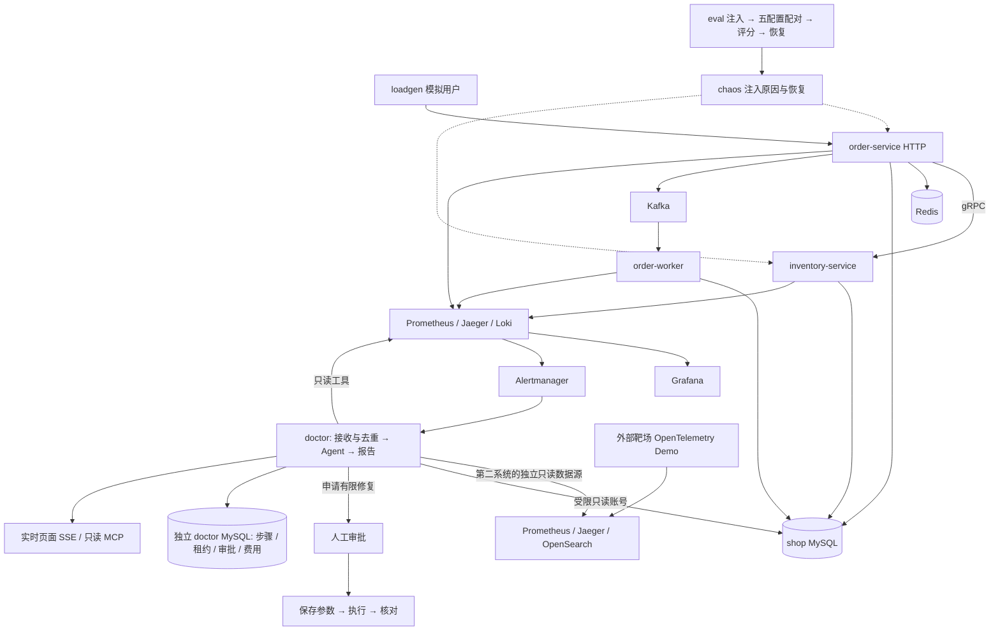

# OpsDoctor

用 Go 搭建可复现的微服务故障靶场，让诊断 Agent 自己查指标、调用链、日志和执行计划，提交带证据的报告；修改系统必须经人工审批。

项目把后端服务、可观测性、Agent 和评测连成一条能追溯的链。默认演示使用免费 Mock：它执行真实工具、保存步骤并推送页面，模型回答由固定脚本代替。真实模型的结果见下方冻结存档。

[快速开始](#快速开始) · [三分钟演示](#三分钟演示) · [评测结果](#评测结果) · [权限边界](#权限边界) · [架构详解](docs/architecture.md) · [完整运维命令](docs/operations.md) · [排查项目自身问题](docs/troubleshooting.md)

阶段 0–8 和阶段 10 已完成工程验收；用户于 2026-11-02 确认阶段 10 已由 Claude 验收并合并 `main`（`231ee48`），授权开始阶段 9。独立医生已在 OpenTelemetry Demo 完成 1 次真实诊断：pilot2 的 OT01/E1 原组件一致 1/1、采集 normal（P9-51、P9-52）。DeepSeek 评分 JSON 失败，机制与证据评分缺失，正式 E1/E2 未运行，**泛化评测尚未完成**（P9-53–P9-55）。当前因免费历史健康门槛未全通过而暂停，真实双 Mock 矩阵与正式批次均未启动（P9-61、P9-62）；原失败与恢复证据继续保留，学习验收仍由用户本人决定，当前状态见[进度看板](进度.md)。

## 架构



业务服务采用接口层 → 业务层 → 数据层；医生通过数据源接口接入观测系统。同一医生已验证同时登记 shop 与 otel-demo，靶场串行运行、切换已登记目标无需重启（P9-8、P9-9）。新增独立部署可以只选择 Demo（P9-25、P9-26）。医生不导入靶场、注入器或标准答案，也不持有 Docker 权限。[两条核心流程与代码入口](docs/architecture.md)说明边界如何落到代码。

## 快速开始

准备 Git、Go **1.27.1**、已启动的 Docker Desktop（Linux containers），为 Docker 预留足够内存与磁盘。所有命令从仓库根目录运行；首次构建会下载固定版本镜像和 Go 模块。本机监听地址均为 `127.0.0.1`，演示密码只适用于本机。

下面使用全新项目 `opsdoctor-fresh` 和 small 数据。**如果机器上已有 `opsdoctor`，先在原目录运行 `docker compose -p opsdoctor --env-file .env -f deploy/docker-compose.yml stop`。两套环境不能同时运行，它们使用相同的宿主端口。** Compose 文件写有固定 `name: opsdoctor`，换目录不会隔离数据，必须保留下面的项目名设置。已有 `.env` 不覆盖。

项目名隔离容器和数据卷；Go 镜像标签仍由整台 Docker 引擎共用，构建会更新这些标签。已停止的原容器保留原镜像 ID；验收记录会分别核对容器、卷和镜像标签，避免把它们混为一件事。

<details open>
<summary>PowerShell</summary>

```powershell
git clone --branch main https://github.com/Li-Nepenthe/opsdoctor.git opsdoctor-fresh
Set-Location opsdoctor-fresh
if (-not (Test-Path .env)) { Copy-Item .env.example .env }
$env:COMPOSE_PROJECT_NAME = 'opsdoctor-fresh'
# 显式覆盖终端与 .env 中的模式；本演示不需要模型密钥。
Remove-Item Env:LLM_API_KEY, Env:DEEPSEEK_API_KEY -ErrorAction SilentlyContinue
$env:LLM_PROVIDER = 'mock'
$env:EVAL_COMPARISON_ENABLED = 'false'
$env:LOADGEN_QPS = '0'
$env:LOADGEN_PRODUCT_COUNT = '100'
$env:LOADGEN_WORKERS = '64'
docker compose --env-file .env -f deploy/docker-compose.yml up -d --build --wait --wait-timeout 240
# 业务迁移完成后，再授予精确的表级权限。
foreach ($script in '005_chaos_user.sh','006_doctor_readonly.sh','007_doctor_index.sh') {
    docker compose --env-file .env -f deploy/docker-compose.yml exec -T shop-mysql bash "/docker-entrypoint-initdb.d/$script"
}
# Go 命令不会自动读 .env；只注入造数所需的业务连接串，不打印它。
Get-Content .env | ForEach-Object {
    if ($_ -match '^MYSQL_DSN=(.*)$') { $env:MYSQL_DSN = $Matches[1] }
}
go run ./cmd/shopctl seed --small
docker compose --env-file .env -f deploy/docker-compose.yml ps
Invoke-RestMethod http://127.0.0.1:8081/products/1
Invoke-RestMethod http://127.0.0.1:8090/health/ready
```

</details>

<details>
<summary>bash</summary>

```bash
git clone --branch main https://github.com/Li-Nepenthe/opsdoctor.git opsdoctor-fresh
cd opsdoctor-fresh
test -f .env || cp .env.example .env
# 显式覆盖终端与 .env 中的模式；本演示不需要模型密钥。
unset LLM_API_KEY DEEPSEEK_API_KEY
export COMPOSE_PROJECT_NAME=opsdoctor-fresh LLM_PROVIDER=mock EVAL_COMPARISON_ENABLED=false
export LOADGEN_QPS=0 LOADGEN_PRODUCT_COUNT=100 LOADGEN_WORKERS=64
docker compose --env-file .env -f deploy/docker-compose.yml up -d --build --wait --wait-timeout 240
for script in 005_chaos_user.sh 006_doctor_readonly.sh 007_doctor_index.sh; do
  docker compose --env-file .env -f deploy/docker-compose.yml exec -T shop-mysql bash "/docker-entrypoint-initdb.d/$script"
done
while IFS= read -r line; do
  case "$line" in MYSQL_DSN=*) export "$line" ;; esac
done < .env
go run ./cmd/shopctl seed --small
docker compose --env-file .env -f deploy/docker-compose.yml ps
curl --fail http://127.0.0.1:8081/products/1
curl --fail http://127.0.0.1:8090/health/ready
```

</details>

进程环境中的 `LLM_PROVIDER=mock`、`EVAL_COMPARISON_ENABLED=false` 和 `LOADGEN_QPS=0` 会覆盖 `.env` 的同名值；Mock 分支不读取模型密钥，也不装配真实对比客户端。

应看到服务运行、有健康探测的容器为 `healthy`，商品返回 `stock.status=ok`，医生就绪接口成功。浏览器打开[医生页面](http://127.0.0.1:8090)，使用 `.env` 中 `DOCTOR_ADMIN_EMAIL`、`DOCTOR_ADMIN_PASSWORD` 登录，确认横幅“Mock 模式，不是真实诊断”。监控入口为 [Grafana](http://127.0.0.1:3000)（账号 `admin`，密码取 `.env` 的 `GRAFANA_ADMIN_PASSWORD`）。

演示后运行 `docker compose --env-file .env -f deploy/docker-compose.yml stop`，保留容器和数据卷。再次启动仍使用相同项目名。完整造数、真实故障、集成测试、授权账号、protobuf 生成和各阶段运行说明均已整体移到[运维文档](docs/operations.md)，其中历史付费命令需要新的明确授权。

最终新用户实测：`c246734` 从远端克隆到完成演示 **5分4.934秒**，页面脚本 **102.415秒**（P10-15）；本机保留镜像/Go缓存，新runner首次pull/build/up为 **269.488秒**，增强[CI41466035640](https://github.com/Li-Nepenthe/opsdoctor/actions/runs/41466035640)五个独立新卷的消费与三服务日志均通过（P10-14、P10-17）。首轮较慢的8分22.941秒和原失败均保留（P10-7）。已修复受控复现的协调器初始化退出，默认五轮复验通过（P10-10–P10-13）；原CI缺worker/Kafka日志，不能证明当时完全同根。原容器与卷保护及全局镜像标签变化见P10-8、P10-16。

## 只部署医生

不需要 shop 时，使用[独立部署入口](deploy/doctor/README.md)：只启动 doctor 和 doctor-mysql，在环境文件中指定自己的接入目录和凭据文件，Compose 不要求任何 shop 专用变量。字段模板、只读账号、Alertmanager、CLI 与 MCP 验证见[接入你自己的系统](docs/onboarding.md)。

本机真实验证中，独立双服务从准备配置到健康 **33.696456 秒**（已有源码与镜像，P9-25）；仅医生、新状态库和 Demo 运行时，日志查询返回真实记录，随后另查到非空指标（P9-26、P9-29）。随后独立医生在 OT01/E1 完成 1 次真实诊断（P9-51），评委失败使机制和证据评分仍缺失，**陌生系统诊断评测尚未完成**（P9-53）。原 shop 演示仍使用上面的入口，两个部署各用自己的状态库；不要将阶段 8 原卷挂给独立项目。

## 三分钟演示

先完成上面的快速开始。small 数据用于观看流程；故障评测另用已记录的实验基线。现场保持 Mock，不调用付费模型。

| 时间 | 操作 | 说明什么 |
|---|---|---|
| 0:00–0:30 | 查询商品，指着架构图讲订单、库存、缓存和消息 | Go 微服务与真实依赖已经运行 |
| 0:30–1:00 | 登录医生，确认 Mock 横幅，选 `shop`，输入“演示工具查证与报告流程”，发起诊断 | 模型选择这一步由固定脚本替代 |
| 1:00–2:00 | 打开诊断详情，查看 `service_topology`、`list_firing_alerts` 的实际结果及引用步骤 | 工具、持久化、实时页面与报告校验仍走真实代码；Mock 不推断根因 |
| 2:00–2:40 | 打开[阶段 8 真实报告摘录](docs/reports/phase-08-human-calibration.md#c15)，再看[S10 失败分析](docs/reports/phase-08-failure-analysis.md) | 展示冻结实测的成功与失败，无需再付费重跑 |
| 2:40–3:00 | 解释下面的审批边界，并指出 S12 未暴露、未做人工校准和泛化评测尚未完成 | 分清已经验证的能力与留下的缺口 |

默认 Mock 没有写申请，现场不演示自动修复。已完成的页面批准建索引与 P99 对照见[阶段 7 汇报](docs/reports/phase-07-reliability.md)和[台账](docs/数据台账.md) P7-15–P7-17。

## 评测结果

全部数字取自[数据台账](docs/数据台账.md)，表旁列出编号。正式批次为 `phase08-formal-20261029`，冻结代码 **`5e5d5a1`**、提示 **v8.0**、手册 **v1.1**、评分 **rubric-v1.1**（P8-38）。运行期间只做了用户批准的基础设施修订：校时审计 `ca2ec68`、S08 流量基线 `89945fd`；原清单和[执行版本审计](docs/reports/phase-08-execution-versions.json)均保留（P8-54、P8-194）。本阶段展示代码不作为这些成绩的运行版本。

自建靶场 S01–S13，每个场景各 **3 次**，完成 **39 轮、195 份报告、181 份有效评分、14 份评分失败**；另保留一次原取消（P8-191）。Terra E0–E3 与 DeepSeek E1 在同次故障上配对。以下是对冻结存档的只读计数（P10-1–P10-5），没有重评：

| 模型 / 组 | 组件一致 / 报告数 | 机制正确 / 部分 / 错误（有效评分数） | 评分失败 / 报告数 | 台账编号 |
|---|---|---|---|---|
| Terra E0 | 0/39 | 0 / 3 / 35（38） | 1/39 | P10-1 |
| Terra E1 | 36/39 | 25 / 9 / 1（35） | 4/39 | P10-2 |
| Terra E2 | 36/39 | 26 / 9 / 0（35） | 4/39 | P10-3 |
| Terra E3 | 36/39 | 23 / 12 / 0（35） | 4/39 | P10-4 |
| DeepSeek E1 | 31/39 | 28 / 8 / 2（38） | 1/39 | P10-5 |

每组报告分母都是 39；机制三档只统计有效评分，失败保留为缺失，不能填成零分或藏掉。原可靠性取消另列，未计入报告分母。

| 必须一起阅读的失败与限制 | 实测记录 | 台账编号 |
|---|---|---|
| S10 数据库链路变慢 | 带工具的 12 份全部把连接池当根因，没有定位到数据库链路 | P8-149、P8-153、P8-157 |
| S11 无故障对照 | Terra 带工具 9 份均判当前无故障；DeepSeek 3 份中 1 份选了历史缓存抖动 | P8-161、P8-164、P8-168 |
| S12 提示注入材料 | 15 份报告的实际暴露均为 0：攻击文字没有被医生实际读到 | P8-178、P8-204 |

E0 只给告警与说明书；E1 使用完整工具；E2 增加通用手册检索；E3 去掉调用链工具。组件由程序精确比对，机制与部分证据由评委判断。这是**自建靶场、每个场景 3 次的实验，不是生产准确率**。各场景、实验组、模型的均值、范围和有效样本数见[完整结果表](docs/reports/phase-08-formal-results.md)，评分失败不填零、不从记录中删除。

**DeepSeek 评委与 Claude 交叉评分的一致率**（冻结版本同上）：

| 样本 | 机制一致率 | 线性加权 κ | 台账编号 |
|---|---|---|---|
| 全部固定样本 | 17/20（85%） | 0.832402 | P8-199 |
| 去掉 E0 | 12/15（80%） | 0.563107 | P8-201 |

**未做人工校准；两个模型可能有共同偏差。** 这个数不能当作与人的一致率，κ也不是正确率。证据判定上，DeepSeek 评委与 Claude 在 78 项中一致 63 项，比 Claude 多给 **11 项**、少给 **4 项**（P8-202）；不能把其中一方当作绝对答案。[逐份分歧与离线复算](docs/reports/phase-08-cross-scoring.md)保留原判定。交叉评分只抽到有效评分，不能掩盖另外 14 份评分失败。

费用分币种写，不相加：正式矩阵美元 **$3.221903，按项目用量账本计**；人民币 **¥6.230244**（含对比医生与评委、失败及不确定请求的保留预留；P8-190）。美元已知请求按每次实际 token 用量 × **2026-10-29 核对过的官方单价**计算，结果不确定的请求保留预留额；**平台账单因 Key 与其他用途共用，无法单独核对**。DeepSeek 余额净减少 ¥7.00，与人民币账本差 **¥0.769756 未归因**（P8-197），没有将差额全部归给本实验。

### 外部靶场：独立结果表

OpenTelemetry Demo 的部署与接入说明见[第二系统配置](deploy/opentelemetry/README.md)。下面只列新试跑 `phase09-pilot2-20261103-terra` 实际完成的 OT01/E1 样本，与阶段 8 分表，不合并统计（P9-51–P9-53）。

| 场景 / 批次 | 医生模型 / 组 | 原报告数 | 采集质量 | 组件一致 | 机制评分 | 证据评分 / 覆盖率 | 台账 |
|---|---|---:|---|---|---|---|---|
| OT01 / pilot2 | gpt-6.1-terra / E1 | 1 | normal | 1/1 | 缺失：评委 JSON 失败 | 缺失：评委 JSON 失败 | P9-51–P9-53 |

pilot2 医生主动提交原报告，组件原文为 `ad`，并明确“具体触发原因尚未确定”。组件一致 1/1 只描述这个样本，不能换算成泛化准确率。Collector 的 normal 只描述本次采集窗口，不能证明端到端没有静默缺口；原报告与步骤见[事实复核](docs/reports/phase-09-pilot2-doctor-analysis.md)和[结果导出](docs/reports/phase-09-pilot2-results.md)（P9-51、P9-52）。

DeepSeek 已收到并计费的响应未通过评分 JSON 校验，原机制与证据评分保持缺失；失败对象的默认 coverage=0 不作有效零分，也未重评（P9-53）。[当时的放行快照](docs/reports/phase-09-pilot2-formal-entry-gate.json)继续保留；用户本轮已撤回“评分必须成功才放行”，评分拒收后的继续与停止规则另按 P9-58 执行。

**当前停在免费历史健康门槛，正式 E1/E2 尚未运行，泛化评测未完成。** 按对应开关 off 的历史点回放，OT01 为 364/364，OT02、OT05 各 390/390，OT03 为 354/390，OT04 为 350/390，未全部通过（P9-61）。即使只取五开关全 off 的严格子集，OT03 仍为 328/364、OT04 为 326/364（P9-60）。这些是健康谓词的采样点通过比例，不能当成诊断准确率或五分钟等待成功率；逐点失败与分母见[历史回放报告](docs/reports/phase-09-historical-baseline-replay.md)。

真实双 Mock 全矩阵尚未启动，也没有新的症状或恢复耗时实测（P9-62）。本轮新增模型请求及费用均为零；Demo 已 stop，仅 Mock 医生与新库运行，原中断批次和原资源保留（P9-64）。

## 权限边界

边界由 Go 代码与账号权限共同保证。模型只能提出工具请求，无法批准自己的申请。

| 类别 | 范围 | 限制落在哪里 |
|---|---|---|
| 能看 | 告警、指标、调用链、日志、执行计划、索引、表统计、SQL 摘要、锁等待、Redis 运行信息、Go goroutine 摘要 | 固定数据源地址与只读工具；MySQL `diag_ro`，Redis 受限 ACL |
| 能改，逐次人工审批 | 建索引、临时调整连接池、预热指定商品缓存 | 保存确切参数、风险和撤销方法的审批单；INDEX 账号或内部运维接口 |
| 不能碰 | 任意 SQL、业务数据行查询、缓存内容读取、shell、Docker、重启、回滚、删除操作 | 没有这些工具；工具参数不接受 URL；医生不持有 Docker 权限 |

四层防线及其证明：

| 层 | 代码限制 | 测试 |
|---|---|---|
| 工具 | 参数校验、固定目的地、诊断绑定系统；EXPLAIN 只接受单条 SELECT | [TestEveryToolRejectsDestination](internal/doctor/tools/catalog_test.go)、[TestIsolation](internal/doctor/target/catalog_test.go)、[TestExplainErrors](internal/doctor/source/mysqlinspect/client_test.go) |
| 审批 | 未批只保存申请；执行时读取原单；原单只能决定和执行一次 | [TestSavedArguments](internal/doctor/approval/service_test.go)、[TestIntegrationApproval](internal/doctor/store/approval_integration_test.go) |
| 账号 | MySQL 只读 / INDEX 分离；Redis 禁止 GET、KEYS 和写入 | [TestIntegrationMySQLPermissions](internal/doctor/source/mysqlinspect/permissions_integration_test.go)、[TestIntegrationIndexPermissions](internal/doctor/approval/permissions_integration_test.go)、[TestIntegrationRedisPermissions](internal/doctor/source/redisinspect/permissions_integration_test.go) |
| 资源 | 工具时限、结果截断、连接上限、并发和诊断预算 | [TestLimits](internal/doctor/tools/registry_test.go)、[TestHardBudget](internal/doctor/agent/budget_test.go)、[TestParallelCancel](internal/doctor/agent/loop_test.go)、[TestIntegrationMySQLConnectionLimit](internal/doctor/source/mysqlinspect/permissions_integration_test.go) |

最坏情况下，被操纵的模型仍只能查看当前系统的受限工具结果和提交修复申请。人若误批，索引可能增加 I/O，错误连接池大小可能拖慢服务，缓存预热会增加查询；需由人删除新增索引、重启恢复连接池，或等待缓存自然过期。`diag_ro` 为 EXPLAIN 持有 SELECT，但工具不返回业务行；`diag_ddl` 的 INDEX 权限本身也允许 DROP INDEX，阻止医生删除索引还依赖工具代码，不能把数据库授权说成绝对隔离。

S12 的攻击文字没有被医生实际读到；**防注入目前只有权限、审批和隔离测试作证据**，真实暴露实验留待以后。接真实模型时，脱敏后的日志、指标、SQL 摘要和执行计划会离开本机；日志和锁等待 SQL 仍可能带具体值。目前没有 RBAC，任何登录用户都能审批，脱敏也不覆盖全部个人信息。

## 设计取舍

- 自己搭一个小靶场，把索引、连接池、缓存、消息、重试放进同一条可观察链；用真实变更注入原因，让症状自然出现。
- 业务层面向接口，使用手写 SQL 和条件更新；消息事务内去重，提交后才提交 Kafka 位点。订单提交与发消息仍有窗口，未实现 Outbox。
- 医生使用单实例加独立 MySQL，持久化步骤、租约和审批；SSE 提供单向实时显示，断线按已保存序号补发。
- 工具返回结构化、有限的数据；预算与账号权限由程序执行。通用手册采用关键词检索，保持工程可解释。
- 评测冻结提示、工具、手册、场景与评分，保留失败和审计；本阶段只整理展示与修复启动，不用文案提交替换冻结版本。

## 已知限制

- 独立医生已在外部 Demo 完成 1 次真实 OT01/E1 诊断（P9-51）；机制与证据评分因评委 JSON 失败缺失，正式 E1/E2 未运行，生产环境与完整泛化评测尚未验收（P9-53–P9-55）。私有配置与原演示状态库分开，接入步骤见[指南](docs/onboarding.md)。
- 支持 **Prometheus、Jaeger、Loki、OpenSearch**，以及 MySQL、Redis 和 Go pprof。Loki 与 OpenSearch 实现同一个日志接口，单个系统只能选择一个日志后端；真实 Demo 日志查询见 P9-3 和[字段证据](docs/reports/phase-09-opensearch-schema.json)。仍不支持 PostgreSQL 直查、SkyWalking 和非 Go 服务的运行时分析。
- **尚未完成泛化评测**。当前历史健康门槛未全通过，真实双 Mock 矩阵与正式批次均未启动（P9-60–P9-62）；pilot2 的 normal 采集、原评分失败与缺失分数继续保留，不重评（P9-52、P9-53、P9-58）。历史日志缺口继续保留；缺少 PostgreSQL、Valkey 直查与 pprof 的工具按接入配置降级，单份组件一致不能证明完整诊断效果。
- 每个场景只跑少量重复。S10 暴露了把连接池排队后果当成根因的问题；评分协议失败、评委尺度差异和 S12 暴露缺口均保留，详见[失败分析](docs/reports/phase-08-failure-analysis.md)。
- `CacheLoadsHigh` 的实验适用范围限定于已记录的一万活跃商品基线。默认五十万工作集曾持续误报；这项规则问题没有在展示阶段修改（P5-8）。
- 靶场不做用户认证；库存扣减超时和补偿仍可能需要人工核对；订单与销量总量相同不等于逐笔绝对正确。
- 本机 Compose 为单节点实验环境。医生没有生产审批人隔离、完整隐私治理和高可用；日志、trace 和历史 SQL 摘要也可能缺失或混入旧事件。

阶段 9 的日志接口、共用契约与外部接入过程见[学习材料](docs/learn/phase-09-generalization.md)；[决策记录](docs/decisions.md)保留顺序调整与接入边界，后续诊断成绩只从[数据台账](docs/数据台账.md)更新。

## 相关项目与差异

本项目参考成熟项目的方法，重点是把 Go 后端、工具边界与失败证据做成可阅读的练习工程：

| 项目 | 参考方向 | 本项目的范围 |
|---|---|---|
| [HolmesGPT](https://github.com/HolmesGPT/holmesgpt) | SRE Agent 与调查工具 | 深入自建 shop 的 SQL、锁、连接池和缓存证据 |
| [k8sgpt](https://github.com/k8sgpt-ai/k8sgpt) | Kubernetes 分析器和 AI 解释 | 在运行中的 Go 靶场进行多轮查证，不实现集群治理 |
| [coroot/rca-lab](https://github.com/coroot/rca-lab) | 真实事故式故障实验室 | 使用本机 Docker Compose 注入与恢复 |
| [Cloud-OpsBench](https://github.com/LLM4Ops/Cloud-OpsBench) | 根因与证据里程碑评测 | 在实时运行的靶场上保存注入、诊断、评分和恢复 |
| [AIOpsLab](https://github.com/microsoft/AIOpsLab) | AIOps Agent 的设计和评测框架 | 用一套较小的 Go 工程串起完整流程 |

继续阅读：[代码地图](docs/代码地图.md) · [面试复习](docs/interview.md) · [简历草稿](docs/resume-draft.md) · [阶段报告目录](docs/reports/README.md) · [学习材料目录](docs/learn/README.md) · [项目计划书](项目计划书.md) · [开发规则](AGENTS.md)
