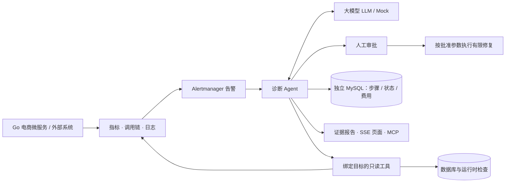

# OpsDoctor：大模型驱动的 Go 故障诊断 Agent

接收微服务告警，通过指标、调用链、日志和 SQL 执行计划逐步查证，输出可追溯的根因报告；修改系统前必须经过人工审批。

项目包含可复现的电商故障靶场、可独立部署的诊断服务，以及故障注入和对照评测工具。

[快速开始](#快速开始) · [架构详解](docs/architecture.md) · [实验结果与限制](docs/demo-and-results.md#评测结果) · [接入自己的系统](docs/onboarding.md) · [作者与-ai-协作](#作者与-ai-协作)

## 架构



电商服务使用 Go、Gin、gRPC、MySQL、Redis 和 Kafka。诊断服务通过数据源接口取证，与业务代码隔离；支持 Prometheus、Jaeger、Loki / OpenSearch，可单独部署。工具注册表对 Agent、CLI 和 MCP 复用同一套参数校验与访问边界。

诊断步骤持久化后可以接续中断任务；写操作只执行审批单中保存的参数，执行前核对实际状态。恢复机制已通过五类进程中断测试，测试条件见[恢复验证](docs/reports/phase-07-reliability.md)。

## 三个核心结果

| 关注点 | 实测结果 | 如何验证 |
|---|---|---|
| 诊断质量 | 完整工具组**故障组件定位 36/39**；根因机制正确 **25/35** | 自建靶场覆盖故障与健康对照等 13 类场景，每类 3 轮；[逐份结果](docs/reports/phase-08-formal-results.md) |
| 诊断效率与费用 | 同组平均 **20.4 秒**；诊断模型账本均费约 **$0.025** | 对全部 39 份报告离线复算，耗时不含故障注入、恢复与评分，费用不含评委；[脚本](docs/reports/phase-10-portfolio-metrics.py) · [结果](docs/reports/phase-10-portfolio-metrics.json) |
| 热点查询优化 | singleflight 将回源从 **6,295 次降至 400 次，减少 93.6%** | 开启/关闭两组各 6,400 次商品查询，只改变合并配置；[测量条件与来源](docs/resume-draft.md#数字与口径) |

根因机制由模型评委评分：完整工具组有 35 份有效评分、4 份评分失败，失败保留为缺失。组件定位由程序精确比对，两项指标含义不同。整个对照实验比较完整工具、RAG 排障手册、去掉调用链、换模型和无工具配置，共保存 195 份报告。

另外接入 OpenTelemetry Demo，在独立诊断部署上完成五个外部场景的工具组和手册组对照；两组组件定位均为 3/5，说明自建靶场成绩不能直接外推。失败案例、评分分歧与费用口径见[完整验证记录](docs/demo-and-results.md#评测结果)。

## 快速开始

准备 Git、Go **1.27.1** 和已启动的 Docker Desktop（Linux containers）。下面命令从新克隆目录初始化 small 数据并启动服务，默认 **Mock 模式，无需模型密钥，不产生模型费用**。Mock 会调用真实工具、保存步骤并推送页面，模型回答由脚本替代。

同一台机器上的两套演示使用相同宿主端口，已有实例需先停止；命令保留独立项目名，不覆盖已有 `.env`。首次下载镜像耗时取决于网络。环境冲突与完整解释见[启动说明](docs/demo-and-results.md#快速开始)。

<details>
<summary>PowerShell：首次初始化并启动</summary>

```powershell
git clone --branch main https://github.com/Li-Nepenthe/opsdoctor.git opsdoctor-fresh
Set-Location opsdoctor-fresh
if (-not (Test-Path .env)) { Copy-Item .env.example .env }
$env:COMPOSE_PROJECT_NAME = 'opsdoctor-fresh'
# 显式覆盖终端与 .env 中的模式；本演示不需要模型密钥。
Remove-Item Env:LLM_API_KEY, Env:DEEPSEEK_API_KEY -ErrorAction SilentlyContinue
$env:LLM_PROVIDER = 'mock'
$env:EVAL_COMPARISON_ENABLED = 'false'
$env:LOADGEN_QPS = '0'
$env:LOADGEN_PRODUCT_COUNT = '100'
$env:LOADGEN_WORKERS = '64'
docker compose --env-file .env -f deploy/docker-compose.yml up -d --build --wait --wait-timeout 240
# 业务迁移完成后，再授予精确的表级权限。
foreach ($script in '005_chaos_user.sh','006_doctor_readonly.sh','007_doctor_index.sh') {
    docker compose --env-file .env -f deploy/docker-compose.yml exec -T shop-mysql bash "/docker-entrypoint-initdb.d/$script"
}
# Go 命令不会自动读 .env；只注入造数所需的业务连接串，不打印它。
Get-Content .env | ForEach-Object {
    if ($_ -match '^MYSQL_DSN=(.*)$') { $env:MYSQL_DSN = $Matches[1] }
}
go run ./cmd/shopctl seed --small
docker compose --env-file .env -f deploy/docker-compose.yml ps
Invoke-RestMethod http://127.0.0.1:8081/products/1
Invoke-RestMethod http://127.0.0.1:8090/health/ready
```

</details>

<details>
<summary>bash：首次初始化并启动</summary>

```bash
git clone --branch main https://github.com/Li-Nepenthe/opsdoctor.git opsdoctor-fresh
cd opsdoctor-fresh
test -f .env || cp .env.example .env
# 显式覆盖终端与 .env 中的模式；本演示不需要模型密钥。
unset LLM_API_KEY DEEPSEEK_API_KEY
export COMPOSE_PROJECT_NAME=opsdoctor-fresh LLM_PROVIDER=mock EVAL_COMPARISON_ENABLED=false
export LOADGEN_QPS=0 LOADGEN_PRODUCT_COUNT=100 LOADGEN_WORKERS=64
docker compose --env-file .env -f deploy/docker-compose.yml up -d --build --wait --wait-timeout 240
for script in 005_chaos_user.sh 006_doctor_readonly.sh 007_doctor_index.sh; do
  docker compose --env-file .env -f deploy/docker-compose.yml exec -T shop-mysql bash "/docker-entrypoint-initdb.d/$script"
done
while IFS= read -r line; do
  case "$line" in MYSQL_DSN=*) export "$line" ;; esac
done < .env
go run ./cmd/shopctl seed --small
docker compose --env-file .env -f deploy/docker-compose.yml ps
curl --fail http://127.0.0.1:8081/products/1
curl --fail http://127.0.0.1:8090/health/ready
```

</details>

打开[诊断页面](http://127.0.0.1:8090)，用 `.env` 中的 `DOCTOR_ADMIN_EMAIL`、`DOCTOR_ADMIN_PASSWORD` 登录，确认 Mock 横幅；监控入口为 [Grafana](http://127.0.0.1:3000)。按[三分钟演示](docs/demo-and-results.md#三分钟演示)查看工具调用、证据与报告。

已有环境可用同一 Compose 命令再次启动；结束后运行 `docker compose --env-file .env -f deploy/docker-compose.yml stop`，保留数据。只接入自己的系统时，使用[仅诊断服务与状态库的部署](deploy/doctor/README.md)。

## 作者与 AI 协作

项目由李健维护，作者主导需求拆分、系统架构、技术选型和功能边界的取舍，包括业务与诊断服务解耦、工具权限、审批执行及评测方案。关键实现通过持续的代码复盘与实验核对，相关依据保留在[设计记录](docs/decisions.md)和[数据台账](docs/数据台账.md)中。

开发过程中使用 Claude Code / Codex 协作，辅助通用代码实现、重复性工作、测试和文档整理。原始实验、失败分析及协作过程均保留记录，便于追溯。

## 继续阅读

| 想了解什么 | 入口 |
|---|---|
| 关键实现、依赖边界和设计取舍 | [架构](docs/architecture.md) · [代码地图](docs/代码地图.md) · [设计记录](docs/decisions.md) · [成熟库评估](docs/learn/library-evaluation.md) |
| 启动、运维与接入 | [完整命令](docs/operations.md) · [接入指南](docs/onboarding.md) · [MCP](docs/mcp.md) · [常见问题](docs/troubleshooting.md) |
| 实验数字、失败与权限边界 | [演示与验证记录](docs/demo-and-results.md) · [数据台账](docs/数据台账.md) · [简历指标口径](docs/resume-draft.md) |
| 开发过程和学习材料 | [文档目录](docs/README.md) · [项目计划书](docs/项目计划书.md) · [进度](docs/进度.md) · [学习材料](docs/learn/README.md) |
