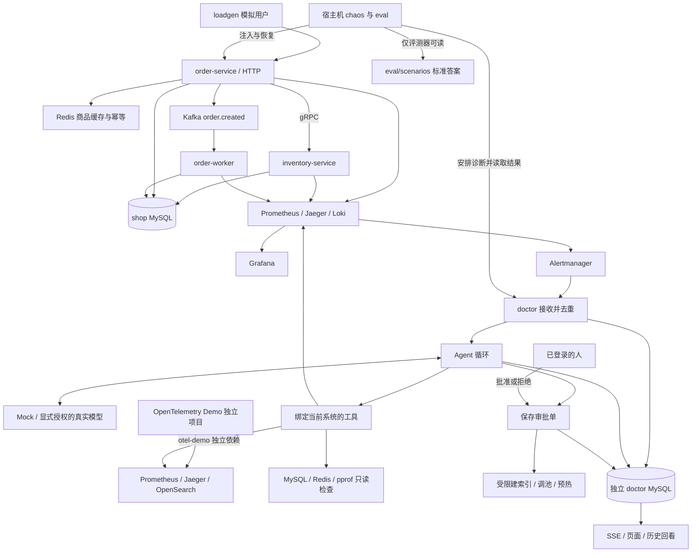
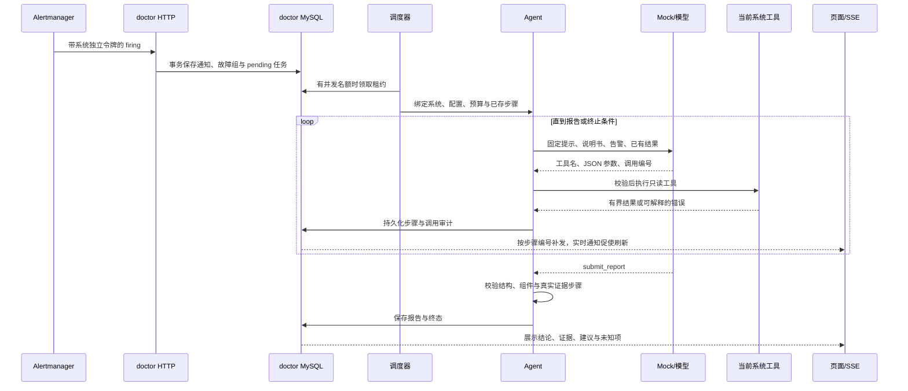

# OpsDoctor 架构说明

OpsDoctor 把三件事放在同一个仓库：运行中的电商靶场、受权限约束的诊断医生、知道标准答案的故障注入与评测器。靶场产生真实症状，医生只能从观测数据取证，评测器独立比较结果。先看 [展示入口](../README.md)，运行命令见 [操作手册](operations.md)，找代码时从 [代码地图](代码地图.md) 进入。

本文描述已经实现的系统。阶段 10 已按用户确认合并 `main`（231ee48），阶段 9 于 2026-11-02 恢复实施。当前医生可同时登记 shop 和 OpenTelemetry Demo，日志有 Loki 与 OpenSearch 两个实现；OpenSearch 已查询真实 Demo 日志（台账 P9-3）。**尚未完成泛化评测**：采集修复已完成固定窗口验证（P9-14、P9-15），等待 Claude 审核，通过后才开始付费诊断。

## 总体结构

图里的箭头表示数据流或调用，不表示跨越所有权限。Toxiproxy 位于订单到库存、库存到 MySQL、订单到 Redis 的链路中；它由宿主机注入器控制，医生没有这项权限。实际监听与映射以 [shop Compose](../deploy/docker-compose.yml)和[Demo 部署配置](../deploy/opentelemetry/README.md)为准，宿主机端口只绑定回环地址。两套靶场一次只运行一套。

阶段 9 使用专用医生容器 `opsdoctor-phase09-doctor`，同一次启动加载 shop 与 otel-demo 两份接入配置。原 doctor 容器保留并停止，避免两个调度器同时领任务；专用医生连接原 doctor-mysql，继续保留 `opsdoctor_doctor-mysql-data` 中的历史数据。第二系统有独立的数据源与工具集，切换运行中的靶场不需要重启医生。[已登记目标证据](reports/phase-09-targets.json)与台账 P9-8 证明接入菜单已装配，不代表两个靶场同时运行。otel-demo 的 PostgreSQL、Valkey 直查与 pprof 没有接入，相应工具不注册。

## 代码怎样分工

| 位置 | 解决的问题 | 阅读入口 |
|---|---|---|
| `cmd/` | 每个程序的薄入口，把退出错误交给操作系统 | [程序说明](../cmd/README.md) |
| `internal/platform/` | 配置、日志、HTTP/gRPC、迁移、连接池、观测与停机等通用能力 | [基础设施说明](../internal/platform/README.md) |
| `internal/shop/` | 商品、库存、订单、销量，以及服务组装 | [靶场说明](../internal/shop/README.md) |
| `internal/doctor/` | 数据源、工具、模型、循环、调度、审批、页面、MCP 与持久化 | [医生说明](../internal/doctor/README.md) |
| `internal/chaos/` | 用真实结构、配置、网络和流量变化注入故障，并恢复基线 | [注入器说明](../internal/chaos/README.md) |
| `internal/eval/` | 冻结输入、配对运行、评分、费用与版本审计、结果导出 | [评测器说明](../internal/eval/README.md) |
| `tools/` | 开发时检查注释、依赖与崩溃恢复 | [工具说明](../tools/README.md) |

业务包按接口、业务和数据访问分层。以库存为例，[gRPC 适配](../internal/shop/inventory/grpc_server.go) 把 protobuf 请求变为领域参数，[业务层](../internal/shop/inventory/service.go) 检查规则，[仓储](../internal/shop/inventory/repository.go) 执行 SQL。业务层定义自己需要的接口，测试可以用假实现替换仓储。Go 按方法集合满足接口，不需要 Java 的 `implements` 声明。

医生不得导入 shop、chaos、eval 的业务实现。双方通过明确的 HTTP、gRPC 和数据库检查协议交互，[archcheck](../tools/archcheck/main.go) 会检查这条边界。医生容器不挂载标准答案，也不持有 Docker socket。Alloy 采集 Docker 日志所需的挂载属于采集器，不能因此说医生有 Docker 权限。

## 靶场的请求、缓存和消息

商品详情先查 Redis，未命中再读 MySQL 并填回缓存，这叫 Cache Aside。空值缓存减少不存在商品的重复查询；TTL 加随机抖动把过期时间打散；singleflight 合并同一进程中同一商品的并发回源。库存单独走 gRPC，库存不可用时商品信息仍返回，并明确标注库存不可用。实现见 [商品服务](../internal/shop/product/service.go) 和 [缓存](../internal/shop/product/cache.go)。

下单先获取 Redis 幂等占位，再查价格、扣库存、写订单并发布消息。库存扣减用带余量条件的 UPDATE，在数据库行锁内完成判断与修改，防止并发超卖。写订单失败时尝试归还库存；结果不确定时保留幂等记录，返回 `REQUEST_OUTCOME_UNKNOWN`，供人核对。实现见 [下单流程](../internal/shop/order/service.go)、[幂等状态](../internal/shop/order/idempotency.go) 和 [库存 SQL](../internal/shop/inventory/repository.go)。

order-worker 消费消息后，在同一事务中插入 `processed_events` 并累加 `product_sales`，事务成功后才提交 Kafka 位点。崩溃可能使消息再次出现，已处理事件表负责消除重复副作用。数据库提交与 Kafka 发布之间仍有一致性窗口：没有实现 Outbox，不能保证订单与消息绝对一致。`shopctl check` 核对总量，也不能单独证明逐商品无误。见 [销量事务](../internal/shop/sales/repository.go) 和 [消费者](../internal/shop/app/orderworker/app.go)。

## 观测数据怎样到医生

指标由 Prometheus 定时采集；Jaeger 接收 OpenTelemetry 的调用链；slog 输出的 JSON 日志由 Alloy 收集到 Loki。HTTP、gRPC、SQL、Redis 和消息处理围绕请求建立 span；Kafka 的上下文通过消息头手动注入与提取。日志携带 trace ID，方便将不同服务的同一请求串起来。见 [观测基础设施](../internal/platform/telemetry/doc.go)、[Kafka 传播](../internal/platform/telemetry/kafka.go)。

Alloy 按 Docker 的 Compose 项目标签发现容器，随后只保留配置允许的 Go 服务。阶段 10 发现这里原先写死 `opsdoctor`，独立项目会漏采自己的日志；`c246734` 改为由 [Compose](../deploy/docker-compose.yml) 向 [采集配置](../deploy/alloy/config.alloy) 传入实际 `COMPOSE_PROJECT_NAME`。最终新克隆已查到同一订单跨三服务的日志，配置验证和实际采集均通过（台账 P10-15、P10-17；[日志证据](reports/phase-10-log-isolation.json)）。

告警描述症状，例如延迟、错误或积压，不在告警名里提前给出“缺索引”等答案。实际规则见 [Prometheus 规则说明](../deploy/prometheus/rules/README.md)。监控接口健康只说明接线的一部分；还要检查 exporter 是否能登录中间件，以及真实 trace 和日志能否查到。阶段 3 曾用这类端到端检查发现 gRPC DNS TXT 查询等待，见 [阶段 3 汇报](reports/phase-03-observability.md) 和台账 P3-18 至 P3-26。

医生的数据源接口把“查什么”和“后端怎样表达”分开。[source](../internal/doctor/source/source.go) 定义统一类型，工具只依赖这些接口，具体适配器处理 Prometheus、Jaeger、Loki、OpenSearch、MySQL、Redis 与 pprof 的格式。

[Loki](../internal/doctor/source/loki/client.go)与[OpenSearch](../internal/doctor/source/opensearch/client.go)实现同一个 `LogSource`。工具仍传服务、级别、关键词、trace、时间和数量条件，不传后端地址、索引或完整查询语言。接入层按系统配置选择实现，同时填写 Loki 和 OpenSearch 会在启动时被拒绝。

| 条件或边界 | Loki | OpenSearch |
|---|---|---|
| 查询表达 | 转义字符串后生成固定 LogQL | `json.Marshal` 编码固定查询 DSL，关键词只作为 JSON 值 |
| 服务、级别、trace | 服务标签与 JSON 字段筛选 | 配置字段上的 term 精确匹配 |
| 关键词、时间、顺序与上限 | 文本筛选，query_range 参数限定时间、倒序和数量 | match_phrase、range、sort 与 size |
| 访问范围 | 固定 Loki 根地址的查询入口 | 固定根地址、指定索引的 `_search`，不跟随重定向 |
| 返回结构 | 日志流转为统一条目 | hits 与 `_source` 转为同一条目，兼容点键与 keyword 子字段 |

OpenSearch 直接使用标准库 `net/http`，没有引入产品客户端库。字段由[接入配置](../deploy/doctor/targets/otel-demo.yaml)提供，实际索引与映射保存在[字段证据](reports/phase-09-opensearch-schema.json)。[共用契约测试](../internal/doctor/source/log_contract_test.go)的同一张行为表分别运行两个实现，覆盖服务、级别、关键词、特殊字符、trace、时间、上限、空结果、组合条件与取消，10 项 × 2 个实现全部通过（P9-6；[检查记录](reports/phase-09-checks.json)）。产品测试另检查分片失败、字段缺失、凭据与响应边界；真实集成读取见台账 P9-3。

上述承诺不等于任意文本的检索语义完全相同：Loki 子串筛选与 OpenSearch 分词短语匹配仍受各自产品语义影响。本次 Demo 禁用了 OpenSearch 安全插件，未验证生产账号授权；启用安全插件时应配置只读账号。仍不支持 PostgreSQL 直查、SkyWalking 和非 Go 服务的运行时分析。

Demo 的 Collector 经 OTLP 接收日志并写入 OpenSearch，曾因 `attributes.http` 的 text/object 映射冲突拒收部分记录。固定版本的采集配置将日志属性键的 `http.` 前缀改成 `http_`，保留旧索引和原 scope 处理，不改变医生的五个映射字段。修复前报告计数、最小上游差异与固定十分钟观察见[专项报告](reports/phase-09-logging-fix.md)及台账 P9-13–P9-15。窗口内未报告最终日志丢弃，17/17 个预期 OTLP 源有日志；image-provider 官方未启用日志，Jaeger traces 仍有重试。结论限于本窗口，不能证明端到端无静默丢失；Claude 审核通过前不开始付费诊断。

## 核心流程一：告警 → 诊断 → 报告

1. [HTTP 路由](../internal/doctor/httpapi/router.go) 验证目标系统的令牌，[告警接收器](../internal/doctor/alerts/service.go) 检查通知，再由 [store](../internal/doctor/store/alerts.go) 在事务里归并。报告生成后，故障组后续通知仍加入同一任务；整组恢复后再经过观察期，避免为同一事故反复诊断。观察期也可能合并真正的新事故，用户可以手动诊断。
2. [调度器](../internal/doctor/run/scheduler.go) 按总名额和每系统名额安排任务。数据库租约证明当前执行权，续约失败会在租约失效前停止本地执行。等待审批时释放全局名额，但仍占住该系统的名额。
3. [Agent](../internal/doctor/agent/loop.go) 调用模型，由 [calls](../internal/doctor/agent/calls.go) 并行查询。普通工具失败变为工具结果，便于模型纠正；审计保存失败则停止，防止出现做过却无记录的步骤。最终报告必须引用当前诊断里保存的真实步骤。
4. [写操作申请](../internal/doctor/approval/service.go) 先生成审批单，保存具体参数、语句预览、理由、证据、风险和撤销方法。登录用户批准后，执行器只读原单参数。恢复时核对索引、实例修订号或缓存状态，不能把超时当作没执行。
5. [SSE](../internal/doctor/httpapi/stream.go) 是服务器到页面的单向事件流。数据库是事实来源，`Last-Event-ID` 对应持久化步骤号；慢客户端断线后可以补发。Cookie 登录的修改接口另做同源和 CSRF 检查；动态内容以文本显示。

`context` 将取消通知沿调度器、Agent、模型 HTTP 请求、数据源查询往下传。进程重启后从已保存的请求与结果重建对话；已有只读结果原样回放，缺少时才补查。租约、预算、模型名和已花费用都不能随重启归零。实现分别见 [回放](../internal/doctor/agent/replay.go)、[执行权](../internal/doctor/store/leases.go)、[回复恢复](../internal/doctor/store/model_recovery.go)。

## 权限与资源边界

| 边界 | 代码怎样执行 | 证明入口 |
|---|---|---|
| 工具与系统 | 固定地址、有限参数和注册表；工具实例预先绑定系统；无任意 SQL、URL 或命令工具 | [工具校验测试](../internal/doctor/tools/catalog_test.go)、[目标隔离测试](../internal/doctor/target/catalog_test.go)、[SELECT 校验测试](../internal/doctor/source/select_test.go) |
| 人工审批 | 写操作先存单，条件更新只允许一次决定；实际执行只用原单 | [审批单元测试](../internal/doctor/approval/service_test.go)、[数据库争抢测试](../internal/doctor/store/approval_integration_test.go) |
| 独立账号 | 只读 SQL/Redis、独立 INDEX 账号、固定运维接口令牌 | [MySQL 权限](../internal/doctor/source/mysqlinspect/permissions_integration_test.go)、[Redis ACL](../internal/doctor/source/redisinspect/permissions_integration_test.go)、[DDL 权限](../internal/doctor/approval/permissions_integration_test.go) |
| 资源预算 | 查询超时、结果截断、连接数、并发数、轮数、token、费用和活动时长共同限制 | [注册表测试](../internal/doctor/tools/registry_test.go)、[循环预算测试](../internal/doctor/agent/budget_test.go)、[调度测试](../internal/doctor/run/scheduler_test.go) |

MySQL 只读账号因 EXPLAIN 需要而有业务表 SELECT 权限，工具不会返回业务数据行；这两件事必须区分。INDEX 权限本身也允许删除索引，账号无法按医生生成的前缀细分授权；代码只提供受限的创建，撤销由人完成。

模型完全受诱导时，仍只能查看当前系统允许的证据、消耗有上限的资源并申请有限修改。误批建索引会消耗数据库资源，误批缩小连接池可能让服务变慢；“可撤销”不等于没有业务影响。真实模型会接收脱敏后的说明书、告警和工具结果，日志与 SQL 仍可能包含业务值。当前没有角色隔离，任何登录用户都可审批，脱敏也不是完整个人信息脱敏；生产使用还需要补齐这些能力。

MCP 通过 `/mcp/{target}` 提供同一批只读工具，独立令牌绑定一个系统；既不开放写工具，也不开放审批。审计开始记录失败时不访问后端。见 [MCP 实现](../internal/doctor/mcpserver/doc.go) 和 [接入说明](mcp.md)。

## 持久化与费用

shop 和 doctor 使用不同 MySQL 实例。前者保存业务数据，后者保存用户、告警、任务、步骤、审批、MCP 审计、模型尝试、预算和评测结果。doctor 能写自己的库，不意味着能任意写 shop。表结构沿 [医生迁移](../internal/doctor/store/migrations) 和 [靶场迁移](../internal/shop/migrations) 阅读。

模型请求前在持久化事务中预留费用和批次 token，确认用量后结算，结果未知时保留预留；单次调查、全局账户和批次预算共同约束花费。供应商、模型、账户、币种和单价随尝试保存，重启不清除累计。费用算法见 [模型客户端](../internal/doctor/llm/doc.go) 与 [账本](../internal/doctor/store/budget.go)。

美元按项目用量账本计：每次请求实际 token 用量乘以 2026-10-29 核对过的官方单价，分档结算，未知请求保留预留。平台账单因 Key 与其他用途共用，无法单独核对。美元与人民币分开，不能相加。DeepSeek 余额差 ¥0.769756 尚未归因，详见 [数据台账](数据台账.md) P8-190、P8-197；不猜差额原因。本阶段的演示和检查只用 Mock。

## 核心流程二：注入 → 评测

```mermaid
flowchart LR
    Freeze[冻结版本、标准、输入与随机顺序] --> Healthy[核对健康与流量基线]
    Healthy --> Inject[chaos 注入真实原因]
    Inject --> Verify[确认症状、捕获同一故障输入]
    Verify --> Paired[按保存顺序运行五配置]
    Paired --> Report[保留报告、步骤、预算及失败]
    Report --> Grade[组件规则 / DeepSeek机制与证据评分]
    Grade --> Restore[按原场景恢复]
    Restore --> Wait[健康、冷却、故障开放期关闭]
    Wait --> Next[下一轮或导出]
```

冻结清单先保存代码哈希、提示、手册、评分与模型版本，以及各轮配置顺序。E0 没有查证工具，E1 使用完整工具，E2 增加通用手册检索，E3 去掉调用链工具；DeepSeek E1 在同一次故障上作为另一配置比较。顺序随机并留档，减少先后时间固定偏向某组的影响。医生不知道场景答案，评测器才读取它。见 [冻结清单](reports/phase-08-formal-manifest.json)、[配对执行](../internal/eval/runner/paired.go) 和 [自动流程](../internal/eval/runner/automatic.go)。

上图的五配置是阶段 8 已完成实验。阶段 9 的[独立入口](../internal/eval/runner/generalization.go)复用轮次、槽位、评分和导出，只选择 E1/E2；[外部场景控制](../internal/eval/runner/generalization_scenario.go)通过官方控制接口保存、注入、读回与恢复完整配置，控制地址和标准答案不会交给医生。新批次、新美元与人民币账户分别保存，不能覆盖阶段 8 或合并两套系统的统计。目前只是实现与数据源验收，尚无付费诊断成绩。

Demo 的 span 指标实际按一分钟间隔到达，原一分钟 increase 窗口会没有足够样本；场景验证窗口已改为两分钟，五个健康条件均返回样本，见台账 P9-7、[原空结果](reports/phase-09-baseline-verified.json)与[修订后检查](reports/phase-09-baseline-two-minute.json)。这只修正宿主机的场景验证条件，不是医生提示、工具、手册或评分调整，也不是五场故障注入通过的证明。

中断后续读原轮次和槽位，保存过的输入、终态与首次盲评编号不覆盖。正常可靠性失败与格式、推理和预算失败分开；指定校时取消的补跑是经用户批准的单独例外，不推广成随意重跑。评测时写审批会被拒绝，执行器也再次拦截；恢复由宿主机评测器完成。见 [结果存储](../internal/doctor/store/eval_results.go)、[可靠性分类](../internal/doctor/store/eval_reliability.go)、[版本修订审计](reports/phase-08-execution-versions.json)。

阶段 8 冻结代码始于 `5e5d5a1`，后续仅获准的基础设施修订为 `ca2ec68` 与 `89945fd`；提示 v8.0、手册 v1.1、评分 v1.1 保持冻结。正式自建靶场 S01–S13 每场景 3 次，195 份报告、181 份有效评分、14 份评分失败，另保留原取消；这些是台账 P8-38、P8-191、P8-194 的实验范围，不能称为生产准确率。S10 带工具的 12 份全部把连接池当根因，见 P8-149、P8-153、P8-157 和 [失败分析](reports/phase-08-failure-analysis.md)。

**DeepSeek 评委与 Claude 交叉评分的一致率**为全量机制 17/20（85%）、去掉 E0 为 12/15（80%），分别见台账 P8-199、P8-201。证据判定中，DeepSeek 评委比 Claude 多给 11 项、少给 4 项，见 P8-202。未做人工校准；两个模型可能有共同偏差。评分尺度不一致和评分失败都不能被一致率掩盖。[完整交叉评分](reports/phase-08-cross-scoring.md) 保留了逐份理由。

S12 的攻击文字没有被医生实际读到，见台账 P8-178、P8-204。当前防注入只有权限、审批与隔离测试作证据，不能把未暴露条件下的零写执行说成实际抗攻击验证通过。

## 阶段 10 的部署证据

部署验收测的是新环境能否运行与消息能否真正消费，和阶段 8 的诊断效果是两类证据。以下均为 Mock，没有重新调用真实模型或评分。前期走查版本为 `5806a7e`，原版复现为 `f851460`，消费者修复为 `364a889`；日志采集项目名修复 `c246734` 的最终新克隆、Mock演示和三服务日志验证见 P10-15–P10-17。

| 观察 | 实测与出处 | 能得出的结论与限制 |
|---|---|---|
| 原版早期独立新卷复现 | `f851460` 前 10/10 轮未复现冷启动退出；最小环境 5/6 轮在主动 stop 后遥测收尾退出 1，台账 P10-6、[逐轮记录](reports/phase-10-startup-reproduction.json) | 后者未启动 Jaeger，属于停机 traces export timeout，不能混成启动失败；后续受控放大才复现协调器错误 |
| 全新远端克隆与演示 | clone 到完成演示 502.941 秒，首次就绪 135.823 秒；首次走查 189.890 秒，再次脚本排练 152.167 秒，台账 P10-7、[接口与计时](reports/phase-10-fresh-demo.json) | 本机在目标时间内跑通 Mock 流程，首次较慢记录保留；镜像、模块与构建缓存存在，没有清空全部 Docker |
| 原环境保护 | 原 19 个 OpsDoctor 与 2 个 QQ 容器的 ID、挂载和状态不变，原卷删除 0；fresh 的 19 个容器 stop、9 个卷保留，台账 P10-8、[前后对照](reports/phase-10-docker-preservation.json) | 没有重建原容器或访问原数据库；默认 Go 镜像的全局标签确实更新，项目名不隔离镜像标签，也没有逐字节校验原数据 |
| 新 runner 的 CI | [CI 41458417476](https://github.com/Li-Nepenthe/opsdoctor/actions/runs/41458417476) 全通过；首次拉取、构建与启动 337.594 秒，后续 5/5 独立新卷通过健康及真实消息消费，台账 P10-9、[步骤与计时](reports/phase-10-ci-first.json) | 补充本机镜像缓存限制；后续轮复用 runner 镜像但数据卷全新。成功轮没有修复前后因果对照，不能称为“修复后五次通过” |
| 受控条件下复现 | `f851460` 在 Kafka 内部分区 500、0.25 CPU 的放大配置中启动后因错误 16 退出 1，Kafka 随后才完成协调元数据加载；Compose up 仍返回 0，台账 P10-10、[根因日志](reports/phase-10-startup-root-cause.json) | 上层把暂态 Fetch 错误当成致命错误，同一 Reader 后台入组尚在继续；这次不是 MySQL 或 OOM，参数也不同于原 CI |
| 相同条件修复对照 | `364a889` 同样放大配置中出现错误 16，retry 1 / 250ms 后同一 worker 成功消费；健康 84.703 秒、完整验收 106.889 秒，台账 P10-11、[对照记录](reports/phase-10-startup-fix-validation.json) | 证明已复现的缺陷由受限恢复修复，未靠容器重启、改健康等待或修改 Kafka 正式配置 |
| 修复后默认配置 | `364a889` 连续 5/5 独立新卷全栈健康并真实消费，台账 P10-13、[五轮记录](reports/phase-10-startup-fix-validation.json)；完整本地检查见 P10-12 | 只证明此次默认配置与消息链路验收；这些轮没有验证独立项目的 Loki，日志采集另修另测 |

消费者现在只对尚未取得消息时的 Kafka 14、15、16 协调器状态最多重取三次，退避可取消，始终复用原 Reader；正常空闲 Fetch 不加短 deadline，消息解析、SQL 与提交位点失败仍直接返回。见 [Fetch 边界与说明](../internal/shop/events/consumer.go)、[恢复与非重试边界测试](../internal/shop/events/consumer_fetch_test.go)。

worker 当前管理健康探针只调用数据库 Ping，不能证明 Kafka 已连通、主题可消费或消费者仍在工作；台账 P10-10 的“up 返回成功后 worker 退出”实测说明了这个缺口。因此 CI 在健康后继续观察，再造数、创建真实订单并核对销量追平，见 [实际消费检查](../.github/workflows/ci.yml)。已复现的缺陷有前后对照，历史 [CI 41447608555](https://github.com/Li-Nepenthe/opsdoctor/actions/runs/41447608555) 因缺少 worker/Kafka 日志仍无法证明与本次完全同根（台账 P8-207）。两者分别保留，不能把受控实验追写成历史 CI 的确证错误。

## 当前取舍

采用单实例医生加 MySQL，减少分布式调度和消息基础设施的复杂度；代价是没有高可用。原生页面和 SSE 足够展示诊断过程，代价是没有复杂前端交互。通用手册用本地关键词检索，容易审计和冻结，代价是检索覆盖有限。工具接口已容纳第二日志实现，并读取真实外部日志；陌生系统上的诊断泛化仍未完成评测。

故障实验与评测既是项目能力，也是约束：它能解释这套靶场中为什么判断成功或失败，尚不能支持对陌生系统、长期生产运行或安全攻击的宽泛结论。
