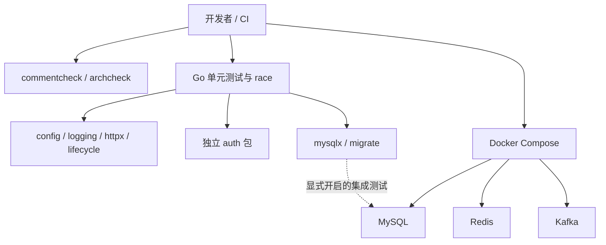

# 阶段 0 学习材料：先把地基讲清楚

## 1. 这个阶段做了什么



我们先搭建以后服务都要依赖的基础能力，并让规则可以自动检查。此时没有库存、订单或医生业务进程，所以你还不能通过 HTTP 下单，也不会看到诊断页面。Redis、Kafka 目前仅用于把部署环境跑通；不代表已经写好了缓存或消息业务。这是阶段 0 的历史学习范围；当前分支已含阶段 1，最新文件导航见[代码地图](../代码地图.md)。先读[汇报书](../reports/phase-00-foundation.md)了解文件全貌，再逐个阅读源码。

## 2. 怎么跑起来、看什么

所有命令从仓库根目录运行。首次安装工具后重新打开终端；如果之前已经创建 `.env`，不要覆盖自己的配置。

1. 执行 `go version`、`docker version`、`docker compose version`、`gcc --version`、`go env CGO_ENABLED`。你应该看到 Go 1.27.1、Docker Client/Server 都可用，Windows 下 gcc 可见且 CGO 为 1。gcc 是 race 的构建依赖，本项目没有让你手写 C。
2. PowerShell：`if (-not (Test-Path .env)) { Copy-Item .env.example .env }`；bash：`test -f .env || cp .env.example .env`。你应该得到一个 Git 忽略的 `.env`，里面都是演示值；`git status --short` 不应列出它。
3. 执行 `docker compose --env-file .env -f deploy/docker-compose.yml up -d --wait --wait-timeout 240 shop-mysql redis kafka`。你应该看到三个服务最终都 Healthy；首次下载镜像可能较慢。`--wait-timeout` 约束等待服务就绪的时间，不是镜像下载速度保证。
4. 执行 `docker compose --env-file .env -f deploy/docker-compose.yml ps`。你应该看到 MySQL、Redis、Kafka 的状态为 healthy，端口前缀是 127.0.0.1。
5. 执行 `go install honnef.co/go/tools/cmd/staticcheck@v0.8.2`。成功一般不输出内容；随后 `staticcheck -version` 应显示安装版本。如果命令不可见，把 GOPATH 下的 bin 加入 PATH。
6. 依次执行下列命令。gofmt、vet、staticcheck 正常时无输出；两个项目检查器应显示通过；测试应显示各包 ok。

```text
gofmt -l internal tools
go vet ./...
staticcheck ./...
go run ./tools/commentcheck ./...
go run ./tools/archcheck ./...
go test -race ./... -count=1 -timeout=180s
```

7. 执行 `go test ./internal/platform/mysqlx ./internal/platform/migrate -run Integration -v`，先不要设置 TEST 开头的 DSN。你应该看到 SKIP 和如何开启的说明；这保证平常测试不依赖你是否启动数据库。
8. 按 [README 的两种 shell 示例](../../README.md#运行真实-mysql-集成测试)把 `.env` 中两个 TEST DSN 注入当前终端，再执行 `go test -race ./internal/platform/mysqlx ./internal/platform/migrate -run Integration -count=1 -timeout=90s -v`。你应该看到 TestOpenIntegration 和 TestApplyIntegration 真正 PASS。后者只允许专用测试库名，并会清理其中的技术表。
9. 执行 `go run ./tools/commentcheck -list ./...`。你应该看到按包列出的名称、文件、行号和第一句注释；可以拿这份清单逐项对照汇报书。
10. 学习结束可执行 `docker compose --env-file .env -f deploy/docker-compose.yml down`。你应该看到容器和网络被移除，命名数据卷保留；不需要加 `-v`。

如果刚启动就失败，先看 `ps --all`。查看 Kafka 的日志可以用 `docker compose --env-file .env -f deploy/docker-compose.yml logs --tail 80 kafka`。不要为了排查配置而把完整 `.env` 或展开后的 Compose 配置贴到公开问题里。

## 3. 开发过程回放

本节依据 [实测记录](../notes.md)、[决定记录](../decisions.md) 和提交 `de44592`、`d9b24f6`、`4404d78` 补写。记录能确定工作段和实际失败，但没有保存每次编辑的先后，所以不编造“先敲了哪个函数”的细节。下面的函数清单描述实际拆分；注明为阅读顺序的地方，不等于编辑时间线。

### 3.1 先确认仓库与运行环境

**目标与动手前的问题。** 我先确认新仓库、唯一计划和只读复用来源，查 Go、Docker、gcc 是否可用。这样后面报告的“测试通过”才有明确环境，不能把没有运行的 Docker 或 race 写成成功。

**拆分。** 这一步没有业务函数；检查使用 `git status`、`go version`、`go env CGO_ENABLED CC` 和 Docker 命令，结果放进 notes，版本选择放进 decisions。

**实际顺序与验证。** 开始时发现 Docker 和 gcc 不可用，先告诉你。你同意继续代码、由自己准备 Docker，race 暂交固定 Linux CI；随后你装好工具，我刷新 PATH，再验证 Docker 引擎、Compose 和 CGO 都可用。没有自行安装系统软件。

**问题与取舍。** 旧终端看不到新 PATH，不能据此断言工具仍未安装。最终 Windows 与 Linux CI 都真实跑了 race，临时替代验收没有被保留成永久缺口。

### 3.2 把共用地基和认证分开

**目标。** 从旧 ai-backend 的认证、配置、MySQL 与中间件经验出发，建立可供后续服务调用的包。旧仓库保持只读；不能直接把旧项目的业务目录复制过来。

**动手前的问题。** 配置怎样在启动时失败、UTC 是 Go 解码设置还是数据库会话设置、迁移锁究竟归哪条连接、退出后怎样继续清理，这些问题都要在服务出现前讲清楚。

**实际拆分的关键函数：**

| 文件 / 函数 | 参数 → 返回 | 在流程里的作用 |
|---|---|---|
| config/config.go：NewReader、String/Int/Duration/Bool | 读取函数 / 变量名与默认范围 → Reader / 值与 error | 分开配置来源和规则，便于内存测试 |
| logging/logging.go：New、WithFields、Handle | 输出与服务名 / context 与字段 → Logger / context / error | app 建日志器，请求补上下文，写出时统一关联 |
| httpx/httpx.go：RequestIDs、Recovery、BodyLimit、BindJSON | logger / 大小 / Gin context 与目标指针 → 中间件 / bool | 让接口先经过统一保护再进入业务 |
| mysqlx/mysql.go：prepare、Open | Config / context → 驱动配置 / *sql.DB 与 error | 先校验，再 Ping，连接池交给 app 管理 |
| migrate/files.go：load | fs.FS 与目录 → 迁移切片与 error | SQL 执行前检查编号、内容和校验和 |
| migrate/migrate.go：Apply、acquire、release、discard | context、池、文件 / 专用连接 → error / 锁名 | 同一会话持锁执行；释放失败丢弃会话 |
| lifecycle/lifecycle.go：Notify、Shutdown | 父 context / 预算与 Hook → context/stop / error | 信号取消与资源清理分成两个阶段 |
| auth/auth.go：NewTokens、Issue、Parse、HashPassword、VerifyPassword | 密钥、用户、令牌或密码 → 认证结果 | 保留认证规则，但暂不接登录路由 |

**顺序与原因。** 这些基础能力和测试在 `de44592` 中一起交付。记录不足以还原各文件之间的精确编辑次序；学习时按上表从“来源与配置”走到“资源与清理”最容易理解，这里明确把它作为阅读路线。实际验证包括配置表格用例、HTTP 内存请求、JWT 伪造样例，以及真实 MySQL 的时区和迁移测试。

**取舍。** 没有引入 dotenv/Viper、ORM 或另一个迁移框架。迁移一文件一条 SQL，沿用会话命名锁但不按分号拆字符串。DDL 不能整批回滚，所以迁移要可重入，不能宣称具备事务迁移能力。

### 3.3 让注释和分层规则真的能失败

**目标与前置问题。** 仓库要让遗漏注释和跨领域依赖在 CI 中被拒绝；只在当前好代码上运行成功，不能证明检查器有用。

| 文件 / 函数 | 参数 → 返回 | 为什么拆出来 |
|---|---|---|
| commentcheck/check.go：scan、inspectFile | 扫描路径 / 文件与汇总状态 → 结果 / error | 遍历与单文件 AST 检查分开 |
| inspectFunction、inspectDeclaration | AST、位置与结果 → 更新诊断 | 函数体规则和 type/const/var 规则不同 |
| writeList | writer、符号切片 → error | 给报告生成清单，不手写一份容易漏掉的函数表 |
| archcheck/check.go：locationProblem、importProblem、layerProblem | 路径、导入、模块 → 问题文字 | 目录、领域方向、包内分层分别解释 |
| scenarioProblems、stringExpression | AST / 表达式与已知字符串 → 违规 / 可求值路径 | 检查可识别的答案读取，不假装分析任意运行时数据流 |

**实际顺序与验证。** 写好工具与故意违规的样例后跑测试。第一次 archcheck 的 embed 路径样例失败：没有去掉 `//go:embed` 前缀，修正为逐个解析 pattern 后通过。随后 commentcheck 自查发现 11 个长函数缺内部说明；补写和拆分过程中，新函数又被抓到一次缺说明，再补齐才通过。最后还临时删除真实 `config.New` 注释，确认工具给出文件和行号，并在 finally 中恢复。

**取舍。** 静态规则只负责它能可靠判断的内容，“像不像人讲解”仍须人工自查。阶段 1 的新规范后来增加了文件说明、包内清单和 `-map`；这些不是阶段 0 首次交付时就有的能力，本次回放不把它们倒写进历史。

### 3.4 跑通容器，留下失败与修复证据

**目标与前置问题。** 三个依赖要在本机和全新 CI 环境健康启动；密码只从环境注入，版本写死。

**拆分。** 没有新增业务 Go 函数。`deploy/docker-compose.yml` 负责服务、端口、健康检查与内存预算；`deploy/mysql/init/001_test_databases.sql` 负责两个平台测试库；CI 负责按顺序执行检查和容器集成测试。

**实际顺序。** 第一次 Compose 命令找不到根目录 `.env`，于是统一显式写 `--env-file .env`。随后 Kafka 因数据目录权限启动失败，检查官方镜像发现 `/var/lib/kafka/data` 属于 appuser，改用该目录，并修正本次新建空卷的属主。没有删卷重来。再运行本机全部检查，推送后查看 CI。

**验证与取舍。** 当时 9 个包、23 个顶层测试通过，三个依赖 healthy；[CI 39929219914](https://github.com/Li-Nepenthe/opsdoctor/actions/runs/39929219914) 的全新卷也通过。这个证据比只说“本机能启动”更完整。没有提前写业务功能来让项目看起来更丰富。

### 3.5 学习前返工，以及这次三层说明补齐

**目标与前置问题。** 你指出具名返回值、错误合并、取消脱离、信号 context、SQL NULL 和坏连接丢弃难以逐行理解，要求只改讲解。

**拆分与顺序。** 对应解释分别补到 migrate 的 Apply/release/discard、lifecycle 的 Notify/Shutdown 及学习材料；检查工具的分支和表格案例也逐项补理由。合并 `6f92d0e` 后删掉废弃的 CHAOS 配置，再检查无行为改动、运行全套检查并推送 `4404d78`。

**验证与真实问题。** 最初按词法 token 比较时，表格排版多出的合法尾逗号被误判为变化；改用去掉注释和位置的 AST 对比，并核对 Go 指令，32 个文件一致。验证示例时，Python 的默认编码打印中文失败，改用 UTF-8 后完成。不是 Go 示例逻辑失败。

**本次追加。** 你在阶段 1 期间发布 `3aa6c99`，要求目录、文件和代码三层说明。我先保存阶段 1 工作、合并 main、恢复工作区，再扩展 commentcheck，接着补全两阶段文件说明和 doc.go 清单。初次核验时，除 commentcheck 外的 28 个旧 Go 文件 AST/指令一致。随后发现 cmd/README.md 被 archcheck 误判，你明确批准只放行这一精确路径并补测试；最终核验排除这两个获准调整的 archcheck 文件后，其余 26 个旧 Go 文件仍然一致。commentcheck 是你明确要求升级的工具，单独排除。现在的源码导航见 [代码地图](../代码地图.md)，历史报告中的行号仍属于当时版本。

## 4. 阅读顺序

本阶段尚无 `cmd/` 服务入口，不能为了满足阅读顺序而创建空服务。实际可执行入口是两个工具的 main.go；以后阶段再从 `cmd/<服务>/main.go` 进入 app。

| 顺序 | 文件 | 重点看什么 |
|---|---|---|
| 1 | [go.mod](../../go.mod)、[go.sum](../../go.sum) | 一个仓库一个模块；直接依赖与传递依赖的区别；sum 是校验记录 |
| 2 | [commentcheck/doc.go](../../tools/commentcheck/doc.go)、[main.go](../../tools/commentcheck/main.go) | 先了解职责，再看参数、输出和退出码，入口不混入扫描细节 |
| 3 | [commentcheck/check.go](../../tools/commentcheck/check.go)、[check_test.go](../../tools/commentcheck/check_test.go) | parser 如何得到 AST、如何定位源码行；用负例而不只是正例证明检查有效 |
| 4 | [archcheck/doc.go](../../tools/archcheck/doc.go)、[main.go](../../tools/archcheck/main.go) | 为什么必须从模块根扫描，入口如何把错误交给 CI |
| 5 | [archcheck/check.go](../../tools/archcheck/check.go)、[check_test.go](../../tools/archcheck/check_test.go) | 先看 importProblem/layerProblem，再看路径分析；区分静态检查与安全沙箱 |
| 6 | [config/doc.go](../../internal/platform/config/doc.go)、[config.go](../../internal/platform/config/config.go) | Reader 接收函数作为依赖；缺失与空字符串不是同一种情况 |
| 7 | [config_test.go](../../internal/platform/config/config_test.go) | 表格驱动测试如何把边界排列在一起；假环境如何代替 os.LookupEnv |
| 8 | [logging/doc.go](../../internal/platform/logging/doc.go)、[logging.go](../../internal/platform/logging/logging.go) | 先看 Fields/New，再看 Handler；关联字段如何跨函数传递且不改全局变量 |
| 9 | [logging_test.go](../../internal/platform/logging/logging_test.go) | 用 JSON 解码验证字段，不依赖整行文本顺序；分组不能隐藏请求标识 |
| 10 | [httpx/doc.go](../../internal/platform/httpx/doc.go)、[httpx.go](../../internal/platform/httpx/httpx.go) | 按 RequestIDs → Recovery → BodyLimit → BindJSON/响应阅读，理解中间件先后关系 |
| 11 | [httpx_test.go](../../internal/platform/httpx/httpx_test.go) | httptest 不必监听端口；未知 Content-Length 时也要限制读取 |
| 12 | [auth/doc.go](../../internal/doctor/auth/doc.go)、[auth.go](../../internal/doctor/auth/auth.go) | 错误分类、构造参数、claims 白名单和 bcrypt 的 72 字节限制 |
| 13 | [auth_test.go](../../internal/doctor/auth/auth_test.go) | 一份可解码的 JWT 为什么仍可能必须拒绝；哪些旧测试被保留 |
| 14 | [mysqlx/doc.go](../../internal/platform/mysqlx/doc.go)、[mysql.go](../../internal/platform/mysqlx/mysql.go) | Config 是输入契约；先看 prepare 再看 Open；sql.DB 是池，不是一条连接 |
| 15 | [mysql_test.go](../../internal/platform/mysqlx/mysql_test.go)、[mysql_integration_test.go](../../internal/platform/mysqlx/mysql_integration_test.go) | 不联网的配置验证与必须联网的会话验证如何分开 |
| 16 | [migrate/doc.go](../../internal/platform/migrate/doc.go)、[files.go](../../internal/platform/migrate/files.go) | fs.FS 接口、文件顺序、校验和，以及一文件一语句的约束 |
| 17 | [migrate.go](../../internal/platform/migrate/migrate.go) | Apply 是总流程；沿 acquire → readHistory → verifyHistory → release 阅读；解释 Conn 的所有权 |
| 18 | [files_test.go](../../internal/platform/migrate/files_test.go)、[migrate_integration_test.go](../../internal/platform/migrate/migrate_integration_test.go)、[探针 SQL](../../internal/platform/migrate/testdata/0001_probe.sql) | 内存文件系统和嵌入文件分别测什么；WaitGroup 如何保证工作者退出 |
| 19 | [lifecycle/doc.go](../../internal/platform/lifecycle/doc.go)、[lifecycle.go](../../internal/platform/lifecycle/lifecycle.go)、[lifecycle_test.go](../../internal/platform/lifecycle/lifecycle_test.go) | 取消正常工作与给清理留预算是两个不同的 context 生命周期 |
| 20 | [Compose](../../deploy/docker-compose.yml)、[初始化 SQL](../../deploy/mysql/init/001_test_databases.sql) | 健康检查是否真的操作依赖，端口、内存、数据卷和权限归谁管 |
| 21 | [CI](../../.github/workflows/ci.yml)、[环境示例](../../.env.example)、[Git 忽略规则](../../.gitignore) | 本机步骤如何搬到 Linux；为什么配置不能进入提交 |

每读一个函数，先用自己的话复述“调用方必须给什么、成功得到什么、失败怎么办、资源由谁关闭”。再进入下一层，避免只记语法。

## 5. 关键设计与 WHY

### 一个模块，按领域隔离

`internal` 是 Go 工具链认识的目录名。位于某个父目录下的 internal 包只能被该父目录树内的代码导入；其他仓库不能像导入公共库一样直接导入我们的实现。但同一仓库中的 doctor 仍然可能导入 shop，因此还需要 archcheck 检查项目自己的边界。前者是语言工具链规则，后者是工程规则。

放弃多个 go.mod，是为了让初学阶段可以一次跑完全部测试、共享基础包。代价是依赖仍会出现在同一模块图中，所以文件和包的职责需要额外约束。还没有消费者的接口和空目录不创建。

### 通过构造函数传依赖

Java 中你可能把一个 Environment 对象传给构造器。Go 的 Reader 直接接收 `func(string) (string, bool)`：函数也是值，可以保存并调用。生产传 os.LookupEnv，测试传闭包。闭包能读取创建它时的 test 值，因此测试不用改真实系统环境。

放弃读取全局可变配置和额外配置框架，换来可测试、显式的依赖关系。代价是 app 需要明确调用每项读取函数。读取失败返回 `(零值, error)`，调用方先检查 error，再使用值；这与 Java 的异常控制流不同。

### context、defer 与资源所有权

context 是沿调用链传递的取消信号、截止时间和少量请求附加信息。它不会自动停止任意函数，函数必须把它传给支持 context 的操作，或主动等 `ctx.Done()`。context 也不适合承载所有业务参数。

defer 类似保证在函数离开时执行的清理，按后进先出顺序运行。Apply 先登记归还连接，再登记释放命名锁，因此退出时先解锁、再归还连接。顺序错了，解锁可能拿不到原来的会话。

Notify 返回的 stop 必须被调用。Shutdown 用 `context.WithoutCancel` 保留请求值但去掉旧的取消状态，再添加新的超时。如果直接复用已经取消的工作 context，HTTP 排空可能刚开始就被取消。放弃一个框架包办全部生命周期，代价是后续 app 必须按依赖顺序提供关闭回调，而且回调必须合作响应超时。

### 日志与 HTTP 错误边界

Request ID 是单个请求的检索线索；trace ID 是跨服务调用链标识，两者不是同义词。阶段 0 只承载 context 中已有的标识，不会自动生成真实调用链。日志固定 JSON、UTC 和 service 字段，便于后续统一采集。

不能直接用 Gin 默认恢复日志打印请求转储：panic 字符串或请求内容可能包含密码。我们的恢复只写固定错误分类。客户端收到安全的 `INTERNAL` 和 request_id，后续可据此查日志。代价是开发者要显式记录安全的上下文，不能靠全部打印来排查。

BodyLimit 既检查 Content-Length，也使用 MaxBytesReader 包住实际读取过程。没有 Content-Length 的分块请求也不能无限读。BindJSON 再读一次，要求 EOF，防止请求末尾追加第二个 JSON 值。它只解析与校验格式；领域合法性仍由未来业务层判断。

### sql.DB、sql.Conn 与数据库会话

sql.DB 是并发安全的连接池句柄。对它调用两次 Exec，可能落到不同连接上。sql.Conn 是从池里暂时租到的一条连接；命名锁属于数据库会话，所以 GET_LOCK、迁移、RELEASE_LOCK 必须都通过同一条 Conn。

池参数是预算：MaxOpenConns 限制同时打开的连接，MaxIdleConns 控制能保留多少空闲连接，ConnMaxLifetime 控制连接最长寿命。上限过大可能拖垮数据库，过小可能让请求等池。阶段 0 的 20/10/5m 是后续配置示例，不能称为压测调优结果。

`parseTime=true` 和 `loc=UTC` 决定驱动把数据库时间读成什么 Go 值；MySQL 的会话 `time_zone` 决定数据库如何理解自己的时间计算。只设置前者不能保证数据库会话也是 UTC，所以同时设置两边。

### 迁移为什么不用“大事务包住一切”

MySQL 的很多 DDL 会隐式提交。第一条建表成功、第二步失败，并不会因为外面写了事务就自动恢复原样。我们的契约是一文件一条可重入 SQL，成功后才写 schema_migrations；失败重试必须安全，例如 CREATE TABLE IF NOT EXISTS。

校验和防止已执行文件被悄悄改写，新增变更靠追加文件。放弃按分号切字符串，因为 `'a;b'` 里的分号不是 SQL 边界。代价是文件数量更多，不支持存储过程/多语句脚本这种复杂格式。命名锁用于排队，不是 DDL 原子性的保证。

embed.FS 在编译时打包文件，实现标准库 fs.FS 接口。Go 不需要写 `implements`：类型只要有接口要求的方法，就能被当作该接口使用。因此内存 fstest.MapFS 可以替代 embed.FS 测加载规则，真实集成测试再验证 MySQL 会话行为。

### 自动规则与测试不是同一件事

commentcheck 解析语法树，而非用正则猜函数位置。它证明注释存在，不证明解释正确。archcheck 检查依赖方向和能推导出的路径，不执行任意代码，不可能仅靠这一层证明医生永远读不到答案。

正例证明合法代码能通过；负例证明违规会被拒绝。如果检查工具只测正例，一个永远输出“通过”的空实现也能通过测试。表格驱动测试把边界摆在同一个地方，便于你自己再补用例。

race 发现的是实际执行中存在的并发数据访问问题。没有报告不等于数学证明绝无竞态；没有运行到的路径仍需审查。迁移测试的 channel 容量是 2，因为两个工作者各写一次，主线程等待它们退出后才读；如果容量为 0，工作者等待接收、主线程等待工作者，便会互相等待。

### Compose 的就绪和持久化

容器进程“已启动”不等于数据库“已经能查询”。healthcheck 实际发查询/命令；后续服务可以用 `depends_on: condition: service_healthy` 等待依赖第一次就绪。本阶段三个基础组件彼此独立，因此没有为了示范而增加虚假的 depends_on。

depends_on 不会替运行中的服务自动处理所有断线，也不会把已失败的请求重放。客户端仍需超时与合理的重连策略。Kafka 给容器内外不同的 advertised listener，是因为容器里的 localhost 指向自己，不指向宿主机或 Kafka 容器。

命名卷在容器删除后保留，因此重启不会重新执行 MySQL 首次初始化脚本。不要以为改 `.env` 的密码就能修改已经建好的数据库账户密码。固定版本、内存上限与 localhost 端口映射便于复现，但单节点部署不能提供生产高可用。

## 6. 本阶段用到的 Go 写法

这一节可以先于 migrate 和 lifecycle 源码阅读。前五个例子都是独立的小程序，可以各自保存到仓库外的临时目录，用 `go run main.go` 运行；不要放在仓库根目录。第六个是接收已有连接的函数片段。例子只讲当前写法，完整的错误上下文和资源所有权处理仍以项目源码为准。

### 6.1 具名返回值，以及 defer 为什么能修改它

`func f() (result error)` 不只是标注返回类型，还声明了一个叫 result 的返回变量，初始值为 nil。执行 `return 某个值` 时，Go 先把这个值赋给 result，再执行 defer，最后把 result 交给调用方。闭包直接引用 result，因此可以在这个间隙修改它。先用整数看清顺序：[Go 语言规范](https://go.dev/ref/spec#Defer_statements)。

```go
package main

import "fmt"

// finish 演示返回变量在 defer 执行前已经得到 return 指定的值。
func finish() (result int) {
    defer func() {
        result += 1 // 此时 result 已经是 10，调用方最终拿到 11。
    }()
    return 10
}

func main() {
    fmt.Println(finish()) // 11
}
```

回到 [migrate.go 的 Apply](../../internal/platform/migrate/migrate.go)：主体先决定 result 是成功的 nil 还是迁移错误，defer 再把解锁、归还连接时的错误合进去。它类似 Java 中退出时会执行的 finally，但这里明确修改的是 Go 的返回变量。要分清闭包引用和参数传值：若写成 `defer func(value int) { value++ }(result)`，参数在登记 defer 时就求值，修改的是副本，不会改变 result。多个 defer 后登记的先执行，所以本项目先解锁、后归还连接。

### 6.2 errors.Join：保留同时发生的多个错误

Go 的 error 是返回值，不是自动抛出的异常。`errors.Join` 可以把多个 error 包在一起，nil 会被忽略，全部为 nil 时结果也是 nil。它保留错误之间的关系，因此调用方仍能用 `errors.Is` 判断其中是否包含某个原因；不是把字符串拼接完就丢掉原错误。[标准库说明](https://pkg.go.dev/errors#Join)。

```go
package main

import (
    "errors"
    "fmt"
)

func main() {
    executeErr := errors.New("执行迁移失败")
    cleanupErr := errors.New("归还连接失败")
    result := errors.Join(executeErr, nil, cleanupErr)
    fmt.Println(errors.Is(result, executeErr)) // true：原始错误仍能被识别。
    fmt.Println(errors.Is(result, cleanupErr)) // true：清理错误也没有丢失。
    fmt.Println(errors.Join(nil, nil) == nil)  // true：没有错误仍表示成功。
}
```

Apply 用它合并“迁移失败”和“清理失败”，Shutdown 用它汇总多个关闭步骤的错误。相较于只返回最后一个错误，调用方能同时看到故障起点和清理结果。`errors.Join(failures...)` 中的 `...` 是把 `[]error` 切片展开成多个参数。

### 6.3 context.WithoutCancel：让清理拥有自己的时间

`context.WithoutCancel(parent)` 生成派生上下文，仍能通过 Value 取到父上下文的信息，但不继承取消和截止时间；它自身的 Done 为 nil，Err 为 nil。因此它需要搭配新的 WithTimeout，不能直接拿去等待 Done 或执行无限期清理。[标准库说明](https://pkg.go.dev/context#WithoutCancel)。

```go
package main

import (
    "context"
    "fmt"
    "time"
)

func main() {
    parent, cancelWork := context.WithCancel(context.Background())
    cancelWork() // 模拟正常工作已经被取消。
    detached := context.WithoutCancel(parent)
    fmt.Println(parent.Err() != nil, detached.Err() == nil) // true true

    // 示例给清理留一秒；项目的总预算由 Shutdown 的调用方决定。
    const cleanupBudget = time.Second
    cleanup, cancelCleanup := context.WithTimeout(detached, cleanupBudget)
    defer cancelCleanup() // 提前结束也应释放定时器资源。
    cancelCleanup()       // 示例主动结束，不需要真的等待一秒。
    fmt.Println(cleanup.Err() == context.Canceled) // true
}
```

[Shutdown](../../internal/platform/lifecycle/lifecycle.go) 通常在工作 context 已取消后才被调用。若原样传给 HTTP 等关闭函数，它们可能立刻放弃清理；解除旧取消、另给总预算，就能给正在处理的请求留出收尾机会。这不是恢复旧 context，也不会让任何 goroutine 自动停止；关闭回调仍必须主动响应新 context。

### 6.4 signal.NotifyContext：把退出信号转换成 context 通知

它返回一个 context 和一个 stop 函数。指定的系统信号到来、父 context 取消、或调用 stop，都会使返回的 context 取消。stop 还负责注销信号监听、释放资源，所以调用者要安排 `defer stop()`。[标准库说明](https://pkg.go.dev/os/signal#NotifyContext)。

```go
package main

import (
    "context"
    "fmt"
    "os"
    "os/signal"
)

func main() {
    parent, cancel := context.WithCancel(context.Background())
    defer cancel()
    ctx, stop := signal.NotifyContext(parent, os.Interrupt)
    defer stop()

    cancel() // 用父取消演示通知，不向终端或其他进程发送真实信号。
    <-ctx.Done()
    fmt.Println("收到退出通知，可以开始清理")
}
```

如果把示例中的主动 `cancel()` 去掉，程序就会等待你按 Ctrl+C。[Notify](../../internal/platform/lifecycle/lifecycle.go) 还登记了 Linux 容器常用的 SIGTERM。它只统一退出通知，并不自动关闭服务器或数据库；收到通知后，组装层再调用 Shutdown。可以把它理解为把 Java 中分散的退出通知转成所有组件都认识的同一种信号。

### 6.5 sql.NullInt64：区分 0 与 SQL NULL

普通 int64 只能保存整数，不能表达 SQL 的 NULL。`sql.NullInt64` 用两个字段表示：Valid 为 true 才说明 Int64 有意义；Valid 为 false 表示 NULL。用途类似 Java 的可空 Long，但这里是否为空写在独立字段里。它实现 Scanner 接口，因此能直接用于 `rows.Scan(&value)`。[标准库说明](https://pkg.go.dev/database/sql#NullInt64)。

```go
package main

import (
    "database/sql"
    "fmt"
)

func main() {
    var value sql.NullInt64
    // 直接调用 Scan 演示解码规则，不需要连接数据库。
    if err := value.Scan(nil); err != nil {
        panic(err)
    }
    fmt.Println(value.Valid) // false：NULL，不能拿 Int64 当有效结果。
    if err := value.Scan(int64(0)); err != nil {
        panic(err)
    }
    fmt.Println(value.Valid, value.Int64) // true 0：确实读到了整数 0。
}
```

acquire 读取 GET_LOCK 的结果时，要分清 1（获取成功）、0（等待超时）和 NULL（MySQL 返回异常结果）。所以代码必须先看 Valid，再判断 Int64，不能把 NULL 和超时 0 混成一回事。release 同样需要确认结果确实是整数 1，才认为锁已经释放。

### 6.6 Conn.Raw + driver.ErrBadConn：让池丢弃一条连接

`sql.Conn.Close()` 通常是结束租用、把底层连接还给连接池。`Conn.Raw` 则在回调执行期间提供底层驱动连接；回调返回 `driver.ErrBadConn` 时，database/sql 会丢弃该连接。底层对象不能拿到回调外继续使用。[Conn.Raw 说明](https://pkg.go.dev/database/sql#Conn.Raw)与[驱动错误约定](https://pkg.go.dev/database/sql/driver#ErrBadConn)。

下面是函数片段，参数必须是一条已经租用的真实连接；它不负责创建连接池，也不要用 nil 试运行。测试入口已经由项目的 MySQL 集成测试提供。

```go
package example

import (
    "database/sql"
    "database/sql/driver"
    "errors"
)

// discardExample 放弃复用一条状态不可靠的连接。
func discardExample(connection *sql.Conn) error {
    err := connection.Raw(func(any) error {
        // 不操作驱动对象，只通过返回值告诉连接池“这条连接不能再使用”。
        return driver.ErrBadConn
    })
    if errors.Is(err, driver.ErrBadConn) || errors.Is(err, sql.ErrConnDone) {
        // 主动丢弃或已经关闭，都达到了本函数的目的。
        return nil
    }
    return err // 其他错误仍交给调用方处理。
}
```

对应源码是 [discard](../../internal/platform/migrate/migrate.go)。当命名锁的获取结果不确定或解锁失败时，直接归还连接可能让下一个请求接手一条仍持锁的会话。这里宁可让池以后重新建连接，也要结束这条旧会话。只有这类无法确认会话状态的场景才需要丢弃，普通业务 SQL 出错并不意味着连接必须废弃；也不能在自己的数据库驱动里随意返回 ErrBadConn，因为某些调用路径会据此重试操作。

## 7. 动手实验

每次只改一个地方，观察结果后撤销**自己本次的编辑**。不改 main、不推送实验破坏、不操作业务库。

### 实验一：让注释检查真的失败

删除 config.go 中 New 前的一行文档注释，运行 `go run ./tools/commentcheck ./...`。应该看到文件、行号和“New 缺少文档注释”，退出非零。撤销删除并重新运行，应该通过。思考：保留一句毫无内容的废话能否通过机器检查？为什么还要人工抽查？

### 实验二：故意跨越领域边界

在 config.go 的 import 组中临时加入 `_ "github.com/Li-Nepenthe/opsdoctor/internal/doctor/auth"`。运行 `go run ./tools/archcheck ./...`，应该看到 platform 不得依赖业务包。下划线导入只要求加载包而不使用名称，不能成为架构豁免。撤销这一行，重新检查。不要执行或提交这一改动。

### 实验三：破坏配置边界的期望

打开 config_test.go，把 maximum 用例的输入从 `100` 改为 `101`，但保留“应成功”的期望。运行 `go test ./internal/platform/config -run TestReader -v`，应该失败并指出变量与范围。撤销改动后通过。再读 too_large 用例：同样的 101，为什么这个测试本来就应通过？测试通过指的是“实现符合期望”，不代表输入被接受。

### 实验四：观察已启动与就绪的区别

执行 `docker compose --env-file .env -f deploy/docker-compose.yml stop redis`，再执行 `ps --all`，你应该看到 Redis 不再 healthy，而 MySQL/Kafka 仍运行。执行 `docker compose --env-file .env -f deploy/docker-compose.yml up -d --wait redis` 恢复，再看状态。这里没有业务请求，所以只能说明依赖容器恢复，不能声称业务恢复。

## 8. 常见误区

- “internal 自动隔离所有领域”：它限制仓库外导入，仓库内的方向还要靠项目规则。
- “Go 的 interface 等于 Java 接口声明”：Go 是按方法集合隐式实现；接口通常由使用方定义所需能力。
- “context 取消会强杀 goroutine”：它只是信号，工作函数必须响应；资源所有者仍需等工作者退出。
- “defer 放在哪里都一样”：它延迟到当前函数返回，执行顺序是后进先出；循环内大量 defer 可能延长资源持有时间。
- “sql.OpenDB 已经证明数据库正常”：它创建池句柄，Ping 才会真正探测连接。
- “日志带 UTC 就够了”：数据库会话也要统一，不然 SQL 时间计算仍可能不一致。
- “JWT 只是能解码就合法”：必须校验签名、允许算法、issuer、audience、时间和主体。
- “bcrypt 是可解密的加密”：它是密码摘要，校验靠重新计算/比较，不能还原原密码。
- “测试 SKIP 等于 PASS”：没有运行就是没有证据，报告必须分清。
- “三个容器 healthy 等于项目完成”：这里只完成阶段 0 的基础依赖，后续业务和诊断尚未实现。

## 9. 必答问题

先自己写答案，再展开文末要点。

1. Go 的 internal 目录有什么特殊作用？
2. 为什么配置用环境变量，而不是把配置文件打包进程序？
3. 优雅停机的完整流程是什么？不做时正在处理的请求会怎样？
4. Compose 的 healthcheck 和 depends_on: condition: service_healthy 分别解决什么问题？
5. 为什么用程序检查包依赖，而不只靠人自觉？
6. sql.DB 和 sql.Conn 有什么区别？命名锁为什么必须用同一个 Conn？
7. 为什么 loc=UTC 与 MySQL time_zone 两项都要设置？
8. DDL 为什么不能承诺整批回滚？迁移文件应该如何设计？
9. 请求体大小限制为什么不能只看 Content-Length？
10. 迁移测试的结果 channel 为什么容量为 2？改成 0 后会发生什么？
11. 如何证明单元测试没有碰真实数据库？如何明确开启集成测试？
12. commentcheck、archcheck、race 分别能发现什么、不能证明什么？

## 10. 本阶段新术语

| 术语 | 一句话解释 |
|---|---|
| module / package | module 是依赖与版本管理单位；package 是 Go 代码组织、可见性和编译单位 |
| 导出标识符 | 以大写字母开头，包外代码才可以直接使用 |
| 组合与隐式接口 | 不通过类继承，而是用结构体组合与方法集合表达能力 |
| 闭包 | 能携带创建位置外部变量的函数值 |
| context | 在调用链中传递取消、截止时间和请求关联信息的对象 |
| defer | 在当前函数返回前执行清理，多个 defer 按后进先出执行 |
| goroutine | Go 运行时调度的并发执行单元，启动者要负责其退出路径 |
| channel | 类型明确的发送/接收通道，阻塞规则和缓冲容量影响并发协作 |
| WaitGroup | 等待一组并发工作全部完成的计数同步工具 |
| 错误包装 | 用 `%w` 附加上下文，同时保留 errors.Is/As 的分类判断能力 |
| AST | 源代码的抽象语法树，让检查器按声明结构而非文本猜测工作 |
| 连接池 | 重用数据库连接并限制并发数量的管理器 |
| 命名锁 | MySQL 会话持有的具名互斥机制，用来协调同库迁移 |
| DDL / 元数据锁 | 定义表结构的 SQL / 保护数据库对象定义的锁 |
| 可重入迁移 | 中断后重复执行不会产生错误状态的迁移语句 |
| KRaft | Kafka 自身维护元数据一致性的模式，本项目不再部署 ZooKeeper |
| healthcheck | 容器执行探测命令，判断依赖是否真的可用 |
| race detector | 在测试运行时跟踪并发访问、报告潜在数据竞争的工具 |

<details>
<summary>必答问题参考要点（先自己回答）</summary>

1. internal 只能由其父目录树内代码导入；同仓库领域隔离仍需 archcheck。
2. 同一二进制可部署到不同环境，秘密不进入源码/镜像；代价是必须明确校验环境且不能把值随意打日志。环境变量也不是万能保险，仍要限制谁能读取运行环境。
3. 收到信号 → 停止接新工作并取消工作 context → 等待/排空已有工作 → 按依赖顺序关闭资源 → 超时则按服务实现处理。清理用独立预算；否则请求和事务可能被突然中断。
4. healthcheck 提供“当前是否可用”的探测；service_healthy 让依赖者等第一次就绪，不能保证之后永远不断线。
5. 重复执行、位置明确、进入 CI；减少新增文件时无意越界，但规则本身也要用负例验证。
6. DB 是池，Conn 是租用会话；命名锁不随任意下一次池查询迁移到其他会话。
7. loc 影响驱动解码，time_zone 影响服务器会话；只设一边会留下时间理解不一致。
8. DDL 可隐式提交，不能用普通事务包装假装原子；小步、可重入、已执行只追加不改写。
9. 分块请求可能没有长度，伪造长度也不能当作唯一保障；限制实际 Reader 才能约束真实读取。
10. 两个工作者各发送一次，主线程先 Wait 后接收；无缓冲时两边互相等。容量 2 对应这段固定协议，不是随便选的性能参数。
11. 普通测试没有 TEST DSN，看到明确 Skip；注入独立测试库 DSN 才运行真实测试。HTTP 单元测试直接调用 Handler，认证测试无网络。
12. commentcheck 查注释存在性，archcheck 查静态结构与可识别路径，race 查执行到的并发访问；它们都不能替代语义审查或证明所有未来路径安全。

</details>

学完后由你自己勾选[进度看板](../../进度.md)的学习验收。开发停在这里，进入阶段 1 需要你明确同意。
