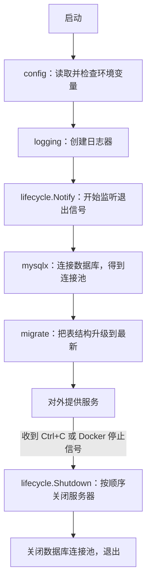

# 阶段 0 学习材料：项目的地基

这个阶段还没有任何业务功能。它做的是盖楼前的准备：打地基、通水电。具体来说是三件事：

1. 写好**每个服务都要用的基础部件**：读配置、写日志、连数据库、建表、处理 HTTP 请求的公共部分、优雅停机。
2. 写好**两个自动检查工具**：一个检查代码说明有没有写全，一个检查代码有没有放错位置。
3. 用 Docker 跑起 **MySQL、Redis、Kafka** 三个基础组件。

> 这份材料对照的是**当前的代码**。阶段 1–3 给这些基础部件加过功能（比如日志里的 trace_id），遇到时会注明“阶段 X 加入”，读的时候可以先跳过。

## 1. 这个阶段做了什么

理解这些基础部件最好的办法，是看一个真实的服务从启动到退出，依次用到了哪些部件。下面是库存服务（阶段 1 写的）的启动过程，代码在 [inventoryservice/app.go](../../internal/shop/app/inventoryservice/app.go) 的 `Run` 函数里：



订单服务对外提供 HTTP 接口，处理每个请求时还会经过 **httpx** 的公共处理（分配请求编号、接住 panic、限制请求体大小）。

各部件和它们以后的用途：

| 部件 | 一句话说明 | 以后谁用 |
|---|---|---|
| [config](../../internal/platform/config/doc.go) | 读取环境变量，启动时检查是否合法 | 所有服务 |
| [logging](../../internal/platform/logging/doc.go) | 输出 JSON 日志，自动带上请求编号 | 所有服务 |
| [httpx](../../internal/platform/httpx/doc.go) | HTTP 接口共用的入口处理和统一响应格式 | 订单服务、压测工具 |
| [mysqlx](../../internal/platform/mysqlx/doc.go) | 创建 MySQL 连接池，统一连接设置 | 所有要连数据库的服务 |
| [migrate](../../internal/platform/migrate/doc.go) | 数据库迁移：按编号执行建表、改表的 SQL 文件 | 所有要连数据库的服务 |
| [lifecycle](../../internal/platform/lifecycle/doc.go) | 优雅停机：收到退出信号后按顺序关闭资源 | 所有服务 |
| [auth](../../internal/doctor/auth/doc.go) | 登录规则：令牌（JWT）和密码（bcrypt） | 阶段 5 的医生服务 |
| [commentcheck](../../tools/commentcheck/doc.go) | 检查代码说明有没有写全 | CI |
| [archcheck](../../tools/archcheck/doc.go) | 检查代码有没有放错位置、有没有越界依赖 | CI |

## 2. 怎么跑起来、看什么

所有命令都在仓库根目录运行。开始前先打开 Docker Desktop。

**第 1 步：确认工具都装好了。**

```text
go version
docker version
gcc --version
go env CGO_ENABLED
```

你应该看到：Go 是 1.27.1；Docker 的 Client 和 Server 两部分都有输出（只有 Client 说明 Docker Desktop 没启动）；gcc 有版本号；`CGO_ENABLED` 是 1。gcc 和 CGO 是 `-race` 检测要用的，项目里没有 C 代码。

**第 2 步：准备 `.env` 文件。** 如果已经有了，跳过这一步，不要覆盖。

```text
cp .env.example .env
```

PowerShell 里用 `Copy-Item .env.example .env`。`.env` 里是本机用的演示密码，Git 会忽略它，`git status` 不会列出它。

**第 3 步：启动三个基础组件。**

```text
docker compose --env-file .env -f deploy/docker-compose.yml up -d --wait --wait-timeout 240 shop-mysql redis kafka
docker compose --env-file .env -f deploy/docker-compose.yml ps
```

你应该看到 shop-mysql、redis、kafka 三个都是 `healthy`，端口都以 `127.0.0.1:` 开头（只有本机能访问）。第一次运行要下载镜像，会慢一些。

**第 4 步：跑全部检查和测试。**

```text
gofmt -l cmd gen internal tools
go vet ./...
staticcheck ./...
go run ./tools/commentcheck ./...
go run ./tools/archcheck ./...
go test -race ./... -count=1 -timeout=180s
```

你应该看到：前三条没有任何输出（没输出就是没问题）；两个检查工具各输出一行“通过”；测试每个包都是 `ok`。如果提示找不到 `staticcheck`，先运行 `go install honnef.co/go/tools/cmd/staticcheck@v0.8.2`。

**第 5 步：看看集成测试默认会跳过。**

```text
go test ./internal/platform/mysqlx ./internal/platform/migrate -run Integration -v
```

你应该看到 `SKIP`，以及开启方法的提示。需要连真实数据库的测试叫“集成测试”，默认不运行，这样平时跑测试不需要先启动数据库。

**第 6 步：打开集成测试。** 按根目录 [README](../../README.md) 里“运行真实 MySQL 与 Redis 集成测试”一节，把测试库的连接地址设到当前终端，再运行：

```text
go test -race ./internal/platform/mysqlx ./internal/platform/migrate -run Integration -count=1 -timeout=90s -v
```

你应该看到 `TestOpenIntegration` 和 `TestApplyIntegration` 都是 `PASS`，而不是 `SKIP`。

**第 7 步：结束时停止容器。**

```text
docker compose --env-file .env -f deploy/docker-compose.yml down
```

容器会被删除，但数据卷会保留，下次启动时数据还在。不要加 `-v`，那会把数据卷一起删掉。

## 3. 开发过程回放

这一节讲这些代码是怎么做出来的。依据是 [实测记录](../notes.md)、[决定记录](../decisions.md) 和当时的提交（`de44592`、`d9b24f6`、`4404d78`）。记录里没有保存每个函数的编写先后，所以这里只讲能确认的过程，不编造细节。

### 3.1 先确认运行环境

**要做什么：** 动手写代码之前，先确认 Go、Docker、gcc 都能用。否则后面说“测试通过”，没法说明是在什么环境下通过的。

**遇到的问题：** 一开始 Docker 和 gcc 都不可用。Astra 先报告给你，你同意先写代码、自己去装工具，期间带 `-race` 的测试先交给 Linux CI 跑。你装好以后，Astra 发现旧的终端窗口还读不到新的 PATH（环境变量要在新窗口里才生效），刷新之后确认 Docker、Compose、CGO 都能用了。最终 Windows 本机和 Linux CI 都真正跑过了 `-race` 测试。

### 3.2 写基础部件

**要做什么：** 参考旧项目 ai-backend 里认证、配置、MySQL、中间件的写法，重新写出这些基础部件。旧项目只读、只参考，不改动，也不直接把业务目录复制过来。

**动手前先想清楚的问题：**

- 配置写错了，怎样在启动时就报错？
- 时区要统一成 UTC，是在 Go 这边设，还是在数据库那边设？
- 迁移用的锁属于哪一条数据库连接？
- 服务收到退出信号以后，清理工作怎样才能继续做完？

这些问题的答案，就是第 5 节讲的内容。

**拆成了哪些函数：**

| 文件 | 主要函数 | 作用 |
|---|---|---|
| config/config.go | `NewReader`、`String`、`Int`、`Duration`、`Bool` | 读一个变量，检查格式和范围 |
| logging/logging.go | `New`、`WithFields`、`Handle` | 创建日志器；把请求编号放进 context；写日志时补上请求编号 |
| httpx/httpx.go | `RequestIDs`、`Recovery`、`BodyLimit`、`BindJSON` | HTTP 请求进入业务代码前的公共处理 |
| mysqlx/mysql.go | `prepare`、`Open` | 先检查和统一配置，再连接并 Ping |
| migrate/files.go | `load` | 读取迁移文件，检查编号、内容，计算校验和 |
| migrate/migrate.go | `Apply`、`acquire`、`release`、`discard` | 用同一条连接加锁、执行迁移、解锁；解锁失败就丢掉这条连接 |
| lifecycle/lifecycle.go | `Notify`、`Shutdown` | 把退出信号变成通知；按顺序关闭资源 |
| auth/auth.go | `NewTokens`、`Issue`、`Parse`、`HashPassword`、`VerifyPassword` | 令牌和密码规则，暂时不接 HTTP |

这些代码在提交 `de44592` 里一起交付。验证方式包括：配置的表格测试、不启动服务器的 HTTP 测试、伪造的 JWT 令牌测试，以及连真实 MySQL 的时区和迁移测试。

**取舍：** 没有引入配置框架（例如 Viper）、ORM 或现成的迁移框架，这些功能都用标准库写，代码少，读起来也更直接。

### 3.3 写检查工具，并证明它们真的能发现问题

**要做什么：** 让漏写注释、跨领域导入这类问题在 CI 里自动报错。

**关键点：** 只在“好代码”上跑一遍、显示通过，证明不了检查工具有用，因为一个什么都不检查、永远输出“通过”的工具也能做到。所以测试里专门写了故意违规的代码，确认工具会报错。

**遇到的问题：**

1. 第一次测 archcheck 时，检查 `//go:embed` 路径的用例失败了。原因是没有去掉 `//go:embed` 这个前缀，改成逐个解析后面的路径后通过。
2. commentcheck 拿去检查项目自己的代码，发现 11 个长函数缺少内部注释。补注释、拆函数的过程中，新拆出来的函数又被查出一次缺注释，再补齐才通过。
3. 最后做了一次实地验证：临时删掉 `config.New` 的注释，确认工具准确报出文件名和行号，然后恢复。

### 3.4 跑通容器

**要做什么：** 让 MySQL、Redis、Kafka 在本机和全新的 CI 环境里都能健康启动。密码只从环境变量读取，镜像版本全部固定。

**遇到的问题：**

1. 第一次运行 Compose 时，它找不到根目录的 `.env`。因为 Compose 默认在 compose 文件所在的目录（`deploy/`）找 `.env`。解决办法是所有命令都显式写上 `--env-file .env`。
2. Kafka 启动失败，原因是数据目录没有写权限。查看官方镜像后发现，`/var/lib/kafka/data` 这个目录才属于镜像里运行 Kafka 的用户，于是改用它，并修正了新建数据卷的属主。没有删除数据卷重来。

**结果：** 当时 9 个包、23 个顶层测试全部通过，三个组件都是 healthy，[CI 39929219914](https://github.com/Li-Nepenthe/opsdoctor/actions/runs/39929219914) 在全新环境里也通过了。

### 3.5 两次返工：改进讲解

**第一次（提交 `4404d78`）：** 你读代码时指出，具名返回值、`errors.Join`、`context.WithoutCancel`、`signal.NotifyContext`、`sql.NullInt64`、丢弃坏连接这几处很难看懂，要求只补讲解、不改代码。于是在对应函数里补了注释，并在学习材料里加了第 6 节的 Go 写法示例。为了确认确实没有改动代码，Astra 比较了改动前后的代码结构：一开始的比较方法把表格里合法的尾逗号误判成了改动，换成更准确的语法树比较后，确认 32 个文件的代码完全一致。

**第二次（阶段 1 期间）：** 你要求说明分三层：目录（README、doc.go）、文件（文件开头的“本文件：”说明）、代码（注释）。于是扩展了 commentcheck，补全了所有文件说明和 doc.go 的文件清单。过程中发现 archcheck 会把 `cmd/README.md` 当成违规（规则是 cmd 下只能有 main.go），你同意只为这一个文件开例外，并补了测试。

## 4. 阅读顺序

按下面的顺序打开文件。每读一个函数，试着用自己的话回答四个问题：调用它要给什么？成功了得到什么？失败了怎么办？用到的资源由谁关闭？

| 顺序 | 文件 | 重点看什么 |
|---|---|---|
| 1 | [go.mod](../../go.mod) | 整个仓库是一个 Go 模块。`require` 里列的是项目依赖的第三方库 |
| 2 | [config.go](../../internal/platform/config/config.go) | `String` 怎样区分“没设置”和“设成空值”；`Reader` 为什么保存一个函数而不是直接调 `os.LookupEnv` |
| 3 | [config_test.go](../../internal/platform/config/config_test.go) | 表格测试：把很多组“输入 → 期望结果”写成一张表，用一个循环逐行检查 |
| 4 | [logging.go](../../internal/platform/logging/logging.go) | 先读 `Fields`、`WithFields`、`New`，再读 `Handle`。看请求编号怎样放进 context，又怎样在写日志时取出来 |
| 5 | [httpx.go](../../internal/platform/httpx/httpx.go) | 从上往下读。注意 `RequestIDs` 和 `Recovery` 的安装顺序；`BodyLimit` 和 `BindJSON` 怎样配合 |
| 6 | [httpx_test.go](../../internal/platform/httpx/httpx_test.go) | 不启动真实服务器也能测 HTTP 处理：用 `httptest` 模拟请求 |
| 7 | [auth.go](../../internal/doctor/auth/auth.go) | `Parse` 要检查哪几项；为什么密码最长只能 72 字节 |
| 8 | [auth_test.go](../../internal/doctor/auth/auth_test.go) | 一个能正常解码的令牌，为什么仍然可能必须拒绝 |
| 9 | [mysql.go](../../internal/platform/mysqlx/mysql.go) | 先读 `prepare`（所有统一设置都在这里），再读 `Open`。记住：`*sql.DB` 是连接池 |
| 10 | [files.go](../../internal/platform/migrate/files.go) | 迁移文件要满足哪些规则；校验和是怎么算的 |
| 11 | [migrate.go](../../internal/platform/migrate/migrate.go) | 先读 `Apply`，它有清楚的分步注释，再按 `acquire` → `readHistory` → `verifyHistory` → `release` 读。配合第 5.6、5.7 节 |
| 12 | [migrate_integration_test.go](../../internal/platform/migrate/migrate_integration_test.go) | 怎样测试“两个服务同时迁移”：开两个 goroutine 同时调用 `Apply` |
| 13 | [lifecycle.go](../../internal/platform/lifecycle/lifecycle.go) | `Notify` 只有一行；`Shutdown` 为什么要另开一个时限。配合第 5.8 节 |
| 14 | [docker-compose.yml](../../deploy/docker-compose.yml) | 只看 shop-mysql、redis、kafka 三个服务：镜像、端口、`healthcheck`、数据卷 |
| 15 | [CI 配置](../../.github/workflows/ci.yml) | 本机跑的检查，是怎样在 GitHub 的 Linux 机器上再跑一遍的 |
| 16 | [commentcheck](../../tools/commentcheck/doc.go)、[archcheck](../../tools/archcheck/doc.go) | **放到最后。** 先读 doc.go 知道它们检查什么，再选读 `main.go`。规则代码要用到 Go 的语法树，看不懂可以先跳过 |

## 5. 关键设计与为什么

### 5.1 一个仓库，但要用规则把各部分隔开

**做法：** 整个项目只有一个 Go 模块（一个 `go.mod`）。代码按“领域”分目录：通用部件在 `internal/platform`，靶场在 `internal/shop`，医生在 `internal/doctor`。

**为什么只用一个模块：** 对初学阶段来说，一个模块最简单。一条 `go test ./...` 就能跑完全部测试，通用部件也能直接共享。

**代价：** 同一个模块里，任何包都能导入任何包，Go 不会阻止医生的代码导入靶场的代码。`internal` 目录只能挡住**其他仓库**的导入，挡不住本仓库内部。所以项目另写了 archcheck，在 CI 里检查“谁能依赖谁”。

> `internal` 是 Go 认识的特殊目录名：放在它下面的包，只有本仓库的代码能导入。

### 5.2 配置在启动时就检查

**要解决的问题：** 配置写错了，比如超时写成了 `5`（少了单位），如果等到第一个请求进来才发现，排查起来很麻烦。最好在启动时就报错退出，并说清楚哪个变量错了。

**做法：** 每个服务启动时，用 `config.Reader` 逐项读取配置。每一项都带默认值和允许的范围，不合法就返回错误，服务不会启动。

**一个细节：“没设置”和“设成空值”不一样。**

- 没设置这个变量：使用默认值。
- 设置了，但值是空的（`DB_DSN=`）：报错。这通常是部署时写错了，比如漏填了值。

`String` 能区分这两种情况，靠的是 `os.LookupEnv` 的第二个返回值：变量存在时为 `true`，不存在时为 `false`。

**为什么 `Reader` 保存一个函数：** `Reader` 里没有直接调用 `os.LookupEnv`，而是保存了一个“查变量”的函数。真实运行时传 `os.LookupEnv`，测试时传一个查假数据的函数。这样测试不需要真的修改电脑的环境变量，也不会互相影响。这其实就是 Java 里的依赖注入，只是 Go 直接传一个函数，不需要先定义接口。（第 6.2 节有可运行的例子。）

### 5.3 日志：怎样把同一个请求的日志串起来

**要解决的问题：** 服务同时处理很多请求，日志交错在一起。排查某个请求时，要能把它的日志全部挑出来。

**做法：** 每个请求进来时，`httpx.RequestIDs` 给它分配一个编号 `request_id`，放进请求的 context。之后业务代码写日志时都带着这个 context（`logger.InfoContext(ctx, ...)`），日志部件在写出时，自动从 context 里取出编号加到日志里。

> **context** 是 Go 里沿着函数调用一路往下传的一个对象，可以携带“这个请求的附加信息”和“取消通知”。每个处理请求的函数第一个参数通常都是 `ctx context.Context`。

**为什么不用全局变量保存编号：** 同时有很多请求在处理，全局变量只有一份，会被不同请求互相覆盖。context 是每个请求各有一份，所以不会串。

> 阶段 3 加入调用链之后，日志还会自动带上 `trace_id` 和 `span_id`。阶段 0 还没有这两个字段。

### 5.4 HTTP 的两道保护

**第一道：panic 不能让服务崩溃，也不能泄露信息。** Go 的 panic 类似 Java 里没被捕获的异常。`Recovery` 中间件接住业务代码的 panic，返回统一的 500 错误。它只在日志里记“发生了 panic”，不记 panic 的具体内容，也不打印请求内容，因为里面可能有密码或 SQL。客户端拿到的响应里有 `request_id`，开发者可以用它查日志。

**中间件的顺序：** `RequestIDs` 要装在 `Recovery` 前面。这样即使发生 panic，返回的 500 响应和错误日志里也都有请求编号。

**第二道：请求体大小要限制两次。** `BodyLimit` 限制请求体最大 1 MiB：

1. 先看请求头里的 `Content-Length`。已经超了，直接拒绝，不读正文。
2. 再把正文包一层 `http.MaxBytesReader`，实际读的时候边读边计数，超过就停。

只做第 1 步不够：客户端可以不发 `Content-Length`（分块传输），也可以谎报长度。第 2 步限制的是实际读到的字节数，才靠得住。

**`BindJSON` 的两个严格检查：**

- 请求里出现结构体没有的字段时报错。这通常说明参数名拼错了，安静地忽略反而让调用方以为请求成功了。
- 解析完一个 JSON 以后，再读一次，必须已经读到结尾。防止请求体后面偷偷追加第二个 JSON。

### 5.5 连接池，以及时区要设两个地方

**`*sql.DB` 是连接池，不是一条连接。** 你可以把它想成银行的一排窗口。每次执行 SQL，连接池分给你一个空闲窗口，用完收回。两次连续的 `db.Exec`，很可能用的是两个不同的窗口。

> 对照 Java：`*sql.DB` 相当于 JDBC 的 DataSource 连接池。

**连接池参数是一种预算：**

| 参数 | 含义 | 设得不对会怎样 |
|---|---|---|
| `MaxOpenConns` | 最多同时开多少条连接 | 太大会压垮数据库；太小时请求要排队等连接 |
| `MaxIdleConns` | 最多保留多少条空闲连接 | 空闲连接留着可以复用，省掉重新建连的时间 |
| `ConnMaxLifetime` | 一条连接最多使用多久，到期就换新的 | 定期换掉旧连接，避免一直用一条可能已经出问题的连接 |

Go 标准库里 `MaxOpenConns` 设为 0 表示“不限制”。项目要求必须设一个大于 0 的值，所以 `prepare` 会拒绝 0。

**时区为什么要设两个地方：** 数据库里的时间，会经过两个环节：

1. **MySQL 自己计算时间**，比如 `NOW()`。用的是这条连接的会话时区 `time_zone`。
2. **Go 驱动把读到的时间转成 Go 的 `time.Time`**。用的是 DSN 里的 `loc`。

只设 `loc=UTC`，MySQL 那边的 `NOW()` 可能还是按本地时区算的；只设 `time_zone`，Go 这边解析出来的时区又可能不对。所以 `prepare` 两边都设成 UTC。

### 5.6 迁移时，为什么加锁、执行、解锁必须用同一条连接

**先看要解决的问题。** 订单服务、库存服务、order-worker 启动时都会执行迁移。如果两个服务同时启动，都发现“0003 号迁移还没执行”，就会各执行一遍，同一个字段可能被加两次。所以执行迁移前要先排队，一次只让一个进程迁移。

**排队靠 MySQL 自带的锁。** 调用 `GET_LOCK('名字', 等待秒数)`，第一个进程拿到锁，后来的进程就等着，直到前一个调用 `RELEASE_LOCK('名字')` 释放。这种按名字区分的锁叫“命名锁”。

**关键在于：这把锁属于某一条数据库连接。** MySQL 记录的是“哪条连接拿着锁”，只有这条连接能释放它。这条连接一旦断开，锁会自动释放。

**而 `*sql.DB` 是连接池。** 每次调用 `db.Exec`，池子会随便分给你一个空闲的连接。你可能在 3 号连接上拿到锁，执行迁移时用的是 5 号，想解锁时又分到了 7 号。7 号连接根本没拿过这把锁，解不了。

**所以要用 `sql.Conn` 固定一条连接。** `db.Conn(ctx)` 从池子里借出一条连接，加锁、执行迁移、解锁都通过它完成，用完再还回池子。`Apply` 一开头就是这么做的。

> 对照 Java：`sql.Conn` 相当于从 DataSource 拿出来的一个 Connection。

**最后一个细节：解锁失败怎么办？** 解锁出错时，这条连接可能还拿着锁。如果把它还回池子，下一个借到它的请求就会莫名其妙地拿着一把锁。所以 `release` 解锁失败时，会调用 `discard` 让连接池直接扔掉这条连接。连接一断开，MySQL 就自动释放了锁。（第 6.9 节讲 `discard` 是怎么做到的。）

### 5.7 迁移为什么不用事务包起来

你可能会想：把所有迁移放进一个事务，出错就回滚，不是更安全吗？

**在 MySQL 里做不到。** `CREATE TABLE`、`ALTER TABLE` 这类修改表结构的语句叫 DDL。MySQL 执行 DDL 时会自动提交当前事务（叫“隐式提交”），所以事务对它们不起作用：第一条建表成功、第二条失败，第一张表不会因为回滚而消失。

**所以项目换了一种思路：让每个迁移都能安全地重跑。**

- 一个文件只放一条 SQL，执行成功后，立刻在 `schema_migrations` 表里记一笔。
- SQL 写成重复执行也不出错的形式，比如 `CREATE TABLE IF NOT EXISTS`。
- 这样即使中途失败，下次启动时，已经记录过的文件会跳过，失败的那个重新执行也不会出错。

**为什么还要记“校验和”：** 已经执行过的迁移文件如果后来被改了，数据库里的表就和文件内容对不上了。所以记录时会保存文件内容的“指纹”（SHA-256 校验和），每次启动都核对一遍，发现被改过就报错。要修改表结构，只能新增一个迁移文件。

**为什么一个文件只能有一条 SQL：** 如果一个文件里写多条 SQL、用分号分开，程序就要按分号切开再逐条执行。但分号也可能出现在字符串里，比如 `'a;b'`，切错了就会执行出错误的 SQL。一个文件一条 SQL，就不用切了。代价是迁移文件会多一些。`mysqlx` 还关闭了 MySQL 驱动的多语句模式，就算有人在一个文件里写了两条，也会直接报错。

### 5.8 优雅停机：先收尾，再关门

**要解决的问题：** 直接杀掉进程，正在处理的请求会被打断，用户收到连接错误，数据库连接也来不及正常关闭。

**做法分两步：**

1. **`Notify`：把退出信号变成通知。** 你按 Ctrl+C，或者 Docker 停止容器时发出 SIGTERM 信号，`Notify` 返回的 context 就会被取消。服务里所有拿着这个 context 的地方都能知道“该停了”，比如服务器停止接受新请求。
2. **`Shutdown`：按顺序关闭资源。** app 传入一组关闭步骤（Hook），`Shutdown` 按顺序逐个执行。比如先关服务器，让正在处理的请求做完；最后再关数据库连接池，因为请求做完之前还要用数据库。

**为什么 `Shutdown` 要另开一个时限：** 调用 `Shutdown` 的时候，第 1 步的 context 已经被取消了。如果把这个已经取消的 context 传给服务器的关闭函数，关闭函数会以为“时间到了”，立刻放弃等待，正在处理的请求就被打断了。

所以 `Shutdown` 用 `context.WithoutCancel` 生成一个**不带取消状态**的新 context，再给它设一个新的时限（例如 10 秒）。这样清理工作有自己的时间，但也不会无限等下去。（第 6.6 节有例子。）

**关闭失败也要继续：** 某一步关闭失败了，`Shutdown` 会记下错误，继续关后面的资源，最后把所有错误合并返回。不能因为服务器没关好，就连数据库连接也不关了。

### 5.9 密码和登录令牌

这部分代码现在还没有被使用，阶段 5 做医生的登录功能时才会用到。

**密码用 bcrypt 保存，不能还原。** bcrypt 计算的是密码的“摘要”，是单向的：只能拿用户输入的密码重新算一遍，比较结果是否相同，不能从摘要算回密码。它还故意算得很慢，让攻击者没法快速地一个个试。

**为什么密码最长 72 字节：** bcrypt 只会使用密码的前 72 个字节，后面的直接忽略。如果允许更长的密码，前 72 字节相同的两个不同密码会被当成同一个。所以超长的密码直接拒绝，而不是悄悄截断。

**令牌（JWT）能解码，不等于可信。** JWT 的内容只是用 Base64 编码过，任何人都能解码查看，甚至伪造一个。所以 `Parse` 必须检查：

- 签名对不对：证明令牌确实是本系统签发的，内容没被改过。
- 签名算法是不是规定的那一种：防止攻击者把算法改成“无签名”来绕过检查。
- 签发方、受众对不对：防止拿别的系统签发的令牌来登录。
- 有没有过期。

### 5.10 检查工具和测试，各能证明什么

| 手段 | 能发现什么 | 证明不了什么 |
|---|---|---|
| commentcheck | 漏写了注释或说明 | 注释写得好不好、对不对 |
| archcheck | 代码放错位置、越界导入 | 运行时才能确定的行为 |
| `go test -race` | 测试跑到的代码里存在的并发读写冲突 | 没被测试跑到的代码是否安全 |

**测试要有“反例”。** 检查工具如果只在合法代码上测试，一个永远输出“通过”的空壳工具也能通过测试。所以测试里必须有故意违规的代码，证明工具真的会报错。

**测试被跳过（SKIP）不等于通过（PASS）。** 集成测试没有设置数据库地址时会跳过，那就是没有运行，什么也证明不了。汇报时要分清这两种情况。

### 5.11 Docker Compose：容器启动了，不等于能用了

**健康检查（healthcheck）：** 容器里的进程启动了，MySQL 不一定已经能接受查询，它可能还在初始化。所以每个组件都配了 `healthcheck`，Docker 定期执行一条命令（比如真的发一条查询），成功了才标记为 `healthy`。

**`depends_on`：** 后来的服务（比如库存服务）用 `depends_on: condition: service_healthy` 声明“等 MySQL 健康了我再启动”。但它只管第一次启动的顺序。服务运行起来以后，如果数据库断了，还是要靠服务自己的超时和重连来处理。

**数据卷和初始化脚本：** MySQL 的数据存在 Docker 数据卷里。删掉容器，数据卷还在，数据也还在。这也意味着 MySQL 的初始化脚本只在数据卷第一次创建时执行一次。之后改 `.env` 里的密码，不会改掉数据库里已经建好的账号的密码。

## 6. 本阶段用到的 Go 写法

每个例子都是能独立运行的小程序（第 6.9 节除外）。在仓库外面新建一个空目录，保存成 `main.go`，运行 `go run main.go` 就能看到结果。

前三个是 Go 最基础的写法，后六个是本阶段代码里比较难懂的地方。

### 6.1 错误是返回值，不是异常

Go 没有 Java 那样的 try/catch。可能失败的函数会多返回一个 `error`，调用方马上检查它。

```go
package main

import (
	"fmt"
	"strconv"
)

func main() {
	value, err := strconv.Atoi("12a") // 把字符串转成整数，会失败
	if err != nil {
		fmt.Println("出错了：", err)
		return
	}
	fmt.Println(value)
}
```

运行结果是 `出错了： strconv.Atoi: parsing "12a": invalid syntax`。项目里到处都是 `if err != nil { return ..., err }`：出错就把错误交给上一层，由上一层决定怎么处理。

### 6.2 函数也是值：config.Reader 的做法

Go 的函数可以像变量一样保存和传递。这就是 `config.Reader` 能在测试里换成假数据的原因。

```go
package main

import "fmt"

// Reader 和项目里的 config.Reader 一样，保存一个“查环境变量”的函数。
type Reader struct {
	lookup func(string) (string, bool)
}

func (reader Reader) Get(name string) string {
	value, ok := reader.lookup(name)
	if !ok {
		return "（没设置）"
	}
	return value
}

func main() {
	fake := map[string]string{"HTTP_ADDR": ":8081"}
	reader := Reader{lookup: func(name string) (string, bool) {
		value, ok := fake[name] // 这个函数用到了外面的 fake 变量
		return value, ok
	}}
	fmt.Println(reader.Get("HTTP_ADDR")) // :8081
	fmt.Println(reader.Get("DB_DSN"))    // （没设置）
}
```

传给 `lookup` 的匿名函数用到了它外面的变量 `fake`，这种“带着外部变量的函数”叫**闭包**。真实运行时，项目传的是 `os.LookupEnv`；测试时，传的就是这样一个查假数据的闭包。

另外注意 `func (reader Reader) Get(...)` 这种写法：函数名前面的 `(reader Reader)` 表示这是 `Reader` 类型的方法，`reader` 相当于 Java 里的 `this`。

### 6.3 defer：函数结束时执行清理

`defer` 后面的语句不会马上执行，而是等当前函数结束时才执行。登记了多个 defer 时，后登记的先执行。

```go
package main

import "fmt"

func main() {
	fmt.Println("开始")
	defer fmt.Println("清理 1（先登记，最后执行）")
	defer fmt.Println("清理 2（后登记，先执行）")
	fmt.Println("结束")
}
```

输出顺序是：开始、结束、清理 2、清理 1。它的作用类似 Java 的 finally：不管函数从哪里返回，清理都会执行。

在 [migrate.go 的 Apply](../../internal/platform/migrate/migrate.go) 里，先登记了“归还连接”，后登记了“释放锁”。所以退出时先释放锁，再归还连接，正好是对的顺序。反过来就会出错：连接先还回去了，就没法再用它解锁。

### 6.4 具名返回值：defer 为什么能修改返回结果

`func f() (result error)` 不只是写明了返回类型，还声明了一个叫 `result` 的变量。执行 `return 某个值` 时，Go 分三步走：

1. 把这个值赋给 `result`；
2. 执行 defer；
3. 把 `result` 交给调用方。

所以 defer 有机会在第 2 步修改 `result`。先看一个整数的例子：

```go
package main

import "fmt"

func finish() (result int) {
	defer func() {
		result += 1 // 此时 result 已经是 10
	}()
	return 10
}

func main() {
	fmt.Println(finish()) // 11
}
```

`Apply` 就是这样用的：函数主体决定 `result` 是成功（`nil`）还是迁移出错，defer 再把“解锁失败”“归还连接失败”这些清理错误合并进 `result`。调用方能同时看到迁移本身的结果和清理的结果。

### 6.5 errors.Join：把多个错误合成一个

一次操作里可能同时发生好几个错误，比如迁移失败了，归还连接也失败了。`errors.Join` 把它们合成一个 error，`nil` 会被自动忽略，全部是 `nil` 时结果也是 `nil`。

```go
package main

import (
	"errors"
	"fmt"
)

func main() {
	executeErr := errors.New("执行迁移失败")
	cleanupErr := errors.New("归还连接失败")
	result := errors.Join(executeErr, nil, cleanupErr)
	fmt.Println(errors.Is(result, executeErr)) // true：还能认出原来的错误
	fmt.Println(errors.Is(result, cleanupErr)) // true：清理错误也没丢
	fmt.Println(errors.Join(nil, nil) == nil)  // true：没有错误就是成功
}
```

`errors.Is` 用来判断“这个错误里有没有包含某个特定的错误”。合并之后，原来的错误都还能认出来。`Shutdown` 也用它把多个关闭步骤的错误合在一起返回。

### 6.6 context.WithoutCancel：让清理有自己的时间

`context.WithoutCancel(parent)` 生成一个新的 context：它保留 `parent` 里携带的信息，但**不继承 `parent` 的取消状态**。所以哪怕 `parent` 已经取消了，新的 context 也还是“没取消”的状态。一般要再给它套一个时限，防止清理无限等下去。

```go
package main

import (
	"context"
	"fmt"
	"time"
)

func main() {
	parent, cancelWork := context.WithCancel(context.Background())
	cancelWork() // 模拟：收到退出信号，工作用的 context 已经取消
	detached := context.WithoutCancel(parent)
	fmt.Println(parent.Err() != nil)   // true：parent 已取消
	fmt.Println(detached.Err() == nil) // true：新的 context 没有取消

	cleanup, cancelCleanup := context.WithTimeout(detached, time.Second) // 给清理一秒钟
	defer cancelCleanup()
	fmt.Println(cleanup.Err() == nil) // true：清理可以开始了
}
```

这就是第 5.8 节说的 `Shutdown` 的做法。

### 6.7 signal.NotifyContext：把 Ctrl+C 变成 context 取消

`signal.NotifyContext` 返回一个 context 和一个 `stop` 函数。指定的系统信号到来，或者父 context 被取消，返回的 context 都会被取消。用完要调用 `stop`，它会注销信号监听。

```go
package main

import (
	"context"
	"fmt"
	"os"
	"os/signal"
)

func main() {
	parent, cancel := context.WithCancel(context.Background())
	defer cancel()
	ctx, stop := signal.NotifyContext(parent, os.Interrupt) // os.Interrupt 就是 Ctrl+C
	defer stop()

	cancel() // 为了演示，直接取消父 context；去掉这一行，程序会一直等你按 Ctrl+C
	<-ctx.Done()
	fmt.Println("收到退出通知，可以开始清理")
}
```

`<-ctx.Done()` 的意思是“一直等，直到这个 context 被取消”。[Notify](../../internal/platform/lifecycle/lifecycle.go) 就是对它的一层包装，并且额外监听了 Docker 停止容器时发出的 SIGTERM。

### 6.8 sql.NullInt64：区分 0 和 NULL

数据库里的值可能是 NULL，但 Go 的 `int64` 只能存整数，没法表示“没有值”。`sql.NullInt64` 用两个字段解决：`Valid` 为 `true` 时，`Int64` 才有意义；`Valid` 为 `false` 表示 NULL。作用类似 Java 里可以为 null 的 `Long`。

```go
package main

import (
	"database/sql"
	"fmt"
)

func main() {
	var value sql.NullInt64
	value.Scan(nil) // 模拟从数据库读到 NULL
	fmt.Println(value.Valid) // false：是 NULL

	value.Scan(int64(0)) // 模拟读到整数 0
	fmt.Println(value.Valid, value.Int64) // true 0：是真的 0
}
```

`acquire` 读取 `GET_LOCK` 的结果时就需要它：结果是 1 表示拿到了锁，0 表示等待超时，NULL 表示出了错。如果用普通整数接收，NULL 和 0 就分不清了。

### 6.9 让连接池扔掉一条连接

这个例子是一个函数片段，不能单独运行，需要传入一条真实的数据库连接。

正常情况下，`conn.Close()` 是把连接还回池子，供下次复用。但如果这条连接的状态不可靠（比如可能还拿着锁），就不能还回去，要让池子直接扔掉它。做法是在 `conn.Raw` 的回调里返回 `driver.ErrBadConn`，这是标准库约定的“这条连接坏了”的信号：

```go
package example

import (
	"database/sql"
	"database/sql/driver"
	"errors"
)

func discardExample(connection *sql.Conn) error {
	err := connection.Raw(func(any) error {
		return driver.ErrBadConn // 告诉连接池：这条连接坏了，别再用了
	})
	if errors.Is(err, driver.ErrBadConn) || errors.Is(err, sql.ErrConnDone) {
		return nil // 连接已经被扔掉，或者本来就关闭了，目的都达到了
	}
	return err
}
```

对应项目里的 [discard](../../internal/platform/migrate/migrate.go)。只有“连接状态说不清”的时候才这样做；普通的 SQL 出错，连接本身是好的，不需要扔掉。

## 7. 动手实验

每个实验只改一个地方，看完结果后**撤销你的改动**。不要提交这些改动。

### 实验一：让注释检查报错

1. 打开 [config.go](../../internal/platform/config/config.go)，删掉 `func New()` 上面那一行注释。
2. 运行 `go run ./tools/commentcheck ./...`。

你应该看到它报出文件名、行号，说 `New` 缺少注释，并且以失败状态退出。撤销删除后再运行一次，应该通过。

想一想：如果把注释改成一句毫无意义的话，比如 `// New 函数`，工具能发现吗？为什么还需要人来读？

### 实验二：让依赖检查报错

1. 在 config.go 的 `import` 里临时加一行：`_ "github.com/Li-Nepenthe/opsdoctor/internal/doctor/auth"`。
2. 运行 `go run ./tools/archcheck ./...`。

你应该看到“platform 不得依赖业务包”。前面的 `_` 表示“只导入、不使用”，Go 允许这样写，但它仍然算一次依赖，archcheck 照样会抓住。撤销这一行。

### 实验三：让配置测试失败

1. 打开 [config_test.go](../../internal/platform/config/config_test.go)，找到名为 `maximum` 的那一行用例，把输入从 `"100"` 改成 `"101"`，其余不动（它仍然期望读取成功）。
2. 运行 `go test ./internal/platform/config -run TestReader -v`。

你应该看到测试失败，因为 101 超出了允许的范围。撤销改动。

再看下面一行名为 `too_large` 的用例：它的输入同样是 101，为什么它本来就能通过？（提示：看它期望的是成功还是失败。）测试“通过”的意思是“结果符合期望”，不是“输入被接受了”。

### 实验四：看“停止”和“恢复”

需要 Docker 在运行，并且已经按第 2 节第 3 步启动了三个组件。

1. 运行 `docker compose --env-file .env -f deploy/docker-compose.yml stop redis`。
2. 运行 `docker compose --env-file .env -f deploy/docker-compose.yml ps --all`，你应该看到 Redis 已经退出，MySQL 和 Kafka 仍在运行。
3. 运行 `docker compose --env-file .env -f deploy/docker-compose.yml up -d --wait redis` 恢复它，再看一次状态，Redis 应该重新变成 `healthy`。

## 8. 常见误区

- **“internal 能隔开项目里的各个部分。”** 它只能挡住其他仓库的导入。项目内部谁能依赖谁，要靠 archcheck。
- **“Go 的接口和 Java 一样，要写 implements。”** 不用。一个类型只要有接口要求的所有方法，就自动实现了这个接口。
- **“context 取消了，函数就会自动停下。”** 不会。取消只是一个通知，函数要自己检查 `ctx.Done()`，或者把 ctx 传给会检查它的操作（比如数据库查询）。
- **“`sql.Open` 成功就说明数据库能连上。”** 不对。它只是创建了连接池，还没真正联网。要 `Ping` 一次才知道。这也是 `mysqlx.Open` 最后要 Ping 的原因。
- **“defer 写在哪里都一样。”** 不一样。defer 在**当前函数**结束时才执行，写在循环里，资源要等整个函数结束才释放。多个 defer 是后登记的先执行。
- **“日志时间是 UTC 就够了。”** 数据库会话的时区也要设成 UTC，否则 SQL 里算出来的时间可能不一致。
- **“JWT 能解码就是合法的。”** 任何人都能解码 JWT，必须检查签名、算法、签发方、受众和有效期。
- **“bcrypt 是一种加密，可以解密。”** 它是单向的摘要，只能比较，不能还原。
- **“测试显示 SKIP，也算通过了。”** SKIP 是没有运行，什么也证明不了。
- **“三个容器都 healthy，项目就跑起来了。”** 阶段 0 只有基础组件，还没有任何业务服务。

## 9. 必答问题

先自己写下答案，再展开最后的参考要点对照。

1. Go 的 `internal` 目录有什么特殊作用？它能挡住什么、挡不住什么？
2. 为什么配置用环境变量，而不是写在配置文件里打包进程序？
3. 优雅停机的完整流程是什么？如果不做，正在处理的请求会怎样？
4. Compose 的 `healthcheck` 和 `depends_on: condition: service_healthy` 分别解决什么问题？
5. 为什么用程序检查包之间的依赖，而不是靠人自觉？
6. `sql.DB` 和 `sql.Conn` 有什么区别？命名锁为什么必须用同一个 `sql.Conn`？
7. 为什么 DSN 里的 `loc=UTC` 和 MySQL 的 `time_zone` 两个都要设置？
8. 为什么迁移不能用一个事务包起来？迁移文件应该怎样设计？
9. 限制请求体大小时，为什么不能只看 `Content-Length`？
10. 迁移的并发测试里，结果 channel 的容量为什么是 2？
11. 怎样证明单元测试没有连真实数据库？怎样打开集成测试？
12. commentcheck、archcheck、`-race` 分别能发现什么问题、证明不了什么？

## 10. 本阶段新术语

| 术语 | 解释 |
|---|---|
| 模块（module）/ 包（package） | 模块是一个 `go.mod` 管理的整个项目，负责管依赖和版本；包是一个目录里的代码，是 Go 组织代码的基本单位 |
| 导出 | 名字以大写字母开头的函数、类型，包外面才能使用，相当于 Java 的 public |
| 闭包 | 用到了外部变量的函数，它会“记住”这些变量 |
| context | 沿函数调用一路往下传的对象，携带请求的附加信息和取消通知 |
| defer | 让一条语句在当前函数结束时才执行，常用来做清理 |
| goroutine | Go 的轻量级线程，用 `go 函数()` 启动 |
| channel | goroutine 之间传递数据的管道，可以设缓冲容量 |
| WaitGroup | 等待一组 goroutine 全部结束的计数工具 |
| panic / recover | panic 类似抛出未捕获的异常；recover 在 defer 里接住它 |
| 中间件 | 在每个请求进入业务代码前后执行的公共处理，比如分配请求编号 |
| 连接池 | 预先建好、可以反复借用的一组数据库连接 |
| 会话 | 一条数据库连接上的状态，比如这条连接的时区、拿着的锁 |
| 命名锁 | MySQL 的 `GET_LOCK`：按名字加锁，属于拿锁的那条连接 |
| 迁移 | 用按编号排序的 SQL 文件，把数据库表结构升级到和代码一致 |
| DDL | 修改表结构的 SQL，比如 `CREATE TABLE`、`ALTER TABLE` |
| 隐式提交 | MySQL 执行 DDL 时自动提交事务，所以 DDL 不能回滚 |
| 校验和 | 根据文件内容算出的“指纹”，内容变了，指纹就变 |
| JWT | 一种登录令牌，内容可以解码，靠签名防伪造 |
| bcrypt | 专门用来保存密码的单向摘要算法，故意算得很慢 |
| healthcheck | Docker 定期执行的检查命令，判断服务是否真的能用 |
| 数据卷 | Docker 保存数据的地方，删除容器后数据仍然保留 |
| race detector | `go test -race` 打开的检测器，发现多个 goroutine 同时读写同一数据的问题 |
| AST（语法树） | 把源代码解析成的树形结构，检查工具靠它准确找到函数和注释 |

<details>
<summary>必答问题参考要点（先自己回答）</summary>

1. 放在 `internal` 下的包，只有它的父目录及以下的代码能导入。它能挡住其他仓库导入我们的内部代码，但挡不住本仓库内部的互相导入，比如医生导入靶场。后者靠 archcheck。
2. 同一个程序可以不重新打包，直接部署到不同的环境，只换环境变量就行；密码也不会出现在代码和镜像里。代价是启动时必须认真检查每个变量，而且不能把变量的值随便打进日志。
3. 收到退出信号 → 停止接受新请求 → 等正在处理的请求做完 → 按顺序关闭资源（先服务器，后数据库） → 超过总时限就不再等。不做优雅停机，正在处理的请求会被直接打断，客户端收到连接错误，事务可能做到一半。
4. `healthcheck` 回答“这个服务现在能不能用”；`depends_on: condition: service_healthy` 让一个服务等它依赖的服务第一次变健康以后再启动。后者只管第一次启动，运行中断线要靠服务自己处理。
5. 人会忘，尤其是新增文件的时候。程序检查每次都会执行、能准确报出位置，而且在 CI 里，不通过就合并不了。但检查工具本身也要用反例测试，证明它真能发现问题。
6. `sql.DB` 是连接池，每次执行可能用不同的连接；`sql.Conn` 是从池里借出来的一条固定的连接。命名锁属于某条连接，加锁、执行、解锁都必须在同一条连接上，否则解锁时换了连接就解不开。
7. `loc` 决定 Go 驱动怎样理解读出来的时间；`time_zone` 决定 MySQL 自己计算时间（比如 `NOW()`）时用的时区。只设一个，两边对时间的理解就可能不一致。
8. MySQL 执行 DDL 时会隐式提交，事务对它无效，回滚不了。所以每个文件只放一条可以重复执行的 SQL，执行成功立刻记录；已经执行过的文件不能修改，要改表结构就新增文件。
9. 客户端可以不发 `Content-Length`（分块传输），也可以谎报。只有在实际读取正文时计数（`MaxBytesReader`），才能真正限制住读进来的字节数。
10. 测试开了两个 goroutine，每个往 channel 里写一次结果。主 goroutine 先 `Wait` 等它们都结束，再读 channel。如果容量是 0，写入的 goroutine 会一直等着有人来读，而主 goroutine 又在等它们结束，两边互相等，就卡死了。容量 2 正好放得下两个结果。
11. 单元测试不设置测试数据库的地址，集成测试看到没有地址就会 SKIP；只有设置了专用测试库的地址，集成测试才会真正运行。HTTP 测试用 `httptest` 直接调用处理函数，认证测试也不需要网络。
12. commentcheck 只查注释有没有写，不管写得好不好；archcheck 查代码位置和依赖方向，查不到运行时才确定的行为；`-race` 只能发现测试实际跑到的代码里的并发冲突，没跑到的代码它不知道。三者都不能代替人的审查。

</details>

学完后，在[进度看板](../../进度.md)上勾选阶段 0 的“学习验收”。
