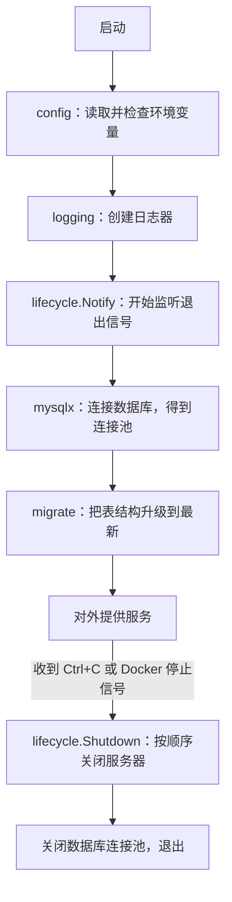
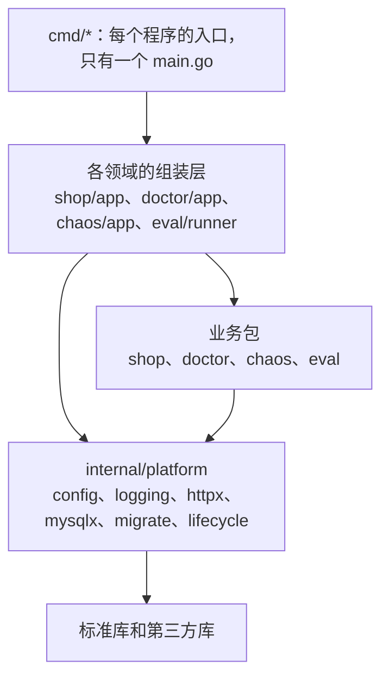

# 阶段 0 学习材料：项目的地基

这个阶段还没有任何业务功能，做的是盖楼前的准备，一共三件事：

1. 写好**每个服务都要用的基础部件**：读配置、写日志、连数据库、建表（迁移）、HTTP 请求的公共处理、优雅停机。
2. 写好**两个自动检查工具**：一个检查代码说明有没有写全，一个检查代码有没有放错位置。
3. 用 Docker 跑起 **MySQL、Redis、Kafka** 三个基础组件。

**怎样读这份材料。** OpsDoctor 的学习材料以系统设计为主线：模块怎样划分、依赖往哪个方向、出故障时怎样取舍。Go 语法不在这里展开，第 7 节列出了本阶段用到的写法，并链接到 [Mini-Redis 的学习文档](https://github.com/Li-Nepenthe/mini-redis/blob/main/docs/learn/README.md)。建议先学 Mini-Redis，再学这里。

> 这份材料对照的是**当前的代码**。阶段 1–3 给这些部件加过功能（比如日志里的 trace_id），遇到时会注明“阶段 X 加入”，第一次读可以先跳过。

## 1. 本阶段能回答的面试题

先带着这些问题读，读完回来检查自己能不能答出来。

| 面试题 | 在哪里 |
|---|---|
| 公共库（platform 层）的边界怎么划？怎样保证它不反过来依赖业务代码？ | 5.1 |
| 配置为什么要在启动时就校验？“没设置”和“设成空值”为什么要分开处理？ | 5.2 |
| 一个请求经过好几个服务，怎样把它的日志串起来？ | 5.3、八股 5 |
| HTTP 服务的入口要做哪些公共处理？中间件的顺序为什么重要？ | 5.4 |
| 数据库连接池的参数怎么定？ | 5.5、八股 3 |
| 多个实例同时启动，怎样保证数据库迁移只执行一次？ | 5.6、八股 2 |
| 迁移为什么不能用一个事务包起来？迁移文件应该怎样设计？ | 5.7、八股 2 |
| 优雅停机的流程是什么？`docker stop` 或者 Kubernetes 删 Pod 时，服务经历了什么？ | 5.8、八股 1 |
| JWT 和 Session 有什么区别？密码为什么用 bcrypt 存？ | 5.9、八股 4 |
| 代码规范靠什么落地？机器检查能证明什么、不能证明什么？ | 5.10 |

## 2. 地基在系统里的位置

### 2.1 一个服务从启动到退出，用到了哪些部件

下面是库存服务（阶段 1 写的）的启动过程，代码在 [inventoryservice/app.go](../../internal/shop/app/inventoryservice/app.go) 的 `Run` 函数里：



图里只画了本阶段的部件。阶段 3 加入可观测性以后，读完配置还会先初始化 telemetry（指标和调用链），退出时最后关闭它。

订单服务对外提供 HTTP 接口，每个请求还会先经过 **httpx** 的公共处理：分配请求编号、接住 panic、限制请求体大小。

### 2.2 依赖方向



箭头表示“可以导入”。最重要的一条规则是：**platform 只能被依赖，不能反过来导入任何业务包。** 另外，医生（doctor）不能导入靶场（shop）、注入器（chaos）和评测器（eval）的代码，它只能像一个外部的运维人员那样，通过观测数据了解靶场。这两条规则由 depguard 在 CI 里检查（5.1 节）。

### 2.3 各部件负责什么、不负责什么

| 部件 | 负责 | 不负责 | 以后谁用 |
|---|---|---|---|
| [config](../../internal/platform/config/doc.go) | 读取环境变量，检查格式和范围 | 决定有哪些变量、默认值是多少，这由各服务自己定 | 所有服务 |
| [logging](../../internal/platform/logging/doc.go) | 输出 JSON 日志，自动带上请求编号和调用链编号 | 日志的收集和查询，那是 Alloy 和 Loki 的事（阶段 3） | 所有服务 |
| [httpx](../../internal/platform/httpx/doc.go) | 请求编号、panic 恢复、请求体大小、统一的响应格式 | 路由和业务处理 | 订单服务、医生、压测工具 |
| [mysqlx](../../internal/platform/mysqlx/doc.go) | 创建连接池，统一时区、超时和连接数上限 | 写 SQL，那是各个仓储的事 | 所有要连数据库的服务 |
| [migrate](../../internal/platform/migrate/doc.go) | 按编号执行建表、改表的 SQL 文件，多个实例排队执行 | 迁移文件的内容，由各领域自己写 | shop 和 doctor |
| [lifecycle](../../internal/platform/lifecycle/doc.go) | 接收退出信号；按传入的顺序关闭资源 | 决定关闭顺序，这由组装层决定 | 所有服务 |
| [auth](../../internal/doctor/auth/doc.go) | 登录令牌（JWT）和密码（bcrypt）的规则 | HTTP 登录接口，阶段 5 才接上 | 医生服务 |
| [commentcheck](../../tools/commentcheck/doc.go) | 检查包说明、文件说明、导出声明的注释有没有写 | 判断注释写得好不好 | CI |
| [archcheck](../../tools/archcheck/doc.go) | 检查目录布局、标准答案的访问、医生容器的挂载和端口 | 运行时才能确定的行为 | CI |
| [depguard](../../.golangci.yml) | 检查谁能导入谁 | 同上 | CI |

## 3. 跑起来看什么

所有命令都在仓库根目录运行。开始前先打开 Docker Desktop。

**第 1 步：确认工具都装好了。**

```text
go version
docker version
gcc --version
go env CGO_ENABLED
```

你应该看到：Go 是 1.27.1；Docker 的 Client 和 Server 两部分都有输出（只有 Client，说明 Docker Desktop 没启动）；gcc 有版本号；`CGO_ENABLED` 是 1。gcc 和 CGO 是 `-race` 检测要用的，项目里没有 C 代码。

**第 2 步：准备 `.env` 文件。** 如果已经有了，跳过这一步，不要覆盖。

```text
cp .env.example .env
```

PowerShell 里用 `Copy-Item .env.example .env`。`.env` 里是本机用的演示密码，Git 会忽略它，`git status` 不会列出它。

**第 3 步：启动三个基础组件。**

```text
docker compose --env-file .env -f deploy/docker-compose.yml up -d --wait --wait-timeout 240 shop-mysql redis kafka
docker compose --env-file .env -f deploy/docker-compose.yml ps
```

你应该看到 shop-mysql、redis、kafka 三个都是 `healthy`，端口都以 `127.0.0.1:` 开头（只有本机能访问）。第一次运行要下载镜像，会慢一些。

**第 4 步：跑主要的检查和测试。**

```text
gofmt -l cmd gen internal tools
go vet ./...
staticcheck ./...
go run ./tools/commentcheck ./...
go run ./tools/archcheck ./...
go test -race ./... -count=1 -timeout=180s
```

你应该看到：前三条没有任何输出（没输出就是没问题）；两个检查工具各输出一行“通过”；测试里有测试文件的包显示 `ok`，没有测试文件的包显示 `? ... [no test files]`。如果提示找不到 `staticcheck`，先运行 `go install honnef.co/go/tools/cmd/staticcheck@v0.8.2`，并确认 `go install` 的安装目录在 PATH 里：设置了 `GOBIN` 时就是 `GOBIN`，否则是 `go env GOPATH` 下的 `bin`。

CI 还会多跑几项：`go mod tidy` 以后 go.mod 和 go.sum 不能有变化、两种构建方式的 golangci-lint、leakbug 版本的编译。完整清单见 [CI 配置](../../.github/workflows/ci.yml)。

**第 5 步：看看集成测试默认会跳过。**

```text
go test ./internal/platform/mysqlx ./internal/platform/migrate -run Integration -v
```

你应该看到 `SKIP`，以及开启方法的提示。需要连真实数据库的测试叫“集成测试”，默认不运行，这样平时跑测试不需要先启动数据库。

**第 6 步：打开集成测试。** 按[操作手册](../operations.md#运行真实-mysql-与-redis-集成测试)里“运行真实 MySQL 与 Redis 集成测试”一节，把测试库的连接地址设到当前终端，再运行：

```text
go test -race ./internal/platform/mysqlx ./internal/platform/migrate -run Integration -count=1 -timeout=90s -v
```

你应该看到 `TestOpenIntegration` 和 `TestApplyIntegration` 都是 `PASS`，而不是 `SKIP`。

**第 7 步：结束时停止容器。**

```text
docker compose --env-file .env -f deploy/docker-compose.yml down
```

容器会被删除，但数据卷会保留，下次启动时数据还在。不要加 `-v`，那会把数据卷一起删掉。

## 4. 代码走读

### 4.1 阅读顺序

按下面的顺序打开文件。每读一个函数，试着回答四个问题：调用它要给什么？成功了得到什么？失败了怎么办？用到的资源由谁关闭？

| 顺序 | 文件 | 重点看什么 |
|---|---|---|
| 1 | [go.mod](../../go.mod) | 整个仓库是一个 Go 模块。`require` 里列的是项目依赖的第三方库 |
| 2 | [config.go](../../internal/platform/config/config.go) | `String` 怎样区分“没设置”和“设成空值”；`Reader` 为什么保存一个查找函数 |
| 3 | [config_test.go](../../internal/platform/config/config_test.go) | 一张表列出所有边界：缺省、空值、格式错、越界 |
| 4 | [logging.go](../../internal/platform/logging/logging.go) | 先读 `Fields`、`WithFields`、`FromContext`，再读 `Handle`：编号怎样放进 context，又怎样在写日志时取出来 |
| 5 | [httpx.go](../../internal/platform/httpx/httpx.go) | `RequestIDs` 和 `Recovery` 的安装顺序；`BodyLimit` 和 `BindJSON` 怎样配合 |
| 6 | [httpx_test.go](../../internal/platform/httpx/httpx_test.go) | 不启动真实服务器也能测 HTTP 处理 |
| 7 | [auth.go](../../internal/doctor/auth/auth.go) | `Parse` 要检查哪几项；为什么密码最长只能 72 字节 |
| 8 | [mysql.go](../../internal/platform/mysqlx/mysql.go) | 先读 `prepare`（所有统一设置都在这里），再读 `Open` |
| 9 | [files.go](../../internal/platform/migrate/files.go) | 迁移文件要满足哪些规则；校验和覆盖的是原始字节 |
| 10 | [migrate.go](../../internal/platform/migrate/migrate.go) | 先读 `Apply`，再按 `acquire` → `readHistory` → `verifyHistory` → `release` 读。配合 5.6、5.7 节 |
| 11 | [migrate_integration_test.go](../../internal/platform/migrate/migrate_integration_test.go) | 怎样测试“两个服务同时迁移” |
| 12 | [lifecycle.go](../../internal/platform/lifecycle/lifecycle.go) | `Shutdown` 为什么要另开一个时限。配合 5.8 节 |
| 13 | [docker-compose.yml](../../deploy/docker-compose.yml) | 只看 shop-mysql、redis、kafka 三个服务：镜像、端口、`healthcheck`、数据卷 |
| 14 | [CI 配置](../../.github/workflows/ci.yml) | 本机跑的检查，怎样在 GitHub 的 Linux 机器上再跑一遍 |
| 15 | [commentcheck](../../tools/commentcheck/doc.go)、[archcheck](../../tools/archcheck/doc.go) | **放到最后。** 先读 doc.go，知道它们检查什么。规则代码要用到 Go 的语法树（7.6 节），看不懂可以先跳过 |

### 4.2 一个请求从进门到写出日志

读 httpx.go 和 logging.go 时，最好对照一次真实的输出。下面的输出来自一次真实运行：用本阶段的 `logging.New`、`RequestIDs`、`Recovery`、`BodyLimit`、`BindJSON`、`Success`，加上一个简化的下单接口（真实的下单接口在阶段 2），中间件的先后顺序和真实订单服务一样。真实订单服务还多装了几层：最外面有调用链和指标，中间还有限流和请求时限，见 [orderservice/app.go](../../internal/shop/app/orderservice/app.go) 的 `routes`。

请求是 `POST /orders`，请求头带 `User-Agent: curl/8.10.1`，没带 `X-Request-ID`，正文是 `{"sku_id":1001,"quantity":2}`，共 28 字节。

| 顺序 | 谁在处理 | 做了什么 |
|---|---|---|
| 1 | `RequestIDs`，`ctx.Next()` 之前 | 请求头里没有编号，就生成一个随机编号 `2IYWAJ2PD4KYGJZRB3EZSUFA75`，放进 context，同时写进响应头；记下开始时间 |
| 2 | `Recovery`，`ctx.Next()` 之前 | 登记一个 defer，准备接住 panic |
| 3 | `BodyLimit` | `Content-Length` 是 28，没超过 1 MiB；给正文套上 `MaxBytesReader` |
| 4 | 处理函数 | `BindJSON` 解析出 sku_id=1001、quantity=2；写一条业务日志；`Success` 写出 201 响应 |
| 5 | `Recovery` 的 defer | 没有 panic，什么也不做 |
| 6 | `RequestIDs`，`ctx.Next()` 之后 | 里面都做完了，写访问日志：方法、路由、状态码、耗时 |

程序真实写出的两条日志，每条是一行 JSON：

```text
{"time":"2026-11-02T14:57:05.5137577Z","level":"INFO","msg":"收到下单请求","service":"order-service","sku_id":1001,"quantity":2,"request_id":"2IYWAJ2PD4KYGJZRB3EZSUFA75"}
{"time":"2026-11-02T14:57:05.5137577Z","level":"INFO","msg":"HTTP 请求完成","service":"order-service","method":"POST","route":"/orders","status":201,"duration_ms":0,"user_agent":"curl/8.10.1","request_id":"2IYWAJ2PD4KYGJZRB3EZSUFA75"}
```

客户端收到的响应：状态码 201，响应头 `X-Request-ID: 2IYWAJ2PD4KYGJZRB3EZSUFA75`，正文是：

```json
{"code":"OK","data":{"order_id":1},"request_id":"2IYWAJ2PD4KYGJZRB3EZSUFA75"}
```

对照着看四个细节：

1. **两条日志的 `request_id` 相同。** 处理函数里只写了 `logger.InfoContext(ctx.Request.Context(), "收到下单请求", "sku_id", ...)`，没有手动传编号。是 logging 包的 `Handle` 在写出时，从 context 里取出编号补上的（5.3 节）。
2. **业务日志在前，访问日志在后。** 访问日志写在 `ctx.Next()` 之后，要等里面的处理全部做完，才知道状态码和耗时。
3. **`time` 结尾的 `Z` 表示 UTC**，由 `utcTime` 统一。`duration_ms` 是 0，因为这个简化接口不到 1 毫秒就做完了。
4. **日志里只有路由模板 `/orders`，没有完整的 URL。** 即使 URL 的查询参数里带了密码，也不会进日志。

同一个接口的另外三种情况，也是真实输出：

| 情况 | 响应 | 日志 |
|---|---|---|
| 客户端自带 `X-Request-ID: my-trace-001` | 201，响应头和正文里的编号都是 `my-trace-001` | 两条日志也都用 `my-trace-001`，客户端可以拿自己的编号来查日志 |
| 参数名拼错：`{"sku_id":1001,"qty":2}` | 400，正文 `{"code":"INVALID_ARGUMENT","message":"请求必须是符合接口约定的单个 JSON 值",...}` | 只有一条访问日志，`"status":400`。处理函数在 `BindJSON` 那里就返回了，没有业务日志 |
| 处理函数里发生 panic | 500，正文 `{"code":"INTERNAL","message":"内部错误",...}` | 先是一条 `"level":"ERROR","msg":"HTTP 请求异常","error":"panic"`，再是 `"status":500` 的访问日志，两条编号相同。panic 的具体内容既没进日志，也没返回给客户端 |

这次运行用的是现在的代码，所以访问日志里有 `user_agent` 字段，这个字段是阶段 8 才加的。启动订单服务以后用 curl 发请求，再运行 `docker compose --env-file .env -f deploy/docker-compose.yml logs order-service`，能看到同样结构的日志；阶段 3 以后，日志还会自动带上当前调用链的 `trace_id` 和 `span_id`。

### 4.3 两个服务同时启动，迁移怎样排队

假设 shop 库是全新的，库存服务（下表的 A）和 order-worker（B）同时启动。用 Compose 一次启动所有服务时，这种情况很常见。shop 库目前有 5 个迁移文件，从 `0001_products.sql` 到 `0005_processed_events.sql`，都是阶段 1 加的。

两边算出的锁名相同：`acquire` 先执行 `SELECT DATABASE()` 得到 `shop`，取它的 SHA-256 摘要的前 16 字节，得到 `opsdoctor:migrate:8d9001d32c6a703d95921a77115050f3`。同一个库永远是同一个锁名；迁移别的库（比如测试库）时锁名不同，互不阻挡。

| 时刻 | 库存服务（A） | order-worker（B） |
|---|---|---|
| 1 | 先读取并检查全部迁移文件，再用 `database.Conn` 从连接池借出一条连接，记作 A1，算出锁名 | 同样先检查文件，再借出连接 B1，算出同一个锁名 |
| 2 | 在 A1 上执行 `GET_LOCK(锁名, 30)`，返回 1：拿到锁 | 在 B1 上执行 `GET_LOCK(锁名, 30)`：锁在 A1 手里，开始等，最多等 30 秒 |
| 3 | 建历史表 `schema_migrations`（已存在就跳过）；读历史，是空的；核对历史，没问题 | 还在等 |
| 4 | 依次执行 0001 到 0005。每执行成功一个，就往历史表插一行：文件名和校验和 | 还在等 |
| 5 | `Apply` 返回，两个 defer 按“后登记先执行”：先在 A1 上 `RELEASE_LOCK`（返回 1），再把 A1 还回连接池 | `GET_LOCK` 返回 1：拿到锁 |
| 6 | 继续启动，开始对外服务 | 读历史：5 行都在，校验和与本地文件一致；5 个文件全部跳过；释放锁，还回连接 |

要注意的几点：

1. **B 一条迁移 SQL 都没执行。** 它是在 A 写完历史以后才读历史的。如果不排队，A、B 可能同时发现“0003 还没执行”，各执行一遍。
2. **等不到锁会明确失败。** B 受两个时限约束：`GET_LOCK` 自己最多等 30 秒，等满返回 0；order-worker 的整个启动也只有 30 秒（[orderworker/app.go](../../internal/shop/app/orderworker/app.go) 的 `startupTimeout`），这个时限先到时，查询会被取消。无论哪种情况，`Apply` 都返回错误，B 启动失败并退出，不会在没拿到锁的情况下硬着头皮迁移。
3. **解锁失败也不会让锁一直挂着。** 如果第 5 步的 `RELEASE_LOCK` 没有返回 1（比如网络刚好断了），`release` 会调用 `discard` 让连接池扔掉 A1。连接一断，MySQL 自动释放 A1 拿着的锁。B 只要还在等待期内，就能拿到锁。
4. **测试里怎样模拟这件事：** [migrate_integration_test.go](../../internal/platform/migrate/migrate_integration_test.go) 开两个 goroutine 同时调用 `Apply`，等两边都结束后，检查历史表里只记了一条。

## 5. 系统设计与取舍

每个设计点按同一个顺序讲：要解决什么问题 → 怎么做 → 放弃了什么、为什么 → 代价和适用边界 → 规模变大十倍会怎样。

### 5.1 公共骨架：一个仓库，用规则隔开各部分

**问题。** 三个靶场服务、医生、注入器、评测器都要读配置、写日志、连数据库、停机。每个服务各写一遍，行为会慢慢不一致：有的服务配置写错了照样启动，有的日志没有请求编号。

**做法。** 把这些公共能力放进 `internal/platform`，每个服务在自己的组装层（例如 `shop/app/inventoryservice`）把它们拼起来。整个项目只有一个 Go 模块（一个 `go.mod`），代码按领域分目录：通用部件在 `internal/platform`，靶场在 `internal/shop`，医生在 `internal/doctor`。

**放弃了什么。**

- **拆成多个模块或多个仓库。** 这样能用模块边界强制隔离，但每改一次 platform，都要发版本、再让各服务升级。项目只有一个开发者，这些成本换不来收益。
- **只靠 `internal` 目录隔离。** `internal` 是 Go 认识的特殊目录名，放在它下面的包只有本仓库能导入。它挡得住其他仓库，挡不住本仓库内部：医生的代码照样能导入靶场的代码。

**代价。** 一个模块里，Go 不会阻止任何包导入任何包，所以依赖方向要靠工具检查：depguard 在 CI 里检查“谁能导入谁”（比如 platform 不能导入 doctor），archcheck 检查目录布局、标准答案的访问，以及医生容器的挂载和端口。规则写在 [.golangci.yml](../../.golangci.yml) 里，违反时 CI 失败。

**规模变大十倍。** 如果有十个团队、几十个服务，platform 会变成一个单独维护、带版本号的公共库，各服务按版本升级；“谁能依赖谁”仍然要靠工具检查，只是规则会更多。

### 5.2 配置：在启动时就检查

**问题。** 配置写错了，比如超时写成了 `5`（少了单位），如果等到第一个请求进来才发现，排查起来很麻烦。最好启动时就报错退出，并说清楚是哪个变量错了。

**做法。** 每个服务启动时，用 [config.Reader](../../internal/platform/config/config.go) 逐项读取配置。每一项都要给出默认值，数字和时长还要给出允许的范围，不合法就返回错误，服务不会启动。变量名、默认值和范围由各服务自己定，config 包只提供读取和校验的规则。

**一个细节：“没设置”和“设成空值”不一样。**

- 没设置这个变量：使用默认值。
- 设置了，但值是空的（比如 `HTTP_ADDR=`）：报错。这通常是部署时漏填了值，用默认值反而会掩盖这个错误。

`String` 靠 `os.LookupEnv` 的第二个返回值区分这两种情况：变量存在时为 `true`，不存在时为 `false`。

必填项的写法是把默认值设成空字符串。比如 shop 的数据库连接串 `MYSQL_DSN`（[shop/app/config.go](../../internal/shop/app/config.go)），没设置时用的默认值是空的，设成空也是空的，两种情况都会报错。

**错误信息里只有变量名，没有变量的值。** 变量的值可能是密码，比如 `MYSQL_DSN` 里就带着数据库密码。错误信息会进日志，所以只说“哪个变量、要求是什么”。

**为什么 `Reader` 保存一个查找函数。** `Reader` 里没有直接调用 `os.LookupEnv`，而是保存了一个“查变量”的函数。真实运行时传 `os.LookupEnv`，测试时传一个查假数据的函数。这样测试不需要修改进程的环境变量，多个测试并行跑也不会互相影响。这种做法叫依赖注入：把一个函数需要的外部能力从参数传进来，而不是在函数里写死。

**放弃了什么。** 没有用配置框架（例如 Viper），也没有用配置文件。环境变量是容器部署最通用的配置方式，同一个镜像换一组变量就能部署到不同环境，密码也不会打进镜像。

**代价。** 改配置要重启服务，不支持热更新。变量一多，名字和默认值容易被无意中改掉，Compose 文件和 `.env.example` 却还按旧的写；可读性改造时专门加了环境变量测试，把各程序读取的变量名和大部分默认值固定下来；worker、alertsink、shopctl 和 eval 还有几个默认值没测到，要等后面的批次补上。

**规模变大十倍。** 服务多了以后，常见做法是把配置放进配置中心（例如 etcd、Nacos），把密码放进专门的密钥管理服务。但“启动时校验、错误里不带值”这两条原则不变。

### 5.3 日志：把同一个请求的日志串起来

**问题。** 服务同时处理很多请求，日志交错在一起。排查某个请求时，要能把它的日志全部挑出来。

**做法。** 每个请求进来时，`httpx.RequestIDs` 给它分配一个编号 `request_id`，放进请求的 context。之后业务代码写日志时都带着这个 context（`logger.InfoContext(ctx, ...)`），日志部件在写出时，自动从 context 里取出编号加到日志里。

> **context** 是沿着函数调用一路往下传的一个对象，可以携带“这个请求的附加信息”和“取消通知”。语法见 [Mini-Redis 第 07 章“context”](https://github.com/Li-Nepenthe/mini-redis/blob/main/docs/learn/07-channel-context与WaitGroup.md)。

**放弃了什么：用全局变量保存编号。** 同时有很多请求在处理，全局变量只有一份，会被不同请求互相覆盖。context 是每个请求各有一份，所以不会串。

**两个容易写错的地方。**

1. **调用链编号每次写日志时重新取。** `Fields` 在阶段 0 就有 `TraceID` 和 `SpanID` 两个字段，阶段 3 接入调用链以后才开始自动填。一个请求里会有很多个操作（span），比如一次 SQL 查询、一次 gRPC 调用。如果在请求入口取一次 `trace_id` 和 `span_id` 存下来，那么 SQL 里写的日志也会带着入口的 span 编号，定位不到实际出问题的操作。所以 [FromContext](../../internal/platform/logging/logging.go) 每次都从 context 里取**当前**的 span。
2. **派生出来的日志器要复制字段，不能共享。** `logger.With("order_id", 1)` 会派生一个新日志器。如果新旧日志器共用同一份字段列表，一个请求追加的字段可能出现在另一个请求的日志里。所以 `WithAttrs` 和 `Handle` 都先复制一份再追加。

**代价。** 每个写日志的地方都必须传 context，忘了传，这条日志就没有编号。

**规模变大十倍。** 日志量大了，要按级别和采样控制写多少。查询端也要小心：阶段 3 接入 Loki 时，只把服务名和日志级别做成索引标签，trace_id 这种每次都不同的值留在日志正文里，查询时再解析，否则索引会无限膨胀（见 [Alloy 配置](../../deploy/alloy/config.alloy)里的说明）。

> 阶段 0 的日志部件已经能写出 `trace_id` 和 `span_id`，但要调用方通过 `WithFields` 自己赋值（当时只有测试这样做）；阶段 3 接入调用链之后，才改成从当前 span 自动取值。

> **对照阅读**：《Golang面试题》[6.1 Go语言里的Context是什么？](https://www.xiaolincoding.com/interview/golang.html#_6-1-go语言里的context是什么) 到 [6.4 Context如何被取消](https://www.xiaolincoding.com/interview/golang.html#_6-4-context如何被取消)。context 有两个用途：携带信息、传递取消通知。本节用的是第一个；5.8 节的优雅停机用的是第二个。

### 5.4 HTTP 入口：所有接口共用的保护

**补基础：一个 HTTP 请求长什么样。** 客户端发来的请求分三部分：

1. 第一行是方法和路径，比如 `POST /orders`。
2. 接着是请求头，一行一个“名字: 值”。比如 `Content-Length: 28` 表示正文有 28 字节；`User-Agent: curl/8.10.1` 表示用什么工具发的；`X-Request-ID` 是客户端可以自带的请求编号。
3. 空一行之后是正文，这里是一段 JSON。

服务端的回复也是三部分：状态码、响应头、响应正文。状态码 2 开头表示成功，4 开头表示客户端的请求有问题，5 开头表示服务端自己出错。本节会用到：201（创建成功）、400（请求格式不对）、413（请求体太大）、500（服务端内部出错）。

**问题。** 每个接口都要面对同样的风险：业务代码 panic 把服务搞崩、客户端发来超大的请求把内存占满、参数拼错却被悄悄忽略。这些不能指望每个接口自己处理。

**做法：用中间件统一处理。** 中间件是套在处理函数外面的一层层壳，请求从外往里穿过每一层（Gin 的写法见 7.3 节）。httpx 提供四样东西：

1. **`RequestIDs`：分配请求编号。** 客户端自带的编号只接受有限长度的字母、数字、短横线和下划线，因为它会原样写进日志和响应头；不合格就换成随机编号。访问日志只记路由模板（`/orders/:id`），不记原始 URL，因为查询串里可能有密码。
2. **`Recovery`：接住 panic。** 如果响应还没开始写，就返回统一的 500 错误；如果已经写出了一部分（比如流式响应），状态码改不了，只能中止处理。日志里只记“发生了 panic”，不记 panic 的具体内容，因为里面可能有 SQL 或密码。客户端拿到的响应里有 `request_id`，开发者可以用它查日志。
3. **`BodyLimit`：请求体限制两次。** 先看请求头里的 `Content-Length`，已经超了就直接拒绝；再把正文包一层 `http.MaxBytesReader`，实际读的时候边读边计数。只看 `Content-Length` 不够：客户端可以不发它（分块传输），也可以谎报。
4. **`BindJSON`：严格解析。** 出现结构体里没有的字段就报错，因为这通常说明参数名拼错了，悄悄忽略反而让调用方以为成功了。解析完一个 JSON 以后再读一次，必须已经读到结尾，防止正文后面偷偷追加第二个 JSON。

**顺序为什么重要。** `RequestIDs` 要装在 `Recovery` 外面（先安装）。处理函数 panic 以后，里层的 `Recovery` 把它接住、写出 500 响应，然后正常返回，外层的 `RequestIDs` 才能执行 `ctx.Next()` 之后的代码，写出这次请求的访问日志（状态 500）。反过来装，panic 会一路穿过 `RequestIDs`，跳过它写访问日志的代码，这次失败的请求在访问日志里就查不到了。（请求编号在处理函数执行之前就分配好了，所以两种顺序下，500 响应和错误日志里都有编号。这一点在本地实验里验证过。）

**放弃了什么：在日志里记完整的请求。** 记下请求正文和完整 URL，排查时最方便，但密码、令牌会跟着进日志，日志又会被很多人和系统读取。项目选择只记路由、状态码和耗时。

**代价和边界。** `Recovery` 只接得住当前请求这个 goroutine 里的 panic。业务代码自己另起的 goroutine 里发生 panic，它管不到，整个进程会崩溃。那种 goroutine 必须自己处理 panic（语法见 [Mini-Redis 第 02 章“goroutine 里的 panic”](https://github.com/Li-Nepenthe/mini-redis/blob/main/docs/learn/02-goroutine与调度.md)）。

**规模变大十倍。** 前面通常会加一层 API 网关，统一做请求体限制、限流和请求编号。但服务自己的这几道检查仍然保留：网关可能配置错，内部调用也可能绕过网关。

> **对照阅读**：《图解网络》[HTTP 常见面试题](https://www.xiaolincoding.com/network/2_http/http_interview.html) 里的 [HTTP 常见的状态码有哪些？](https://www.xiaolincoding.com/network/2_http/http_interview.html#http-常见的状态码有哪些) 和 [HTTP 常见字段有哪些？](https://www.xiaolincoding.com/network/2_http/http_interview.html#http-常见字段有哪些)。小林讲 `Content-Length` 时，说的是它用来标出正文在哪里结束；本项目还多用了一步：拿它提前拒绝过大的请求。

### 5.5 连接池：一种预算，以及时区要设两个地方

**问题。** 每个服务都要连 MySQL。连接建得太多会压垮数据库，太少又会让请求排队；时间如果在 Go 和 MySQL 两边按不同的时区理解，订单时间、过期时间都会算错。

**补基础：为什么建一条连接很贵。** 程序和 MySQL 之间的每条连接，建立时要先完成 TCP 三次握手，再由 MySQL 校验用户名和密码、读取权限，前后要在网络上来回好几趟。连接池把建好的连接留着反复用，省掉的就是这部分开销。

**做法。** [mysqlx.Open](../../internal/platform/mysqlx/mysql.go) 统一创建连接池。Go 的 `*sql.DB` 本身就是连接池，不是一条连接（7.2 节）。它的几个参数是一种预算：

| 参数 | 含义 | 设得不对会怎样 |
|---|---|---|
| `MaxOpenConns` | 最多同时开多少条连接 | 太大会压垮数据库；太小时请求要排队等连接 |
| `MaxIdleConns` | 最多保留多少条空闲连接 | 空闲连接留着可以复用，省掉重新建连的时间 |
| `ConnMaxLifetime` | 一条连接最多使用多久，到期就换新的 | 定期换掉旧连接，避免一直用一条可能已经出问题的连接 |

`prepare` 在连接之前做了四件事：

1. **拒绝 `MaxOpenConns` 为 0。** Go 标准库里 0 表示“不限制”，一个服务就可能占满整台 MySQL 的连接。
2. **两边都设成 UTC。** 数据库里的时间会经过两个环节：MySQL 自己计算时间（比如 `NOW()`）用的是会话时区 `time_zone`；Go 驱动把读到的时间转成 `time.Time` 用的是 DSN 里的 `loc`。只设一边，两边对时间的理解就可能不一致。
3. **关掉多语句。** 一条 SQL 里不能用分号拼多条语句，这能挡住一类 SQL 注入，也决定了迁移文件只能一个文件一条语句（5.7 节）。
4. **设置网络超时。** 连接 5 秒、读写 30 秒，读的时间留给迁移这类较长的 SQL。

最后 `Open` 会主动 Ping 一次，连不上数据库的服务在接收请求之前就退出。

**放弃了什么：ORM。** 项目直接写 SQL，不用 ORM（比如 GORM）。代价是要自己写 Scan；好处是每条 SQL 用了哪个索引、加了什么锁都能直接看到，这在阶段 1 的防超卖和阶段 4 的慢查询实验里很重要。

**代价和边界。** 连接数上限是按“这台 MySQL 只服务这几个服务”估的。shop 的三个服务默认各 20 条（[shop/app/config.go](../../internal/shop/app/config.go)），合计 60 条，低于 [Compose](../../deploy/docker-compose.yml) 给 shop-mysql 设的 `max-connections=100`。

**规模变大十倍。** 每个服务部署十个实例，20 × 3 × 10 = 600 条，远超 MySQL 的上限（MySQL 8.4 的默认值是 151）。这时要么把每个实例的上限调小，要么在中间加一层数据库代理统一管理连接。判断上限够不够，看连接池的等待次数和等待时间，项目用 telemetry 包把这些统计导出成了 Prometheus 指标。

> **对照阅读**：
> - 《图解网络》[TCP 三次握手过程是怎样的？](https://www.xiaolincoding.com/network/3_tcp/tcp_interview.html#tcp-三次握手过程是怎样的)：新建一条 TCP 连接要来回几趟。
> - 《图解MySQL》[执行一条 select 语句，期间发生了什么？](https://www.xiaolincoding.com/mysql/base/how_select.html#第一步-连接器) 的“第一步：连接器”：长连接和短连接有什么区别，为什么要定期断开长连接。上表的 `ConnMaxLifetime`，就是让连接池替你定期换掉旧连接。

### 5.6 迁移排队：锁属于一条连接

**问题。** 订单服务、库存服务、order-worker 启动时都会执行迁移。如果两个服务同时启动，都发现“0003 号迁移还没执行”，就会各执行一遍，同一个字段可能被加两次。所以执行迁移前要排队，一次只让一个进程迁移。

**补基础：锁到底是什么。** 好几个人要改同一样东西时，规定“同一时刻只能有一个人在改，其他人排队”，这叫**互斥**，用来排队的东西就是**锁**。Go 里的 `sync.Mutex` 只管得住一个进程；MySQL 的锁对所有连到这个数据库的进程都有效。迁移要拦住的是好几个服务进程，所以只能用数据库里的锁。

**做法：MySQL 的命名锁。** 调用 `GET_LOCK('名字', 等待秒数)`，第一个进程拿到锁，后来的进程就等着，直到前一个调用 `RELEASE_LOCK('名字')` 释放。这种按名字区分的锁叫“命名锁”。锁名由库名的摘要算出，同一个库用同一个锁名；摘要只取前 16 字节，让锁名满足 MySQL 的 64 字符上限。

**关键：这把锁属于某一条数据库连接（会话）。** MySQL 记录的是“哪条连接拿着锁”，只有这条连接能释放它；连接一断开，锁自动释放。而 `*sql.DB` 是连接池，每次执行可能分到不同的连接：你可能在 3 号连接上拿到锁，执行迁移时用的是 5 号，想解锁时又分到了 7 号，7 号根本没拿过这把锁。

所以 [Apply](../../internal/platform/migrate/migrate.go) 检查完迁移文件以后，用 `database.Conn(ctx)` 从池里借出一条固定的连接，加锁、执行迁移、解锁都通过它完成，最后再还回池子。先检查文件再借连接，是为了不让一个写错的文件白白占着锁，让其他实例空等。

**解锁失败怎么办。** 解锁出错时，这条连接可能还拿着锁。如果把它还回池子，下一个借到它的请求就会莫名其妙地拿着一把锁。所以 `release` 解锁失败时调用 `discard`，让连接池直接关掉这条连接，而不是放回池里。连接一断开，MySQL 就自动释放了锁。加锁时也一样：如果取消恰好发生在拿到锁之后，程序无法确认这条连接是否持锁，也会丢弃它。

**放弃了什么。**

- **用一张表的一行当锁**（比如 `UPDATE migration_lock SET owner=?`）。进程崩溃时这一行不会自动清掉，需要再加过期机制；命名锁随连接断开自动释放，省掉了这部分。
- **等锁一直等下去。** 等待上限是 30 秒，超时就让服务启动失败，由部署系统决定重试，而不是卡在启动阶段没人知道。

**代价和边界。** 命名锁只在同一台 MySQL 上有效。如果数据库前面有会把连接分到不同节点的代理，这个办法就不成立了。

**规模变大十倍。** 实例多了以后，常见做法是不让每个服务在启动时迁移，而是在发布流程里单独跑一次迁移任务（比如 Kubernetes 的 Job），成功后再滚动发布服务。这样迁移只有一个执行者，也不会因为迁移慢拖住所有实例的启动。

> **对照阅读**：
> - 《图解系统》[多线程冲突了怎么办？](https://www.xiaolincoding.com/os/4_process/multithread_sync.html#互斥的概念) 的“互斥的概念”：锁要解决什么问题。
> - 《图解MySQL》[MySQL 有哪些锁？](https://www.xiaolincoding.com/mysql/lock/mysql_lock.html)：MySQL 自带全局锁、表级锁、行锁三类。命名锁不在其中，它是 MySQL 另外提供的“按名字加的锁”，但有一点相同：会话断开后锁会自动释放，这正是 `discard` 能解开锁的原因。另外，执行 `CREATE TABLE`、`ALTER TABLE` 时 MySQL 会自动加[元数据锁](https://www.xiaolincoding.com/mysql/lock/mysql_lock.html#元数据锁)，这也是大表改结构会卡住业务查询的原因。

### 5.7 迁移的可靠性：不用事务，让每一步都能重跑

**补基础：事务是什么。** 事务是一组 SQL，要么全部生效，要么全部不生效，这叫**原子性**。比如转账要“A 扣 100”和“B 加 100”两步，放进一个事务里，第二步失败时，程序执行回滚（ROLLBACK），第一步也会被撤销。注意 MySQL 遇到普通的语句错误时，通常只撤销出错的那一条语句，整个事务要由程序显式回滚。普通的 INSERT、UPDATE 都可以这样回滚，但下面要说的修改表结构的语句不行。

**问题。** 把所有迁移放进一个事务，出错就回滚，看起来最安全。但在 MySQL 里做不到：`CREATE TABLE`、`ALTER TABLE` 这类修改表结构的语句叫 DDL，MySQL 执行普通的建表、改表语句时会自动提交当前事务（叫“隐式提交”；临时表的 `CREATE/DROP TEMPORARY TABLE` 是少数例外，但它们本身也不能回滚）。第一条建表成功、第二条失败，第一张表不会因为回滚而消失。

**做法：让每个迁移都能安全地重跑。**

1. **一个文件只放一条 SQL**，执行成功后，立刻在 `schema_migrations` 表里记一笔。如果一个文件里写多条、用分号分开，程序就要按分号切开再逐条执行，而分号也可能出现在字符串里（比如 `'a;b'`），切错了就会执行出错误的 SQL。
2. **SQL 写成重复执行也不出错的形式**，比如 `CREATE TABLE IF NOT EXISTS`。原因是还有一个窗口：DDL 成功了，但记录历史时失败了。下次启动时这个文件会被再执行一次。
3. **历史只能往后追加。** 新文件的编号不能插到已经执行过的版本前面，这样新建的库和已有的库按同样的顺序升级。
4. **记录校验和。** 每个执行过的文件，都保存它原始字节的 SHA-256。每次启动都核对一遍，发现被改过（哪怕只改了一个空格）或者被删了，就报错。要修改表结构，只能新增一个迁移文件。

**放弃了什么：现成的迁移库。** 换库评估时对照过 golang-migrate v4.20.1，最后保留了自己的迁移器。原因有三条：它等锁的时间固定是 10 秒，不能按调用方的 context 取消；失败后会留下 dirty 状态，需要人工处理；它不校验已执行文件的内容。详细对照见[成熟库评估](library-evaluation.md)。

**代价。** 迁移文件会多一些；写 SQL 的人要记得写成能重跑的形式，这一点工具查不出来，只能靠评审。

**规模变大十倍。** 表大了以后，`ALTER TABLE` 可能要跑很久，期间的元数据锁会挡住业务查询。这时要用 MySQL 的在线 DDL，或者 gh-ost 这类工具在后台复制一张新表再切换；滚动发布时还要让新旧两版代码都能用同一张表，通常分两步：先加新列、新代码上线，再删旧列。

> **对照阅读**：《图解MySQL》[事务隔离级别是怎么实现的？](https://www.xiaolincoding.com/mysql/transaction/mvcc.html#事务有哪些特性) 开头的“事务有哪些特性？”。小林提到，原子性靠 undo log（回滚日志）来保证。本节说的 DDL 隐式提交，意思是它一执行完就算数，没法和别的语句一起回滚。

### 5.8 优雅停机：先收尾，再关门

**问题。** 直接杀掉进程，正在处理的请求会被打断，用户收到连接错误，数据库连接也来不及正常关闭。

**补基础：信号。** 信号是操作系统通知进程“发生了某件事”的方式。在终端按 Ctrl+C，进程收到 SIGINT；`docker stop` 默认先发 SIGTERM（镜像可以指定别的停止信号），等一段时间进程还没退出，再发 SIGKILL 强制杀掉。程序能接住 SIGINT 和 SIGTERM 去做清理，但接不住 SIGKILL。

**做法分两步。**

1. **[Notify](../../internal/platform/lifecycle/lifecycle.go)：把退出信号变成通知。** 收到 Ctrl+C 或 SIGTERM 时，`Notify` 返回的 context 会被取消。服务里所有拿着这个 context 的地方都能知道“该停了”，比如服务器停止接受新请求。
2. **`Shutdown`：按顺序关闭资源。** 组装层传入一组关闭步骤（Hook），`Shutdown` 按顺序逐个执行。顺序由组装层决定，原则是**先关依赖别人的，后关被依赖的**：先关服务器，让正在处理的请求做完；最后再关数据库连接池，因为请求做完之前还要用数据库。

**两个容易写错的地方。**

1. **清理要另开一个时限。** 调用 `Shutdown` 时，第 1 步的 context 往往已经被取消了。如果把这个已取消的 context 传给服务器的关闭函数，关闭函数会以为“时间到了”，立刻放弃等待，正在处理的请求就被打断了。所以 `Shutdown` 用 `context.WithoutCancel` 生成一个**不带取消状态**、但保留日志字段的新 context，再给它设一个新的时限（7.4 节）。
2. **一个资源关闭失败，也要继续关后面的。** `Shutdown` 记下错误继续往下关，最后把所有错误合并返回。不能因为服务器没关好，就连数据库连接也不关了。回调全部返回以后，如果总时限已经用完，也要把超时报告出来。

**时间要对得上。** 清理必须在 SIGKILL 到来之前做完。库存服务给在途请求 10 秒（[config.go](../../internal/shop/app/inventoryservice/config.go) 里的 `shutdownTimeout`），Compose 给库存服务的等待时间是 15 秒（`stop_grace_period: 15s`），比 10 秒长，留出了关闭数据库连接的时间。

**放弃了什么：收到信号就退出。** 最简单的写法是收到信号直接 `os.Exit`。代价就是本节开头说的那些问题。

**规模变大十倍。** 在 Kubernetes 上删除 Pod 时，控制面把 Pod 从负载均衡里摘掉，和节点开始终止容器（先执行 preStop 钩子，再发 SIGTERM）是并行进行的，两者没有先后保证，服务可能在被摘掉之前就停止接请求了。常见做法是在 preStop 里先等几秒，给摘除留出时间，并确认整个流程短于 `terminationGracePeriodSeconds`（默认 30 秒）。

> **对照阅读**：《图解系统》[进程间有哪些通信方式？](https://www.xiaolincoding.com/os/4_process/process_commu.html#信号) 的“信号”一节；《Golang面试题》[6.4 Context如何被取消](https://www.xiaolincoding.com/interview/golang.html#_6-4-context如何被取消)：`Notify` 收到信号后，就是靠取消 context 通知所有拿着它的代码。

### 5.9 密码和登录令牌

这部分代码在阶段 0 写好，阶段 5 做医生的登录功能时才用上。代码在 [auth.go](../../internal/doctor/auth/auth.go)。

**密码用 bcrypt 保存，不能还原。** bcrypt 计算的是密码的“摘要”，是单向的：只能拿用户输入的密码重新算一遍，比较结果是否相同，不能从摘要算回密码。它还故意算得很慢，并给每个密码加一段随机的“盐”，让攻击者没法快速地一个个试，也没法用提前算好的表反查。

**为什么密码最长 72 字节。** bcrypt 只会使用密码的前 72 个字节。如果允许更长的密码并悄悄截断，前 72 字节相同的两个不同密码会被当成同一个。所以超长的密码直接拒绝。

**令牌（JWT）能解码，不等于可信。** JWT 的内容只是用 Base64 编码过，任何人都能解码查看，甚至伪造一个。所以 `Parse` 必须检查：

- 签名对不对：证明令牌确实是本系统签发的，内容没被改过。项目用 HS256，签发和验证用同一个至少 32 字节的密钥。
- 签名算法是不是规定的那一种：防止攻击者把算法改成“无签名”来绕过检查。
- 签发方、受众对不对：防止拿别的系统签发的令牌来登录。
- 有没有过期：医生的登录令牌有效期是一小时。

除了这五项，项目还要求令牌里的用户编号（`sub`）不能为空，签发时间（`iat`）如果有，不能在未来。

**放弃了什么：服务端 Session。** 见八股 4。

> **对照阅读**：《图解网络》[HTTP 常见面试题](https://www.xiaolincoding.com/network/2_http/http_interview.html) 里“HTTPS 是如何解决上面的三个风险的？”中的“摘要算法 + 数字签名”。小林讲的数字签名是“私钥签、公钥验”；本项目的 HS256 签发和验证用**同一个密钥**，道理一样：没有这个密钥就算不出正确的签名，令牌内容被改过，签名就对不上。

### 5.10 规范怎样落地：机器能查什么，查不了什么

**问题。** 计划书规定了很多规则：包要有说明、依赖不能反向、标准答案只有注入器和评测器能读。人会忘，尤其是新增文件的时候。

**做法：把能机械检查的规则写成工具，放进 CI。**

| 手段 | 能发现什么 | 证明不了什么 |
|---|---|---|
| commentcheck | 包没有说明、文件没有说明、手写的非测试文件里导出的函数和类型没有文档注释、doc.go 漏列了包里手写的非测试文件 | 注释写得好不好、对不对 |
| archcheck | 目录布局、标准答案的访问、医生容器的挂载和内部端口 | 运行时才能确定的行为 |
| depguard | 当前构建中违反规则的导入；默认构建和 leakbug 构建分别检查 | 运行时的账号权限 |
| `go test -race` | 测试跑到的代码里的并发读写冲突 | 没被测试跑到的代码是否安全 |

**测试要有反例。** 检查工具如果只在合法代码上测试，一个永远输出“通过”的空壳工具也能通过。所以测试里专门写了故意违规的代码，证明工具真的会报错。

**测试被跳过（SKIP）不等于通过（PASS）。** 集成测试没有设置数据库地址时会跳过，那就是没有运行，什么也证明不了。汇报时要分清这两种情况。

**一次规则调整：检查过严，反而逼出了套话。** commentcheck 最初的规则是“每个函数（包括测试函数和未导出的函数）都要有注释”“函数体超过 15 行必须有内部注释”。机器只能检查“有没有写”，于是代码里出现了大量为了过检查而写的注释：字段注释复述字段名、函数注释罗列参数和返回值、长函数里插“第 1 步、第 2 步”。2026-11 的可读性改造把规则改成：

- 只要求**导出的**函数、方法、类型、常量和变量有文档注释；
- 测试文件不检查文档注释；
- 去掉“超过 15 行必须有内部注释”；
- doc.go 只需列出包里手写的非测试文件，不用列它自己。生成的代码不用列；`cmd/<命令>/main.go` 这种命令入口本来就用 main.go 的包注释代替 doc.go。

机器负责检查“该有的说明有没有”，注释写得好不好交给人来审。决定和理由记在 [decisions.md](../decisions.md) 里。这个经历本身就是一道好面试题：一条检查规则为什么会让质量变差？因为它把“写了注释”当成了“说明白了”，而作者为了通过检查，会写出能通过、但没有信息量的东西。

**规模变大十倍。** 团队大了以后，这类规则通常放进 lint 配置和代码评审模板里，并定期回头看：哪些规则在制造噪音，就删掉或放宽。

### 5.11 Docker Compose：容器启动了，不等于能用了

**补基础：镜像、容器、数据卷。** 镜像是一个只读的“安装包”，比如 `mysql:8.4.13`；容器是用镜像启动起来、正在运行的程序，同一个镜像可以启动好多个容器。容器被删除后，写在容器里面的数据也跟着没了，所以数据库要把数据放在**数据卷**里，数据卷独立于容器保存。Compose 用一个 YAML 文件写清楚要启动哪些容器、它们怎样连在一起，一条命令就能全部启动。

**健康检查（healthcheck）。** 容器里的进程启动了，MySQL 不一定已经能接受查询，它可能还在初始化。所以每个组件都配了 `healthcheck`，Docker 定期执行一条命令（比如真的发一条查询），成功了才标记为 `healthy`。

**`depends_on`。** 后启动的服务（比如库存服务）用 `depends_on: condition: service_healthy` 声明“等 MySQL 健康了我再启动”。但它只管第一次启动的顺序。服务运行起来以后，如果数据库断了，还是要靠服务自己的超时和重连来处理。

**数据卷和初始化脚本。** 删掉容器，数据卷还在，数据也还在。这也意味着 MySQL 的初始化脚本只在数据卷第一次创建时执行一次。之后改 `.env` 里的密码，不会改掉数据库里已经建好的账号的密码。

> **对照阅读**：《Docker面试题》[镜像和容器有什么区别？](https://www.xiaolincoding.com/interview/docker.html#镜像和容器有什么区别)、[Docker 容器数据持久化有哪些方式？](https://www.xiaolincoding.com/interview/docker.html#docker-容器数据持久化有哪些方式)、[Docker Compose 是什么？什么场景用？](https://www.xiaolincoding.com/interview/docker.html#docker-compose-是什么-什么场景用)。小林那边没有讲 healthcheck，这部分以本节为准。

## 6. 系统设计八股

每题先给一分钟口述版，面试时照着这个长度说；再给要点、项目里的例子和常见追问。

### 八股 1：优雅停机怎么做？

#### 一分钟口述版

优雅停机是指服务收到退出信号后，不立刻退出，而是先停止接收新请求，等正在处理的请求做完，再按依赖关系的反方向关闭资源，比如先关 HTTP 服务器，最后关数据库连接池。整个过程要有一个总时限，因为容器平台在等待一段时间后会强制杀掉进程。我的项目里，信号被转成 context 取消，通知所有组件；关闭时另开一个带时限的 context，因为原来的那个已经被取消了，直接用会让关闭函数立刻放弃等待。一个资源关闭失败也继续关后面的，最后把错误合并返回。

#### 要点

- 信号：SIGINT（Ctrl+C）、SIGTERM（`docker stop`、Kubernetes 删 Pod）可以接住；SIGKILL 接不住。
- 顺序：停止接新请求 → 等在途请求 → 关后台任务 → 关连接池等底层资源。
- 时限：程序里的清理时限要小于平台的等待时间。Docker 的 Linux 容器默认等 10 秒，Kubernetes 默认 30 秒。
- 已取消的 context 不能用来做清理，要另开一个带时限的。

#### 项目里的例子

- [lifecycle.go](../../internal/platform/lifecycle/lifecycle.go)：`Notify` 和 `Shutdown`。
- 库存服务清理时限 10 秒，Compose 的 `stop_grace_period` 是 15 秒（5.8 节）。
- Go 层面的写法（信号、WaitGroup、关闭连接），见 [Mini-Redis 第 07 章“八股 5：怎样实现优雅停机？”](https://github.com/Li-Nepenthe/mini-redis/blob/main/docs/learn/07-channel-context与WaitGroup.md)。

#### 常见追问

1. **Kubernetes 上为什么还要加 preStop？** 因为摘流量和终止容器是并行进行的，没有先后保证，服务可能先停了、流量还在进来。preStop 钩子在发 SIGTERM 之前执行，在里面先等几秒，让摘除生效。
2. **消息消费者怎样优雅停机？** 停止拉新消息，处理完手上这一条并提交位点再退出。项目的 order-worker 在阶段 2 就是这样做的，它的宽限期是 45 秒，因为一条消息最多处理 30 秒。
3. **清理超时了怎么办？** 记录错误，强制关闭剩下的连接并退出。不能无限等。

### 八股 2：多实例部署时，数据库迁移怎样保证安全？

#### 一分钟口述版

有两个问题要解决：一是多个实例同时启动时，同一个迁移不能执行两遍；二是迁移中途失败后，下次能接着做。第一个问题我用 MySQL 的命名锁排队，关键是命名锁属于数据库会话，所以加锁、执行、解锁必须在从连接池借出的同一条连接上完成，解锁失败时还要丢掉这条连接，让 MySQL 自动释放锁。第二个问题，MySQL 的建表、改表语句会隐式提交，不能用事务回滚，所以我让每个文件只放一条可以重复执行的 SQL，成功一个就记一笔历史，并保存文件的校验和，防止已执行的文件被改。更大的系统里，通常把迁移从服务启动中拿出来，在发布流程里单独执行一次。

#### 要点

- 互斥：数据库命名锁、锁表的一行，或者干脆只让一个发布任务执行迁移。
- 会话级的锁必须固定连接；解锁不确定时丢弃连接。
- 建表、改表语句隐式提交 → 不能靠事务 → 每步可重跑 + 历史记录。
- 历史只追加、校验和防篡改；要改表结构就新增文件。
- 大表改结构用在线 DDL；滚动发布时新旧代码要兼容同一张表。

#### 项目里的例子

- [migrate.go](../../internal/platform/migrate/migrate.go) 的 `Apply`、`acquire`、`release`、`discard`。
- 两个服务同时迁移的时间表见 4.3 节；集成测试见 [migrate_integration_test.go](../../internal/platform/migrate/migrate_integration_test.go)。
- 为什么没用 golang-migrate：见 5.7 节和[成熟库评估](library-evaluation.md)。

#### 常见追问

1. **为什么不用一张表的一行当锁？** 进程崩溃时那一行不会自动清掉，要再做过期和抢占；命名锁随连接断开自动释放。
2. **迁移执行到一半进程被杀了怎么办？** 已经记进历史的文件下次跳过；没记的会重新执行，所以 SQL 必须能重复执行。
3. **怎样给一张几千万行的表加字段？** 用 MySQL 的在线 DDL 或 gh-ost 这类工具；发布时先加字段、新代码上线，确认后再删旧字段。

### 八股 3：数据库连接池的参数怎么设？

#### 一分钟口述版

连接池的几个参数本质上是预算。最大连接数决定一个服务最多占数据库多少连接，所有服务所有实例加起来不能超过数据库的 max_connections，还要给运维和其他程序留余量；空闲连接数决定能复用多少连接，省掉建连的开销；连接最长寿命让连接池定期换掉旧连接。具体数值不是拍出来的，要看连接池的等待次数和等待时间：经常要等，说明上限偏小或者 SQL 太慢；从来不等、连接大量空闲，说明上限可以调小。我的项目里，每个服务的最大连接数必须显式设置、不能是 0，因为 Go 里 0 表示不限制。

#### 要点

- 总量约束：各服务上限 × 实例数 ≤ 数据库上限 − 余量。
- 连接不够时先查慢 SQL，盲目加连接只会把压力推给数据库。
- 观察指标：等待次数、等待时长、使用中和空闲的连接数。

#### 项目里的例子

- [mysql.go](../../internal/platform/mysqlx/mysql.go) 的 `prepare` 拒绝 `MaxOpenConns <= 0`。
- shop 三个服务默认各 20 条，shop-mysql 上限 100（5.5 节）。
- 阶段 4 的故障场景 S03“库存数据库连接池过小”，就是把库存服务的上限调到 2 条，制造排队。

#### 常见追问

1. **为什么不是越大越好？** 数据库同时处理的查询越多，锁竞争和上下文切换越多，吞吐反而可能下降；而且一个服务占多了，别的服务就没有了。
2. **`MaxIdleConns` 设得比 `MaxOpenConns` 小很多会怎样？** 高峰过后连接被关掉，下一波请求又要重新建连，延迟会抖动。
3. **连接用久了为什么要换？** 中间的网络设备或数据库可能悄悄断掉长时间空闲的连接，定期换新可以减少拿到坏连接的机会。

### 八股 4：JWT 和 Session 有什么区别？密码怎么存？

#### 一分钟口述版

Session 是服务端保存登录状态，客户端只拿一个编号，每次请求服务端去查；JWT 把用户信息和签名都放进令牌，服务端只需要验证签名，不用保存状态，所以容易横向扩展。代价是 JWT 签发以后很难提前作废，所以有效期要短。JWT 只是编码，不是加密，谁都能解开看，必须检查签名、算法、签发方、受众和有效期。密码不能存明文，也不能用 MD5、SHA-256 这种很快的摘要，要用 bcrypt 这类故意算得慢、自带随机盐的算法。我的项目还限制密码最长 72 字节，因为 bcrypt 只用前 72 字节，悄悄截断会让不同的密码被当成同一个。

#### 要点

- Session：有状态，作废容易；多实例时要共享存储。
- JWT：无状态，扩展容易；作废难，有效期要短。
- 验证 JWT 至少检查五项：签名、算法、签发方、受众、有效期。项目还检查用户编号非空、签发时间不在未来。
- 密码：慢哈希 + 随机盐；不截断。

#### 项目里的例子

- [auth.go](../../internal/doctor/auth/auth.go)：`Issue`、`Parse`、`HashPassword`、`VerifyPassword`。
- 医生的登录令牌有效期一小时；页面登录后另有 CSRF 检查（阶段 6）。

#### 常见追问

1. **JWT 泄露了怎么办？** 有效期内无法单独作废，只能等它过期，或者维护一张黑名单（这样又变回有状态了）。所以有效期要短。
2. **为什么不用 MD5 存密码？** 它太快了，攻击者每秒能试很多次；同一个密码算出来总是一样，可以提前算好表反查。
3. **HS256 和 RS256 有什么区别？** HS256 签发和验证用同一个密钥；RS256 用私钥签、公钥验，适合验证方很多、不能拿到签名密钥的场景。

### 八股 5：怎样把一个请求在多个服务里的日志串起来？

#### 一分钟口述版

给每个请求一个编号，让它跟着请求走，每条日志都带上这个编号。在一个服务内部，编号放在 context 里，日志部件写日志时自动取出来，业务代码不用手动传。跨服务时，更通用的做法是分布式追踪：OpenTelemetry 给整条调用链一个 trace_id，给链上的每个操作一个 span_id，并通过请求头、消息头把它们传给下游；日志带上这两个编号，就能从一条慢请求跳到它在各个服务里的每一条日志。我的项目两种都有：每个服务在入口给请求分配自己的 request_id，只在本服务内有效；跨服务靠 trace_id，HTTP 和 gRPC 由 OpenTelemetry 自动传，Kafka 在消息头里手动注入和提取。日志部件每次写日志都取当前 span 的编号，这样 SQL 里写的日志也能定位到具体那次查询。

#### 要点

- 编号放 context，不放全局变量。
- 跨进程靠请求头（HTTP 头、gRPC metadata、Kafka 消息头）传递追踪上下文。
- 日志用结构化格式（JSON），编号是字段，方便查询。
- 每次写日志取当前 span，而不是入口时存下的那个。

#### 项目里的例子

- [logging.go](../../internal/platform/logging/logging.go) 的 `FromContext` 和 `Handle`；[httpx.go](../../internal/platform/httpx/httpx.go) 的 `RequestIDs`。
- 4.2 节的真实日志：两条日志的 `request_id` 相同。
- Kafka 消息头里的调用链传递，见阶段 3。

#### 常见追问

1. **request_id 和 trace_id 有什么区别？** 在这个项目里，request_id 只在一个服务内有效（gRPC 服务端会生成自己的编号）；trace_id 标识整条调用链，链上操作之间的父子关系由 span_id 和父 span_id 表达。
2. **日志量太大怎么办？** 按级别过滤、对正常请求采样；索引只建在服务名这类取值少的字段上。
3. **异步任务（比如消息消费）怎样串起来？** 发消息时把追踪上下文写进消息头，消费时取出来，作为新操作的父节点。

## 7. 用到的 Go 写法

### 7.1 已在 Mini-Redis 讲过的

下面这些写法在本阶段的代码里都出现了，Mini-Redis 的学习文档里有完整的讲解和可运行的例子。

| 写法 | 本阶段在哪里用 | 去哪里学 |
|---|---|---|
| 模块、包和导出规则（`internal` 目录见 5.1 节） | 整个仓库的布局 | [Mini-Redis 第 00 章](https://github.com/Li-Nepenthe/mini-redis/blob/main/docs/learn/00-Go程序的骨架.md)“模块、包和 main”“导出规则和 init” |
| 函数也是值、闭包 | `config.Reader` 保存查找函数 | [Mini-Redis 第 00 章](https://github.com/Li-Nepenthe/mini-redis/blob/main/docs/learn/00-Go程序的骨架.md)“函数”和“八股 4” |
| 切片共享底层数组 | logging 的 `WithAttrs` 先复制再追加 | [Mini-Redis 第 01 章](https://github.com/Li-Nepenthe/mini-redis/blob/main/docs/learn/01-切片与字符串.md)“八股 2：两个切片共享底层数组，会出什么问题？” |
| goroutine 里的 panic | `Recovery` 管不到业务另起的 goroutine | [Mini-Redis 第 02 章](https://github.com/Li-Nepenthe/mini-redis/blob/main/docs/learn/02-goroutine与调度.md)“goroutine 里的 panic” |
| 方法、接口、类型断言 | `ctx.Value(contextKey{}).(Fields)`；slog 的 Handler 接口 | [Mini-Redis 第 03 章](https://github.com/Li-Nepenthe/mini-redis/blob/main/docs/learn/03-map-struct与接口.md)“方法”“接口”“any 和类型断言” |
| defer 的顺序、defer 修改命名返回值 | `Apply` 先解锁再归还连接；清理错误合并进 `result` | [Mini-Redis 第 04 章](https://github.com/Li-Nepenthe/mini-redis/blob/main/docs/learn/04-锁.md)“defer”和“八股 3：defer 的规则和开销” |
| error、`errors.Is`、`errors.Join` | 迁移和停机把多个错误合并返回 | [Mini-Redis 第 06 章](https://github.com/Li-Nepenthe/mini-redis/blob/main/docs/learn/06-错误处理.md)“创建、包装和判断错误”“合并多个错误：errors.Join” |
| panic 和 recover | httpx 的 `Recovery` | [Mini-Redis 第 06 章](https://github.com/Li-Nepenthe/mini-redis/blob/main/docs/learn/06-错误处理.md)“panic 和 recover” |
| context、channel、WaitGroup | 停机通知；迁移并发测试 | [Mini-Redis 第 07 章](https://github.com/Li-Nepenthe/mini-redis/blob/main/docs/learn/07-channel-context与WaitGroup.md)“channel 的基本操作”“context”“WaitGroup 和 Once” |
| 接收系统信号 | `lifecycle.Notify` | [Mini-Redis 第 07 章](https://github.com/Li-Nepenthe/mini-redis/blob/main/docs/learn/07-channel-context与WaitGroup.md)“接收系统信号” |
| 表格测试、`-race` | config、httpx 的测试 | [Mini-Redis 第 08 章](https://github.com/Li-Nepenthe/mini-redis/blob/main/docs/learn/08-测试.md)“表格驱动测试和子测试”“八股 1” |

下面几节是 Mini-Redis 没有讲过、或者只提了一句的，只讲本阶段用到的部分。其中 `context.WithoutCancel` 在 Mini-Redis 第 07 章“八股 4”里提到过它的作用，这里补一个带清理时限的完整程序。

### 7.2 database/sql：连接池、固定一条连接、NULL

Mini-Redis 不连数据库，这部分在这里讲。

- **`*sql.DB` 是连接池，不是一条连接。** 每次 `db.Exec`、`db.Query`，池子分给你一个空闲连接，用完收回。两次连续的调用很可能用的是两条不同的连接。
- **`db.Conn(ctx)` 借出一条固定的连接**，返回 `*sql.Conn`。之后在它上面执行的 SQL 都走同一条连接，用完调用 `Close` 还回池子。会话级的状态（命名锁、会话变量）必须这样用。
- **`sql.NullInt64` 区分 0 和 NULL。** 数据库里的值可能是 NULL，而 Go 的 `int64` 没法表示“没有值”。`Valid` 为 `true` 时 `Int64` 才有意义。`acquire` 读 `GET_LOCK` 的结果时就需要它：1 表示拿到锁，0 表示等待超时，NULL 表示出错。

```go
package main

import (
	"database/sql"
	"fmt"
)

func main() {
	var value sql.NullInt64
	value.Scan(nil)          // 模拟从数据库读到 NULL
	fmt.Println(value.Valid) // false：是 NULL

	value.Scan(int64(0))                  // 模拟读到整数 0
	fmt.Println(value.Valid, value.Int64) // true 0：是真的 0
}
```

- **让连接池扔掉一条连接。** 正常情况下，`conn.Close()` 是把连接还回池子。如果这条连接的状态不可靠（比如可能还拿着锁），就要让池子直接关掉它。做法是在 `conn.Raw` 的回调里返回 `driver.ErrBadConn`，这是标准库约定的“这条连接坏了”的信号。下面是项目里 [discard](../../internal/platform/migrate/migrate.go) 的源码摘录，不是示例程序，它需要一条真实的数据库连接，不能单独运行：

```go
func discard(connection *sql.Conn) error {
	err := connection.Raw(func(any) error { return driver.ErrBadConn })
	if errors.Is(err, driver.ErrBadConn) || errors.Is(err, sql.ErrConnDone) {
		return nil // 连接已经被扔掉，或者本来就关闭了，目的都达到了
	}
	if err != nil {
		return fmt.Errorf("丢弃迁移连接：%w", err)
	}
	return nil
}
```

只有“连接状态说不清”的时候才这样做；普通的 SQL 出错，连接本身是好的，不需要扔掉。

### 7.3 Gin 的中间件和 ctx.Next

Gin 是建在标准库 `net/http` 之上的 Web 框架，负责把不同的路径交给对应的处理函数。中间件就是一个 `gin.HandlerFunc`，可以在处理函数之前和之后做事：

- `ctx.Next()` 的意思是“交给里面一层”。里面全部做完以后，代码回到 `ctx.Next()` 的下一行继续执行。所以 `RequestIDs` 能在 `ctx.Next()` 之后记下最终的状态码和耗时。
- `ctx.Abort()` 或 `ctx.AbortWithStatusJSON(...)` 表示“到此为止，里面的层不再执行”。`BodyLimit` 发现请求体过大时就是这样拒绝的。
- 先安装的中间件在最外层。4.2 节的表格就是一个请求依次穿过各层、再依次返回的过程。

### 7.4 context.WithoutCancel：让清理有自己的时间

`context.WithoutCancel(parent)`（Go 1.21 加入）生成一个新的 context：它保留 `parent` 里携带的值（比如日志字段），但**不继承 `parent` 的取消状态**。所以哪怕 `parent` 已经取消了，新的 context 也还没取消。一般要再给它套一个时限，防止清理无限等下去。

```go
package main

import (
	"context"
	"fmt"
	"time"
)

func main() {
	parent, cancelWork := context.WithCancel(context.Background())
	cancelWork() // 模拟：收到退出信号，工作用的 context 已经取消
	detached := context.WithoutCancel(parent)
	fmt.Println(parent.Err() != nil)   // true：parent 已取消
	fmt.Println(detached.Err() == nil) // true：新的 context 没有取消

	cleanup, cancelCleanup := context.WithTimeout(detached, time.Second) // 给清理一秒钟
	defer cancelCleanup()
	fmt.Println(cleanup.Err() == nil) // true：清理可以开始了
}
```

运行结果是三行 `true`。这就是 5.8 节说的 `Shutdown` 的做法。

### 7.5 log/slog 的 Handler

`log/slog` 是标准库的结构化日志包。`slog.Logger` 负责接收日志调用，真正决定“怎样写出去”的是 `slog.Handler` 接口，它有四个方法：`Enabled`（这个级别要不要写）、`Handle`（写一条记录）、`WithAttrs`（派生一个带固定字段的 Handler）、`WithGroup`（派生一个带分组的 Handler）。

logging 包写了一个自己的 `handler`，包在标准库的 JSON Handler 外面：每次 `Handle` 时，从 context 里取出请求编号和调用链编号，加到记录的顶层，再交给 JSON Handler 写出。业务代码只管调用 `logger.InfoContext(ctx, ...)`，不需要知道这些字段从哪里来。

### 7.6 go/ast：检查工具怎样读源码

commentcheck 和 archcheck 不是用正则表达式搜索源码，而是用标准库 `go/parser` 把源码解析成语法树（AST）：一个文件是一棵树，树上的节点是包声明、导入、函数、类型、注释等。

- `parser.ParseFile(..., parser.ParseComments)` 解析一个文件，并保留注释。
- 遍历 `file.Decls` 就能拿到每个顶层声明，函数声明是 `*ast.FuncDecl`，它的 `Doc` 字段就是紧挨着它的文档注释。
- `ast.Inspect` 深度遍历整棵树。archcheck 用它找出 `os`、`io/fs`、`path/filepath` 这几个包里读文件、列目录的调用，再看传进去的路径是不是标准答案目录。它只能判断从源码里推得出的路径；运行时才拼出来的路径查不到，要靠账号权限和部署隔离来挡。
- `token.FileSet` 负责把节点的位置还原成“文件名:行号”，所以报错能指到具体的行。

用语法树而不用正则，是因为语法树分得清注释、字符串和代码。比如字符串里出现 `func` 不会被当成函数。

## 8. 动手实验

每个实验只改一个地方，看完结果后**撤销你的改动**。不要提交这些改动。

### 实验一：让注释检查报错

1. 打开 [config.go](../../internal/platform/config/config.go)，删掉 `func New()` 上面那一行注释。
2. 运行 `go run ./tools/commentcheck ./...`。

你应该看到：

```text
internal\platform\config\config.go:19:1: 函数或方法 New 缺少文档注释
commentcheck：发现 1 项问题
exit status 1
```

撤销删除后再运行一次，应该通过。

再打开 [mysql.go](../../internal/platform/mysqlx/mysql.go)，看 `prepare` 函数：它上面没有文档注释，工具却没有报错。想一想为什么。（提示：看 5.10 节的规则调整。`prepare` 是小写开头的。）

最后想一想：如果把 `New` 的注释改成一句毫无意义的话，比如 `// New 函数`，工具能发现吗？为什么还需要人来读？

### 实验二：让依赖检查报错

如果尚未安装检查工具，先运行 `go install github.com/golangci/golangci-lint/v2/cmd/golangci-lint@v2.15.0`，并确认 Go 的 bin 目录在 PATH 中。

1. 在 config.go 的 `import (` 后临时加入第一项：`_ "github.com/Li-Nepenthe/opsdoctor/internal/doctor/auth"`。
2. 运行 `golangci-lint run ./...`。

你应该看到（行号取决于插入位置）：

```text
internal\platform\config\config.go:7:2: import 'github.com/Li-Nepenthe/opsdoctor/internal/doctor/auth' is not allowed from list 'platform-boundary': platform 是通用基础设施，不能向上依赖诊断业务。 (depguard)
```

前面的 `_` 表示“只导入、不使用”，Go 允许这样写，但它仍然算一次依赖，depguard 照样会抓住。撤销这一行再运行，应该通过。

### 实验三：让配置测试失败

1. 打开 [config_test.go](../../internal/platform/config/config_test.go)，找到名为 `maximum` 的那一行用例，把输入从 `"100"` 改成 `"101"`，其余不动（它仍然期望读取成功）。
2. 运行 `go test ./internal/platform/config -run TestReader -v`。

你应该看到 `--- FAIL: TestReader/maximum`，错误信息是“环境变量 maximum 必须是 0 到 100 之间的整数”。撤销改动。

再看下面一行名为 `too_large` 的用例：它的输入同样是 101，为什么它本来就能通过？（提示：看它期望的是成功还是失败。）测试“通过”的意思是“结果符合期望”，不是“输入被接受了”。

### 实验四：看“停止”和“恢复”

需要 Docker 在运行，并且已经按第 3 节第 3 步启动了三个组件。（这个实验在本次改写时没有重跑，命令和预期按 Compose 的行为写出。）

1. 运行 `docker compose --env-file .env -f deploy/docker-compose.yml stop redis`。
2. 运行 `docker compose --env-file .env -f deploy/docker-compose.yml ps --all`，你应该看到 Redis 已经退出，MySQL 和 Kafka 仍在运行。
3. 运行 `docker compose --env-file .env -f deploy/docker-compose.yml up -d --wait redis` 恢复它，再看一次状态，Redis 应该重新变成 `healthy`。

## 9. 常见误区

- **“internal 能隔开项目里的各个部分。”** 它只能挡住其他仓库的导入。项目内部谁能依赖谁，要靠 depguard 的导入规则。
- **“检查工具通过了，注释就写好了。”** 工具只检查“有没有”，不检查“好不好”。规则过严时，反而会逼出没有信息量的注释（5.10 节）。
- **“context 取消了，函数就会自动停下。”** 不会。取消只是一个通知，函数要自己检查 `ctx.Done()`，或者把 ctx 传给会检查它的操作（比如数据库查询）。
- **“`sql.Open` 成功就说明数据库能连上。”** 不对。它只是创建了连接池，还没真正联网。要 Ping 一次才知道，这也是 `mysqlx.Open` 最后要 Ping 的原因。
- **“连接池的最大连接数越大越好。”** 所有服务加起来不能超过数据库的上限；连接不够时更该先查慢 SQL（八股 3）。
- **“日志时间是 UTC 就够了。”** 数据库会话的时区也要设成 UTC，否则 SQL 里算出来的时间可能不一致。
- **“迁移放进事务就能回滚。”** MySQL 的建表、改表语句会隐式提交，回滚不了（5.7 节）。
- **“JWT 能解码就是合法的。”** 任何人都能解码 JWT，必须检查签名、算法、签发方、受众和有效期。
- **“bcrypt 是一种加密，可以解密。”** 它是单向的摘要，只能比较，不能还原。
- **“测试显示 SKIP，也算通过了。”** SKIP 是没有运行，什么也证明不了。
- **“三个容器都 healthy，项目就跑起来了。”** 阶段 0 只有基础组件，还没有任何业务服务。

## 10. 自测

先自己写下答案，再展开参考要点对照。系统设计方面的问题见第 1 节和第 6 节，这里偏重代码细节。

1. Go 的 `internal` 目录有什么特殊作用？它能挡住什么、挡不住什么？
2. 为什么配置用环境变量，而不是写在配置文件里打包进程序？
3. Compose 的 `healthcheck` 和 `depends_on: condition: service_healthy` 分别解决什么问题？
4. `sql.DB` 和 `sql.Conn` 有什么区别？命名锁为什么必须用同一个 `sql.Conn`？
5. 为什么 DSN 里的 `loc=UTC` 和 MySQL 的 `time_zone` 两个都要设置？
6. 限制请求体大小时，为什么不能只看 `Content-Length`？
7. 迁移的并发测试里，结果 channel 的容量为什么是 2？
8. 怎样证明单元测试没有连真实数据库？怎样打开集成测试？
9. 迁移 SQL 为什么必须能重复执行？哪个窗口会让同一个文件执行两次？
10. commentcheck 为什么不再要求未导出的函数有注释？

<details>
<summary>参考要点（先自己回答）</summary>

1. 放在 `internal` 下的包，只有它的父目录及以下的代码能导入。它能挡住其他仓库导入我们的内部代码，但挡不住本仓库内部的互相导入，比如医生导入靶场。后者靠 depguard。
2. 同一个程序可以不重新打包，直接部署到不同的环境，只换环境变量就行；密码也不会出现在代码和镜像里。代价是启动时必须认真检查每个变量，而且不能把变量的值打进日志。
3. `healthcheck` 回答“这个服务现在能不能用”；`depends_on: condition: service_healthy` 让一个服务等它依赖的服务第一次变健康以后再启动。后者只管第一次启动，运行中断线要靠服务自己处理。
4. `sql.DB` 是连接池，每次执行可能用不同的连接；`sql.Conn` 是从池里借出来的一条固定的连接。命名锁属于某条连接，加锁、执行、解锁都必须在同一条连接上，否则解锁时换了连接就解不开。
5. `loc` 决定 Go 驱动怎样理解读出来的时间；`time_zone` 决定 MySQL 自己计算时间（比如 `NOW()`）时用的时区。只设一个，两边对时间的理解就可能不一致。
6. 客户端可以不发 `Content-Length`（分块传输），也可以谎报。只有在实际读取正文时计数（`MaxBytesReader`），才能真正限制住读进来的字节数。
7. 测试开了两个 goroutine，每个往 channel 里写一次结果。主 goroutine 先等它们都结束，再读 channel。如果容量是 0，写入的 goroutine 会一直等着有人来读，而主 goroutine 又在等它们结束，两边互相等，就卡死了。容量 2 正好放得下两个结果。
8. 单元测试不设置测试数据库的地址，集成测试看到没有地址就会 SKIP；只有设置了专用测试库的地址，集成测试才会真正运行。HTTP 测试用 `httptest` 直接调用处理函数，认证测试也不需要网络。
9. DDL 执行成功以后、往历史表记录之前，如果进程崩溃或者记录失败，下次启动时这个文件没有记录，会被再执行一次。所以要写成 `CREATE TABLE IF NOT EXISTS` 这类能重跑的形式。
10. 机器只能检查“写没写”，要求每个函数都写，会逼出复述函数名、罗列参数的套话。未导出的函数只在包内使用，名字能说清时不需要注释；需要说明的约束由人在评审时把关。

</details>

## 11. 开发过程回放

这一节讲这些代码是怎么做出来的。依据是 [实测记录](../notes.md)、[决定记录](../decisions.md) 和当时的提交（`de44592`、`d9b24f6`、`4404d78`）。记录里没有保存每个函数的编写先后，所以这里只讲能确认的过程，不编造细节。

### 11.1 先确认运行环境

**要做什么：** 动手写代码之前，先确认 Go、Docker、gcc 都能用。否则后面说“测试通过”，没法说明是在什么环境下通过的。

**遇到的问题：** 一开始 Docker 和 gcc 都不可用。Astra 先报告给你，你同意先写代码、自己去装工具，期间带 `-race` 的测试先交给 Linux CI 跑。你装好以后，Astra 发现旧的终端窗口还读不到新的 PATH（环境变量要在新窗口里才生效），刷新之后确认 Docker、Compose、CGO 都能用了。最终 Windows 本机和 Linux CI 都真正跑过了 `-race` 测试。

### 11.2 写基础部件

**要做什么：** 参考旧项目 ai-backend 里认证、配置、MySQL、中间件的写法，重新写出这些基础部件。旧项目只读、只参考，不改动，也不直接把业务目录复制过来。

**动手前先想清楚的问题：**

- 配置写错了，怎样在启动时就报错？
- 时区要统一成 UTC，是在 Go 这边设，还是在数据库那边设？
- 迁移用的锁属于哪一条数据库连接？
- 服务收到退出信号以后，清理工作怎样才能继续做完？

这些问题的答案，就是第 5 节讲的内容。

**拆成了哪些函数：**

| 文件 | 主要函数 | 作用 |
|---|---|---|
| config/config.go | `NewReader`、`String`、`Int`、`Duration`、`Bool` | 读一个变量，检查格式和范围 |
| logging/logging.go | `New`、`WithFields`、`Handle` | 创建日志器；把请求编号放进 context；写日志时补上请求编号 |
| httpx/httpx.go | `RequestIDs`、`Recovery`、`BodyLimit`、`BindJSON` | HTTP 请求进入业务代码前的公共处理 |
| mysqlx/mysql.go | `prepare`、`Open` | 先检查和统一配置，再连接并 Ping |
| migrate/files.go | `load` | 读取迁移文件，检查编号、内容，计算校验和 |
| migrate/migrate.go | `Apply`、`acquire`、`release`、`discard` | 用同一条连接加锁、执行迁移、解锁；解锁失败就丢掉这条连接 |
| lifecycle/lifecycle.go | `Notify`、`Shutdown` | 把退出信号变成通知；按顺序关闭资源 |
| auth/auth.go | `NewTokens`、`Issue`、`Parse`、`HashPassword`、`VerifyPassword` | 令牌和密码规则，暂时不接 HTTP |

这些代码在提交 `de44592` 里一起交付。验证方式包括：配置的表格测试、不启动服务器的 HTTP 测试、伪造的 JWT 令牌测试，以及连真实 MySQL 的时区和迁移测试。

**取舍：** 没有引入配置框架（例如 Viper）、ORM 或现成的迁移框架，配置读取和迁移调度是自己写的；数据库驱动、HTTP 框架 Gin、JWT 和 bcrypt 则用成熟的第三方库。迁移器后来在 2026-11 的换库评估中又和 golang-migrate 对照过一次，结论仍是保留（5.7 节）。

### 11.3 写检查工具，并证明它们真的能发现问题

**要做什么：** 让漏写注释、跨领域导入这类问题在 CI 里自动报错。

**关键点：** 只在“好代码”上跑一遍、显示通过，证明不了检查工具有用，因为一个什么都不检查、永远输出“通过”的工具也能做到。所以测试里专门写了故意违规的代码，确认工具会报错。

**遇到的问题：**

1. 第一次测 archcheck 时，检查 `//go:embed` 路径的用例失败了。原因是没有去掉 `//go:embed` 这个前缀，改成逐个解析后面的路径后通过。
2. commentcheck 拿去检查项目自己的代码，发现 11 个长函数缺少内部注释。补注释、拆函数的过程中，新拆出来的函数又被查出一次缺注释，再补齐才通过。（这条“长函数必须有内部注释”的规则，后来在 11.6 节的改造中取消了。）
3. 最后做了一次实地验证：临时删掉 `config.New` 的注释，确认工具准确报出文件名和行号，然后恢复。

### 11.4 跑通容器

**要做什么：** 让 MySQL、Redis、Kafka 在本机和全新的 CI 环境里都能健康启动。密码只从环境变量读取，镜像版本全部固定。

**遇到的问题：**

1. 第一次运行 Compose 时，它找不到根目录的 `.env`。因为 Compose 默认在 compose 文件所在的目录（`deploy/`）找 `.env`。解决办法是所有命令都显式写上 `--env-file .env`。
2. Kafka 启动失败，原因是数据目录没有写权限。查看官方镜像后发现，`/var/lib/kafka/data` 这个目录才属于镜像里运行 Kafka 的用户，于是改用它，并修正了新建数据卷的属主。没有删除数据卷重来。

**结果：** 当时 9 个包、23 个顶层测试全部通过，三个组件都是 healthy，[CI 39929219914](https://github.com/Li-Nepenthe/opsdoctor/actions/runs/39929219914) 在全新环境里也通过了。

### 11.5 两次返工：改进讲解

**第一次（提交 `4404d78`）：** 你读代码时指出，具名返回值、`errors.Join`、`context.WithoutCancel`、`signal.NotifyContext`、`sql.NullInt64`、丢弃坏连接这几处很难看懂，要求只补讲解、不改代码。于是在对应函数里补了注释，并在学习材料里加了 Go 写法示例。为了确认确实没有改动代码，Astra 比较了改动前后的代码结构：一开始的比较方法把表格里合法的尾逗号误判成了改动，换成更准确的语法树比较后，确认 32 个文件的代码完全一致。

**第二次（阶段 1 期间）：** 你要求说明分三层：目录（README、doc.go）、文件（文件开头的“本文件：”说明）、代码（注释）。于是扩展了 commentcheck，补全了所有文件说明和 doc.go 的文件清单。过程中发现 archcheck 会把 `cmd/README.md` 当成违规（规则是 cmd 下只能有 main.go），你同意只为这一个文件开例外，并补了测试。

### 11.6 可读性改造：注释只写思路和设计（2026-11-11）

**要做什么：** 你读代码时发现，很多注释是 AI 为了满足规则写出来的：同一句话在 doc.go、文件开头、函数注释、行内注释里写了三四遍；有的注释在讲 Go 语法（比如“defer 按登记的相反顺序执行”）；有的只是复述字段名。你定下新原则：“注释不是学习资料，是一个人编写代码的思路或者设计。”

**怎么做的：** 这是 OpsDoctor 可读性改造的第 1 批，代码由 GPT 改，Claude 审核。

1. 先固定行为（第 0 批）：新增 37 个测试、27 份 golden，把模型请求、工具结果、HTTP 响应、环境变量等对外行为逐字节固定下来。之后每一批都必须让这些 golden 保持不变。
2. 改规则：计划书和 AGENTS.md 的注释规则改成“只写思路和设计，不讲语法，不写清单”；commentcheck 只检查导出声明，取消 15 行规则（5.10 节）。
3. 改注释：platform 的 8 个包、commentcheck 和 archcheck 两个检查工具、recoverycheck 的 doc.go，以及 cmd 入口，独立的注释行从 755 行减到 235 行，审核修补后是 225 行。讲 Go 语法的内容挪进了本材料的第 7 节。
4. 代码只改了 archcheck 的两个函数，把嵌套 5 层的部分拆成独立的小函数；commentcheck 按新规则修改。

**怎么验证：** 本批改动的 52 个 Go 文件里，除 commentcheck 和 archcheck 的 6 个代码与测试文件外，其余 46 个去掉注释后逐个 token 比较，完全相同；30 份 golden 逐字节不变；CI 的集成测试和 Compose 冒烟测试全部通过。

**遇到的问题：** 审核时做了变异测试（故意改坏代码，看测试能不能发现），发现 archcheck 有三种情况没有测试覆盖：带引号的嵌入路径、赋值语句里的路径、要扫第二轮才能算出的路径。这三个缺口改造前就存在，但正好落在被拆分的两个函数里，于是补了三个测试用例，让这次拆分有测试来证明。另外，commentcheck 原来要求 doc.go 列出包里的每个文件，连 doc.go 自己也要列，于是每个包都有一句“doc.go 说明……”，这也是为了过检查写的话，这次一并去掉了。

## 12. 核对来源

### 12.1 外部事实

| 说法 | 出处 |
|---|---|
| `GET_LOCK` 的锁属于会话，会话结束时自动释放；锁名最长 64 个字符 | MySQL 8.4 参考手册 [Locking Functions](https://dev.mysql.com/doc/refman/8.4/en/locking-functions.html) |
| 建表、改表这类 DDL 会隐式提交当前事务（`CREATE TEMPORARY TABLE` 等少数语句除外） | MySQL 8.4 参考手册 [Statements That Cause an Implicit Commit](https://dev.mysql.com/doc/refman/8.4/en/implicit-commit.html) |
| 普通的语句错误通常只回滚出错的语句，整个事务要显式回滚 | MySQL 8.4 参考手册 [InnoDB Error Handling](https://dev.mysql.com/doc/refman/8.4/en/innodb-error-handling.html) |
| `max_connections` 的默认值是 151 | MySQL 8.4 参考手册 [max_connections](https://dev.mysql.com/doc/refman/8.4/en/server-system-variables.html#sysvar_max_connections) |
| `docker stop` 默认先发 SIGTERM（可以改成别的停止信号）；Linux 容器默认等 10 秒，还没退出才发 SIGKILL | Docker 文档 [docker container stop](https://docs.docker.com/reference/cli/docker/container/stop/) |
| Kubernetes 删除 Pod 时默认宽限 30 秒；摘除流量和终止容器并行进行，配置了 preStop 时先执行它再发 SIGTERM | Kubernetes 文档 [Termination of Pods](https://kubernetes.io/docs/concepts/workloads/pods/pod-lifecycle/#pod-termination) |
| bcrypt 只使用前 72 字节；Go 的 `GenerateFromPassword` 对超长密码返回错误，项目在生成和验证两处都自己先检查长度 | [golang.org/x/crypto/bcrypt](https://pkg.go.dev/golang.org/x/crypto/bcrypt#GenerateFromPassword)、[auth.go](../../internal/doctor/auth/auth.go) |
| `context.WithoutCancel` 保留值、不继承取消 | Go 文档 [context.WithoutCancel](https://pkg.go.dev/context#WithoutCancel) |
| `Conn.Raw` 的回调返回 `driver.ErrBadConn` 时，连接不会放回连接池 | Go 文档 [sql.Conn.Raw](https://pkg.go.dev/database/sql#Conn.Raw) |
| golang-migrate 的对照结论 | 本仓库的[成熟库评估](library-evaluation.md) |

### 12.2 对照阅读（小林coding）

本材料默认你还不熟悉 HTTP、数据库连接、锁、事务这些基础，用到时先用几句话讲清楚（标着“补基础”），再给出 [小林coding](https://www.xiaolincoding.com/) 里讲同一知识点的文章。建议的读法：先读完本材料的一小节，再去读对应文章里指定的部分，最后回到项目代码对照。

| 本材料 | 小林coding 对应文章 | 去那边重点看什么 |
|---|---|---|
| 4.2、5.4 HTTP 请求 | 《图解网络》[HTTP 常见面试题](https://www.xiaolincoding.com/network/2_http/http_interview.html) | “HTTP 常见的状态码有哪些？”和“HTTP 常见字段有哪些？” |
| 5.3 日志与 context | 《Golang面试题》[6.1 Go语言里的Context是什么？](https://www.xiaolincoding.com/interview/golang.html#_6-1-go语言里的context是什么) 到 6.4 | context 能携带什么、怎样被取消 |
| 5.5 连接池 | 《图解网络》[TCP 三次握手过程是怎样的？](https://www.xiaolincoding.com/network/3_tcp/tcp_interview.html#tcp-三次握手过程是怎样的) | 新建一条连接要在网络上来回几趟 |
| 5.5 连接池 | 《图解MySQL》[执行一条 select 语句，期间发生了什么？](https://www.xiaolincoding.com/mysql/base/how_select.html#第一步-连接器) | “第一步：连接器”：长连接、短连接，为什么要定期断开长连接 |
| 4.3、5.6 迁移排队 | 《图解系统》[多线程冲突了怎么办？](https://www.xiaolincoding.com/os/4_process/multithread_sync.html#互斥的概念) | “互斥的概念”：锁要解决什么问题 |
| 5.6 命名锁 | 《图解MySQL》[MySQL 有哪些锁？](https://www.xiaolincoding.com/mysql/lock/mysql_lock.html) | MySQL 自带的三类锁；会话断开时锁会自动释放 |
| 5.7 迁移和事务 | 《图解MySQL》[事务隔离级别是怎么实现的？](https://www.xiaolincoding.com/mysql/transaction/mvcc.html#事务有哪些特性) | 开头的“事务有哪些特性？”，尤其是原子性 |
| 5.8 优雅停机 | 《图解系统》[进程间有哪些通信方式？](https://www.xiaolincoding.com/os/4_process/process_commu.html#信号) | “信号”一节：Ctrl+C 和 SIGTERM |
| 5.9 密码和令牌 | 《图解网络》[HTTP 常见面试题](https://www.xiaolincoding.com/network/2_http/http_interview.html) | “HTTPS 是如何解决上面的三个风险的？”里的“摘要算法 + 数字签名” |
| 5.11 Docker | 《Docker面试题》[镜像和容器有什么区别？](https://www.xiaolincoding.com/interview/docker.html#镜像和容器有什么区别) | 再往下看“数据持久化”和“Docker Compose 是什么”两题 |

学完后，在[进度看板](../进度.md)上勾选阶段 0 的“学习验收”。
