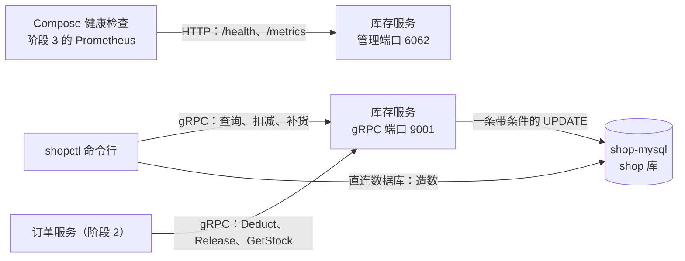
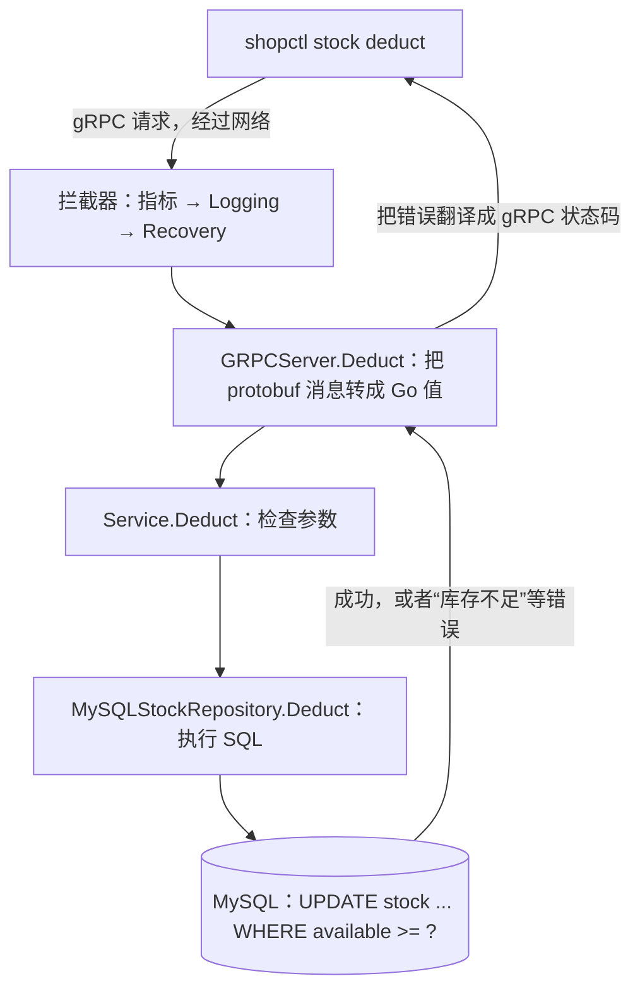

# 阶段 1 学习材料：库存服务

这是项目里第一个真正处理业务请求的服务。它只做三件事：查询库存、扣减库存、归还库存。阶段 1 一共交付了这些东西：

| 交付 | 在哪里 |
|---|---|
| 库存服务的 gRPC 接口：GetStock、Deduct、Release | [inventory.proto](../../api/proto/inventory/v1/inventory.proto) |
| 库存服务的实现，分三层 | [internal/shop/inventory](../../internal/shop/inventory/doc.go) |
| 把库存服务组装起来运行，支持优雅停机 | [inventoryservice](../../internal/shop/app/inventoryservice/doc.go) |
| 五张表：商品、库存、订单、销量、已处理消息 | [migrations](../../internal/shop/migrations/doc.go) |
| 造测试数据：50 万商品、200 万订单 | [seed](../../internal/shop/seed/doc.go) |
| 命令行工具：造数、手动查询和扣减库存 | [shopctl](../../internal/shop/app/shopctl/doc.go) |
| gRPC 的公共部分：请求日志、panic 恢复、带时限的停机 | [grpcx](../../internal/platform/grpcx/doc.go) |
| 管理端口：健康检查 | [adminserver](../../internal/platform/adminserver/doc.go) |

**怎样读这份材料。** 主线是系统设计：防超卖有哪几种做法、各放弃了什么；服务之间怎样通信、错误和超时怎样跨服务传递。Go 语法不在这里展开，第 7 节列出本阶段用到的写法，并链接到 [Mini-Redis 的学习文档](https://github.com/Li-Nepenthe/mini-redis/blob/main/docs/learn/README.md)。

> 这份材料对照的是**当前的代码**。阶段 3 给库存服务加了指标和调用链（telemetry），读代码时遇到可以先跳过。

## 1. 本阶段能回答的面试题

先带着这些问题读，读完回来检查自己能不能答出来。

| 面试题 | 在哪里 |
|---|---|
| 怎样防止超卖？有哪几种做法，各有什么代价？ | 5.3、八股 1 |
| 怎样证明 100 个并发请求抢 50 件库存时不会超卖？ | 5.3、八股 1 |
| 服务之间为什么用 gRPC？对外接口为什么还是 HTTP？ | 5.1、八股 2 |
| protobuf 的字段编号为什么不能改？接口怎样兼容地演进？ | 5.1 |
| 一个服务的代码为什么要分层？接口为什么定义在使用方？ | 5.2 |
| 扣减失败时，怎样区分“库存不足”和“商品不存在”？ | 5.4 |
| 聚簇索引和二级索引有什么区别？UPDATE 没走索引会怎样？ | 5.5、八股 3 |
| 调用方设的超时，怎样一路传到数据库？超时以后能不能重试？ | 5.6、5.7、八股 4 |
| 错误码怎样设计？数据库的报错能直接返回给调用方吗？ | 5.8 |
| 一个服务开了两个端口，优雅停机按什么顺序？ | 5.9 |
| 几百万条测试数据怎样写进数据库？ | 5.10、八股 5 |
| 金额为什么用整数分保存？ | 5.11 |

## 2. 库存服务在系统里的位置

### 2.1 上下游



阶段 1 时库存服务开了两个端口：**9001** 是 gRPC 端口，处理业务请求；**6062** 是管理端口，提供健康检查 `/health`，阶段 3 以后还提供指标 `/metrics`。阶段 7 起又多了一个内部运维端口 **6064**，只在容器网络里监听，不映射到你的电脑。

库存服务只被别的程序调用，它自己不调用任何业务服务。主要的调用方是阶段 2 的订单服务：下单时扣库存，订单写失败时把库存还回去。

### 2.2 一次扣减走过的层



最外层的指标拦截器是阶段 3 加的，本阶段只有 Logging 和 Recovery 两层。

### 2.3 各部分负责什么、不负责什么

| 部分 | 负责 | 不负责 |
|---|---|---|
| 库存服务整体 | 可售数量的查询、扣减、归还；保证库存不会变成负数 | 订单、价格；同一个订单不能重复扣库存（这是订单服务的事，阶段 2 讲）；跨服务的事务 |
| [inventory](../../internal/shop/inventory/doc.go) 包 | 三层：gRPC 适配、参数检查、SQL | 连接池的创建和关闭，那是组装层的事 |
| [inventoryservice](../../internal/shop/app/inventoryservice/doc.go) | 读配置、连数据库、迁移、开两个端口、按顺序停机 | 业务规则 |
| [grpcx](../../internal/platform/grpcx/doc.go) | 每个 RPC 的访问日志、接住 panic、带时限的停机 | 把业务错误翻译成状态码，那是 inventory 包的事 |
| [adminserver](../../internal/platform/adminserver/doc.go) | `/health` 调用传进来的检查函数；阶段 3 起提供 `/metrics` | 决定“健康”是什么意思，由组装层传入检查函数（这里是 Ping 数据库） |
| [migrations](../../internal/shop/migrations/doc.go) | 五张表的结构 | 执行迁移，那是阶段 0 的 migrate 包 |
| [seed](../../internal/shop/seed/doc.go) | 在空库上造数，中断后能接着造 | 检查或修复已有的数据 |
| [shopctl](../../internal/shop/app/shopctl/doc.go) | 运维用的命令行：造数、查库存、扣库存、补货 | 绕过接口直接改库存。扣减和补货都走正式的 gRPC 接口 |

## 3. 跑起来看什么

所有命令都在仓库根目录运行，开始前先打开 Docker Desktop。命令用 PowerShell 写，bash 的写法见[操作手册](../operations.md)。

**第 1 步：启动库存服务。**

```powershell
docker compose --env-file .env -f deploy/docker-compose.yml up -d --build --wait --wait-timeout 240 inventory-service
docker compose --env-file .env -f deploy/docker-compose.yml ps
Invoke-RestMethod http://127.0.0.1:6062/health
```

库存服务依赖 MySQL。阶段 1 时它直连 shop-mysql；阶段 4 起改成经过 toxiproxy（`toxiproxy:13306`，故障实验用它给数据库连接加延迟），所以 Compose 会先把 shop-mysql 和 toxiproxy 启动起来。你应该看到这三个服务都是 `healthy`，健康检查返回 `ok`。这个健康检查会真的 Ping 一次数据库，不只是看进程活着没有。

服务启动时会自动执行迁移（建表），但不会自动造数。只启动这几个服务时，日志里可能出现“导出调用链失败”一类的报错，那是阶段 3 加的调用链在找 Jaeger，这里没启动它，可以忽略。

**第 2 步：查询和扣减库存。** `shopctl stock` 只需要库存服务的地址 `INVENTORY_GRPC_TARGET`，不设时默认是 `127.0.0.1:9001`；`seed` 和 `check` 才需要数据库地址 `MYSQL_DSN`。Go 程序不会自动读取 `.env`，下面把这两个变量一起读进当前终端，第 4 步造数时也要用：

```powershell
Get-Content .env | ForEach-Object {
    if ($_ -match '^(MYSQL_DSN|INVENTORY_GRPC_TARGET)=(.*)$') {
        [Environment]::SetEnvironmentVariable($matches[1], $matches[2], 'Process')
    }
}
go run ./cmd/shopctl stock get --sku 1
go run ./cmd/shopctl stock deduct --sku 1 --quantity 1
go run ./cmd/shopctl stock get --sku 1
```

你应该看到：第一次输出 `sku_id=1 available=某个数`；扣减输出 `sku_id=1 deducted=1`；再查一次，库存比第一次少 1。前提是库里已经有 1 号商品而且还有库存；如果你的 shop 库是全新的空库，先做第 4 步造数。

**第 3 步：看库存服务的日志。**

```powershell
docker compose --env-file .env -f deploy/docker-compose.yml logs --tail 15 inventory-service
```

每次 gRPC 调用都有一条 JSON 日志，包括服务名、请求编号、调用的方法、状态码和耗时。日志里不应该出现数据库密码，也不应该出现请求的具体内容。

**第 4 步：关于造数。** 如果你已经跟着后面的阶段做过实验，数据库里已经有数据了（阶段 2、3 又产生了很多新订单），这时**不要再运行 `shopctl seed`**，保留已有的数据卷就行。seed 会检查五张表的行数和编号是否符合造数的规律，对不上就拒绝继续，防止误把业务数据重置掉。只有全新的空库才需要造数：运行 `go run ./cmd/shopctl seed`（需要 `MYSQL_DSN`），会看到类似 `products=500000 stock=500000 orders=2000000 ... skipped=false` 的输出，开发时实测耗时 75.651 秒（数据台账 P1-3）。

**第 5 步：运行测试。** 按[操作手册](../operations.md#运行真实-mysql-与-redis-集成测试)的“运行真实 MySQL 与 Redis 集成测试”一节，把测试库的地址设到当前终端，然后运行：

```text
go test -race ./internal/shop/inventory ./internal/shop/seed ./internal/platform/grpcx ./internal/platform/adminserver -count=1 -v
```

重点看两个测试：

- `TestIntegrationConcurrentDeduct`：100 个 goroutine 同时扣减 50 件库存，结果是 50 个成功、50 个库存不足，最后库存为 0（数据台账 P1-1）。
- `TestIntegrationDeadline`：数据库那边的查询要 5 秒，客户端只等 100 毫秒。结果是客户端收到超时错误，库存服务这边的数据库调用也在两秒内停止等待，返回取消错误（P1-4）。MySQL 服务端那条查询会不会立刻停下，这个测试没有验证，见 5.6 节。

如果没有设置测试库地址，这两个测试会显示 `SKIP`，那就是没有运行。

## 4. 代码走读

### 4.1 阅读顺序

沿着一次扣减请求，从入口读到数据库，再回头读外围部分。

| 顺序 | 文件 | 重点看什么 |
|---|---|---|
| 1 | [cmd/inventory-service/main.go](../../cmd/inventory-service/main.go) | 只有几行：调用 `Run`，出错就退出 |
| 2 | [inventoryservice/app.go](../../internal/shop/app/inventoryservice/app.go) | `Run`：启动时依次创建了哪些资源，退出时按什么顺序关闭。`serve` 第二遍再细读 |
| 3 | [inventory.proto](../../api/proto/inventory/v1/inventory.proto) | 三个方法，每个方法的请求和响应有哪些字段；注释里写着“扣减和归还没有幂等键” |
| 4 | [model.go](../../internal/shop/inventory/model.go) | `Stock` 和四种业务错误 |
| 5 | [service.go](../../internal/shop/inventory/service.go) | `StockRepository` 接口为什么定义在这里；`validate` 检查了什么 |
| 6 | [grpc_server.go](../../internal/shop/inventory/grpc_server.go) | 怎样把请求转给 `Service`；`grpcError` 怎样把业务错误翻译成状态码 |
| 7 | [repository.go](../../internal/shop/inventory/repository.go) | **最重要的文件。** 逐句读 `deductStockSQL` 和它上面的注释，再读 `change` 和 `classifyDatabaseError` |
| 8 | [0002_stock.sql](../../internal/shop/migrations/0002_stock.sql) | 主键 `id`、唯一索引 `uk_stock_sku`、`CHECK` 约束各管什么 |
| 9 | [grpcx/interceptor.go](../../internal/platform/grpcx/interceptor.go)、[shutdown.go](../../internal/platform/grpcx/shutdown.go) | 两个拦截器；带时限的停机 |
| 10 | [adminserver/server.go](../../internal/platform/adminserver/server.go) | `/health` 怎样调用传进来的检查函数 |
| 11 | [shopctl/stock_client.go](../../internal/shop/app/shopctl/stock_client.go) | 从调用方的角度看：`parseStock` 检查参数，`stockTarget` 读出库存服务的地址，`runStock` 建立连接、发起一次调用 |
| 12 | [seed/seed.go](../../internal/shop/seed/seed.go)、[seed/repository.go](../../internal/shop/seed/repository.go) | 分批、每批一个事务、怎样接着造 |
| 13 | [repository_integration_test.go](../../internal/shop/inventory/repository_integration_test.go) | 100 个 goroutine 怎样同时开始抢库存；超时测试怎样证明库存服务不再等数据库（MySQL 那边是否停止执行，测试没有观察，见 5.6） |

### 4.2 一次扣减，从 shopctl 到 MySQL 再回来

假设 sku 1 现在的库存是 3，你运行 `go run ./cmd/shopctl stock deduct --sku 1 --quantity 1`：

| 顺序 | 在哪里 | 做了什么 |
|---|---|---|
| 1 | shopctl 的 `parseStock` | 检查命令参数：sku 和数量必须为正，数量不能超过 int32 的上限。参数不对，就不会建立连接 |
| 2 | `stockTarget` 和 `runStock` | 从环境变量 `INVENTORY_GRPC_TARGET` 读出地址（没设置时是 `127.0.0.1:9001`）；创建连接时关掉 gRPC 的自动重试，原因见 5.7 节；用 `context.WithTimeout` 设 800 毫秒时限（`--timeout` 的默认值） |
| 3 | 网络 | 请求被序列化成 protobuf，剩余时间放在 `grpc-timeout` 请求头里一起发出。方法的全名是 `/inventory.v1.InventoryService/Deduct` |
| 4 | 拦截器 `grpcx.Logging` | 生成请求编号，记下开始时间，交给下一层 |
| 5 | 拦截器 `grpcx.Recovery` | 登记 defer，准备接住 panic |
| 6 | `GRPCServer.Deduct` | 从 protobuf 消息里取出 sku_id=1、quantity=1 |
| 7 | `Service.Deduct` 里的 `validate` | 检查 ctx 还没结束、两个数都大于 0 |
| 8 | `MySQLStockRepository.Deduct` 里的 `change` | 执行 `UPDATE stock SET available = available - ?, updated_at = ? WHERE sku_id = ? AND available >= ?`，四个问号依次是 1、当前 UTC 时间、1、1 |
| 9 | MySQL | 通过 `uk_stock_sku` 找到这一行，加锁，检查 3 >= 1 成立，改成 2，影响 1 行 |
| 10 | `change` | `RowsAffected()` 是 1，返回成功 |
| 11 | `GRPCServer.Deduct` | 返回空的 `DeductResponse`。消息是空的，但状态码 OK 本身就表示成功 |
| 12 | 拦截器 `grpcx.Logging` | 写日志：方法、状态码、耗时 |
| 13 | shopctl | 打印 `sku_id=1 deducted=1` |

失败时从第 9 步开始分岔：

- **扣 99 件：** 3 >= 99 不成立，影响 0 行。`change` 补查一次，商品存在，于是返回“库存不足”，`grpcError` 翻译成 `FailedPrecondition`。
- **商品不存在：** 影响 0 行，补查也查不到，返回“商品不存在”，翻译成 `NotFound`。
- **数量为 0：** 第 1 步 shopctl 自己就拒绝了。换一个不检查参数的客户端直接调用，第 7 步的 `validate` 也会拒绝，翻译成 `InvalidArgument`，不会执行 SQL。

下面是一次真实运行的输出（2026-11-02）。用的是本阶段真实的两个拦截器、`GRPCServer` 和 `Service`，客户端和 shopctl 一样设 800 毫秒时限；仓储换成了内存里的假实现，模仿那条带条件的 UPDATE（所以没连数据库），并让它打印收到的 ctx 还剩多少时间：

```text
----- 扣 1 件
服务端仓储收到的 ctx：还剩 798 毫秒
{"time":"2026-11-02T15:10:13.4750535Z","level":"INFO","msg":"gRPC 请求完成","service":"inventory-service","method":"/inventory.v1.InventoryService/Deduct","code":"OK","duration_ms":0,"request_id":"UP3EEX2VR6ZQ3PBFOJM3JAFRCY"}
客户端收到： OK
----- 扣 99 件
服务端仓储收到的 ctx：还剩 800 毫秒
{"time":"2026-11-02T15:10:13.4750535Z","level":"WARN","msg":"gRPC 请求失败","service":"inventory-service","method":"/inventory.v1.InventoryService/Deduct","code":"FailedPrecondition","duration_ms":0,"error":"FailedPrecondition","request_id":"PN2HWHP4Y5PVG7YWO2CAOWA2PU"}
客户端收到： FailedPrecondition 库存不足
----- 商品不存在
服务端仓储收到的 ctx：还剩 800 毫秒
{"time":"2026-11-02T15:10:13.4755798Z","level":"WARN","msg":"gRPC 请求失败","service":"inventory-service","method":"/inventory.v1.InventoryService/Deduct","code":"NotFound","duration_ms":0,"error":"NotFound","request_id":"KT33KUEGVICO2NERDKTEW5S6X4"}
客户端收到： NotFound 商品不存在
----- 数量为 0
{"time":"2026-11-02T15:10:13.4755798Z","level":"WARN","msg":"gRPC 请求失败","service":"inventory-service","method":"/inventory.v1.InventoryService/Deduct","code":"InvalidArgument","duration_ms":0,"error":"InvalidArgument","request_id":"CGUYHCAMIN2H4XDDJD2DMKQAQT"}
客户端收到： InvalidArgument 库存参数不合法或归还超出范围
```

对照着看五个细节：

1. **服务端的 ctx 还剩 798 毫秒。** 客户端设的 800 毫秒跟着请求到了服务端。第一次调用还要先建立连接，路上用掉了约 2 毫秒；后几次连接已经建好，剩余时间就是 800 毫秒。这就是 5.6 节说的“把剩余时间放在请求里一起发出去”。
2. **业务上的失败也是正常返回。** 库存不足、商品不存在不是程序出错，而是业务结果，所以日志级别是 WARN 而不是 ERROR。
3. **“数量为 0”那次，没有打印“服务端仓储收到的 ctx”那一行。** `validate` 在业务层就拒绝了，请求没有到达仓储，也就不会碰数据库。
4. **日志里只有状态码，没有“库存不足”这样的错误详情。** 错误详情可能带着数据库信息，拦截器故意不记原文（5.8 节）。
5. **每条日志的 `request_id` 都是新生成的。** gRPC 这一层的编号由拦截器自己生成，不接受调用方带来的编号。要把订单服务和库存服务的日志串成同一个请求，靠的是阶段 3 加入的 `trace_id`。

## 5. 系统设计与取舍

每个设计点按同一个顺序讲：要解决什么问题 → 怎么做 → 放弃了什么、为什么 → 代价和适用边界 → 规模变大十倍会怎样。

### 5.1 服务之间用 gRPC，对外用 HTTP

**问题。** 订单服务要调用库存服务。两边由不同的代码维护，需要一份双方都认的“合同”：有哪些方法、每个字段是什么类型、出错时怎么表示。合同写在文档里，很容易一边改了另一边没跟上，要到运行时才发现。

**做法。** 用 `.proto` 文件写清楚接口，再用工具生成两边的 Go 代码（生成的代码放在 `gen/` 下）。服务之间的调用走 gRPC：底层是 HTTP/2，数据用 protobuf 编码。

**补基础：序列化。** 程序里的数据是内存里的结构体，要通过网络发给另一个进程，得先把它变成一串字节，这叫**序列化**；对方收到后再还原成自己的结构体，叫**反序列化**。JSON 把数据写成人能读的文本，比如 `{"sku_id":1}`，每次都要发字段名；protobuf 写成紧凑的二进制，不发字段名，只发字段编号，所以更小。

**字段编号为什么不能改。** `int64 sku_id = 1;` 里的 `1` 是这个字段在二进制数据里的身份。对方解码时看到编号 1，就把它当成 `sku_id`。如果把编号改成 3，还在用旧版本的调用方仍然按 1 发送，数据就会被错误地解读。所以编号一旦用了就不能改；字段删掉以后，它的编号也不能再给别的字段用（protobuf 用 `reserved` 把它保留起来）。接口要做不兼容的修改时，另开一个版本：包名里的 `v1` 就是为此留的。

**放弃了什么。**

- **服务之间也用 HTTP + JSON。** 直观、好调试，用 curl 就能调。但字段名写错、类型不对，只有运行时才发现；超时也要自己约定一个请求头来传。
- **对外也用 gRPC。** 浏览器不能直接发 gRPC 请求，第三方接入也更麻烦。所以订单服务对外仍然是 HTTP + JSON（阶段 2）。

**代价。** 二进制数据没法直接用眼睛看，调试要靠 grpcurl 这类工具；改接口要先改 `.proto`、重新生成代码并提交。

**规模变大十倍。** 服务多了以后，`.proto` 文件通常放进一个单独的仓库统一管理，用 buf 这类工具在 CI 里检查“这次修改是否破坏兼容”。项目用 buf 检查 `.proto` 的写法并生成代码（`buf lint`、`buf generate`，在本机手动运行）；[buf.yaml](../../buf.yaml) 里也配好了兼容性规则，但 CI 还没有运行 `buf breaking`。

### 5.2 服务内部分三层，接口定义在使用方

**问题。** 一个请求要经过协议转换、业务规则和 SQL 三件事。如果写在一个函数里，测业务规则也得启动数据库和 gRPC 服务器；换一种协议（比如加一个 HTTP 入口），业务代码也得跟着改。

**做法。** 库存服务的代码分成三层，每层只认识自己需要的东西：

| 层 | 文件 | 只关心什么 |
|---|---|---|
| 适配层 | grpc_server.go | gRPC：把 protobuf 消息转成 Go 值，把业务错误转成状态码 |
| 业务层 | service.go | 业务规则：数量必须大于 0 等 |
| 数据层 | repository.go | SQL |

业务层 `Service` 不直接依赖 MySQL，而是依赖一个接口 `StockRepository`。测试时传一个假的实现进去，不用启动数据库。

**接口定义在使用方。** `StockRepository` 写在 service.go 里，也就是使用它的地方，而不是写在实现它的 repository.go 里。Go 的接口不需要声明“我实现了谁”：一个类型只要有接口要求的方法，就自动满足这个接口。所以使用方可以按自己的需要定义接口，只列出自己真正要用的方法。

**放弃了什么。** 更多的层，比如再加一层“领域服务”、再把仓储拆成接口和多个实现。库存只有三个操作，再多一层只会多出转发代码。

**代价。** 三层之间有一些重复的转换代码，比如 protobuf 的请求转成 Go 参数、业务错误转成状态码。

**规模变大十倍。** 业务规则多起来以后，业务层会变厚，可能出现跨多个仓储的事务。那时要决定事务由谁开启：通常是业务层开启，把事务传给仓储。阶段 6 的医生就遇到了这个问题，它的仓储（store 包）用一个事务完成“检查 + 写入”。

### 5.3 防止超卖：把检查和扣减放进一条 UPDATE

这是本阶段最重要的一节。

**问题。** 很多请求同时抢最后几件商品，库存不能被扣成负数，也不能卖出比库存多的件数。先看最直观的错误做法：先查，再扣。假设库存只剩 1 件，A、B 两个请求同时来：

| 时刻 | 请求 A | 请求 B |
|---|---|---|
| 1 | 查询：剩 1 件，够 | |
| 2 | | 查询：剩 1 件，够 |
| 3 | 扣 1 件，剩 0 | |
| 4 | | 扣 1 件，剩 -1 ❌ |

两个请求都在对方扣减之前查询，都以为库存够，结果卖出了 2 件。问题出在“查询”和“扣减”是两步，中间有空隙，别的请求可以插进来。

**做法。** 把检查和扣减写进同一条 SQL：

```sql
UPDATE stock SET available = available - ?, updated_at = ?
WHERE sku_id = ? AND available >= ?
```

执行这条 UPDATE 时，MySQL 会先给这一行加锁。还是 A、B 同时来：

1. A 先拿到这一行的锁，检查 `available >= 1`，成立，扣成 0，提交，释放锁。
2. B 一直在等这把锁。拿到锁以后，MySQL 按**最新的值**重新检查条件：`available` 现在是 0，`0 >= 1` 不成立，这一行不会被更新。
3. B 收到“影响了 0 行”，返回“库存不足”。

检查和扣减在同一条语句里、在锁的保护下一起完成，中间没有空隙。建表时还加了约束 `CHECK (available >= 0)`，作为最后一道保险：就算哪天 SQL 写错了，库存也不可能被改成负数。

**补基础：B 拿到锁以后，为什么看到的是“最新的值”？** MySQL 读数据有两种方式。普通的 `SELECT` 叫**快照读**：读的是某一时刻的数据快照，不加锁，读完以后别人随时可以修改。`UPDATE`、`DELETE`、`SELECT ... FOR UPDATE` 叫**当前读**：必须读最新提交的值，并且给读到的记录加锁。扣库存的这条 UPDATE 是当前读，所以 B 等到锁以后，读到的是 A 扣完以后的 0。

**怎样证明它有效。** 用真实 MySQL 做集成测试：库存设为 50，100 个 goroutine 同时各扣 1 件，在 `-race` 下运行。结果恰好 50 个成功、50 个库存不足，最后库存为 0（数据台账 P1-1）。注意 `-race` 只能发现 Go 程序内部的数据竞争，证明不了数据库里没有超卖；真正的证据是“恰好 50 个成功、余量为 0”这两条断言。

**放弃了什么。** 防超卖还有几种常见做法：

| 做法 | 怎么做 | 为什么没选 |
|---|---|---|
| Go 代码里加一把锁 | `sync.Mutex` 包住“查 + 扣” | 只能管住当前这一个进程。库存服务可能有多个实例，也可能有人绕过服务直接写库，Go 的锁管不到它们 |
| 悲观锁 | 开事务，`SELECT ... FOR UPDATE` 锁住这一行，判断够不够，再 UPDATE，提交 | 能用，但要多一次往返，锁持有的时间更长。扣减前需要做复杂判断时才值得 |
| 乐观锁 | 表里加版本号，`UPDATE ... WHERE version = 读到的版本`，失败就重新读、重试 | 热门商品冲突多，大量请求在重试。而“够不够”本身就能写成条件，不需要版本号 |
| Redis 预扣 | 库存放进 Redis，用 Lua 脚本原子地判断和扣减，再异步写回 MySQL | 最快，适合秒杀。但 Redis 和 MySQL 有两份库存，要对账；Redis 宕机可能丢掉扣减记录。本项目的并发量用不到 |

带条件的 UPDATE 可以看成乐观并发控制的一种特殊形式：它不检查“别人改没改过”，只检查“改完以后还满足条件吗”，而且失败了不需要重试，失败本身就是业务结果“库存不足”。

**代价和适用边界。** 条件只能写成 SQL 能表达的简单判断。如果扣减前要调用别的服务、做复杂计算，就只能用事务加悲观锁。另外，同一个商品的所有扣减都要排队等同一把行锁。

**规模变大十倍。** 热门商品会成为瓶颈：所有请求排队等同一行的锁，吞吐量取决于每次持锁多久。阶段 4 的故障场景 S08“大家都在改同一行”模拟的就是这种情况。常见的解决办法有三种：把一个商品的库存拆成多行（分桶），每次扣其中一行；用 Redis 预扣挡住大部分请求；在服务里把同一商品的请求排队、合并后再写库。

### 5.4 失败以后再补查一次，区分失败原因

**问题。** UPDATE 执行完，`RowsAffected()` 返回实际更新了几行。1 行表示成功；0 行表示失败，但有两种可能：这个商品根本不存在，或者存在但库存不够。调用方对这两种情况的处理不一样：前者是调用方传错了，后者要告诉用户卖完了。

**做法。** 只在失败之后补查一次（`change` 函数里调用 `GetStock`）：查不到，返回“商品不存在”；查到了，返回“库存不足”。这次补查只用来决定返回哪种错误，不会根据查询结果再扣一次。扣减是否成功，只看那条 UPDATE。

**放弃了什么。** 每次扣减前先查一次商品存不存在。成功的请求占绝大多数，每个都多一次查询不划算；而且先查的结果在扣减时可能已经过时。

**代价。** 失败的请求要多一次查询。补查和 UPDATE 之间有空隙，极端情况下商品可能刚好被删除或新建，返回的错误种类会不准，但扣减本身不会出错。

**规模变大十倍。** 如果“库存不足”的请求很多（比如秒杀时绝大多数请求都会失败），补查会让数据库多出一倍的查询。那时可以在 Redis 里缓存“已售罄”的标记，在到达数据库之前就挡掉大部分请求。

### 5.5 索引：sku_id 用唯一二级索引，而不是主键

**问题。** 扣库存按 `sku_id` 找行。stock 表有 50 万行，找行的方式决定了扣一件库存要扫描多少行、锁住多少行。

**做法。** stock 表有两个索引：主键 `id`（自增的数字），和建在 `sku_id` 上的唯一索引 `uk_stock_sku`。扣库存时按 `sku_id` 找行，靠的就是后者。它是唯一的，所以还保证了一个商品只有一行库存。

**补基础：聚簇索引、二级索引和回表。** InnoDB 的数据按主键存放：主键索引是一棵 B+ 树，树的叶子就是完整的一行数据，这叫**聚簇索引**。`uk_stock_sku` 是另一棵树，叫**二级索引**，它的叶子上只有 `sku_id` 和对应的主键 `id`。所以按 `sku_id` 查库存要走两步：先在 `uk_stock_sku` 里找到 `id`，再拿着 `id` 去主键索引里取出完整的一行。第二步叫**回表**。

**补基础：B+ 树为什么快。** 它长得很“矮胖”：每个节点是一个数据页（默认 16 KB），能放下几百上千个键，所以三四层高的 B+ 树就能装下千万级的数据。从树根往下走三四步就到了叶子，每走一步读一个数据页。数据都在最底层的叶子上，叶子之间按顺序串在一起，范围查询只要顺着叶子往后读。

**如果 `uk_stock_sku` 被删掉了：**

- `WHERE sku_id = ?` 没有索引可用，只能从头到尾扫描整张表。
- 更要命的是加锁。InnoDB 执行 UPDATE 时，会给扫描过的记录加锁。没有合适的索引、必须扫描全表时，表里的每一行都会被锁住。别的扣减请求只能排队等锁，下单就会变得非常慢。

**补基础：为什么还会锁住记录之间的“间隙”。** InnoDB 默认的隔离级别是 REPEATABLE READ（可重复读）。为了在这个级别下避免“幻读”（同一个事务里，前后两次查到的行数不一样），InnoDB 加锁时不只锁记录本身，还会锁记录之间的间隙。所以 UPDATE 一旦走了全表扫描，效果上相当于锁住了整张表。

第 8 节实验一会实际删一次索引，结果是这样的（数据台账 P1-2）：

| 状态 | type | 用到的索引 | 预计扫描行数 |
|---|---|---|---|
| 有索引 | const | uk_stock_sku | 1 |
| 删掉索引 | ALL（全表扫描） | 无 | 498780 |
| 恢复索引 | const | uk_stock_sku | 1 |

这正是阶段 4 的故障场景 S01 要模拟的情况。

**放弃了什么。** 直接把 `sku_id` 设成主键。这样按 `sku_id` 查不用回表，少一步。没有这样做，是因为唯一索引可以删掉再恢复，正好用来做 S01 的故障实验；主键就不能随便删。这是为了实验做的选择，正常的生产系统两种设计都可以。

**代价。** 插入新商品、或者改动 `sku_id` 时，要同时维护两棵树；扣减只改 `available` 和 `updated_at`，不动二级索引。按 `sku_id` 查询多一次回表。

**规模变大十倍。** 500 万行时 B+ 树也只多一层，按索引查一行的代价几乎不变；但全表扫描的代价变成十倍。所以规模越大，“某个改动让查询不再走索引”的后果越严重。上线前用 EXPLAIN 检查关键 SQL，比事后排查便宜得多。

### 5.6 超时：从调用方一路传到数据库

**问题。** 调用方只愿意等 800 毫秒。时间到了，调用方放弃了，但库存服务和数据库如果还在干活，就是白白占着连接和锁。

**做法。** 让超时跟着请求一路往下传：

1. gRPC 客户端把剩余时间写在请求头 `grpc-timeout` 里，和请求一起发出。
2. 库存服务的 gRPC 收到请求，用剩余时间生成一个带截止时间的 `ctx`，传给 `GRPCServer.Deduct`。
3. 这个 `ctx` 原样往下传：`Service.Deduct(ctx, ...)` → `repository.Deduct(ctx, ...)` → `database.ExecContext(ctx, ...)`。
4. 时间到了，`ctx` 被取消，MySQL 驱动停止等待，关掉这条数据库连接，`ExecContext` 返回取消错误。

关键在第 3 步：每一层都要把收到的 `ctx` 继续往下传。如果中间有一层换成了 `context.Background()`（一个永远不会取消的 context），客户端虽然按时放弃了，库存服务还会一直等数据库。第 8 节实验三会故意制造这个错误。

集成测试里，一条原本要执行 5 秒的查询，客户端设 100 毫秒时限，实际等了 100.5017 毫秒就收到超时，服务端的数据库调用也返回了取消错误（数据台账 P1-4）。

**超时以后，MySQL 里的那条查询真的停了吗？** 不一定，这是面试里很容易答错的一点。翻项目用的驱动 go-sql-driver/mysql v1.10.1 的源码可以看到：`ctx` 被取消时，驱动关掉这条 TCP 连接，然后返回取消错误；整个驱动里没有发送 `KILL QUERY` 的代码。也就是说，Go 这一侧立刻不再等了，但 MySQL 服务端没有收到“停下”的命令，它通常要把这条 SQL 执行完、准备写回结果时，才发现连接已经断了。真要让服务端停下，得另开一个连接执行 `KILL QUERY <线程号>`。

想亲眼看到，可以在 Docker 运行时做这个实验：终端 A 按第 3 节第 5 步运行 `TestIntegrationDeadline`；同时在终端 B 每秒查一次 MySQL 里正在执行的语句：

```powershell
docker compose --env-file .env -f deploy/docker-compose.yml exec -T shop-mysql sh -c 'export MYSQL_PWD=$MYSQL_ROOT_PASSWORD; for i in 1 2 3 4 5 6 7; do mysql -uroot -e "SELECT ID, TIME, INFO FROM information_schema.PROCESSLIST WHERE INFO LIKE \"%SLEEP(5)%\" AND INFO NOT LIKE \"%PROCESSLIST%\""; sleep 1; done'
```

客户端 100 毫秒就超时了；如果 B 里那条带 `SLEEP(5)` 的语句还继续出现好几秒、`TIME` 一秒秒增加，就说明服务端仍在执行。这个现象在写作时没有实测，结论来自驱动源码；你做完实验，把看到的结果记在自己的笔记里。

**放弃了什么。** 每一层各设一个固定超时（比如库存服务对数据库一律 2 秒）。这样各层的时限互不相关，调用方早就放弃了，下游还在按自己的时限等。

**代价。** 每个函数都要多一个 `ctx` 参数，漏传一处，整条链就断了；而且只能让 Go 这一侧停下，数据库服务端的查询不一定停。

**规模变大十倍。** 调用链变长（A → B → C → 数据库）时，每一跳都要从剩余时间里扣掉自己用掉的部分，越往下剩得越少。如果下游还要自动重试，重试次数会层层相乘。所以链路越长，越要把“总时限”定在入口，下游只用剩余时间，并且限制重试只发生在一层。

### 5.7 写接口不自动重试，防重复交给调用方

**问题。** 客户端收到超时错误，只说明它没等到结果。数据库可能已经扣成功了，只是响应没来得及传回来。如果客户端自动重试，同一件商品可能被扣两次。

**做法。** 库存接口不做防重复：`.proto` 的注释写明“扣减和归还没有幂等键，调用方不能自动重试写操作”。shopctl 创建连接时用 `grpc.WithDisableRetry()` 关掉了 gRPC 按服务配置做的自动重试。gRPC 还保留一种“透明重试”，但它只在能确定服务端没有处理这个请求时才重发，不会造成重复扣减。“同一个订单不能重复扣库存”这件事，交给调用方订单服务处理（阶段 2 的接口幂等）。

**放弃了什么。** 在库存服务里做幂等：调用方每次扣减带一个唯一编号（比如订单号），库存服务把“这个编号扣过多少”记进一张流水表，用唯一键防止重复。这是更完整的做法，但要多一张表、每次扣减多写一行。本项目线上的业务调用方只有订单服务，它已经有订单级的幂等；另一个调用方 shopctl 是运维时手工使用的命令。

**代价。** 调用方必须清楚“超时不等于没执行”，不能随手重试。归还接口 `Release` 也一样：同一个请求执行两次，会把库存加两次。

**规模变大十倍。** 调用方多了以后，不能指望每个调用方都处理对；那时应该在库存服务里加扣减流水，让库存服务自己防重复，同时也方便对账。

### 5.8 错误码：每种业务错误对应一个状态码，不暴露原文

**问题。** 调用方要根据错误决定下一步：改参数、告诉用户卖完了，还是稍后重试。如果所有错误都是“内部错误”，调用方无从判断；如果把数据库报错原样返回，又会泄露 SQL、表名和连接地址。

**做法。** `grpcError` 把业务错误翻译成 gRPC 状态码，返回固定的中文说明：

| 业务错误 | gRPC 状态码 | 调用方该怎么办 |
|---|---|---|
| 参数不合法 | InvalidArgument | 修正参数，重试没用 |
| 商品不存在 | NotFound | 重试没用 |
| 库存不足 | FailedPrecondition | 告诉用户卖完了 |
| 存储暂时不可用 | Unavailable | 读操作可以稍后再试 |
| 超时 / 取消 | DeadlineExceeded / Canceled | 不知道执行了没有，写操作不能盲目重试 |
| 其他 | Internal | 查服务端日志 |

哪些数据库错误算“暂时不可用”，由仓储里的 `classifyDatabaseError` 决定：网络错误、连接失效，以及 MySQL 的 7 个错误码（连接数已满 1040、锁等待超时 1205、死锁 1213、连不上服务器 2002/2003、连接断开 2006/2013）。SQL 写错、没有权限这类错误重试也没用，留作 Internal。如果请求的 `ctx` 已经结束，优先返回超时或取消，因为驱动在取消时可能顺带报一个网络错误，那不是真正的原因。

访问日志里也只记状态码，不记错误原文（4.2 节第 4 点）。

**放弃了什么。** 把原始错误放进响应的详情字段（gRPC 支持附带结构化的错误详情）。方便调试，但调用方是另一个服务，不应该知道库存服务用的是哪种数据库。

**代价。** 排查问题时，调用方只能看到状态码，要到库存服务这边才能看到原因。阶段 3 加入调用链以后，可以从调用方的那次请求直接跳到库存服务的对应记录。

**规模变大十倍。** 错误码要在所有服务之间统一约定，并写进接口文档；“哪些错误可以重试”最好由服务端明确告诉调用方，而不是让每个调用方自己猜。

### 5.9 优雅停机：两个端口，连接池最后关

**问题。** 库存服务同时开着 gRPC 端口和管理端口。收到退出信号时，正在处理的请求要做完；关闭的顺序错了，还在处理的请求会突然没有数据库可用。

**做法。** 收到退出信号后：

1. 先排空 gRPC 端口：停止接受新请求，等正在处理的请求做完。
2. 再关管理端口。两步由 `lifecycle.Shutdown` 依次执行，共用同一个时限。
3. 两个端口都关掉以后，再关数据库连接池。

gRPC 的 `GracefulStop` 会一直等到所有请求做完，但它不接受时限。万一某个请求卡住了，服务就永远退不出去。所以 `grpcx.Shutdown` 另开一个 goroutine 调用 `GracefulStop`，自己同时等两件事：`GracefulStop` 做完了，或者时限到了。时限到了，就调用 `Stop` 强制断开所有请求。库存服务给停机的时限是 10 秒（`shutdownTimeout`）。

两个端口的 `Serve` 正常结束时，返回的东西不一样：HTTP 的 `Serve` 返回 `http.ErrServerClosed`，正常关闭也算一种错误；gRPC 的 `Serve` 因 `GracefulStop` 或 `Stop` 结束时返回 nil，在服务器停止以后才调用它，会返回 `grpc.ErrServerStopped`。`normalServeError` 对每个结果单独判断，只去掉这两种正常关闭的结果，其他错误都保留。

**放弃了什么。** 收到信号直接退出。简单，但正在执行的扣减会被打断，调用方只能收到连接断开，不知道扣成功没有。

**代价。** 停机最长要等 10 秒；卡住的请求最后还是会被强制断开。

**规模变大十倍。** 多实例部署时，还要先让负载均衡把这个实例摘掉、不再分请求给它，再开始停机（阶段 0 八股 1 的 preStop）。

### 5.10 造数：分批写入，每批一个事务

**问题。** 后面的索引实验和压测需要真实的数据规模：50 万商品、200 万订单。造数要快；中途失败了要能接着造；重新运行时不能把已经扣过的库存恢复原样。

**做法。** 每批 1000 个商品，每批在一个事务里写五张表：每个商品对应 1 条库存、4 条订单、1 条销量、4 条已处理消息记录。每批的插入用一条 SQL 写多行（`INSERT ... VALUES (?, ?), (?, ?), ...`）。重新运行时，`inspect` 先检查五张表的行数和编号是否符合造数的规律：已经造完就跳过；造到一半就从已经写好的批次后面接着造；对不上（比如混进了真实下单产生的订单），就拒绝继续。它只检查行数和编号，不检查每一行的内容，所以已经扣过的库存既不会被发现，也不会被覆盖。

实测在正式的 shop 库上全量造数 75.651 秒；再运行一次，538 毫秒后跳过（数据台账 P1-3）。

**放弃了什么。**

| 方式 | 问题 |
|---|---|
| 每行一个事务 | 太慢：每个商品要写 11 行（商品、库存各 1 行，订单 4 行，销量 1 行，已处理消息 4 行），50 万个商品就是 550 万次提交，每次都要等磁盘写完 |
| 全部放进一个大事务 | 事务太大：占用大量内存，长时间持有锁，失败了要整体回滚 |
| **分批，每批一个事务** | 折中：每批要么全部写入，要么全部不写；失败了从已经写好的批次后面接着造 |

**补基础：为什么每次提交都要等磁盘？** 事务提交成功，就要保证断电以后数据也不丢。InnoDB 的做法是：提交时先把这次修改记进 redo log（重做日志），并把它写到磁盘上；数据页本身可以晚一点再写。默认配置（`innodb_flush_log_at_trx_commit=1`）下每次提交都要写一次磁盘，所以 550 万次提交会很慢。

**SQL 里只有问号。** 代码只拼出 `(?, ?, ?)` 这样的占位符，实际的值作为参数单独交给驱动。即使某个值里有引号等特殊字符，也不会破坏 SQL 语句，这是防止 SQL 注入的标准做法。

**历史订单要配齐销量和“已处理消息”。** 这些订单没有经过真正的下单流程，也没有发过消息。如果不写对应的记录，阶段 2 的一致性检查会以为它们“漏统计”了。这里直接写好数据，而不是真的发消息、启动消费者。

**代价。** 批大小 1000 是经验值，没有做过对比实验。一条 INSERT 带的参数太多，会碰到 MySQL 单个数据包的大小上限。

**规模变大十倍。** 几千万行时，用 `LOAD DATA` 从文件导入会快得多；导入前临时去掉二级索引，导入后再建，也能省掉大量维护索引的开销。

### 5.11 金额用整数分，时间用 UTC

这两条是数据约定，不像前面几节那样有几种方案要权衡，所以写得短一些。

- **金额：** 价格存的是“分”（`price_cents BIGINT`），不是“元”（小数）。浮点数不能精确表示 0.1 这样的小数，累加多了就会出现误差。用整数分，所有计算都是精确的。放弃的做法是 MySQL 的 `DECIMAL`：它也精确，但 Go 没有对应的内置类型，要引入十进制库，或者用字符串传来传去。代价是显示时要换算，而且所有服务都要约定用分。规模变大十倍不影响这个选择；只有要支持多币种，或者出现小于一分的单价时，才需要换成更小的单位或 `DECIMAL`。
- **时间：** 所有时间都用 UTC 保存，显示给用户时再转成本地时间。阶段 0 的 mysqlx 已经把驱动和数据库会话的时区都设成了 UTC。放弃的做法是存服务器的本地时间：机器换了时区，同一个时刻就有两种写法，排序和比较都会出错。代价是排查问题时，要自己把日志里的时间换算成北京时间（加 8 小时）。规模和这个选择无关；服务部署到多个地区时，UTC 是唯一不需要额外约定的写法。

## 6. 系统设计八股

每题先给一分钟口述版，面试时照着这个长度说；再给要点、项目里的例子和常见追问。

### 八股 1：怎样防止超卖？

#### 一分钟口述版

超卖的根源是“查库存”和“扣库存”分成了两步，两个请求可能都在对方扣减之前查到还有货。解决办法是让检查和扣减原子地完成。我的项目用一条带条件的 UPDATE：`SET available = available - ? WHERE sku_id = ? AND available >= ?`。InnoDB 执行它时先给这一行加锁，后来的请求拿到锁后按最新值重新判断条件，不满足就影响 0 行，返回库存不足。这样不需要版本号，也不需要重试。我用集成测试证明过：库存 50，100 个 goroutine 同时各扣 1 件，结果恰好 50 个成功，余量为 0。其他做法还有悲观锁 `SELECT ... FOR UPDATE`、带版本号的乐观锁，以及秒杀场景常用的 Redis 加 Lua 预扣。Go 里加锁不行，因为它管不住其他实例。

#### 要点

- 原子性：检查和修改必须在同一个锁的保护下完成。
- 行锁对所有连接、所有实例都有效；进程内的锁只对一个进程有效。
- 判断成功看影响行数，不看事先查到的值。
- 兜底：`CHECK (available >= 0)`。
- 证明：真实数据库 + 并发测试，断言成功次数和余量，而不是只看 `-race`。

#### 项目里的例子

- [repository.go](../../internal/shop/inventory/repository.go) 的 `deductStockSQL` 和 `change`。
- [repository_integration_test.go](../../internal/shop/inventory/repository_integration_test.go) 的 `TestIntegrationConcurrentDeduct`（数据台账 P1-1）。

#### 常见追问

1. **热门商品，所有请求都排队等同一行的锁，怎么办？** 把库存拆成多行分桶扣减；用 Redis 预扣挡住大部分请求；或者在服务里排队合并。阶段 4 的场景 S08 模拟了这种热点行争用。
2. **用 Redis 预扣，怎样和数据库保持一致？** Redis 扣成功后异步写库，要有对账任务比较两边；Redis 宕机可能丢掉还没落库的扣减，所以通常只把 Redis 当作挡流量的第一层，最终以数据库为准。
3. **乐观锁和这种条件更新有什么区别？** 乐观锁检查的是“我读之后有没有人改过”，冲突就重试；条件更新检查的是“改完以后是否仍满足业务条件”，不满足就是业务结果，不需要重试。

### 八股 2：RPC 和 HTTP 有什么区别？服务之间为什么用 gRPC？

#### 一分钟口述版

RPC 不是和 HTTP 对立的协议，它是一种“像调用本地函数一样调用远程服务”的方式，底层可以跑在 TCP 上，也可以跑在 HTTP 上；gRPC 就跑在 HTTP/2 上。服务之间我用 gRPC，原因有三个：接口用 `.proto` 定义，两边代码自动生成，字段和类型不对在编译时就会报错；protobuf 是二进制，比 JSON 小，解析也快；超时会通过 `grpc-timeout` 请求头自动传到服务端。代价是数据不能直接用眼睛读，调试要用专门的工具，而且浏览器不能直接调用。所以对外给浏览器的订单接口还是 HTTP 加 JSON，服务之间用 gRPC。protobuf 靠字段编号识别字段，所以编号一旦用了就不能改。

#### 要点

- 序列化：JSON 带字段名、是文本；protobuf 只带字段编号、是二进制。
- 兼容演进：只加字段、不改编号；删掉的编号用 `reserved` 保留；不兼容就开 v2。
- HTTP/2：一条连接上可以同时跑多个请求。
- 四种调用方式：一问一答、服务端流、客户端流、双向流。项目只用一问一答。

#### 项目里的例子

- [inventory.proto](../../api/proto/inventory/v1/inventory.proto)；生成的代码在 `gen/inventory/v1`。
- 4.2 节的真实输出：服务端仓储收到的 ctx 还剩 798 毫秒。

#### 常见追问

1. **gRPC 怎样做负载均衡？** HTTP/2 是长连接，一条连接上的请求都会发到同一个实例，所以连接级的负载均衡不够，要在客户端按请求做负载均衡，或者用支持 HTTP/2 的代理。
2. **新增一个字段，旧的客户端会出错吗？** 不会。旧客户端不认识这个编号，解码时跳过它；新服务端收不到这个字段时，读到的是零值。
3. **gRPC 的错误怎样表示？** 用状态码加一段说明，状态码是一个固定的集合（NotFound、Unavailable 等），见 5.8 节。

### 八股 3：聚簇索引、二级索引和回表；UPDATE 不走索引为什么会锁很多行？

#### 一分钟口述版

InnoDB 的表按主键组织成一棵 B+ 树，叶子上就是完整的行，这叫聚簇索引。其他索引叫二级索引，叶子上只存索引列和主键值。所以通过二级索引查一行要走两步：先在二级索引里找到主键，再回到聚簇索引取整行，第二步叫回表。B+ 树很矮，三四层就能装千万行，所以按索引查一行只要读几个数据页。InnoDB 执行 UPDATE 时，会给扫描过的记录加锁；在默认的可重复读隔离级别下，还会锁住记录之间的间隙。如果 WHERE 条件没有合适的索引，就要扫描全表，等于锁住全表，其他更新都要排队。我在项目里实测过：删掉 stock 表 sku_id 上的唯一索引后，扣减语句的执行计划从按索引定位 1 行变成全表扫描约 50 万行。

#### 要点

- 聚簇索引：叶子是整行；二级索引：叶子是索引列 + 主键。
- 回表：二级索引 → 主键 → 整行。查询的列都在索引里时不用回表，叫覆盖索引。
- EXPLAIN 看三列：`type`（const、ref、range、ALL）、`key`、`rows`。
- 加锁的是扫描到的索引记录，不是最后满足条件的行。

#### 项目里的例子

- [0002_stock.sql](../../internal/shop/migrations/0002_stock.sql)：主键 `id`，唯一索引 `uk_stock_sku`。
- 删索引前后的 EXPLAIN（数据台账 P1-2）；阶段 4 的场景 S01 就是删掉这个索引。

#### 常见追问

1. **唯一索引和普通索引，按等值查询加锁有什么不同？** 唯一索引上的等值查询、记录存在时，只锁这一条索引记录，不锁它前面的间隙（经二级索引加排他锁时，对应的主键记录也会被锁上）；普通索引还要锁住相邻的间隙，防止插入新的同值记录。
2. **为什么不用 UUID 做主键？** UUID 无序，插入会落在 B+ 树的随机位置，导致页分裂和碎片；而且每个二级索引都要存一份主键，长主键让所有二级索引变大。
3. **索引越多越好吗？** 不是。每次写入都要维护所有索引，写多读少的表索引要少；索引也占磁盘和内存。

### 八股 4：超时怎样跨服务传递？超时之后能不能重试？

#### 一分钟口述版

超时应该在请求的入口定一个总时限，然后让剩余时间跟着请求往下传，每一层只用剩下的时间，而不是各设各的固定超时。在 Go 里就是把同一个带截止时间的 context 一路传下去，gRPC 客户端会把剩余时间放进 `grpc-timeout` 请求头，服务端据此重建 context，最后传给 `ExecContext`，时间到了驱动就停止等待。但要注意两点：第一，驱动只是断开连接，并不会通知 MySQL 停止那条查询；第二，超时不等于没执行，数据库可能已经扣成功了，只是响应没传回来。所以读操作可以重试，写操作不能盲目重试，要先有幂等。我的库存接口没有幂等键，就关掉了客户端按配置做的自动重试，防重复交给订单服务。

#### 要点

- 总时限定在入口，下游只用剩余时间。
- 每一层都传 ctx，不能中途换成 `context.Background()`。
- 超时 = 不知道结果。写操作重试的前提是幂等。
- 重试要限次数、加退避，而且只在一层重试，否则层层放大。

#### 项目里的例子

- [repository.go](../../internal/shop/inventory/repository.go) 的 `change` 用 `ExecContext(ctx, ...)`。
- [stock_client.go](../../internal/shop/app/shopctl/stock_client.go) 的 `runStock` 用 `grpc.WithDisableRetry()`。
- `TestIntegrationDeadline`：100 毫秒时限，实际等了 100.5017 毫秒（数据台账 P1-4）。

#### 常见追问

1. **context 取消以后，函数会自动停下吗？** 不会。取消只是一个通知，要由函数自己检查，或者把 ctx 传给会检查它的操作。
2. **怎样让 MySQL 服务端真的停下慢查询？** 另开一个连接执行 `KILL QUERY <线程号>`；或者在 SQL 里用 `MAX_EXECUTION_TIME` 提示限制只读查询的时长。
3. **订单服务调库存时，哪些错误会重试？** 阶段 2 的订单服务只对查库存（读操作）的几种暂时性错误重试，扣库存不重试。

### 八股 5：几百万条数据怎样批量写入？

#### 一分钟口述版

关键是减少两样东西：程序和数据库之间的来回次数，以及事务提交的次数。一行一条 INSERT、一行一个事务最慢，因为每次提交都要把 redo log 写到磁盘；全部放进一个大事务也不行，它占大量内存、长时间持锁，失败了要整体回滚。所以我的项目分批写：每批 1000 个商品，一个事务里用多行 INSERT 写完五张表，50 万商品和 200 万订单花了 75 秒。还要考虑中途失败：造数会检查已经写到哪一批，重新运行时接着造；表的行数或编号不符合造数的规律就拒绝继续，防止覆盖业务数据。它不检查已有行的内容，所以也不会把改过的库存改回去。所有值都用占位符传，不拼进 SQL。更大的规模可以用 `LOAD DATA` 从文件导入，或者先去掉二级索引、导入后再建。

#### 要点

- 多行 INSERT 减少往返；分批事务减少提交次数，又不至于事务过大。
- 可续跑：记住进度，失败后从断点继续。
- 不破坏已有数据：重跑要能识别“已经造过”。
- 占位符防注入。

#### 项目里的例子

- [seed.go](../../internal/shop/seed/seed.go) 的 `Run`；[repository.go](../../internal/shop/seed/repository.go) 的 `inspect`、`makeBatches`、`insertBatch`、`insertStatement`。
- 75.651 秒造完，重跑 538 毫秒跳过（数据台账 P1-3）。

#### 常见追问

1. **一批多大合适？** 要实测。太小，提交次数多；太大，单条 SQL 可能超过 `max_allowed_packet`，事务持锁时间也变长。项目的 1000 是经验值，没有做对比实验。
2. **大事务有什么危害？** 锁持有时间长，阻塞其他写入；回滚的代价和写入差不多大；主从复制时，从库要等这个大事务执行完才能追上。
3. **怎样防止 SQL 注入？** 用占位符，把值作为参数交给驱动，不要把用户输入拼进 SQL 字符串。

## 7. 用到的 Go 写法

### 7.1 已在 Mini-Redis 讲过的

| 写法 | 本阶段在哪里用 | 去哪里学 |
|---|---|---|
| 接口、隐式实现、接口定义在使用方 | `StockRepository` 写在 service.go；测试传假仓储 | [Mini-Redis 第 03 章](https://github.com/Li-Nepenthe/mini-redis/blob/main/docs/learn/03-map-struct与接口.md)“接口”和“四个接口，都定义在使用它的一方” |
| struct 嵌入 | `GRPCServer` 嵌入生成代码里的 `UnimplementedInventoryServiceServer`（7.2 节） | [Mini-Redis 第 03 章](https://github.com/Li-Nepenthe/mini-redis/blob/main/docs/learn/03-map-struct与接口.md)“struct 与嵌入” |
| any 和类型断言 | 拦截器的 `request any`；造数用 `[]any` 装 INSERT 的参数 | [Mini-Redis 第 03 章](https://github.com/Li-Nepenthe/mini-redis/blob/main/docs/learn/03-map-struct与接口.md)“any 和类型断言：取出来先问类型” |
| 函数也是值、闭包、可变参数 | 拦截器“记住” logger；`ExecContext(ctx, statement, args...)` | [Mini-Redis 第 00 章](https://github.com/Li-Nepenthe/mini-redis/blob/main/docs/learn/00-Go程序的骨架.md)“函数” |
| 自定义错误类型、`%w` 包装、`errors.Is`/`errors.As`、`errors.Join` | `inventory.Error` 常量；`classifyDatabaseError` 用 `errors.As` 认出 MySQL 错误 | [Mini-Redis 第 06 章](https://github.com/Li-Nepenthe/mini-redis/blob/main/docs/learn/06-错误处理.md)“创建、包装和判断错误”“合并多个错误：errors.Join” |
| panic 和 recover、defer 修改命名返回值 | `grpcx.Recovery` | [Mini-Redis 第 06 章](https://github.com/Li-Nepenthe/mini-redis/blob/main/docs/learn/06-错误处理.md)“panic 和 recover”；[第 04 章](https://github.com/Li-Nepenthe/mini-redis/blob/main/docs/learn/04-锁.md)“defer” |
| select、channel 的关闭通知 | `grpcx.Shutdown` 等“GracefulStop 做完”和“时限到”二者之一 | [Mini-Redis 第 05 章](https://github.com/Li-Nepenthe/mini-redis/blob/main/docs/learn/05-时间-select与GC.md)“select 的规则”；[第 07 章](https://github.com/Li-Nepenthe/mini-redis/blob/main/docs/learn/07-channel-context与WaitGroup.md)“channel 的基本操作” |
| context 的截止时间和取消 | 超时一路传到 `ExecContext`（5.6 节） | [Mini-Redis 第 07 章](https://github.com/Li-Nepenthe/mini-redis/blob/main/docs/learn/07-channel-context与WaitGroup.md)“context”和“八股 4” |
| WaitGroup | 并发扣减测试等 100 个 goroutine 结束 | [Mini-Redis 第 02 章](https://github.com/Li-Nepenthe/mini-redis/blob/main/docs/learn/02-goroutine与调度.md)“等 goroutine 结束：sync.WaitGroup” |
| 表格测试、`t.Helper`、`t.Cleanup`、`t.Context` | grpc_server_test.go 的状态码表；集成测试用 `t.Cleanup` 关闭连接池 | [Mini-Redis 第 08 章](https://github.com/Li-Nepenthe/mini-redis/blob/main/docs/learn/08-测试.md)“表格驱动测试和子测试”“testing.T 的常用方法” |
| `-race` 能发现什么 | 并发扣减测试在 `-race` 下运行 | [Mini-Redis 第 08 章](https://github.com/Li-Nepenthe/mini-redis/blob/main/docs/learn/08-测试.md)“八股 1” |

下面几节是 Mini-Redis 没有讲过的，只讲本阶段用到的部分。

### 7.2 gRPC 生成的代码和拦截器

- **生成的代码。** `buf generate` 根据 `.proto` 生成两部分：消息类型（`DeductRequest` 等结构体），以及服务的接口和客户端（`InventoryServiceServer`、`NewInventoryServiceClient`）。生成的文件不要手改，改接口就改 `.proto` 再重新生成。
- **为什么要嵌入 `UnimplementedInventoryServiceServer`。** 生成代码给每个方法都准备了一个默认实现，返回“未实现”。`GRPCServer` 把它嵌入进来，再覆盖自己实现了的三个方法。以后 `.proto` 新增方法，旧代码不用改也能编译，新方法默认返回 `Unimplemented`。
- **拦截器。** 一元拦截器是一个函数，签名是 `func(ctx, request, info, handler) (response, error)`：它在调用 `handler` 之前和之后各做一些事，`handler` 就是下一层（最终是业务方法）。`grpc.ChainUnaryInterceptor(a, b, c)` 里，第一个是最外层。库存服务的顺序是“指标 → Logging → Recovery”：Recovery 在最里面，panic 被它转成 Internal 错误以后，外层的 Logging 还能把这个结果记下来。

### 7.3 database/sql：执行写语句、影响行数和占位符

阶段 0 的 7.2 节讲了连接池；这里补本阶段用到的三点。

- `database.ExecContext(ctx, sql, args...)` 执行不返回行的语句（UPDATE、INSERT），返回 `sql.Result`。`result.RowsAffected()` 是实际修改的行数，防超卖靠它判断成功与否。
- `QueryRowContext(...).Scan(&a, &b)` 读一行；没有行时 `Scan` 返回 `sql.ErrNoRows`，要用 `errors.Is` 判断，而不是当成普通错误。
- SQL 里写 `?`，值放在后面的参数里，由驱动负责安全地传给数据库。

### 7.4 整数转换不会报错

```go
package main

import (
	"fmt"
	"math"
)

func main() {
	var big int64 = 2147483648       // 比 int32 的最大值大 1
	fmt.Println(int32(big))          // -2147483648：直接转换会“绕回去”，不会报错
	fmt.Println(big > math.MaxInt32) // true：所以转换之前要先检查范围
}
```

Go 要求显式转换，但转换本身不检查范围。shopctl 读到的数量是 `int64`，接口要的是 `int32`，所以 `parseStock` 先检查不超过 `math.MaxInt32`，再转换。

### 7.5 embed：把文件打包进程序

迁移的 SQL 文件是用 `//go:embed` 打包进程序的，所以程序在哪个目录启动都能找到它们。在一个空目录里放两个文件：`main.go`，以及内容为 `SELECT 1;` 的 `hello.sql`。然后运行 `go mod init example`，再运行 `go run .`：

```go
package main

import (
	"embed"
	"fmt"
)

//go:embed *.sql
var files embed.FS

func main() {
	data, err := files.ReadFile("hello.sql")
	if err != nil {
		panic(err)
	}
	fmt.Println(string(data)) // SELECT 1;
}
```

`//go:embed *.sql` 是给编译器的指令，`//` 和 `go:embed` 之间不能有空格。

## 8. 动手实验

每个实验看完结果后都要**恢复原状**，不要提交任何改动。

### 实验一：删掉索引，看执行计划的变化

先停掉库存服务，避免实验期间有扣减请求；MySQL 保持运行。下面的脚本删掉索引前后各执行一次 EXPLAIN，最后不管成功与否都会恢复索引、重新启动库存服务：

```powershell
docker compose --env-file .env -f deploy/docker-compose.yml stop inventory-service
try {
    @'
EXPLAIN SELECT sku_id, available FROM stock WHERE sku_id=250000 AND available>=1;
ALTER TABLE stock DROP INDEX uk_stock_sku;
EXPLAIN SELECT sku_id, available FROM stock WHERE sku_id=250000 AND available>=1;
'@ | docker compose --env-file .env -f deploy/docker-compose.yml exec -T shop-mysql sh -c 'export MYSQL_PWD=$MYSQL_PASSWORD; exec mysql -uapp -Dshop --table'
} finally {
    @'
ALTER TABLE stock ADD UNIQUE INDEX uk_stock_sku(sku_id);
SHOW INDEX FROM stock;
EXPLAIN SELECT sku_id, available FROM stock WHERE sku_id=250000 AND available>=1;
'@ | docker compose --env-file .env -f deploy/docker-compose.yml exec -T shop-mysql sh -c 'export MYSQL_PWD=$MYSQL_PASSWORD; exec mysql -uapp -Dshop --table'
    docker compose --env-file .env -f deploy/docker-compose.yml up -d --wait inventory-service
}
```

重点看 EXPLAIN 输出里的三列：`type`（`const` 表示通过唯一索引直接定位，`ALL` 表示全表扫描）、`key`（用到的索引）、`rows`（预计要扫描的行数）。结果应该和 5.5 节的表格一致。这里用 SELECT 来观察，因为它不改数据。注意 WHERE 条件相同，不代表执行计划相同：开发时删掉索引以后，单独对扣减的 UPDATE 做过 EXPLAIN，结果是 `type=index, key=PRIMARY, rows=498780`，也就是沿主键索引扫描，而不是 SELECT 的全表扫描 `ALL`。两者都要扫描几十万条记录，结论一样，但访问方式不同。

如果删除索引那一步就失败了，恢复时会报“索引已存在”，这不要紧。看 `SHOW INDEX` 的输出，确认 `uk_stock_sku` 还在就行。

### 实验二：扣一个不可能扣成的数量

1. 先查一次：`go run ./cmd/shopctl stock get --sku 1`，记下库存。
2. 扣一个巨大的数量：`go run ./cmd/shopctl stock deduct --sku 1 --quantity 2147483647`。应该返回 `FailedPrecondition`（库存不足）。
3. 再查一次，库存应该和第 1 步完全一样：失败的扣减不会扣掉一部分。
4. 查一个不存在的商品：`go run ./cmd/shopctl stock get --sku 9223372036854775807`。应该返回 `NotFound`。

对比第 2 步和第 4 步的错误，想一想它们是怎么被区分出来的（5.4 节）。

### 实验三：故意切断超时的传递

需要先按第 3 节第 5 步设置好测试库地址。

1. 运行 `go test -race ./internal/shop/inventory -run TestIntegrationDeadline -count=1 -v`，应该通过。
2. 打开 [repository_integration_test.go](../../internal/shop/inventory/repository_integration_test.go)，找到测试专用的 `slowRepository.GetStock`，把它调用 `QueryRowContext` 时传的 `ctx` 临时改成 `context.Background()`。
3. 再运行一次。客户端可能还是按时收到了超时错误，但“库存服务在两秒内停止等待”的检查会失败。

这说明只检查客户端有没有按时返回是不够的，还要检查服务端有没有真的停止等待。实验后撤销改动，再运行一次确认通过。只改测试文件，不要改正式代码。

### 实验四：数据库断开时，健康检查会怎么说

1. 停掉 MySQL：`docker compose --env-file .env -f deploy/docker-compose.yml stop shop-mysql`。
2. 访问健康检查：`Invoke-RestMethod http://127.0.0.1:6062/health`。应该返回 503，PowerShell 会报错，因为状态码不是 2xx。
3. 恢复：`docker compose --env-file .env -f deploy/docker-compose.yml up -d --wait shop-mysql inventory-service`。
4. 再访问健康检查，并查一次库存，应该都正常了。

这里只是停止容器，数据不会丢。不要用 `down -v`，它会删掉数据卷。

### 实验五：让文件清单检查报错

commentcheck 要求 [inventory/doc.go](../../internal/shop/inventory/doc.go) 提到包里的每个非测试文件。最直接的办法是新增一个文件：

1. 新建 `internal/shop/inventory/extra.go`，内容只有三行：

   ```go
   // 本文件：实验用的空文件。

   package inventory
   ```

2. 运行 `go run ./tools/commentcheck ./...`，你应该看到（Windows 的 PowerShell 里路径可能显示成反斜杠）：

   ```text
   internal/shop/inventory/extra.go:1:1: doc.go 的文件清单未提到 extra.go
   commentcheck：发现 1 项问题
   ```

3. 删掉 extra.go，再运行一次，应该通过。

## 9. 常见误区

- **“`-race` 通过了，就说明不会超卖。”** `-race` 只检查 Go 程序内部的并发读写冲突。超卖发生在数据库层面，要靠测试里断言“恰好 50 个成功、最后库存为 0”来证明。
- **“先 SELECT 查一下库存，就能为后面的 UPDATE 留住库存。”** 普通的 SELECT 不加锁，查完以后，别的请求随时可以把库存扣掉。
- **“在 Go 代码里加把锁就能防超卖。”** 只能管住一个进程。多实例、其他程序改库存时都管不住。
- **“收到超时错误，说明扣减没有执行。”** 不一定。数据库可能已经扣成功了，只是响应没来得及传回来。所以扣减不能自动重试。
- **“context 超时了，数据库里的查询就停了。”** 驱动只是断开连接、不再等待，没有通知 MySQL 停止那条查询。
- **“唯一索引就是聚簇索引。”** 不一样。stock 表的聚簇索引是主键 `id`；`uk_stock_sku` 是唯一的二级索引。
- **“UPDATE 只锁满足条件的那几行。”** InnoDB 锁的是扫描到的记录。没走索引时，扫描到的就是整张表。
- **“每个请求都应该新建一个数据库连接池。”** `*sql.DB` 是连接池，整个服务共用一个就够了。每个请求都建一个，反而会开出大量连接。
- **“seed 跳过了，说明数据是对的。”** 跳过只说明“已经造过了，不再造”，它不检查、也不修复你后来改过的数据。
- **“生成的代码里也该写详细注释。”** 生成的代码每次重新生成都会被覆盖。要改接口，就去改 `.proto` 文件。
- **“/health 返回 ok，说明整个系统都正常。”** 它只检查了库存服务能不能连上数据库。

## 10. 自测

先自己写下答案，再展开参考要点对照。系统设计方面的问题见第 1 节和第 6 节，这里偏重代码细节。

1. 一次扣减从 shopctl 出发，经过哪几个函数到达 MySQL？
2. 为什么拦截器的顺序是 Logging 在外、Recovery 在内？反过来会怎样？
3. `RowsAffected()` 返回 0 时，`change` 做了什么？为什么不直接返回“库存不足”？
4. `classifyDatabaseError` 为什么先检查 `ctx.Err()`？
5. 语法写错的 SQL，会被翻译成哪个状态码？为什么不是 Unavailable？
6. `grpcx.Shutdown` 怎样做到“尽量等请求做完，但最多等到时限”？
7. 库存服务关闭时，为什么连接池要最后关？
8. 并发扣减测试里，怎样让 100 个 goroutine 尽量同时开始？
9. 连接池的最大连接数为什么是 20？这个数是怎么来的？
10. 造数时为什么要同时写销量和“已处理消息”记录？

<details>
<summary>参考要点（先自己回答）</summary>

1. `parseStock` 检查参数 → `stockTarget` 读地址 → `runStock` 建连接、发起调用 → 网络 → `grpcx.Logging` → `grpcx.Recovery` → `GRPCServer.Deduct` → `Service.Deduct`（`validate`）→ `MySQLStockRepository.Deduct` → `change` → `ExecContext`。阶段 3 以后最外层还有指标拦截器。
2. Recovery 把 panic 转成 Internal 错误后，外层的 Logging 才能把这次请求连同最终状态记下来。反过来，panic 会先穿过 Logging（Logging 来不及写日志），再被 Recovery 接住，这次请求就没有访问日志了。
3. 补查一次 `GetStock`：查不到返回“商品不存在”，查到了返回“库存不足”（或归还时的“参数不合法”）。影响 0 行有两种可能，补查才能分清。
4. 驱动在 ctx 取消时会关掉连接，可能顺带返回一个网络错误。如果不先看 ctx，就会把“调用方超时”误判成“数据库不可用”。
5. Internal。语法错误、权限错误重试也不会好，标成 Unavailable 会诱导调用方无意义地重试。
6. 另开一个 goroutine 调用 `GracefulStop`，做完时关闭一个 channel；主流程用 select 同时等这个 channel 和 ctx 的时限，时限先到就调用 `Stop` 强制断开。
7. 关闭端口时还在处理的请求要用数据库。先关连接池，这些请求会突然失败。
8. 测试启动 100 个 goroutine，每个都先等同一个 channel；100 个都启动以后关闭这个 channel，大家几乎同时开始扣减。谁先谁后由调度决定，测试也不确认 100 个是否都已经在等。最后用 WaitGroup 等它们全部结束、收集结果。具体写法见测试文件。
9. shop-mysql 的连接上限是 100，还要留给另外两个服务、shopctl 和迁移，所以每个服务默认 20。这是一个起始值，不是压测得出的最优值（阶段 0 八股 3）。
10. 这些历史订单没有经过真正的下单流程，也没有发过消息。不写对应的销量和处理记录，阶段 2 的一致性检查会以为它们漏统计了。

</details>

## 11. 开发过程回放

这一节讲库存服务是怎么一步步做出来的，依据是[实测记录](../notes.md)和提交历史。阶段 1 进行到一半时，计划书更新了说明规范，当时的工作被暂存、合并、再恢复，所以提交里的文件顺序不代表编写顺序。

### 11.1 先定接口，再让扣减本身正确

**要做什么：** 先确定客户端和库存服务之间“说什么话”，再实现一个不会超卖的扣减。

**动手前先想清楚的问题：**

- 商品编号用 `int64`，数量用 `int32`。
- “商品不存在”和“库存不足”是两种不同的错误，调用方的处理方式也不一样，要能区分开。
- 先查库存、再决定扣不扣，在并发下是错的（5.3 节）。正确性必须交给数据库的一条带条件的 UPDATE 来保证。

**写的顺序：**

1. 写 `.proto` 接口定义和建表迁移。
2. 定义 Go 这边的类型：库存快照 `Stock`、四种业务错误、`StockRepository` 接口。
3. 实现 `Service`（检查参数）和 `MySQLStockRepository`（执行 SQL）。

先定接口和错误，写 SQL 的时候就已经知道输入范围和要返回什么；后面接 gRPC 的时候，也不用回头重新设计错误。

**怎么验证：** 先用假仓储测试参数检查和取消；再连真实 MySQL：把库存设为 50，100 个 goroutine 同时各扣 1 件。在 `-race` 下，结果恰好 50 个成功、50 个库存不足、最后库存为 0。还测了商品不存在、归还库存、数量达到 `int32` 上限这些情况。

**遇到的问题：** UPDATE 影响了 0 行，可能是商品不存在，也可能是库存不够。最后的做法是：只在失败之后补查一次，用来决定返回哪种错误（5.4 节）。

### 11.2 接上 gRPC，处理启动和退出

**要做什么：** 让客户端能通过端口调用库存服务，调用过程有日志可查，按 Ctrl+C 时能把正在处理的请求做完再退出。

**动手前先想清楚的问题：**

- 调用方设的超时，要一路原样传到数据库（5.6 节）。
- 两个拦截器的顺序：Recovery 放在内层，这样 panic 被转成错误之后，外层的 Logging 还能把结果记下来。
- 数据库连接池必须活到最后：两个端口都关掉、所有请求都处理完以后，才能关连接池。

**写的顺序：** 仓储和业务层写好之后，写 gRPC 适配层 `GRPCServer`；再写拦截器、管理端口和组装代码 `inventoryservice.Run`；最后写只有几行的 `cmd/inventory-service/main.go`。

**怎么验证：**

- 用 bufconn（gRPC 提供的内存连接，不占用真实端口）起一个真实的 gRPC 服务器，测试请求和响应的编解码。
- 用表格测试检查每种业务错误对应的状态码。
- 故意让业务代码 panic，确认 Recovery 能接住。
- 让一个请求一直卡住，配合很短的停机时限，确认 Shutdown 会强制停止。
- 在真实 MySQL 上执行一条要 5 秒的查询，客户端设 100 毫秒超时：客户端实际等了 100.5 毫秒就收到 `DeadlineExceeded`（数据台账 P1-4），库存服务这边的数据库调用也立刻返回了取消错误（MySQL 服务端是否同时停止执行，测试没有验证，见 5.6 节）。

**遇到的问题：**

1. 两个端口各有一个 `Serve` 调用，退出时各返回一个结果，正常关闭也可能是一个错误值（HTTP 的 `http.ErrServerClosed`）。一开始的写法是先把两个错误合并，再判断“如果包含正常关闭就忽略”，但这样会把同时发生的真实故障也一起忽略掉。改成逐个判断：只去掉正常关闭的那个，其他错误都保留。
2. gRPC 的 `GracefulStop` 不接受时限，可能一直等下去。于是另开一个 goroutine 调用它，主流程等它结束或者等时限到，时限到了就调用 `Stop` 强制停止（5.9 节）。

### 11.3 造数

**要做什么：** 一条命令造出 50 万商品、200 万订单，给后面的索引实验提供真实的数据规模。

**动手前先想清楚的问题：**

- 五张表要一起造，不能只造三张。
- 重新运行时，不能把已经扣过的库存恢复原样。
- 中途失败后再运行，要能从已经写好的地方接着造。

**写的顺序：** 先确定编号规则和五张表之间的对应关系（每个商品对应 1 条库存、4 条订单、1 条销量、4 条已处理记录），再写生成每批数据的函数、在一个事务里写入的函数、以及控制整体进度的 `Run`，最后接到 shopctl 命令上，补测试。

**怎么验证：**

- `--small` 模式：从 2 个商品接着造到 100 个，最终得到 400 条订单。
- 把某个商品的库存改成 7，重新运行 seed，库存仍然是 7。
- 故意让一批里后面某张表的插入失败，确认同一批前面几张表写入的数据也被回滚了。
- 在正式的 shop 库上全量造数，实测 75.651 秒；再运行一次，538 毫秒后跳过（数据台账 P1-3）。

**取舍：** 历史订单要同时写好销量和“已处理消息”记录，否则阶段 2 的一致性检查会把它们当成“漏统计”。这里直接写好这些数据，而不是真的去发消息、启动消费者。

### 11.4 接上 Docker，实测索引的作用

**要做什么：** 一条 Compose 命令启动库存服务；实际删掉索引看看执行计划的变化。

**注意的细节：** 当时在容器里，数据库地址是 `shop-mysql:3306`（阶段 4 起改成经过 `toxiproxy:13306`）；在你的电脑上运行 shopctl 时，地址是 `127.0.0.1:3306`。

**结果：** 四个容器都 healthy；用 shopctl 实际扣减，库存从 100 变成 97；停机日志显示先关端口、再关连接池；删掉索引后，EXPLAIN 从“按索引找到 1 行”变成“全表扫描 49.9 万行”，恢复索引后又变回来（第 8 节实验一）。阶段结束时，43 个顶层测试全部通过，0 跳过（数据台账 P1-5）。

**遇到的问题：** 新增的测试库要用初始化脚本创建，但旧的 MySQL 数据卷不会重新执行初始化脚本。解决办法是在已有的数据卷上手动执行一次新脚本，而不是删掉数据卷重来，因为那会把造好的数据一起删掉。

### 11.5 落实三层说明规范

阶段 1 进行中，计划书要求说明分三层：目录（README、doc.go）、文件（文件开头的“本文件：”说明）、代码（注释）。于是先扩展了 commentcheck，让它能检查前两层，并用反例证明它能发现问题；再补全所有文件说明、doc.go 文件清单和目录 README；最后生成代码地图。

过程中发现 archcheck 会把 `cmd/README.md` 当成违规（规则是 cmd 下只能有 main.go）。这涉及修改阶段 0 的检查逻辑，于是先问了你，你同意只为这一个文件开例外。

### 11.6 可读性改造（2026-11-11）

OpsDoctor 可读性改造的第 1 批改了 platform 下的公共包（其中有 adminserver），第 2 批改了 shop 和 grpcx，代码由 GPT 改，Claude 审核。第 2 批按工单没有动 `inventoryservice/app.go` 和迁移 SQL。和本阶段有关的改动：

1. **注释只写思路和设计。** 第 2 批重写了 inventory、grpcx、seed、migrations 的注释，以及 inventoryservice 里除 `app.go` 以外的文件；adminserver 在第 1 批重写。讲 Go 语法和复述代码的句子删掉了。
2. **MySQL 错误码起了名字。** `classifyDatabaseError` 里原来直接写 `1040`、`1205` 这样的数字，现在改成 `errTooManyConnections`、`errLockWaitTimeout` 等常量，判断逻辑不变。
3. **shopctl 读库存服务地址的代码提成了 `stockTarget` 函数**，并补了一份环境变量 golden（`shopctl/testdata/environment.golden.txt`），把默认值和覆盖值固定下来。这是第 0 批发现的测试缺口：改造前，没有测试能证明 shopctl 读配置的行为。

**怎么验证：** 改造前先用 golden 把对外行为逐字节固定下来，改完以后全部 golden 不变；只改注释的文件，去掉注释后逐个 token 比较，完全相同；库存相关的集成测试在 CI 的真实 MySQL 上全部通过。

## 12. 核对来源

### 12.1 外部事实

| 说法 | 出处 |
|---|---|
| UPDATE 会给扫描到的每条索引记录加锁；没有合适的索引、必须扫描全表时，表里每一行都会被锁住；唯一索引上的等值查询、记录存在时只锁这条记录，不锁间隙；经二级索引加排他锁时，对应的聚簇索引记录也会被锁 | MySQL 8.4 参考手册 [Locks Set by Different SQL Statements in InnoDB](https://dev.mysql.com/doc/refman/8.4/en/innodb-locks-set.html) |
| 普通 SELECT 是一致性非锁定读（快照读）；`FOR UPDATE` 和 UPDATE 读最新数据并加锁 | MySQL 8.4 参考手册 [Consistent Nonlocking Reads](https://dev.mysql.com/doc/refman/8.4/en/innodb-consistent-read.html)、[Locking Reads](https://dev.mysql.com/doc/refman/8.4/en/innodb-locking-reads.html) |
| InnoDB 默认隔离级别是 REPEATABLE READ | MySQL 8.4 参考手册 [Transaction Isolation Levels](https://dev.mysql.com/doc/refman/8.4/en/innodb-transaction-isolation-levels.html) |
| 聚簇索引与二级索引的结构，二级索引记录包含主键列 | MySQL 8.4 参考手册 [Clustered and Secondary Indexes](https://dev.mysql.com/doc/refman/8.4/en/innodb-index-types.html) |
| `CHECK` 约束从 MySQL 8.0.16 起会被执行 | MySQL 8.0 参考手册 [CHECK Constraints](https://dev.mysql.com/doc/refman/8.0/en/create-table-check-constraints.html)（写明 8.0.16 以前只解析、不执行）；当前语义见 [8.4 版同名页面](https://dev.mysql.com/doc/refman/8.4/en/create-table-check-constraints.html) |
| `innodb_flush_log_at_trx_commit` 默认是 1，每次提交都把日志写到磁盘 | MySQL 8.4 参考手册 [innodb_flush_log_at_trx_commit](https://dev.mysql.com/doc/refman/8.4/en/innodb-parameters.html#sysvar_innodb_flush_log_at_trx_commit) |
| 1040、1205、1213、2002、2003、2006、2013 这几个错误码的含义 | MySQL 8.4 [Server Error Message Reference](https://dev.mysql.com/doc/mysql-errors/8.4/en/server-error-reference.html)、[Client Error Message Reference](https://dev.mysql.com/doc/mysql-errors/8.4/en/client-error-reference.html) |
| 剩余时间通过 `grpc-timeout` 请求头传给服务端 | gRPC [PROTOCOL-HTTP2](https://github.com/grpc/grpc/blob/master/doc/PROTOCOL-HTTP2.md)；[Deadlines](https://grpc.io/docs/guides/deadlines/) |
| 字段编号是字段在编码中的身份，不能改，删掉的编号应保留 | Protocol Buffers [Language Guide (proto 3)](https://protobuf.dev/programming-guides/proto3/#assigning) |
| `ChainUnaryInterceptor` 的第一个拦截器在最外层；`GracefulStop` 等所有请求结束，`Stop` 立即断开 | [google.golang.org/grpc](https://pkg.go.dev/google.golang.org/grpc#ChainUnaryInterceptor) 的 `ChainUnaryInterceptor`、[Server.GracefulStop](https://pkg.go.dev/google.golang.org/grpc#Server.GracefulStop) |
| 嵌入 `Unimplemented...Server` 是为了以后新增方法时保持兼容 | protoc-gen-go-grpc 的 [Future-proofing services](https://github.com/grpc/grpc-go/blob/master/cmd/protoc-gen-go-grpc/README.md#future-proofing-services)；生成代码里的说明见 [inventory_grpc.pb.go](../../gen/inventory/v1/inventory_grpc.pb.go) |
| go-sql-driver/mysql v1.10.1 在 ctx 取消时关闭连接，不发送 `KILL QUERY` | 驱动源码 [connection.go](https://github.com/go-sql-driver/mysql/blob/v1.10.1/connection.go) 的 `watchCancel`、`cleanup` |

### 12.2 对照阅读（小林coding）

用到基础知识时，先读本材料的一小节，再去读对应文章里指定的部分，最后回到项目代码对照。这一阶段是数据库知识最集中的地方，MySQL 的索引、锁、事务都在这里第一次出现。

| 本材料 | 小林coding 对应文章 | 去那边重点看什么 |
|---|---|---|
| 5.1 为什么用 gRPC | 《图解网络》[既然有 HTTP 协议，为什么还要有 RPC？](https://www.xiaolincoding.com/network/2_http/http_rpc.html) | RPC 和 HTTP 的关系；序列化；为什么 RPC 可以用 Protobuf |
| 5.3 防止超卖 | 《图解MySQL》[MySQL 可重复读隔离级别，完全解决幻读了吗？](https://www.xiaolincoding.com/mysql/transaction/phantom.html#当前读是如何避免幻读的) | 快照读和当前读的区别，幻读部分可以先略过 |
| 5.3 防止超卖 | 《图解MySQL》[MySQL 是怎么加锁的？](https://www.xiaolincoding.com/mysql/lock/how_to_lock.html#唯一索引-主键索引-等值查询) | “唯一索引（主键索引）等值查询”：记录存在时只锁这一行。小林的例子用主键，本项目按唯一二级索引 `uk_stock_sku` 扣减，同样不锁间隙；区别是除了二级索引上的记录，对应的主键记录也会被锁 |
| 5.5 索引 | 《图解MySQL》[索引常见面试题](https://www.xiaolincoding.com/mysql/index/index_interview.html#通过二级索引查询商品数据的过程) | 二级索引和回表；B+ 树为什么矮；后半部分 EXPLAIN 的 type 字段 |
| 5.5 索引 | 《图解MySQL》[为什么 MySQL 采用 B+ 树作为索引？](https://www.xiaolincoding.com/mysql/index/why_index_chose_bpuls_tree.html) | 从二分查找一步步推到 B+ 树，想深入再读 |
| 5.5、实验一 删掉索引 | 《图解MySQL》[update 没加索引会锁全表？](https://www.xiaolincoding.com/mysql/lock/update_index.html) | 全表扫描时，为什么所有记录都会被加锁；这就是阶段 4 的 S01 |
| 5.5 隔离级别 | 《图解MySQL》[事务隔离级别是怎么实现的？](https://www.xiaolincoding.com/mysql/transaction/mvcc.html) | 四种隔离级别；InnoDB 默认是可重复读 |
| 5.6 超时 | 《Golang面试题》[6.2 Go语言的Context有什么作用](https://www.xiaolincoding.com/interview/golang.html#_6-2-go语言的context有什么作用)、[6.4 Context如何被取消](https://www.xiaolincoding.com/interview/golang.html#_6-4-context如何被取消) | 超时控制和取消信号怎样往下传 |
| 5.10 造数 | 《图解MySQL》[MySQL 日志：undo log、redo log、binlog 有什么用？](https://www.xiaolincoding.com/mysql/log/how_update.html) | redo log 什么时候写到磁盘：`innodb_flush_log_at_trx_commit` 那部分 |
| 5.11 金额用整数分 | 《图解系统》[为什么 0.1 + 0.2 不等于 0.3？](https://www.xiaolincoding.com/os/1_hardware/float.html) | 0.1 为什么在二进制里没法精确表示 |

学完后，在[进度看板](../进度.md)上勾选阶段 1 的“学习验收”。
