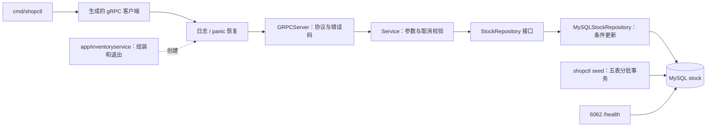

# 阶段 1 学习材料：库存服务（gRPC + MySQL）

对应分支：`phase-01-inventory`。先看[汇报书](../reports/phase-01-inventory.md)，找文件时打开[代码地图](../代码地图.md)。预计学习约 10 小时，可拆成跑通、读代码、做实验、回答问题四次。

## 1. 这个阶段做了什么



库存服务是第一个接收业务请求的进程。一次扣减经过协议解码、业务校验和 SQL，最后把错误变成调用方能理解的 gRPC 状态；同一个 context 把超时传过整条链。另一个命令建立足够大的实验数据集。Redis 和 Kafka 仍只有基础容器，本阶段没有订单服务或消费者。

## 2. 怎么跑起来、看什么

以下都在仓库根目录执行。已有 .env 不覆盖；阶段 0 升级的测试库和环境变量补充方法见 [README](../../README.md)。PowerShell 示例适用于本机；bash 的环境加载方式也在 README 中。

### 2.1 启动与健康

```powershell
if (-not (Test-Path .env)) { Copy-Item .env.example .env }
docker compose --env-file .env -f deploy/docker-compose.yml up -d --build --wait --wait-timeout 240
```

你应该看到构建成功，MySQL、Redis、Kafka、inventory-service 都健康。启动服务会自动迁移，但不会自动造数。

```powershell
docker compose --env-file .env -f deploy/docker-compose.yml ps
Invoke-RestMethod http://127.0.0.1:6062/health
```

你应该看到四个 `healthy`，健康接口返回 `ok`。探测会 Ping 数据库，不是只看进程还在不在。

### 2.2 初始化与真实 RPC

```powershell
Get-Content .env | ForEach-Object {
    if ($_ -match '^(MYSQL_DSN|INVENTORY_GRPC_TARGET)=(.*)$') {
        [Environment]::SetEnvironmentVariable($matches[1], $matches[2], 'Process')
    }
}
go run ./cmd/shopctl seed
```

空库应得到 products=500000、stock=500000、orders=2000000、skipped=false 和本机实际耗时。本次开发机总耗时 75.651 秒。你现在已有全量数据，因此重跑应是 skipped=true；本次重跑实测 538ms。`seed --small` 在空库生成 100 商品/400 订单，已有大库时也跳过，不会缩小或重置它。

```powershell
go run ./cmd/shopctl stock get --sku 1
go run ./cmd/shopctl stock deduct --sku 1 --quantity 1
go run ./cmd/shopctl stock get --sku 1
```

你应该看到库存相对第一次查询减少 1；全新数据是 100 → 99，已使用的库以实际余额为准。扣减命令输出 deducted=1。重复运行 seed 后余额应保持原样。

```powershell
docker compose --env-file .env -f deploy/docker-compose.yml logs --tail 15 inventory-service
```

你应该看到服务名、request_id、RPC 方法、状态码和耗时，不应出现 DSN 或请求完整内容。本阶段尚无 trace 链路可视化。

### 2.3 检查与真实数据库测试

按 README 安装固定版本 staticcheck，并把 GOPATH/bin 加入 PATH。

```text
gofmt -l cmd gen internal tools
go vet ./...
staticcheck ./...
go run ./tools/commentcheck ./...
go run ./tools/archcheck ./...
```

前三条成功时没有诊断；commentcheck 应报告 70 个非生成文件，archcheck 应通过。

```powershell
Get-Content .env | ForEach-Object {
    if ($_ -match '^(TEST_((MIGRATE|INVENTORY|SEED)_)?MYSQL_DSN)=(.*)$') {
        [Environment]::SetEnvironmentVariable($matches[1], $matches[4], 'Process')
    }
}
go test -race ./... -count=1 -timeout=180s -v
```

你应该看到 15 个有测试的包通过，库存并发日志是 50 成功、50 不足、最终 0；deadline 测试返回 DeadlineExceeded。未设置 TEST DSN 时集成测试会明确 SKIP，那不能代替真实数据库验收。测试只清理专用库。

```text
go run ./tools/commentcheck -map ./...
go run ./tools/commentcheck -list ./...
```

前者是每个文件做什么，后者是每个类型/函数在哪里。它们不会替你判断注释是否讲得自然，人工阅读仍然必要。

## 3. 开发过程回放

下面按实际的功能开发先后讲解，结果可在 [notes](../notes.md#phase-01) 对照。阶段 1 的未提交工作在规范更新时被暂存、合入 main、再恢复；最终提交的文件排列不是逐函数编辑时间。

### 3.1 先定契约，再让扣减本身正确

**这次要做什么**：确定客户端和服务之间说什么话，实现不会超卖的一次更新。

**动手前先想清楚什么**：SKU 是 int64，数量是 int32；缺商品和余额不足是不同错误。先查询再更新会留下并发窗口，正确性必须落到数据库条件更新上。

| 文件 / 函数 | 参数 | 返回值 | 作用 |
|---|---|---|---|
| migrations/migrations.go：Apply | ctx、*sql.DB | error | 把五份嵌入 SQL 交给公共迁移器 |
| inventory/service.go：NewService | StockRepository | *Service | 让业务依赖小接口 |
| Service.GetStock | ctx、skuID | Stock、error | 校验后查询 |
| Service.Deduct / Release | ctx、skuID、quantity | error | 校验后扣减/归还 |
| inventory/repository.go：change | ctx、固定 SQL、SKU、数量、拒绝原因 | error | 执行更新，再按影响行数分类 |
| classifyDatabaseError | ctx、底层 error | error | 优先保留取消原因，区分暂时不可用和内部错误 |

proto 负责跨进程契约，model/service 负责 Go 领域契约，repository 负责 SQL。分开后可以替换数据库测试，又不会把驱动类型带进 RPC 层。

**按什么顺序写，为什么**：先写 proto 和迁移，再定义 Stock、错误和仓储接口，之后实现 Service 与 MySQL 仓储。这样写 SQL 时已经知道输入范围和返回语义，接 RPC 时不必重做业务错误设计。

**怎么验证**：先用假仓储验证参数和取消；真实 MySQL 设置库存 50，100 个 goroutine 同时扣 1。最终 race 下恰好 50 成功、50 库存不足、余额 0。另测不存在、归还和 int32 上限。

**遇到的问题和取舍**：影响 0 行可能缺商品，也可能条件不满足，所以只在失败后补查。查询只用于错误说明，不参与扣减决策；并发写入可能让错误说明反映稍晚的状态，但不会导致第二次扣减。没有增加分布式锁或计划外幂等字段。

### 3.2 接到 gRPC 和进程生命周期

**这次要做什么**：让客户端通过端口调用，能观察错误，Ctrl+C 时能收尾。

**动手前先想清楚什么**：deadline 必须原样往下传；panic 恢复在日志拦截器内层，让外层能记录恢复后的状态。连接池必须活到所有入口关闭之后。

| 文件 / 函数 | 参数 | 返回值 | 作用 |
|---|---|---|---|
| inventory/grpc_server.go：NewGRPCServer | *Service | *GRPCServer | 组装协议适配器 |
| GRPCServer.GetStock / Deduct / Release | ctx、对应生成请求指针 | 对应响应指针、error | 转换字段和业务错误 |
| grpcError | error | error | 转成固定状态和安全说明 |
| grpcx.Logging / Recovery | *slog.Logger | UnaryServerInterceptor | 用闭包保存 logger，包围处理器 |
| adminserver.New | address、probe(ctx) | *http.Server | 创建带数据库探测的健康端口 |
| inventoryservice.Run | parent context | result error | 读取配置、迁移、组装、停机 |
| inventoryservice.serve | ctx、address、gRPC server、HTTP server、logger | error | 绑定端口并收齐退出结果 |
| grpcx.Shutdown | ctx、*grpc.Server | error | 先排空，预算到期强制取消 |

**按什么顺序写，为什么**：仓储和业务之后写 gRPC 适配，再写拦截器、管理端口和 app 组装，最后用 cmd 薄入口调用 Run。入口只处理进程退出码，不承包全部业务。

**怎么验证**：bufconn 测试走真实 gRPC 编解码；表格测试覆盖错误码；人为 panic 验证恢复；阻塞请求配合短预算验证强制停机。真实 MySQL 的 SLEEP(5) 配合 100ms RPC deadline，最终实测等 100.5017ms，客户端 DeadlineExceeded，服务端 context canceled。

**遇到的问题和取舍**：审查时发现不能先 Join 全部 Serve 错误，再用 errors.Is 判断“含正常关闭错误就忽略”，否则会丢掉同组真实故障。现在逐个过滤标准关闭哨兵再合并。GracefulStop 没有 context 参数，因此另用 goroutine、done channel 和超时后的 Stop 控制清理时间。

### 3.3 造数先保证基线，再使用批量写入

**这次要做什么**：一条命令得到 50 万商品和 200 万订单，为索引实验提供真实规模。

**动手前先想清楚什么**：五张表不能只写三张；重跑不能恢复已扣库存；续跑必须从已提交的边界开始。

| 文件 / 函数 | 参数 | 返回值 | 作用 |
|---|---|---|---|
| seed.Run | ctx、*sql.DB、small | Result、error | 检查、选择规模、分批推进 |
| seed.inspect | ctx、*sql.DB | 已有商品数、error | 检查行数和连续 ID |
| seed.makeBatches | first、last、now | []batch | 在内存生成五表参数 |
| seed.insertStatement | batch | SQL、[]any | 只拼占位符，展开参数 |
| seed.insertBatch | ctx、*sql.DB、first、last | result error | 五表同事务，提交或回滚 |
| shopctl.Run | parent、arguments、Reader、Writer | error | 分派 seed/stock |
| shopctl.runSeed | 同上，arguments 去掉 seed | result error | 连接、迁移、计时和输出 |
| shopctl.parseStock / runStock | arguments、输出 / 加 parent、Reader | stockOptions、error / error | 先校验，再调用一次 RPC |

**按什么顺序写，为什么**：先确定 ID 和五表关系，再写参数生成、事务插入与 Run 循环，接 CLI 后补测试。纯内存函数单测，事务交给真实数据库验证。

**怎么验证**：small 从两商品完整前缀续到 100，得到 400 订单；改库存为 7 后重跑仍为 7；人为制造后写表的主键冲突，证明前写表也回滚。之后在 shop 跑 full seed，实测 75.651 秒；重跑 538ms，inserted_products=0。

**遇到的问题和取舍**：历史订单要有 product_sales 和 processed_events，后续检查才不会把种子数据当成漏消费。这里直接写基线，没有启动消费者。两个测试包各自清表，因此分配独立测试库，避免并行时互相干扰。seed 要求离线独占运行，不宣称能修复任意业务库。

### 3.4 接 Compose，再实际验证索引

**这次要做什么**：一条 Compose 命令启动服务，留下删索引前后的真实证据。

**动手前先想清楚什么**：容器内数据库地址是 shop-mysql，宿主机才用 127.0.0.1；运行镜像不需要编译器；索引实验先停库存服务，结束必须恢复。

**拆成哪些文件、哪些函数**：本步没有新增 Go 函数。go.Dockerfile 编译已有 main；Compose 健康检查调用已有 /health；CLI 沿用前述函数。002_shop_test_databases.sql 补两个测试库，旧卷显式执行一次，不能靠删卷解决。

**按什么顺序写，为什么**：先验证固定镜像并构建，跑健康和 CLI，再做 full seed 和索引实验。先有真实规模，执行计划差异才有学习价值。

**怎么验证**：四个容器 healthy；RPC 100 → 97；停服日志证明先关入口再关池；EXPLAIN 从 const/uk_stock_sku/1 变为 ALL/NULL/498780，恢复后回到原结果。完整记录见第 7 节。

**遇到的问题和取舍**：旧 MySQL 卷不会重跑 init 脚本，因此显式补建测试库并保留业务数据。CLI 的 SYSTEM 时区与应用 UTC 会话不同，分别记录。没有为重测耗时清空已生成数据。

### 3.5 合入新规范，先改工具再改说明

**这次要做什么**：落实目录、文件、代码三层说明，让工具发现缺项。

**动手前先想清楚什么**：文件头不能粘住 package，否则被当包说明；清单必须精确匹配文件名，不能让 old_service.go 冒充 service.go；cmd/main.go 和生成物保留合理例外。

| 文件 / 函数 | 参数 | 返回值 | 作用 |
|---|---|---|---|
| commentcheck.describeFile | path、AST、FileSet | sourceFile、诊断字符串 | 收集地图项，选择校验规则 |
| fileDescription | AST、FileSet | 一句话说明、是否有效 | 验证首行前缀和空行 |
| inventoryProblems | []sourceFile | []string | 扫描结束后核对 doc.go |
| mentionsFilename | notes、name | bool | 匹配完整文件名 |
| writeMap | Writer、[]sourceFile | error | 输出相对于 docs 的链接 |
| archcheck.locationProblem | path | string | 保留薄入口限制，仅允许根 cmd/README.md |

**按什么顺序写，为什么**：暂存阶段 1，合入 main 的 3aa6c99，再恢复；先扩展 commentcheck 和正反例，再补文件头、doc.go 清单、分组 README，最后生成地图，避免批量改说明时漏项。

**怎么验证**：缺前缀、缺空行、空说明、清单漏项和伪文件名均被拒绝；地图含测试与生成物且链接正确；-list/-map 同用报错。最终 70 个手写文件通过，地图共 72 个 Go 文件。

**遇到的问题和取舍**：cmd/README.md 触发旧 archcheck 误判。因阶段 0 逻辑受限，先询问最小例外；用户批准并要求更新计划书、记录决定。只放行精确路径，程序子目录的 README/doc.go/extra.go 仍拒绝。去注释 AST 与 Go 指令比较证明其余 26 个旧 Go 文件逻辑未变；阶段 0 回放也只依据已有记录补写。

## 4. 阅读顺序

先沿一次请求读通，再研究测试和工具。到一个包先看 doc.go 清单。

1. [库存 main](../../cmd/inventory-service/main.go)：为什么 os.Exit 在 Run 返回之后。
2. [进程组装](../../internal/shop/app/inventoryservice/app.go)：谁创建资源，谁关闭；第二遍再细读 serve。
3. [proto](../../api/proto/inventory/v1/inventory.proto) → [生成接口](../../gen/inventory/v1/inventory_grpc.pb.go)：字段类型/编号和 RPC 边界。
4. [model](../../internal/shop/inventory/model.go) → [service](../../internal/shop/inventory/service.go)：先认领域错误与 StockRepository，再看 Service 实现。
5. [gRPC 适配](../../internal/shop/inventory/grpc_server.go)：context 怎样下传，错误在哪里映射。
6. [仓储](../../internal/shop/inventory/repository.go)：逐句解释 WHERE、RowsAffected 和失败后补查。
7. [迁移目录](../../internal/shop/migrations/doc.go)：stock 主键和 SKU 唯一索引为什么分开。
8. [拦截器](../../internal/platform/grpcx/interceptor.go)、[停机](../../internal/platform/grpcx/shutdown.go)、[健康端口](../../internal/platform/adminserver/server.go)：外围职责如何独立于业务。
9. [CLI main](../../cmd/shopctl/main.go) → [分派](../../internal/shop/app/shopctl/app.go) → [RPC 客户端](../../internal/shop/app/shopctl/stock_client.go)：从调用方看完整链路。
10. [seed 调度](../../internal/shop/seed/seed.go) → [seed 事务](../../internal/shop/seed/repository.go)：规模、批次和占位符。
11. [库存集成测试](../../internal/shop/inventory/repository_integration_test.go)、[seed 集成测试](../../internal/shop/seed/seed_integration_test.go)：先看库名保护，再读断言。
12. [文件说明检查](../../tools/commentcheck/files.go)、[架构检查](../../tools/archcheck/check.go)：工具能证明什么，不能证明什么。

## 5. 关键设计与 WHY

| 怎么做 | 为什么 | 放弃的方案 | 代价 |
|---|---|---|---|
| 单条条件 UPDATE | 判断和减法在数据库加锁时一起完成 | 先查后改、进程内大锁 | 失败后补查错误；高竞争仍等行锁 |
| 消费方定义小接口 | 测试可替换仓储，业务不认识驱动 | 巨型通用 DAO | 多一层调用，需要清楚标注 |
| 边界统一映射错误 | 客户端得到稳定状态，领域不依赖 gRPC | 返回原始数据库错误 | 详细诊断要另行完善，不能泄露配置 |
| ctx 一直传到驱动 | 预算覆盖数据库等待 | 中途 Background | 取消不等于未提交，不能盲重试 |
| 连接池 20/10/5m | 控制本机资源，留数据库余量 | 无上限或独占全部连接 | 起始配置，需后续压测验证 |
| 五表分批事务 | 失败回滚本批，成功后才推进 | 逐行提交、全量大事务 | 不是全库一次原子操作 |
| UTC 时间、整数分 | 避免会话歧义和金额浮点误差 | 本地字符串时间、float 金额 | 展示层需格式化，业务仍需校验 |
| 提交生成物 | 普通构建无需协议工具 | CI 每次在线生成 | 改协议须固定插件重建、审查 diff |

InnoDB 对 UPDATE 锁定扫描到的索引记录；缺索引会扩大扫描和锁范围，具体受隔离级别与计划影响。[MySQL 锁说明](https://dev.mysql.com/doc/refman/8.4/en/innodb-locks-set.html)

gRPC deadline 是调用预算；驱动可通过关闭连接停止等待，不能据此保证远端事务必定回滚。[gRPC deadline](https://grpc.io/docs/guides/deadlines/)、[MySQL Go 驱动](https://github.com/go-sql-driver/mysql)

## 6. 本阶段用到的 Go 写法

阶段 0 的具名返回值、defer、errors.Join、WithoutCancel、signal.NotifyContext、sql.NullInt64 和 Raw/ErrBadConn 已在[阶段 0 材料](phase-00-foundation.md)第 6 节讲解。这里补本阶段首次大量使用的写法。片段用于独立理解，不直接拼入业务代码。

### 6.1 隐式接口与方法接收者

没有 Java 的 implements 声明，方法集合满足接口就实现它。`*T` 接收者让方法作用于原对象；方法集也决定把指针还是值交给接口。StockRepository 让 Service 能用假仓储测试。

```go
type Reader interface { Read() string }
type Memory struct { Value string }
func (m *Memory) Read() string { return m.Value }
func show(r Reader) string { return r.Read() }
// show(&Memory{Value: "库存"}) 返回“库存”。
```

### 6.2 具名字符串类型实现 error

`type Error string` 定义新类型，不是类型别名。实现 Error() 就满足内置 error 接口；常量错误不能被别人重新赋值。errors.Is 能检查被包装的领域错误，不依赖文本比较。

```go
type StockError string
func (e StockError) Error() string { return string(e) }
const ErrEmpty StockError = "库存不足"
// var err error = ErrEmpty
```

### 6.3 匿名嵌入

嵌入会提升字段/方法，不是 Java 类继承。GRPCServer 值嵌入生成的 UnimplementedInventoryServiceServer，为新增 RPC 保留默认未实现行为，也避免 nil 嵌入指针。

```go
type Base struct{}
func (Base) Name() string { return "默认实现" }
type Server struct { Base }
// Server{}.Name() 可以调用被提升的方法。
```

### 6.4 函数值与闭包

函数可以作参数或返回值，闭包记住创建时的变量。拦截器用它保存 logger，不必为一个回调另建实现类。

```go
func wrap(label string, next func() string) func() string {
    return func() string { return label + next() }
}
// f := wrap("RPC: ", func() string { return "OK" })
// f() 返回 "RPC: OK"。
```

### 6.5 chan struct{}、close 与 select

空结构体不承载数据，适合“完成”事件。close 后所有接收者可继续，关闭者只能是负责宣布完成的一方。Shutdown 竞争正常结束和 ctx.Done；并发测试用关闭 start channel 同时放行任务。

```go
// 需要 import "context"。
func wait(ctx context.Context, done <-chan struct{}) error {
    select {
    case <-done:
        return nil
    case <-ctx.Done():
        return ctx.Err()
    }
}
```

`<-chan` 只允许接收，防止函数意外发送/关闭。服务的 finished 则是容量 2 的 error channel：两个 Serve 各写一次，主流程可能尚未读取；已知接收次数，无需 close。

### 6.6 WaitGroup 等待任务，不保护结果

它像一个等待归零的计数器：先 Add，再启动 goroutine，在里面 defer Done，最后 Wait。并发测试把结果送入缓冲 channel，由主 goroutine 汇总，避免多方写同一个普通整数。

```go
// 函数内片段，需要 import "sync"。
var group sync.WaitGroup
results := make(chan int, 2)
for range 2 {
    group.Add(1)
    go func() { defer group.Done(); results <- 1 }()
}
group.Wait()
close(results)
// 之后 for value := range results 汇总。
```

### 6.7 any、切片展开与可变参数

any 是 interface{} 的别名，SQL 参数要同时容纳 ID、名称和时间。`arguments...` 展开切片成多个参数，类似 Java varargs 的目的，但 Go 必须显式写省略号。

```go
func count(values ...any) int { return len(values) }
// args := []any{int64(1), "商品1"}
// count(args...) 是 2，count(args) 是 1。
```

本项目只拼固定列与问号，实际值仍参数化传给驱动。

### 6.8 range 整数、min 与窄化转换

`for range 100` 重复 100 次；需要序号则写 `for i := range 100`。min 截断最后一批。int64 转 int32 不抛溢出异常，所以 CLI 必须先检查范围。

```go
// 函数内片段。
for i := range 3 { _ = i } // 依次 0、1、2。
last := min(int64(1000), int64(107))
_ = last
// int64(2147483648) 的变量直接转 int32 会截断；先和 math.MaxInt32 比较。
```

### 6.9 embed.FS 与编译器指令

迁移 SQL 随二进制发布，不依赖启动目录。`//go:embed` 是指令，不能当普通注释删掉；路径相对当前包，编译时必须有匹配文件。

```go
import "embed"

//go:embed *.sql
var files embed.FS
// files.ReadFile("0001.sql") 读取编译时嵌入的内容。
```

这是计划允许的只读包级资源，不是可随意修改的全局业务状态。

### 6.10 测试资源：t.Context、Cleanup、Helper

t.Context 在测试结束时取消；Cleanup 逆序清理；Helper 把失败位置指向调用帮助函数的测试行。先注册关池、再注册清表，就会先清表后关池。清理要使用仍有效的 context，不能继续借用已经取消的测试上下文。

```go
// 需要 import "testing"。
func requirePositive(t *testing.T, value int) {
    t.Helper()
    if value <= 0 { t.Fatalf("需要正数，得到 %d", value) }
}
func TestContext(t *testing.T) {
    ctx := t.Context()
    requirePositive(t, 1)
    t.Cleanup(func() {
        // testing 在调用 Cleanup 前取消测试 context。
        if ctx.Err() == nil { t.Error("测试 context 应已取消") }
    })
}
```

## 7. 动手实验

### 实验 1：删索引，观察扫描，再恢复

仅在本机靶场做，先停止库存服务，保持 MySQL 运行，不与业务写入并行。SQL 通过管道输入，密码只读容器环境：

```powershell
docker compose --env-file .env -f deploy/docker-compose.yml stop inventory-service
try {
    @'
EXPLAIN SELECT sku_id, available FROM stock WHERE sku_id=250000 AND available>=1;
ALTER TABLE stock DROP INDEX uk_stock_sku;
EXPLAIN SELECT sku_id, available FROM stock WHERE sku_id=250000 AND available>=1;
'@ | docker compose --env-file .env -f deploy/docker-compose.yml exec -T shop-mysql sh -c 'export MYSQL_PWD=$MYSQL_PASSWORD; exec mysql -uapp -Dshop --table'
} finally {
    @'
ALTER TABLE stock ADD UNIQUE INDEX uk_stock_sku(sku_id);
SHOW INDEX FROM stock;
EXPLAIN SELECT sku_id, available FROM stock WHERE sku_id=250000 AND available>=1;
'@ | docker compose --env-file .env -f deploy/docker-compose.yml exec -T shop-mysql sh -c 'export MYSQL_PWD=$MYSQL_PASSWORD; exec mysql -uapp -Dshop --table'
    docker compose --env-file .env -f deploy/docker-compose.yml up -d --wait inventory-service
}
```

若未成功删索引，恢复可能报“索引已存在”；确认 SHOW INDEX 中 uk_stock_sku 存在且唯一后再继续。本次实测如下：

| 状态 | type | possible_keys / key | key_len | ref | rows | filtered | Extra |
|---|---|---|---|---|---|---|---|
| 有索引 | const | uk_stock_sku / uk_stock_sku | 8 | const | 1 | 100.00 | NULL |
| 删索引 | ALL | NULL / NULL | NULL | NULL | 498780 | 3.33 | Using where |
| 恢复索引 | const | uk_stock_sku / uk_stock_sku | 8 | const | 1 | 100.00 | NULL |

实际表有 500000 行，498780 是估算。这里 SELECT 的筛选条件对应扣减条件，用于观察访问路径；不能把 SELECT 的 const 当成 UPDATE 的全部锁行为。[EXPLAIN 列说明](https://dev.mysql.com/doc/refman/8.4/en/explain-output.html)

### 实验 2：提出无法满足的扣减，确认没有部分扣减

先 get 记录余额，再执行 `go run ./cmd/shopctl stock deduct --sku 1 --quantity 2147483647`，然后 get。正常种子余额下应返回 FailedPrecondition，余额不变。修复是按实际余额选择合法数量，不是循环重试；查 SKU `9223372036854775807` 应返回 NotFound。比较两种错误。

### 实验 3：切断取消传播，让测试抓住它

已加载测试 DSN 后运行 `go test -race ./internal/shop/inventory -run TestIntegrationDeadline -count=1 -v`。只在测试 slowRepository.GetStock 中把 QueryRowContext 的 ctx 临时改成 context.Background()，重跑。客户端可能仍及时返回，但服务端等待断言应失败：只测客户端不够。随后撤销这一行、gofmt、重跑通过，不提交实验改动，不修改生产仓储。

### 实验 4：数据库断开时健康接口是否诚实

执行 `docker compose --env-file .env -f deploy/docker-compose.yml stop shop-mysql` 后访问 /health，应返回 503（PowerShell 会报非 2xx）。再执行 `docker compose --env-file .env -f deploy/docker-compose.yml up -d --wait shop-mysql inventory-service`，等待恢复后看 /health 和 stock get。只停止容器，不用 down -v，数据应保留。

### 实验 5：破坏文件清单，再修复

临时从 inventory/doc.go 删除 repository.go 项，运行 `go run ./tools/commentcheck ./...`，应指出漏项；恢复后通过。再把普通文件的 `// 本文件：` 改成一般句子，会触发文件头规则；恢复后重跑。工具证明结构存在，不证明讲解自然。

## 8. 常见误区

- -race 检查 Go 内存竞争，不能单独证明数据库不超卖；还要断言成功次数和余额。
- DeadlineExceeded 不等于未提交，响应丢失时数据库可能已经写入；扣减没有应用层重试。
- sql.DB 是连接池；多个仓储共享它很正常，每请求创建一个池反而放大资源消耗。
- 普通 SELECT 是观察，不会为后续 UPDATE 预留库存。
- 唯一索引和聚簇索引不同：本表按 id 聚簇，sku_id 是唯一二级索引。
- seed 的跳过是保留现有数据，不是校准余额或在线修复。
- 生成代码用于编译，改协议应回到 proto，不能把生成注释当手写教学注释模板。
- /health 目前只探测数据库，没有证明后续 Kafka/Redis 业务链路可用，也没有指标采集。

## 9. 必答问题

1. protobuf 相比 JSON 有什么优缺点？字段编号为什么不能随便改？
2. gRPC deadline 怎样从客户端传到服务端，服务端怎样感知？
3. 为什么条件更新防超卖，而先查后改不能？
4. 聚簇索引和二级索引有何区别？什么是回表？
5. 没索引的 UPDATE 为什么可能锁大量行？
6. 批量插入为什么比逐条插入快？
7. MaxOpenConns 设多少，为什么？
8. 为什么先读 RowsAffected，再查存在性？
9. 为什么 GracefulStop 配合 Stop，done 由唯一一方关闭？
10. seed 为什么写 processed_events，为什么仍不能声称实现幂等消费？

## 10. 本阶段新术语

| 术语 | 一句话解释 |
|---|---|
| protobuf | 用字段编号与类型定义消息的二进制序列化协议 |
| RPC / gRPC | 用接口调用形式访问另一个进程；gRPC 提供传输和状态机制 |
| unary interceptor | 包围一次请求/响应调用的函数，用于日志、恢复等职责 |
| deadline | 一次调用允许持续到的时间边界 |
| 领域错误 | 表达业务含义，独立于具体传输协议 |
| 条件更新 | 把允许修改的条件放进同一条 UPDATE |
| 聚簇索引 | InnoDB 用于组织完整行记录的索引，本表用主键 |
| 二级索引 / 回表 | 二级记录带主键，需要未覆盖列时按主键找完整行 |
| RowsAffected | SQL 影响的行数，本项目据此判断条件更新成功与否 |
| bufconn | 测试 gRPC 协议栈的内存监听器，不占 TCP 端口 |
| 基线 / 批次事务 | 可续跑的已提交前缀；每批五表一起提交或回滚 |
| AST | 编译器解析出的语法结构，检查器用它识别声明和注释位置 |

原文参考：[proto3 字段规则](https://protobuf.dev/programming-guides/proto3/)、[gRPC Go](https://grpc.io/docs/languages/go/quickstart/)、[拦截器](https://grpc.io/docs/guides/interceptors/)、[buf v2](https://buf.build/docs/configuration/v2/buf-gen-yaml/)。

<details>
<summary>必答问题参考要点（先自己回答）</summary>

1. protobuf 有类型、生成接口和较紧凑的二进制表达；JSON 易读、调试工具通用。不能笼统保证每种消息更小更快。编号是线上身份，改号/复用会误解释旧数据；删字段要保留编号和名称。
2. 剩余预算随 gRPC 请求传递，服务端得到带截止时间的 context；Done 关闭，Err 给出原因。继续传给 SQL，不能换成 Background。
3. InnoDB 更新时加锁，等待者拿锁后按当前余额重新判断条件；先查后改时两人可能都读到最后一件。单进程锁也挡不住另一实例。
4. PRIMARY(id) 组织完整行；uk_stock_sku 找到主键，再取 available 等未覆盖列叫回表。唯一性描述约束，聚簇描述存储组织。
5. UPDATE 通常锁它扫描的索引记录，没有有效索引会扩大扫描；默认 REPEATABLE READ 下可能牵连大量记录/间隙。结合实际计划、隔离级别判断。
6. 多行 INSERT 摊薄往返、解析/执行和提交成本；本项目五表共一批事务。太大又会放大内存和锁时间，所以不用全量单事务。
7. 20 打开、10 空闲、5 分钟寿命。MySQL 上限 100，还给 CLI、迁移和后续服务留余量。这是起始配置，没有宣称压测最优。
8. 成功不用额外查；失败后区分不存在/不足，查询只决定错误，不触发第二次写。
9. GracefulStop 没有 context 且可能一直等待，Stop 在预算耗尽时中断。done 唯一关闭者避免重复 close panic；收到完成信号后知道清理 goroutine 已退出。
10. 历史订单已计入销量，因此写对应处理记录保持基线。真实消费、事务幂等和 offset 提交尚未实现，一张表不等于完整能力。

</details>
