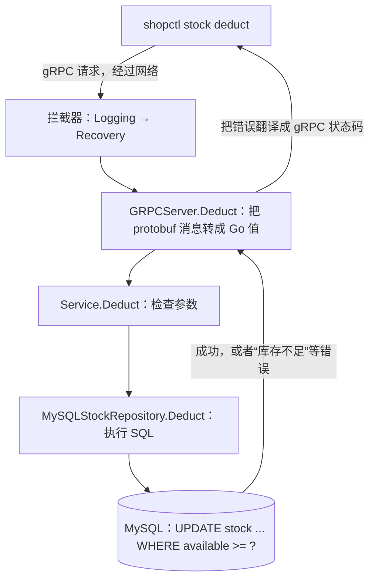

# 阶段 1 学习材料：库存服务

这是项目里第一个真正处理业务请求的服务。它只做三件事：查询库存、扣减库存、归还库存。

事情不多，但后端面试最常问的几个问题都在这里：

- 服务之间怎么调用？（gRPC 和 protobuf）
- 一个请求从网络进来，经过哪几层才到数据库？
- 很多人同时抢最后几件商品，怎么保证不超卖？
- 索引为什么重要？没有索引会发生什么？
- 调用方设了超时，怎么让数据库那边也及时停下来？

> 这份材料对照的是**当前的代码**。阶段 3 给库存服务加了指标和调用链（telemetry），读代码时遇到可以先跳过。

## 1. 这个阶段做了什么

| 做了什么 | 在哪里 |
|---|---|
| 定义库存服务的 gRPC 接口：GetStock、Deduct、Release | [inventory.proto](../../api/proto/inventory/v1/inventory.proto) |
| 实现库存服务 | [internal/shop/inventory](../../internal/shop/inventory/doc.go) |
| 把库存服务组装起来运行，并支持优雅停机 | [inventoryservice](../../internal/shop/app/inventoryservice/doc.go) |
| 建五张表：商品、库存、订单、销量、已处理消息 | [migrations](../../internal/shop/migrations/doc.go) |
| 造测试数据：50 万商品、200 万订单 | [seed](../../internal/shop/seed/doc.go) |
| 命令行工具：造数、手动查询和扣减库存 | [shopctl](../../internal/shop/app/shopctl/doc.go) |
| gRPC 公共部分：请求日志、panic 恢复、带时限的停机 | [grpcx](../../internal/platform/grpcx/doc.go) |
| 管理端口：健康检查 | [adminserver](../../internal/platform/adminserver/doc.go) |

一次扣减请求走过的路：



库存服务开了两个端口：**9001** 是 gRPC 端口，处理上面这样的业务请求；**6062** 是管理端口，提供健康检查 `/health`。

## 2. 怎么跑起来、看什么

所有命令都在仓库根目录运行，开始前先打开 Docker Desktop。命令用 PowerShell 写，bash 的写法见根目录 [README](../../README.md)。

### 2.1 启动库存服务

```powershell
docker compose --env-file .env -f deploy/docker-compose.yml up -d --build --wait --wait-timeout 240 inventory-service
docker compose --env-file .env -f deploy/docker-compose.yml ps
Invoke-RestMethod http://127.0.0.1:6062/health
```

库存服务依赖 MySQL，Compose 会先把 shop-mysql 启动起来。你应该看到两个服务都是 `healthy`，健康检查返回 `ok`。这个健康检查会真的 Ping 一次数据库，不只是看进程活着没有。

服务启动时会自动执行迁移（建表），但不会自动造数。

> 只启动这两个服务时，库存服务的日志里可能出现“导出调用链失败”一类的报错。那是阶段 3 加的调用链在找 Jaeger，这里没启动它，可以忽略。

### 2.2 查询和扣减库存

shopctl 需要两个环境变量：数据库地址和库存服务地址。Go 程序不会自动读取 `.env`，所以先把这两个变量读进当前终端：

```powershell
Get-Content .env | ForEach-Object {
    if ($_ -match '^(MYSQL_DSN|INVENTORY_GRPC_TARGET)=(.*)$') {
        [Environment]::SetEnvironmentVariable($matches[1], $matches[2], 'Process')
    }
}
go run ./cmd/shopctl stock get --sku 1
go run ./cmd/shopctl stock deduct --sku 1 --quantity 1
go run ./cmd/shopctl stock get --sku 1
```

你应该看到：第一次输出 `sku_id=1 available=某个数`；扣减输出 `sku_id=1 deducted=1`；再查一次，库存比第一次少 1。

然后看看库存服务的日志：

```powershell
docker compose --env-file .env -f deploy/docker-compose.yml logs --tail 15 inventory-service
```

你应该看到每次 gRPC 调用都有一条 JSON 日志，包括服务名、请求编号、调用的方法、状态码和耗时。日志里不应该出现数据库密码或请求的具体内容。

### 2.3 关于造数

你的数据库里已经有数据了（阶段 2、3 又产生了很多新订单），所以**不要再运行 `shopctl seed`**。它会检查五张表是不是最初的造数状态，发现对不上就拒绝继续，这是为了防止误把业务数据重置掉。

如果你在一个全新的空数据库上运行它，会看到类似 `products=500000 stock=500000 orders=2000000 ... skipped=false` 的输出。开发时实测耗时 75.651 秒。

### 2.4 运行测试

按根目录 README 的“运行真实 MySQL 与 Redis 集成测试”一节，把测试库的地址设到当前终端，然后运行：

```text
go test -race ./internal/shop/inventory ./internal/shop/seed ./internal/platform/grpcx ./internal/platform/adminserver -count=1 -v
```

重点看两个测试的输出：

- `TestIntegrationConcurrentDeduct`：100 个 goroutine 同时扣减 50 件库存，结果是 50 个成功、50 个库存不足，最后库存为 0。
- `TestIntegrationDeadline`：数据库那边的查询要 5 秒，客户端只等 100 毫秒，结果是客户端收到超时错误，数据库那边的查询也被取消了。

如果没有设置测试库地址，这两个测试会显示 `SKIP`，那就是没有运行。

## 3. 开发过程回放

这一节讲库存服务是怎么一步步做出来的，依据是 [实测记录](../notes.md) 和提交历史。阶段 1 进行到一半时，计划书更新了说明规范，当时的工作被暂存、合并、再恢复，所以提交里的文件顺序不代表编写顺序。

### 3.1 先定接口，再让扣减本身正确

**要做什么：** 先确定客户端和库存服务之间“说什么话”，再实现一个不会超卖的扣减。

**动手前先想清楚的问题：**

- 商品编号用 `int64`，数量用 `int32`。
- “商品不存在”和“库存不足”是两种不同的错误，调用方的处理方式也不一样，要能区分开。
- 先查库存、再决定扣不扣，在并发下是错的（第 5.3 节）。正确性必须交给数据库的一条带条件的 UPDATE 来保证。

**写的顺序：**

1. 写 `.proto` 接口定义和建表迁移。
2. 定义 Go 这边的类型：库存快照 `Stock`、四种业务错误、`StockRepository` 接口。
3. 实现 `Service`（检查参数）和 `MySQLStockRepository`（执行 SQL）。

先定接口和错误，写 SQL 的时候就已经知道输入范围和要返回什么；后面接 gRPC 的时候，也不用回头重新设计错误。

**怎么验证：** 先用假仓储测试参数检查和取消；再连真实 MySQL：把库存设为 50，100 个 goroutine 同时各扣 1 件。在 `-race` 下，结果恰好 50 个成功、50 个库存不足、最后库存为 0。还测了商品不存在、归还库存、数量达到 `int32` 上限这些情况。

**遇到的问题：** UPDATE 影响了 0 行，可能是商品不存在，也可能是库存不够。最后的做法是：只在失败之后补查一次，用来决定返回哪种错误（第 5.4 节）。

### 3.2 接上 gRPC，处理启动和退出

**要做什么：** 让客户端能通过端口调用库存服务，调用过程有日志可查，按 Ctrl+C 时能把正在处理的请求做完再退出。

**动手前先想清楚的问题：**

- 调用方设的超时，要一路原样传到数据库（第 5.6 节）。
- 两个拦截器的顺序：Recovery 放在内层，这样 panic 被转成错误之后，外层的 Logging 还能把结果记下来。
- 数据库连接池必须活到最后：两个端口都关掉、所有请求都处理完以后，才能关连接池。

**写的顺序：** 仓储和业务层写好之后，写 gRPC 适配层 `GRPCServer`；再写拦截器、管理端口和组装代码 `inventoryservice.Run`；最后写只有几行的 `cmd/inventory-service/main.go`。

**怎么验证：**

- 用 bufconn（在内存里模拟网络连接）起一个真实的 gRPC 服务器，测试请求和响应的编解码。
- 用表格测试检查每种业务错误对应的状态码。
- 故意让业务代码 panic，确认 Recovery 能接住。
- 让一个请求一直卡住，配合很短的停机时限，确认 Shutdown 会强制停止。
- 在真实 MySQL 上执行一条要 5 秒的查询，客户端设 100 毫秒超时：客户端实际等了 100.5 毫秒就收到 `DeadlineExceeded`，数据库那边的查询也被取消了。

**遇到的问题：**

1. 两个端口各有一个 `Serve` 调用，退出时都会返回错误，其中“正常关闭”也算一种错误。一开始的写法是先把两个错误合并，再判断“如果包含正常关闭就忽略”，但这样会把同时发生的真实故障也一起忽略掉。改成逐个判断：只去掉正常关闭的那个，其他错误都保留。
2. gRPC 的 `GracefulStop` 不接受时限，可能一直等下去。于是另开一个 goroutine 调用它，主流程等它结束或者等时限到，时限到了就调用 `Stop` 强制停止（第 5.8 节）。

### 3.3 造数

**要做什么：** 一条命令造出 50 万商品、200 万订单，给后面的索引实验提供真实的数据规模。

**动手前先想清楚的问题：**

- 五张表要一起造，不能只造三张。
- 重新运行时，不能把已经扣过的库存恢复原样。
- 中途失败后再运行，要能从已经写好的地方接着造。

**写的顺序：** 先确定编号规则和五张表之间的对应关系（每个商品对应 1 条库存、4 条订单、1 条销量、4 条已处理记录），再写生成每批数据的函数、在一个事务里写入的函数、以及控制整体进度的 `Run`，最后接到 shopctl 命令上，补测试。

**怎么验证：**

- `--small` 模式：从 2 个商品接着造到 100 个，最终得到 400 条订单。
- 把某个商品的库存改成 7，重新运行 seed，库存仍然是 7。
- 故意让一批里后面某张表的插入失败，确认同一批前面几张表写入的数据也被回滚了。
- 在正式的 shop 库上全量造数，实测 75.651 秒；再运行一次，538 毫秒后跳过。

**取舍：** 历史订单要同时写好销量和“已处理消息”记录，否则阶段 2 的一致性检查会把它们当成“漏统计”。这里直接写好这些数据，而不是真的去发消息、启动消费者。

### 3.4 接上 Docker，实测索引的作用

**要做什么：** 一条 Compose 命令启动库存服务；实际删掉索引看看执行计划的变化。

**注意的细节：** 在容器里，数据库地址是 `shop-mysql:3306`；在你的电脑上运行 shopctl 时，地址是 `127.0.0.1:3306`。

**结果：** 四个容器都 healthy；用 shopctl 实际扣减，库存从 100 变成 97；停机日志显示先关端口、再关连接池；删掉索引后，EXPLAIN 从“按索引找到 1 行”变成“全表扫描 49.9 万行”，恢复索引后又变回来（第 7 节实验一）。

**遇到的问题：** 新增的测试库要用初始化脚本创建，但旧的 MySQL 数据卷不会重新执行初始化脚本。解决办法是在已有的数据卷上手动执行一次新脚本，而不是删掉数据卷重来，因为那会把造好的数据一起删掉。

### 3.5 落实三层说明规范

阶段 1 进行中，计划书要求说明分三层：目录（README、doc.go）、文件（文件开头的“本文件：”说明）、代码（注释）。于是先扩展了 commentcheck，让它能检查前两层，并用反例证明它能发现问题；再补全所有文件说明、doc.go 文件清单和目录 README；最后生成代码地图。

过程中发现 archcheck 会把 `cmd/README.md` 当成违规（规则是 cmd 下只能有 main.go）。这涉及修改阶段 0 的检查逻辑，于是先问了你，你同意只为这一个文件开例外。

## 4. 阅读顺序

沿着一次扣减请求，从入口读到数据库，再回头读外围部分。

| 顺序 | 文件 | 重点看什么 |
|---|---|---|
| 1 | [cmd/inventory-service/main.go](../../cmd/inventory-service/main.go) | 只有几行：调用 `Run`，出错就退出 |
| 2 | [inventoryservice/app.go](../../internal/shop/app/inventoryservice/app.go) | `Run`：启动时依次创建了哪些资源，退出时按什么顺序关闭。`serve` 第二遍再细读 |
| 3 | [inventory.proto](../../api/proto/inventory/v1/inventory.proto) | 三个方法，每个方法的请求和响应有哪些字段 |
| 4 | [model.go](../../internal/shop/inventory/model.go) | `Stock` 和四种业务错误 |
| 5 | [service.go](../../internal/shop/inventory/service.go) | `StockRepository` 接口为什么定义在这里；`validate` 检查了什么 |
| 6 | [grpc_server.go](../../internal/shop/inventory/grpc_server.go) | 怎样把请求转给 `Service`；`grpcError` 怎样把业务错误翻译成状态码 |
| 7 | [repository.go](../../internal/shop/inventory/repository.go) | **最重要的文件。** 逐句读 `deductStockSQL` 和它上面的注释，再读 `change` |
| 8 | [0002_stock.sql](../../internal/shop/migrations/0002_stock.sql) | 主键 `id` 和唯一索引 `uk_stock_sku` 各是什么 |
| 9 | [grpcx/interceptor.go](../../internal/platform/grpcx/interceptor.go)、[shutdown.go](../../internal/platform/grpcx/shutdown.go) | 两个拦截器；带时限的停机 |
| 10 | [adminserver/server.go](../../internal/platform/adminserver/server.go) | `/health` 怎样调用传进来的检查函数 |
| 11 | [shopctl/app.go](../../internal/shop/app/shopctl/app.go)、[stock_client.go](../../internal/shop/app/shopctl/stock_client.go) | 从调用方的角度看：怎样连上库存服务、发起一次调用 |
| 12 | [seed/seed.go](../../internal/shop/seed/seed.go)、[seed/repository.go](../../internal/shop/seed/repository.go) | 分批、每批一个事务、怎样接着造 |
| 13 | [repository_integration_test.go](../../internal/shop/inventory/repository_integration_test.go) | 100 个 goroutine 怎样同时开始抢库存；超时测试怎样证明数据库那边也停了 |

## 5. 关键设计与为什么

### 5.1 为什么服务之间用 gRPC

订单服务要调用库存服务。可以用 HTTP + JSON，也可以用 gRPC。项目选了 gRPC，原因有两个：

- **接口有明确的定义。** 用 `.proto` 文件写清楚有哪些方法、每个字段是什么类型，再自动生成两边的代码。字段写错、类型不对，编译时就会报错，不用等到运行时才发现。
- **数据更紧凑。** protobuf 用二进制编码，一般比 JSON 小，解析也快。

代价是不如 JSON 直观：二进制数据没法直接用眼睛看，调试时要用专门的工具。所以对外给浏览器、给用户的接口（订单服务）用 HTTP + JSON，服务之间的内部调用用 gRPC。

**字段编号为什么不能改：** `int64 sku_id = 1;` 里的 `1` 是这个字段在二进制数据里的标识。对方解码时，看到编号 1，就把它当成 `sku_id`。如果你把编号改成 3，旧版本的调用方还在按 1 发送，数据就会被错误地解读。所以编号一旦用了就不能改；字段删掉以后，它的编号也不能再给别的字段用。

### 5.2 一个请求分三层

库存服务的代码分成三层，每层只认识自己需要的东西：

| 层 | 文件 | 只关心什么 |
|---|---|---|
| 适配层 | grpc_server.go | gRPC：把 protobuf 消息转成 Go 值，把业务错误转成状态码 |
| 业务层 | service.go | 业务规则：数量必须大于 0 等 |
| 数据层 | repository.go | SQL |

**好处：** 每层都可以单独测试。最典型的是业务层：`Service` 不直接依赖 MySQL，而是依赖一个接口 `StockRepository`，测试时传一个假的实现进去，不用启动数据库。

**接口定义在使用方：** `StockRepository` 写在 service.go 里，也就是使用它的地方，而不是写在实现它的 repository.go 里。这和 Java 的习惯不同。Go 的接口是“隐式实现”的：一个类型只要有接口要求的方法，就自动实现了它，不需要写 `implements`。所以接口可以由使用方按自己的需要来定义，只列出自己真正要用的方法。（第 6.1 节有例子。）

### 5.3 防止超卖：一条带条件的 UPDATE

这是本阶段最重要的一节。

**先看错误的做法：先查，再扣。** 假设库存只剩 1 件，A、B 两个请求同时来：

| 时刻 | 请求 A | 请求 B |
|---|---|---|
| 1 | 查询：剩 1 件，够 | |
| 2 | | 查询：剩 1 件，够 |
| 3 | 扣 1 件，剩 0 | |
| 4 | | 扣 1 件，剩 -1 ❌ |

两个请求都在对方扣减之前查询，都以为库存够，结果卖出了 2 件。问题出在“查询”和“扣减”是两步，中间有空隙，别的请求可以插进来。

**正确的做法：把检查和扣减写进同一条 SQL。**

```sql
UPDATE stock SET available = available - ?, updated_at = ?
WHERE sku_id = ? AND available >= ?
```

执行这条 UPDATE 时，MySQL 会先给这一行加锁。还是 A、B 同时来：

1. A 先拿到这一行的锁，检查 `available >= 1`，成立，扣成 0，提交事务，释放锁。
2. B 一直在等这把锁。拿到锁以后，MySQL 会按**最新的值**重新检查条件：`available` 现在是 0，`0 >= 1` 不成立，这一行不会被更新。
3. B 收到“影响了 0 行”，返回“库存不足”。

检查和扣减在同一条语句里、在锁的保护下一起完成，中间没有空隙。

**为什么不在 Go 代码里加一把锁：** Go 的锁只能管住当前这一个进程。以后库存服务可能部署好几个实例，shopctl 也会直接调用接口改库存，Go 的锁管不到它们。数据库的行锁对所有连接都有效。

**最后一道保险：** 建表时还加了约束 `CHECK (available >= 0)`。就算哪天 SQL 写错了，库存也不可能被改成负数。

### 5.4 扣减失败时，区分“库存不足”和“商品不存在”

UPDATE 执行完，`RowsAffected()` 返回实际更新了几行：

- 1 行：扣减成功。
- 0 行：失败了，但有两种可能：这个商品根本不存在，或者存在但库存不够。

所以失败之后补查一次（`change` 函数里调用 `GetStock`）：查不到，返回“商品不存在”；查到了，返回“库存不足”。

**注意：** 这次补查只用来决定返回哪种错误，不会根据查询结果再扣一次。扣减是否成功，只看那条 UPDATE。

### 5.5 索引：没有它，扣一件库存要扫描 50 万行

**stock 表有两个索引：**

- 主键 `id`：自增的数字。
- 唯一索引 `uk_stock_sku`：建在 `sku_id` 上。扣库存时按 `sku_id` 找行，靠的就是它。

**InnoDB 的数据是按主键存放的。** 主键索引是一棵树，树的叶子就是完整的一行数据，这叫**聚簇索引**。`uk_stock_sku` 是另一棵树，叫**二级索引**，它的叶子上只有 `sku_id` 和对应的主键 `id`。

所以按 `sku_id` 查库存要走两步：先在 `uk_stock_sku` 里找到这个 `sku_id` 对应的 `id`，再拿着 `id` 去主键索引里取出完整的一行。第二步叫**回表**。

**如果 `uk_stock_sku` 被删掉了：**

- `WHERE sku_id = ?` 没有索引可用，只能从头到尾扫描整张表，50 万行。
- 更要命的是加锁。InnoDB 执行 UPDATE 时，会给扫描过的记录加锁。在默认的隔离级别（REPEATABLE READ）下，没有索引，就可能锁住大量的行。别的扣减请求只能排队等锁，下单就会变得非常慢。

这正是阶段 4 故障场景 S01 要模拟的情况。第 7 节实验一会实际删一次索引，结果是这样的：

| 状态 | type | 用到的索引 | 预计扫描行数 |
|---|---|---|---|
| 有索引 | const | uk_stock_sku | 1 |
| 删掉索引 | ALL（全表扫描） | 无 | 498780 |
| 恢复索引 | const | uk_stock_sku | 1 |

> 为什么不直接把 `sku_id` 设成主键？两种设计都能用。现在这样有一个好处：唯一索引可以删掉再恢复，正好用来做 S01 实验；主键就不能随便删。

### 5.6 超时：从调用方一路传到数据库

shopctl 调用库存服务时设了超时（默认 800 毫秒）。这个超时是怎么让数据库那边也停下来的？

1. gRPC 客户端把“剩余时间”放在请求里一起发出去。
2. 库存服务收到请求，gRPC 根据剩余时间生成一个带截止时间的 `ctx`，传给 `GRPCServer.Deduct`。
3. 这个 `ctx` 原样往下传：`Service.Deduct(ctx, ...)` → `repository.Deduct(ctx, ...)` → `database.ExecContext(ctx, ...)`。
4. 时间到了，`ctx` 被取消，MySQL 驱动就会中断这次查询。

关键在第 3 步：每一层都要把收到的 `ctx` 继续往下传。如果中间有一层换成了 `context.Background()`（一个永远不会取消的 context），客户端虽然按时放弃了，数据库那边的查询还会一直跑下去，白白占着连接和锁。第 7 节实验三会故意制造这个错误。

**超时不等于没有执行。** 客户端收到超时错误，只说明它没等到结果。数据库可能已经扣减成功了，只是响应没来得及传回来。所以扣减**不能自动重试**，否则可能扣两次。这个问题在阶段 2 的“接口幂等”里会仔细讲。

### 5.7 错误码：每种业务错误对应一个 gRPC 状态码

`grpcError` 把业务错误翻译成 gRPC 状态码：

| 业务错误 | gRPC 状态码 | 调用方该怎么办 |
|---|---|---|
| 参数不合法 | InvalidArgument | 修正参数，重试没用 |
| 商品不存在 | NotFound | 重试没用 |
| 库存不足 | FailedPrecondition | 告诉用户卖完了 |
| 存储暂时不可用（数据库断开、锁等待超时等） | Unavailable | 可以稍后再试 |
| 超时 / 取消 | DeadlineExceeded / Canceled | 不知道执行了没有，不能盲目重试 |
| 其他 | Internal | 查服务端日志 |

返回给客户端的错误信息都是固定的中文，比如“库存服务内部错误”，不包含数据库报错的原文。原文里可能有 SQL、表名或连接地址，不该让调用方看到。

### 5.8 优雅停机

库存服务同时开着两个端口。收到退出信号后的顺序是：

1. 停止接受新请求，等正在处理的请求做完。gRPC 端口和管理端口都这样处理。
2. 两个端口都关掉以后，再关数据库连接池。顺序反过来的话，还在处理的请求会突然没有数据库可用。

gRPC 的 `GracefulStop` 会一直等到所有请求做完，但它不接受时限。万一某个请求卡住了，服务就永远退不出去。所以 `grpcx.Shutdown` 另开一个 goroutine 调用 `GracefulStop`，自己同时等两件事：`GracefulStop` 做完了，或者时限到了。时限到了，就调用 `Stop` 强制断开所有请求。（第 6.5 节有一个简化的例子。）

### 5.9 造数：分批，每批一个事务

50 万商品、200 万订单要分批写入，每批 1000 个商品。为什么不用别的方式？

| 方式 | 问题 |
|---|---|
| 每行一个事务 | 太慢：200 多万次提交，每次都要等磁盘写完 |
| 全部放进一个大事务 | 事务太大：占用大量内存，长时间持有锁，失败了要整体回滚 |
| **分批，每批一个事务** | 折中：每批要么全部写入，要么全部不写；失败了重新运行，从已经写好的批次后面接着造 |

每批的插入用一条 SQL 写多行（`INSERT ... VALUES (?, ?), (?, ?), ...`），比一行一条快得多，因为减少了程序和数据库之间的来回次数。

**SQL 里只有问号。** 代码只负责拼出 `(?, ?, ?)` 这样的占位符，实际的值作为参数单独交给驱动。这样即使某个值里有引号等特殊字符，也不会破坏 SQL 语句。这是防止 SQL 注入的标准做法。

### 5.10 金额用整数分，时间用 UTC

- **金额：** 价格存的是“分”（`price_cents BIGINT`），不是“元”（小数）。浮点数不能精确表示 0.1 这样的小数，累加多了就会出现误差。用整数分，所有计算都是精确的。
- **时间：** 所有时间都用 UTC 保存。显示给用户时再转成本地时间。

## 6. 本阶段用到的 Go 写法

每个例子都是能独立运行的小程序。在仓库外面新建一个空目录，保存成 `main.go`，运行 `go run main.go`。第 6.9、6.10 节的运行方法单独说明。

### 6.1 接口是隐式实现的

```go
package main

import "fmt"

// StockRepository 是使用方需要的能力，和项目里的同名接口一样，定义在使用它的地方。
type StockRepository interface {
	Available(skuID int64) int32
}

// fakeRepository 没有写 implements，但它有 Available 方法，所以自动实现了这个接口。
type fakeRepository struct{}

func (fakeRepository) Available(skuID int64) int32 { return 42 }

func describe(repository StockRepository) string {
	return fmt.Sprintf("库存：%d", repository.Available(1))
}

func main() {
	fmt.Println(describe(fakeRepository{})) // 库存：42
}
```

测试 `Service` 时，就是这样传一个假仓储进去的。

### 6.2 用一个字符串类型表示业务错误

```go
package main

import (
	"errors"
	"fmt"
)

// Error 是一个新类型，底层是 string。它有 Error() 方法，所以可以当作 error 使用。
type Error string

func (err Error) Error() string { return string(err) }

const ErrInsufficientStock Error = "库存不足"

func deduct() error {
	// %w 把原来的错误“包”在新错误里，加上了上下文，但原来的错误还能被认出来
	return fmt.Errorf("变更 sku=1 的条件不满足：%w", ErrInsufficientStock)
}

func main() {
	err := deduct()
	fmt.Println(err)                                  // 变更 sku=1 的条件不满足：库存不足
	fmt.Println(errors.Is(err, ErrInsufficientStock)) // true
}
```

用常量表示错误有一个好处：常量不能被重新赋值，别的代码没法把 `ErrInsufficientStock` 改成别的东西。`errors.Is` 能穿过 `%w` 包装找到原来的错误，所以判断错误种类时不用比较字符串。

### 6.3 嵌入：把另一个类型的方法“借”过来

```go
package main

import "fmt"

// Unimplemented 相当于生成代码里的 UnimplementedInventoryServiceServer：每个方法都有一个默认实现。
type Unimplemented struct{}

func (Unimplemented) Deduct() string  { return "未实现" }
func (Unimplemented) Release() string { return "未实现" }

// Server 把 Unimplemented 嵌入进来（只写类型名，不写字段名），然后只覆盖自己实现了的 Deduct。
type Server struct {
	Unimplemented
}

func (Server) Deduct() string { return "扣减成功" }

func main() {
	server := Server{}
	fmt.Println(server.Deduct())  // 扣减成功：用的是 Server 自己的方法
	fmt.Println(server.Release()) // 未实现：用的是嵌入进来的默认方法
}
```

看起来像 Java 的继承，但它其实是组合：`Server` 里面包含一个 `Unimplemented`，Go 自动把它的方法“提升”到 `Server` 上。`GRPCServer` 这样嵌入，以后 `.proto` 里新增了方法，旧代码不用改也能编译，新方法默认返回“未实现”。

### 6.4 返回函数的函数：拦截器的写法

```go
package main

import "fmt"

type Handler func(request string) string

// Logging 和项目里的拦截器思路相同：给它一个前缀，它返回一个“包装器”。
// 包装器接收下一层的处理函数，返回一个先调用下一层、再打印日志的新函数。
func Logging(prefix string) func(Handler) Handler {
	return func(next Handler) Handler {
		return func(request string) string {
			response := next(request)
			fmt.Println(prefix, request, "→", response)
			return response
		}
	}
}

func main() {
	business := func(request string) string { return "OK" }
	wrapped := Logging("[日志]")(business)
	wrapped("Deduct") // 打印：[日志] Deduct → OK
}
```

最里面的函数用到了外层的 `prefix` 和 `next`，这就是闭包。项目里的 `grpcx.Logging(logger)` 就是这样“记住”了 logger。

### 6.5 select：同时等两件事，哪个先发生就处理哪个

```go
package main

import (
	"context"
	"fmt"
	"time"
)

func main() {
	done := make(chan struct{})
	go func() {
		time.Sleep(2 * time.Second) // 模拟 GracefulStop：等正在处理的请求做完，要 2 秒
		close(done)                 // 关闭 channel，通知“做完了”
	}()

	ctx, cancel := context.WithTimeout(context.Background(), 500*time.Millisecond) // 只给 0.5 秒
	defer cancel()

	select {
	case <-done:
		fmt.Println("请求都做完了，正常停止")
	case <-ctx.Done():
		fmt.Println("时间到了，强制停止") // 会走这里
	}
}
```

`chan struct{}` 是一个不传数据的 channel，只用来发通知。`close(done)` 以后，所有在等 `<-done` 的地方都会立刻收到通知。`select` 同时等多个 channel，哪个先有动静就执行哪个分支。`grpcx.Shutdown` 就是这样实现“等做完，但最多等到时限”的。

### 6.6 WaitGroup：等一批 goroutine 全部结束

这个例子模拟了库存的并发测试：100 个 goroutine 同时抢 50 件库存。

```go
package main

import (
	"fmt"
	"sync"
)

func main() {
	var group sync.WaitGroup
	results := make(chan bool, 100) // 容量 100：每个 goroutine 写一次，写的时候不会卡住
	stock := 50
	var lock sync.Mutex // 用锁模拟数据库的行锁

	for range 100 {
		group.Add(1) // 计数加 1
		go func() {
			defer group.Done() // 结束时计数减 1
			lock.Lock()
			ok := stock >= 1 // 检查和扣减在同一把锁里完成，相当于那条带条件的 UPDATE
			if ok {
				stock--
			}
			lock.Unlock()
			results <- ok
		}()
	}
	group.Wait()   // 等计数归零，也就是 100 个 goroutine 全部结束
	close(results) // 不会再有人写入了，关闭它，下面的 range 才能结束

	success := 0
	for ok := range results {
		if ok {
			success++
		}
	}
	fmt.Println("成功", success, "次，剩余", stock) // 成功 50 次，剩余 0
}
```

试着把 `lock.Lock()` 和 `lock.Unlock()` 删掉，再用 `go run -race main.go` 运行，race 检测器会报告数据竞争，结果也可能不再是 50。

### 6.7 any 和可变参数

```go
package main

import "fmt"

// values ...any 表示可以传任意多个、任意类型的参数，在函数里它是一个 []any 切片。
func count(values ...any) int { return len(values) }

func main() {
	args := []any{int64(1), "商品1", 1999}
	fmt.Println(count(args...)) // 3：加了 ...，切片被展开成 3 个参数
	fmt.Println(count(args))    // 1：没加 ...，整个切片被当成 1 个参数
}
```

`any` 是 `interface{}` 的简写，表示“任意类型”。造数时，一条 INSERT 的参数里既有数字又有字符串和时间，所以用 `[]any` 装，再用 `args...` 展开传给 `ExecContext`。

### 6.8 按次数循环、min，以及类型转换的坑

```go
package main

import (
	"fmt"
	"math"
)

func main() {
	for i := range 3 {
		fmt.Print(i, " ") // 0 1 2
	}
	fmt.Println()

	fmt.Println(min(1000, 107)) // 107：最后一批不足 1000 个时，用它截断

	var big int64 = 2147483648       // 比 int32 的最大值大 1
	fmt.Println(int32(big))          // -2147483648：直接转换会“绕回去”，不会报错
	fmt.Println(big > math.MaxInt32) // true：所以转换之前要先检查范围
}
```

Java 里整数转换溢出也不报错，Go 一样。shopctl 读到的数量是 `int64`，传给接口时要转成 `int32`，所以先检查范围，超出就报错。

### 6.9 embed：把文件打包进程序

在一个空目录里放两个文件：`main.go`，以及内容为 `SELECT 1;` 的 `hello.sql`。然后运行 `go mod init example`，再运行 `go run .`。

```go
package main

import (
	"embed"
	"fmt"
)

//go:embed *.sql
var files embed.FS

func main() {
	data, err := files.ReadFile("hello.sql")
	if err != nil {
		panic(err)
	}
	fmt.Println(string(data)) // SELECT 1;
}
```

`//go:embed *.sql` 不是普通注释，而是给编译器的指令：编译时把匹配的文件打包进程序。迁移的 SQL 文件就是这样带进程序的，所以程序在哪个目录启动都能找到它们。注意 `//` 和 `go:embed` 之间不能有空格，删掉这一行，程序就找不到文件了。

### 6.10 测试的辅助工具：t.Helper、t.Cleanup、t.Context

在一个空目录里运行 `go mod init example`，把下面的代码保存成 `example_test.go`，再运行 `go test -v`。

```go
package example

import "testing"

func requirePositive(t *testing.T, value int) {
	t.Helper() // 失败时，报告调用它的那一行，而不是这一行
	if value <= 0 {
		t.Fatalf("需要正数，得到 %d", value)
	}
}

func TestExample(t *testing.T) {
	ctx := t.Context() // 测试结束时会自动取消
	t.Cleanup(func() {
		// Cleanup 注册的函数在测试结束时执行，这时 ctx 已经取消了
		if ctx.Err() == nil {
			t.Error("ctx 应该已经取消")
		}
	})
	requirePositive(t, 1)
}
```

集成测试用 `t.Cleanup` 注册“清空测试表”“关闭连接池”这类收尾工作，后注册的先执行。注意清理函数执行时，`t.Context()` 已经取消了，所以清理时要用另外的 context。

## 7. 动手实验

每个实验看完结果后都要**恢复原状**，不要提交任何改动。

### 实验一：删掉索引，看执行计划的变化

先停掉库存服务，避免实验期间有扣减请求；MySQL 保持运行。下面的脚本删掉索引前后各执行一次 EXPLAIN，最后不管成功与否都会恢复索引、重新启动库存服务：

```powershell
docker compose --env-file .env -f deploy/docker-compose.yml stop inventory-service
try {
    @'
EXPLAIN SELECT sku_id, available FROM stock WHERE sku_id=250000 AND available>=1;
ALTER TABLE stock DROP INDEX uk_stock_sku;
EXPLAIN SELECT sku_id, available FROM stock WHERE sku_id=250000 AND available>=1;
'@ | docker compose --env-file .env -f deploy/docker-compose.yml exec -T shop-mysql sh -c 'export MYSQL_PWD=$MYSQL_PASSWORD; exec mysql -uapp -Dshop --table'
} finally {
    @'
ALTER TABLE stock ADD UNIQUE INDEX uk_stock_sku(sku_id);
SHOW INDEX FROM stock;
EXPLAIN SELECT sku_id, available FROM stock WHERE sku_id=250000 AND available>=1;
'@ | docker compose --env-file .env -f deploy/docker-compose.yml exec -T shop-mysql sh -c 'export MYSQL_PWD=$MYSQL_PASSWORD; exec mysql -uapp -Dshop --table'
    docker compose --env-file .env -f deploy/docker-compose.yml up -d --wait inventory-service
}
```

重点看 EXPLAIN 输出里的三列：`type`（`const` 表示通过唯一索引直接定位，`ALL` 表示全表扫描）、`key`（用到的索引）、`rows`（预计要扫描的行数）。结果应该和第 5.5 节的表格一致。

如果删除索引那一步就失败了，恢复时会报“索引已存在”，这不要紧。看 `SHOW INDEX` 的输出，确认 `uk_stock_sku` 还在就行。

> 这里用 SELECT 来观察：它的 WHERE 条件和扣减的 UPDATE 一样，所以访问路径一样。

### 实验二：扣一个不可能扣成的数量

1. 先查一次：`go run ./cmd/shopctl stock get --sku 1`，记下库存。
2. 扣一个巨大的数量：`go run ./cmd/shopctl stock deduct --sku 1 --quantity 2147483647`。应该返回 `FailedPrecondition`（库存不足）。
3. 再查一次，库存应该和第 1 步完全一样：失败的扣减不会扣掉一部分。
4. 查一个不存在的商品：`go run ./cmd/shopctl stock get --sku 9223372036854775807`。应该返回 `NotFound`。

对比第 2 步和第 4 步的错误，想一想它们是怎么被区分出来的（第 5.4 节）。

### 实验三：故意切断超时的传递

需要先按第 2.4 节设置好测试库地址。

1. 运行 `go test -race ./internal/shop/inventory -run TestIntegrationDeadline -count=1 -v`，应该通过。
2. 打开 [repository_integration_test.go](../../internal/shop/inventory/repository_integration_test.go)，找到测试专用的 `slowRepository.GetStock`，把它调用 `QueryRowContext` 时传的 `ctx` 临时改成 `context.Background()`。
3. 再运行一次。客户端可能还是按时收到了超时错误，但“数据库那边也停下来了”的检查会失败。

这说明只检查客户端有没有按时返回是不够的，还要检查服务端有没有真的停下来。实验后撤销改动，再运行一次确认通过。只改测试文件，不要改正式代码。

### 实验四：数据库断开时，健康检查会怎么说

1. 停掉 MySQL：`docker compose --env-file .env -f deploy/docker-compose.yml stop shop-mysql`。
2. 访问健康检查：`Invoke-RestMethod http://127.0.0.1:6062/health`。应该返回 503，PowerShell 会报错，因为状态码不是 2xx。
3. 恢复：`docker compose --env-file .env -f deploy/docker-compose.yml up -d --wait shop-mysql inventory-service`。
4. 再访问健康检查，并查一次库存，应该都正常了。

这里只是停止容器，数据不会丢。不要用 `down -v`，它会删掉数据卷。

### 实验五：让文件清单检查报错

1. 打开 [inventory/doc.go](../../internal/shop/inventory/doc.go)，删掉文件清单里 `repository_test.go` 那一行。
2. 运行 `go run ./tools/commentcheck ./...`，应该报告 doc.go 的文件清单漏了 `repository_test.go`。
3. 恢复那一行，再运行一次，应该通过。

## 8. 常见误区

- **“`-race` 通过了，就说明不会超卖。”** `-race` 只检查 Go 程序内部的并发读写冲突。超卖发生在数据库层面，要靠测试里断言“恰好 50 个成功、最后库存为 0”来证明。
- **“收到超时错误，说明扣减没有执行。”** 不一定。数据库可能已经扣成功了，只是响应没来得及传回来。所以扣减不能自动重试。
- **“每个请求都应该新建一个数据库连接池。”** 不对。`*sql.DB` 是连接池，整个服务共用一个就够了。每个请求都建一个，反而会开出大量连接。
- **“先 SELECT 查一下库存，就能为后面的 UPDATE 留住库存。”** 普通的 SELECT 不加锁，查完以后，别的请求随时可以把库存扣掉。
- **“唯一索引就是聚簇索引。”** 不一样。stock 表的聚簇索引是主键 `id`；`uk_stock_sku` 是唯一的二级索引。
- **“seed 跳过了，说明数据是对的。”** 跳过只说明“已经造过了，不再造”，它不检查、也不修复你后来改过的数据。
- **“生成的代码里也该写详细注释。”** 生成的代码每次重新生成都会被覆盖。要改接口，就去改 `.proto` 文件。
- **“/health 返回 ok，说明整个系统都正常。”** 它只检查了库存服务能不能连上数据库。

## 9. 必答问题

先自己写下答案，再展开最后的参考要点对照。

1. protobuf 和 JSON 相比有什么优缺点？字段编号为什么不能随便改？
2. gRPC 调用方设置的超时，怎样传到服务端？服务端怎样知道超时了？
3. 为什么带条件的 UPDATE 能防止超卖，而“先查后改”不能？
4. 聚簇索引和二级索引有什么区别？什么是回表？
5. 没有索引的 UPDATE，为什么可能锁住大量的行？
6. 批量插入为什么比逐条插入快？
7. 连接池的最大连接数应该设多少？这个项目为什么设 20？
8. 扣减失败后，为什么先看影响行数，再补查商品是否存在？
9. 为什么要用 GracefulStop 加 Stop 的组合？
10. 造数时为什么要同时写销量和“已处理消息”记录？

## 10. 本阶段新术语

| 术语 | 解释 |
|---|---|
| RPC | 远程过程调用：像调用本地函数一样，调用另一个进程里的函数 |
| gRPC | Google 开源的 RPC 框架，用 protobuf 定义接口 |
| protobuf | 一种接口定义语言和二进制数据格式。先写 `.proto` 文件，再生成各语言的代码 |
| 字段编号 | `.proto` 里每个字段后面的数字，是字段在二进制数据中的身份 |
| 拦截器 | gRPC 的中间件，在每个请求前后执行，比如记日志、接住 panic |
| deadline / 截止时间 | 一次调用最晚要在什么时间完成 |
| 状态码 | gRPC 返回的错误分类，比如 NotFound、FailedPrecondition |
| 业务错误 | 用业务语言描述的错误，比如“库存不足”，和具体用的是 gRPC 还是 HTTP 无关 |
| 条件更新 | 把“允许修改的条件”写进 UPDATE 的 WHERE 里，检查和修改一步完成 |
| 行锁 | InnoDB 更新一行时加的锁，别的事务要修改同一行必须等它释放 |
| 聚簇索引 | InnoDB 按主键组织数据，主键索引的叶子就是完整的一行 |
| 二级索引 | 主键以外的索引，叶子上存的是索引列和对应的主键 |
| 回表 | 通过二级索引找到主键以后，再去主键索引取完整行数据 |
| EXPLAIN | 查看 MySQL 打算怎么执行一条 SQL：用哪个索引、扫描多少行 |
| RowsAffected | 一条 UPDATE 实际修改了几行 |
| bufconn | gRPC 提供的内存连接，测试时不用占用真实端口 |
| 隐式接口 | Go 的接口不用声明实现，有对应的方法就自动实现了 |
| 嵌入 | 把一个类型放进另一个结构体，它的方法会被“提升”上来 |

<details>
<summary>必答问题参考要点（先自己回答）</summary>

1. 优点：接口有明确的类型定义，可以自动生成代码；二进制编码通常更紧凑、解析更快。缺点：不能直接用眼睛读，调试要靠工具。字段编号是字段在数据里的身份，改了编号，新旧版本对同一份数据的理解就不一样了；删掉的字段，编号也不能再给别的字段用。
2. 客户端把剩余时间放在请求里发出去；服务端的 gRPC 据此生成一个带截止时间的 `ctx`。时间到了，`ctx.Done()` 会收到通知，`ctx.Err()` 返回 `DeadlineExceeded`。这个 `ctx` 要一路传到 SQL 执行，中间不能换成 `context.Background()`。
3. 先查后改是两步，两个请求可能都在对方扣减之前查到“还有 1 件”。带条件的 UPDATE 在锁的保护下检查并修改：后来的请求要等锁，拿到锁以后按最新的值重新检查条件，不满足就不会更新。Go 进程里的锁管不住其他实例和其他程序。
4. 聚簇索引按主键组织，叶子就是完整的一行；二级索引的叶子只有索引列和主键。通过二级索引找到主键，再去主键索引取完整的行，叫回表。
5. InnoDB 执行 UPDATE 时，会给扫描过的记录加锁。没有索引只能全表扫描，在 REPEATABLE READ 隔离级别下可能锁住大量记录，别的更新就只能排队等待。
6. 一条 SQL 插入多行，减少了程序和数据库之间的来回次数，也减少了 SQL 解析和事务提交的次数。但一批也不能太大，否则占用内存多、持有锁的时间长。
7. 要看数据库能承受多少连接，以及同时有几个服务在用。这个项目的 MySQL 最多 100 个连接，还要留给其他服务、shopctl 和迁移，所以每个服务默认 20。这是一个起始值，不是压测得出的最优值。
8. 成功时不需要额外查询。失败时影响行数为 0，可能是商品不存在，也可能是库存不够，补查一次才能返回准确的错误。补查只用来选错误码，不会触发第二次扣减。
9. `GracefulStop` 会等所有请求做完，但它不接受时限，可能永远等下去；`Stop` 会立刻断开所有请求。两者组合起来，就是“尽量等请求做完，但最多等到时限”。
10. 这些历史订单没有经过真正的下单流程，也没有发过消息。如果不写对应的销量和处理记录，阶段 2 的一致性检查会以为它们“漏统计”了。但这只是造数据，真正的消息消费和防重复处理是阶段 2 才实现的。

</details>

学完后，在[进度看板](../../进度.md)上勾选阶段 1 的“学习验收”。
