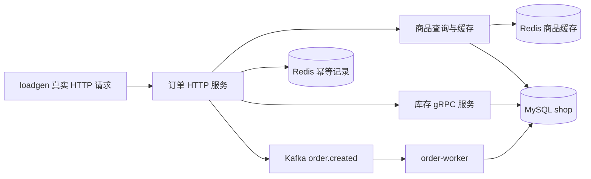

# 阶段 2 学习材料：订单、缓存与消息

本材料面向有 Java 基础、正在学习 Go 的读者。先看[阶段汇报书](../reports/phase-02-order.md)了解交付范围，再沿这里的顺序读代码。工程验收与学习验收分开，学习方框仍由你自己勾选。

## 一、这个阶段做了什么



阶段 1 只有库存。现在一次下单能从 HTTP 入口走到价格查询、库存扣减、订单保存和消息发送。另一个进程读取消息并累加销量。客户端重发同一请求时，幂等记录会阻止重复执行。“幂等”在这里就是同一请求发多次，也只产生一次业务效果；这项保证受保存期限和 Redis 数据是否保留限制。

## 二、怎么跑起来、看什么

命令从仓库根目录执行。下面以 PowerShell 为例，bash 对照根 [README](../../README.md)。这份工作区已经保留阶段 1 的全量数据，进入阶段 2 后不要反复运行 seed 来重置它。

### 1. 先启动，但暂停压测

```powershell
$env:LOADGEN_QPS = '0'
docker compose --env-file .env -f deploy/docker-compose.yml up -d --build --wait --wait-timeout 240
docker compose --env-file .env -f deploy/docker-compose.yml ps
```

你应该看到七个容器 healthy。QPS 是每秒请求数，这里设为零只是暂停生成请求。只有全新的空库才需要先按 README 造数。已有订单的环境不要再拿 seed 作修复工具。

```powershell
Invoke-RestMethod http://127.0.0.1:8081/products/499997 | ConvertTo-Json -Depth 5
```

你应该看到商品编号、名称、以分表示的价格，以及 `stock.status=ok`。库存为零时仍会输出 `available:0`。只有查不到库存数值时才省略 available，并把状态写成 unavailable。

### 2. 同一键下单两次

这一步会真实购买一件商品。用一个新生成的键标识这一笔逻辑请求，第二次保持键和参数都不变。

```powershell
$key = 'learn-' + [guid]::NewGuid().ToString('N')
$headers = @{ 'Idempotency-Key' = $key }
$body = '{"user_id":880001000,"sku_id":499997,"quantity":1}'
$first = Invoke-RestMethod http://127.0.0.1:8081/orders -Method Post -Headers $headers -ContentType 'application/json' -Body $body
$second = Invoke-RestMethod http://127.0.0.1:8081/orders -Method Post -Headers $headers -ContentType 'application/json' -Body $body
$first.data
$second.data
```

你应该看到相同的订单编号、金额和状态。每次 HTTP 响应自己的 request_id 可以不同，它标识的是传输请求。Idempotency-Key 标识要去重的业务请求，两者用途不同。

```powershell
Invoke-RestMethod ("http://127.0.0.1:8081/orders/" + $first.data.order_id)
Invoke-RestMethod 'http://127.0.0.1:8081/orders?user_id=880001000&page=1&page_size=20'
```

你应该在详情和用户列表里找到同一笔订单。时间是 UTC，金额是整数分。这里没有登录，user_id 是请求传入的值，这是靶场的简化。

### 3. 看待核对记录

```powershell
Invoke-RestMethod http://127.0.0.1:6061/metrics
docker compose --env-file .env -f deploy/docker-compose.yml logs --tail 30 order-service
```

你应该看到 `idempotency_requests_total` 的 needs_review 计数。它统计进入待核对的事件，进程重启后归零。告警日志保留 `order_id`、`sku_id`、`idempotency_key` 和原因；订单号为零表示尚未知晓编号。这里只接入了你明确要求的这一个计数，尚未搭建阶段 3 的监控管道。

### 4. 开始或暂停流量

```powershell
Invoke-RestMethod http://127.0.0.1:6070/control -Method Post -ContentType 'application/json' -Body '{"qps":200,"hot_sku_id":0}'
docker compose --env-file .env -f deploy/docker-compose.yml logs -f loadgen
```

你应该每十秒看到一份统计。目标 QPS 只是希望发送的速度，实际 QPS 要看 statistics.qps。P99 是把请求按耗时排好后，百分之九十九的请求不超过的那个位置。这里用一毫秒的桶估计，不是精确到纳秒的原始样本。

```powershell
Invoke-RestMethod http://127.0.0.1:6070/control -Method Post -ContentType 'application/json' -Body '{"qps":0}'
Get-Content .env | ForEach-Object {
    if ($_ -match '^MYSQL_DSN=(.*)$') { $env:MYSQL_DSN = $matches[1] }
}
go run ./cmd/shopctl check
```

等消费者追平后，你应该看到 gap=0。它比较的是购买件数，不是订单笔数。暂时非零可能只是消息还没有处理完；持续非零则要检查发送失败等记录。总量相等也可能掩盖不同商品之间的抵消，所以不能代替逐订单去重测试。

## 三、开发过程回放

这一节按实际开发顺序写。具体运行记录保留在 [notes](../notes.md#phase-02)，没有把中途失败删掉。

### 1. 先把服务保护写成可单独验证的小部件

**这次要做什么**：限制入口请求数，让查询重试有边界，让不健康的下游暂停接收请求。熔断可以理解成“连续出问题，先停一会儿，再小心试探”。

**动手前先想清楚什么**：查询能重复做，扣减不能。重试不能每次重新获得完整超时，否则总耗时会越拖越长。库存不足也不能算服务故障。

| 函数 | 参数 | 返回 | 一句话作用 |
|---|---|---|---|
| resilience.RateLimit | 每秒速率、桶容量 | Gin 中间件、error | 没有额度时立即返回 429 |
| Retrier.Do | context、操作函数、可重试判断 | error | 在次数与时间上限内再试 |
| NewBreaker | 配置、日志、错误分类函数 | Breaker、error | 保存失败统计并控制放行 |
| Client.GetStock | context、商品编号 | Stock、error | 多次查询共享同一预算 |
| Client.Deduct / Release | context、商品编号、数量 | error | 各只发送一次写调用 |

**按什么顺序写，为什么**：先写 resilience 的令牌桶、重试与熔断，再写它们的测试。随后接到 inventoryclient，统一转换 RPC 错误。令牌桶像一个定时补票的盒子，请求拿不到票就离开，不在入口无限排队。

**怎么验证**：测试记录退避时长，检查最多三次总尝试。查询的每次调用都收到同一个截止时间。扣减从不自动重试。熔断测试经过关闭、打开、半开，再恢复关闭。

**遇到的问题和取舍**：首次运行测试被编译缓存写权限挡住，取得工具批准后运行成功。没有安装新系统软件。生产错误被转换成小范围业务分类，避免服务层到处识别 gRPC 状态码。

### 2. 再写商品查询，让缓存只是加速层

**这次要做什么**：缓存命中时直接用商品信息。没有命中才查数据库，这个动作叫回源。库存只影响展示，暂时失败时仍能看商品。

**动手前先想清楚什么**：数据库连接失败不能缓存成“商品不存在”。同时来五十个相同查询时，应该尽量只回源一次。singleflight 只合并同一进程中的同一批查询，不是分布式锁。

| 函数 | 参数 | 返回 | 一句话作用 |
|---|---|---|---|
| product.Service.Get | context、商品编号 | Product、error | 缓存优先，必要时合并回源 |
| Service.load | context、商品编号 | Product、error | 再查一次缓存后读数据库并回填 |
| RedisCache.Get | context、商品编号 | 商品、是否命中、error | 区分没有 key 与空值记录 |
| RedisCache.Set | context、商品编号、商品、是否不存在 | error | 保存 JSON 与对应有效期 |
| Service.Detail | context、商品编号 | Detail、error | 附加库存，失败时标注 unavailable |

**按什么顺序写，为什么**：先写模型和接口，再写缓存优先的流程、SQL 与 Redis 适配，最后补 HTTP handler。这样用内存替身就能检查回源次数，不必等真实 Redis 才发现流程问题。

**怎么验证**：单元测试覆盖命中、未命中、空值、损坏内容、随机时间范围和五十个并发请求。真实 Redis 测试验证十分钟加抖动，以及空值三十秒的有效期。TTL 就是记录还能保存多久。

**遇到的问题和取舍**：singleflight 的执行使用第一个请求的 context。它取消时，这一批等待者也可能收到失败。这样不会为了缓存查询任意延长已经取消的请求。它不是跨进程的合并能力，不能把效果夸大。

### 3. 用消息契约连接订单与销量

**这次要做什么**：订单创建后通知消费者加销量。消息可能重复到达，但一笔订单只能记一次账。

**动手前先想清楚什么**：Kafka 的位点就是“某个分区已经读到哪里”。如果先提交位点、后写数据库，进程中途退出会丢处理。若先写数据库，重复收到消息就必须能识别。

| 函数 | 参数 | 返回 | 一句话作用 |
|---|---|---|---|
| OrderCreated.Validate | 消息自身 | error | 挡住不合法消息字段 |
| Publisher.Publish | context、订单事件 | error | 按订单编号分区并等待发送结果 |
| Consumer.Run | context | error | 停止拉新消息，做完手中消息 |
| Consumer.process | context、Kafka 消息 | error | 解析、写数据库、再提交位点 |
| sales.MySQLRepository.Apply | context、订单事件 | error | 同一事务内去重和累加 |
| MySQLRepository.Check | context | Summary、error | 从同一快照核对两个总量 |

**按什么顺序写，为什么**：先定义消息和消费顺序，再写销量事务。随后用内存读取器检查提交顺序，用真实 MySQL 检查唯一键与回滚。最后才装配 order-worker。

**怎么验证**：二十条同一订单消息并发处理后，真实数据库只留下一个去重记录，销量只加一次。故意使 BIGINT 加法溢出，去重记录也会回滚；修正测试数据后能重放成功。消费循环的测试在处理时取消服务，确认仍提交手上消息且不取下一条。

**遇到的问题和取舍**：消息损坏时选择停下并保留未提交位置，不悄悄跳过。当前没有死信队列，坏消息需要人工检查。消息头的调用链传播留给阶段 3，当前不伪造 traceparent。

### 4. 先确认失败边界，再写订单幂等

**这次要做什么**：同一键重复请求不能重复扣库存或创建订单。出现不确定结果时，要把“继续等”与“需要人工核对”分开。

**动手前先想清楚什么**：原计划说失败时删占位，但失败不等于没有生效。扣减响应丢失后重发，可能扣两次。因此先按 AGENTS 第 6 节向你确认，而不是自行改需求。你批准保守处理，并要求独立错误码、日志和计数。

| 函数 | 参数 | 返回 | 一句话作用 |
|---|---|---|---|
| order.Service.Create | context、请求、幂等键 | Created、error | 串起占位到结果保存 |
| RedisIdempotency.Reserve | context、键、请求 | 记录、是否持有处理权、error | SET NX 原子占位 |
| Complete / Review / Abandon | context、原记录、结果或订单号 | error | 只修改自己持有的记录 |
| Service.safeFailure | context、记录、原错误 | error | 确认没有变更后删除占位 |
| Service.unknown | context、记录、订单号、原因 | error | 保留记录并告警计数 |
| MySQLRepository.Create | context、订单草稿 | 带编号订单、error | 区分未提交与提交结果不明 |

**按什么顺序写，为什么**：收到确认后先更新计划书与 decisions。随后写模型、状态接口、订单流程、Redis 比较更新、SQL 和 HTTP 映射。最后用失败表格把每个分支都走一遍。

**怎么验证**：单元测试分别模拟扣减不明、提交不明、补偿失败、消息发送失败和结果保存失败。真实 Redis 二十次同时占位只有一个执行者；旧请求不能修改新占位；超出处理预算的遗留记录转为待核对。真实 MySQL 验证订单详情、用户隔离和稳定分页。

**遇到的问题和取舍**：Redis 状态更新使用 Lua 在服务器里比较旧值后再写。比较的是完整 JSON，避免 Lua 浮点数把大整数订单号改坏。记录保留原 TTL，重复请求不延长期限。Redis 改为不淘汰记录并持久化；内存满时拒绝新写入。没有增加 Outbox，也没有改库存 RPC 契约。

### 5. 装配进程后，真实请求暴露了首次连接问题

**这次要做什么**：让业务、管理端口和资源关闭真正接起来。新增待核对计数只放在本进程独立注册表里。

**动手前先想清楚什么**：创建客户端对象不等于连接已建立。健康端口也不能代替实际业务请求验收。

| 函数 | 参数 | 返回 | 一句话作用 |
|---|---|---|---|
| orderservice.Run | 父 context | error | 建立依赖后启动 HTTP |
| connectInventory | context、gRPC 连接 | error | 在启动预算内等到 Ready |
| orderservice.serve | context、两台 HTTP server、预算、日志 | error | 排空入口再归还底层资源 |
| reviewRecorder.RecordReview | context、订单号、商品号、键、原因 | 无 | 同时写告警和增加计数 |
| orderworker.Run / serve | context 与进程依赖 | error | 等当前消息结束再关闭连接 |

**按什么顺序写，为什么**：先把纯业务测试跑通，再创建 app 与 cmd，接 Compose。七个容器都健康后才发真实商品和订单请求。

**怎么验证**：第一次真实下单进入待核对；同键重发没有重做，库存也没有变化。检查容器间 DNS、TCP 与健康接口后，稍后的 RPC 正常。新增等待 Ready 的启动步骤及内存握手测试。修复后新的独立测试订单同键两次都返回订单 2000001，数据库只有一笔，总量核对 gap=0。

**遇到的问题和取舍**：第一次失败记录保留，没有删除占位来让测试“变绿”。首次连接等待放进启动预算。运行中库存断开仍按原规则降级或快速失败。阶段 2 只接入明确要求的待核对计数，没有顺便展开整个监控阶段。后来真实停止库存，15 次商品请求均降级；10 次下单转为待核对，指标为 10，熔断后 5 次快速返回 503。恢复后两个熔断器都经过半开并关闭。Redis 停止时原键返回 503，保留卷重启后回放原订单。最后人工审查还发现商品数据库超时错误分类不对，改成统一的 504，并用七个表格场景验证。

### 6. 最后写流量工具，用实际完成数检查它自己

**这次要做什么**：持续驱动三类真实接口，按约七二一的比例访问，允许调速与指定热点。

**动手前先想清楚什么**：生成目标不等于服务真正处理的速度。工作者太少时，工具本身也会成为瓶颈。超时重试必须保留原幂等键，失败尝试也应留在统计中。

| 函数 | 参数 | 返回 | 一句话作用 |
|---|---|---|---|
| generator.nextJob | 热点编号 | job | 选择接口、商品和唯一逻辑请求键 |
| generator.schedule | context、工作通道 | 无 | 按真实经过时间分配发送额度 |
| generator.execute / attempt | context、job | 无 / 是否失败、是否超时 | 实际发送与同键重试 |
| statistics.record / snapshot | 请求类型、耗时、结果 / 当前时间、是否重置窗口 | 无 / report | 累计真实尝试并计算报表 |
| controlState.update | 可选 QPS、可选热点 | error | 检查并原子更新控制设置 |

**按什么顺序写，为什么**：先定义配置和固定内存统计，再写调度、发送、控制与退出。用内存 RoundTripper 检查请求，不在单元测试里访问网络。最后运行真实五分钟压测。

**怎么验证**：固定随机种子的样本符合目标比例，热点切换生效。下单超时恰好两次尝试，键与正文相同。高 QPS 下工作者没有超出上限。第一轮真实基准虽然请求零错误，但少发 880 次，只完成约 197 QPS，因此没有把目标 200 写成实际 200；随后用已有参数提高工作者上限重新验收。

**遇到的问题和取舍**：不使用无限 goroutine 或无限排队来掩盖压力。dropped 单独报告。延迟桶固定为一毫秒，内存不会随运行时间增长。第二轮宿主机仍少发 302 次。第三轮在 Compose 网络内完成 59998 次、0 错误、0 dropped，实际 199.986 QPS，P50=5ms、P99=51ms。尾段与 worker 停机实验重叠，重启后 LAG 和总量差值均归零。各轮缓存状态不同，不能把延迟差异全归因于并发参数或网络。准备另开短流量时还遇到端口已占用，短进程没有发请求；这一操作顺序问题保留在 notes。

## 四、阅读顺序

| 顺序 | 文件 | 重点看什么 |
|---:|---|---|
| 1 | [订单入口](../../cmd/order-service/main.go) → [装配](../../internal/shop/app/orderservice/app.go) | 哪些资源由谁创建、何时关闭 |
| 2 | [订单模型](../../internal/shop/order/model.go) → [幂等状态接口](../../internal/shop/order/idempotency.go) | 先认清输入、结果与三种状态 |
| 3 | [订单流程](../../internal/shop/order/service.go) | 每次失败前已经发生了什么 |
| 4 | [库存客户端](../../internal/shop/inventoryclient/inventory_client.go) → [重试](../../internal/platform/resilience/retry.go) | 一次逻辑调用如何共享预算 |
| 5 | [熔断](../../internal/platform/resilience/breaker.go) → [限流](../../internal/platform/resilience/http.go) | 暂停访问下游和限制入口流量有什么不同 |
| 6 | [商品流程](../../internal/shop/product/service.go) → [缓存](../../internal/shop/product/cache.go) → [SQL](../../internal/shop/product/repository.go) | 缓存 miss、空值、故障分别怎么处理 |
| 7 | [订单 SQL](../../internal/shop/order/repository.go) → [Redis 幂等](../../internal/shop/order/cache.go) | 数据库提交边界与所有者比较更新 |
| 8 | [消息契约](../../internal/shop/events/model.go) → [消费者](../../internal/shop/events/consumer.go) → [销量事务](../../internal/shop/sales/repository.go) | 为什么数据库在前、位点在后 |
| 9 | [worker 装配](../../internal/shop/app/orderworker/app.go) | 停机时当前消息如何拿到独立预算 |
| 10 | [loadgen 入口](../../cmd/loadgen/main.go) → [调度](../../internal/loadgen/generator.go) → [发送](../../internal/loadgen/client.go) → [统计](../../internal/loadgen/stats.go) | 目标流量与实际结果如何分开 |
| 11 | [失败边界测试](../../internal/shop/order/service_test.go) → [Redis 集成测试](../../internal/shop/order/cache_integration_test.go) | 用失败状态反过来检查设计 |

每个文件头现在都列有“主要内容”。先看这个清单，再按函数声明前的 WHY 和函数内部步骤往下读。完整目录与文件导航见[代码地图](../代码地图.md)。

## 五、关键设计与 WHY

### 缓存保存商品，不保存下单判断

怎么做：缓存名称与价格，库存仍通过 RPC 查询或扣减。为什么：商品详情可容忍暂时看不到库存，但扣减必须由库存服务原子判断。放弃的方案是拿缓存中的库存数直接减。代价是下单仍依赖库存服务可用。

### 空值缓存、singleflight 和过期抖动各处理一种问题

空值缓存挡住反复查询不存在编号。singleflight 合并同一进程中同时查同一商品的回源。过期抖动把缓存失效时间打散。它们不能互相替代，也不能解决所有跨实例并发。关闭开关是配置能力，程序没有添加假故障响应。

### 超时、重试、熔断、限流不是同一件事

超时规定“最多等多久”。重试决定“是否再试一次”。熔断在下游持续异常时暂时停发。限流限制入口“每秒允许多少次”。它们各自有代价：超时可能留下未知写结果，重试增加流量，熔断会暂时拒绝已经恢复的服务，单机限流不能约束多个实例的总量。

### 订单提交后，消息失败仍返回已创建

订单已存在，重新执行下单会造成更大的问题。所以保存并回放创建结果，同时记录消息失败告警。代价是销量可能少一笔。Outbox 的思路是把订单和“待发送消息”写进同一个数据库事务，再由独立任务可靠发送；本阶段只讲清，不实现。

### Redis 原子占位只解决一段时间内的重复请求

先 SET NX 取得处理权，再比较旧记录来完成或删除。放弃单进程 map，因为重启或多个实例会绕过它。代价是下单依赖 Redis。选择 noeviction 后，内存满时会拒绝新写入，这是保住已有去重凭据的取舍。

### 消费去重与销量更新放在同一事务

唯一键竞争只让一个事务拿到处理权。它加完销量后一起提交。放弃先把订单 ID 放进 Redis 再改数据库，因为两个系统之间又会出现提交缺口。代价是多一张表、一次插入，以及去重数据的长期保留成本。

### 已知限制

- 扣库存超时可能已经生效。根治需要让 Deduct 自身带请求 ID，并由库存服务去重。本阶段没有实现，不能宣称端到端“恰好一次”。
- 补偿本身可能失败。结果待核对不会自动变成可重试，必须人工核对库存与订单。
- 订单已提交但消息发送失败会少统计销量，没有 Outbox 自动补发。
- 幂等默认保存二十四小时。过期后重发、不带键、换键，或 Redis 数据卷丢失，都超出这项保证。
- Redis 无法写状态时，原占位仍保留。超过完整处理预算后，读取者会把遗留处理中状态转为待核对。原始告警日志仍是重要线索。
- Kafka 与 MySQL 均为本机单节点。坏消息会阻止继续消费，需要人工处理。
- singleflight 只在一个进程中合并请求。商品改价接口尚未实现，所以当前只有读与回填缓存。
- 页码分页在很深的页上需要跳过许多记录。当前按计划保留，后续可讨论基于游标的分页。
- loadgen 使用固定工作者，容量不足会少发请求。dropped 不能当作零错误后忽略。P50/P99 是一毫秒桶上界估计。
- 只有指定的待核对计数，没有完整监控、调用链或诊断 Agent。它们属于后续阶段。

## 六、本阶段用到的 Go 写法

以下是最小片段，省略 `package main` 和 import。函数声明放在包级，其余语句放在 main 或相应函数内；示例中的 ctx、results、jobs 等由调用处提供。这九段都补过必要上下文并编译验证。先理解片段，再回到链接中的实际文件看完整上下文。

### 1. 把函数作为参数

函数可以像值一样传入另一个函数。重试器不需要知道具体业务，只要能调用它。

```go
func once(operation func() error) error {
    return operation()
}
err := once(func() error { return nil })
_ = err
```

这和 Java 传入 lambda 类似。Go 写出的 `func() error` 就是参数类型，表示没有参数、返回一个 error 的函数。

### 2. 泛型加空结构体

`Breaker[struct{}]` 中的方括号提供类型参数。空结构体表示这里不需要业务返回值，只关心 error。

```go
func value[T any](input T) T { return input }
empty := value(struct{}{})
_ = empty
```

`T` 是类型占位，`any` 表示允许任意类型。没有为了本项目另写泛型框架，只是在调用现成库时指定结果类型。

### 3. 接口值与类型断言

singleflight 的回调返回 any，所以取回时要说明它实际装的是什么类型。

```go
var result any = int32(7)
stock := result.(int32)
fmt.Println(stock)
```

`.(int32)` 是类型断言。类型不对会 panic；不确定时用 `stock, ok := result.(int32)`。商品服务的 group 是私有字段，所有回调都返回 Product，所以断言的来源是明确的。

### 4. select 让等待也能取消

select 可以同时等多个通道。商品请求既等共享查询，也等自己的取消通知。

```go
select {
case <-ctx.Done():
    return ctx.Err()
case result := <-results:
    return result.Err
}
```

取消等待不等于自动杀掉另一个 goroutine。真正执行查询的函数仍要把 context 传给数据库。

### 5. 指针区分零与不存在

Go 的普通 int32 默认是零，不能单靠它区分“没有结果”。用指针时，nil 可以表示不存在。

```go
type View struct {
    Available *int32 `json:"available,omitempty"`
}
zero := int32(0)
known := View{Available: &zero}
unknown := View{}
_, _ = known, unknown
```

known 编码后有 `available:0`；unknown 省略字段。结构体后面的反引号内容叫字段标签，由 JSON 编码器读取。

### 6. errors.As 查找一个小接口

错误可以一层层包裹。errors.As 能沿包装链找出满足接口的值，业务层不必导入每个具体错误类型。

```go
var outcome interface { OutcomeUnknown() bool }
if errors.As(err, &outcome) && outcome.OutcomeUnknown() {
    // 结果可能已经生效，不能直接重新执行。
}
```

这里传 `&outcome`，是让 errors.As 把找到的值填进这个变量。库存与数据库错误都实现同一个方法，像 Java 面向接口判断一样使用，但 Go 不需要写 implements。

### 7. WithoutCancel 后马上加新预算

`context.WithoutCancel` 保留上下文中的日志值，但去掉原取消通知。它自己没有超时，因此必须马上加一个有限的新预算。

```go
cleanup, cancel := context.WithTimeout(
    context.WithoutCancel(requestContext), 2*time.Second,
)
defer cancel()
err := release(cleanup)
_ = err
```

这不是给所有工作延寿。只有已经需要完成的补偿、结果保存或当前消息收尾使用它。

### 8. 具名返回值与 defer 补充错误

具名返回值相当于函数内提前声明了一个结果变量。defer 在返回前运行，还能修改它。

```go
func finish() (result error) {
    defer func() { result = errors.Join(result, cleanup()) }()
    return work()
}
```

`errors.Join` 把多个原因保留在同一个 error 中。它不会只留下最后一个错误。订单事务里需要同时保留原失败与回滚失败；已经正常结束的事务会返回 sql.ErrTxDone，这种清理结果不当作故障。

### 9. 固定工作者、WaitGroup 与原子计数

通道传任务，WaitGroup 等全部工作者结束。它不负责保护共享数据。

```go
var workers sync.WaitGroup
for range 2 {
    workers.Add(1)
    go func() {
        defer workers.Done()
        for job := range jobs { handle(job) }
    }()
}
close(jobs) // 由发送方在全部发送结束后关闭。
workers.Wait()
```

共享 map 用互斥锁。测试里的简单次数用 atomic.Int32 的 Add/Load，避免并发读写普通整数。不要把 WaitGroup 当成锁，也不要让接收者随意关闭发送通道。

## 七、动手实验

每次只做一个实验，完成后恢复配置。不要删除 MySQL、Kafka 或 Redis 数据卷。

### 实验 1：降低入口额度，看真实 429

破坏：设置 `$env:RATE_LIMIT_RPS='1'`、`$env:RATE_LIMIT_BURST='1'`，执行 `docker compose --env-file .env -f deploy/docker-compose.yml up -d --no-deps --wait order-service`。

观察：连续快速请求商品接口，部分响应为 429 RATE_LIMITED。请求没有排成一个无限长的队列。

修复：清除这两个进程环境覆盖，再执行同一条 Compose 命令。回到默认 500/100。可以用 `go test ./internal/platform/resilience -run TestRateLimit -v` 对照固定额度的测试。

### 实验 2：停止库存，看商品降级与熔断恢复

破坏：`docker compose --env-file .env -f deploy/docker-compose.yml stop inventory-service`。

观察：重复查询已有商品，HTTP 仍成功，但 stock.status 变成 unavailable。继续查询后日志出现 GetStock 熔断打开。不要把展示降级理解成“仍然可以安全下单”。

修复：`docker compose --env-file .env -f deploy/docker-compose.yml up -d --no-deps --wait inventory-service`。等待连接恢复和半开试探，商品库存重新可用。对照 inventoryclient 中两个独立熔断器。

### 实验 3：杀掉 worker，再让它追平

破坏：先暂停 loadgen，然后执行 `docker compose --env-file .env -f deploy/docker-compose.yml kill -s SIGKILL order-worker`。通过控制接口短暂恢复较低 QPS，让新订单产生，再暂停。

观察：`shopctl check` 的差值可能为正。用 `docker compose --env-file .env -f deploy/docker-compose.yml exec -T kafka /opt/kafka/bin/kafka-consumer-groups.sh --bootstrap-server kafka:29092 --describe --group order-worker` 查看各分区的 LAG，它表示尚未消费的消息数。

修复：启动 worker，等待 LAG 归零，再核对 gap=0。真实重复投递由 `go test ./internal/shop/sales -run Integration -v` 验证；该命令只有注入专用 TEST DSN 才运行，不要指向 shop。

### 实验 4：停止 Redis，再验证原结果仍能回放

破坏：先完成第二节的同键下单，保存好 `$headers` 和 `$body`。停止 Redis，再提交同一请求。

观察：应该收到 503，而不是绕过占位创建新订单。此时不要换键。

修复：保留数据卷启动 Redis，等它健康，再用原键和原正文查询结果。未过期的完成记录应回放原订单。检查 AOF 与 noeviction 的配置，说明为什么“只是缓存就可以随便丢”的想法不适用于幂等记录。

## 八、常见误区

- “报超时，所以肯定没扣库存。”超时只说明调用方没有及时得到结果。
- “有 Redis 锁就能恰好一次。”这里还有跨服务写入、期限和持久化边界。
- “消息发送失败就把整个下单再来一遍。”订单可能已经提交，重做会重复扣库存。
- “先提交 Kafka 位点能减少重复。”会增加消息尚未落库却被跳过的风险。
- “singleflight 是缓存。”它只共享一次正在进行的计算，不长期保存值。
- “P99 可以把每个十秒窗口的 P99 平均一下。”平均百分位不是全程百分位；本工具另存总直方图。
- “目标 200，日志就可以写 200。”必须看实际完成数、真实时长和 dropped。
- “零错误就一定达标。”生成器少发请求也可能零错误。
- “注释检查通过就容易读。”工具只验证基本结构，WHY、术语和句子还要人工审阅。

## 九、必答问题

1. Cache Aside 的读写流程是什么？更新数据时为什么通常删缓存，而不是直接改缓存？
2. 缓存穿透、击穿、雪崩分别是什么？本项目各用什么办法应对？
3. singleflight 的原理是什么？它能解决多个实例同时回源吗？
4. Kafka 的至少投递一次是什么意思？为什么先提交数据库事务，再提交位点？
5. 消费幂等有哪些做法？这里为什么选择已处理事件表？
6. 下单有哪些不一致窗口？Outbox 解决其中哪一段？
7. 为什么流量使用 Zipf 分布？
8. 熔断器的三个状态如何转换？为什么快速失败能保护系统？
9. 为什么 GetStock 能重试而 Deduct 不能？为什么要退避与随机增量？
10. 令牌桶和漏桶有什么区别？单机限流有什么局限？
11. Redis 怎样实现接口幂等？键该保存多久？Redis 不可用时为什么拒绝下单？
12. REQUEST_IN_PROGRESS 与 REQUEST_OUTCOME_UNKNOWN 分别告诉客户端什么？
13. 为什么 Lua 比较整条记录，而不是只看 key 存不存在？
14. 为什么要报告 dropped？为何全程 P99 不能平均窗口 P99？
15. 消费者收到停止信号后，为什么还要处理当前消息？时间上限在哪里？

<details>
<summary>参考答案要点：先自己讲，再展开核对</summary>

1. 先缓存、未命中查库、回填。写库后删除缓存，下一次读再重建。直接更新缓存容易在并发写入时把旧值覆盖到新值上；删缓存也仍有竞态，不能夸大成强一致。
2. 穿透是反复查不存在的数据，用短空值缓存；击穿是热点 key 失效时大量同时回源，用 singleflight；雪崩是大量 key 同时失效，用过期抖动。这里只是对应防护，不能保证任何负载都扛住。
3. 同一 key 的第一位执行，后来的共享结果。本项目只在单进程内生效。
4. 消息可能重复。数据库先提交会留下可安全重放的重复，位点先提交会造成未处理消息被跳过。
5. 可用业务唯一键、已处理表或带条件的状态更新。这里订单号已经唯一，去重凭据和销量能在同一个 MySQL 事务里提交。
6. 扣减成功但订单失败需要补偿，补偿也可能失败；订单成功但消息失败会少统计；扣减或提交答复丢失会留下结果不明。Outbox 主要缩小订单与发送消息之间的缺口，不自动解决扣库存超时。
7. 热门商品远比长尾商品常见，更能观察缓存和热点行为；均匀分布会稀释热点。
8. 关闭正常调用；打开快速拒绝；等待后半开少量试探，成功恢复，失败再打开。避免持续占用连接和等待时间。
9. 查询没有写副作用，扣减重复执行会多扣。退避降低重复尝试速度，随机增量避免大量客户端同时冲回来。
10. 令牌桶按速率补额度并允许一定突发；漏桶强调按固定速度排出。单机各有自己的额度，多实例总量会放大。
11. SET NX 取得处理权，保存处理中或完成结果，所有者比较后更新。当前默认二十四小时，要覆盖客户端重试窗口，也要考虑存储成本。Redis 不可用时继续下单会失去去重保护。
12. 前者仍在预算内处理；后者可能已有副作用，要求核对，不能换键重做。
13. 原 key 可能已经过期并被新请求占用。只看存在性会让旧请求删除新记录，完整值中的随机所有者可以区分它们。
14. dropped 说明生成器没有把目标流量真正发出。百分位不是线性量，必须合并样本或桶后重新算。
15. 当前消息可能已经提交数据库，完成位点提交能减少无谓重放。WithoutCancel 后立即 WithTimeout，限定单条消息收尾时间。

</details>

## 十、本阶段新术语

| 术语 | 大白话说明 |
|---|---|
| Cache Aside | 应用自己照看缓存，没命中才查库并回填 |
| 回源 | 绕过没拿到结果的缓存，去查数据库 |
| 空值缓存 | 把“确实不存在”也短暂保存起来 |
| TTL | 一条记录还能保存多久 |
| 抖动 | 在固定等待或过期时间上加一点随机量 |
| singleflight | 同一进程中，相同 key 的并发查询共享一次执行 |
| 令牌桶 | 按速度补票，请求拿到票才放行 |
| 指数退避 | 连续失败后，基础等待时间逐次翻倍 |
| 熔断 | 下游持续异常时先停发，再少量试探恢复 |
| 降级 | 一部分能力不可用时，保留仍可信的部分 |
| 幂等键 | 客户端为同一逻辑请求保留的去重标识 |
| 占位 | 先登记正在处理，阻止其他重复请求抢着执行 |
| 结果待核对 | 已不能确定写入是否发生，停止自动重做并交人工检查 |
| CAS | 比较旧值仍没变，才执行更新；本项目用 Redis Lua 完成 |
| 位点 / offset | 某个 Kafka 分区读到了哪个位置 |
| 消费组 | 合作读取同一主题的一组消费者 |
| LAG | 尚未追上的消息数量 |
| Outbox | 和业务数据一起写入的待发送消息表 |
| AOF | Redis 把写操作追加到磁盘文件，用于恢复数据 |
| Zipf 分布 | 少数对象特别热门，大量对象很少被访问 |
| QPS | 每秒请求数，目标值与实际值需要分开 |
| P50 / P99 | 按耗时排序后，百分之五十 / 九十九所在的位置 |
| 直方图 | 把数值分成一段段桶，记录每段有多少样本 |

本阶段到这里停止。学习验收由你本人勾选；没有得到新的明确授权前，不进入阶段 3。
