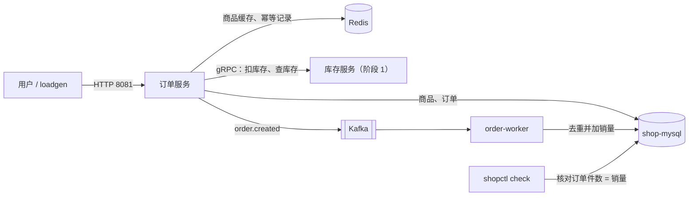
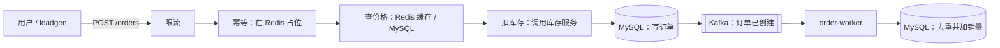
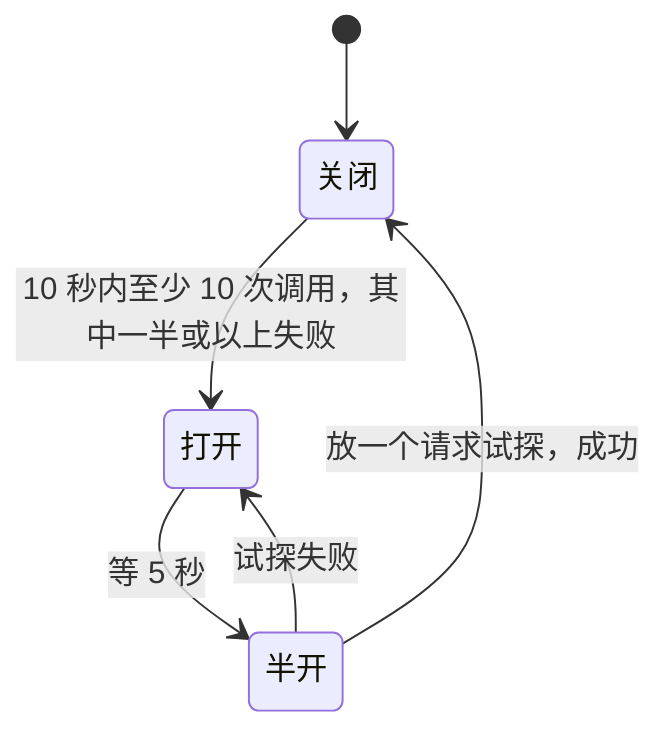

# 阶段 2 学习材料：下单全流程

阶段 1 只有库存服务。阶段 2 让完整的购物流程跑了起来：用户查商品、下单，订单服务扣库存、写订单、发消息，另一个程序收到消息后给商品加销量。还写了一个压测工具，持续给系统发真实的请求。

| 新增的部分 | 作用 |
|---|---|
| 订单服务（[orderservice](../../internal/shop/app/orderservice/doc.go)） | 对外的 HTTP 接口：查商品、下单、查订单 |
| 商品查询（[product](../../internal/shop/product/doc.go)） | 先查 Redis 缓存，没有再查 MySQL |
| 库存客户端（[inventoryclient](../../internal/shop/inventoryclient/doc.go)） | 订单服务调用库存服务，带超时、重试、熔断 |
| 下单（[order](../../internal/shop/order/doc.go)） | 下单的全部步骤，以及防止重复下单 |
| 消息（[events](../../internal/shop/events/doc.go)） | “订单已创建”消息的发送和消费 |
| 销量（[sales](../../internal/shop/sales/doc.go)） | 收到消息后加销量，同一条消息不会算两次 |
| 消费者（[orderworker](../../internal/shop/app/orderworker/doc.go)） | 一个单独的程序，专门消费消息 |
| 服务治理（[resilience](../../internal/platform/resilience/doc.go)） | 限流、重试、熔断 |
| 压测工具（[loadgen](../../internal/loadgen/doc.go)） | 按设定的速率持续发请求 |
| 核对命令（`shopctl check`） | 核对订单总件数和销量总件数是否相等 |

**怎样读这份材料。** 这一阶段是后端面试题最集中的地方：缓存、消息队列、接口幂等、服务治理、分布式一致性。主线是一个问题：**下单要改 Redis、库存服务、MySQL、Kafka 四个地方，它们之间没有一个事务能包住，中途失败了怎么办？** 第 5 节的每个设计点都围绕它展开。Go 语法见第 7 节和 [Mini-Redis 的学习文档](https://github.com/Li-Nepenthe/mini-redis/blob/main/docs/learn/README.md)。

> 这份材料对照的是**当前的代码**。阶段 3 加的指标和调用链，读代码时可以先跳过。

## 1. 本阶段能回答的面试题

| 面试题 | 在哪里 |
|---|---|
| 缓存和数据库怎样保持一致？为什么删缓存而不是改缓存？ | 5.1、八股 1 |
| 缓存穿透、击穿、雪崩是什么？分别怎么防？ | 5.2、八股 1 |
| 超时、重试、熔断、限流、降级各解决什么问题？ | 5.3、八股 5 |
| 为什么查库存可以重试，扣库存不行？重试为什么要退避和加随机量？ | 5.4 |
| 用户点了两次“下单”，怎样保证只下一单？ | 5.5、八股 3 |
| 下单要改好几个系统，中途失败了怎么办？ | 5.6、八股 4 |
| 消息会不会丢、会不会重复？重复了怎么办？ | 5.7、八股 2 |
| 订单写成功了，消息没发出去怎么办？什么是 Outbox？ | 5.8、八股 4 |
| 一个请求里有好几个时限，它们之间要满足什么关系？ | 5.9 |
| 压测结果怎样才可信？P99 能不能取平均？ | 5.10 |
| 消费者怎样优雅停机？ | 5.7 |

## 2. 订单链路在系统里的位置

### 2.1 上下游



订单服务是靶场对外的唯一入口。它依赖四样东西：Redis、库存服务、MySQL、Kafka。order-worker 是另一个进程，只读 Kafka、只写 MySQL，和订单服务之间没有直接调用。

### 2.2 同步的一段和异步的一段



前面一段（到发出消息为止）在用户的请求里同步完成；后面加销量由 order-worker 异步完成，用户不用等。

### 2.3 各部分负责什么、不负责什么

| 部分 | 负责 | 不负责 |
|---|---|---|
| order | 下单的步骤和顺序；每一步失败时判断“到底发生了什么”；幂等记录的状态 | 怎样连 Redis、Kafka，由组装层传入 |
| product | 商品查询：缓存、空值、合并并发查询；库存服务不可用时降级 | 修改商品（项目没有这个接口） |
| inventoryclient | 调库存服务的超时、重试、熔断；把 gRPC 状态码翻译成订单服务认识的错误 | 决定扣减失败以后怎么办，那是 order 的事 |
| resilience | 通用的限流、重试、熔断部件 | 判断哪些错误该重试，由调用方传入判断函数 |
| events | 消息格式；发送时等 Kafka 确认；消费时先处理、后提交位点 | 销量怎么加 |
| sales | 在一个事务里去重并加销量；核对总量 | 读 Kafka |
| orderservice / orderworker | 读配置、建连接、开端口、按顺序停机 | 业务规则 |
| loadgen | 按目标速率发三种请求；统计实际速率、错误率、P50、P99 | 判断系统是否健康 |

## 3. 跑起来看什么

所有命令都在仓库根目录运行，开始前先打开 Docker Desktop。命令用 PowerShell 写，bash 的写法见[操作手册](../operations.md)。你的数据库里已经有数据了，**不要运行 `shopctl seed`**。

**第 1 步：启动，先不开流量。**

```powershell
$env:LOADGEN_QPS = '0'
docker compose --env-file .env -f deploy/docker-compose.yml up -d --build --wait --wait-timeout 240 order-service order-worker loadgen
docker compose --env-file .env -f deploy/docker-compose.yml ps
```

Compose 会把它们依赖的 MySQL、Redis、Kafka、库存服务一起启动。你应该看到这几个服务都是 `healthy`。`LOADGEN_QPS=0` 表示压测工具先不发请求。没启动阶段 3 的监控组件时，日志里可能出现“导出调用链失败”一类的报错，可以忽略。

**第 2 步：查一个商品。**

```powershell
Invoke-RestMethod http://127.0.0.1:8081/products/499997 | ConvertTo-Json -Depth 5
```

你应该看到商品编号、名称、价格（单位是分），以及 `stock.status=ok` 和库存数量。连续执行两次：第一次可能要查数据库，第二次直接命中 Redis 缓存。

**第 3 步：用同一个幂等键下单两次。** 这一步会真的买一件商品。先生成一个键，两次请求用同一个键、同样的内容：

```powershell
$key = 'learn-' + [guid]::NewGuid().ToString('N')
$headers = @{ 'Idempotency-Key' = $key }
$body = '{"user_id":880001000,"sku_id":499997,"quantity":1}'
$first = Invoke-RestMethod http://127.0.0.1:8081/orders -Method Post -Headers $headers -ContentType 'application/json' -Body $body
$second = Invoke-RestMethod http://127.0.0.1:8081/orders -Method Post -Headers $headers -ContentType 'application/json' -Body $body
$first.data
$second.data
```

你应该看到两次返回的订单号、金额完全一样：第二次没有真的再下一单，而是直接返回第一次的结果（数据台账 P2-2）。两次响应里的 `request_id` 是不同的：`request_id` 标识“这一次 HTTP 请求”，`Idempotency-Key` 标识“这一笔下单”。

**第 4 步：查订单。**

```powershell
Invoke-RestMethod ("http://127.0.0.1:8081/orders/" + $first.data.order_id)
Invoke-RestMethod 'http://127.0.0.1:8081/orders?user_id=880001000&page=1&page_size=20'
```

你应该在订单详情和这个用户的订单列表里都找到这笔订单。靶场没有登录功能，`user_id` 直接由请求传入。

**第 5 步：看“结果待核对”的计数。**

```powershell
(Invoke-WebRequest http://127.0.0.1:6061/metrics).Content -split "`n" | Select-String idempotency_requests_total
```

`result="needs_review"` 是“结果待核对”的次数（5.6 节）。这个计数在服务重启后会归零，每次进入待核对时还会写一条告警日志。

**第 6 步：开始和暂停流量。**

```powershell
Invoke-RestMethod http://127.0.0.1:6070/control -Method Post -ContentType 'application/json' -Body '{"qps":200,"hot_sku_id":0}'
docker compose --env-file .env -f deploy/docker-compose.yml logs -f loadgen
```

你应该每 10 秒看到一份统计：实际的每秒请求数 `qps`、错误率 `error_rate`、`p50_ms`、`p99_ms`、没发出去的请求数 `dropped`。按 Ctrl+C 退出日志查看（不会停止压测）。暂停流量：

```powershell
Invoke-RestMethod http://127.0.0.1:6070/control -Method Post -ContentType 'application/json' -Body '{"qps":0}'
```

**第 7 步：核对订单和销量。** 暂停流量、等 order-worker 处理完积压的消息（大约几秒），再运行：

```powershell
Get-Content .env | ForEach-Object { if ($_ -match '^MYSQL_DSN=(.*)$') { $env:MYSQL_DSN = $matches[1] } }
go run ./cmd/shopctl check
```

你应该看到 `gap=0`：所有订单的总件数，等于销量表里的总件数。如果刚暂停就核对，可能有消息还没处理完，等一会儿再试。

## 4. 代码走读

### 4.1 阅读顺序

分两条线读：先读下单，再读销量消费。

**下单这条线：**

| 顺序 | 文件 | 重点看什么 |
|---|---|---|
| 1 | [orderservice/config.go](../../internal/shop/app/orderservice/config.go) | 几个时限的默认值，以及 `loadConfig` 末尾检查的它们之间的关系（5.9 节）；库存调用的配置在 `inventoryConfig` |
| 2 | [orderservice/app.go](../../internal/shop/app/orderservice/app.go)、[dependencies.go](../../internal/shop/app/orderservice/dependencies.go)、[servers.go](../../internal/shop/app/orderservice/servers.go) | 启动时创建了哪些连接（`openDependencies`），怎样组装成业务服务（`shopServices`）和两个 HTTP 服务器（`httpServers`），退出时怎么关；`routes` 里中间件的顺序 |
| 3 | [order/model.go](../../internal/shop/order/model.go)、[idempotency.go](../../internal/shop/order/idempotency.go) | 下单请求、订单，以及幂等记录的三种状态 |
| 4 | [order/service.go](../../internal/shop/order/service.go) | **最重要的文件。** `Create` 只有二十几行，按顺序调用 `reserve`、`replay`、`orderPrice`、`deductStock`、`writeOrder`、`publishCreated`、`saveResult`；再看每一步失败时调用的是 `safeFailure` 还是 `unknown` |
| 5 | [order/cache.go](../../internal/shop/order/cache.go) | `Reserve` 怎样用 Redis 占位；`existing` 怎样处理已有的记录，`reviewIfExpired` 怎样把超时的“处理中”转成“待核对”；Lua 脚本为什么要比较整条记录 |
| 6 | [product/service.go](../../internal/shop/product/service.go)、[product/cache.go](../../internal/shop/product/cache.go) | 先缓存后数据库；空值缓存；singleflight |
| 7 | [inventoryclient/inventory_client.go](../../internal/shop/inventoryclient/inventory_client.go) | `GetStock` 的重试由 `retryableStockErrors` 决定哪些错误可以重试；对比 `Deduct` 为什么只发一次 |
| 8 | [resilience/retry.go](../../internal/platform/resilience/retry.go)、[breaker.go](../../internal/platform/resilience/breaker.go)、[http.go](../../internal/platform/resilience/http.go) | 重试、熔断、限流的实现 |
| 9 | [order/repository.go](../../internal/shop/order/repository.go) | 写订单的事务；怎样判断“提交结果不确定” |

**销量消费这条线：**

| 顺序 | 文件 | 重点看什么 |
|---|---|---|
| 10 | [events/model.go](../../internal/shop/events/model.go)、[publisher.go](../../internal/shop/events/publisher.go) | 消息的格式；发送时怎样等 Kafka 确认 |
| 11 | [events/consumer.go](../../internal/shop/events/consumer.go) | `Run` 的循环；`process`：先处理、后提交位点 |
| 12 | [sales/repository.go](../../internal/shop/sales/repository.go) | `Apply`：在同一个事务里去重和加销量 |
| 13 | [orderworker/config.go](../../internal/shop/app/orderworker/config.go)、[app.go](../../internal/shop/app/orderworker/app.go) | `loadConfig` 读消息处理时限；Kafka 地址的解析和订单服务共用 [app.KafkaBrokers](../../internal/shop/app/config.go)；收到退出信号后，怎样让手上的消息处理完 |

**最后：**

| 顺序 | 文件 | 重点看什么 |
|---|---|---|
| 14 | [loadgen/generator.go](../../internal/loadgen/generator.go)、[client.go](../../internal/loadgen/client.go)、[stats.go](../../internal/loadgen/stats.go) | `schedule` 按目标速率派发任务，`work` 是固定数量的工作者；目标速率和实际速率怎样分开统计；dropped 是怎么来的 |
| 15 | [order/service_test.go](../../internal/shop/order/service_test.go) | 每一种失败情况的测试，反过来帮你理解 `Create` |

### 4.2 一次下单，在请求里同步完成的那一段

沿着第 3 节第 3 步的那次下单走一遍：请求头带着 `Idempotency-Key`，正文是 `{"user_id":880001000,"sku_id":499997,"quantity":1}`。

| 顺序 | 在哪里 | 做了什么 |
|---|---|---|
| 1 | `Handler.Create`（[http_handler.go](../../internal/shop/order/http_handler.go)） | 读请求头 `Idempotency-Key`，带了多个就拒绝；用 `BindJSON` 解析出 user_id、sku_id、quantity |
| 2 | `Service.Create` 开头 | 检查三个数都大于 0、键的格式合法 |
| 3 | `reserve` → `RedisIdempotency.Reserve`（[order/cache.go](../../internal/shop/order/cache.go)） | 先算出请求参数摘要，再执行 `SET idempotency:<键> <记录> NX EX 86400`。记录是一段 JSON，里面有随机的所有者标识、参数摘要、状态“处理中”和商品编号。写入成功，拿到处理权 |
| 4 | `orderPrice` | 调商品服务查价格：先查 Redis 的 `product:499997`，没有再查 MySQL 并写回缓存（5.1 节）。还要检查单价乘数量不会溢出 |
| 5 | `deductStock` | 通过 gRPC 调库存服务扣 1 件，最多等 800 毫秒，不重试。库存服务那一头发生了什么，见阶段 1 第 4.2 节 |
| 6 | `writeOrder` | 在 MySQL 的事务里执行 `INSERT INTO orders ...`，状态 `created`，金额等于单价乘以数量。如果提交（Commit）这一步出错，分不清订单到底写进去没有，就按“结果不确定”处理（5.6 节） |
| 7 | `publishCreated` | 往主题 `order.created` 发一条消息，用订单号决定进哪个分区，最多等 5 秒 Kafka 确认收到。发送失败只记一条告警日志，照常往下走（5.8 节） |
| 8 | `saveResult` → `RedisIdempotency.Complete` | 用 Lua 脚本先比较 Redis 里的记录还是不是自己写的那条，是才改成“已完成”，并存下订单号和金额。`KEEPTTL` 让有效期保持原来的 24 小时，不重新计时 |
| 9 | `Handler.Create` | 返回 201，正文 `data` 里是订单号、金额和状态 |

**同一个键再提交一次：** 第 3 步的 `SET NX` 失败，因为键已经存在。`existing` 读出原来的记录，先比较参数摘要，一致；然后 `replay` 看状态：“已完成”就直接返回保存的订单号和金额，第 4 到 8 步一步都不执行；“处理中”返回 409 `REQUEST_IN_PROGRESS`；“待核对”返回 409 `REQUEST_OUTCOME_UNKNOWN`。

**同一个键、换了下单内容：** 比如第一次买 1 件，第二次买 5 件。参数摘要对不上，说明客户端把键用错了，返回 400 参数错误，不会把第一次的结果当成这一次的结果返回。

**同一个键的 10 个请求同时到达：** 只有一个能 `SET NX` 成功。其余 9 个读到的记录可能还是“处理中”（返回 409），也可能已经是“已完成”（返回同一个订单）。实测 2 个返回 409、8 个返回同一个订单，订单表只新增 1 笔，库存只少 1 件（数据台账 P2-3）。

### 4.3 同一条消息到了两次

订单写好、消息发出以后，order-worker 在后台处理这条消息。下面假设订单号是 12345，消息在某个分区的位点是 100，并且在最坏的时刻发生了一次崩溃：

| 时刻 | order-worker 做了什么 | MySQL | Kafka 位点 |
|---|---|---|---|
| 1 | 读到订单 12345 的消息 | | 停在 100 |
| 2 | 开始事务，`INSERT INTO processed_events (order_id, processed_at) VALUES (12345, 当前时间)`，成功 | 多了一条去重记录（还没提交） | |
| 3 | `INSERT INTO product_sales (sku_id, sold) VALUES (499997, 1) ON DUPLICATE KEY UPDATE sold = sold + 1` | 销量加 1（还没提交） | |
| 4 | 提交事务 | 两条修改一起生效 | |
| 5 | 还没来得及提交位点，进程被强制杀掉，就像第 8 节实验三那样 | | 仍停在 100 |
| 6 | 重启以后，从位点 100 重新读到同一条消息 | | |
| 7 | 开始事务，再插入 processed_events：主键 12345 已经存在，MySQL 返回错误 1062（主键重复）。`Apply` 据此认定这笔订单处理过了，直接返回；这个事务里什么也没写，回滚即可 | 销量没有再加 | |
| 8 | 提交位点，日志里的 `result` 字段是 `duplicate` | | 前进到 101 |

要注意的两点：

1. **第 5 步如果换成“先提交位点、再写数据库”**，崩溃以后这条消息就再也不会来了，销量少算一笔，而且没法补救。这就是 5.7 节那张表的意思。
2. **两条重复消息同时到达也不会算两次。** 第一条的事务还没提交时，第二条插入同一个主键会先等着；等第一条提交了，它得到 1062，按重复处理。集成测试里 20 条相同的消息并发处理，销量只记一次（数据台账 P2-4）。

## 5. 系统设计与取舍

每个设计点按同一个顺序讲：要解决什么问题 → 怎么做 → 放弃了什么、为什么 → 代价和适用边界 → 规模变大十倍会怎样。

### 5.1 商品缓存：先查缓存，没有再查数据库

**问题。** 查商品是最频繁的请求，每次都查 MySQL，数据库会成为瓶颈。商品的名称和价格很少变，适合放进缓存。

**补基础：Redis。** Redis 是一个把数据放在内存里的键值数据库：给它一个键，它返回对应的值。内存比磁盘快得多，所以 Redis 常放在 MySQL 前面当缓存。本项目里的 Redis 有两个用途：一是商品缓存，键是 `product:商品编号`，值是商品的 JSON；二是 5.5 节的幂等记录，键是 `idempotency:幂等键`。

**做法。** 用 **Cache Aside**（旁路缓存）：

- **读：** 先查 Redis，查到了（命中）就直接返回；没查到（未命中），去 MySQL 查（回源），再把结果写进 Redis，有效期 10 分钟。
- **写：** 先更新数据库，再**删除**缓存（而不是更新缓存），下次读的时候自然会重新从数据库加载。项目目前没有修改商品的接口，只用到了读的那一半。

**为什么只缓存商品，不缓存库存。** 库存时刻在变，而且扣库存必须由库存服务在数据库里原子地判断，不能拿缓存里的数去减。商品详情里显示的库存，是每次实时向库存服务查询的。

**放弃了什么。**

- **写时更新缓存。** 两个请求同时更新同一个商品时，“改缓存”的顺序可能和“改数据库”的顺序不一致，缓存里就会留下旧值。删缓存能缩小这个问题，但也不能完全消除，所以缓存都设有效期，最多过一会儿就会自己更新。
- **先删缓存、再更新数据库。** 删完缓存、数据库还没改完时，另一个读请求会把旧值重新写回缓存。要配合“延迟双删”（过一会儿再删一次）才行，更复杂。

**代价。** 数据库改了以后，缓存里最多会有一个有效期的旧数据。对商品名称和价格来说可以接受；对库存、余额这种必须准确的数据就不行。

**规模变大十倍。** 删缓存失败的概率会变得不可忽略。常见的补救是把要删的键放进消息队列重试，或者订阅数据库的 binlog（MySQL 记录所有修改的日志），由一个独立的程序负责删缓存。

### 5.2 缓存的三个经典问题：穿透、击穿、雪崩

**问题。** 缓存挡住了大部分查询，但有三种情况会让大量请求绕过缓存，直接压到数据库上：

| 问题 | 是什么 | 后果 | 本项目的办法 |
|---|---|---|---|
| **穿透** | 反复查一个根本不存在的商品 | 缓存里永远没有，每次都打到数据库 | 把“不存在”也缓存 30 秒（空值缓存） |
| **击穿** | 一个热门商品的缓存刚过期，同时来了大量请求 | 这些请求同时去查数据库 | singleflight：同一时刻只让一个请求去查，其余的等它的结果 |
| **雪崩** | 大量商品的缓存在同一时刻过期 | 数据库同时收到大量查询 | 有效期在 10 分钟的基础上随机多加最多 1 分钟，让过期时间分散开 |

**做法的细节。**

- **只有数据库明确说“没有这行”，才缓存“不存在”。** 数据库连接失败时，不能把“查不到”缓存成“商品不存在”，否则数据库恢复以后，这个商品还会被当成不存在 30 秒。
- **singleflight 用的是第一个请求的 context。** 如果第一个请求被取消了，等着它的其他请求也会一起失败。这样做是为了不让一个已经被取消的请求继续占着数据库。
- **两个功能都可以通过配置关掉。** 阶段 4 的故障场景会故意关掉 singleflight（S04 缓存击穿）、去掉随机有效期（S05 缓存雪崩）。

**放弃了什么。**

- **布隆过滤器防穿透。** 它用很少的内存记住“哪些编号存在”，能在查缓存之前就挡掉不存在的编号。但商品增删时要同步维护它，而且有一定的误判率。空值缓存更简单，对靶场够用。
- **分布式锁防击穿。** singleflight 只在一个进程里生效，订单服务部署多个实例时，每个实例还是会各查一次。用 Redis 锁能让所有实例只查一次，但多了一次网络往返，还要处理锁过期。

**代价。** 空值缓存会让新上架的商品最多 30 秒查不到；随机有效期让缓存的平均寿命略长。

**规模变大十倍。** 实例多了以后，singleflight 的效果按实例数打折。热门商品还可以在每个实例的内存里再放一层很短的本地缓存，或者让热门商品的缓存永不过期、由后台定期刷新。

### 5.3 服务治理：限流、熔断、降级

**问题。** 订单服务依赖库存服务。库存服务变慢或者挂掉时，订单服务不能跟着被拖垮；流量突然变大时，也不能把自己和下游一起压垮。

**做法。** 五种手段各管一种问题：

| 手段 | 一句话 | 用在哪里 | 代价 |
|---|---|---|---|
| **超时** | 最多等多久 | 每次调用库存服务最多等 800 毫秒 | 超时了不知道对方执行没有 |
| **重试** | 失败了再试一次 | 只用于查库存，最多试 3 次（5.4 节） | 增加下游的压力 |
| **熔断** | 下游一直出错，先别调用它 | 调用库存服务 | 熔断期间，就算库存服务已经恢复，请求也会先被拒绝 |
| **限流** | 每秒最多处理多少请求 | 订单服务的入口，默认每秒 500 个，最多攒 100 个令牌 | 只限制单个实例，多个实例的总量会叠加 |
| **降级** | 部分功能坏了，保留还能用的部分 | 库存服务不可用时，商品详情仍然返回，只是库存显示 unavailable | 用户看到的信息不完整 |

**熔断器的三种状态：**



为什么打开时直接失败反而是保护？库存服务已经出问题了，如果每个请求还去调用、等 800 毫秒超时，订单服务的 goroutine 和连接都会被这些注定失败的请求占满，最后订单服务自己也撑不住了。实测库存服务停机时，熔断器打开以后，下单每次约 5–7 毫秒就返回 503（数据台账 P2-6）。

“库存不足”是正常的业务结果，不能算作库存服务出了故障，否则熔断器会误判，所以熔断器只把超时、不可用这类错误计为失败。

**限流用的是令牌桶。** 想象一个桶，每秒往里放 500 个令牌，最多存 100 个。每个请求要拿走一个令牌才能进入，拿不到就立刻返回 429，不排队。桶里存着的令牌允许短时间的突发流量。

**下单为什么不能降级。** 查商品时库存未知，可以显示“暂不可用”；下单时库存未知，不能“当作有库存”继续下单。所以库存服务挂了，下单只能失败。

**放弃了什么。**

- **漏桶限流。** 它把流量整成完全平稳的速率，不允许突发。用户的点击本来就是一阵一阵的，令牌桶更合适。
- **全局限流。** 用 Redis 记录所有实例的总请求数，能精确控制总量，但每个请求都多一次 Redis 调用。

**代价。** 熔断的参数（10 次、50%、5 秒）是经验值，没有针对真实流量调过；单机限流在多实例时总量会叠加。

**规模变大十倍。** 实例多了以后，限流一般放到网关上统一做；熔断仍然放在每个调用方，因为只有调用方知道自己能不能承受下游的失败。

### 5.4 重试：只重试读操作，所有重试共用一个总时限

**问题。** 网络偶尔抖一下，一次调用失败了，再试一次往往就成功了。但重试也有风险：写操作可能重复执行；下游本来就快撑不住了，大量重试会把它彻底压垮。

**做法。**

- **只重试查库存。** 查询没有副作用，执行一次和执行三次结果一样；扣减执行两次就扣了两次。如果第一次其实已经成功了，只是响应在网络上丢了，重试就会再扣一次。所以 inventoryclient 只给 `GetStock` 加了重试，`Deduct` 和 `Release` 都只调用一次。
- **只重试暂时性的错误。** `retryableStockErrors` 只放行 `Unavailable` 和 `DeadlineExceeded`，而且整次调用的时限还没到。“商品不存在”这种错误重试也没用。
- **所有重试共用同一个 800 毫秒的时限。** 剩下的时间不够了就不再重试，不会因为重试三次就等三倍的时间。
- **指数退避加抖动。** 第一次失败后等 50 毫秒，第二次失败后等 100 毫秒，逐次翻倍；再在等待时间上加一点随机量，避免很多客户端在同一时刻一起重试。阶段 4 的场景 S13“重试风暴”会演示不退避、不熔断时会发生什么。

**补基础：幂等。** “幂等”指同一个操作执行多次，效果和执行一次一样。查库存是幂等的，扣库存不是，所以只有前者能自动重试。一个接口是否幂等，要看服务端怎么实现，不能只看它用的是 GET 还是 POST。

**放弃了什么。** 给扣库存也加重试。要做到安全，库存服务必须能认出“这是同一次扣减”，也就是阶段 1 5.7 节说的扣减流水，本阶段没有做。

**代价。** 重试让下游的压力最多变成三倍。

**规模变大十倍。** 调用链变长以后，每一层都重试三次，重试次数会层层相乘。常见的做法是只在最靠近失败的那一层重试，或者给整条链设一个“重试预算”（比如重试的请求不能超过总请求的 10%）。

### 5.5 接口幂等：同一个下单请求只执行一次

**问题。** 用户点了“下单”，网络卡了一下没反应，又点了一次；或者客户端超时后自动重试。如果服务端每次都执行，就下了两单。

**做法。** 客户端给每一笔下单生成一个唯一的键，放在请求头 `Idempotency-Key` 里，重试时用同一个键。服务端用 Redis 记录每个键的处理状态：

1. **占位：** 用 `SET key 值 NX EX 86400` 写入一条“处理中”的记录。`NX` 表示“只有这个键不存在时才写入”，所以同一个键的多个请求同时到达，只有一个能写入成功，拿到处理权。
2. **处理完成：** 把记录改成“已完成”，并保存下单结果（订单号、金额）。
3. **重复请求到来：** 看到“已完成”，直接返回保存的结果；看到“处理中”，返回 409 `REQUEST_IN_PROGRESS`。

记录保存 24 小时。超过 24 小时再用同一个键，就当成新请求了。

**同一个键，换了下单内容。** 占位记录里还存着一份“请求参数摘要”：把用户、商品、数量三个数编码以后算一个 SHA-256。同一个键再来时，如果摘要和记录里的不一样，说明客户端把键用错了，直接返回 400。

**改记录时要比较整条内容。** 假设请求 A 处理得特别慢，它的占位过期了，请求 B 用同一个键占了新的位。这时 A 终于处理完，要把记录改成“已完成”。如果只判断“这个键还存在”，A 就会把 B 的记录覆盖掉。所以每条记录里都有一个随机的“所有者”标识，修改前先比较整条记录是否还是自己当初写的那条，是才修改。“先比较、再修改”必须一步完成，所以用 Lua 脚本在 Redis 服务器里执行：Redis 执行一段 Lua 脚本时，中间不会插进别的命令。

**Redis 不可用时，宁可拒绝下单。** 这时没法检查重复，如果照常下单，就失去了防重复的保护，所以直接返回 503。实测 Redis 停机时，已经完成的键返回 503、不新建订单；Redis 带着原来的数据卷重启后，返回原来的订单（数据台账 P2-7）。

**Redis 的两个配置。** 这里的 Redis 存的不是可有可无的缓存，而是防重复的凭据，丢了就可能重复下单。所以配置了 `noeviction`（内存满了就拒绝新的写入，而不是把旧记录删掉腾地方），并开启 AOF 持久化、每条写命令都刷到磁盘（`--appendfsync always`），Redis 重启后记录还在。

**放弃了什么。**

- **在 MySQL 里用唯一索引做幂等。** 把幂等键作为订单表的唯一键，和创建订单放进同一个本地事务，是更严格的做法：订单和幂等记录要么都有、要么都没有。但扣库存发生在写订单之前，唯一索引挡不住重复扣库存；而且每个重复请求都要打到数据库。
- **用分布式锁。** 写法很像，都是 `SET key value NX EX`。但锁用完就释放，只保证同一时刻只有一个人在做；幂等记录要保留 24 小时，还存着结果，保证“同一件事只做一次”。

**代价。** 幂等记录在 Redis、订单在 MySQL，两者之间没有事务，所以才需要 5.6 节那张失败处理表。不带键的请求（键是可选的）、换了新键、记录过期或者 Redis 数据丢失，都不在保护范围内。

**规模变大十倍。** Redis 要做主从和持久化，并且要接受“主节点宕机、从节点还没同步到最新记录”时可能出现的重复。真正要求严格的场景，最终还是要在数据库层面有唯一约束兜底。

### 5.6 下单中途失败：分清“确定没发生”和“不知道发生了没有”

这是本阶段最难的一节。

**问题。** 下单要改好几个地方：Redis（幂等记录）、库存服务、MySQL（订单）、Kafka（消息）。它们分属不同的系统，没有一个事务能把它们包在一起。每一步失败时，都要先判断：**到目前为止，哪些事情已经真的发生了？**

**做法。**

| 失败发生在哪一步 | 已经发生了什么 | 怎么处理 |
|---|---|---|
| 扣库存之前（参数不对、商品不存在） | 什么都没发生 | 删掉占位，客户端可以重试 |
| 扣库存**明确失败**（比如库存不足） | 什么都没发生 | 删掉占位，返回错误 |
| 扣库存**超时** | 不知道扣了没有 | 保留占位，标记“待核对”，不能重试 |
| 扣库存成功，写订单明确失败，**归还库存成功** | 已经撤销干净 | 删掉占位，客户端可以重试 |
| 扣库存成功，写订单明确失败，**归还库存也失败** | 库存少了一件，但没有订单 | 保留占位，标记“待核对”，等人工处理 |
| 订单提交时**超时** | 不知道订单写进去没有 | 保留占位，标记“待核对” |
| 订单写成功，**发消息失败** | 订单已经存在 | 照常返回“下单成功”，记一条告警日志（销量可能少算一笔，5.8 节） |
| 订单写成功，**保存结果到 Redis 失败** | 订单已经存在，但 Redis 里没有记下结果 | 保留占位，标记“待核对” |

代码里，“确定没发生”的路径都走 `safeFailure`（删占位、返回原错误），“不知道”的路径都走 `unknown`（标记待核对、记告警和计数）。

**补基础：补偿。** “扣库存成功、写订单失败”时，调用 Release 把库存还回去。这种“做一个反向操作，把已经发生的事撤销”的办法叫**补偿**。补偿本身也可能失败，所以表里才有“归还库存也失败”那一行。

**怎样判断“确定”还是“不知道”。** 库存客户端和订单仓储返回的错误，如果实现了 `OutcomeUnknown() bool` 方法，order 就用它来判断。**没有实现这个方法的写错误，一律当成“不知道”。** 这是故意的保守默认：以后接入一个新的下游，开发者忘了说明错误的含义，系统也不会因此允许重复扣库存。

**“待核对”和“处理中”用不同的错误码。** 两者都返回 409，但错误码不同：`REQUEST_IN_PROGRESS` 让客户端等一会儿、用同一个键再问；`REQUEST_OUTCOME_UNKNOWN` 表示再怎么问都不会有结果了，需要人工核对，客户端也**不能换一个新键重新下单**，因为原来那笔可能已经成功了。每次进入“待核对”，都会写一条带订单号、商品 ID、幂等键的告警日志，并把 `idempotency_requests_total{result="needs_review"}` 加 1。

**遗留的“处理中”。** 订单服务在处理到一半时崩溃，Redis 里会留下一条永远不会完成的“处理中”记录。每条记录都带着一个处理期限，超过期限还没完成，下一个看到它的请求会通过 `reviewIfExpired` 把它转成“待核对”。

**核心原则：** 只有确认“什么都没发生”或“已经完全撤销”时，才允许重试；结果不确定时，宁可拒绝，也不冒重复扣库存、重复下单的风险。

**放弃了什么。**

- **两阶段提交（2PC/XA）。** 让 Redis、库存、MySQL、Kafka 在一个协调者的指挥下一起提交或一起回滚。这些系统并不都支持，而且协调者本身会成为瓶颈和单点。
- **TCC（Try-Confirm-Cancel）。** 每个参与方都实现“预留、确认、取消”三个接口。库存服务就要多出“冻结库存”的概念，改动大。
- 本项目的做法接近 **Saga**：按顺序执行，失败了对已经完成的步骤做补偿。但只给扣库存这一步做了补偿。

**代价。** 有一部分订单会进入“待核对”，需要人工处理。服务刚启动时第一笔订单就进入了待核对（11.5 节），实测库存服务停机时，前 10 次下单都进入了待核对（数据台账 P2-6）。

**规模变大十倍。** “待核对”的数量会多到人工处理不过来。根本的解决办法是让扣库存本身幂等：扣库存时带上订单的请求编号，由库存服务去重，超时后就可以放心重试；再加一个定时任务，自动比对订单、库存流水和幂等记录，只把真正对不上的交给人。

### 5.7 消息：先写数据库，再提交位点

**问题。** 下单成功后要加销量。如果订单服务直接去改销量表，下单就要多等一步；销量那边出了问题，下单也会失败。

**做法。** 订单服务发一条“订单已创建”的消息，由 order-worker 异步处理。

**补基础：Kafka 的几个概念。**

- **主题（topic）：** 消息的分类，这里是 `order.created`。
- **分区（partition）：** 一个主题分成几份（这里是 3 份），可以并行处理。消息按订单 ID 决定进哪个分区，所以同一笔订单的消息总在同一个分区里、按顺序处理。
- **位点（offset）：** 记录“这个分区我读到第几条了”。消费者处理完一条消息，要“提交位点”，Kafka 才知道它处理到哪里了。
- **消费组：** order-worker 用的消费组叫 `order-worker`。同一个消费组里，一个分区同一时刻只交给一个消费者。现在只运行一个 order-worker，它一个人读 3 个分区；启动第 4 个，会有一个闲着。所以分区数决定了一个消费组最多能有几个消费者同时干活。
- **发送确认：** 订单服务发消息时设置了 acks=all：Kafka 确认这条消息已经写进所有同步副本，发送才算成功。不过本项目的 Kafka 只有一个节点，“所有副本”其实只有它自己。

**提交位点的时机决定了会不会丢消息：**

| 顺序 | 中途崩溃会怎样 |
|---|---|
| 先提交位点，再写数据库 | 位点已经往前走了，但数据库没写，这条消息**丢了**，销量少算一笔 |
| **先写数据库，再提交位点** | 数据库写了，但位点没提交，重启后这条消息**会再来一次** |

项目选了第二种，叫“至少一次”（at least once）：消息不会丢，但可能重复。所以 order-worker 必须能识别重复的消息：在一个事务里，先往 `processed_events` 表插入这笔订单的 ID（订单 ID 是主键，第二次插入会因为主键冲突而失败，说明已经处理过了），插入成功了才给 `product_sales` 加销量。两件事要么都成功，要么都不生效。具体过程见 4.3 节。

**坏消息不跳过。** 遇到格式损坏的消息，消费者停下来，不提交它的位点，进程退出，等人工处理。重启以后还从这条消息继续。

**停机时处理完手上的消息。** 收到退出信号后，消费者不再取新消息，但手上这一条会另给 10 秒（`WORKER_MESSAGE_TIMEOUT`）处理完并提交位点。这条消息可能已经写了一半，或者数据库已经写完、只差提交位点，把它做完，可以避免重启后再处理一次。

实测停掉 order-worker 时，三个分区积压了 274、282、282 条消息；重启后追平到 0，停流量后下单件数与销量相等（数据台账 P2-5）。

**放弃了什么。**

- **把“已处理”记在 Redis 里。** 那样就变成两个系统了：Redis 记录成功、MySQL 加销量失败，或者反过来，又会出现不一致。都放在 MySQL 的同一个事务里最简单可靠。
- **Kafka 的事务和“恰好一次”。** Kafka 事务只覆盖 Kafka 内部的“读、处理、写”，管不到 MySQL 里的销量更新。
- **死信队列。** 把处理不了的消息转存到另一个主题，消费者继续往下走。不会卡住，但坏消息容易被遗忘。靶场选择停下来，让问题立刻暴露。

**代价。** 一条坏消息会卡住它所在的分区，后面的消息都要等；`processed_events` 表会一直增长。

**规模变大十倍。** 要加分区和消费者实例来提高吞吐；`processed_events` 要定期清理很久以前的记录（前提是那么老的消息不会再重复到达）；坏消息要转进死信队列，并有告警和重放工具。

### 5.8 订单写成功了，消息却没发出去

**问题。** 订单已经提交，发消息失败了。这时如果当成下单失败、让用户重来，库存会再扣一次，订单会再写一笔，问题更大。

**做法。** 照常返回“下单成功”，同时记一条告警日志，带上错误类别和等了多久。代价是这笔订单的销量少算了，`shopctl check` 会发现差额。

**超时也不等于没发出去。** 项目用的 kafka-go 会把消息交给后台批量发送；调用方的等待时间到了可以先返回，但后台那一批仍可能成功。所以“调用方没收到确认，消息后来却被消费了”是可能的。告警只能写“确认超时”，不能写成“消息丢了”。

**放弃了什么：Outbox（发件箱）。** 写订单时，在同一个数据库事务里，往一张“待发送消息”表里也插入一行；再由一个单独的任务，从这张表里读出消息发给 Kafka，发成功了再标记为已发送。因为订单和“待发送消息”在同一个事务里，要么都有、要么都没有，消息就不会丢了。这个阶段只讲思路，没有实现：要多一张表、一个后台任务，还要处理多个发送任务抢同一条记录的问题。

**代价。** 销量可能少算；总量核对能发现差额，但找不出是哪一笔。

**规模变大十倍。** 必须做 Outbox，或者用 CDC（变更数据捕获：读数据库的 binlog，把订单表的新增行转成消息）。两种办法发出的消息都可能重复，所以消费者仍然要幂等。

### 5.9 一个请求里的几个时限，要满足什么关系

**问题。** 一次下单经过好几步，每一步都有自己的时限。这些时限如果各定各的，就会出现“外层已经放弃了，内层还在等”或者“幂等记录过期了，请求还没处理完”这样的问题。

**做法。** 订单服务的时限和它们之间的约束（[config.go](../../internal/shop/app/orderservice/config.go)）：

| 时限 | 默认值 | 管什么 |
|---|---|---|
| HTTP 请求预算 `HTTP_REQUEST_TIMEOUT` | 3 秒 | 整个请求最多处理多久 |
| 库存调用 `INVENTORY_CALL_TIMEOUT` | 800 毫秒 | 一次库存调用（含查询的全部重试） |
| 收尾预算 `ORDER_CLEANUP_TIMEOUT` | 2 秒 | 归还库存、写 Redis 状态这类收尾工作 |
| 消息确认 `ORDER_PUBLISH_TIMEOUT` | 5 秒 | 等 Kafka 确认收到 |
| 幂等保存时间 `IDEMPOTENCY_TTL` | 24 小时 | 幂等记录保留多久 |

`loadConfig` 在启动时检查这些关系，不满足就拒绝启动：

1. **库存调用必须短于 HTTP 预算，也短于收尾预算。** 前者是为了给响应留出时间；后者是因为补偿（归还库存）本身就是一次库存调用，收尾预算必须装得下它。
2. **幂等保存时间必须长于整个处理预算。** 处理预算是 HTTP 预算、消息确认、三次收尾和一点余量加起来的上限（`processingBudget`）。否则请求还没处理完，记录就过期了，同一个键的下一个请求会被当成新请求。

**收尾为什么另给时间。** 请求的 context 可能已经因为超时或客户端断开而取消了，但已经扣掉的库存必须还回去、已经写好的订单必须记进 Redis。所以收尾和发消息都用 `context.WithoutCancel` 另开一个带时限的 context（阶段 0 的 [7.4 节](phase-00-foundation.md#74-contextwithoutcancel让清理有自己的时间)）。

**放弃了什么。** 最初消息确认和 Redis 收尾共用 2 秒预算。2026-10-24 发现 kafka-go 单次写入允许 3 秒，还可能排队，于是把消息确认改成独立的 5 秒（见[决定记录](../decisions.md)）。

**代价。** 最坏情况下一个请求要占用十几秒，优雅停机也要等这么久。

**规模变大十倍。** 时限关系越多，越容易在改一个值时忘了另一个。把约束写成启动检查，比写在文档里可靠。

### 5.10 压测：看实际值，不看目标值

**问题。** 压测的目的是知道系统在持续流量下是否稳定。但压测工具本身也可能是瓶颈，数字很容易被误读。

**做法。**

- **目标 QPS 不等于实际 QPS。** 工作者都忙不过来时，压测工具会少发请求，记在 `dropped` 里。所以“0 错误”不一定说明系统扛住了，也可能是请求根本没发出去。
- **P99 不能取平均。** P99 的意思是：把所有请求按耗时从小到大排好，第 99% 位置的那个耗时。把每 10 秒的 P99 平均一下，得到的不是全程的 P99。正确的做法是把所有样本（这里是每个 1 毫秒区间的计数）合在一起，再重新计算。
- **商品编号按 Zipf 分布选。** 少数商品特别热门，大部分商品很少被访问，这样更接近真实的电商，也能让缓存和热点问题显现出来。
- **请求比例约 70%、20%、10%**：查商品、下单、查订单。下单超时重试时用原来的幂等键，失败的尝试也算进统计。

最终一轮在 Compose 内部网络运行，256 个工作者：300 秒内实际 199.986 QPS、0 错误、0 个没发出去，P50 5 毫秒、P99 51 毫秒（数据台账 P2-1）。

**放弃了什么。** 用现成的压测工具（比如 k6、wrk）。它们更成熟，但要做到“按 Zipf 分布选商品、下单带幂等键并按原键重试、能在运行中通过接口调整速率和热点商品”，脚本也不简单；而且阶段 4 的故障实验需要一个能随时调整的流量源。

**代价。** P50、P99 是按 1 毫秒的区间估算的；压测工具和被测服务在同一台机器上，会互相抢 CPU。

**规模变大十倍。** 单机发不出那么多请求，要多台机器一起发，再把各自的直方图合并起来算百分位。

### 5.11 已知限制

- 扣库存超时后，结果仍然可能不确定。根本的解决办法是让扣库存本身带请求编号去重，这个阶段没有做，所以不能说做到了端到端的“恰好一次”。
- 归还库存本身也可能失败。进入“待核对”的订单，需要人工核对库存和订单。
- 订单写成功但消息发送失败时，销量会少算一笔。没有实现 Outbox。
- 幂等记录保存 24 小时。过期以后重发、不带键、换了新键、或者 Redis 的数据丢了，都不在保护范围内。
- Kafka 和 MySQL 都是单节点。遇到格式损坏的消息，消费会停下来，需要人工处理。
- singleflight 只合并同一个进程里的请求。
- 订单列表用页码分页，翻到很深的页时要跳过很多行，会变慢。
- `shopctl check` 只比较总量。总量相等不能单独证明每个商品都正确，重复和遗漏可能在总量上相互抵消（数据台账 P2-8 的说明）。

## 6. 系统设计八股

每题先给一分钟口述版，面试时照着这个长度说；再给要点、项目里的例子和常见追问。

### 八股 1：缓存和数据库怎样保持一致？穿透、击穿、雪崩怎么办？

#### 一分钟口述版

最常用的是 Cache Aside：读的时候先查缓存，没有再查数据库并写回缓存；写的时候先更新数据库，再删除缓存。之所以删而不是改，是因为两个并发写入改缓存的顺序可能和改数据库的顺序不一致，留下旧值；删缓存能缩小这个窗口，但不能完全消除，所以缓存一定要设有效期兜底。缓存还有三个经典问题：穿透是反复查不存在的数据，我用空值缓存 30 秒；击穿是热点数据刚过期时大量请求同时回源，我用 singleflight 让同一个进程里只有一个请求去查；雪崩是大量缓存同时过期，我给 10 分钟的有效期再随机加最多 1 分钟。另外，我只缓存商品，不缓存库存，因为扣库存必须在数据库里原子判断。

#### 要点

- 读：缓存 → 数据库 → 写回；写：数据库 → 删缓存。
- 删缓存失败的补救：有效期兜底；消息队列重试；订阅 binlog 删缓存。
- 穿透：空值缓存、布隆过滤器。击穿：互斥锁、singleflight、热点永不过期。雪崩：随机有效期、多级缓存、限流。
- 只有确定“不存在”才缓存空值，数据库出错不能缓存成不存在。

#### 项目里的例子

- [product/service.go](../../internal/shop/product/service.go) 的 `Get` 和 `load`；[product/cache.go](../../internal/shop/product/cache.go) 的 `expiration`。
- 阶段 4 的场景 S04（关掉 singleflight）、S05（去掉随机有效期）。

#### 常见追问

1. **singleflight 能防止多个实例同时查数据库吗？** 不能，它只在一个进程里生效。多实例要用分布式锁，或者接受每个实例各查一次。
2. **先删缓存再更新数据库有什么问题？** 删完、改完之前，另一个读请求会把旧值写回缓存。要用延迟双删补救。
3. **缓存命中率怎么看？** 统计命中和未命中的次数。项目在阶段 3 加了缓存命中和未命中的指标，阶段 4 的故障实验就是看它的变化。

### 八股 2：消息队列怎样保证不丢、不重复？

#### 一分钟口述版

消息可能在三个环节丢：生产者发送时、Broker 存储时、消费者处理时。生产端要等 Broker 确认，比如 Kafka 的 acks=all；Broker 要多副本；消费端要先处理完业务、再提交位点。但先处理后提交，崩溃时同一条消息会再来一次，所以“不丢”的代价是“可能重复”，也就是至少一次。重复要靠消费幂等解决：我的项目用一张已处理事件表，订单 ID 做主键，把“插入处理记录”和“加销量”放在同一个 MySQL 事务里，重复的消息插入时主键冲突，整个事务什么也不改。实测 20 条相同的消息并发处理，销量只加一次。我的项目还有一个已知缺口：订单写成功、消息没发出去时会丢，因为没有做 Outbox。

#### 要点

- 三个环节：生产（确认）、存储（副本）、消费（先处理后提交）。
- 至少一次 + 消费幂等 = 业务上的“恰好一次”。
- 去重记录和业务更新在同一个本地事务里。
- 坏消息：停下或转死信队列，不能悄悄跳过。

#### 项目里的例子

- [events/consumer.go](../../internal/shop/events/consumer.go) 的 `process`；[sales/repository.go](../../internal/shop/sales/repository.go) 的 `Apply`。
- 数据台账 P2-4（并发重复消息）、P2-5（崩溃后追平）。

#### 常见追问

1. **消息积压了怎么办？** 先看消费者是不是卡住了（比如一条坏消息）；再加消费者实例，但不能超过分区数；必要时临时扩分区。项目的实验三演示了积压和追平。
2. **怎样保证消息的顺序？** Kafka 只保证同一个分区内有序。项目按订单 ID 选分区，同一笔订单的消息总在同一个分区。
3. **acks=all 就一定不丢吗？** 不一定。如果同步副本只剩 Leader 自己，acks=all 就退化成单副本。项目的 Kafka 只有一个节点，正是这种情况。

### 八股 3：接口幂等怎么设计？

#### 一分钟口述版

核心是让客户端为每一笔逻辑请求生成一个唯一的幂等键，重试时用同一个键，服务端按键记录处理状态。我的项目用 Redis 的 `SET key value NX EX` 占位，同一个键只有一个请求能拿到处理权；处理完把状态改成已完成并保存结果，重复请求直接返回保存的结果。记录里还存了请求参数的摘要，同一个键换了内容就返回 400。改记录时用 Lua 脚本先比较整条记录是不是自己写的，防止旧请求覆盖新请求的占位。最关键的是失败处理：只有确认什么都没发生时才删除占位允许重试；扣库存超时这类结果不确定的情况，保留占位并标成待核对，宁可让人工处理，也不冒重复扣库存的风险。Redis 不可用时直接拒绝下单。

#### 要点

- 幂等键由客户端生成，重试不变。
- 状态：处理中、已完成、结果待核对。
- 参数摘要防止键被误用。
- 修改时比较所有者，比较和修改原子完成。
- 保存时间要覆盖客户端可能重试的时间窗口，而且要长于处理时间。
- 存储不可用时拒绝，不绕过。

#### 项目里的例子

- [order/cache.go](../../internal/shop/order/cache.go)：`Reserve`、`existing`、`reviewIfExpired`、`replace` 和两段 Lua 脚本。
- 数据台账 P2-2、P2-3、P2-7。

#### 常见追问

1. **幂等和分布式锁有什么区别？** 锁用完就释放，只保证同一时刻只有一个人在做；幂等记录要保留并存着结果，保证同一件事只做一次。
2. **为什么不用数据库唯一索引？** 唯一索引更严格，但它只能保护写订单这一步，挡不住之前的重复扣库存；如果幂等记录和订单在同一个库里，这是更好的选择。
3. **处理到一半进程崩溃了，占位怎么办？** 每条记录带处理期限，过期还没完成就转成待核对，而不是直接删掉让客户端重试。

### 八股 4：一个操作要改好几个系统，怎样保证一致？

#### 一分钟口述版

跨系统没法用一个本地事务，常见的方案有几类。2PC 由协调者让所有参与方一起提交或回滚，一致性强，但要求参与方都支持，性能差，协调者是单点。TCC 让每个参与方实现预留、确认、取消三个接口，业务改动大。Saga 按顺序执行，失败了对已经完成的步骤做反向补偿，最终一致。本地消息表，也叫 Outbox，把要发的消息和业务数据写在同一个本地事务里，再异步投递，解决“数据写了、消息没发”。我的下单流程接近 Saga：扣库存成功、写订单失败时调用归还库存做补偿。关键是区分“确定没发生”和“不知道发生了没有”：前者可以补偿或重试，后者只能标记待核对交给人。我没有做 Outbox，所以消息发送失败时销量会少算，这是已知缺口。

#### 要点

- 强一致：2PC/XA。最终一致：TCC、Saga、本地消息表。
- 补偿也会失败，要有兜底（待核对、对账）。
- 超时 = 结果未知，不能当成失败处理。
- 最终一致需要对账任务来发现差异。

#### 项目里的例子

- [order/service.go](../../internal/shop/order/service.go) 的 `writeOrder`（补偿）、`safeFailure`、`unknown`。
- `shopctl check` 核对订单件数和销量（数据台账 P2-8）。

#### 常见追问

1. **Outbox 的消息发出去了、还没标记就宕机怎么办？** 下次会再发一次，所以消费者仍然要幂等。
2. **补偿失败了怎么办？** 记录下来交给人工或定时任务重试。项目里归还库存失败时进入待核对。
3. **为什么不用 Seata 这类分布式事务框架？** 引入一个协调服务，组件更多；靶场只有一个补偿点，手写补偿更容易讲清楚每一步的失败边界。

### 八股 5：限流、熔断、降级、重试各解决什么问题？

#### 一分钟口述版

它们回答的是不同的问题。限流回答“请求太多了怎么办”：在入口用令牌桶控制每秒处理多少请求，超出的立刻返回 429。熔断回答“下游一直出错怎么办”：失败比例超过阈值就暂时不再调用它，直接快速失败，过一段时间放一个请求试探，这样不会让大量请求在一个已经坏掉的服务上等超时。降级回答“部分功能坏了怎么办”：保留还能用的部分，比如库存服务挂了，商品详情照常返回，只是库存显示不可用。重试回答“偶尔失败怎么办”：但只能重试幂等的操作，要退避加随机量，所有重试共用一个总时限。我的项目里，限流在订单服务入口，熔断和重试在库存客户端，扣库存不重试，降级在商品查询。

#### 要点

- 限流算法：固定窗口、滑动窗口、漏桶、令牌桶。令牌桶允许突发。
- 熔断三态：关闭、打开、半开。
- 降级要有业务判断：哪些能降，哪些不能（下单不能“当作有库存”）。
- 重试：只重试幂等操作、只重试暂时性错误、退避、抖动、总时限。

#### 项目里的例子

- [resilience](../../internal/platform/resilience/doc.go) 包；[inventoryclient](../../internal/shop/inventoryclient/inventory_client.go)。
- 数据台账 P2-6：库存服务停机时降级、熔断、恢复的完整过程。

#### 常见追问

1. **熔断器打开后，库存服务恢复了，订单服务多久能发现？** 最多等 5 秒进入半开，第一个试探请求成功就恢复关闭。
2. **单机限流在多实例时有什么问题？** 每个实例各算各的，总量是实例数的倍数。全局限流要用 Redis 或在网关上做。
3. **重试风暴是怎么形成的？** 下游变慢，大量请求超时后同时重试，下游负载更高，更多请求超时。阶段 4 的场景 S13 演示了这个过程。

## 7. 用到的 Go 写法

### 7.1 已在 Mini-Redis 讲过的

| 写法 | 本阶段在哪里用 | 去哪里学 |
|---|---|---|
| 函数作为参数和返回值 | `Retrier.Do(ctx, operation, retryable)`：哪些错误该重试由调用方决定 | [Mini-Redis 第 00 章](https://github.com/Li-Nepenthe/mini-redis/blob/main/docs/learn/00-Go程序的骨架.md)“函数” |
| 指针 | 用 `*int32` 区分“库存是 0”和“不知道库存”（7.3 节） | [Mini-Redis 第 00 章](https://github.com/Li-Nepenthe/mini-redis/blob/main/docs/learn/00-Go程序的骨架.md)“指针” |
| any 和类型断言 | singleflight 返回 `any`，商品服务断言回 `Product` | [Mini-Redis 第 03 章](https://github.com/Li-Nepenthe/mini-redis/blob/main/docs/learn/03-map-struct与接口.md)“any 和类型断言：取出来先问类型” |
| 接口定义在使用方 | order 的 `Repository`、`PriceReader`、`StockWriter`、`Publisher` 都定义在 service.go | [Mini-Redis 第 03 章](https://github.com/Li-Nepenthe/mini-redis/blob/main/docs/learn/03-map-struct与接口.md)“四个接口，都定义在使用它的一方” |
| `errors.As` 找实现了某个接口的错误 | `outcomeUnknown` 在错误链里找 `OutcomeUnknown() bool` 方法 | [Mini-Redis 第 06 章](https://github.com/Li-Nepenthe/mini-redis/blob/main/docs/learn/06-错误处理.md)“创建、包装和判断错误”和“八股 2” |
| channel 由发送方关闭；对已关闭的 channel 发送会 panic | loadgen 的调度循环关闭任务通道 | [Mini-Redis 第 07 章](https://github.com/Li-Nepenthe/mini-redis/blob/main/docs/learn/07-channel-context与WaitGroup.md)“channel 的基本操作”和“八股 2” |
| `sync/atomic` | loadgen 的计数 | [Mini-Redis 第 04 章](https://github.com/Li-Nepenthe/mini-redis/blob/main/docs/learn/04-锁.md)“sync/atomic” |
| select 和 Timer | 重试的退避等待能被 ctx 打断（`waitContext`） | [Mini-Redis 第 05 章](https://github.com/Li-Nepenthe/mini-redis/blob/main/docs/learn/05-时间-select与GC.md)“Ticker、Timer 和 select” |
| context 的取消和截止时间 | 所有重试共用一个总时限 | [Mini-Redis 第 07 章](https://github.com/Li-Nepenthe/mini-redis/blob/main/docs/learn/07-channel-context与WaitGroup.md)“context” |
| 优雅停机 | order-worker 停止取新消息、处理完手上的一条 | [Mini-Redis 第 07 章](https://github.com/Li-Nepenthe/mini-redis/blob/main/docs/learn/07-channel-context与WaitGroup.md)“八股 5：怎样实现优雅停机？” |

`context.WithoutCancel`、具名返回值、`errors.Join` 在阶段 0 讲过；`select` 等待“做完或时限到”在阶段 1 讲过。下面几节是 Mini-Redis 没有讲过的。

### 7.2 泛型：只在使用库时见到

```go
package main

import "fmt"

// T 是类型参数，any 表示 T 可以是任意类型。
func first[T any](values []T) T {
	return values[0]
}

func main() {
	fmt.Println(first([]int{3, 1, 2}))       // 3
	fmt.Println(first([]string{"商品", "订单"})) // 商品
}
```

方括号里的 `[T any]` 声明了一个类型参数，调用时 Go 根据传入的值推断出 `T` 是什么。项目里没有自己写泛型函数，只在使用 gobreaker 库时写了 `gobreaker.NewCircuitBreaker[struct{}]`：这个库要求指定“受保护的调用返回什么类型的结果”，扣库存不需要返回值，所以用了空结构体。

### 7.3 结构体标签，以及用指针区分“0”和“没有”

```go
package main

import (
	"encoding/json"
	"fmt"
)

type Stock struct {
	Status    string `json:"status"`
	Available *int32 `json:"available,omitempty"` // 指针：nil 表示“没有这个值”
}

func main() {
	zero := int32(0)
	soldOut, _ := json.Marshal(Stock{Status: "ok", Available: &zero})
	unknown, _ := json.Marshal(Stock{Status: "unavailable"})
	fmt.Println(string(soldOut)) // {"status":"ok","available":0}
	fmt.Println(string(unknown)) // {"status":"unavailable"}
}
```

字段后面反引号里的内容叫**结构体标签**，告诉 JSON 编码器这个字段叫什么名字；`omitempty` 表示值为空时，输出里就不写这个字段。`int32` 的零值就是 0，单靠它分不清“卖完了”和“不知道”，所以商品详情里的库存数量用 `*int32`。

### 7.4 工作者池：固定数量的 goroutine 处理任务

```go
package main

import (
	"fmt"
	"sync"
	"sync/atomic"
)

func main() {
	jobs := make(chan int)
	var done atomic.Int32
	var workers sync.WaitGroup

	for range 3 { // 固定 3 个工作者
		workers.Add(1)
		go func() {
			defer workers.Done()
			for job := range jobs { // 通道关闭后循环结束
				_ = job
				done.Add(1)
			}
		}()
	}

	for i := range 10 {
		jobs <- i
	}
	close(jobs) // 发送方发完以后关闭
	workers.Wait()
	fmt.Println("完成", done.Load(), "个任务") // 完成 10 个任务
}
```

这就是压测工具的结构：`schedule` 按目标速率往通道里放任务，固定数量的 `work` 从通道里取任务去发请求。工作者全忙、任务放不进去时，这个请求记为 dropped，而不是无限地开新 goroutine。

### 7.5 Gin 入门：订单服务的 HTTP 接口是怎么写出来的

**Gin 是什么。** Gin 是 Go 里最常用的 HTTP Web 框架，建在标准库 `net/http` 之上，替你做三件事：**路由**（哪个地址交给哪个函数处理）、**中间件**（每个请求都要经过的公共逻辑）、**取参数和写响应的便捷方法**。

| 概念 | 是什么 | 在下面例子里的样子 |
|---|---|---|
| Engine | 路由器本身，所有路由和中间件都挂在它上面 | `router := gin.New()` |
| HandlerFunc | 处理函数，形状固定是 `func(c *gin.Context)` | 每个 `router.GET(...)` 的最后一个参数 |
| `*gin.Context` | 每个请求一个，装着请求、响应、路径参数。它不是标准库的 `context.Context`；要后者，用 `c.Request.Context()` | 处理函数的参数 `c` |
| 路径参数 | 路由里的 `:id` 是占位符 | `c.Param("id")` |
| 路由组 | 一组共用前缀和中间件的路由 | `router.Group("/admin", requireToken())` |
| 中间件 | 也是 HandlerFunc；`c.Next()` 交给下一个，`c.Abort()` 让后面的都不再执行 | `requestLog`、`requireToken` |

下面是一个完整的小程序，用 `httptest` 把请求直接交给路由，不占端口。在仓库外新建一个目录，保存为 `main.go`，执行 `go mod init ginexample`、`go get github.com/gin-gonic/gin@v1.12.0`（和本项目同一版本），再执行 `go run .`。

```go
package main

import (
	"fmt"
	"net/http"
	"net/http/httptest"
	"strings"

	"github.com/gin-gonic/gin"
)

// requestLog 是最小的中间件：c.Next() 之前的代码在处理函数之前执行，之后的代码在处理函数返回后执行。
func requestLog() gin.HandlerFunc {
	return func(c *gin.Context) {
		fmt.Println("进入中间件：", c.Request.Method, c.Request.URL.Path)
		c.Next()
		fmt.Println("离开中间件：route =", c.FullPath(), "status =", c.Writer.Status())
	}
}

// requireToken 演示 Abort：令牌不对就直接返回 401，后面的处理函数不会执行。
func requireToken() gin.HandlerFunc {
	return func(c *gin.Context) {
		if c.GetHeader("Authorization") != "Bearer demo" {
			c.AbortWithStatusJSON(http.StatusUnauthorized, gin.H{"code": "UNAUTHORIZED"})
			return
		}
		c.Next()
	}
}

// createOrder 的 binding 标签交给 Gin 自带的校验器检查。
type createOrder struct {
	SKUID    int64 `json:"sku_id" binding:"required"`
	Quantity int32 `json:"quantity" binding:"required,min=1"`
}

func newRouter() *gin.Engine {
	gin.SetMode(gin.ReleaseMode) // 关掉 Gin 自己的调试输出，只看示例的打印。
	router := gin.New()          // 不带任何默认中间件，需要什么自己 Use。
	router.Use(requestLog())
	router.GET("/orders/:id", func(c *gin.Context) {
		c.JSON(http.StatusOK, gin.H{"id": c.Param("id")})
	})
	secured := router.Group("/admin", requireToken()) // 这一组路由都先过令牌检查。
	secured.POST("/orders", func(c *gin.Context) {
		var input createOrder
		if err := c.ShouldBindJSON(&input); err != nil {
			c.JSON(http.StatusBadRequest, gin.H{"code": "INVALID_ARGUMENT"})
			return
		}
		c.JSON(http.StatusCreated, gin.H{"sku_id": input.SKUID, "quantity": input.Quantity})
	})
	return router
}

// send 不开端口，直接把请求交给路由处理，再打印响应。
func send(router *gin.Engine, method, path, token, body string) {
	request := httptest.NewRequest(method, path, strings.NewReader(body))
	if token != "" {
		request.Header.Set("Authorization", token)
	}
	recorder := httptest.NewRecorder()
	router.ServeHTTP(recorder, request)
	fmt.Println("响应：", recorder.Code, recorder.Body.String())
	fmt.Println()
}

func main() {
	router := newRouter()
	send(router, "GET", "/orders/42", "", "")
	send(router, "POST", "/admin/orders", "", `{"sku_id":1,"quantity":1}`)
	send(router, "POST", "/admin/orders", "Bearer demo", `{"sku_id":1,"quantity":0}`)
	send(router, "POST", "/admin/orders", "Bearer demo", `{"sku_id":1,"quantity":2}`)
	send(router, "GET", "/not-found", "", "")
}
```

本机实际输出（gin v1.12.0）：

```text
进入中间件： GET /orders/42
离开中间件：route = /orders/:id status = 200
响应： 200 {"id":"42"}

进入中间件： POST /admin/orders
离开中间件：route = /admin/orders status = 401
响应： 401 {"code":"UNAUTHORIZED"}

进入中间件： POST /admin/orders
离开中间件：route = /admin/orders status = 400
响应： 400 {"code":"INVALID_ARGUMENT"}

进入中间件： POST /admin/orders
离开中间件：route = /admin/orders status = 201
响应： 201 {"quantity":2,"sku_id":1}

进入中间件： GET /not-found
离开中间件：route =  status = 404
响应： 404 404 page not found
```

逐个看结果：

1. **第一个请求**：中间件的前半段先执行，再到处理函数，最后回到中间件的后半段。`c.FullPath()` 拿到的是路由模板 `/orders/:id`，不是实际地址 `/orders/42`。阶段 3 的指标标签用的就是它。
2. **第二个请求**：没带令牌，`requireToken` 直接返回 401，后面的处理函数没有执行；但外层 `requestLog` 的后半段照样执行了，所以它看得到最终的 401。这就是项目把计时、指标这类中间件放在最外层的原因。
3. **第三个请求**：`quantity` 传了 0，被 `binding:"required"` 拒绝。对数字来说，`required` 的意思是“不能是零值”，所以合法的 0 也会被当成“没填”。真要允许 0，就把字段改成指针 `*int32`，原理和 7.3 节一样。
4. **第四个请求**：校验通过，返回 201。`gin.H` 就是 `map[string]any`，编码成 JSON 时键按字母顺序排列。
5. **第五个请求**：没有匹配的路由，`FullPath()` 是空字符串。项目用 `router.NoRoute(...)` 改成统一的 JSON 错误。

**项目里是怎样用的。** 打开 [orderservice/app.go](../../internal/shop/app/orderservice/app.go) 的 `routes` 函数对照着看：

| 做法 | 在项目里的样子 | 为什么这样做 |
|---|---|---|
| 用 `gin.New()`，不用 `gin.Default()` | `Default` 等于 `New` 再加上 Gin 自带的 Logger 和 Recovery | 项目要用自己的结构化日志和 Recovery，所以从空的开始 |
| 中间件的顺序 | 依次是：响应记录、调用链、指标、请求编号、Recovery、限流、请求体上限、请求总预算 | 外层的看得到所有结果，包括被限流拒绝的 429；内层的负责把 panic、超限和超时变成明确的响应 |
| 解析 JSON | 不用 Gin 的绑定，而是项目自己写的 `httpx.BindJSON`（[httpx.go](../../internal/platform/httpx/httpx.go)） | 拒绝未知字段：参数名拼错应该报错，不能被悄悄忽略 |
| 统一响应 | `httpx.Success` 和 `httpx.Failure`，都返回 `{"code", "data" 或 "message", "request_id"}` | 所有接口长一个样子 |

**面试常问的 Gin 问题。**

- **中间件是怎么串起来的？** Gin 把中间件和处理函数按顺序放进一个切片，用一个下标记录执行到了第几个。`c.Next()` 把下标加一、调用下一个，等它返回后再接着执行自己剩下的代码；`c.Abort()` 把下标设成一个很大的值，后面的就都不执行了。一层套一层，所以叫“洋葱模型”。
- **路由为什么快？** 路由表是一棵前缀树（radix tree），按路径一段一段地往下匹配。
- **`gin.Context` 能不能交给别的 goroutine 用？** 不能直接用。请求结束后，Gin 会把这个 Context 放回对象池给下一个请求复用。确实要用，先 `c.Copy()` 一份。
- **`ShouldBindJSON` 和 `BindJSON` 有什么区别？** Gin 的 `BindJSON` 出错时会自动回 400 并中断；`ShouldBindJSON` 只把错误还给你。项目里的 `httpx.BindJSON` 是自己写的同名函数，不是 Gin 的那个。

## 8. 动手实验

每个实验看完结果后都要**恢复原状**。不要删除任何数据卷。

### 实验一：调低限流，看 429

1. 把限流调到每秒 1 个请求：

   ```powershell
   $env:RATE_LIMIT_RPS = '1'; $env:RATE_LIMIT_BURST = '1'
   docker compose --env-file .env -f deploy/docker-compose.yml up -d --no-deps --wait order-service
   ```

2. 快速连续查询商品好几次：`1..5 | ForEach-Object { try { Invoke-RestMethod http://127.0.0.1:8081/products/1 | Out-Null; 'OK' } catch { $_.Exception.Response.StatusCode.value__ } }`。应该看到有的请求返回 429。被拒绝的请求立刻就返回了，没有排队等待。
3. 恢复：

   ```powershell
   Remove-Item Env:RATE_LIMIT_RPS, Env:RATE_LIMIT_BURST
   docker compose --env-file .env -f deploy/docker-compose.yml up -d --no-deps --wait order-service
   ```

### 实验二：停掉库存服务，看降级和熔断

1. `docker compose --env-file .env -f deploy/docker-compose.yml stop inventory-service`
2. 连续查询几次商品：HTTP 仍然返回成功，但 `stock.status` 变成了 `unavailable`。这就是降级。
3. 看订单服务的日志：`docker compose --env-file .env -f deploy/docker-compose.yml logs --tail 20 order-service`，应该能看到熔断状态从 closed 变成 open。
4. 恢复：`docker compose --env-file .env -f deploy/docker-compose.yml up -d --no-deps --wait inventory-service`。再查几次商品，等熔断器经过半开、恢复关闭，库存又能显示了。

想一想：商品能降级显示，下单为什么不能降级？

### 实验三：杀掉 order-worker，看消息积压和追平

1. 先暂停流量（第 3 节第 6 步）。
2. 强制杀掉消费者：`docker compose --env-file .env -f deploy/docker-compose.yml kill -s SIGKILL order-worker`
3. 用较低的速率开一会儿流量（比如 `{"qps":20}`），产生一些新订单，再暂停。
4. 看积压：

   ```powershell
   docker compose --env-file .env -f deploy/docker-compose.yml exec -T kafka /opt/kafka/bin/kafka-consumer-groups.sh --bootstrap-server kafka:29092 --describe --group order-worker
   ```

   `LAG` 列是每个分区还没处理的消息数。这时运行 `shopctl check`，`gap` 可能大于 0。
5. 恢复：`docker compose --env-file .env -f deploy/docker-compose.yml up -d --wait order-worker`。等 LAG 都变成 0，再运行 `shopctl check`，应该是 `gap=0`。

### 实验四：停掉 Redis，看幂等的保护

1. 先按第 3 节第 3 步完成一次下单，保留 `$headers` 和 `$body` 这两个变量。
2. 停掉 Redis：`docker compose --env-file .env -f deploy/docker-compose.yml stop redis`
3. 用同一个键再提交一次：应该返回 503，而不是绕过幂等检查、直接下一笔新订单。
4. 恢复 Redis：`docker compose --env-file .env -f deploy/docker-compose.yml up -d --wait redis`
5. 再用同一个键提交一次：应该返回原来那笔订单，因为 AOF 让 Redis 重启后记录还在。

## 9. 常见误区

- **“请求超时了，说明库存没扣。”** 超时只说明调用方没等到结果，库存可能已经扣了。
- **“有了 Redis 幂等，就做到了恰好一次。”** 幂等只在 24 小时内、同一个键、Redis 数据没丢的前提下有效，而且扣库存超时的问题还没有根本解决。
- **“消息发送失败了，就把整个下单重来一遍。”** 订单可能已经写进去了，重来会重复扣库存、重复下单。
- **“消息确认超时，说明消息没发出去。”** kafka-go 的后台批次可能仍然成功。
- **“先提交 Kafka 位点，能减少重复处理。”** 能减少重复，但代价是可能丢消息。
- **“singleflight 是一种缓存。”** 它只在“正在查询”的这一小段时间里，让相同的请求共享结果，查完就没了。
- **“熔断器打开说明下游挂了。”** 只说明最近一段时间失败比例高。它也可能误判，比如把业务错误当成故障，所以“库存不足”不计入失败。
- **“把每 10 秒的 P99 平均一下，就是全程的 P99。”** 百分位不能取平均，要把所有样本合起来重新算。
- **“0 错误就说明扛住了。”** 请求可能根本没发出去，要看 dropped 和实际 QPS。

## 10. 自测

先自己写下答案，再展开参考要点对照。系统设计方面的问题见第 1 节和第 6 节，这里偏重代码细节。

1. `Create` 按顺序调用了哪几个函数？哪一步之后失败，就不能再删除占位了？
2. `outcomeUnknown` 遇到没有实现 `OutcomeUnknown()` 的错误时返回什么？为什么？
3. `writeOrder` 里归还库存为什么要用 `context.WithoutCancel`？
4. `existing` 为什么最多读三次 Redis？
5. Lua 脚本比较的是整条记录，而不是记录里的状态字段。为什么？
6. 熔断器为什么不把“库存不足”算作失败？
7. `retryableStockErrors` 放行哪两种错误？为什么还要检查 `ctx.Err()`？
8. order-worker 处理消息时，为什么用 `context.WithoutCancel(ctx)` 另开一个 10 秒的 context？
9. `loadConfig` 为什么要求库存调用超时小于收尾预算？
10. 压测工具的 dropped 是在什么时候加一的？

<details>
<summary>参考要点（先自己回答）</summary>

1. `reserve` → `replay`（重复请求时）→ `orderPrice` → `deductStock` → `writeOrder` → `publishCreated` → `saveResult`。扣库存成功以后，库存已经变了，之后的失败只能补偿成功后再删占位，或者标记待核对。
2. 返回 true，也就是当成“结果不确定”。保守默认：新接入的下游忘了说明错误含义时，宁可进入待核对，也不允许重复扣库存。
3. 请求的 context 可能已经因为超时或客户端断开而取消了，用它去归还库存会立刻失败。另开一个不继承取消、但有自己时限的 context，补偿才能做完。
4. 比较失败可能是因为原请求刚好完成或刚好转成待核对，重新读一次才能看到最新的记录。限定三次，避免无限循环。
5. 记录过期后同一个键可能被新请求占用，新记录的状态也可能是“处理中”。只比状态分不清新旧，比较整条记录（含随机的所有者标识）才能确认是自己写的那条。
6. 库存不足是正常的业务结果，说明库存服务工作正常。算作失败的话，热门商品卖完时熔断器会打开，连正常的请求也被拒绝。
7. `Unavailable` 和 `DeadlineExceeded`。整次调用的时限已经到了，再重试也没有时间了。
8. 收到退出信号时，原来的 ctx 会被取消，但手上的消息要处理完并提交位点。另开的 context 不继承取消，又有 10 秒的上限，不会无限等待。
9. 收尾时要做的补偿就是一次库存调用（归还库存），收尾预算必须装得下它。
10. 调度循环要派发一个任务，但所有工作者都在忙、任务放不进通道时，这个请求不发了，记一次 dropped。

</details>

## 11. 开发过程回放

这一节按实际开发的顺序讲。运行记录（包括失败的尝试）保留在 [notes](../notes.md#phase-02)。

### 11.1 先写服务治理的小部件

**要做什么：** 写限流、重试、熔断三个通用部件，再用它们包装对库存服务的调用。

**动手前先想清楚的问题：**

- 查库存可以重试，扣库存不能（5.4 节）。
- 重试不能每次都重新计时，否则三次重试就要等三倍的时间。所有重试共用一个总时限。
- “库存不足”是正常的业务结果，不能算作库存服务出了故障，不然熔断器会误判。

**写的顺序：** 先写 resilience 包的令牌桶、重试、熔断和它们的测试，再写 inventoryclient，把这些保护套在 gRPC 调用外面，并把 gRPC 错误码翻译成订单服务认识的错误。

**怎么验证：** 测试记下每次重试前的等待时间，确认最多试 3 次、所有重试共用同一个截止时间、扣减从不重试；熔断器测试走一遍完整的状态变化：关闭 → 打开 → 半开 → 关闭。

### 11.2 写商品查询，缓存只是加速

**要做什么：** 先查缓存，没有再查数据库。商品详情还要显示库存，但库存服务出问题时，商品信息仍然要能看。

**动手前先想清楚的问题：**

- 数据库连接失败时，不能把“查不到”缓存成“商品不存在”。只有数据库明确说“没有这行”，才能缓存“不存在”。
- 同时来 50 个查询同一商品的请求，最好只查一次数据库（singleflight）。但它只能合并同一个进程里的请求，不是分布式锁。

**写的顺序：** 先写模型和接口，再写“先缓存后数据库”的流程，然后写 MySQL 和 Redis 的实现，最后写 HTTP 接口。流程先用假的缓存和数据库测试，可以直接数出查了几次数据库，不用先启动 Redis。

**怎么验证：** 单元测试覆盖命中、未命中、空值、缓存内容损坏、随机有效期的范围，以及 50 个并发请求只查一次数据库；连真实 Redis 确认有效期确实是 10 分钟加抖动、空值是 30 秒。

### 11.3 用消息连接订单和销量

**要做什么：** 订单创建后发一条消息，order-worker 收到后加销量。消息可能重复到达，但一笔订单只能加一次销量。

**动手前先想清楚的问题：** 先提交位点、后写数据库，中间崩溃就会丢消息；先写数据库、后提交位点，中间崩溃会让这条消息再来一次，所以必须能识别重复（5.7 节）。

**写的顺序：** 先定义消息格式和消费顺序，再写销量的事务。用假的 Kafka 读取器测试“先处理、后提交”的顺序，用真实 MySQL 测试主键去重和事务回滚，最后组装 order-worker。

**怎么验证：** 20 条同一订单的消息同时处理，数据库里只有一条去重记录，销量只加了一次；故意让销量加法溢出，确认去重记录也一起回滚了；消费过程中发出停止信号，确认手上的消息仍然处理完、位点也提交了，但不会再取下一条。

**取舍：** 遇到格式损坏的消息时，选择停下来，不提交它的位点，而不是悄悄跳过。现在没有死信队列，坏消息需要人工处理。

### 11.4 先确认失败边界，再写接口幂等

**要做什么：** 同一个幂等键的重复请求，不能重复扣库存或重复下单。

**遇到的问题：** 计划书原来写的是“处理失败时删除占位，允许客户端重试”。Astra 发现这在“结果不确定”时是错的：比如扣库存超时了，库存可能其实已经扣掉了，删掉占位让客户端重试，就会扣两次。于是先停下来问你，你同意采用更保守的规则：只有确认什么都没发生时才删占位；结果不确定时保留占位、标记“结果待核对”，并且单独给一个错误码、记告警日志和计数（5.6 节）。

**写的顺序：** 先更新计划书和决定记录，再写模型、幂等记录的接口、下单流程、Redis 实现、SQL 和 HTTP 接口。最后用一张表格，把每一种失败情况都在测试里走一遍。

**怎么验证：** 单元测试分别模拟扣库存结果不明、订单提交结果不明、归还库存失败、消息发送失败、保存结果失败；真实 Redis 测试里 20 个请求同时占位，只有一个成功；旧请求不能修改新请求的占位；处理时间超过上限的遗留占位会转成“待核对”。

### 11.5 组装服务，真实请求发现了首次连接的问题

**要做什么：** 把业务代码、管理端口和资源的关闭接起来，用 Compose 启动，发真实请求。

**遇到的问题：** 服务刚启动后的第一笔真实订单，等了约 800 毫秒后进入了“结果待核对”。原因是 gRPC 客户端创建以后并没有立刻建立连接，第一个请求要等连接建立，超过了时限。当时的修复是：启动时先等库存服务的连接真正建立好（`connectInventory`），再开始接受请求。阶段 3 又发现了一个更深的原因：DNS 查询会卡 5 秒，见阶段 3 学习材料。

那笔进入“待核对”的订单没有被删掉重来：同一个键再请求，返回的仍然是“待核对”，库存也没有变化。这说明幂等规则在真实情况下按设计工作了。

**更多真实验证（数据台账 P2-6、P2-7）：**

- 停掉库存服务：15 次商品查询都降级返回（库存显示 unavailable）；10 次下单进入“待核对”；熔断器打开后，5 次下单直接返回 503。恢复后两个熔断器都经过半开、恢复关闭。
- 停掉 Redis：同一个键的请求返回 503，没有绕过幂等直接下单；Redis 恢复后，返回原来的订单。

### 11.6 写压测工具

**要做什么：** 按约 70%、20%、10% 的比例持续发三种请求，可以随时调整速率、指定热点商品。

**动手前先想清楚的问题：**

- “想发多快”和“实际发了多快”是两回事。工作者不够用时，压测工具自己就成了瓶颈。
- 下单超时重试时必须用原来的幂等键，失败的尝试也要算进统计。

**遇到的问题：** 第一轮 5 分钟压测虽然 0 错误，但少发了 880 个请求，实际只有约 197 QPS，所以没有把“目标 200”写成“实际 200”。调整工作者数量、改在 Compose 内部网络里运行后，第三轮实际 199.986 QPS、0 错误、0 个没发出去，P50 5 毫秒、P99 51 毫秒。三轮的数据都保留在数据台账里（P2-1）。阶段结束时 83 个顶层测试全部通过（P2-9）。

### 11.7 可读性改造（2026-11-11）

OpsDoctor 可读性改造的第 2 批改了 shop 的全部代码，代码由 GPT 改，Claude 审核。和本阶段有关的改动：

1. **拆开 `Service.Create`。** 原来一个函数里写完了全部步骤，现在 `Create` 只保留顺序，每一步拆成一个有名字的函数（`reserve`、`replay`、`orderPrice`、`deductStock`、`writeOrder`、`publishCreated`、`saveResult`）。每一步失败时调用 `safeFailure` 还是 `unknown`，和原来逐个分支对照过，完全一致。
2. **`NewService` 改成接收一个 `Dependencies` 结构体。** 原来要按顺序传九个参数，其中两个时限的类型相同，传反了编译器也发现不了。
3. **幂等记录的读取降低了嵌套。** 原来的 `existing` 里嵌套了好几层判断，把“处理中的记录超过期限转成待核对”提成了 `reviewIfExpired`；Lua 脚本改成多行，方便阅读。
4. **配置读取拆小。** 订单服务的库存配置提成了 `inventoryConfig`；查库存时“哪些错误可以重试”提成了有名字的 `retryableStockErrors`；order-worker 读配置的代码提成了 `loadConfig`，Kafka 地址的解析和订单服务共用 `app.KafkaBrokers`，并补了一份环境变量 golden。
5. **组装层收窄。** 订单服务启动时组装的东西分成 `shopServices`（业务服务）和 `httpServers`（两个 HTTP 服务器）两个结构体返回。

**怎么验证：** 改造前先用 golden 把 HTTP 响应、环境变量等对外行为逐字节固定下来，改完以后全部 golden 不变；`Create` 的拆分逐个分支对照；CI 的集成测试在真实 MySQL、Redis、Kafka 上全部通过。

## 12. 核对来源

### 12.1 外部事实

| 说法 | 出处 |
|---|---|
| `SET` 的 `NX`、`EX`、`KEEPTTL` 选项 | Redis 文档 [SET](https://redis.io/docs/latest/commands/set/) |
| Lua 脚本执行期间不会插入其他命令 | Redis 文档 [Scripting with Lua](https://redis.io/docs/latest/develop/programmability/eval-intro/) |
| `noeviction` 内存淘汰策略；AOF 的 `appendfsync always` | Redis 文档 [Key eviction](https://redis.io/docs/latest/develop/reference/eviction/)、[Persistence](https://redis.io/docs/latest/operate/oss_and_stack/management/persistence/) |
| Kafka 只保证分区内有序；同一消费组内一个分区同一时刻只分给一个消费者；acks=all 等所有同步副本确认 | Apache Kafka 文档 [Introduction](https://kafka.apache.org/documentation/#introduction)、[Producer configs: acks](https://kafka.apache.org/documentation/#producerconfigs_acks) |
| kafka-go v0.4.51 的 Writer 在调用方 context 到期后可以先返回，后台批次仍可能成功 | 本仓库[决定记录](../decisions.md) 2026-10-24 一节，引用了 kafka-go 源码 |
| MySQL 主键重复的错误码是 1062 | MySQL 8.4 [Server Error Message Reference](https://dev.mysql.com/doc/mysql-errors/8.4/en/server-error-reference.html) |
| singleflight 合并同一个键的并发调用，只在一个进程内有效 | [golang.org/x/sync/singleflight](https://pkg.go.dev/golang.org/x/sync/singleflight) |
| gobreaker 的三种状态和计数规则 | [sony/gobreaker](https://pkg.go.dev/github.com/sony/gobreaker/v2) |
| 令牌桶限流 | [golang.org/x/time/rate](https://pkg.go.dev/golang.org/x/time/rate) |
| Gin 的中间件、路由组、`FullPath`、对象池复用 Context | [Gin 文档](https://gin-gonic.com/en/docs/)；上面 7.5 节的输出来自本机实际运行 |

### 12.2 对照阅读（小林coding）

| 本材料 | 小林coding 对应文章 | 去那边重点看什么 |
|---|---|---|
| 5.1 Redis 与 Cache Aside | 《图解Redis》[什么是 Redis？](https://www.xiaolincoding.com/redis/base/wath_is_redis.html) | Redis 为什么快，为什么常放在 MySQL 前面当缓存 |
| 5.1 写时删缓存 | 《图解Redis》[数据库和缓存如何保证一致性？](https://www.xiaolincoding.com/redis/architecture/mysql_redis_consistency.html#先更新数据库-还是先删除缓存) | “先更新数据库，还是先删除缓存？”；延迟双删；[如何保证两个操作都能执行成功？](https://www.xiaolincoding.com/redis/architecture/mysql_redis_consistency.html#如何保证两个操作都能执行成功) |
| 5.2 穿透、击穿、雪崩 | 《图解Redis》[什么是缓存雪崩、击穿、穿透？](https://www.xiaolincoding.com/redis/cluster/cache_problem.html) | 每个问题有几种办法，本项目选了哪一种 |
| 5.3 限流、熔断、降级 | 《分布式面试题》[限流、熔断和降级有什么区别？](https://www.xiaolincoding.com/interview/cap.html#限流、熔断和降级有什么区别)、[常见的限流算法你知道哪些？](https://www.xiaolincoding.com/interview/cap.html#常见的限流算法你知道哪些)、[多台机器部署时，怎么做全局限流？](https://www.xiaolincoding.com/interview/cap.html#多台机器部署时-怎么做全局限流) | 三者各解决什么问题；令牌桶和漏桶的区别；单机限流的局限 |
| 5.4 重试与幂等 | 《图解网络》[GET 和 POST 方法都是安全和幂等的吗？](https://www.xiaolincoding.com/network/2_http/http_interview.html#get-和-post-方法都是安全和幂等的吗) | “幂等”是什么意思 |
| 5.5 接口幂等 | 《系统设计面试题》[如何设计一个幂等接口，避免重复下单或重复扣款？](https://www.xiaolincoding.com/interview/systemdesign.html#如何设计一个幂等接口-避免重复下单或重复扣款) | 幂等键、请求参数摘要，以及处理中、成功、结果未知几种状态。小林建议把幂等键的唯一索引和创建订单放进同一个本地事务，可以对照 5.5 节“放弃了什么” |
| 5.5 SET NX 与 Lua | 《图解Redis》[Redis 分布式锁是怎么实现的？](https://www.xiaolincoding.com/redis/module/setnx.html) | `SET key unique_value NX EX`，唯一标识，用 Lua 把“判断”和“修改”合成一步 |
| 5.5 noeviction 与 AOF | 《图解Redis》[过期删除策略和内存淘汰策略有什么区别？](https://www.xiaolincoding.com/redis/module/strategy.html)、[AOF 持久化是怎么实现的？](https://www.xiaolincoding.com/redis/storage/aof.html) | 内存淘汰策略里的 noeviction；AOF 三种写回策略里的 Always |
| 5.6 分布式一致性 | 《分布式面试题》[分布式事务的解决方案你知道哪些？](https://www.xiaolincoding.com/interview/cap.html#分布式事务的解决方案你知道哪些) | 2PC、TCC、Saga、本地消息表各自的代价 |
| 5.7 Kafka 基本概念 | 《消息队列面试题》[为什么需要消息队列？](https://www.xiaolincoding.com/interview/mq.html#为什么需要消息队列)、[Kafka 的模型介绍一下](https://www.xiaolincoding.com/interview/mq.html#kafka-的模型介绍一下-kafka-是推送还是拉取)、[为什么一个分区只能由消费者组的一个消费者消费？](https://www.xiaolincoding.com/interview/mq.html#kafka为什么一个分区只能由消费者组的一个消费者消费-这样设计的意义是什么) | 主题、分区、消费组 |
| 5.7 位点与去重 | 《消息队列面试题》[Kafka 的 offset 应该什么时候提交？](https://www.xiaolincoding.com/interview/mq.html#kafka-的-offset-应该什么时候提交-自动提交有什么问题)、[消息重复消费怎么解决？](https://www.xiaolincoding.com/interview/mq.html#消息重复消费怎么解决)、[最多一次、至少一次、恰好一次有什么区别？](https://www.xiaolincoding.com/interview/mq.html#最多一次、至少一次、恰好一次有什么区别) | 先处理再提交；去重记录和业务更新放进同一个本地事务 |
| 5.7 acks 与丢消息 | 《消息队列面试题》[Kafka 的 ISR 是什么，acks=all 就一定不丢消息吗？](https://www.xiaolincoding.com/interview/mq.html#kafka-的-isr-是什么-acks-all-就一定不丢消息吗)、[消息丢失怎么解决的？](https://www.xiaolincoding.com/interview/mq.html#消息丢失怎么解决的) | 为什么单节点上 acks=all 并不更可靠 |
| 5.7 坏消息、实验三 积压 | 《消息队列面试题》[消费失败怎么重试，死信消息怎么处理？](https://www.xiaolincoding.com/interview/mq.html#消费失败怎么重试-死信消息怎么处理)、[如何处理消息队列的消息积压问题？](https://www.xiaolincoding.com/interview/mq.html#如何处理消息队列的消息积压问题) | 死信队列是什么；积压怎么处理 |
| 5.8 Outbox | 《消息队列面试题》[本地消息表怎么保证数据库和 MQ 的一致性？](https://www.xiaolincoding.com/interview/mq.html#本地消息表怎么保证数据库和-mq-的一致性) | 本地消息表就是 Outbox |
| 7.3、7.4 Go 写法 | 《Golang面试题》[1.10 tag 有什么用](https://www.xiaolincoding.com/interview/golang.html#_1-10-go-语言-tag-有什么用)、[4.8 往关闭的channel写数据](https://www.xiaolincoding.com/interview/golang.html#_4-8-往一个关闭的channel写入数据会发生什么)、[5.3 原子操作和锁的区别](https://www.xiaolincoding.com/interview/golang.html#_5-3-聊聊原子操作和锁的区别) | 结构体标签、为什么由发送方关闭通道、atomic |

学完后，在[进度看板](../进度.md)上勾选阶段 2 的“学习验收”。
