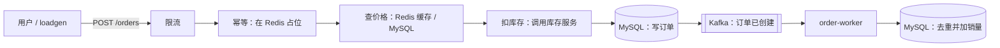
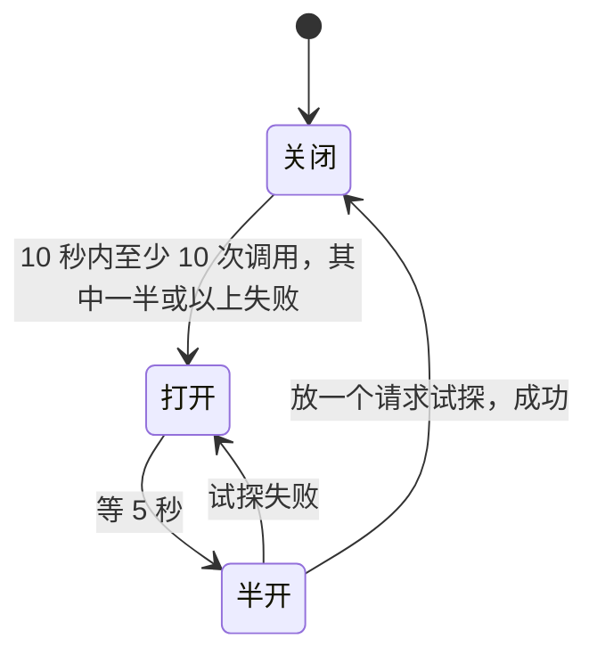

# 阶段 2 学习材料：下单全流程

阶段 1 只有库存服务。阶段 2 让完整的购物流程跑了起来：用户查商品、下单，订单服务扣库存、写订单、发消息，另一个程序收到消息后给商品加销量。还写了一个压测工具，持续给系统发真实的请求。

这个阶段是后端面试题最集中的地方：

- **缓存**：缓存穿透、击穿、雪崩分别是什么，怎么防？
- **服务治理**：超时、重试、熔断、限流、降级，各解决什么问题？
- **消息队列**：消息会不会丢、会不会重复？重复了怎么办？
- **接口幂等**：用户点了两次“下单”，怎么保证只下一单？
- **分布式一致性**：下单要改好几个地方，中途失败了怎么办？

> 这份材料对照的是**当前的代码**。阶段 3 加的指标和调用链，读代码时可以先跳过。

## 1. 这个阶段做了什么

| 新增的部分 | 作用 |
|---|---|
| 订单服务（order-service） | 对外的 HTTP 接口：查商品、下单、查订单 |
| 商品查询（product） | 先查 Redis 缓存，没有再查 MySQL |
| 库存客户端（inventoryclient） | 订单服务调用库存服务，带超时、重试、熔断 |
| 下单（order） | 下单的全部步骤，以及防止重复下单 |
| 消息（events） | “订单已创建”消息的发送和消费 |
| 销量（sales） | 收到消息后加销量，同一条消息不会算两次 |
| 消费者（order-worker） | 一个单独的程序，专门消费消息 |
| 服务治理（resilience） | 限流、重试、熔断 |
| 压测工具（loadgen） | 按设定的速率持续发请求 |
| 核对命令（shopctl check） | 核对订单总件数和销量总件数是否相等 |

一次下单，以及之后销量的更新：



前面一段（到发出消息为止）在用户的请求里同步完成；后面加销量由 order-worker 异步完成，用户不用等。

## 2. 怎么跑起来、看什么

所有命令都在仓库根目录运行，开始前先打开 Docker Desktop。命令用 PowerShell 写，bash 的写法见根目录 [README](../../README.md)。

> 你的数据库里已经有数据了，**不要运行 `shopctl seed`**。

### 2.1 启动，先不开流量

```powershell
$env:LOADGEN_QPS = '0'
docker compose --env-file .env -f deploy/docker-compose.yml up -d --build --wait --wait-timeout 240 order-service order-worker loadgen
docker compose --env-file .env -f deploy/docker-compose.yml ps
```

Compose 会把它们依赖的 MySQL、Redis、Kafka、库存服务一起启动。你应该看到这几个服务都是 `healthy`。`LOADGEN_QPS=0` 表示压测工具先不发请求。

> 没启动阶段 3 的监控组件时，日志里可能出现“导出调用链失败”一类的报错，可以忽略。

### 2.2 查一个商品

```powershell
Invoke-RestMethod http://127.0.0.1:8081/products/499997 | ConvertTo-Json -Depth 5
```

你应该看到商品编号、名称、价格（单位是分），以及 `stock.status=ok` 和库存数量。连续执行两次：第一次可能要查数据库，第二次直接命中 Redis 缓存。

### 2.3 用同一个幂等键下单两次

这一步会真的买一件商品。先生成一个键，两次请求用同一个键、同样的内容：

```powershell
$key = 'learn-' + [guid]::NewGuid().ToString('N')
$headers = @{ 'Idempotency-Key' = $key }
$body = '{"user_id":880001000,"sku_id":499997,"quantity":1}'
$first = Invoke-RestMethod http://127.0.0.1:8081/orders -Method Post -Headers $headers -ContentType 'application/json' -Body $body
$second = Invoke-RestMethod http://127.0.0.1:8081/orders -Method Post -Headers $headers -ContentType 'application/json' -Body $body
$first.data
$second.data
```

你应该看到两次返回的订单号、金额完全一样：第二次没有真的再下一单，而是直接返回第一次的结果。

两次响应里的 `request_id` 是不同的。`request_id` 标识的是“这一次 HTTP 请求”，而 `Idempotency-Key` 标识的是“这一笔下单”，两者的用途不同。

### 2.4 查订单

```powershell
Invoke-RestMethod ("http://127.0.0.1:8081/orders/" + $first.data.order_id)
Invoke-RestMethod 'http://127.0.0.1:8081/orders?user_id=880001000&page=1&page_size=20'
```

你应该在订单详情和这个用户的订单列表里都找到这笔订单。靶场没有登录功能，`user_id` 直接由请求传入。

### 2.5 看“结果待核对”的计数

```powershell
(Invoke-WebRequest http://127.0.0.1:6061/metrics).Content -split "`n" | Select-String idempotency_requests_total
```

你应该看到 `idempotency_requests_total`，其中 `result="needs_review"` 是“结果待核对”的次数（第 5.7 节）。这个计数在服务重启后会归零，每次进入待核对时还会写一条告警日志。

### 2.6 开始和暂停流量

```powershell
Invoke-RestMethod http://127.0.0.1:6070/control -Method Post -ContentType 'application/json' -Body '{"qps":200,"hot_sku_id":0}'
docker compose --env-file .env -f deploy/docker-compose.yml logs -f loadgen
```

你应该每 10 秒看到一份统计：实际的每秒请求数 `qps`、错误率 `error_rate`、`p50_ms`、`p99_ms`、没发出去的请求数 `dropped`。按 Ctrl+C 退出日志查看（不会停止压测）。暂停流量：

```powershell
Invoke-RestMethod http://127.0.0.1:6070/control -Method Post -ContentType 'application/json' -Body '{"qps":0}'
```

### 2.7 核对订单和销量

暂停流量、等 order-worker 处理完积压的消息（大约几秒），再运行：

```powershell
Get-Content .env | ForEach-Object { if ($_ -match '^MYSQL_DSN=(.*)$') { $env:MYSQL_DSN = $matches[1] } }
go run ./cmd/shopctl check
```

你应该看到 `gap=0`：所有订单的总件数，等于销量表里的总件数。如果刚暂停就核对，可能有消息还没处理完，等一会儿再试。

## 3. 开发过程回放

这一节按实际开发的顺序讲。运行记录（包括失败的尝试）保留在 [notes](../notes.md#phase-02)。

### 3.1 先写服务治理的小部件

**要做什么：** 写限流、重试、熔断三个通用部件，再用它们包装对库存服务的调用。

**动手前先想清楚的问题：**

- 查库存可以重试，扣库存不能（第 5.4 节）。
- 重试不能每次都重新计时，否则三次重试就要等三倍的时间。所有重试共用一个总时限。
- “库存不足”是正常的业务结果，不能算作库存服务出了故障，不然熔断器会误判。

**写的顺序：** 先写 resilience 包的令牌桶、重试、熔断和它们的测试，再写 inventoryclient，把这些保护套在 gRPC 调用外面，并把 gRPC 错误码翻译成订单服务认识的错误。

**怎么验证：** 测试记下每次重试前的等待时间，确认最多试 3 次、所有重试共用同一个截止时间、扣减从不重试；熔断器测试走一遍完整的状态变化：关闭 → 打开 → 半开 → 关闭。

### 3.2 写商品查询，缓存只是加速

**要做什么：** 先查缓存，没有再查数据库。商品详情还要显示库存，但库存服务出问题时，商品信息仍然要能看。

**动手前先想清楚的问题：**

- 数据库连接失败时，不能把“查不到”缓存成“商品不存在”。只有数据库明确说“没有这行”，才能缓存“不存在”。
- 同时来 50 个查询同一商品的请求，最好只查一次数据库（singleflight）。但它只能合并同一个进程里的请求，不是分布式锁。

**写的顺序：** 先写模型和接口，再写“先缓存后数据库”的流程，然后写 MySQL 和 Redis 的实现，最后写 HTTP 接口。流程先用假的缓存和数据库测试，可以直接数出查了几次数据库，不用先启动 Redis。

**怎么验证：** 单元测试覆盖命中、未命中、空值、缓存内容损坏、随机有效期的范围，以及 50 个并发请求只查一次数据库；连真实 Redis 确认有效期确实是 10 分钟加抖动、空值是 30 秒。

**取舍：** singleflight 合并的这一次查询，用的是第一个请求的 context。如果第一个请求被取消了，等着它的其他请求也会一起失败。这样做是为了不让一个已经被取消的请求继续占着数据库。

### 3.3 用消息连接订单和销量

**要做什么：** 订单创建后发一条消息，order-worker 收到后加销量。消息可能重复到达，但一笔订单只能加一次销量。

**动手前先想清楚的问题：** Kafka 的“位点”记录的是“这个分区读到哪里了”。先提交位点、后写数据库，中间崩溃就会丢消息；先写数据库、后提交位点，中间崩溃会让这条消息再来一次，所以必须能识别重复（第 5.5 节）。

**写的顺序：** 先定义消息格式和消费顺序，再写销量的事务。用假的 Kafka 读取器测试“先处理、后提交”的顺序，用真实 MySQL 测试主键去重和事务回滚，最后组装 order-worker。

**怎么验证：** 20 条同一订单的消息同时处理，数据库里只有一条去重记录，销量只加了一次；故意让销量加法溢出，确认去重记录也一起回滚了；消费过程中发出停止信号，确认手上的消息仍然处理完、位点也提交了，但不会再取下一条。

**取舍：** 遇到格式损坏的消息时，选择停下来，不提交它的位点，而不是悄悄跳过。现在没有“死信队列”（专门存放处理不了的消息的地方），坏消息需要人工处理。

### 3.4 先确认失败边界，再写接口幂等

**要做什么：** 同一个幂等键的重复请求，不能重复扣库存或重复下单。

**遇到的问题：** 计划书原来写的是“处理失败时删除占位，允许客户端重试”。Astra 发现这在“结果不确定”时是错的：比如扣库存超时了，库存可能其实已经扣掉了，删掉占位让客户端重试，就会扣两次。于是先停下来问你，你同意采用更保守的规则：只有确认什么都没发生时才删占位；结果不确定时保留占位、标记“结果待核对”，并且单独给一个错误码、记告警日志和计数（第 5.7 节）。

**写的顺序：** 先更新计划书和决定记录，再写模型、幂等记录的接口、下单流程、Redis 实现、SQL 和 HTTP 接口。最后用一张表格，把每一种失败情况都在测试里走一遍。

**怎么验证：** 单元测试分别模拟扣库存结果不明、订单提交结果不明、归还库存失败、消息发送失败、保存结果失败；真实 Redis 测试里 20 个请求同时占位，只有一个成功；旧请求不能修改新请求的占位；处理时间超过上限的遗留占位会转成“待核对”。

### 3.5 组装服务，真实请求发现了首次连接的问题

**要做什么：** 把业务代码、管理端口和资源的关闭接起来，用 Compose 启动，发真实请求。

**遇到的问题：** 服务刚启动后的第一笔真实订单，等了约 800 毫秒后进入了“结果待核对”。原因是 gRPC 客户端创建以后并没有立刻建立连接，第一个请求要等连接建立，超过了时限。当时的修复是：启动时先等库存服务的连接真正建立好，再开始接受请求。（阶段 3 发现，这里面还有一个更深的原因：DNS 查询会卡 5 秒，见阶段 3 学习材料。）

那笔进入“待核对”的订单没有被删掉重来：同一个键再请求，返回的仍然是“待核对”，库存也没有变化。这说明幂等规则在真实情况下按设计工作了。

**更多真实验证：**

- 停掉库存服务：15 次商品查询都降级返回（库存显示 unavailable）；10 次下单进入“待核对”；熔断器打开后，5 次下单直接返回 503。恢复后两个熔断器都经过半开、恢复关闭。
- 停掉 Redis：同一个键的请求返回 503，没有绕过幂等直接下单；Redis 恢复后，返回原来的订单。

### 3.6 写压测工具

**要做什么：** 按约 70%、20%、10% 的比例持续发三种请求，可以随时调整速率、指定热点商品。

**动手前先想清楚的问题：**

- “想发多快”和“实际发了多快”是两回事。工作者不够用时，压测工具自己就成了瓶颈。
- 下单超时重试时必须用原来的幂等键，失败的尝试也要算进统计。

**遇到的问题：** 第一轮 5 分钟压测虽然 0 错误，但少发了 880 个请求，实际只有约 197 QPS，所以没有把“目标 200”写成“实际 200”。调整工作者数量、改在 Compose 内部网络里运行后，第三轮实际 199.986 QPS、0 错误、0 个没发出去，P50 5 毫秒、P99 51 毫秒。三轮的数据都保留在数据台账里。

## 4. 阅读顺序

分两条线读：先读下单，再读销量消费。

**下单这条线：**

| 顺序 | 文件 | 重点看什么 |
|---|---|---|
| 1 | [orderservice/config.go](../../internal/shop/app/orderservice/config.go) | 几个时限的默认值，以及它们之间必须满足的关系 |
| 2 | [orderservice/app.go](../../internal/shop/app/orderservice/app.go)、[dependencies.go](../../internal/shop/app/orderservice/dependencies.go) | 启动时创建了哪些连接，退出时怎么关 |
| 3 | [order/model.go](../../internal/shop/order/model.go)、[idempotency.go](../../internal/shop/order/idempotency.go) | 下单请求、订单，以及幂等记录的三种状态 |
| 4 | [order/service.go](../../internal/shop/order/service.go) | **最重要的文件。** `Create` 的每一步，以及每一步失败时调用的是 `safeFailure` 还是 `unknown` |
| 5 | [order/cache.go](../../internal/shop/order/cache.go) | 怎样用 Redis 实现占位；Lua 脚本为什么要比较整条记录 |
| 6 | [product/service.go](../../internal/shop/product/service.go)、[product/cache.go](../../internal/shop/product/cache.go) | 先缓存后数据库；空值缓存；singleflight |
| 7 | [inventoryclient/inventory_client.go](../../internal/shop/inventoryclient/inventory_client.go) | GetStock 的重试，对比 Deduct 为什么不重试 |
| 8 | [resilience/retry.go](../../internal/platform/resilience/retry.go)、[breaker.go](../../internal/platform/resilience/breaker.go)、[http.go](../../internal/platform/resilience/http.go) | 重试、熔断、限流的实现 |
| 9 | [order/repository.go](../../internal/shop/order/repository.go) | 写订单的事务；怎样判断“提交结果不确定” |

**销量消费这条线：**

| 顺序 | 文件 | 重点看什么 |
|---|---|---|
| 10 | [events/model.go](../../internal/shop/events/model.go)、[publisher.go](../../internal/shop/events/publisher.go) | 消息的格式；发送时怎样等 Kafka 确认 |
| 11 | [events/consumer.go](../../internal/shop/events/consumer.go) | `process`：先处理、后提交位点 |
| 12 | [sales/repository.go](../../internal/shop/sales/repository.go) | `Apply`：在同一个事务里去重和加销量 |
| 13 | [orderworker/app.go](../../internal/shop/app/orderworker/app.go) | 收到退出信号后，怎样让手上的消息处理完 |

**最后：**

| 顺序 | 文件 | 重点看什么 |
|---|---|---|
| 14 | [loadgen/generator.go](../../internal/loadgen/generator.go)、[client.go](../../internal/loadgen/client.go)、[stats.go](../../internal/loadgen/stats.go) | 目标速率和实际速率怎样分开统计；dropped 是怎么来的 |
| 15 | [order/service_test.go](../../internal/shop/order/service_test.go) | 每一种失败情况的测试，反过来帮你理解 `Create` |

## 5. 关键设计与为什么

### 5.1 缓存：先查缓存，没有再查数据库

这种做法叫 **Cache Aside**（旁路缓存）：

- **读：** 先查 Redis，查到了（命中）就直接返回；没查到（未命中），去 MySQL 查（回源），再把结果写进 Redis。
- **写：** 先更新数据库，再**删除**缓存（而不是更新缓存）。下次读的时候自然会重新从数据库加载。

为什么写的时候删缓存而不是改缓存？两个请求同时更新同一个商品时，“改缓存”的顺序可能和“改数据库”的顺序不一致，缓存里就会留下旧值。删缓存能缩小这个问题，但也不能完全消除，所以缓存都设有效期，最多过一会儿就会自己更新。（项目目前没有修改商品的接口，只用到了读的那一半。）

**为什么只缓存商品，不缓存库存：** 商品名称和价格很少变，缓存几分钟没问题。库存时刻在变，而且扣库存必须由库存服务在数据库里原子地判断，不能拿缓存里的数去减。商品详情里显示的库存，是每次实时向库存服务查询的。

### 5.2 缓存的三个经典问题

| 问题 | 是什么 | 后果 | 本项目的办法 |
|---|---|---|---|
| **穿透** | 反复查一个根本不存在的商品 | 缓存里永远没有，每次都打到数据库 | 把“不存在”也缓存 30 秒（空值缓存） |
| **击穿** | 一个热门商品的缓存刚过期，同时来了大量请求 | 这些请求同时去查数据库 | singleflight：同一时刻只让一个请求去查，其余的等它的结果 |
| **雪崩** | 大量商品的缓存在同一时刻过期 | 数据库同时收到大量查询 | 有效期在 10 分钟的基础上随机多加最多 1 分钟，让过期时间分散开 |

三个办法各管一种问题，不能互相替代。singleflight 只能合并同一个进程里的请求；如果订单服务部署了多个实例，每个实例还是会各查一次。

阶段 4 的故障场景会故意关掉 singleflight（S04 缓存击穿）、去掉随机有效期（S05 缓存雪崩），所以这两个功能都可以通过配置关闭。

### 5.3 服务治理：五种手段，解决五种问题

| 手段 | 一句话 | 用在哪里 | 代价 |
|---|---|---|---|
| **超时** | 最多等多久 | 每次调用库存服务最多等 800 毫秒 | 超时了不知道对方执行没有 |
| **重试** | 失败了再试一次 | 只用于查库存，最多试 3 次 | 增加下游的压力 |
| **熔断** | 下游一直出错，先别调用它 | 调用库存服务 | 熔断期间，就算库存服务已经恢复，请求也会先被拒绝 |
| **限流** | 每秒最多处理多少请求 | 订单服务的入口，默认每秒 500 个 | 只限制单个实例，多个实例的总量会叠加 |
| **降级** | 部分功能坏了，保留还能用的部分 | 库存服务不可用时，商品详情仍然返回，只是库存显示 unavailable | 用户看到的信息不完整 |

**熔断器的三种状态：**



- **关闭**：正常调用。
- **打开**：直接返回失败，不调用库存服务。
- **半开**：放一个请求过去试探。

为什么打开时直接失败反而是保护？库存服务已经出问题了，如果每个请求还去调用、等 800 毫秒超时，订单服务的线程和连接都会被这些注定失败的请求占满，最后订单服务自己也撑不住了。直接失败只要几毫秒（实测约 5–7 毫秒），能把资源留给其他请求。

**限流用的是令牌桶：** 想象一个桶，每秒往里放 500 个令牌，最多存 100 个。每个请求要拿走一个令牌才能进入，拿不到就立刻返回 429。桶里存着的令牌允许短时间的突发流量。

### 5.4 为什么查库存可以重试，扣库存不行

- **查询**没有副作用：执行一次和执行三次，结果一样。
- **扣减**有副作用：如果第一次其实已经成功了，只是响应在网络上丢了，重试就会再扣一次。

所以 inventoryclient 只给 GetStock 加了重试，Deduct 和 Release 都只调用一次。

**重试的两个细节：**

- **指数退避：** 第一次失败后等 50 毫秒，第二次失败后等 100 毫秒，等待时间逐次翻倍。下游出问题时，马上重试往往还是失败，还会加重它的负担。
- **抖动：** 在等待时间上再加一点随机量。否则很多客户端在同一时刻失败，又在同一时刻重试，会形成一波一波的冲击。阶段 4 的场景 S13“重试风暴”就会演示不退避、不熔断时会发生什么。

所有重试共用同一个 800 毫秒的时限，剩下的时间不够了就不再重试。

### 5.5 消息：先写数据库，再提交位点

**为什么用消息：** 下单成功后要加销量。如果订单服务直接去改销量表，下单就要多等一步；销量那边出了问题，下单也会失败。改成发一条消息、由 order-worker 异步处理，两边就互不影响了。

**Kafka 的几个概念：**

- **主题（topic）：** 消息的分类，这里是 `order.created`。
- **分区（partition）：** 一个主题分成几份（这里是 3 份），可以并行处理。消息按订单 ID 决定进哪个分区。
- **位点（offset）：** 记录“这个分区我读到第几条了”。消费者处理完一条消息，要“提交位点”，Kafka 才知道它处理到哪里了。

**提交位点的时机决定了会不会丢消息：**

| 顺序 | 中途崩溃会怎样 |
|---|---|
| 先提交位点，再写数据库 | 位点已经往前走了，但数据库没写，这条消息**丢了**，销量少算一笔 |
| **先写数据库，再提交位点** | 数据库写了，但位点没提交，重启后这条消息**会再来一次** |

项目选了第二种，叫“至少一次”（at least once）：消息不会丢，但可能重复。所以 order-worker 必须能识别重复的消息。

**识别重复：去重记录和加销量放在同一个事务里。** 处理一条消息时，在一个事务里做两件事：

1. 往 `processed_events` 表插入这笔订单的 ID。这个表以订单 ID 为主键，同一笔订单第二次插入会因为主键冲突而失败，说明已经处理过了，直接跳过。
2. 插入成功了，才给 `product_sales` 加销量。

两件事要么都成功，要么都不生效。不会出现“记了已处理，但销量没加”的情况，也不会出现“销量加了，但没记已处理”的情况。

为什么不把“已处理”记在 Redis 里？那样就变成两个系统了：Redis 记录成功、MySQL 加销量失败，或者反过来，中间又会出现不一致。都放在 MySQL 的同一个事务里最简单可靠。

### 5.6 接口幂等：同一个下单请求只执行一次

**问题：** 用户点了“下单”，网络卡了一下没反应，又点了一次；或者客户端超时后自动重试。如果服务端每次都执行，就下了两单。

**做法：** 客户端给每一笔下单生成一个唯一的键，放在请求头 `Idempotency-Key` 里，重试时用同一个键。服务端用 Redis 记录每个键的处理状态：

1. **占位：** 用 `SET key 值 NX EX 86400` 写入一条“处理中”的记录。`NX` 表示“只有这个键不存在时才写入”。所以同一个键的多个请求同时到达，只有一个能写入成功，拿到处理权。
2. **处理完成：** 把记录改成“已完成”，并保存下单结果（订单号、金额）。
3. **重复请求到来：** 看到“已完成”，直接返回保存的结果；看到“处理中”，返回 409 `REQUEST_IN_PROGRESS`。

记录保存 24 小时（`EX 86400`）。超过 24 小时再用同一个键，就当成新请求了。

**为什么改记录时要比较整条内容（Lua 脚本）：** 假设请求 A 处理得特别慢，它的占位在 24 小时后过期了，请求 B 用同一个键占了新的位。这时 A 终于处理完，要把记录改成“已完成”。如果只判断“这个键还存在”，A 就会把 B 的记录覆盖掉。所以每条记录里都有一个随机的“所有者”标识，修改前先比较整条记录是否还是自己当初写的那条，是才修改。“先比较、再修改”必须一步完成，中间不能被别的请求插进来，所以用 Lua 脚本在 Redis 服务器里执行。

**Redis 不可用时，宁可拒绝下单：** 这时没法检查重复，如果照常下单，就失去了防重复的保护。所以直接返回 503。

**Redis 的两个配置：** 这里的 Redis 存的不是可有可无的缓存，而是防重复的凭据，丢了就可能重复下单。所以：

- `noeviction`：内存满了就拒绝新的写入，而不是把旧记录删掉腾地方。
- AOF 持久化：每次写入都记到磁盘上，Redis 重启后记录还在。

### 5.7 下单中途失败：哪些情况可以重试，哪些不行

这是本阶段最难的一节。

下单要改好几个地方：Redis（幂等记录）、库存服务、MySQL（订单）、Kafka（消息）。它们分属不同的系统，没有一个事务能把它们包在一起。所以每一步失败时，都要先判断：**到目前为止，哪些事情已经真的发生了？**

| 失败发生在哪一步 | 已经发生了什么 | 怎么处理 |
|---|---|---|
| 扣库存之前（参数不对、商品不存在） | 什么都没发生 | 删掉占位，客户端可以重试 |
| 扣库存**明确失败**（比如库存不足） | 什么都没发生 | 删掉占位，返回错误 |
| 扣库存**超时** | 不知道扣了没有 | 保留占位，标记“待核对”，不能重试 |
| 扣库存成功，写订单明确失败，**归还库存成功** | 已经撤销干净 | 删掉占位，客户端可以重试 |
| 扣库存成功，写订单明确失败，**归还库存也失败** | 库存少了一件，但没有订单 | 保留占位，标记“待核对”，等人工处理 |
| 订单提交时**超时** | 不知道订单写进去没有 | 保留占位，标记“待核对” |
| 订单写成功，**发消息失败** | 订单已经存在 | 照常返回“下单成功”，记一条告警日志（销量可能少算一笔） |
| 订单写成功，**保存结果到 Redis 失败** | 订单已经存在，但 Redis 里没有记下结果 | 保留占位，标记“待核对” |

核心原则只有一句话：**只有确认“什么都没发生”或“已经完全撤销”时，才允许重试；结果不确定时，宁可拒绝，也不冒重复扣库存、重复下单的风险。**

**“待核对”和“处理中”要用不同的错误码：** 两者都返回 409，但错误码不同：

- `REQUEST_IN_PROGRESS`（处理中）：客户端等一会儿，用同一个键再问就行。
- `REQUEST_OUTCOME_UNKNOWN`（结果待核对）：再怎么问都不会有结果了，需要人工核对。这时客户端也**不能换一个新键重新下单**，因为原来那笔可能已经成功了。

每次进入“待核对”，都会写一条带订单号、商品 ID、幂等键的告警日志，并把 `idempotency_requests_total{result="needs_review"}` 加 1。

**为什么还有遗留的“处理中”：** 如果订单服务在处理到一半时崩溃了，Redis 里就会留下一条永远不会完成的“处理中”记录。所以代码规定了一个处理时间上限：一条“处理中”的记录超过这个上限还没完成，下一个看到它的请求会把它转成“待核对”。

**根本的解决办法（这个阶段没有做）：** 扣库存超时之所以麻烦，是因为扣库存本身不是幂等的。如果扣库存时也带上一个请求 ID、由库存服务去重，超时后就可以放心重试了。这超出了阶段 2 的范围，作为已知限制记录下来。

### 5.8 订单写成功了，消息却没发出去

这时订单已经存在。如果当成下单失败、让用户重来，库存会再扣一次，订单会再写一笔，问题更大。所以照常返回“下单成功”，同时记一条告警日志。代价是这笔订单的销量少算了，`shopctl check` 会发现差额。

业界常用的解决办法叫 **Outbox（发件箱）**：写订单时，在同一个数据库事务里，往一张“待发送消息”表里也插入一行；再由一个单独的任务，从这张表里读出消息发给 Kafka，发成功了再标记为已发送。因为订单和“待发送消息”在同一个事务里，要么都有、要么都没有，消息就不会丢了。这个阶段只讲思路，没有实现。

### 5.9 压测：看实际值，不看目标值

- **目标 QPS 不等于实际 QPS。** 工作者都忙不过来时，压测工具会少发请求，记在 `dropped` 里。所以“0 错误”不一定说明系统扛住了，也可能是请求根本没发出去。第一轮压测就是这样：0 错误，但少发了 880 个请求。
- **P99 不能取平均。** P99 的意思是：把所有请求按耗时从小到大排好，第 99% 位置的那个耗时。如果把每 10 秒的 P99 加起来求平均，得到的不是全程的 P99。正确的做法是把所有样本（这里是每个 1 毫秒区间的计数）合在一起，再重新计算。
- **商品编号按 Zipf 分布选。** 少数商品特别热门，大部分商品很少被访问，这样更接近真实的电商，也能让缓存和热点问题显现出来。

### 5.10 已知限制

- 扣库存超时后，结果仍然可能不确定。根本的解决办法是让扣库存本身带请求 ID 去重，这个阶段没有做，所以不能说做到了端到端的“恰好一次”。
- 归还库存本身也可能失败。进入“待核对”的订单，需要人工核对库存和订单。
- 订单写成功但消息发送失败时，销量会少算一笔。没有实现 Outbox。
- 幂等记录保存 24 小时。过期以后重发、不带键、换了新键、或者 Redis 的数据丢了，都不在保护范围内。
- Kafka 和 MySQL 都是单节点。遇到格式损坏的消息，消费会停下来，需要人工处理。
- singleflight 只合并同一个进程里的请求。
- 订单列表用页码分页，翻到很深的页时要跳过很多行，会变慢。
- 压测工具的 P50、P99 是按 1 毫秒的区间估算的。

## 6. 本阶段用到的 Go 写法

每个例子都是能独立运行的小程序。在仓库外面新建一个空目录，保存成 `main.go`，运行 `go run main.go`。

`context.WithoutCancel`、具名返回值、`errors.Join` 在阶段 0 讲过，`select` 和 `WaitGroup` 在阶段 1 讲过，这里不再重复。

### 6.1 把函数当参数传：重试器的写法

```go
package main

import (
	"errors"
	"fmt"
)

// retry 不知道具体要做什么操作，只负责“失败了就再试”。
// operation 是要执行的操作，retryable 判断某个错误值不值得重试。
func retry(attempts int, operation func() error, retryable func(error) bool) error {
	var err error
	for i := 1; i <= attempts; i++ {
		err = operation()
		if err == nil || !retryable(err) {
			return err
		}
		fmt.Println("第", i, "次失败，再试一次")
	}
	return err
}

var errTemporary = errors.New("暂时不可用")

func main() {
	calls := 0
	err := retry(3, func() error {
		calls++
		if calls < 3 {
			return errTemporary
		}
		return nil
	}, func(err error) bool { return errors.Is(err, errTemporary) })
	fmt.Println("结果：", err, "，一共调用了", calls, "次") // 结果： <nil> ，一共调用了 3 次
}
```

`func() error` 是一个类型，表示“没有参数、返回一个 error 的函数”。这和 Java 里传 lambda 很像。项目里的 `Retrier.Do` 就是这样设计的：哪些错误值得重试由调用方决定，所以重试器本身不需要认识任何业务。

### 6.2 泛型：一份代码适用于多种类型

```go
package main

import "fmt"

// T 是类型参数，any 表示 T 可以是任意类型。
func first[T any](values []T) T {
	return values[0]
}

func main() {
	fmt.Println(first([]int{3, 1, 2}))       // 3
	fmt.Println(first([]string{"商品", "订单"})) // 商品
}
```

方括号里的 `[T any]` 声明了一个类型参数，调用时 Go 会根据传入的值推断出 `T` 是什么。项目里没有自己写泛型代码，只在使用 gobreaker 库时写了 `gobreaker.NewCircuitBreaker[struct{}]`：这个库要求指定“受保护的调用返回什么类型的结果”，扣库存不需要返回值，所以用了空结构体 `struct{}`。

### 6.3 类型断言：从 any 里取出具体类型

```go
package main

import "fmt"

func main() {
	var result any = int32(7) // any 里可以装任何类型的值

	stock := result.(int32) // 类型断言：我确定它是 int32
	fmt.Println(stock)      // 7

	text, ok := result.(string) // 不确定时用两个返回值，类型不对不会 panic
	fmt.Println(text, ok)       // （空字符串） false
}
```

singleflight 合并查询后返回的结果是 `any` 类型，所以商品服务要用类型断言把它变回 `Product`。用一个返回值的写法时，如果类型不对，程序会 panic；用两个返回值的写法，类型不对时 `ok` 为 false。

### 6.4 用指针区分“0”和“没有”

```go
package main

import (
	"encoding/json"
	"fmt"
)

type Stock struct {
	Status    string `json:"status"`
	Available *int32 `json:"available,omitempty"` // 指针：nil 表示“没有这个值”
}

func main() {
	zero := int32(0)
	soldOut, _ := json.Marshal(Stock{Status: "ok", Available: &zero})
	unknown, _ := json.Marshal(Stock{Status: "unavailable"})
	fmt.Println(string(soldOut)) // {"status":"ok","available":0}
	fmt.Println(string(unknown)) // {"status":"unavailable"}
}
```

`int32` 的默认值就是 0，单靠它分不清“库存是 0（卖完了）”和“不知道库存是多少（库存服务挂了）”。用指针 `*int32` 时，`nil` 表示没有值。字段后面反引号里的内容叫**结构体标签**，告诉 JSON 编码器这个字段叫什么名字；`omitempty` 表示值为空时，输出里就不写这个字段。

### 6.5 errors.As：在错误链里找一个实现了某个接口的错误

```go
package main

import (
	"errors"
	"fmt"
)

// timeoutError 表示一次结果不确定的写操作。
type timeoutError struct{}

func (timeoutError) Error() string        { return "扣库存超时" }
func (timeoutError) OutcomeUnknown() bool { return true }

func main() {
	err := fmt.Errorf("下单失败：%w", timeoutError{}) // 被包了一层

	var outcome interface{ OutcomeUnknown() bool }
	if errors.As(err, &outcome) && outcome.OutcomeUnknown() {
		fmt.Println("结果不确定，不能重试") // 会走这里
	}
}
```

`errors.As` 会沿着 `%w` 包装的链条一层层往里找，找到第一个能赋值给 `outcome` 的错误，就把它填进去。注意要传 `&outcome`（取地址），它才能把找到的值写回来。

订单服务就是这样判断“结果是否确定”的：库存客户端和订单仓储返回的错误，如果实现了 `OutcomeUnknown() bool` 方法，就能被识别出来。订单代码不需要知道这些错误具体是什么类型，只要它们有这个方法就行。

### 6.6 工作者池：固定数量的 goroutine 处理任务

```go
package main

import (
	"fmt"
	"sync"
	"sync/atomic"
)

func main() {
	jobs := make(chan int) // 任务通道
	var done atomic.Int32  // 并发安全的计数器
	var workers sync.WaitGroup

	for range 3 { // 固定 3 个工作者
		workers.Add(1)
		go func() {
			defer workers.Done()
			for job := range jobs { // 不断取任务，通道关闭后循环结束
				_ = job
				done.Add(1)
			}
		}()
	}

	for i := range 10 {
		jobs <- i // 发送 10 个任务
	}
	close(jobs) // 由发送方在发完以后关闭通道
	workers.Wait()
	fmt.Println("完成", done.Load(), "个任务") // 完成 10 个任务
}
```

这就是压测工具的结构：一个调度循环往通道里放任务，固定数量的工作者从通道里取任务去发请求。工作者数量是固定的，不会随速率的提高无限增长。

两个规则：**通道由发送方关闭**（接收方不知道还有没有人要发）；**多个 goroutine 修改同一个计数时，要用 `atomic` 或者锁**，不能用普通的 `int`。

## 7. 动手实验

每个实验看完结果后都要**恢复原状**。不要删除任何数据卷。

### 实验一：调低限流，看 429

1. 把限流调到每秒 1 个请求：

   ```powershell
   $env:RATE_LIMIT_RPS = '1'; $env:RATE_LIMIT_BURST = '1'
   docker compose --env-file .env -f deploy/docker-compose.yml up -d --no-deps --wait order-service
   ```

2. 快速连续查询商品好几次：`1..5 | ForEach-Object { try { Invoke-RestMethod http://127.0.0.1:8081/products/1 | Out-Null; 'OK' } catch { $_.Exception.Response.StatusCode.value__ } }`。应该看到有的请求返回 429。被拒绝的请求立刻就返回了，没有排队等待。
3. 恢复：

   ```powershell
   Remove-Item Env:RATE_LIMIT_RPS, Env:RATE_LIMIT_BURST
   docker compose --env-file .env -f deploy/docker-compose.yml up -d --no-deps --wait order-service
   ```

### 实验二：停掉库存服务，看降级和熔断

1. `docker compose --env-file .env -f deploy/docker-compose.yml stop inventory-service`
2. 连续查询几次商品：HTTP 仍然返回成功，但 `stock.status` 变成了 `unavailable`。这就是降级。
3. 看订单服务的日志：`docker compose --env-file .env -f deploy/docker-compose.yml logs --tail 20 order-service`，应该能看到“熔断状态改变”，从 closed 变成 open。
4. 恢复：`docker compose --env-file .env -f deploy/docker-compose.yml up -d --no-deps --wait inventory-service`。再查几次商品，等熔断器经过半开、恢复关闭，库存又能显示了。

想一想：商品能降级显示，下单为什么不能降级？

### 实验三：杀掉 order-worker，看消息积压和追平

1. 先暂停流量（第 2.6 节）。
2. 强制杀掉消费者：`docker compose --env-file .env -f deploy/docker-compose.yml kill -s SIGKILL order-worker`
3. 用较低的速率开一会儿流量（比如 `{"qps":20}`），产生一些新订单，再暂停。
4. 看积压：

   ```powershell
   docker compose --env-file .env -f deploy/docker-compose.yml exec -T kafka /opt/kafka/bin/kafka-consumer-groups.sh --bootstrap-server kafka:29092 --describe --group order-worker
   ```

   `LAG` 列是每个分区还没处理的消息数。这时运行 `shopctl check`，`gap` 可能大于 0。
5. 恢复：`docker compose --env-file .env -f deploy/docker-compose.yml up -d --wait order-worker`。等 LAG 都变成 0，再运行 `shopctl check`，应该是 `gap=0`。

### 实验四：停掉 Redis，看幂等的保护

1. 先按第 2.3 节完成一次下单，保留 `$headers` 和 `$body` 这两个变量。
2. 停掉 Redis：`docker compose --env-file .env -f deploy/docker-compose.yml stop redis`
3. 用同一个键再提交一次：应该返回 503，而不是绕过幂等检查、直接下一笔新订单。
4. 恢复 Redis：`docker compose --env-file .env -f deploy/docker-compose.yml up -d --wait redis`
5. 再用同一个键提交一次：应该返回原来那笔订单，因为 AOF 让 Redis 重启后记录还在。

## 8. 常见误区

- **“请求超时了，说明库存没扣。”** 超时只说明调用方没等到结果，库存可能已经扣了。
- **“有了 Redis 幂等，就做到了恰好一次。”** 幂等只在 24 小时内、同一个键、Redis 数据没丢的前提下有效，而且扣库存超时的问题还没有根本解决。
- **“消息发送失败了，就把整个下单重来一遍。”** 订单可能已经写进去了，重来会重复扣库存、重复下单。
- **“先提交 Kafka 位点，能减少重复处理。”** 能减少重复，但代价是可能丢消息。
- **“singleflight 是一种缓存。”** 它只在“正在查询”的这一小段时间里，让相同的请求共享结果，查完就没了，不会保存结果。
- **“把每 10 秒的 P99 平均一下，就是全程的 P99。”** 百分位不能取平均，要把所有样本合起来重新算。
- **“目标是 200 QPS，那实际就是 200 QPS。”** 要看实际完成的请求数和 dropped。
- **“0 错误就说明扛住了。”** 请求可能根本没发出去。

## 9. 必答问题

先自己写下答案，再展开最后的参考要点对照。

1. Cache Aside 的读写流程是什么？更新数据时，为什么通常是删缓存，而不是改缓存？
2. 缓存穿透、击穿、雪崩分别是什么？本项目各用什么办法？
3. singleflight 的原理是什么？它能防止多个服务实例同时查数据库吗？
4. Kafka 的“至少一次”是什么意思？为什么要先写数据库，再提交位点？
5. 消费者怎样防止重复处理同一条消息？这里为什么用“已处理事件表”？
6. 下单过程中，有哪些地方可能出现不一致？Outbox 解决的是其中哪一个？
7. 压测工具为什么按 Zipf 分布选商品？
8. 熔断器的三种状态怎样转换？为什么“直接失败”反而能保护系统？
9. 为什么查库存可以重试，扣库存不能？重试时为什么要退避、还要加随机量？
10. 令牌桶和漏桶有什么区别？单机限流有什么局限？
11. 怎样用 Redis 实现接口幂等？记录该保存多久？Redis 不可用时为什么拒绝下单？
12. `REQUEST_IN_PROGRESS` 和 `REQUEST_OUTCOME_UNKNOWN` 分别告诉客户端什么？
13. 修改幂等记录时，为什么要比较整条记录，而不是只看这个键在不在？
14. 压测为什么要报告 dropped？为什么不能把每个窗口的 P99 平均？
15. order-worker 收到退出信号后，为什么还要把手上的消息处理完？最多等多久？

## 10. 本阶段新术语

| 术语 | 解释 |
|---|---|
| Cache Aside | 应用自己管理缓存：先查缓存，没有再查数据库并写回缓存 |
| 命中 / 未命中 | 在缓存里查到了 / 没查到 |
| 回源 | 缓存里没有，去数据库查 |
| 空值缓存 | 把“不存在”也缓存一小段时间 |
| TTL | 一条缓存记录的有效期 |
| 抖动 | 在固定的时间上加一点随机量，让大家不要同时行动 |
| singleflight | 同一进程里，相同的并发查询只执行一次，结果大家共享 |
| 服务治理 | 超时、重试、熔断、限流、降级这类保护服务的手段的统称 |
| 令牌桶 | 一种限流算法：按固定速度补充令牌，请求拿到令牌才能通过 |
| 指数退避 | 每次重试前的等待时间逐次翻倍 |
| 熔断 | 下游持续出错时，暂时不再调用它，直接返回失败 |
| 降级 | 部分功能不可用时，保留还能用的部分 |
| 主题 / 分区 | Kafka 里消息的分类 / 一个主题分成的几份，可以并行处理 |
| 位点（offset） | 消费者在一个分区里读到了第几条 |
| 消费组 | 一起消费同一个主题的一组消费者，每条消息只会被组里的一个成员处理 |
| LAG | 消费者还没处理的消息数 |
| 至少一次 | 消息不会丢，但可能重复 |
| 消费幂等 | 同一条消息处理多次，效果和处理一次一样 |
| 接口幂等 | 同一个请求执行多次，效果和执行一次一样 |
| 幂等键 | 客户端给每笔逻辑请求生成的唯一标识，重试时不变 |
| 占位 | 开始处理前先登记“我在处理了”，阻止重复的请求 |
| 结果待核对 | 已经无法确定写操作是否发生，停止自动处理，交给人工 |
| Outbox | 把要发的消息和业务数据写在同一个事务里，再由单独的任务发送 |
| AOF | Redis 把每次写操作记到磁盘文件里，重启后可以恢复 |
| Zipf 分布 | 少数对象特别热门、大多数很少被访问的分布 |
| QPS | 每秒请求数 |
| P50 / P99 | 把请求按耗时排序后，第 50% / 99% 位置的耗时 |

<details>
<summary>必答问题参考要点（先自己回答）</summary>

1. 读：先查缓存，没有就查数据库，再写回缓存。写：先更新数据库，再删除缓存。改缓存的话，两个并发写入可能让缓存里留下旧值；删缓存能缩小这个问题，但也不能完全消除，所以缓存还要设有效期兜底。
2. 穿透：反复查不存在的数据，用空值缓存（30 秒）。击穿：热门数据的缓存刚过期，大量请求同时查库，用 singleflight。雪崩：大量缓存同时过期，用随机有效期（10 分钟加最多 1 分钟）。
3. 同一个 key 的第一个请求真正去执行查询，后来的请求等它的结果并共享。它只在一个进程内有效，多个实例之间不能合并。
4. 至少一次：消息不会丢，但可能重复投递。先写数据库，中途崩溃只会让消息重来一次，可以靠去重解决；先提交位点，中途崩溃会让消息丢失，没法补救。
5. 常见做法有：业务唯一键、已处理记录表、带条件的状态更新。这里订单 ID 天然唯一，把“已处理”记录和加销量放在 MySQL 的同一个事务里，最简单可靠。
6. 扣库存成功但写订单失败，需要归还，归还也可能失败；订单写成功但消息发送失败，销量会少算；扣库存或订单提交超时，结果不确定。Outbox 解决的是“订单和消息”之间的不一致，解决不了扣库存超时的问题。
7. 真实的电商里，少数商品特别热门。用 Zipf 分布才能把缓存命中、热点商品这些现象表现出来；均匀分布会把热点稀释掉。
8. 关闭：正常调用。10 秒内至少 10 次调用、一半或以上失败时打开：直接返回失败。5 秒后进入半开：放一个请求试探，成功就关闭，失败就重新打开。直接失败只要几毫秒，不会让大量请求在一个已经坏掉的服务上等超时，把订单服务自己也拖垮。
9. 查询没有副作用，执行多次结果一样；扣减执行两次就扣了两次。退避是为了不在下游出问题时马上又冲过去；随机量是为了避免大量客户端在同一时刻一起重试。
10. 令牌桶按固定速度补充令牌，桶里攒下的令牌允许一定的突发流量；漏桶按固定速度处理请求，多出来的排队或丢弃，输出很平稳。单机限流时，每个实例各算各的，部署 3 个实例，总量就是 3 倍。
11. 用 `SET key 值 NX EX 秒数` 占位，只有一个请求能写入成功；处理完把结果存进这条记录；重复请求直接返回保存的结果。保存时间要覆盖客户端可能重试的时间窗口，这里是 24 小时。Redis 不可用时没法检查重复，继续下单就失去了保护，所以返回 503。
12. 处理中：还在处理，稍后用同一个键再问。结果待核对：已经无法确定结果，需要人工核对，而且不能换新键重新下单，因为原来那笔可能已经成功了。
13. 原来的记录可能已经过期，同一个键又被新的请求占用了。只看键在不在，旧请求就会覆盖新请求的记录。记录里有一个随机的所有者标识，比较整条记录才能确认“这还是我写的那条”。
14. dropped 说明有请求根本没发出去，不能把“0 错误”当成扛住了。百分位不是可以相加的量，必须把所有样本合起来重新计算。
15. 手上的消息可能已经写了一半，或者数据库已经写完、只差提交位点。把它处理完、提交位点，可以避免重启后再处理一次。最多等 10 秒（`WORKER_MESSAGE_TIMEOUT`），不会无限等待。

</details>

学完后，在[进度看板](../../进度.md)上勾选阶段 2 的“学习验收”。
