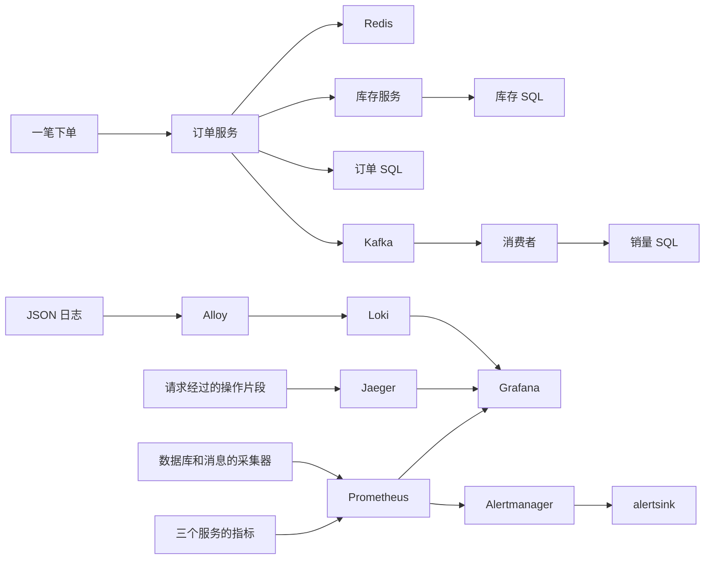

# 阶段 3 学习材料：可观测性与告警

本阶段工程验收已完成，本地检查与 Linux CI 均通过，见[进度](../../进度.md)。先读指标、调用链、日志各回答什么，再跑一笔真实订单。

## 一、这个阶段做了什么

先把三个词分清。**指标**是一段时间内的数字，回答“系统整体有没有变慢，错误是不是变多了”。**调用链**记录一笔请求经过哪些操作，回答“这笔订单慢在哪一步”。**日志**记录当时发生的具体事情，回答“哪个订单失败了，代码给出了什么线索”。三个问题互相补充。



靶场仍然做原来的商品、下单和销量业务。这一阶段给业务加上观察入口，再把数据汇集到看板。收到“消息积压”通知只表示发现了症状。临时接收器不会判断原因，也不会执行修复；医生系统还没开始。

## 二、怎么跑起来、看什么

先按 [README 的阶段 3 启动步骤](../../README.md#启动阶段-3-环境)补齐本机环境变量。已有 `.env` 不要覆盖。已有 MySQL 卷要运行 README 中的监控账号初始化命令；不要删卷。

```powershell
$env:LOADGEN_QPS = '0'
docker compose --env-file .env -f deploy/docker-compose.yml up -d --build --wait --wait-timeout 240
docker compose --env-file .env -f deploy/docker-compose.yml ps
Invoke-WebRequest http://127.0.0.1:3100/ready
```

应该看到 17 个容器运行，带健康检查的显示 healthy；Loki 最后返回 200 和 ready。某个镜像没有健康检查时，running 只说明进程启动了，不能替代接口验收。首次 Loki 就绪可能还要等十几秒。

已有全量数据可以直接开始小流量。首次空库按 README 造数。已有阶段 2 订单不能用 seed 重置。

```powershell
Invoke-RestMethod http://127.0.0.1:6070/control -Method Post -ContentType 'application/json' -Body '{"qps":20,"hot_sku_id":0}'
Invoke-WebRequest http://127.0.0.1:6061/metrics
```

应该看到指标正文。打开 `http://127.0.0.1:9090/targets`，八个目标应全部 UP。再查 `mysql_up`、`redis_up`，值也应为 1。UP 只表示 Prometheus 能访问采集器，不表示采集器能访问数据库。

打开 `http://127.0.0.1:3000`，用户名 admin，密码使用本机 `GRAFANA_ADMIN_PASSWORD`。找到 shop 总览，等两分钟，让速率查询有足够样本。十二个面板包括 QPS、P99、错误率、连接池、缓存、积压、goroutine、内存、熔断、重试、连接池等待和幂等。

这一步手动创建一笔被采样的订单。traceparent 是跨服务传递的请求标签，末尾 01 表示需要保存调用链。

```powershell
$traceID = [guid]::NewGuid().ToString('N')
$headers = @{
    'traceparent' = "00-$traceID-1234567890abcdef-01"
    'Idempotency-Key' = 'learn-trace-' + [guid]::NewGuid().ToString('N')
}
$body = '{"user_id":880000303,"sku_id":499995,"quantity":1}'
$order = Invoke-RestMethod http://127.0.0.1:8081/orders -Method Post -Headers $headers -ContentType 'application/json' -Body $body
$order.data
$traceID
```

全量数据中该商品还有库存时，应返回订单编号。small 数据改用已有商品编号。下单失败要先读错误码，尤其不能对 REQUEST_OUTCOME_UNKNOWN 随意换键重做。`1234567890abcdef` 是实验声明的上游父 span；上游没有导出，所以 Jaeger 不会有这段上游操作本身。

在 Jaeger 按刚才的 trace ID 查找。等几秒，应看到三个服务。SQL 插件可能把准备语句、执行、提交分别记成多个 span；这不代表同一条 SQL 被重复执行。不要把“必须恰好 29 个 span”当成断言，缓存是否命中会改变片段数量。

Grafana Explore 选择 Loki，把下面的占位文本换成实际 trace ID：

```logql
{service=~"order-service|inventory-service|order-worker"} | json | trace_id="填入刚才的 trace ID"
```

应该看到库存 RPC、订单 HTTP 和消费成功日志。各条 trace_id 相同，span_id 可以不同。日志字段 TraceID 提供跳转；当前固定 Jaeger 2.20.0，数据源和实际 trace 查询均已通过；直接查 Jaeger 成功，仍不能替代检查 Grafana 的数据源接线。

学习结束后暂停流量：

```powershell
Invoke-RestMethod http://127.0.0.1:6070/control -Method Post -ContentType 'application/json' -Body '{"qps":0}'
```

应该看到 qps=0。等消费积压归零，再按 README 加载 MYSQL_DSN，运行 `go run ./cmd/shopctl check`，应输出 gap=0。不要让实验流量一直消耗库存。

## 三、开发过程回放

这里按实际发生的顺序写。原始记录在 [notes](../notes.md#phase-03)，没有把失败的尝试改写成一次成功。

### 1. 先补上订单提交后的发送窗口

**这次要做什么。** 订单已经进入数据库，用户断开连接时仍应该尝试把消息发给 Kafka。这个小修复来自用户明确要求。

**先想清楚什么。** 用户取消意味着不再等待响应，不代表已经提交的订单可以撤销。收尾必须有时间上限，否则停机可能一直等发送。已有 span 也不能丢，否则后面的消息会变成另一条链。

**拆成哪些函数。** 改的是 `Service.Create(ctx, input, key) (Result, error)` 中提交成功后的 Publish 调用。增加 `TestPublishSurvivesCancellation(t)`，让替身仓储在提交后取消原 ctx，让替身发布器检查新 ctx。

**实际顺序。** 先读原来的提交、补偿、幂等完成顺序。然后只把 Publish 的上下文改为 WithoutCancel 加 CleanupBudget。接着写取消测试，检查新 ctx 的值、deadline 和调用次数，最后接入追踪。

**怎么验证。** 测试确认原请求已取消，Publish 仍得到未取消的上下文，保留原来的值，且剩余时间有限。订单相关回归与最终 race 均通过。

**问题和取舍。** 这不是消息可靠性的完整解决方案。进程在提交后崩溃，或 Kafka 发送失败，仍会少消息。Outbox 要把待发消息一起写进数据库，本阶段没有实现。

### 2. 把指标、span 和日志接到同一笔业务上

**这次要做什么。** 每个进程输出同一套命名的指标，每笔订单能从 HTTP 追到消费者。

**先想清楚什么。** 一个请求能生成很多 span，但它们必须保留同一个 trace ID。指标只记录有限类别，不能为每个订单建一组新曲线。业务规则不应该自己设置全局监控对象。

**函数清单。**

| 函数 | 主要参数 → 返回值 | 负责什么 |
|---|---|---|
| telemetry.New | ctx、service → Runtime、error | 创建独立注册表、Provider 和传播器 |
| NewMetrics | service → Metrics | 登记固定指标与 Go 运行时统计 |
| HTTPMiddleware | 无 → gin.HandlerFunc | 响应完成后按模板路由计时 |
| Metrics.Server / Client | 逻辑目标名等 → 拦截器 | 每次真实 RPC 分别计时 |
| KafkaHeaders.Get / Set / Keys | 消息头名和值 → 读取结果等 | 让传播器能读写 Kafka 消息头 |
| Publisher.Publish | ctx、事件 → error | 创建发送 span，注入头，等待确认 |
| Consumer.process | ctx、消息 → error | 提取父节点，处理并提交位点 |
| logging.FromContext | ctx、基础日志器 → 日志器 | 使用当前 span 的关联字段 |
| MySQLRepository.Apply | ctx、事件 → duplicate、error | 返回正常重复标识，供指标区分 |

**实际顺序。** 先加入统一 telemetry 包，再把 Gin、gRPC、SQL、Redis 的现成插件接到 app。Kafka 没有靠自动插件，手写消息头适配。之后把日志关联改为读取当前 span，把缓存和幂等计数放到 app 的接口包装中。接着补内存测试，再启动真实管道。

**怎么验证。** Kafka 单测同时检查 trace ID 和父 span，HTTP 单测检查两个订单路径只归入同一模板。真实请求得到了三个服务、29 个 span；Grafana 按 trace ID 查到三条对应日志。消费测试还覆盖处理成功、重复、提交位点失败。

**问题和取舍。** 第一轮编译要求先整理 go.mod，执行 tidy 后通过。commentcheck 指出了新增文件未列入 doc.go、长函数缺内部解释，逐项补齐。订单 Run 变长后又拆出 dependencies.go、servers.go，避免学习时先面对一大段连接代码。选择显式传 Provider 的代价是参数多一些，换来每个测试独立、不会互相改全局配置。

### 3. 启动监控栈，再用真实业务验收

**这次要做什么。** 从“代码有埋点”走到“看板能查询、告警能送达”。

**先想清楚什么。** 本机同时运行 17 个容器，需要固定版本和内存边界。旧数据卷不能删除。管理员密码和推送令牌不能进入 Git。

**拆分。** Compose 负责启动；`deploy/prometheus` 负责采集与规则；Grafana provisioning 负责数据源和看板；Alloy 负责读 Docker 日志；Loki 存日志；Jaeger 收 span。`alertsink.Run(ctx)` 管理 HTTP 生命周期，`Handler(token, logger)` 校验通知并写摘要，`safeLabel(value)` 限制外部字段长度。

**实际顺序。** 查官方版本并固定，拉取九个监控镜像，补本机缺少的凭据，再启动。旧 MySQL 卷没有重跑 init，手动执行同一个脚本补建 metrics 账号。然后查采集目标、真实 trace、Grafana 面板和日志，最后停 worker 触发积压，恢复后核对销量。

**怎么验证。** 八个采集目标 UP，十二面板均得到数据；167.064 秒内收到 ConsumerLagHigh，恢复后收到 resolved。暂停后 lag=0，订单与销量件数都是 2066809。负载时容器内存合计约 1.89 GiB，详表在 notes。

**真实问题。** Loki 精简镜像没有 wget，原健康命令执行失败，改为从宿主机与 CI 检查 /ready。Jaeger 2.22 移除了 Grafana 仍调用的服务查询接口，健康检查实测失败。先按规则询问，用户批准后只替换 Jaeger 为 2.20.0；同一份数据源配置由 404 恢复为 200。解除条件和阶段 5 适配器约束已写进 decisions。集成测试脚本也曾因缺 DSN 退出；有风险的替换回退被自动审批拦下，改为明确生成并校验专用测试库后，16 项真实测试才运行通过。

连接重建期间还遇到两次不同失败：一笔下单的库存调用超时进入待核对，原键保留；另一笔订单业务已成功，但库存和消费者向 Jaeger 导出超时，trace 不完整。先查对应日志与只读数据，再用独立测试订单确认连接恢复。最终新 trace 又有三个服务、29 个 span，Grafana 列表、搜索、详情和日志都通过。没有删除这两次失败，不能把“监控接通”理解为永远不会丢观测数据。

### 4. 用全新环境找出初始化脚本的问题

**这次要做什么。** 远端 CI 从空数据卷启动，补上本机旧卷没有走到的首次初始化路径。

**实际遇到了什么。** Go 检查通过，MySQL 却退出了。本机临时容器直接挂载脚本时成功；把脚本权限设为 Linux checkout 的 0644 后，复现了可选变量未定义的错误。官方入口会用 source 读取没有执行位的脚本。source 的意思是让当前 shell 执行文件内容，所以脚本里的 `set -u` 也改变了官方入口后续的行为。

**怎样修改和验证。** 用圆括号把脚本内容包起来。括号会创建子 shell，里面的严格选项和密码环境不会留在外面。再建一个独立空卷，确认初始化成功；重复 source 后，父 shell 的选项和 MYSQL_PWD 没被改变，metrics 账号也能实际登录读取监控数据。全过程使用演示凭据，没有碰原业务卷。首次 CI 失败保留在 notes。修复后的完整 Linux CI 也已通过，覆盖全新 Compose、真实依赖测试和观测管道。

### 5. 真实排障：为什么查到了 IP，库存调用还是卡住

**这次要做什么。** 修复用户验收发现的闲置后超时。用户暂停流量 34.5 分钟后恢复，两个库存熔断器打开，出现 12 笔待核对订单。这里的“熔断”是客户端看到失败太多后，暂时拒绝继续调用下游，避免请求不断堆积。它延长了表面上的恢复时间，但不是最初的原因。

**先看现象，不急着改超时。** 以前 P3-13 只知道扣库存超时，P3-14 只知道导出 span 超时。这次先看失败调用链：HTTP 和 Redis 的片段都在，gRPC 的片段却不在。返工复现的 trace `aa757b687403442a99b36e361878ae46` 也只有 POST /orders、set、get、eval。这不能单独证明 DNS 有问题，但提醒我们：请求可能还没进入通常的 RPC 计时步骤。

**把两次 DNS 查询分开测。** DNS 可以把名字翻译成 IP，A 记录存的是 IPv4 地址；TXT 记录存的是文本。grpc-go 还支持从 `_grpc_config.<主机名>` 的 TXT 记录中读取服务配置，比如连接或调用策略。我们没有使用这种配置方式，但客户端默认仍可能去查。

```text
docker compose --env-file .env -f deploy/docker-compose.yml exec -T order-service nslookup -type=A inventory-service
docker compose --env-file .env -f deploy/docker-compose.yml exec -T order-service nslookup -type=TXT _grpc_config.inventory-service
```

本次 A 查询约 0.187 秒成功，TXT 查询约 5.175 秒后超时。Jaeger 的两次查询也表现相同。这些数包含 docker exec 开销，所以它们只用来对比现象，不能当作纯网络延迟。一次 nslookup 成功并不足以排除 DNS，还要确认程序实际查询了哪类记录。

**读源码确认等待发生在哪里。** 先用 `go env GOMODCACHE` 找到本机下载的依赖，再按 go.mod 固定的 v1.84.0 阅读 grpc-go，不拿最新版的代码代替当前版本。DNS 解析器的 lookup 先执行 lookupHost，再执行 lookupTXT，两者完成后才把地址交给连接管理器。stream.go 先 waitForResolvedAddrs，再进入新建调用尝试和 TagRPC 的步骤。OTel 的 gRPC 插件通过 TagRPC 开始记录，所以解析阶段就耗尽预算时，会出现“有 HTTP span，却没有 gRPC span”。公开源码链接见[这次决定](../decisions.md#grpc-dns-txt)。

**为什么运行一段时间后又出现。** grpc-go 默认在 30 分钟没有 RPC 后释放连接和解析器。下一次请求需要重新解析。启动时 connectInventory 只让第一次建连提前完成，无法替之后的每次空闲重连预热。因此，单测首次启动成功还不够。

**怎样拆开改。** 先给 orderservice 的配置增加 `INVENTORY_GRPC_IDLE_TIMEOUT`，默认仍是 30m。临时改成 10s，就能在等待 25 秒后观察到连接从 ESTABLISHED 变成 TIME_WAIT，不必等半小时。然后分别改两个入口：inventoryDialOptions 给库存连接加 `grpc.WithDisableServiceConfig()`；newTraceExporter 用 `otlptracegrpc.WithDialOption` 把同一选项交给 OTLP 底层连接。shopctl 的库存命令也补上同样的选项。

这不是关闭 DNS。客户端仍然按主机名解析 IP，只是不再读取本项目没有使用的服务配置。这个选项写在代码里，避免某个容器漏配环境变量。没有把容器 IP 写死，也没有通过加长 800ms 超时来掩盖额外等待。

**怎样验证。** 修改前后都使用同一验收脚本：20 QPS，每五次请求中四次查商品、一次下单。商品 HTTP 200 但库存降级也算未成功。先做有流量的库存重启，再做 10s 空闲配置、无 RPC 等待 25 秒后的恢复。所有下单使用独立幂等键，不重试待核对请求。这次闲置对照从 228/500 次未成功降为 0/500，修复后首个请求约 7.6 毫秒完成。完整前后数据、样本数和恢复口径见[数据台账](../数据台账.md#阶段-3可观测性与告警)，原始现象见 notes。

代码回归分两层：配置测试拒绝负数、错误单位和超长输入；内存 gRPC 与 OTLP 测试让连接真正回收后重建，检查解析器收到“无需读服务配置”的标志，还验证 RPC 和 span 实际送达。它们使用 bufconn，也就是在内存里传递网络报文，不访问外部网络。

**取舍和边界。** 一次库存重启本来就有不可服务的窗口，这轮前后恢复时间约为 1.25 秒和 1.26 秒，没有观察到显著变化。真正要消除的是闲置后多出来的 TXT 等待。即便修复这个原因，真实断网和后端故障仍可能导致超时或丢 span；Deduct 的结果不确定仍需靠库存端按请求 ID 去重解决，本阶段没有实现。

## 四、阅读顺序

| 顺序 | 文件 | 重点 |
|---|---|---|
| 1 | [cmd/order-service/main.go](../../cmd/order-service/main.go) | 入口只调用 Run |
| 2 | [orderservice/app.go](../../internal/shop/app/orderservice/app.go) | 资源归属与关闭顺序 |
| 3 | [telemetry/doc.go](../../internal/platform/telemetry/doc.go)、[metrics.go](../../internal/platform/telemetry/metrics.go) | 一份注册表有哪些指标 |
| 4 | [tracing.go](../../internal/platform/telemetry/tracing.go) | Provider、传播器、导出与退出排空 |
| 5 | [dependencies.go](../../internal/shop/app/orderservice/dependencies.go)、[servers.go](../../internal/shop/app/orderservice/servers.go) | 先装插件，再装业务 |
| 6 | [middleware.go](../../internal/platform/telemetry/middleware.go) | 什么时候开始和结束计时 |
| 7 | [observations.go](../../internal/shop/app/orderservice/observations.go) | 通过接口包装加计数 |
| 8 | [kafka.go](../../internal/platform/telemetry/kafka.go)、[publisher.go](../../internal/shop/events/publisher.go)、[consumer.go](../../internal/shop/events/consumer.go) | 消息头里的父子关系 |
| 9 | [logging.go](../../internal/platform/logging/logging.go)、[mysql.go](../../internal/platform/mysqlx/mysql.go) | 当前 span 与 SQL 插件 |
| 10 | [shop.yml](../../deploy/prometheus/rules/shop.yml)、[alertsink/main.go](../../cmd/alertsink/main.go)、[handler.go](../../internal/platform/alertsink/handler.go) | 从症状到认证后的通知 |
| 11 | [deploy/README](../../deploy/README.md)、[代码地图](../代码地图.md) | 配置文件怎样组成完整管道 |

## 五、关键设计与 WHY

**独立注册表。** 每个 app 创建自己的 Metrics。默认全局注册表省几行接线，但同一测试进程创建两个服务时容易重复注册。显式传依赖多一些代码，行为却更容易看清。

**先有当前 span，再输出日志。** ctx 可以同时带着旧入口日志字段和新的子 span。写日志时优先读当前 span，trace_id 仍关联整条链，span_id 才能指向实际操作。继续使用旧入口 span 会让日志跳到错误的位置。

**Kafka 手动传播。** producer 把 traceparent 写进消息头，consumer 从头里取出来再 Start 新 span。JSON 业务契约不变。代价是我们要维护适配器和测试；不传则消费会另起一条 trace。

**HTTP 用模板标签。** `/orders/1`、`/orders/2` 都记为 `/orders/:id`。标签组合就是一条时间序列，订单编号无限增长会把监控存储撑大。要查具体订单，去日志或 trace。

**直方图估计 P99。** 每个请求只给若干耗时桶计数。例如在 0.1 秒以内有 95%，在 0.25 秒以内有 99.5%，第 99 百分位就在这两个边界之间。Prometheus 按桶内分布插值，无法还原原始请求耗时，所以它是估计。

```promql
histogram_quantile(0.99,
  sum by (le) (rate(http_server_request_duration_seconds_bucket{service="order-service",route="/orders",method="POST"}[2m]))
)
```

`le` 表示这个桶的上界。先计算每秒桶计数变化，再把多条相同上界的序列相加，最后估计分位数。不能把几个实例各自的 P99 直接平均。本阶段负载工具的毫秒桶和这里的桶不同，两个 P99 也不应要求完全相等。

**症状告警。** lag 大表示消息没及时处理，原因可能是 worker 停了、SQL 慢了或消费失败。规则如果直接写“缺索引”，就把未经判断的原因当成事实。for 两分钟能过滤短暂抖动，但发现也会变晚。

**采样与资源。** 默认只保存十分之一的根请求，跨服务跟随父节点。Jaeger 限最近五千条，适合本机学习。代价是历史请求可能查不到；有 trace ID 不等于后端一定保存了它。

## 六、本阶段用到的 Go 写法

### 1. 给已有切片类型增加方法，实现适配接口

`type KafkaHeaders []kafka.Header` 定义了一个新类型，底层仍是切片。给它实现 Get、Set、Keys 后，OTel 传播器就能使用它。不需要 Java 的 implements 声明。下面只保留最小的 Set 思路：

```go
package main

import "fmt"

type Headers []string

func (headers *Headers) Add(value string) {
    *headers = append(*headers, value)
}

func main() {
    headers := Headers{}
    headers.Add("traceparent")
    fmt.Println(headers)
}
```

为什么用指针接收者？append 可能产生新的切片头，必须把新的长度和底层数组地址写回原变量。项目中的 Set 还会替换同名旧头，不能一直追加重复的 traceparent。

### 2. 嵌入接口，再覆盖需要观察的方法

这与 Java 的装饰器类似：一个对象包住另一个对象，保留原调用，只在前后增加计数。Go 的嵌入让没有改写的方法继续可用。

```go
package main

import "fmt"

type Reader interface { Read() string }
type Source struct{}
func (Source) Read() string { return "商品" }

type Observed struct { Reader }
func (value Observed) Read() string {
    result := value.Reader.Read()
    fmt.Println("读了一次")
    return result
}

func main() { fmt.Println((Observed{Reader: Source{}}).Read()) }
```

项目的 observedCache、observedProducts、observedIdempotency 用这个方式加指标。代价是要明确“一次调用”是什么：缓存为了防重复回源会再查一次，那次查询也会计数，不能把缓存查询数直接当成 HTTP 请求数。

### 3. 让注册对象在采集时调用闭包

GaugeFunc 不保存一份可能过期的熔断状态。每次 Prometheus 抓取时，它调用函数读取当前状态。闭包就是函数记住了周围用到的变量。

```go
package main

import "fmt"

func main() {
    state := 0
    read := func() int { return state }
    fmt.Println(read())
    state = 2
    fmt.Println(read())
}
```

这个最小例子只有一个 goroutine。项目里读取的是熔断库带锁的 State 方法，不能把这个示例里的普通变量直接拿去并发读写。闭包本身不会自动让数据并发安全。

### 4. 再看一次 WithoutCancel：保留值，重新给预算

阶段 0 已学过它，本次用在订单提交后。WithoutCancel 去掉旧取消和旧 deadline，保留 ctx 里的值；必须再加有限超时。span 也放在 ctx 的值里，所以会跟着保留。

```go
package main

import (
    "context"
    "fmt"
    "time"
)

func main() {
    original, cancelRequest := context.WithCancel(context.Background())
    cancelRequest()
    cleanup, cancelCleanup := context.WithTimeout(context.WithoutCancel(original), time.Second)
    defer cancelCleanup()
    fmt.Println(original.Err() != nil, cleanup.Err() == nil)
}
```

输出 true true 只说明新上下文暂时可用，不表示实际 Kafka 一定发送成功。发送错误仍然要记录。

## 七、动手实验

只在本机靶场做，实验前读 [当前边界](../../README.md#当前边界)。不要清理业务卷。每次先恢复再做下一次，避免两个故障互相影响。

### 实验 1：让消费积压，再恢复

全量数据有余量时，开始 200 QPS，等看板稳定，再运行：

```text
docker compose --env-file .env -f deploy/docker-compose.yml stop order-worker
docker compose --env-file .env -f deploy/docker-compose.yml logs --since 5m alertsink
```

观察 lag 逐渐增长。超过 1000 并持续两分钟后，应收到 ConsumerLagHigh。低流量可能需要更久才到门槛，所以三分钟不是任何流量下的保证。

```text
docker compose --env-file .env -f deploy/docker-compose.yml start order-worker
```

暂停流量，等 lag=0，核对销量。应该收到 resolved。本次真实实验是 167.064 秒，不是所有机器的固定常数。

### 实验 2：停库存，只做商品查询

```powershell
docker compose --env-file .env -f deploy/docker-compose.yml stop inventory-service
1..15 | ForEach-Object { Invoke-RestMethod http://127.0.0.1:8081/products/1 }
docker compose --env-file .env -f deploy/docker-compose.yml start inventory-service
```

应看到 stock.status=unavailable，页面所需商品信息仍可返回；看 RPC 错误、重试和熔断状态。恢复后等熔断器允许试探，再查商品，应恢复正常。这里不下单，避免为了学习制造待核对的扣库存结果。

### 实验 3：用错误令牌推送通知

```powershell
try {
    Invoke-WebRequest http://127.0.0.1:8091/api/v1/alerts -Method Post -Headers @{Authorization='Bearer deliberately-wrong'} -ContentType 'application/json' -Body '{}'
} catch {
    $_.Exception.Response.StatusCode
}
```

应为 401。不能出现“收到告警通知”。恢复无需改配置：正常 Alertmanager 仍使用环境中的真实令牌。不要为了测试把真实令牌贴进命令历史或笔记。

### 实验 4：访问不同的未知路径

```powershell
foreach ($path in @('/not-a-route-1','/not-a-route-2')) {
    try { Invoke-WebRequest ('http://127.0.0.1:8081' + $path) } catch { $_.Exception.Response.StatusCode }
}
```

两个请求都应为 404。在指标中应同属 route=unmatched，不产生两个路径标签。随后访问正常 `/products/1`，确认业务仍可用。

## 八、常见误区与已知限制

- 指标不会告诉你每笔订单的全过程。日志里有订单号，调用链里有操作顺序，各用各的入口。
- 计数器进程重启会从零开始。用 rate 处理变化，不能把“现在比刚才小”直接当成负请求。
- 缓存命中率统计的是缓存读取，不是所有 HTTP 请求；列表和下单经过的步骤不同。
- worker_messages_total 的 processed 与 duplicate 都需要成功提交位点。提交失败记 failed，重投时可能再见到同一订单。
- 日志里没有 trace ID 的启动消息是正常的。未采样请求有 ID 也可能查不到 span。即使采样，导出超时也可能丢一批记录；这次后端重建期间确实发生过。
- 原验收 MySQL 曾占 758.3/768 MiB。返工提高上限到 1536 MiB，保持 buffer pool 和连接数不变；200 QPS 四次快照为 622.6–656.5 MiB，全栈末次约 2.02 GiB。进程刚重启，不能把前后差值说成优化收益。
- 资源观察轮仍有 267 次库存不足和 53 条发送未确认告警。53 笔后来都有消费记录，也不能反过来说当时的告警是错的；告警描述的是“当时没有收到确认”。
- Grafana 与 Jaeger 的 API 兼容必须实际检查，容器都 running 不代表两个产品接通了。

**已知限制。** 扣库存超时仍可能已经生效。根治需要 Deduct 携带请求 ID 并在库存端去重，本阶段没有实现。订单与 Kafka 之间也没有 Outbox；本次修复只让客户端取消不再直接终止提交后的发送。监控能显示故障，不能自动消除这些一致性缺口。

## 九、必答问题

1. Counter、Gauge、Histogram 有什么区别？分别指出本项目的一个例子。
2. P99 怎么从桶算出来？为什么不能把实例的 P99 直接平均？
3. trace、span、context 是什么关系？HTTP、gRPC 和 Kafka 怎样保留关联？
4. 为什么告警写“消费积压”，不写“数据库缺索引”？
5. 为什么订单号和 trace ID 不能成为指标标签？
6. WithoutCancel 去掉了哪些东西，保留了什么？为什么必须再加超时？
7. up=1 和 mysql_up=1 有什么区别？
8. 同一订单两次消费，一次成功一次重复，销量和消息指标分别怎么变化？
9. 拿到一个 trace ID 却查不到 span，可能有哪些正常原因？
10. 哪些数据现在可以写简历，哪些能力必须等后续实现和测量？

## 十、本阶段新术语

| 术语 | 一句话说明 |
|---|---|
| 可观测性 | 从系统输出的信息判断它内部发生了什么 |
| Counter | 只累计增加、重启会归零的计数器 |
| Gauge | 可上可下的当前数值，例如连接数 |
| Histogram | 按边界分桶计数，用来估计耗时分布 |
| 标签基数 | 不同标签组合的数量，越多需要存的曲线越多 |
| trace / span | 一次请求的整条路线 / 其中一段操作 |
| Provider | 创建和管理 span 的对象，也决定采样和导出 |
| Propagator | 把关联信息写入或读出跨进程载体的对象 |
| OTLP | 把观测数据发到后端的一种标准协议 |
| exporter | 把已有系统的数据翻译成监控系统能读取的形式 |
| scrape | Prometheus 定时访问端点，取回一批指标样本 |
| provisioning | 启动时按配置文件自动建立数据源和看板 |
| consumer lag | 已产生的消息中，消费组还没提交完成的数量 |
| firing / resolved | 告警正在触发 / 告警条件已经恢复 |

<details>
<summary>参考答案要点，先自己回答再展开</summary>

1. Counter 累计事件，例如重试；Gauge 当前状态，例如熔断值或连接数；Histogram 耗时桶，例如 HTTP 请求时间。
2. 先求桶速率，再按上界合并，最后在所在桶中插值。原始样本已被压缩，分位数不具备可加性。
3. trace 串起请求，span 描述一步，ctx 携带当前 span 与取消信息。HTTP/gRPC 插件读写头，Kafka 由本项目手动读写消息头。
4. 同一症状有多种原因，告警应提供调查入口，不能把猜测当答案。
5. 每个新值都可能产生新序列，长期无界增长；具体编号留给日志和调用链。
6. 去掉原取消、错误和 deadline，保留值。新超时约束收尾，避免无限占用资源。
7. 前者是采集端点可达，后者是 exporter 能连接并读取 MySQL。
8. 销量只累加一次；确认提交成功后，processed 和 duplicate 各加一次。位点提交失败则记 failed。
9. 没采样、异步导出还没到、后端重启或淘汰、只有外部父节点但它从未导出，也可能确实是导出故障。
10. 可以写真实数据规模、明确条件下的压测、已验证的幂等与告警实验。不能写尚未完成的医生诊断准确率、修复成功率或性能提升比例。

</details>
