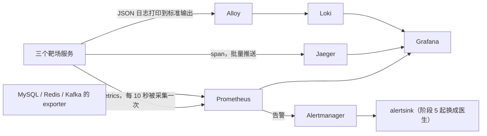
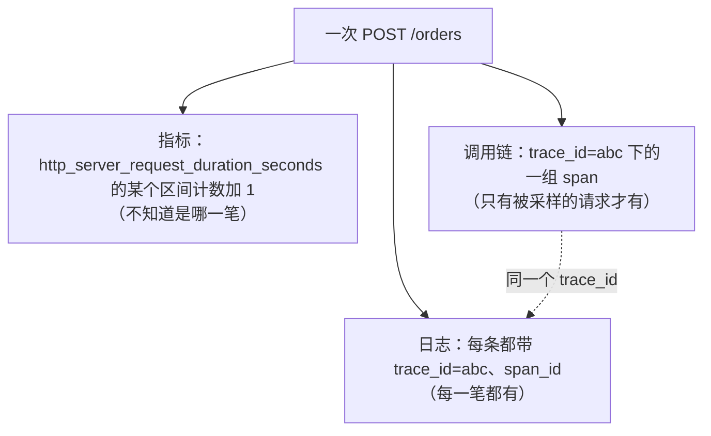

# 阶段 3 学习材料：可观测性与告警

前两个阶段，系统已经能正常工作了。但出了问题，你几乎什么都“看不见”：系统慢了吗？慢在哪一步？哪个订单失败了？这个阶段给系统装上“眼睛”：

| 交付 | 回答什么问题 | 存在哪里 | 怎么看 |
|---|---|---|---|
| **指标** | 系统整体怎么样？变慢了吗？错误变多了吗？ | Prometheus | Grafana 看板 |
| **调用链** | 这一笔请求慢在哪一步？ | Jaeger | Jaeger 页面，或 Grafana |
| **日志** | 当时具体发生了什么？哪个订单失败了？ | Loki | Grafana 的 Explore |
| **告警** | 什么时候该有人来看一眼？ | Prometheus 规则 → Alertmanager | 告警接收器的日志 |

这也是医生能工作的前提：阶段 5 以后，医生诊断时调用的工具，查的就是这些数据。

**怎样读这份材料。** 主线是：三种数据怎样分工、怎样用 trace_id 串起来；指标的标签、调用链的采样、告警的规则，各自在“看得清”和“成本”之间怎样取舍。这个阶段还有一次很有价值的**真实排障**（11.5 节）：从一个奇怪的现象出发，一步步找到藏在 gRPC 库里的根因。面试时讲这种经历，比背概念有说服力得多。Go 语法见第 7 节和 [Mini-Redis 的学习文档](https://github.com/Li-Nepenthe/mini-redis/blob/main/docs/learn/README.md)。

> 这份材料对照的是**当前的代码**。阶段 4 以后又加了告警规则、调大了 Jaeger 的容量，阶段 5 起告警改由医生接收，遇到时会注明。

## 1. 本阶段能回答的面试题

| 面试题 | 在哪里 |
|---|---|
| 指标、日志、调用链有什么区别？怎样把它们关联起来？ | 5.1、八股 1 |
| Prometheus 是拉数据还是等推送？各有什么好处？ | 5.2 |
| Counter、Gauge、Histogram 有什么区别？P99 是怎么算出来的？为什么不能平均？ | 5.3、八股 2 |
| 为什么订单号不能做指标的标签？ | 5.4 |
| 调用链怎样跨服务、跨消息队列传递？采样怎么做？ | 5.5、5.7、八股 3 |
| 告警规则怎么设计？告警太多怎么办？ | 5.8、八股 4 |
| 一个接口突然变慢了，你怎么一步步定位？ | 八股 5、11.5 |
| 监控系统自己出故障了，会不会影响业务？ | 5.11 |

## 2. 可观测性在系统里的位置

### 2.1 数据怎样流动



阶段 3 结束时一共有 17 个容器：原来的 7 个（MySQL、Redis、Kafka、库存服务、订单服务、order-worker、压测工具），加上 Prometheus、3 个 exporter、Jaeger、Loki、Alloy、Grafana、Alertmanager 和告警接收器 alertsink。

**exporter** 是一个小程序，它连上 MySQL、Redis、Kafka，把它们的状态翻译成 Prometheus 能读的格式。这些中间件自己不提供 `/metrics`，所以每个配一个。

**alertsink 是临时的。** 它只把收到的告警写进日志，不判断原因，也不修复。阶段 5 以后，Alertmanager 改为把告警发给医生（[alertmanager.yml](../../deploy/alertmanager/alertmanager.yml)），alertsink 的代码留在 `internal/platform/alertsink`，现在的 Compose 里已经没有它了。

### 2.2 一笔请求在三种数据里留下了什么



指标是汇总的数字，说不出是哪一笔；调用链和日志都带着同一个 trace_id，所以能从一条慢请求跳到它在各个服务里的每一条日志。

### 2.3 各部分负责什么、不负责什么

| 部分 | 负责 | 不负责 |
|---|---|---|
| [telemetry](../../internal/platform/telemetry/doc.go) 包 | 每个服务的指标注册表；调用链的 Provider 和 Propagator；HTTP、gRPC 的计时中间件；Kafka 消息头的读写 | 存储和查询数据，那是 Prometheus、Jaeger、Loki 的事 |
| 各服务的组装层 | 把 Gin、gRPC、SQL、Redis 的现成插件装上；用包装的方式给缓存、幂等加计数（5.10 节） | 业务逻辑 |
| [logging](../../internal/platform/logging/doc.go) | 每条日志自动带上当前 span 的 trace_id、span_id | 收集日志，那是 Alloy 的事 |
| [告警规则](../../deploy/prometheus/rules/shop.yml) | 用症状判断“该有人看一眼了” | 判断原因 |
| [alertsink](../../internal/platform/alertsink/doc.go) | 核对令牌，把告警写进日志 | 诊断和修复 |
| Grafana | 看板和数据源，启动时按配置文件自动创建（provisioning） | 数据本身 |

## 3. 跑起来看什么

所有命令都在仓库根目录运行，开始前先打开 Docker Desktop。阶段 3 的 17 个容器大约占 2 GB 内存（数据台账 P3-5、P3-12）；现在的 Compose 还包括阶段 4、5 加的组件，会更多一些。

**第 1 步：启动全部服务。** 你的 `.env` 里已经有需要的几个变量（Grafana 管理员密码、监控账号密码、告警令牌）。如果启动时提示缺少某个变量，参照[操作手册](../operations.md#启动靶场环境)的“启动靶场环境”一节补上。

```powershell
$env:LOADGEN_QPS = '0'
docker compose --env-file .env -f deploy/docker-compose.yml up -d --build --wait --wait-timeout 240
docker compose --env-file .env -f deploy/docker-compose.yml ps
Invoke-WebRequest http://127.0.0.1:3100/ready
```

配了健康检查的容器显示 `healthy`；最后一条（Loki）返回 `ready`。Loki 刚启动时可能要再等十几秒。

**第 2 步：开一点流量，看指标。**

```powershell
Invoke-RestMethod http://127.0.0.1:6070/control -Method Post -ContentType 'application/json' -Body '{"qps":20,"hot_sku_id":0}'
(Invoke-WebRequest http://127.0.0.1:6061/metrics).Content | Select-Object -First 1
```

然后在浏览器打开 http://127.0.0.1:9090/targets，所有采集目标应该都是 UP。在 Prometheus 首页输入查询 `mysql_up`，结果应该是 1。UP 只说明 Prometheus 能访问到 MySQL 的 exporter，`mysql_up=1` 才说明 exporter 能连上 MySQL（P3-1）。

**第 3 步：看看板。** 打开 http://127.0.0.1:3000，用户名 `admin`，密码是 `.env` 里的 `GRAFANA_ADMIN_PASSWORD`。在 OpsDoctor 文件夹里打开“shop 总览”，等两分钟让数据积累起来。阶段 3 验收时 12 个面板都有数据（P3-3）：请求数、P99、错误率、连接池、缓存命中率、消息积压、goroutine 数、内存、熔断器状态、重试次数、连接等待时间、幂等处理次数。

**第 4 步：追踪一笔订单。** 默认只记录十分之一的请求，随便下一单不一定能在 Jaeger 里查到。下面手动生成一个 trace ID，并在请求头里要求“一定记录这个请求”：

```powershell
$traceID = [guid]::NewGuid().ToString('N')
$headers = @{
    'traceparent' = "00-$traceID-1234567890abcdef-01"
    'Idempotency-Key' = 'learn-trace-' + [guid]::NewGuid().ToString('N')
}
$body = '{"user_id":880000303,"sku_id":499995,"quantity":1}'
$order = Invoke-RestMethod http://127.0.0.1:8081/orders -Method Post -Headers $headers -ContentType 'application/json' -Body $body
$order.data
$traceID
```

`traceparent` 是 W3C 规定的调用链请求头，格式是“版本-trace ID-上一步的 span ID-标志”，最后的 `01` 表示“需要记录”。

**在 Jaeger 里看：** 打开 http://127.0.0.1:16686，在右上角的搜索框粘贴 trace ID。等几秒，你应该看到这笔订单经过了三个服务：HTTP 请求 → Redis 占位 → gRPC 扣库存 → 库存服务的 SQL → 写订单的 SQL → 发 Kafka 消息 → order-worker 消费 → 加销量的 SQL。阶段 3 验收时一笔订单有 29 个 span（P3-2）。一条 SQL 可能显示成好几个 span（准备、执行、提交），span 的总数也会随缓存是否命中而变化，不用纠结具体数字。

**在 Grafana 里查日志：** 左侧菜单打开 Explore，数据源选 Loki，输入下面的查询（把占位文字换成你的 trace ID）：

```logql
{service=~"order-service|inventory-service|order-worker"} | json | trace_id="填入你的 trace ID"
```

你应该看到三条日志，分别来自三个服务。它们的 trace_id 相同，span_id 不同。日志旁边有一个 TraceID 链接，点击可以直接跳到这条调用链。

**第 5 步：结束。**

```powershell
Invoke-RestMethod http://127.0.0.1:6070/control -Method Post -ContentType 'application/json' -Body '{"qps":0}'
```

等消息积压归零，可以用 `shopctl check` 核对一次（方法见阶段 2 学习材料第 3 节第 7 步），应该是 `gap=0`。不学的时候，记得停掉容器释放内存：

```powershell
docker compose --env-file .env -f deploy/docker-compose.yml down
```

## 4. 代码走读

### 4.1 阅读顺序

| 顺序 | 文件 | 重点看什么 |
|---|---|---|
| 1 | [telemetry/metrics.go](../../internal/platform/telemetry/metrics.go) | `NewMetrics`：每个服务有哪些共用的指标；为什么每个服务一个独立的注册表；直方图的区间边界 |
| 2 | [telemetry/tracing.go](../../internal/platform/telemetry/tracing.go) | `New` 创建了什么；批量发送和 5 秒发送时限；`newTraceExporter` 的 DNS 修复；退出时 `Shutdown` 怎样把剩下的 span 发完 |
| 3 | [telemetry/middleware.go](../../internal/platform/telemetry/middleware.go) | HTTP 请求什么时候开始、什么时候结束计时；没有匹配到路由的请求标签是什么 |
| 4 | [orderservice/dependencies.go](../../internal/shop/app/orderservice/dependencies.go) | 各种插件是怎样装到 MySQL、Redis、gRPC 客户端上的 |
| 5 | [orderservice/observations.go](../../internal/shop/app/orderservice/observations.go) | 怎样在不改业务代码的情况下加计数 |
| 6 | [telemetry/kafka.go](../../internal/platform/telemetry/kafka.go)、[events/publisher.go](../../internal/shop/events/publisher.go)、[events/consumer.go](../../internal/shop/events/consumer.go) | 调用链信息怎样写进消息头、又怎样被读出来 |
| 7 | [logging/logging.go](../../internal/platform/logging/logging.go) 的 `FromContext` | 日志里的 trace_id 为什么要每次从当前 span 取 |
| 8 | [prometheus/rules/shop.yml](../../deploy/prometheus/rules/shop.yml) | 阶段 3 写的是前 5 条（OrderLatencyHigh、HTTPErrorRateHigh、ConsumerLagHigh、GoroutinesGrowing、ServiceUnavailable），后面 7 条是阶段 4 加的 |
| 9 | [alertsink/handler.go](../../internal/platform/alertsink/handler.go)、[app.go](../../internal/platform/alertsink/app.go) | 收到告警以后做了什么；`loadConfig` 读监听地址和令牌 |
| 10 | [deploy/README.md](../../deploy/README.md) 及各子目录的 README | 每个监控组件的配置，以及它们怎样连成一套 |

### 4.2 一次下单请求怎样变成指标

假设第 3 节的流量里，有一次 `POST /orders` 返回了 201，用时 0.037 秒（数字是示意）：

| 顺序 | 在哪里 | 做了什么 |
|---|---|---|
| 1 | `HTTPMiddleware`（[telemetry/middleware.go](../../internal/platform/telemetry/middleware.go)） | 记下开始时间，调用 `ctx.Next()`，把请求交给后面的下单处理函数 |
| 2 | 下单处理函数 | 照常下单，返回 201 |
| 3 | 回到 `HTTPMiddleware` | `ctx.FullPath()` 取到的是路由模板 `/orders`，不是请求的原始地址；没有匹配到路由时它是空字符串，改记成 `unmatched`。方法 `POST` 在已知列表里，原样保留；不认识的方法统一记成 `OTHER`。状态码是 `201` |
| 4 | 同上 | `metrics.HTTP.WithLabelValues("POST", "/orders", "201").Observe(0.037)`：0.037 秒不超过 0.05，所以 `le="0.05"` 以及更大的每个区间计数都加 1；同时总耗时 `_sum` 加 0.037，总次数 `_count` 加 1 |
| 5 | Prometheus | 每 10 秒访问一次 `/metrics`，把这些计数存成时间序列。`service="order-service"` 这个标签是创建注册表时统一加上的（`NewMetrics` 里的 `WrapRegistererWith`），所以每条序列都带着它 |

一个直方图在 `/metrics` 里会展开成很多行，大致是这样（数字是示意）：

```text
http_server_request_duration_seconds_bucket{method="POST",route="/orders",service="order-service",status="201",le="0.025"} 812
http_server_request_duration_seconds_bucket{method="POST",route="/orders",service="order-service",status="201",le="0.05"} 1530
...
http_server_request_duration_seconds_bucket{method="POST",route="/orders",service="order-service",status="201",le="+Inf"} 1600
http_server_request_duration_seconds_sum{method="POST",route="/orders",service="order-service",status="201"} 47.3
http_server_request_duration_seconds_count{method="POST",route="/orders",service="order-service",status="201"} 1600
```

`le` 是“小于等于”：`le="0.05"` 的 1530 已经包含了 `le="0.025"` 的 812。区间计数是**累计**的，最后的 `+Inf` 就等于总次数。5.3 节算 P99，用的就是这种累计计数。

### 4.3 trace 怎样跟着消息走到 order-worker

接着第 3 节第 4 步那笔订单。它的请求头带着 `traceparent`，最后两位是 `01`，表示要记录：

| 顺序 | 在哪里 | 做了什么 |
|---|---|---|
| 1 | `Publish`（[events/publisher.go](../../internal/shop/events/publisher.go)） | 以当前 context 里的 span 为父节点，开一个 `order.created publish` span，类型是 Producer（生产者）。trace ID 沿用这笔订单的 |
| 2 | 同上：`Propagator.Inject(ctx, &headers)` | Propagator 从 context 取出当前 span，调用 `headers.Set("traceparent", "00-<trace ID>-<publish span 的 ID>-01")`。`headers` 的类型是 `KafkaHeaders`，一个加了方法的切片（7.2 节） |
| 3 | `writer.WriteMessages` | 消息带着这个消息头写进 Kafka，键是订单号 |
| 4 | order-worker 的 `process`（[events/consumer.go](../../internal/shop/events/consumer.go)） | 读到消息，把 `message.Headers` 转成 `KafkaHeaders`；`Propagator.Extract` 调用 `Get("traceparent")`，把 trace ID 和父 span ID 放进 context |
| 5 | 同上 | 开 `order.created process` span，类型是 Consumer（消费者）。它的父节点是第 1 步的 publish span，trace ID 不变，所以在 Jaeger 里接在同一条链上 |
| 6 | 之后的 SQL 和日志 | 都从这个 context 往下传：SQL 插件创建子 span，日志自动带上同一个 trace_id（5.6 节） |

如果这笔订单没被选中记录，最后两位是 `00`，第 2 步写进消息头的也是 `00`。各服务的采样方式是“跟随父节点”（`parentbased_traceidratio`，由 [docker-compose.yml](../../deploy/docker-compose.yml) 里的环境变量设置），order-worker 看到 `00` 也就不记录。所以一条链要么都记、要么都不记（5.7 节）。

### 4.4 一条告警从规则到通知

以第 8 节实验一为例：200 QPS 下停掉 order-worker。下面用的是阶段 3 当时的[告警配置](https://github.com/Li-Nepenthe/opsdoctor/blob/482aa22/deploy/alertmanager/alertmanager.yml)。阶段 5 以后，接收方从 alertsink 换成了医生，分组方式也改了，但流程相同。

| 顺序 | 在哪里 | 发生了什么 |
|---|---|---|
| 1 | Kafka exporter → Prometheus | 每 10 秒采集一次消费组的积压量 `kafka_consumergroup_lag` |
| 2 | 告警规则 `ConsumerLagHigh` | Prometheus 每 10 秒算一次 `sum(kafka_consumergroup_lag{consumergroup="order-worker",topic="order.created"}) > 1000`。积压第一次超过 1000 时，告警进入 **pending**（等待），开始计时 |
| 3 | 同上 | 接下来 2 分钟（`for: 2m`）里每次计算都仍超过 1000，告警变成 **firing**，发给 Alertmanager。中间只要有一次不满足，就退回去重新计时 |
| 4 | Alertmanager | 按告警名和服务分组，先等 5 秒（`group_wait`），让同一组的告警凑齐再发；然后 POST 到 `http://alertsink:8091/api/v1/alerts`，请求头带 `Authorization: Bearer <令牌>`。令牌从容器里的临时文件读取，不写在配置里 |
| 5 | alertsink 的 `Handler` | 先核对令牌，不对就返回 401（第 8 节实验三）；再解析 JSON，状态只能是 firing 或 resolved；每条告警写一行日志“收到告警通知”，返回 204 |
| 6 | 恢复以后 | 积压降到 1000 以下，告警恢复。配置了 `send_resolved: true`，所以会再发一次 resolved 通知 |

把时间加起来，就能理解验收时为什么是 167 秒（数据台账 P3-4）：默认流量下大约每秒 40 笔订单，积压涨到 1000 要二十多秒；之后还要再持续 2 分钟才 firing；采集和计算各有最多 10 秒的间隔，Alertmanager 还要等 5 秒。

**补基础：比较令牌，为什么要先算哈希、再用 `subtle.ConstantTimeCompare`。** 普通的字符串比较，遇到第一个不同的字节就返回。攻击者可以反复猜，测量每次响应是快是慢，一个字节一个字节地猜出令牌，这叫**时序攻击**。`ConstantTimeCompare` 不管哪里不同，都把整段比完，耗时一样。但它在两段长度不同时会直接返回，所以先把双方都算成固定 32 字节的 SHA-256 再比较，长度也不会泄露。

## 5. 系统设计与取舍

每个设计点按同一个顺序讲：要解决什么问题 → 怎么做 → 放弃了什么、为什么 → 代价和适用边界 → 规模变大十倍会怎样。

### 5.1 三种数据各管一件事，用 trace_id 串起来

**问题。** 出了问题要回答三个层次的问题：整体有没有问题、问题出在哪一步、那一步具体发生了什么。没有哪一种数据能同时回答这三个问题。

**做法。** 指标看全局，调用链看一笔请求的路径，日志看细节。指标里没有 trace_id，只能按时间、服务和路由圈出范围；调用链和带调用链上下文的日志之间，才用同一个 trace_id 对照。典型的排查路线：看板显示下单变慢了（指标）→ 找一笔慢的下单，看它的调用链，发现慢在扣库存那一步（调用链）→ 用这笔请求的 trace_id 查日志，看库存服务当时报了什么错（日志）。

**放弃了什么。** 只要日志。日志细节最多，但量大、难聚合：算 P99 要扫描所有日志；告警要不停地查日志。指标是预先聚合好的数字，便宜得多。

**代价。** 三套存储、三种查询语言（PromQL、LogQL、Jaeger 的搜索），本机要多跑十个容器，约 2 GB 内存。

**规模变大十倍。** 日志和调用链的存储成本增长最快。通常会对日志按级别过滤、对正常请求采样，调用链改用尾部采样（5.7 节），指标基本不受影响。

### 5.2 指标用拉取，调用链和日志用推送

**问题。** 数据要从各个服务送到存储里。

**做法。**

- **指标是 Prometheus 来拉。** 每 10 秒访问一次各服务的 `/metrics`，把当时的数字取回去，这一步叫采集（scrape）。
- **调用链和日志是服务推出去。** span 攒成一批发给 Jaeger；日志直接打印到标准输出，由 Alloy 从容器里收走，再转给 Loki。

**为什么指标用拉取。** Prometheus 自己知道“这次没拉到”，会把这个目标的 `up` 记成 0，所以服务挂了也能发现；服务也不需要知道监控系统在哪。

**为什么日志打印到标准输出。** 服务不用关心日志存到哪里、怎样轮转文件。容器平台天然会收集标准输出，换一个日志系统也不用改代码。

**放弃了什么。** 指标也用推送（比如每个服务把指标推给一个网关）。推送适合运行时间很短的任务（还没等到采集就结束了），或者监控系统拉不到的网络环境。阶段 9 的外部 Demo 就是通过 OTLP 把指标推给 Prometheus 的。

**代价。** 拉取模式下，Prometheus 必须知道所有采集目标的地址；服务变多、地址经常变时，要靠服务发现。

**规模变大十倍。** Prometheus 用 Kubernetes 的服务发现自动找到采集目标；单个 Prometheus 存不下时，按服务拆成多个，或者用 Thanos、Mimir 这类方案做长期存储和全局查询。

### 5.3 三种指标类型，以及 P99 是怎么算出来的

**问题。** 不同的量要用不同的方式记录：累计发生了多少次、当前是多少、耗时怎样分布。

**做法。**

| 类型 | 特点 | 本项目的例子 |
|---|---|---|
| **Counter（计数器）** | 只会增加，程序重启后归零 | `rpc_client_retries_total`：查库存的重试次数；`idempotency_requests_total`：幂等处理次数 |
| **Gauge（仪表）** | 可增可减，表示“当前是多少” | `circuit_breaker_state`：熔断器状态（0 关闭、1 半开、2 打开）；连接池里正在使用的连接数 |
| **Histogram（直方图）** | 把每个值分到不同的区间里计数，用来估计分布 | `http_server_request_duration_seconds`：HTTP 请求的耗时 |

Counter 的值本身没什么意义（“从启动到现在一共重试了 37 次”），有意义的是它增长的速度，所以查询时通常用 `rate()`：每秒增加了多少。程序重启后 Counter 归零，`rate()` 会自动处理这种情况。

**补基础：rate 和 increase。** `rate(x[2m])` 是“最近 2 分钟里平均每秒增加多少”；`increase(x[2m])` 是“最近 2 分钟一共增加了多少”，大约等于 `rate` 乘以 120。两者都只用窗口里实际采到的点来算，再按比例推算到整个窗口，所以 `increase` 的结果经常不是整数。阶段 9 就碰到过：外部 Demo 的业务指标大约每 60 秒才采一个点（数据台账 P9-73），2 分钟的窗口里往往只有两个点，`increase` 按比例外推出来的数不能当实际次数。所以不能把 `increase` 的结果直接当成“发生了几次”。

**P99 怎样从直方图算出来。** Histogram 不保存每一个请求的耗时，而是预先划分好一组区间，只记“落在每个区间里的有多少个”。本项目的区间边界是：1ms、5ms、10ms、25ms、50ms、100ms、250ms、500ms、1s、2s、5s、10s。查询写法：

```promql
histogram_quantile(0.99,
  sum by (le) (rate(http_server_request_duration_seconds_bucket{service="order-service",route="/orders",method="POST"}[2m]))
)
```

从里往外读：`rate(...[2m])` 算出最近 2 分钟每个区间每秒增加了多少；`sum by (le)` 把多个实例的同一个区间加在一起（`le` 是区间的上界）；`histogram_quantile(0.99, ...)` 估算出 P99。

**算一遍。** 假设最近 2 分钟一共有 1000 个下单请求，累计区间计数是这样（数字是示意）：

| 区间上界 `le` | 累计请求数 |
|---|---:|
| 0.05 秒 | 600 |
| 0.1 秒 | 900 |
| 0.25 秒 | 985 |
| 0.5 秒 | 995 |
| 1 秒 | 1000 |

1. P99 是第 0.99 × 1000 = 990 个请求。
2. 从上往下找第一个累计数不少于 990 的区间，是 0.5 秒那一行（995）。上一行是 985，所以第 990 个请求落在 0.25 到 0.5 秒之间，是这个区间 10 个请求里的第 5 个。
3. Prometheus 假设这 10 个请求在区间里均匀分布，按比例算：0.25 + (0.5 − 0.25) × 5 ÷ 10 = 0.375 秒。

所以 P99 约为 375 毫秒。真实值可能是 0.25 到 0.5 秒之间的任何数，这就是“估计值”的意思；区间分得越细，估计越准。

**为什么不能把几个实例的 P99 平均。** 实例 A 处理了 100 个请求，全都是 10 毫秒，P99 是 10 毫秒。实例 B 也是 100 个，其中 2 个用了 2 秒，P99 是 2 秒。两个 P99 平均，大约是 1 秒。可是把 200 个请求放在一起，慢的只有 2 个，第 198 个（0.99 × 200）仍然是 10 毫秒的快请求，真实的 P99 还是 10 毫秒左右。正确的做法是先把各实例的区间计数加起来，再算 P99。

**放弃了什么。** Summary 类型：在被监控的服务里直接算好分位数。它也是估计值，误差按配置控制；更大的问题是各实例算好的分位数没法再合并。直方图可以先合并再算，适合多实例。

**代价。** P99 只是估计值；区间边界定死以后，想看更细的分布就得改代码。区间越多，时间序列越多（每个区间一条）。

**规模变大十倍。** 区间数乘以标签组合数，序列数增长很快。新版 Prometheus 的原生直方图（native histogram）能自动调整区间、序列也更少，可以考虑迁移。

### 5.4 标签基数：为什么订单号不能做标签

**问题。** 指标可以带标签，比如 `http_server_request_duration_seconds{service="order-service", route="/orders", method="POST", status="201"}`。**每一种不同的标签组合，Prometheus 都要单独存一条时间序列。**

**补基础：时间序列。** 一条时间序列由“指标名 + 一组标签”确定。每采集一次，这条线上就多一个点（时间，数值）。服务只有几个，路由只有十几个，组合起来也就几百条，没问题。但如果把订单号当标签，每个新订单都会产生一条新的时间序列，200 多万个订单就是 200 多万条，Prometheus 的内存和存储很快就会撑爆。这个问题叫**高基数**。

**做法。**

- 路由标签用模板：`/orders/1`、`/orders/2` 都记为 `/orders/:id`。
- 没有匹配到任何路由的请求（比如乱写的地址），统一记为 `unmatched`，否则别人随便访问不同的地址就能制造出无数条序列。
- 不认识的 HTTP 方法统一记为 `OTHER`。
- 要查某一笔具体的订单，去日志或调用链里查，不要用指标。

**放弃了什么。** 用用户编号、商品编号做标签，方便按用户、按商品看。这些都是无限增长的值，同样会撑爆存储。

**代价。** 指标回答不了“哪个商品最慢”这种问题，只能靠日志和调用链。

**规模变大十倍。** 要在采集端限制每个目标的序列数（Prometheus 的 `sample_limit`），并监控序列总数，防止某次代码改动不小心引入高基数标签。

### 5.5 调用链怎样跨服务传递

**问题。** 一次下单经过订单服务、库存服务、Kafka、order-worker。要看清楚它在哪一步慢，所有服务记录的操作必须连成一条链。

**补基础：trace、span、context。**

- **trace**：一次请求的完整路径，有一个全局唯一的 trace ID。
- **span**：路径上的一步操作，比如一次 SQL、一次 gRPC 调用。每个 span 记录了开始时间、结束时间，以及它的“父 span”是谁。
- **context**：Go 里沿着函数调用往下传的对象，当前的 span 就放在它里面。

**做法。** 在一个服务内部，span 跟着 context 往下传就行。**跨服务时**，要把 trace ID 和当前 span ID 放进请求里，对方收到后取出来，作为自己 span 的父节点：

- **HTTP 和 gRPC**：有现成的插件，自动在请求头里写入、读出 `traceparent`。
- **Kafka**：kafka-go 没有插件，所以项目自己写了 `KafkaHeaders`。订单服务发消息前，把 `traceparent` 写进消息头；order-worker 收到后，从消息头里读出来，再创建自己的 span（4.3 节）。

如果 Kafka 这一段不传，order-worker 的处理就会变成一条新的、孤立的 trace，下单和消费就串不起来了。

**放弃了什么。**

- **用 OpenTelemetry 的全局对象。** OTel 提供全局的 Provider 和 Propagator，插件不传参数也能用。项目让每个插件都显式接收 Provider，测试之间不会串到另一套调用链。
- **在消息正文里放 trace ID。** 能用，但业务数据和观测数据混在一起，消费者也要改解析代码。放在消息头里，业务完全不用管。

**代价。** 每个跨进程的地方都要确认传了，漏一处链就断了。没有现成插件的组件要自己写读写代码。

**规模变大十倍。** 链路经过更多的中间件（网关、消息队列、缓存代理），每一个都要支持传递 `traceparent`。统一用 W3C 的标准请求头，才能和其他团队、其他语言的服务接上。

### 5.6 日志带上当前 span 的 trace_id

**问题。** 日志和调用链要能互相跳转。

**做法。** 只要 context 里有有效的 span，日志就会自动带上 `trace_id` 和 `span_id`；没有调用链的后台任务，日志里就没有这两个字段。日志包每次写日志时，都会从 context 里取**当前的** span，而不是请求进来时存下的那个。一次请求进来时有一个入口 span，执行 SQL 时又会创建子 span。如果一直用入口 span 的 ID，SQL 出错时写的日志就会指向错误的位置。trace_id 在整条链上都一样，span_id 精确指向具体是哪一步。

没有被采样的请求，日志里也有 trace_id（ID 照样生成，只是 span 不发给 Jaeger）。所以日志能串起每一笔请求，调用链只能看被采样的那些。

**代价。** 日志里多了两个字段；启动日志这种不在请求里的日志没有 trace_id，这是正常的。

### 5.7 采样和保留：只记一部分，但要记完整

**问题。** 每个请求都记录调用链，本机的 Jaeger 和网络开销都太大。

**做法。**

- **只记录十分之一的请求。** 用 `parentbased_traceidratio`：入口按 trace ID 随机选 10%；下游一律“跟随父节点”，父节点记了就记，没记就不记。所以一条链要么完整地记录，要么都不记，不会出现只记了一半的情况。
- **Jaeger 只存在内存里。** 阶段 3 时只保留最近 5000 条 trace，阶段 4 为了长实验调到了 30000 条（[jaeger.yml](../../deploy/jaeger/jaeger.yml)）。旧的会被挤掉，拿着一个 trace ID 不一定还能查到。
- **调试时可以强制记录。** 请求头里带 `traceparent` 并把最后两位设成 `01`，下游都会跟着记录（第 3 节第 4 步）。

**放弃了什么：尾部采样。** 现在的做法叫“头部采样”：请求一开始就决定记不记，出错的请求也可能没被选中。尾部采样先把整条链缓存起来，等请求结束、知道它出错了或者很慢，再决定保留。效果好得多，但采集端要缓存大量数据，还要多部署一个收集器。

**代价。** 90% 的请求没有调用链，出错的那一笔可能正好没被记下来，只能靠日志。

**规模变大十倍。** 采样比例要进一步降低（比如 1%），同时用尾部采样保证错误和慢请求一定被记录；Jaeger 要换成持久化存储。

### 5.8 告警：只写症状，不写原因

**问题。** 告警要能及时发现问题，又不能太吵。

**做法。**

- **只写症状。** 阶段 3 的 5 条规则描述的都是用户或运维能看到的现象：下单慢了（OrderLatencyHigh）、5xx 错误多了（HTTPErrorRateHigh）、消息积压了（ConsumerLagHigh）、goroutine 一直在涨（GoroutinesGrowing）、服务采集不到了（ServiceUnavailable）。没有一条写的是“数据库缺索引”这样的原因。因为同一个症状可能有很多原因：消息积压可能是 order-worker 停了，也可能是数据库变慢了，或者消息格式坏了。告警只负责发现“有问题”，找出原因是医生的工作。阶段 4 又加了 7 条，也都是症状（比如行锁等待、连接池排队），一共 12 条。
- **持续一段时间才报。** 每条规则都有 `for`，比如积压要持续 2 分钟才报，过滤掉偶尔的抖动。
- **只数 5xx。** 错误率告警只数服务器自己的错误：参数填错的 400、地址不存在的 404 是客户端的问题，不代表服务坏了。
- **分组发送。** Alertmanager 把同一组的告警等 5 秒凑齐再一起发。
- **接收方要认证。** 告警推送带令牌，接收方核对后才处理（4.4 节）。

**补基础：告警的三个状态。** 规则每 10 秒算一次。条件不满足时是 inactive（没事）；第一次满足，进入 pending（等待），开始计 `for` 的时间；在 `for` 规定的时间里每次都满足，才变成 firing（报警），发给 Alertmanager。等待期间只要有一次不满足，就回到 inactive，下次满足时重新计时。

**放弃了什么。** 按原因写告警（比如“慢查询超过 10 条”）。这类告警数量多、误报多，而且等于把没有验证的猜测当成了结论。

**代价。** 发现得晚一点：积压告警从停掉消费者到收到通知要两分半到三分钟（P3-4）。

**规模变大十倍。** 服务多了以后，一个底层故障会在很多服务上同时触发症状。要靠分组和抑制规则（下游的告警在上游已经报警时不再单独通知）把它们合成一条。阶段 5 以后，医生还会把同一场故障的多次通知合进同一个诊断。

### 5.9 每个服务一个独立的指标注册表

**问题。** Prometheus 的 Go 库提供了一个全局默认的注册表，直接用能省几行代码。

**做法。** 每个服务在启动时创建自己的注册表（`NewMetrics`），再显式地传给需要的组件；`service` 标签在创建时统一加上。

**放弃了什么：全局注册表。** 同一个测试进程里创建两个服务时，同名的指标会被注册两次，直接报错；测试之间也会互相影响。

**代价。** 多写几行传参的代码。好处是每个测试都是独立的，依赖关系也一目了然。

### 5.10 用“包装”的方式加计数，业务包不依赖监控

**问题。** 要统计缓存命中了多少次，最直接的办法是去改 product 包，在缓存代码里加一行计数。但那样业务包就要依赖监控库了。

**做法。** 在组装代码里（[observations.go](../../internal/shop/app/orderservice/observations.go)）给缓存“包一层”：包装对象实现和原来一样的接口，每次调用时先调用原来的缓存，再记一次数。业务代码完全不知道有计数这回事。这就是**装饰器模式**。`observedCache`、`observedProducts`、`observedIdempotency` 都是这样做的。

**放弃了什么。** 在业务代码里直接调用指标。简单直接，但业务包要导入 Prometheus，测试也要准备指标对象。

**代价。** 缓存为了防止重复回源，有时会查两次缓存，这两次都会被计数。所以“缓存查询次数”不等于“HTTP 请求次数”。

### 5.11 监控系统自己出故障时，业务不受影响

**问题。** 监控是辅助设施。Jaeger 挂了、Prometheus 拉不到，订单照样要能下。

**做法。**

- **span 异步批量发送。** 业务代码只把 span 交给内存里的队列，由后台任务批量发给 Jaeger，每批最多等 5 秒（`exportTimeout`）。队列满了就丢掉调用链记录，不阻塞下单。
- **停机时也有上限。** 退出时把剩下的 span 发完，最多等 5 秒，不让监控后端拖住进程退出。
- **组件版本固定，升级要对照验证。** 实测 Jaeger 2.22.0 去掉了 Grafana 还在用的一个接口，Grafana 的数据源检查失败（P3-9）。对照 2.20.0 一切正常以后，把 Jaeger 固定在 2.20.0，并记录了以后什么时候可以升级（P3-11，[决定记录](../decisions.md#jaeger-compatibility)）。

**代价。** 监控后端出问题时，会丢掉一段调用链：阶段 3 验收时重建过一次后端，一笔订单业务成功，但调用链只剩订单服务那一段（P3-14）。业务成功不等于观测数据完整。

**规模变大十倍。** 在服务和后端之间加一层收集器（OpenTelemetry Collector），由它负责缓冲、重试和采样，服务只管发给本机的收集器。

## 6. 系统设计八股

每题先给一分钟口述版，面试时照着这个长度说；再给要点、项目里的例子和常见追问。

### 八股 1：指标、日志、调用链有什么区别？怎样关联起来？

#### 一分钟口述版

这是可观测性的三类数据，各自回答一个层次的问题。指标是预先聚合的数字，比如每秒请求数、P99、错误率，存储便宜，适合看全局趋势和触发告警，但说不出是哪一笔请求。调用链记录一笔请求经过的每一步和耗时，能看出慢在哪一步，但一般要采样。日志细节最多，但量大、难聚合。三者靠同一个 trace_id 串起来：我的项目里每条日志都自动带上当前 span 的 trace_id 和 span_id，Grafana 里点日志旁边的链接就能跳到对应的调用链。排查时先看指标定范围，再看调用链定位到具体一步，最后看日志找具体原因。

#### 要点

- 指标：便宜、可聚合、可告警；没有个体信息。
- 调用链：一笔请求的路径和耗时；有采样。
- 日志：细节最多；量大。
- 关联键：trace_id（跨服务）、span_id（具体一步）。

#### 项目里的例子

- [logging.go](../../internal/platform/logging/logging.go) 的 `FromContext` 每次取当前 span。
- 第 3 节第 4 步：同一个 trace_id 在 Jaeger 里看到三个服务，在 Loki 里查到三条日志（P3-2）。

#### 常见追问

1. **只要日志行不行？** 能做，但算 P99、触发告警都要扫描大量日志，成本高、延迟大。
2. **request_id 和 trace_id 有什么区别？** request_id 只在一个服务内有效；trace_id 标识整条调用链，跨服务传递。
3. **日志里的 trace_id 为什么每次都要从当前 span 取？** 一个请求里有很多 span，入口时存下的 ID 指不到具体出错的那一步。

### 八股 2：P99 怎么算？为什么不能把几个实例的 P99 平均？

#### 一分钟口述版

P99 是把一段时间里所有请求的耗时排序后，第 99% 位置上的值，它比平均值更能反映用户感受到的慢。Prometheus 用直方图来算：直方图不保存每个请求的耗时，只记录落在每个区间里的累计个数。查询时先用 rate 算出每个区间的增长速度，再用 sum by le 把多个实例的同一区间加起来，最后用 histogram_quantile 找到第 99% 落在哪个区间，在区间内按均匀分布线性估算。所以 P99 是估计值，精度取决于区间划分。百分位不能平均：一个实例全是快请求、另一个有少量慢请求，各自的 P99 平均以后会严重偏大或偏小，必须先合并区间计数，再重新算。

#### 要点

- 直方图的区间计数是累计的（`le` 是小于等于）。
- 查询顺序：rate → sum by le → histogram_quantile。
- 估计值，精度由区间决定。
- Summary 在客户端算分位数，不能跨实例合并。

#### 项目里的例子

- [metrics.go](../../internal/platform/telemetry/metrics.go) 的区间边界：1ms 到 10s 共 12 个。
- 阶段 2 的压测工具也是先合并 1 毫秒区间的计数，再算全程 P99。

#### 常见追问

1. **区间怎么定？** 覆盖关心的范围，并在告警阈值附近分得细一些。项目的下单 P99 告警阈值是 1 秒，阈值两边正好有 500ms、1s、2s 三个边界。
2. **为什么看 P99 而不是平均值？** 平均值会被大量快请求拉低，掩盖少数很慢的请求，而用户抱怨的正是这部分。
3. **P99 和 P999 怎么选？** 请求量大、对尾部延迟敏感的服务看 P999；请求量小时 P999 的样本太少，不稳定。

### 八股 3：分布式追踪的原理是什么？采样怎么做？

#### 一分钟口述版

一次请求叫一个 trace，有全局唯一的 trace ID；请求经过的每一步操作是一个 span，记录开始、结束时间和父 span。在一个服务内部，当前 span 放在 context 里跟着函数调用往下传；跨服务时，把 trace ID 和当前 span ID 写进请求头，W3C 标准的头叫 traceparent，下游取出来作为父节点，这样所有服务的 span 就连成一棵树。我的项目里 HTTP 和 gRPC 用 OpenTelemetry 的插件自动传，Kafka 没有插件，我自己实现了消息头的读写，所以下单和异步消费能接在同一条链上。采样上用的是父节点决定：入口随机选 10%，下游跟随父节点，保证一条链要么完整记录要么都不记。头部采样的缺点是出错的请求可能没被选中，改进办法是尾部采样。

#### 要点

- trace → span 树；父子关系靠 parent span ID。
- 传播：HTTP/gRPC 请求头、消息队列消息头；标准是 W3C traceparent。
- 采样：头部（入口决定）、跟随父节点、尾部（请求结束后决定）。
- 异步发送，不阻塞业务。

#### 项目里的例子

- [telemetry/kafka.go](../../internal/platform/telemetry/kafka.go) 的 `KafkaHeaders`。
- 4.3 节：trace 怎样跟着消息走到 order-worker。

#### 常见追问

1. **拿着 trace ID 在 Jaeger 里查不到，可能是什么原因？** 没被采样；还在发送的路上；Jaeger 重启过或已经被新的 trace 挤掉；发送出了错。
2. **调用链对性能有多大影响？** 创建 span 和异步发送有少量开销，采样能控制总量；不采样的请求只生成 ID，不发送。
3. **消息队列的 span 是父子关系还是链接关系？** 项目里消费者的 span 是发送者 span 的子节点；批量消费时一个消费 span 对应多条消息，更适合用 link（链接）关联。

### 八股 4：告警规则怎么设计？告警太多怎么办？

#### 一分钟口述版

我的原则是只对症状告警，不对猜测的原因告警。症状是用户或运维能看到的现象，比如下单 P99 超过阈值、5xx 比例升高、消息积压、服务采集不到；原因可能有很多种，写成告警等于把没验证的猜测当成结论，而且数量多、误报多。每条规则都用 for 要求异常持续一段时间，过滤掉抖动，代价是发现得晚一点。错误率只数 5xx，因为 4xx 是客户端的问题。告警太多时，靠 Alertmanager 分组，把同一组的告警等几秒凑齐一起发；靠抑制规则，在上游已经报警时不再单独通知下游；重复提醒之间留间隔。我的项目到阶段 5 以后，还让医生把同一场故障的多次通知合进同一个诊断。

#### 要点

- 症状告警，不写原因。
- `for` 过滤抖动。
- 分组、抑制、静默、重复间隔。
- 告警必须能行动：收到以后知道去看什么。

#### 项目里的例子

- [rules/shop.yml](../../deploy/prometheus/rules/shop.yml)：阶段 3 的 5 条，阶段 4 加到 12 条。
- 4.4 节：一条告警从规则到通知的时间线，167 秒（P3-4）。

#### 常见追问

1. **`for` 设多长合适？** 要权衡发现速度和误报。项目里积压告警是 2 分钟，因为短时间的积压在重启消费者时很常见。
2. **为什么还要告警“服务采集不到”？** 服务彻底挂掉时，它自己的指标都没了，其他症状告警反而不会触发，只有 `up=0` 能发现。
3. **告警发出去以后谁来处理？** 阶段 3 只写日志；阶段 5 起发给医生，由医生调查原因。

### 八股 5：一个接口突然变慢了，你怎么一步步定位？

#### 一分钟口述版

先看指标定范围：是哪个接口、从什么时候开始、P99 和错误率怎么变、是所有实例还是一个实例。然后找一笔同一时段的慢请求，看它的调用链，确定慢在哪一步。再用它的 trace_id 查那一步的日志，看具体发生了什么。最后用底层数据验证猜想，比如数据库的慢查询、网络、DNS。我做过一次真实的排障：闲置半小时后恢复流量，调用库存服务全部超时。调用链里没有 gRPC 的 span，说明卡在发出调用之前；在容器里分别测 DNS 的 A 记录和 TXT 记录，A 记录 0.19 秒返回，TXT 记录 5 秒才超时；再读 grpc-go 的源码，确认它要等两种记录都查完才发调用。修复是关掉从 DNS 读服务配置，而不是把超时调大。为了快速复现，修复前后都用同一个加速条件：连接空闲 10 秒就回收、停 25 秒不发请求。500 次请求里，失败或降级从 228 次降到 0（数据台账 P3-21、P3-23）。

#### 要点

- 指标 → 调用链 → 日志 → 底层验证。
- 调用链里**缺了什么**和有什么一样重要。
- 把大问题拆成能单独测量的小问题。
- 读的是项目实际使用的那个版本的源码。
- 修复要在同样条件下对比，没有改善的结果也要如实记录。

#### 项目里的例子

- 11.5 节：DNS TXT 排障的完整经过（数据台账 P3-18 到 P3-23）。

#### 常见追问

1. **为什么不直接把超时调大？** 问题会被掩盖，根因还在；而且调大超时会让真实故障时等更久、占更多资源。
2. **修复后为什么“重启库存服务”的恢复时间没变？** 容器重启后 IP 不变，gRPC 直接重连旧地址，不需要重新解析 DNS；剩下的失败是真实的停机时间。
3. **怎样不等 30 分钟就复现？** 把 gRPC 连接的空闲回收时间做成可配置的，测试时改成 10 秒。

## 7. 用到的 Go 写法

### 7.1 已在 Mini-Redis 讲过的

| 写法 | 本阶段在哪里用 | 去哪里学 |
|---|---|---|
| 值接收者和指针接收者 | `KafkaHeaders.Set` 必须用指针接收者（7.2 节） | [Mini-Redis 第 03 章](https://github.com/Li-Nepenthe/mini-redis/blob/main/docs/learn/03-map-struct与接口.md)“八股 4：值接收者和指针接收者有什么区别？怎么选？” |
| append 可能换底层数组 | 同上 | [Mini-Redis 第 01 章](https://github.com/Li-Nepenthe/mini-redis/blob/main/docs/learn/01-切片与字符串.md)“八股 1：slice 的底层是什么？append 怎样扩容？” |
| 接口和嵌入 | `observedCache` 嵌入原来的缓存、只重写要计数的方法（7.3 节） | [Mini-Redis 第 03 章](https://github.com/Li-Nepenthe/mini-redis/blob/main/docs/learn/03-map-struct与接口.md)“接口”“struct 与嵌入” |
| 函数也是值、闭包 | 熔断器状态的 `GaugeFunc`：采集时调用一个函数读当前值 | [Mini-Redis 第 00 章](https://github.com/Li-Nepenthe/mini-redis/blob/main/docs/learn/00-Go程序的骨架.md)“函数” |
| context 携带请求级的值 | 当前 span 放在 context 里往下传 | [Mini-Redis 第 07 章](https://github.com/Li-Nepenthe/mini-redis/blob/main/docs/learn/07-channel-context与WaitGroup.md)“context”和“八股 4” |
| goroutine 泄漏和排查 | `GoroutinesGrowing` 告警看的就是 goroutine 数量的曲线 | [Mini-Redis 第 07 章](https://github.com/Li-Nepenthe/mini-redis/blob/main/docs/learn/07-channel-context与WaitGroup.md)“八股 3：goroutine 泄漏是怎样产生的？怎样排查？” |

`context.WithoutCancel` 在阶段 0 讲过：订单写成功后发消息、退出时发完剩下的 span，都用它另开一个带时限的 context。下面几节是 Mini-Redis 没有讲过的。

### 7.2 给切片类型加方法

```go
package main

import "fmt"

// Headers 是一个新类型，底层是字符串切片。可以给它加方法。
type Headers []string

func (headers *Headers) Set(value string) {
	*headers = append(*headers, value)
}

func main() {
	headers := Headers{}
	headers.Set("traceparent")
	headers.Set("tracestate")
	fmt.Println(headers, len(headers)) // [traceparent tracestate] 2
}
```

项目里的 `KafkaHeaders` 就是这样定义的：`type KafkaHeaders []kafka.Header`。给它加上 `Get`、`Set`、`Keys` 三个方法后，它就满足了 OpenTelemetry 要求的接口，调用链信息就能写进 Kafka 消息头了。`Set` 用指针接收者，是因为它要换掉整个切片：值接收者拿到的是切片头的拷贝，长度变了也传不回去，容量不够时 `append` 换了一块新数组更是如此。项目的 `Set` 先拼出一个去掉同名键的新切片，再加上新值，最后写回 `*headers`，所以转发时不会出现两个 `traceparent`。

### 7.3 装饰器：包一层，加点东西

```go
package main

import "fmt"

type Cache interface {
	Get(key string) string
}

type redisCache struct{}

func (redisCache) Get(key string) string { return "商品" + key }

// countingCache 把一个 Cache 嵌入进来，只重写 Get：先调用原来的 Get，再记一次数。
type countingCache struct {
	Cache
	count *int
}

func (cache countingCache) Get(key string) string {
	result := cache.Cache.Get(key)
	*cache.count++
	return result
}

func main() {
	count := 0
	var cache Cache = countingCache{Cache: redisCache{}, count: &count}
	cache.Get("1")
	cache.Get("2")
	fmt.Println("查了", count, "次") // 查了 2 次
}
```

`countingCache` 和 `redisCache` 实现的是同一个接口，所以用到 `Cache` 的业务代码不需要任何修改。项目里只是把 `count++` 换成了给 Prometheus 指标加 1。

### 7.4 Prometheus 和 OpenTelemetry 的几个对象

- **`prometheus.Registry`**：一个服务的全部指标都注册在它上面，`/metrics` 输出的就是它的内容。`WrapRegistererWith` 返回一个“包了一层”的注册器，经它注册的指标都自动带上固定的标签（这里是 `service`）。
- **`CounterVec`、`HistogramVec`**：带标签的指标。`WithLabelValues("POST", "/orders", "201")` 取出这组标签对应的那一条，再 `Inc()` 或 `Observe()`。
- **`TracerProvider`**：负责创建 span，并在后台批量发送。退出时必须调用 `Shutdown`，否则内存里还没发出去的 span 会丢。
- **`Propagator`**：负责把当前 span 写进请求头（`Inject`）、从请求头读出来（`Extract`）。它只认一个读写接口，所以 HTTP 头、gRPC 元数据、Kafka 消息头都能用。

## 8. 动手实验

每个实验做完都要**恢复原状**，再做下一个。不要删除数据卷。

> 阶段 5 以后告警发给医生，实验一和实验三里看 alertsink 日志的步骤，在当前的 Compose 里要改成看医生页面上的告警记录。下面保留阶段 3 当时的写法，并注明差别。

### 实验一：让消息积压，等告警

1. 开 200 QPS 的流量（第 3 节第 2 步的命令，把 20 改成 200），等看板稳定。
2. 停掉 order-worker：`docker compose --env-file .env -f deploy/docker-compose.yml stop order-worker`
3. 在看板上看“订单消费者积压”面板，数字会一直往上涨。
4. 大约两三分钟后，在 Alertmanager 页面（http://127.0.0.1:9093）应该能看到 `ConsumerLagHigh` 处于 firing。阶段 3 当时还可以用 `docker compose --env-file .env -f deploy/docker-compose.yml logs --tail 20 alertsink` 看到 `"alertname":"ConsumerLagHigh"`、`"status":"firing"` 的记录。可能还会更早看到 `ServiceUnavailable`：order-worker 停了，它的管理端口也采集不到了。
5. 恢复：`docker compose --env-file .env -f deploy/docker-compose.yml start order-worker`，然后暂停流量。等积压归零后，告警应该变成 resolved。

告警多快到达取决于流量大小：规则要求积压超过 1000 条、再持续 2 分钟。流量小的话，积压涨得慢，告警也会晚到。

### 实验二：停掉库存服务，看指标的变化

只查商品，不下单，避免产生“待核对”的订单。

```powershell
docker compose --env-file .env -f deploy/docker-compose.yml stop inventory-service
1..15 | ForEach-Object { (Invoke-RestMethod http://127.0.0.1:8081/products/1).data.stock.status }
```

你应该看到 `unavailable`（降级）。去看板上看熔断器状态面板，应该变成 2（打开）。恢复：`docker compose --env-file .env -f deploy/docker-compose.yml start inventory-service`。再查几次商品，熔断器经过半开（1）回到关闭（0）。

### 实验三：用错误的令牌推送告警

这个实验需要 alertsink 在运行，只适用于阶段 3 当时的环境。原理在 4.4 节最后的补基础里：

```powershell
try {
    Invoke-WebRequest http://127.0.0.1:8091/api/v1/alerts -Method Post -Headers @{Authorization='Bearer deliberately-wrong'} -ContentType 'application/json' -Body '{}'
} catch {
    $_.Exception.Response.StatusCode
}
```

应该看到 `Unauthorized`（401），日志里也不应该出现“收到告警通知”。alertsink 的单元测试见 [alertsink/handler_test.go](../../internal/platform/alertsink/handler_test.go)。现在的医生接收告警时用同样的办法核对令牌，见 [target/catalog.go](../../internal/doctor/target/catalog.go) 的 `Authenticate`。不要为了做实验把真实的令牌写进命令里，那样它会留在命令历史中。

### 实验四：访问不存在的地址，看指标标签

```powershell
foreach ($path in @('/not-a-route-1', '/not-a-route-2')) {
    try { Invoke-WebRequest ('http://127.0.0.1:8081' + $path) } catch { $_.Exception.Response.StatusCode }
}
```

两个请求都应该返回 404。然后在 Prometheus 里查询：

```promql
http_server_request_duration_seconds_count{service="order-service", route="unmatched"}
```

两个不同的地址都记在同一个 `route="unmatched"` 标签下，没有产生两条新的序列（5.4 节）。

## 9. 常见误区

- **“看指标就能知道每笔订单的情况。”** 指标是汇总的数字。具体某一笔订单，要看日志和调用链。
- **“Counter 的值变小了，说明出错了。”** 程序重启后 Counter 会归零，这是正常的。看增长速度要用 `rate()`。
- **“`increase` 的结果就是发生了几次。”** 它是按窗口比例推算的，经常不是整数，采样稀疏时偏差更大。
- **“把几个实例的 P99 平均一下就行。”** 百分位不能平均，要先合并区间计数再算。
- **“缓存命中率就是 HTTP 请求的命中率。”** 统计的是缓存查询的次数。一个 HTTP 请求可能查好几次缓存，也可能一次都不查。
- **“有 trace ID 就一定能在 Jaeger 里查到。”** 可能没被采样，可能还没发到 Jaeger，可能已经被新的 trace 挤掉了，也可能发送时出了错。
- **“业务成功了，调用链就是完整的。”** 监控后端出问题时会丢 span（P3-14）。
- **“容器都是 running，监控就通了。”** 要实际查一次数据。Jaeger 和 Grafana 的接口不兼容，就是实际查询时才发现的。
- **“修好了 DNS 问题，就再也不会超时了。”** 网络真的断了、库存服务真的挂了，照样会超时；扣库存超时后结果不确定的问题也依然存在。

## 10. 自测

先自己写下答案，再展开参考要点对照。系统设计方面的问题见第 1 节和第 6 节，这里偏重代码细节。

1. `HTTPMiddleware` 在什么时候取路由模板？为什么不能在 `ctx.Next()` 之前取？
2. `service` 标签是在哪里加上的？业务代码需要自己写吗？
3. `up=1` 和 `mysql_up=1` 有什么区别？
4. `KafkaHeaders` 为什么要有 `Get`、`Set`、`Keys` 三个方法？
5. 没有被采样的请求，日志里有没有 trace_id？为什么？
6. 同一笔订单的消息被消费了两次，一次正常处理、一次判定为重复，`worker_messages_total` 会怎样变化？
7. `TracerProvider` 为什么要在业务请求都处理完以后再 `Shutdown`？
8. alertsink 比较令牌时，为什么要先算 SHA-256？
9. 为什么告警从停掉消费者到收到通知要两分半以上？
10. `GaugeFunc` 读熔断器状态时，并发安全由谁保证？

<details>
<summary>参考要点（先自己回答）</summary>

1. 在 `ctx.Next()` 之后。路由匹配发生在请求进入 Gin 时，但状态码和耗时要等处理函数返回才知道，所以统一在之后记录；没有匹配到路由时 `FullPath()` 是空字符串，改记成 `unmatched`。
2. 在 `NewMetrics` 里用 `WrapRegistererWith` 包了一层注册器，经它注册的指标都自动带上 `service`。业务代码不用写。
3. `up=1` 说明 Prometheus 能访问到 exporter；`mysql_up=1` 说明 exporter 能连上 MySQL 并读到数据。前者正常、后者为 0，说明问题出在 exporter 和 MySQL 之间。
4. 这是 OpenTelemetry 的 Propagator 要求的读写接口：`Set` 用来写入 traceparent，`Get` 用来读出，`Keys` 列出所有键。满足了这个接口，Propagator 就能把调用链信息写进 Kafka 消息头。
5. 有。trace ID 在请求进来时就生成了，采样只决定 span 要不要发给 Jaeger。所以日志能串起每一笔请求。
6. 销量只加一次。`worker_messages_total` 里，处理成功的那次记为 processed，判定为重复的那次记为 duplicate，各加 1（前提是位点都提交成功了；提交失败会记为 failed）。
7. 先停业务，最后一批请求产生的 span 才会进入队列；`Shutdown` 再把队列里剩下的发完。顺序反过来，最后那些 span 会丢。
8. `ConstantTimeCompare` 在两段长度不同时会直接返回，耗时不同，会泄露令牌的长度。先都算成固定 32 字节的哈希再比较，长度也不会泄露。
9. 积压先要涨到 1000 条（默认流量下二十多秒），再持续 2 分钟才 firing；采集和规则计算各有最多 10 秒的间隔，Alertmanager 还要等 5 秒凑齐一组。
10. 由熔断器库的 `State()` 方法内部的锁保证。闭包本身不会让并发读写变得安全。

</details>

## 11. 开发过程回放

这一节按实际发生的顺序讲。原始记录在 [notes](../notes.md#phase-03)，失败的尝试都保留着。

### 11.1 先修一个小问题：订单写成功后，消息要发出去

**要做什么：** 阶段 2 验收时发现，订单写进数据库以后，发 Kafka 消息用的还是这次 HTTP 请求的 context。如果用户这时断开了连接，context 被取消，消息就发不出去，销量会少算一笔。

**改法：** 发消息改用“不带取消状态、但有自己时限”的 context（`context.WithoutCancel` 再加 `WithTimeout`）。用户断开只表示他不再等响应，不代表订单可以撤销。新的 context 还保留着原来的调用链信息，所以发消息这一步仍然在同一条 trace 里。

**怎么验证：** 写了一个测试：订单提交后取消原来的 context，确认发送消息时拿到的 context 没有被取消、带着原来的信息、并且有时限。

**这不是完整的解决方案：** 进程在订单提交后崩溃，或者 Kafka 本身发送失败，消息还是会丢。根本的办法是 Outbox（阶段 2 第 5.8 节），这个阶段没有实现。

### 11.2 把指标、调用链、日志接到业务上

**要做什么：** 每个服务输出同一套名字的指标；一笔订单能从订单服务一路追到 order-worker；日志能和调用链对上。

**动手前先想清楚的问题：**

- 一个请求会产生很多 span，但它们必须共用同一个 trace ID，才能连成一条链。
- 指标的标签只能用种类有限的值，不能用订单号这种无限增长的值（5.4 节）。
- 业务代码不应该自己去设置全局的监控对象。

**写的顺序：**

1. 写 telemetry 包：每个服务一个独立的指标注册表、调用链的 Provider 和 Propagator。
2. 把 Gin、gRPC、SQL、Redis 的现成插件接到各服务的组装代码上。
3. Kafka 没有现成插件，手写消息头的读写（kafka.go）。
4. 让日志自动带上当前 span 的 trace_id 和 span_id。
5. 给缓存、幂等这些操作加计数：用包装的方式（5.10 节），业务包不用改。
6. 补测试，再启动整套监控组件做真实验证。

**怎么验证：** Kafka 的单元测试确认消费者拿到的 trace ID 和父 span 都对；HTTP 的单元测试确认 `/orders/1` 和 `/orders/2` 记在同一个标签 `/orders/:id` 下。真实环境里，一笔订单的调用链经过三个服务，Grafana 按 trace ID 能查到三条对应的日志。

**遇到的问题：** 订单服务的 `Run` 函数变得太长，于是拆出 dependencies.go 和 servers.go，读起来不用一下子面对一大段连接代码。阶段 2 的“待核对”计数也在这时并入了统一的指标注册表。

### 11.3 启动监控组件，用真实业务验收

**要做什么：** 从“代码里埋了点”走到“看板能看、告警能收到”。

**遇到的问题：**

1. **Loki 的健康检查失败。** Loki 的官方精简镜像里没有 `wget` 命令，健康检查执行不了。改成从宿主机和 CI 里检查它的 `/ready` 地址。
2. **Grafana 查不了 Jaeger。** 实测发现 Jaeger 2.22.0 去掉了 Grafana 还在用的一个接口，返回 404（数据台账 P3-9）。Astra 按规则先停下来问你，你同意后把 Jaeger 固定在 2.20.0，同样的配置就能用了（P3-11）。对照证据和以后什么时候可以升级，都记录在 [decisions](../decisions.md#jaeger-compatibility) 里。
3. **旧数据卷没有监控账号。** MySQL 的监控账号由初始化脚本创建，但旧数据卷不会重新执行初始化脚本，于是在已有的数据卷上手动执行了一次。

**结果：** 8 个采集目标都是 UP，12 个面板都有数据。200 QPS 下停掉 order-worker，167 秒后收到了 ConsumerLagHigh 告警，恢复后收到了 resolved 通知。暂停流量后积压归零，订单件数和销量件数相等（P3-1 到 P3-7）。

### 11.4 全新环境暴露了初始化脚本的问题

**现象：** GitHub 上的 CI 从空数据卷启动时，MySQL 启动失败退出了，但在本机的旧数据卷上一直是好的。

**排查：** 本机用一个全新的临时容器直接挂载脚本，启动成功；但把脚本的文件权限改成 Linux 上检出代码后的 0644（没有执行权限），就复现了失败（P3-16）。

**原因：** MySQL 官方镜像对没有执行权限的 `.sh` 脚本，会用 `source` 的方式运行，也就是在当前的 shell 里执行这个文件的内容，而不是另开一个进程。脚本里写了 `set -u`（遇到未定义的变量就报错），这个设置就留在了镜像自己的启动脚本里，后面的步骤用到某个可选的未定义变量时就报错退出了。

**修复：** 用圆括号把脚本内容包起来。圆括号会开一个子 shell，里面的设置和密码变量都不会影响外面。修复后在全新的空数据卷上验证通过，CI 也通过了（P3-17）。

这件事说明：在旧环境里测试通过，不等于在全新环境里也能通过。CI 每次都从空白开始，正好能发现这类问题。

**补基础：文件权限 0644 和 0755。** Linux 给每个文件记三组权限：文件主人、同组用户、其他人。每组三项：读（r，记 4）、写（w，记 2）、执行（x，记 1），加起来就是一个数字。`0644` 是“主人能读写，其他人只能读”，谁都不能执行；`0755` 是三组都能执行。Windows 不记录这种权限，所以同一个脚本，在你电脑上检出和在 CI 的 Linux 上检出，权限可能不一样。

### 11.5 真实排障：查到了 IP，为什么调用还是卡住了

这是这个阶段最值得学的一段，完整地讲一遍。

**现象。** 你在验收时，暂停流量 34.5 分钟后又恢复了流量。恢复后的头一两秒，所有调用库存服务的请求都等满了 800 毫秒才超时，两个熔断器都打开了，产生了 12 笔“结果待核对”的订单（P3-19）。十几秒后一切恢复正常。此前 Astra 也遇到过两次奇怪的超时（P3-13、P3-14），但当时没有找到原因。

**第一条线索：调用链里少了一段。** 打开一笔失败订单的调用链，里面有 HTTP 请求的 span、Redis 操作的 span，唯独**没有 gRPC 调用库存服务的 span**。整个请求花了 800 毫秒，但 Redis 那几步加起来才几毫秒。gRPC 的 span 是在调用真正发出去的时候才开始记录的。没有这个 span，说明调用很可能卡在了“发出去之前”。

**第二条线索：两次 DNS 查询的耗时差别很大。** 调用发出去之前要先把服务名 `inventory-service` 解析成 IP 地址。在订单服务的容器里分别测两种 DNS 查询：

```text
docker compose --env-file .env -f deploy/docker-compose.yml exec -T order-service nslookup -type=A inventory-service
docker compose --env-file .env -f deploy/docker-compose.yml exec -T order-service nslookup -type=TXT _grpc_config.inventory-service
```

- **A 记录**（服务名对应的 IP 地址）：约 0.19 秒就返回了。
- **TXT 记录**（一种存文本的记录）：约 5.2 秒后超时（P3-18）。

为什么要查 TXT？grpc-go 支持从 DNS 的 TXT 记录 `_grpc_config.<服务名>` 里读取“服务配置”（比如重试策略）。这个项目没有用这个功能，但 grpc-go 默认还是会去查。Docker 内置的 DNS 不认识这条记录，就把查询转发到外面，外面一直没有回应，于是要等 5 秒才超时。

**第三条线索：读源码确认顺序。** 只知道“TXT 查询慢”还不够，还要确认 gRPC 是不是真的要等它查完才发调用。于是按 go.mod 里固定的版本（v1.84.0），去本机的模块缓存里读 grpc-go 的源码：DNS 解析器先查 A 记录，再查 TXT 记录，**两个都查完**，才把地址交给连接管理器。而调用要等拿到地址才能发出去。这就解释了为什么调用卡住，以及为什么没有 gRPC 的 span。

**为什么闲置一段时间后才出现。** grpc-go 默认在 30 分钟没有调用后，释放连接和解析器。之后再有调用，就要重新解析一遍，又会撞上 5 秒的 TXT 查询。阶段 2 加的“启动时先等连接建立好”只覆盖了启动那一次，管不了之后每次闲置后的重新连接。你那次恰好暂停了 34.5 分钟，超过了 30 分钟。

**修复。** 创建 gRPC 客户端时加上 `grpc.WithDisableServiceConfig()`，告诉它“不要从 DNS 读服务配置”。这样就只查 A 记录，不再查 TXT。一共改了三处：订单服务调用库存服务的客户端、发送调用链数据给 Jaeger 的导出器（它底层也用 gRPC，P3-14 的 5 秒导出超时就是它，TXT 查询耗尽了整批 span 的 5 秒发送时限）、shopctl 的库存命令。

注意这不是关掉 DNS：服务名照样会被解析成 IP，只是不再读一个没用到的配置。也没有用“把超时从 800 毫秒加长到 6 秒”这种办法来掩盖问题。

**验证。** 为了不用真等 30 分钟，把空闲时间做成了可以配置的（`INVENTORY_GRPC_IDLE_TIMEOUT`），测试时临时改成 10 秒。用同样的脚本、同样的流量对比修复前后：

| 场景 | 修复前 | 修复后 |
|---|---|---|
| 闲置后恢复流量（500 个请求） | 228 个失败或降级，12.3 秒才恢复（P3-21） | 全部成功，第一个请求 7.6 毫秒（P3-23） |
| 有流量时重启库存服务 | 18 个失败或降级，1.25 秒恢复（P3-20） | 17 个失败或降级，1.26 秒恢复（P3-22） |

重启库存服务这一项没有改善，这是预期之中的：容器重启后 IP 不变，gRPC 直接重连旧地址，不需要重新解析 DNS。剩下的那 1 秒多失败，是库存服务真的停机的时间。

**这次排障能学到的方法：**

1. 先看现象，不急着改参数。把超时加长也能让问题“消失”，但根因还在。
2. 调用链里**缺了什么**，和有什么一样重要。
3. 把一个大问题拆成能单独测量的小问题：DNS 查询分成 A 和 TXT 两种，分别计时。
4. 读源码确认因果，而且读的是项目实际使用的那个版本。
5. 用同样的条件对比修复前后，没有改善的结果也要如实记录。

**补基础：DNS、A 记录和 TXT 记录。** 代码里写的是服务名 `inventory-service`，真正发网络请求要用 IP 地址。把名字翻译成 IP 的系统叫 DNS。DNS 里一个名字可以挂好几种“记录”：A 记录存 IPv4 地址，是最常用的；TXT 记录存一段文本，常用来放配置或验证信息。Docker 给每个容器配了一个内置的 DNS（地址是 127.0.0.11）：容器名、服务名它自己就能回答；不认识的名字，比如 `_grpc_config.inventory-service`，它转给宿主机设置的 DNS 去问，外面一直不回答，就只能等到超时。

### 11.6 阶段 3 以后的变化

- **阶段 4（2026-10-24）**：为了长实验，Jaeger 保留的 trace 从 5000 条调到 30000 条；告警规则从 5 条加到 12 条，新加的也都是症状（库存延迟、连接池排队、行锁等待、库存请求被放大等）。
- **阶段 5（2026-10-26）**：Alertmanager 的接收方从 alertsink 换成医生。
- **阶段 6（2026-10-27）**：分组方式改成“同一个靶场的所有症状合成一组”，医生按整组的恢复来判断一场故障结束。

### 11.7 可读性改造（2026-11-11）

OpsDoctor 可读性改造的第 3 批改了 telemetry 和 alertsink，代码由 GPT 改，Claude 审核：

1. **alertsink 读监听配置的代码提成了 `loadConfig`**，并补了默认地址的测试。这是第 0 批发现的测试缺口：改造前，没有测试能证明 alertsink 读配置的行为。
2. **注释只写思路和设计。** telemetry 的注释改成说明“指标为什么按服务注册”“调用链信息怎样跨进程传递”这类约束；讲 Go 语法的句子删掉了。DNS TXT 那次排查的结论仍保留在 `newTraceExporter` 的注释里，因为它解释了一行不明显的代码为什么存在。

**怎么验证：** 改造前先用 golden 把指标名称和标签固定下来（[metrics_golden_test.go](../../internal/platform/telemetry/metrics_golden_test.go)），改完以后 golden 不变；只改注释的文件，去掉注释后逐个 token 比较，完全相同。

## 12. 核对来源

### 12.1 外部事实

| 说法 | 出处 |
|---|---|
| Counter、Gauge、Histogram、Summary 的区别；直方图可以跨实例聚合，Summary 不行 | Prometheus 文档 [Metric types](https://prometheus.io/docs/concepts/metric_types/)、[Histograms and summaries](https://prometheus.io/docs/practices/histograms/) |
| `histogram_quantile` 对本项目用的经典直方图，假设桶内均匀分布并线性插值（原生直方图的指数桶用另一种插值）；`rate`、`increase` 按窗口外推 | Prometheus 文档 [Query functions](https://prometheus.io/docs/prometheus/latest/querying/functions/) |
| 每个标签组合是一条时间序列，不要用无界的值做标签 | Prometheus 文档 [Metric and label naming](https://prometheus.io/docs/practices/naming/#labels) |
| 告警规则的 `for` 和 pending、firing 状态 | Prometheus 文档 [Alerting rules](https://prometheus.io/docs/prometheus/latest/configuration/alerting_rules/) |
| Alertmanager 的分组、`group_wait`、抑制 | Prometheus 文档 [Alertmanager](https://prometheus.io/docs/alerting/latest/alertmanager/)；`group_wait` 等路由参数的含义和默认值见 [Configuration: route](https://prometheus.io/docs/alerting/latest/configuration/#route) |
| `traceparent` 请求头的格式和标志位 | W3C [Trace Context](https://www.w3.org/TR/trace-context/) |
| `parentbased_traceidratio` 采样器和 `OTEL_TRACES_SAMPLER` 环境变量 | OpenTelemetry [SDK 环境变量](https://opentelemetry.io/docs/specs/otel/configuration/sdk-environment-variables/) |
| 批量发送的 span 处理器在队列满时丢弃记录 | OpenTelemetry Go [sdk/trace](https://pkg.go.dev/go.opentelemetry.io/otel/sdk/trace#WithBatcher) |
| grpc-go 的 `WithDisableServiceConfig`；DNS 解析器查 TXT 记录读服务配置；默认空闲 30 分钟后释放连接 | [google.golang.org/grpc](https://pkg.go.dev/google.golang.org/grpc#WithDisableServiceConfig)、[WithIdleTimeout](https://pkg.go.dev/google.golang.org/grpc#WithIdleTimeout)；grpc-go v1.84.0 源码 `internal/resolver/dns` |
| Docker 内置 DNS 地址 127.0.0.11，不认识的名字转发给外部 DNS | Docker 文档 [Networking overview: DNS services](https://docs.docker.com/engine/network/#dns-services) |
| `subtle.ConstantTimeCompare` 长度不同时立即返回 | Go 文档 [crypto/subtle](https://pkg.go.dev/crypto/subtle#ConstantTimeCompare) |
| Jaeger 2.22.0 与 Grafana 数据源的兼容问题 | 本仓库[决定记录](../decisions.md#jaeger-compatibility)，数据台账 P3-9、P3-11 |

### 12.2 对照阅读（小林coding）

小林coding 没有专门讲 Prometheus、Jaeger 这些监控工具，所以这一阶段的对照阅读集中在排障思路、DNS 和 Go 写法上；监控本身的概念，以本材料为准。

| 本材料 | 小林coding 对应文章 | 去那边重点看什么 |
|---|---|---|
| 八股 5、11.5 排障 | 《系统设计面试题》[对外提供一个 API 服务，客户说请求接口超时了，怎么排查？](https://www.xiaolincoding.com/interview/systemdesign.html#对外提供一个api服务-客户说请求接口超时了-怎么排查) | 先看监控定范围，再用请求 ID 串起日志、用链路追踪拆开耗时；他也提到了“DNS 解析慢”和“不能只是把超时调大”。读完试着用他的框架把 11.5 节重讲一遍 |
| 11.5 DNS | 《图解网络》[真实地址查询 —— DNS](https://www.xiaolincoding.com/network/1_base/what_happen_url.html#真实地址查询-dns) | 域名怎样一级一级解析成 IP；Docker 内置 DNS 扮演“本地 DNS 服务器”的角色 |
| 5.5 context 带着 span 往下传 | 《Golang面试题》[6.2 Go 语言的 context 有什么作用？](https://www.xiaolincoding.com/interview/golang.html#_6-2-go语言的context有什么作用) | context 的三个用途：超时、取消、传递请求级数据；调用链信息属于第三种 |
| 5.8 错误率告警 | 《图解网络》[HTTP 常见的状态码有哪些？](https://www.xiaolincoding.com/network/2_http/http_interview.html#http-常见的状态码有哪些) | 4xx 和 5xx 的区别，错误率告警为什么只数 5xx |
| 5.8 goroutine 告警 | 《Golang面试题》[10.5 Go 语言在什么情况下会发生内存泄漏？](https://www.xiaolincoding.com/interview/golang.html#_10-5-go语言在什么情况下会发生内存泄漏)、[10.6 发生了内存泄漏如何定位和优化？](https://www.xiaolincoding.com/interview/golang.html#_10-6-go语言发生了内存泄漏如何定位和优化) | goroutine 泄漏是最常见的一种；先看 goroutine 数量的曲线，再用 pprof 找它们卡在哪里 |
| 7.2 给切片类型加方法 | 《Golang面试题》[2.4 slice 作为函数参数传递，会改变原 slice 吗？](https://www.xiaolincoding.com/interview/golang.html#_2-4-slice作为函数参数传递-会改变原slice吗) | 为什么 `Set` 必须用指针接收者 |
| 7.3 装饰器 | 《Golang面试题》[7.4 Go 语言 interface 有哪些应用场景？](https://www.xiaolincoding.com/interview/golang.html#_7-4-go语言interface有哪些应用场景) | 依赖注入和解耦、Web 框架的中间件，都靠“同一个接口，换一个实现” |
| 实验二 熔断器状态 | 《分布式面试题》[限流、熔断和降级有什么区别？](https://www.xiaolincoding.com/interview/cap.html#限流、熔断和降级有什么区别) | 熔断器的关闭、打开、半开三个状态，对应看板上的 0、2、1 |

学完后，在[进度看板](../进度.md)上勾选阶段 3 的“学习验收”。
