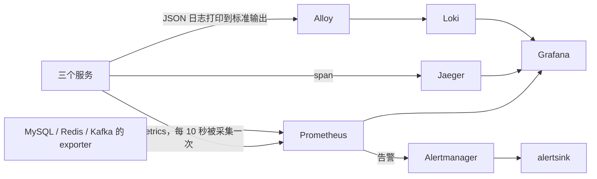

# 阶段 3 学习材料：可观测性与告警

前三个阶段，系统已经能正常工作了。但出了问题，你几乎什么都“看不见”：系统慢了吗？慢在哪一步？哪个订单失败了？

这个阶段给系统装上“眼睛”：

- **指标**：一段时间内的数字，比如每秒请求数、P99 耗时、错误率。
- **调用链**：一次请求经过了哪些操作、每一步花了多久。
- **日志**：每件事发生时留下的记录。
- **看板**：把上面三样放在一个页面里看。
- **告警**：指标异常时自动发出通知。

这也是医生能工作的前提：阶段 5 以后，医生诊断时调用的工具，查的就是这些数据。

这个阶段还有一次很有价值的**真实排障**（第 3.5 节）：从一个奇怪的现象出发，一步步找到藏在 gRPC 库里的根因。面试时讲这种经历，比背概念有说服力得多。

## 1. 这个阶段做了什么

**三种数据，各回答一个问题：**

| | 回答什么问题 | 存在哪里 | 怎么看 |
|---|---|---|---|
| 指标 | 系统整体怎么样？变慢了吗？错误变多了吗？ | Prometheus | Grafana 看板 |
| 调用链 | 这一笔请求慢在哪一步？ | Jaeger | Jaeger 页面，或 Grafana |
| 日志 | 当时具体发生了什么？哪个订单失败了？ | Loki | Grafana 的 Explore |

三者互相补充。比如：看板显示下单变慢了（指标）→ 找一笔慢的下单，看它的调用链，发现慢在扣库存那一步（调用链）→ 用这笔请求的 trace_id 查日志，看库存服务当时报了什么错（日志）。

**数据是怎么流动的：**



现在一共有 17 个容器：原来的 7 个（MySQL、Redis、Kafka、库存服务、订单服务、order-worker、压测工具），加上 Prometheus、3 个 exporter、Jaeger、Loki、Alloy、Grafana、Alertmanager 和告警接收器 alertsink。

alertsink 是临时的：它只把收到的告警写进日志，不判断原因，也不修复。阶段 5 以后由医生接替。

## 2. 怎么跑起来、看什么

所有命令都在仓库根目录运行，开始前先打开 Docker Desktop。全部 17 个容器大约占 2 GB 内存。

### 2.1 启动全部服务

你的 `.env` 里已经有阶段 3 需要的几个变量（Grafana 管理员密码、监控账号密码、告警令牌），Astra 开发时已经补好了。如果启动时提示缺少某个变量，参照根目录 README 的“启动阶段 3 环境”一节补上。

```powershell
$env:LOADGEN_QPS = '0'
docker compose --env-file .env -f deploy/docker-compose.yml up -d --build --wait --wait-timeout 240
docker compose --env-file .env -f deploy/docker-compose.yml ps
Invoke-WebRequest http://127.0.0.1:3100/ready
```

你应该看到 17 个容器都在运行；配了健康检查的显示 `healthy`；最后一条（Loki）返回 `ready`。Loki 刚启动时可能要再等十几秒。

### 2.2 开一点流量，看指标

```powershell
Invoke-RestMethod http://127.0.0.1:6070/control -Method Post -ContentType 'application/json' -Body '{"qps":20,"hot_sku_id":0}'
(Invoke-WebRequest http://127.0.0.1:6061/metrics).Content | Select-Object -First 1
```

然后在浏览器打开 http://127.0.0.1:9090/targets，你应该看到 8 个采集目标都是 UP。

在 Prometheus 的首页（http://127.0.0.1:9090）输入查询 `mysql_up`，结果应该是 1。UP 只说明 Prometheus 能访问到 MySQL 的 exporter，`mysql_up=1` 才说明 exporter 能连上 MySQL。

### 2.3 看看板

打开 http://127.0.0.1:3000，用户名 `admin`，密码是 `.env` 里的 `GRAFANA_ADMIN_PASSWORD`。在 OpsDoctor 文件夹里打开“shop 总览”，等两分钟，让数据积累起来。你应该看到 12 个面板都有数据：请求数、P99、错误率、连接池、缓存命中率、消息积压、goroutine 数、内存、熔断器状态、重试次数、连接等待时间、幂等处理次数。

### 2.4 追踪一笔订单

因为默认只记录十分之一的请求，随便下一单不一定能在 Jaeger 里查到。下面手动生成一个 trace ID，并在请求头里要求“一定记录这个请求”：

```powershell
$traceID = [guid]::NewGuid().ToString('N')
$headers = @{
    'traceparent' = "00-$traceID-1234567890abcdef-01"
    'Idempotency-Key' = 'learn-trace-' + [guid]::NewGuid().ToString('N')
}
$body = '{"user_id":880000303,"sku_id":499995,"quantity":1}'
$order = Invoke-RestMethod http://127.0.0.1:8081/orders -Method Post -Headers $headers -ContentType 'application/json' -Body $body
$order.data
$traceID
```

`traceparent` 是 W3C 规定的调用链请求头，格式是“版本-trace ID-上一步的 span ID-标志”，最后的 `01` 表示“需要记录”。

**在 Jaeger 里看：** 打开 http://127.0.0.1:16686，在右上角的搜索框粘贴 trace ID。等几秒，你应该看到这笔订单经过了三个服务：订单服务、库存服务、order-worker。依次是：HTTP 请求 → Redis 占位 → gRPC 扣库存 → 库存服务的 SQL → 写订单的 SQL → 发 Kafka 消息 → order-worker 消费 → 加销量的 SQL。

一条 SQL 可能显示成好几个 span（准备、执行、提交），这不代表执行了好几次。span 的总数也会随缓存是否命中而变化，不用纠结具体数字。

**在 Grafana 里查日志：** 左侧菜单打开 Explore，数据源选 Loki，输入下面的查询（把占位文字换成你的 trace ID）：

```logql
{service=~"order-service|inventory-service|order-worker"} | json | trace_id="填入你的 trace ID"
```

你应该看到三条日志，分别来自三个服务：订单服务的 HTTP 请求、库存服务的 gRPC 请求、order-worker 的消息处理。它们的 trace_id 相同，span_id 不同。日志旁边有一个 TraceID 链接，点击可以直接跳到这条调用链。

### 2.5 结束

```powershell
Invoke-RestMethod http://127.0.0.1:6070/control -Method Post -ContentType 'application/json' -Body '{"qps":0}'
```

等消息积压归零，可以用 `shopctl check` 核对一次（方法见阶段 2 学习材料第 2.7 节），应该是 `gap=0`。不学的时候，记得停掉容器释放内存：

```powershell
docker compose --env-file .env -f deploy/docker-compose.yml down
```

## 3. 开发过程回放

这一节按实际发生的顺序讲。原始记录在 [notes](../notes.md#phase-03)，失败的尝试都保留着。

### 3.1 先修一个小问题：订单写成功后，消息要发出去

**要做什么：** 阶段 2 验收时发现，订单写进数据库以后，发 Kafka 消息用的还是这次 HTTP 请求的 context。如果用户这时断开了连接，context 被取消，消息就发不出去，销量会少算一笔。

**改法：** 发消息改用“不带取消状态、但有自己时限”的 context（`context.WithoutCancel` 再加 `WithTimeout`，阶段 0 第 6.6 节讲过）。用户断开只表示他不再等响应，不代表订单可以撤销。新的 context 还保留着原来的调用链信息，所以发消息这一步仍然在同一条 trace 里。

**怎么验证：** 写了一个测试：订单提交后取消原来的 context，确认发送消息时拿到的 context 没有被取消、带着原来的信息、并且有时限。

**这不是完整的解决方案：** 进程在订单提交后崩溃，或者 Kafka 本身发送失败，消息还是会丢。根本的办法是 Outbox（阶段 2 第 5.8 节），这个阶段没有实现。

### 3.2 把指标、调用链、日志接到业务上

**要做什么：** 每个服务输出同一套名字的指标；一笔订单能从订单服务一路追到 order-worker；日志能和调用链对上。

**动手前先想清楚的问题：**

- 一个请求会产生很多 span，但它们必须共用同一个 trace ID，才能连成一条链。
- 指标的标签只能用种类有限的值，不能用订单号这种无限增长的值（第 5.3 节）。
- 业务代码不应该自己去设置全局的监控对象。

**写的顺序：**

1. 写 telemetry 包：每个服务一个独立的指标注册表、调用链的 Provider 和 Propagator。
2. 把 Gin、gRPC、SQL、Redis 的现成插件接到各服务的组装代码上。
3. Kafka 没有现成插件，手写消息头的读写（kafka.go）。
4. 让日志自动带上当前 span 的 trace_id 和 span_id。
5. 给缓存、幂等这些操作加计数：用包装的方式（第 5.9 节），业务包不用改。
6. 补测试，再启动整套监控组件做真实验证。

**怎么验证：** Kafka 的单元测试确认消费者拿到的 trace ID 和父 span 都对；HTTP 的单元测试确认 `/orders/1` 和 `/orders/2` 记在同一个标签 `/orders/:id` 下。真实环境里，一笔订单的调用链经过三个服务，Grafana 按 trace ID 能查到三条对应的日志。

**遇到的问题：** commentcheck 查出新文件没写进 doc.go、长函数缺少注释，逐个补上。订单服务的 `Run` 函数变得太长，于是拆出 dependencies.go 和 servers.go，读起来不用一下子面对一大段连接代码。

### 3.3 启动监控组件，用真实业务验收

**要做什么：** 从“代码里埋了点”走到“看板能看、告警能收到”。

**遇到的问题：**

1. **Loki 的健康检查失败。** Loki 的官方精简镜像里没有 `wget` 命令，健康检查执行不了。改成从宿主机和 CI 里检查它的 `/ready` 地址。
2. **Grafana 查不了 Jaeger。** 实测发现 Jaeger 2.22.0 去掉了 Grafana 还在用的一个接口，返回 404。Astra 按规则先停下来问你，你同意后把 Jaeger 固定在 2.20.0，同样的配置就能用了。对照证据和以后什么时候可以升级，都记录在 [decisions](../decisions.md#jaeger-compatibility) 里。
3. **旧数据卷没有监控账号。** MySQL 的监控账号由初始化脚本创建，但旧数据卷不会重新执行初始化脚本，于是在已有的数据卷上手动执行了一次。

**结果：** 8 个采集目标都是 UP，12 个面板都有数据。200 QPS 下停掉 order-worker，167 秒后收到了 ConsumerLagHigh 告警，恢复后收到了 resolved 通知。暂停流量后积压归零，订单件数和销量件数相等。

### 3.4 全新环境暴露了初始化脚本的问题

**现象：** GitHub 上的 CI 从空数据卷启动时，MySQL 启动失败退出了，但在本机的旧数据卷上一直是好的。

**排查：** 本机用一个全新的临时容器直接挂载脚本，启动成功；但把脚本的文件权限改成 Linux 上检出代码后的 0644（没有执行权限），就复现了失败。

**原因：** MySQL 官方镜像对没有执行权限的 `.sh` 脚本，会用 `source` 的方式运行。`source` 的意思是“在当前的 shell 里执行这个文件的内容”，而不是另开一个进程。脚本里写了 `set -u`（遇到未定义的变量就报错），这个设置就留在了镜像自己的启动脚本里，后面的步骤用到某个可选的未定义变量时就报错退出了。

**修复：** 用圆括号把脚本内容包起来。圆括号会开一个子 shell，里面的设置和密码变量都不会影响外面。修复后在全新的空数据卷上验证通过，CI 也通过了。

这件事说明：在旧环境里测试通过，不等于在全新环境里也能通过。CI 每次都从空白开始，正好能发现这类问题。

### 3.5 真实排障：查到了 IP，为什么调用还是卡住了

这是这个阶段最值得学的一段，完整地讲一遍。

**现象。** 你在验收时，暂停流量 34.5 分钟后又恢复了流量。恢复后的头一两秒，所有调用库存服务的请求都等满了 800 毫秒才超时，两个熔断器都打开了，产生了 12 笔“结果待核对”的订单。十几秒后一切恢复正常。

此前 Astra 也遇到过两次奇怪的超时（数据台账 P3-13、P3-14），但当时没有找到原因。

**第一条线索：调用链里少了一段。** 打开一笔失败订单的调用链，里面有 HTTP 请求的 span、Redis 操作的 span，唯独**没有 gRPC 调用库存服务的 span**。整个请求花了 800 毫秒，但 Redis 那几步加起来才几毫秒。那 800 毫秒花在哪里了？

gRPC 的 span 是在调用真正发出去的时候才开始记录的。没有这个 span，说明调用很可能卡在了“发出去之前”。

**第二条线索：两次 DNS 查询的耗时差别很大。** 调用发出去之前要先做什么？要先把服务名 `inventory-service` 解析成 IP 地址。在订单服务的容器里分别测两种 DNS 查询：

```text
docker compose --env-file .env -f deploy/docker-compose.yml exec -T order-service nslookup -type=A inventory-service
docker compose --env-file .env -f deploy/docker-compose.yml exec -T order-service nslookup -type=TXT _grpc_config.inventory-service
```

- **A 记录**（服务名对应的 IP 地址）：约 0.19 秒就返回了。
- **TXT 记录**（一种存文本的记录）：约 5.2 秒后超时。

为什么要查 TXT？grpc-go 支持一个功能：从 DNS 的 TXT 记录 `_grpc_config.<服务名>` 里读取“服务配置”（比如重试策略）。这个项目没有用这个功能，但 grpc-go 默认还是会去查。Docker 内置的 DNS 不认识这条记录，就把查询转发到外面，外面一直没有回应，于是要等 5 秒才超时。

**第三条线索：读源码确认顺序。** 只知道“TXT 查询慢”还不够，还要确认 gRPC 是不是真的要等它查完才发调用。于是按 go.mod 里固定的版本（v1.84.0），去本机的模块缓存里读 grpc-go 的源码：DNS 解析器先查 A 记录，再查 TXT 记录，**两个都查完**，才把地址交给连接管理器。而调用要等拿到地址才能发出去。这就解释了为什么调用卡住，以及为什么没有 gRPC 的 span。

**为什么闲置一段时间后才出现。** grpc-go 默认在 30 分钟没有调用后，释放连接和解析器。之后再有调用，就要重新解析一遍，又会撞上 5 秒的 TXT 查询。阶段 2 加的“启动时先等连接建立好”只覆盖了启动那一次，管不了之后每次闲置后的重新连接。你那次恰好暂停了 34.5 分钟，超过了 30 分钟。

**修复。** 创建 gRPC 客户端时加上 `grpc.WithDisableServiceConfig()`，告诉它“不要从 DNS 读服务配置”。这样就只查 A 记录，不再查 TXT。一共改了三处：订单服务调用库存服务的客户端、发送调用链数据给 Jaeger 的导出器（它底层也用 gRPC，P3-14 的 5 秒超时就是它）、shopctl 的库存命令。

注意这不是关掉 DNS：服务名照样会被解析成 IP，只是不再读一个没用到的配置。也没有用“把超时从 800 毫秒加长到 6 秒”这种办法来掩盖问题。

**验证。** 为了不用真等 30 分钟，把空闲时间做成了可以配置的（`INVENTORY_GRPC_IDLE_TIMEOUT`），测试时临时改成 10 秒。用同样的脚本、同样的流量对比修复前后：

| 场景 | 修复前 | 修复后 |
|---|---|---|
| 闲置后恢复流量（500 个请求） | 228 个失败或降级，12.3 秒才恢复 | 全部成功，第一个请求 7.6 毫秒 |
| 有流量时重启库存服务 | 18 个失败或降级，1.25 秒恢复 | 17 个失败或降级，1.26 秒恢复 |

重启库存服务这一项没有改善，这是预期之中的：容器重启后 IP 不变，gRPC 直接重连旧地址，不需要重新解析 DNS。剩下的那 1 秒多失败，是库存服务真的停机的时间。

**这次排障能学到的方法：**

1. 先看现象，不急着改参数。把超时加长也能让问题“消失”，但根因还在。
2. 调用链里**缺了什么**，和有什么一样重要。
3. 把一个大问题拆成能单独测量的小问题：DNS 查询分成 A 和 TXT 两种，分别计时。
4. 读源码确认因果，而且读的是项目实际使用的那个版本。
5. 用同样的条件对比修复前后，没有改善的结果也要如实记录。

## 4. 阅读顺序

| 顺序 | 文件 | 重点看什么 |
|---|---|---|
| 1 | [telemetry/metrics.go](../../internal/platform/telemetry/metrics.go) | 每个服务有哪些共用的指标；为什么每个服务一个独立的注册表 |
| 2 | [telemetry/tracing.go](../../internal/platform/telemetry/tracing.go) | `New` 创建了什么；退出时怎样把剩下的 span 发完；`newTraceExporter` 的 DNS 修复 |
| 3 | [telemetry/middleware.go](../../internal/platform/telemetry/middleware.go) | HTTP 请求什么时候开始、什么时候结束计时；没有匹配到路由的请求标签是什么 |
| 4 | [orderservice/dependencies.go](../../internal/shop/app/orderservice/dependencies.go) | 各种插件是怎样装到 MySQL、Redis、gRPC 客户端上的 |
| 5 | [orderservice/observations.go](../../internal/shop/app/orderservice/observations.go) | 怎样在不改业务代码的情况下加计数 |
| 6 | [telemetry/kafka.go](../../internal/platform/telemetry/kafka.go)、[events/publisher.go](../../internal/shop/events/publisher.go)、[events/consumer.go](../../internal/shop/events/consumer.go) | 调用链信息怎样写进消息头、又怎样被读出来 |
| 7 | [logging/logging.go](../../internal/platform/logging/logging.go) 的 `FromContext` | 日志里的 trace_id 为什么要每次从当前 span 取 |
| 8 | [prometheus/rules/shop.yml](../../deploy/prometheus/rules/shop.yml) | 5 条告警规则 |
| 9 | [alertsink/handler.go](../../internal/platform/alertsink/handler.go) | 收到告警以后做了什么 |
| 10 | [deploy/README.md](../../deploy/README.md) 及各子目录的 README | 每个监控组件的配置，以及它们怎样连成一套 |

## 5. 关键设计与为什么

### 5.1 三种指标类型

| 类型 | 特点 | 本项目的例子 |
|---|---|---|
| **Counter（计数器）** | 只会增加，程序重启后归零 | `rpc_client_retries_total`：查库存的重试次数；`idempotency_requests_total`：幂等处理次数 |
| **Gauge（仪表）** | 可增可减，表示“当前是多少” | `circuit_breaker_state`：熔断器状态（0 关闭、1 半开、2 打开）；连接池里正在使用的连接数 |
| **Histogram（直方图）** | 把每个值分到不同的区间里计数，用来估计分布 | `http_server_request_duration_seconds`：HTTP 请求的耗时 |

Counter 的值本身没什么意义（“从启动到现在一共重试了 37 次”），有意义的是它增长的速度，所以查询时通常用 `rate()`：每秒增加了多少。程序重启后 Counter 归零，`rate()` 会自动处理这种情况。

### 5.2 P99 是怎么从直方图算出来的

Histogram 不保存每一个请求的耗时，而是预先划分好一组区间，只记“落在每个区间里的有多少个”。本项目的区间边界是：1ms、5ms、10ms、25ms、50ms、100ms、250ms、500ms、1s、2s、5s、10s。

假设 100 个请求里，95 个在 100ms 以内，99.5 个在 250ms 以内，那么第 99 个请求（P99）一定落在 100ms 到 250ms 之间。具体是多少，Prometheus 假设请求在这个区间里均匀分布，按比例估算出来。所以 **P99 是一个估计值**，精度取决于区间划分得有多细。

查询写法：

```promql
histogram_quantile(0.99,
  sum by (le) (rate(http_server_request_duration_seconds_bucket{service="order-service",route="/orders",method="POST"}[2m]))
)
```

从里往外读：`rate(...[2m])` 算出最近 2 分钟每个区间每秒增加了多少；`sum by (le)` 把多个实例的同一个区间加在一起（`le` 是区间的上界）；`histogram_quantile(0.99, ...)` 估算出 P99。

**不能把几个实例各自的 P99 平均。** 正确的做法就是上面这样：先把各实例的区间计数加起来，再算 P99。

### 5.3 标签基数：为什么订单号不能做标签

指标可以带标签，比如 `http_server_request_duration_seconds{service="order-service", route="/orders", method="POST", status="201"}`。**每一种不同的标签组合，Prometheus 都要单独存一条时间序列。**

服务只有几个，路由只有十几个，组合起来也就几百条，没问题。但如果把订单号当标签，每个新订单都会产生一条新的时间序列，200 多万个订单就是 200 多万条，Prometheus 的内存和存储很快就会撑爆。这个问题叫**高基数**。

所以：

- 路由标签用模板：`/orders/1`、`/orders/2` 都记为 `/orders/:id`。
- 没有匹配到任何路由的请求（比如乱写的地址），统一记为 `unmatched`，否则别人随便访问不同的地址就能制造出无数条序列。
- 要查某一笔具体的订单，去日志或调用链里查，不要用指标。

### 5.4 调用链怎样跨服务传递

先分清三个概念：

- **trace**：一次请求的完整路径，有一个全局唯一的 trace ID。
- **span**：路径上的一步操作，比如一次 SQL、一次 gRPC 调用。每个 span 记录了开始时间、结束时间，以及它的“父 span”是谁。
- **context**：Go 里沿着函数调用往下传的对象，当前的 span 就放在它里面。

在一个服务内部，span 跟着 context 往下传就行。**跨服务时**，要把 trace ID 和当前 span ID 放进请求里，对方收到后取出来，作为自己 span 的父节点：

- **HTTP 和 gRPC**：有现成的插件，自动在请求头里写入、读出 `traceparent`。
- **Kafka**：kafka-go 没有插件，所以项目自己写了 `KafkaHeaders`。订单服务发消息前，把 `traceparent` 写进消息头；order-worker 收到后，从消息头里读出来，再创建自己的 span。

如果 Kafka 这一段不传，order-worker 的处理就会变成一条新的、孤立的 trace，下单和消费就串不起来了。

### 5.5 日志里的 trace_id

每条日志都会自动带上 `trace_id` 和 `span_id`，日志和调用链就能对上了。

细节在于：日志包每次写日志时，都会从 context 里取**当前的** span。一次请求进来时有一个入口 span，执行 SQL 时又会创建子 span。如果一直用入口 span 的 ID，SQL 出错时写的日志就会指向错误的位置。trace_id 在整条链上都一样，span_id 则精确指向具体是哪一步。

### 5.6 告警：只写症状

5 条告警规则描述的都是症状：下单慢了、错误多了、消息积压了、goroutine 一直在涨、服务采集不到了。没有一条写的是“数据库缺索引”这样的原因。

因为同一个症状可能有很多原因。消息积压可能是 order-worker 停了，也可能是数据库变慢了，或者消息格式坏了。告警只负责发现“有问题”，找出原因是医生的工作。

每条规则还有一个持续时间（`for`），比如积压要持续 2 分钟才报。这样能过滤掉偶尔的抖动，代价是发现得晚一点。

### 5.7 采样和资源

- **只记录十分之一的请求。** 每个请求都记录的话，本机的 Jaeger 和网络开销都太大。但一旦某个请求被选中记录，它经过的所有服务都会跟着记录（“跟随父节点”），不会出现一条链只记了一半的情况。
- **Jaeger 只在内存里存最近 5000 条 trace。** 本机学习够用。代价是旧的会被挤掉：拿着一个 trace ID，不一定还能查到。
- **每个容器都设了内存上限。** MySQL 原来的上限是 768 MiB，实测已经用到 98.8%，返工时调到了 1.5 GiB。

### 5.8 每个服务一个独立的指标注册表

Prometheus 的 Go 库提供了一个全局默认的注册表，直接用能省几行代码。项目没有用它，而是每个服务在启动时创建自己的注册表，再显式地传给需要的组件。

原因是测试：如果用全局注册表，同一个测试进程里创建两个服务时，同名的指标会被注册两次，直接报错；测试之间也会互相影响。显式传递多写几行代码，但每个测试都是独立的，依赖关系也一目了然。

### 5.9 用“包装”的方式加计数

要统计缓存命中了多少次，最直接的办法是去改 product 包，在缓存代码里加一行计数。但那样业务包就要依赖监控库了。

项目的做法是在组装代码里（observations.go）给缓存“包一层”：包装对象实现和原来一样的接口，每次调用时先调用原来的缓存，再记一次数。业务代码完全不知道有计数这回事。这就是**装饰器模式**，第 6.2 节有例子。

有一点要注意：缓存为了防止重复回源，有时会查两次缓存，这两次都会被计数。所以“缓存查询次数”不等于“HTTP 请求次数”。

## 6. 本阶段用到的 Go 写法

每个例子都是能独立运行的小程序。在仓库外面新建一个空目录，保存成 `main.go`，运行 `go run main.go`。

### 6.1 给切片类型加方法

```go
package main

import "fmt"

// Headers 是一个新类型，底层是字符串切片。可以给它加方法。
type Headers []string

// Set 用指针接收者：append 可能会换一块新的底层数组，必须把结果写回原来的变量。
func (headers *Headers) Set(value string) {
	*headers = append(*headers, value)
}

func main() {
	headers := Headers{}
	headers.Set("traceparent")
	headers.Set("tracestate")
	fmt.Println(headers, len(headers)) // [traceparent tracestate] 2
}
```

项目里的 `KafkaHeaders` 就是这样定义的：`type KafkaHeaders []kafka.Header`。给它加上 `Get`、`Set`、`Keys` 三个方法后，它就满足了 OpenTelemetry 要求的接口，调用链信息就能写进 Kafka 消息头了。

为什么 `Set` 要用指针接收者？`append` 在容量不够时会分配一块新的数组，返回新的切片。如果接收者是值（`headers Headers`），改的只是一份拷贝，调用方的变量不会变。

### 6.2 装饰器：包一层，加点东西

```go
package main

import "fmt"

type Cache interface {
	Get(key string) string
}

type redisCache struct{}

func (redisCache) Get(key string) string { return "商品" + key }

// countingCache 把一个 Cache 嵌入进来，只重写 Get：先调用原来的 Get，再记一次数。
type countingCache struct {
	Cache
	count *int
}

func (cache countingCache) Get(key string) string {
	result := cache.Cache.Get(key)
	*cache.count++
	return result
}

func main() {
	count := 0
	var cache Cache = countingCache{Cache: redisCache{}, count: &count}
	cache.Get("1")
	cache.Get("2")
	fmt.Println("查了", count, "次") // 查了 2 次
}
```

`countingCache` 和 `redisCache` 实现的是同一个接口，所以用到 `Cache` 的业务代码不需要任何修改。项目里的 `observedCache`、`observedProducts`、`observedIdempotency` 都是这样做的，只是把 `count++` 换成了给 Prometheus 指标加 1。

### 6.3 采集时再读取当前值

```go
package main

import "fmt"

func main() {
	state := 0 // 假设这是熔断器的状态
	read := func() int { return state }

	fmt.Println(read()) // 0
	state = 2           // 熔断器打开了
	fmt.Println(read()) // 2：每次调用都读当前的值
}
```

熔断器状态的指标用的是 `GaugeFunc`：注册时交给 Prometheus 一个函数，Prometheus 每次来采集时调用它，读到的总是当前的状态，不用在状态变化时手动更新指标。

注意：这个例子只有一个 goroutine。项目里读取的是熔断器库提供的 `State()` 方法，它内部有锁保护。闭包本身并不会让并发读写变得安全。

## 7. 动手实验

每个实验做完都要**恢复原状**，再做下一个。不要删除数据卷。

### 实验一：让消息积压，等告警

1. 开 200 QPS 的流量（第 2.2 节的命令，把 20 改成 200），等看板稳定。
2. 停掉 order-worker：`docker compose --env-file .env -f deploy/docker-compose.yml stop order-worker`
3. 在看板上看“订单消费者积压”面板，数字会一直往上涨。
4. 大约两三分钟后，查看告警接收器的日志：

   ```powershell
   docker compose --env-file .env -f deploy/docker-compose.yml logs --tail 20 alertsink
   ```

   你应该看到一条 `"alertname":"ConsumerLagHigh"`、`"status":"firing"` 的记录。可能还会更早看到一条 `ServiceUnavailable`：order-worker 停了，它的管理端口也采集不到了。
5. 恢复：`docker compose --env-file .env -f deploy/docker-compose.yml start order-worker`，然后暂停流量。等积压归零后再看 alertsink 的日志，应该能看到 `"status":"resolved"`。

告警多快到达取决于流量大小：规则要求积压超过 1000 条、再持续 2 分钟。流量小的话，积压涨得慢，告警也会晚到。实测 200 QPS 时，大约 2.5 到 3 分钟。

### 实验二：停掉库存服务，看指标的变化

只查商品，不下单，避免产生“待核对”的订单。

```powershell
docker compose --env-file .env -f deploy/docker-compose.yml stop inventory-service
1..15 | ForEach-Object { (Invoke-RestMethod http://127.0.0.1:8081/products/1).data.stock.status }
```

你应该看到 `unavailable`（降级）。去看板上看熔断器状态面板，应该变成 2（打开）。

恢复：`docker compose --env-file .env -f deploy/docker-compose.yml start inventory-service`。再查几次商品，熔断器经过半开（1）回到关闭（0）。

### 实验三：用错误的令牌推送告警

```powershell
try {
    Invoke-WebRequest http://127.0.0.1:8091/api/v1/alerts -Method Post -Headers @{Authorization='Bearer deliberately-wrong'} -ContentType 'application/json' -Body '{}'
} catch {
    $_.Exception.Response.StatusCode
}
```

你应该看到 `Unauthorized`（401），alertsink 的日志里也不应该出现“收到告警通知”。不要为了做实验把真实的令牌写进命令里，那样它会留在命令历史中。

### 实验四：访问不存在的地址，看指标标签

```powershell
foreach ($path in @('/not-a-route-1', '/not-a-route-2')) {
    try { Invoke-WebRequest ('http://127.0.0.1:8081' + $path) } catch { $_.Exception.Response.StatusCode }
}
```

两个请求都应该返回 404。然后在 Prometheus 里查询：

```promql
http_server_request_duration_seconds_count{service="order-service", route="unmatched"}
```

两个不同的地址都记在同一个 `route="unmatched"` 标签下，没有产生两条新的序列（第 5.3 节）。

## 8. 常见误区

- **“看指标就能知道每笔订单的情况。”** 指标是汇总的数字。具体某一笔订单，要看日志和调用链。
- **“Counter 的值变小了，说明出错了。”** 程序重启后 Counter 会归零，这是正常的。看增长速度要用 `rate()`。
- **“缓存命中率就是 HTTP 请求的命中率。”** 统计的是缓存查询的次数。一个 HTTP 请求可能查好几次缓存，也可能一次都不查（比如订单列表）。
- **“有 trace ID 就一定能在 Jaeger 里查到。”** 可能没被采样，可能还没发到 Jaeger，可能已经被新的 trace 挤掉了，也可能发送时出了错。
- **“启动日志里没有 trace_id，说明日志关联坏了。”** 启动时还没有请求，自然没有 trace_id。
- **“容器都是 running，监控就通了。”** 要实际查一次数据。Jaeger 和 Grafana 的接口不兼容，就是实际查询时才发现的。
- **“修好了 DNS 问题，就再也不会超时了。”** 网络真的断了、库存服务真的挂了，照样会超时；扣库存超时后结果不确定的问题也依然存在。

## 9. 必答问题

先自己写下答案，再展开最后的参考要点对照。

1. Counter、Gauge、Histogram 有什么区别？各举一个本项目里的例子。
2. P99 是怎样从直方图算出来的？为什么只是估计值？为什么不能把几个实例的 P99 平均？
3. trace、span、context 是什么关系？调用链信息怎样跨 HTTP、gRPC 和 Kafka 传递？
4. 为什么告警规则写“消息积压”，而不写“数据库缺索引”？
5. 为什么订单号、trace ID 不能做指标的标签？
6. `up=1` 和 `mysql_up=1` 有什么区别？
7. 同一笔订单的消息被消费了两次，一次正常处理、一次判定为重复，销量和相关的指标分别会怎样变化？
8. 拿着一个 trace ID 却在 Jaeger 里查不到，可能有哪些原因？
9. 讲一讲 DNS TXT 那次排障：现象是什么、线索是什么、根因是什么、怎么修、怎么验证？
10. 为什么重启库存服务的恢复时间，修复前后没有变化？

## 10. 本阶段新术语

| 术语 | 解释 |
|---|---|
| 可观测性 | 通过系统输出的数据（指标、调用链、日志）判断它内部发生了什么 |
| 指标 | 一段时间内的数字，比如每秒请求数、P99 耗时 |
| Counter | 只增不减的计数器，程序重启后归零 |
| Gauge | 可增可减的当前值，比如正在使用的连接数 |
| Histogram | 按区间计数的直方图，用来估计耗时分布 |
| 标签 / 标签基数 | 指标的附加维度 / 不同标签组合的数量，太多会撑爆存储 |
| 采集（scrape） | Prometheus 定时去访问 `/metrics`，取回当前的指标 |
| exporter | 帮 MySQL、Redis 这类组件把状态翻译成 Prometheus 格式的程序 |
| trace / span | 一次请求的完整路径 / 路径上的一步操作 |
| traceparent | W3C 规定的请求头，用来在服务之间传递 trace ID 和父 span ID |
| 采样 | 只记录一部分请求的调用链，节省资源 |
| Provider / Propagator | 负责创建 span 的对象 / 负责在服务之间写入和读出调用链信息的对象 |
| OTLP | OpenTelemetry 定义的、把观测数据发给后端的协议 |
| LogQL / PromQL | Loki 的日志查询语言 / Prometheus 的指标查询语言 |
| provisioning | Grafana 启动时根据配置文件自动创建数据源和看板 |
| 症状告警 | 告警只描述看得到的现象，不推断原因 |
| firing / resolved | 告警正在发生 / 已经恢复 |
| 装饰器 | 用实现同一接口的对象把原对象包起来，在调用前后加上额外的逻辑 |
| DNS A / TXT 记录 | 域名对应的 IPv4 地址 / 域名附带的一段文本 |

<details>
<summary>必答问题参考要点（先自己回答）</summary>

1. Counter 只增不减，比如重试次数；Gauge 是当前值，可增可减，比如熔断器状态、连接数；Histogram 按区间计数，比如 HTTP 请求耗时。
2. 先算每个区间的增长速度，把各实例同一个区间的计数加起来，再找到 99% 所在的区间，在区间内按比例估算。因为没有保存每个请求的原始耗时，只知道落在哪个区间，所以是估计值。百分位不能相加或平均，必须先合并区间计数，再重新计算。
3. trace 是一次请求的完整路径，span 是其中一步，context 携带当前的 span，在函数之间往下传。HTTP 和 gRPC 由插件自动在请求头里传递 `traceparent`；Kafka 由项目自己把 `traceparent` 写进消息头，消费者读出来作为父节点。
4. 同一个症状可能有很多原因。告警只负责发现问题、提供调查的入口，把猜测写进告警，等于把没有验证的原因当成了结论。
5. 每一种不同的标签组合都是一条单独的时间序列。订单号、trace ID 每个都不一样，会让序列数量无限增长，撑爆存储。具体某一笔的情况，去日志和调用链里查。
6. `up=1` 说明 Prometheus 能访问到 exporter；`mysql_up=1` 说明 exporter 能连上 MySQL 并读到数据。前者正常、后者为 0，说明问题出在 exporter 和 MySQL 之间。
7. 销量只加一次。`worker_messages_total` 里，处理成功的那次记为 processed，判定为重复的那次记为 duplicate，各加 1（前提是位点都提交成功了；提交失败会记为 failed）。
8. 这个请求没有被采样；span 还在发送的路上；Jaeger 重启过或者已经被新的 trace 挤掉了；只有一个外部传进来的父 span，但那一段从来没有发给 Jaeger；或者发送真的出了错。
9. 现象：闲置 34.5 分钟后恢复流量，库存调用全部超时，熔断器打开。线索：调用链里没有 gRPC 的 span；DNS 的 A 记录查询很快，TXT 记录查询要 5 秒才超时。根因：grpc-go 解析地址时会查 A 和 TXT，两个都查完才发调用；连接闲置 30 分钟后会被释放，再次调用时要重新解析。修复：创建 gRPC 客户端时加上 `WithDisableServiceConfig()`，不再查 TXT。验证：把空闲时间调成 10 秒，用同样的流量对比，失败从 228 个降到 0 个。
10. 容器重启后 IP 不变，gRPC 直接重连原来的地址，不需要重新解析 DNS，所以 TXT 查询本来就不影响这个场景。剩下的 1 秒多失败，是库存服务真的停机的时间。

</details>

学完后，在[进度看板](../../进度.md)上勾选阶段 3 的“学习验收”。
