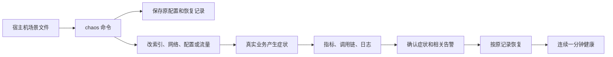

# 阶段 4 学习材料：故障注入与人工排障

> 开发中的说明草稿。代码和单元测试已写，真实场景验收仍在进行，实测结论会在收尾时补齐。

以前我们知道系统“能工作”，也知道怎样看指标、调用链和日志。这个阶段要进一步回答：一个索引没了，问题怎样一步步传到用户？看到请求变慢，怎样区分数据库、网络和连接池？

## 1. 这个阶段做了什么



chaos 是做实验的工具。它负责制造原因和恢复环境。医生以后负责根据外部证据找原因。两者分开，医生才能面对一个未知的问题，而不是读到工具写好的答案。

## 2. 怎么跑起来、看什么

从仓库根目录操作，先按根 README 准备本机环境和完整业务数据。长实验需要足够库存；补库存命令只在实验前、暂停流量后显式执行。密码来自环境变量，不能复制到笔记或截图中。

```text
go run ./cmd/chaos list
```

你应该看到 S01–S10 和 S13，共十一个编号。S11、S12 在后面的阶段实现。

```text
go run ./cmd/chaos healthy
```

你应该看到工具持续观察后返回成功。流量要先打开：没有请求就没有可靠的延迟分位数。这个命令检查延迟、错误比例、消费积压、采集与后端连接，也检查是否还有正在触发的告警。

下面以库存调用延迟为例。先确认系统健康，再逐条运行：

```text
go run ./cmd/chaos inject S07
go run ./cmd/chaos verify S07
go run ./cmd/chaos restore S07
go run ./cmd/chaos healthy
```

注入命令只报告动作已执行。verify 会另行查询业务指标和相关告警。恢复命令移除网络规则后，还要等 healthy 连续观察一分钟，才能确认请求和监控窗口都已恢复。

如果终端意外关闭，先执行：

```text
go run ./cmd/chaos restore-all
```

它读取宿主机的 `.opsdoctor-chaos.json`，恢复记录中的活动实验。这个文件包含原镜像和公开配置，不含密码；它不提交到 Git，也不进入业务或医生容器。恢复失败时先保留文件，查明原因后再执行同一命令。

完整自测使用：

```text
go run ./cmd/chaos selftest
```

每个场景都会输出一行实际结果，包括注入前健康、注入、发现症状与告警、恢复健康的时间。失败行同样保留。两遍完整自测需要较长时间，执行期间不要另开一次场景，也不要手工修改同一服务的配置。

## 3. 开发过程回放

### 3.1 先处理长实验需要的基础条件

这次先要保证实验进行到后半程时，库存和调用链仍然可用。热门商品卖空后，扣减很快返回库存不足，原本想观察的行锁竞争就不一定还存在。Jaeger 若只保留几分钟，告警发出时也可能已经找不到故障刚开始的请求。

动手前先确定补库存只能走已有 Release 接口，不能绕开业务直接改表。文件继续放在 shopctl 包内，避免再造一个补库存服务：

| 函数 | 输入与返回 | 作用 |
|---|---|---|
| parseStock | 命令参数、输出对象 → stockOptions、error | 检查数量、范围和超时 |
| runStock | context、参数、配置、输出 → error | 建立客户端并选择操作 |
| restock | context、库存客户端、选项、输出 → error | 逐个商品确认归还，失败就停 |

先写显式的 stock restock 命令，再通过原有 Release RPC 给 SKU 1–10000 各补了 100000 件。没有直接更新 stock 表。随后把 Jaeger 容量设为 30000 条，并安排带标记请求的长时间流量实验。

补库存单元测试用假的 RPC 检查中途失败。失败时命令立即停下，报告已经确认到哪里。第一次响应丢失不等于没有补成功，所以没有加自动重试。

### 3.2 追查“未确认发送，但后来消费了”

目标是解释 P3-25 的 53 条告警，并避免健康状态下因为等待预算太短而报警。先读旧日志，发现当时没有保存底层错误，不能凭一条“未确认”还原最初为什么变慢。

这里先分清三件事：订单是否提交、调用方是否收到消息确认、消费者是否处理。这三个时刻并不相同。改动沿用原有分层：

| 函数 | 输入与返回 | 作用 |
|---|---|---|
| order.NewService | 业务依赖、收尾与确认预算、logger → Service | 分别保存两种等待预算 |
| Service.Create | context、下单内容、幂等键 → Created、error | 提交后独立等待消息确认 |
| publishErrorKind | error → string | 记录固定错误类别，不记录敏感参数 |
| events.NewPublisher | brokers、观测对象、logger → Publisher | 给真实 Writer 接上失败诊断 |
| processingBudget | 订单配置 → time.Duration | 让幂等与停机预算容纳完整收尾 |

随后读固定版本 kafka-go 的 Writer：调用方的 context 决定是否继续等待，真正发送批次的后台任务使用另一份 context。于是调用方可以先超时返回，后台稍后才获得 broker 的成功回复。这里的 broker 就是保存 Kafka 消息的服务进程。

写测试时没有换掉整个发送器。测试保留真实 Writer，只让假的 broker 暂时不回复。先取消调用方，再允许 broker 确认，测试观察到了这个先后顺序。代码审查还发现，订单只等两秒，而 Writer 单次写入允许三秒。于是新增五秒的独立消息确认预算，并让幂等处理时限和停机预算一起包含它。

第一次五分钟基线没有复现消息告警，但出现了五次 HTTP 错误，其中一笔结果保存失败进入待核对，原始结果照实保留。第一次长实验在 318.7 秒左右遇到 Docker 引擎停止。用户重新启动后另起一轮，没有覆盖中断记录。完整结果以 notes 和数据台账为准。

### 3.3 写场景之前，先补齐可恢复的执行流程

目标是让一条命令能完成实验动作，同时在失败后知道怎样恢复。先确定只允许固定的表、索引、服务和环境变量，再写场景结构和加载校验。接着写 Docker、HTTP、MySQL、Redis 四类外部操作，最后由 app 把它们串起来。

| 函数 | 输入与返回 | 作用 |
|---|---|---|
| scenario.Load | 目录 → 场景列表、error | 读取授权的十一个定义 |
| Runner.Execute | context、Step → error | 执行一个已检查的外部动作 |
| Runner.Capture | context、Scenario → Baseline、error | 保存将要改变的配置和流量 |
| Engine.Inject | context、Scenario → Record、error | 落盘后按顺序操作 |
| Engine.Restore | context、Record → error | 尝试所有清理，成功后删除记录 |
| Client.Symptom | context、症状条件 → Result、error | 等业务指标和相关告警 |
| Client.Healthy | context → Result、error | 要求健康条件连续一分钟成立 |
| Engine.Trial | context、Scenario → Row | 组织单场实验并记录失败 |

这样拆分后，流程测试只需要假的 Executor 和 Observer；HTTP 解码的测试则在 verify 包里做，既能定位失败，也不用为了测试取消流程真的停数据库。

恢复前必须知道原来是什么样，因此先保存原镜像内容 ID、公开配置和流量设置，再执行第一项改动。镜像内容 ID 可以理解成某一份镜像内容的指纹；同名标签后来被新构建覆盖，也不会改变这个指纹指向的旧内容。

测试用假的执行器制造取消和恢复失败，检查取消后仍能恢复、某一步恢复失败后仍继续清理其他项，以及失败时记录不会被删除。监控测试则分别检查空数据、NaN、尚未触发的 pending 告警和不相关告警。

### 3.4 S13 为什么还需要一个时限

原来的 GetStock 共享 800ms 总截止时间。第一下如果已经等满 800ms，再把最大重试次数从两次改成十次也没用，因为没有剩余时间可重试。

先定两个边界：单次预算只能缩短一次查询，总预算仍控制全部尝试；写请求不进入这个新分支。

| 函数 | 输入与返回 | 作用 |
|---|---|---|
| inventoryclient.New | RPC、Config、logger → Client、error | 校验单次时限不超过总时限 |
| Client.GetStock | context、商品编号 → Stock、error | 只创建一次总截止时间 |
| Client.queryAttempt | context、商品编号 → RPC 响应、error | 按需给一次尝试更短的时间 |
| orderservice.loadConfig | 环境读取器 → Config、error | 读取新参数并检查组合预算 |

发现这个缺口后先询问用户。用户批准增加单次尝试时限，要求默认行为不变、单次不超过总时限、重试有硬上限，并且扣减仍只发一次。实现顺序是先改客户端，再接环境配置和启动日志，最后补默认行为、真正多次查询及全部重试次数下扣减一次的测试。

S13 的参考证据也随之补齐：既要看到重试计数增加，也要看到库存实际收到的 RPC 数量比 HTTP 入口更多。只看一条“最大重试次数=10”的日志，不能证明运行时真的发生了十次尝试。

## 4. 阅读顺序

| 顺序 | 文件 | 重点看什么 |
|---|---|---|
| 1 | [cmd/chaos/main.go](../../cmd/chaos/main.go) | Ctrl+C 怎样变成 context 取消 |
| 2 | [app/app.go](../../internal/chaos/app/app.go) | 子命令怎样进入不同流程 |
| 3 | [app/engine.go](../../internal/chaos/app/engine.go) | 先落盘，再改外部系统，最后才删除恢复记录 |
| 4 | [scenario/model.go](../../internal/chaos/scenario/model.go) | 一份实验需要哪些输入与证据 |
| 5 | [scenario/validate.go](../../internal/chaos/scenario/validate.go) | 为什么不开放任意 SQL 和命令 |
| 6 | [action/deploy.go](../../internal/chaos/action/deploy.go) | 配置发布和原镜像恢复有什么不同 |
| 7 | [action/storage.go](../../internal/chaos/action/storage.go) | 索引列顺序、唯一性与缓存操作范围 |
| 8 | [verify/wait.go](../../internal/chaos/verify/wait.go) | 怎样判断真正出现、持续恢复 |
| 9 | [app/selftest.go](../../internal/chaos/app/selftest.go) | 失败与取消为什么仍进入清理路径 |
| 10 | [inventory_client.go](../../internal/shop/inventoryclient/inventory_client.go) | 单次与总时限怎样嵌套，为什么扣减不重试 |

## 5. 关键设计与 WHY

### 5.1 先看用户，再找耗时落在哪里

排障不从猜原因开始。先用入口指标确认哪些接口受影响，再找一笔同一时间的慢请求。调用链可以把这笔请求拆成查缓存、调用库存、查数据库、发消息等步骤。然后用对应日志和底层状态验证判断。

例如下单变慢，不足以说明缺了索引。可能在借数据库连接时排队，也可能 SQL 已执行完，但响应在网络里等待。下面每个场景都按这条调查顺序展开。

### 5.2 S01：库存索引缺失

**原理。** 索引像按商品编号整理好的目录。有它时，MySQL 很快找到要扣减的行；没有它时，需要检查很多无关行。UPDATE 还要取得锁，扫描范围扩大后，其他更新也更容易被挡住。

**注入。** 用专用账号删除 `stock.uk_stock_sku`，数据和业务 SQL 保持原样。

**症状链。** 查找范围扩大 → UPDATE 持锁和等待增加 → 库存 RPC 变慢 → 订单调用预算耗尽。部分扣减结果可能进入待核对；客户端超时不能证明数据库没有执行。

**人工调查。** 先比较下单与商品查询，再找慢下单的库存 span。沿着它定位 UPDATE 模板。对这条 SQL 做 EXPLAIN，检查使用的索引和预计扫描行数，再用 SHOW INDEX 确认 `sku_id` 上的唯一索引确实不存在。最后结合锁等待数据，解释为什么其他请求也被拖慢。

**修复。** 恢复原唯一索引，观察扫描范围和锁等待下降，再等待健康基线。另行核对结果不明的订单，不能简单换一个幂等键重做。

### 5.3 S02：订单列表联合索引缺失

**原理。** 列表先按用户找订单，再按时间排序。联合索引把这两个顺序放在同一份目录中，避免每次都从大量历史订单里重新找和排。

**注入。** 删除 `orders.idx_orders_user_created`。

**症状链。** 用户筛选不能有效缩小扫描 → 大量订单参与读取和排序 → GET 列表耗时上升。它与库存索引问题的受影响接口不同。

**人工调查。** 先按 HTTP 方法和路由分开看，确认是 GET `/orders`。从慢调用链提取查询模板，检查 EXPLAIN 的扫描和排序，再核对 `user_id, created_at` 的索引列顺序。

**修复。** 按原顺序恢复联合索引。只建一个名称相同、列顺序不同的索引不算恢复。

### 5.4 S03：连接池只有两条连接

**原理。** Go 的 `*sql.DB` 类似 Java 的 DataSource 连接池。请求不是随时都能拿到连接；池中可借出的连接用完后，它要先排队。

**注入。** 真正发布库存服务，把最大连接数和空闲连接数都设为 2。

**症状链。** 同时需要数据库的请求超过容量 → 等待借连接 → 剩余 SQL 执行时间减少 → 库存和上游出现慢请求或超时。流量不足时不一定出现明显症状，必须用实测证明。

**人工调查。** 先看启动时间和生效配置，再对照连接上限、使用数、等待次数、累计等待时间。随后检查数据库执行计划和行锁，区分“还没借到连接”与“已经执行 SQL 但被锁挡住”。

**修复。** 回到实验前的连接池配置。容量要结合数据库总连接预算考虑，不能一遇到等待就无限调大。

### 5.5 S04：一个热门缓存失效

**原理。** singleflight 会让同一个商品的一批并发请求共用一次查库结果。没有这层合并时，它们可能同时发现缓存为空，各自去查数据库，这就是缓存击穿。

**注入。** 发布关闭 singleflight 的配置，把流量集中到一个商品，然后删除它的缓存。

**症状链。** 热点缓存消失 → 同时到来的请求各自回源 → 相同商品的查询在短时间内增加 → 数据库和请求耗时可能上升。这里的“可能”需要实际并发支持；若数据库很快，第一笔已经填好缓存，后来的请求就不会重复查库。

**人工调查。** 对比缓存 miss 和真正查库的 `cache_loads_total`，再看同一时段的 SQL 调用链。确认它们集中到同一商品，并从启动日志核对 singleflight 是否关闭。不要把普通的首次未命中直接叫作击穿。

**修复。** 恢复合并回源配置和原流量分布，让正常请求填回缓存。场景验收必须拿到重复回源的证据。

### 5.6 S05：许多缓存一起失效

**原理。** 一大批缓存如果在同一时刻到期，许多商品都要重新查库，这叫缓存雪崩。给 TTL 加一点随机时间，可以把这一波回源分散开。TTL 就是一条缓存还能保留多久。

**注入。** 发布零抖动配置，再把一批已有商品缓存的到期时间对齐。没有清空 Redis，也没有改动订单幂等记录。

**症状链。** 许多键共同到期 → 多个商品未命中 → 实际回源增加 → 数据库压力和延迟可能上升。缓存逐渐重新填充后，这一波压力也会下降。

**人工调查。** 先对照 miss 与回源曲线，再抽查多个商品的剩余时间和调用链。查看新发布是否关闭了抖动。它与 S04 的区别是涉及许多商品，而不是同一个热点。

**修复。** 恢复过期抖动，等待正常流量重新填充。已经过期的缓存字节不需要人为还原，数据库仍是商品数据来源。

### 5.7 S06：消费者停止

**原理。** 下单和更新销量是通过 Kafka 分开的两步。消费者停了，订单仍能产生消息，但销量暂时跟不上。lag 表示尚未消费到的位置差。

**注入。** 停止 order-worker 容器。

**症状链。** 新订单继续产生 → 消费位置不前进 → lag 增长 → 销量更新落后。下单接口正常也不能证明整条业务链正常。

**人工调查。** 先确认生产仍成功，再看消费者管理端点、运行日志、三个分区的消费位置和 lag。不要只看某一个分区，也不要把“没有收到消息”直接归因于 Kafka 停机。

**修复。** 启动原消费者，观察积压下降。暂停流量、等追平后运行 shopctl check；总量一致是一个核对结果，详细订单去重仍靠事务与去重记录。

### 5.8 S07：库存响应卡在网络里

**原理。** 调用方的等待包含请求传输、服务端处理和响应传输。服务端处理快，不代表调用方很快能收到结果。

**注入。** Toxiproxy 在订单至库存链路的响应方向增加 800ms 等待。代理只是晚一点转发真实数据。

**症状链。** 响应到达变晚 → 调用方的 800ms 预算耗尽 → 失败累计 → 熔断器暂时拒绝继续调用 → 商品库存降级、下单可能进入待核对。

**人工调查。** 对比同一次调用的客户端和服务端 gRPC span。如果客户端很长，服务端和 SQL 都短，优先调查链路和连接。再核对 DeadlineExceeded、熔断状态以及商品返回的库存状态。

**修复。** 移除本次延迟规则，等已有连接和熔断器恢复。已发生的待核对订单要另外处理，恢复网络不会自动证明它们的扣减结果。

### 5.9 S08：大家都在改同一行

**原理。** 同一商品的一行库存不能被多个事务同时任意改写。数据库用行锁保证更新顺序；请求集中到同一行时，它们只能依次取得这把锁。

**注入。** 改变真实订单流量，让它集中到同一个商品。实验前保证该商品有库存，不通过人为长事务或 sleep 制造等待。

**症状链。** 同一行的写入并发增加 → 行锁竞争 → 等待和持连接时间增加 → 下单变慢。症状是否明显取决于实际并发和写入耗时，要从测量中判断。

**人工调查。** 先看锁等待，再检查阻塞关系和涉及的行。随后对照 EXPLAIN：仍使用 `uk_stock_sku`，说明它与 S01 的全表扫描不同。结合订单日志确认流量确实集中到这个商品。

**修复。** 恢复分散流量。真实业务还可以缩短事务、控制同一商品并发；如果业务长期只有一个热点，需要重新考虑库存分配方式。

### 5.10 S09：请求结束了，后台任务没结束

**原理。** goroutine 是 Go 运行时调度的任务，类似很轻的并发执行单元。它等在 channel 上时仍占资源。无缓冲 channel 必须有接收方准备好，发送方才能交出值。

**注入。** 发布另一份响应收尾实现。每次响应后启动一个发送结果的任务，但接收方不存在，所以任务停在发送处。

**症状链。** 每个请求留下一个等待任务 → goroutine 数持续增长 → 栈和其他关联资源占用增加 → 继续运行可能遇到内存压力。单次任务便宜也不能抵消无限积累。

**人工调查。** 先对照发布版本与进程启动时间。入口流量若稳定而任务数持续上涨，抓取两次 goroutine profile。profile 是运行时任务状态的快照；比较相同 `chan send` 堆栈是否越来越多，再检查发送方与接收方的生命周期。

**修复。** 恢复原镜像。代码层面的修复是保证接收、使用合适缓冲或在取消时退出。单纯增加内存只会延后问题。

### 5.11 S10：SQL 等的是网络

**原理。** 应用里的 SQL span 包含到数据库的网络往返，不能直接等同于数据库 CPU 执行时间。

**注入。** 在库存至 MySQL 链路的响应方向增加真实延迟。

**症状链。** 多种 SQL 往返都变慢 → 连接占用更久 → 池等待可能增加 → 库存 RPC 和上游变慢。连接池告警可能是后果，而不一定是最初原因。

**人工调查。** 比较不同 SQL 是否一起变慢，再看数据库内部执行与锁等待。若执行计划仍正常、数据库内部等待不足以解释客户端耗时，就继续检查链路。不要只看到连接池满就停在 S03 的判断上。

**修复。** 移除延迟，观察 SQL、连接使用与入口延迟依次回落。

### 5.12 S13：一次失败带来更多请求

**原理。** 总时限决定这次逻辑调用最晚什么时候结束。单次时限决定这一回尝试最多等多久。例如总共 800ms，每次只等 50ms，第一回超时后仍可能有时间继续试。若没有等待间隔、没有熔断，而且重试上限很高，一份入口流量会被放大成很多下游请求。

**注入。** 单次时限 50ms，最多重试十次，关闭退避和熔断，再把响应延迟到 80ms。正常默认仍是单次时限零、两次重试、启用退避与熔断。

**症状链。** 响应来不及在单次时限内返回 → 客户端继续尝试 → 库存收到更多查询 → 资源消耗和等待增加 → 更多调用来不及完成。这种相互加重的过程就是重试风暴。

**人工调查。** 先比较入口 HTTP 请求率与库存 RPC 请求率，再看 `rpc_client_retries_total`。找一笔商品请求，数出其下的多次 GetStock，并核对新发布的预算和保护参数。不能用配置值代替实际请求放大证据。

**修复。** 恢复退避、熔断和合理的重试上限，排查最初的延迟。总预算始终有限。Deduct 无论怎样配置都只执行一次，因为重复扣库存会改变业务结果。

### 5.13 为什么“消息确认超时”仍要保留

等待确认到期，只能说明调用方没能在约定时间内确定结果。发送可能失败，也可能稍后成功。如果一律记成成功，就会掩盖真正漏发；如果直接自动重发，也可能造成重复。

本阶段把确认预算从两秒拆成独立的五秒，并补充诊断字段。它给短暂抖动留下余量。根治数据库订单和消息之间的一致性缺口，需要另外的可靠投递设计；本阶段仍不实现 Outbox。

## 6. 本阶段用到的 Go 写法

下面的完整程序都已在本机实际运行并经过 gofmt。每个代码块单独保存为 main.go，再执行 `go run main.go`。

### 6.1 单次时限与父时限

WithTimeout 创建一份可以更早结束的 context。子时限不会延长父时限。这里用一秒总预算包住三次尝试，前两次各自等满二十毫秒，第三次直接完成。对照 Java，可以把它理解成每次 Future 等待有自己的上限，外层还保留整项工作的截止时间。

```go
package main

import (
	"context"
	"fmt"
	"time"
)

func main() {
	total, cancel := context.WithTimeout(context.Background(), time.Second)
	defer cancel()
	for attempt := 1; attempt <= 3; attempt++ {
		one, stop := context.WithTimeout(total, 20*time.Millisecond)
		if attempt < 3 {
			<-one.Done()
			fmt.Printf("第 %d 次：单次时限用完，总时限仍有效=%t\n", attempt, total.Err() == nil)
		} else {
			fmt.Println("第 3 次：完成")
		}
		stop()
	}
}
```

本机实际输出：

```text
第 1 次：单次时限用完，总时限仍有效=true
第 2 次：单次时限用完，总时限仍有效=true
第 3 次：完成
```

### 6.2 无缓冲 channel 的交接

channel 是传值的通道。make(chan int) 没有缓冲，发送方只有等到接收方接走值，才能继续执行。这个程序明确接收并等待任务结束，方便看清 S09 缺少接收方时停在哪里。

```go
package main

import "fmt"

func main() {
	result := make(chan int)
	ready := make(chan struct{})
	done := make(chan struct{})
	go func() {
		close(ready)
		result <- 201
		close(done)
	}()
	<-ready
	select {
	case <-done:
		panic("没有接收方，发送不可能完成")
	default:
		fmt.Println("接收之前，发送任务尚未结束")
	}
	fmt.Println("接收到状态：", <-result)
	<-done
	fmt.Println("发送任务已结束")
}
```

本机实际输出：

```text
接收之前，发送任务尚未结束
接收到状态： 201
发送任务已结束
```

### 6.3 独占创建恢复文件

O_EXCL 与 O_CREATE 一起使用时，只有文件不存在才能创建。它把“检查是否存在”和“创建”交给操作系统完成，避免两个进程都先检查到不存在，再互相覆盖。Java 可以对照 CREATE_NEW 打开选项。示例只在新临时目录中操作自己的文件。

```go
package main

import (
	"fmt"
	"os"
	"path/filepath"
)

func main() {
	directory, err := os.MkdirTemp("", "opsdoctor-learning-")
	if err != nil {
		panic(err)
	}
	defer os.Remove(directory)
	path := filepath.Join(directory, "active.json")
	first, err := os.OpenFile(path, os.O_CREATE|os.O_EXCL|os.O_WRONLY, 0600)
	if err != nil {
		panic(err)
	}
	if err := first.Close(); err != nil {
		panic(err)
	}
	defer os.Remove(path)
	second, err := os.OpenFile(path, os.O_CREATE|os.O_EXCL|os.O_WRONLY, 0600)
	if err == nil {
		second.Close()
		panic("意外覆盖已有记录")
	}
	fmt.Println("第二次创建被拒绝：", os.IsExist(err))
}
```

本机实际输出：

```text
第二次创建被拒绝： true
```

### 6.4 通过参数数组运行外部命令

exec.CommandContext 直接启动程序。go 和 version 是分开的参数，不会先拼成一段 shell 代码。context 到期会结束这个命令的等待与进程；如果命令已经让 Docker 后台执行了操作，仍要靠恢复记录核对和收尾。

```go
package main

import (
	"context"
	"fmt"
	"os/exec"
	"strings"
	"time"
)

func main() {
	ctx, cancel := context.WithTimeout(context.Background(), 5*time.Second)
	defer cancel()
	command := exec.CommandContext(ctx, "go", "version")
	output, err := command.Output()
	if err != nil {
		panic(err)
	}
	fmt.Println("独立参数执行成功：", strings.HasPrefix(string(output), "go version "))
}
```

本机实际输出：

```text
独立参数执行成功： true
```

## 7. 动手实验

1. **区分 S01 和 S10。** 分别注入，找一笔慢下单，比较 SQL span、执行计划和数据库内部等待。每次都恢复并等 healthy 通过，再做下一次。
2. **看消费者追赶。** 注入 S06，记录三个分区的 lag；恢复后观察回落，再暂停流量核对销量。
3. **比较单次与总时限。** 先运行本节的小程序，再看 S13 的同一 trace 里有几次查询。解释为什么缩短单次预算不等于延长总预算。
4. **追踪后台任务。** 注入 S09，间隔一段时间读取两份 goroutine profile，数相同发送堆栈；恢复原镜像后确认数量稳定。
5. **练习中断恢复。** 在一项网络场景的 selftest 等待期间按 Ctrl+C，观察恢复流程。另开终端检查活动记录是否已清除，最后运行 healthy。

## 8. 常见误区与已知限制

- 命令成功不等于症状出现。verify 需要真实指标和相关告警。
- 调用链里的 SQL 时间不全是数据库执行时间。还可能包括借连接和网络等待，需结合其他证据区分。
- 空列表不总是“零故障”。监控无数据也会返回空结果，健康判断还要求流量与采集可用。
- 配置了十次重试不等于真的重试十次。总预算、单次预算、退避和熔断会共同限制实际次数。
- 恢复服务不等于修正过去的业务结果。实验产生的待核对记录仍需人工核对。根治 Deduct 超时的不确定性，需要让 Deduct 自身按请求 ID 去重，本阶段未实现。
- 有限确认预算无法消除所有消息结果不确定性。历史 53 次缺少底层错误，不能编造它们最初变慢的逐次原因。
- Jaeger 仍是内存存储。增加容量只延长当前进程的保留窗口，重启后旧 trace 仍会清空。
- Docker 引擎停止时工具无法替它恢复；恢复记录要保留，等引擎可用后再继续。
- 缓存与热点场景依赖实际流量、数据规模和缓存状态。不能通过降低门槛、忽略失败轮次把没有明显症状的实验写成成功。

## 9. 必答问题

1. S01 和 S10 都可能显示 SQL 变慢，你怎样区分？
2. 为什么连接池太小会让 gRPC 超时？怎样与行锁等待区别？
3. S04 为什么关闭 singleflight？它模拟了哪一种真实变更？
4. S08 和 S01 的锁等待有什么不同？
5. 为什么要改原因，而不让应用直接返回假错误？
6. 为什么用配置或版本发布，而不在运行中的服务放一个故障开关？
7. S13 怎样形成？退避和熔断分别在哪里打断放大过程？
8. 总时限 800ms、单次时限 50ms、最多重试十次，是否一定发十一条 RPC？
9. 订单消息未在五秒内确认，为什么不能直接判断没发送成功？

<details>
<summary>参考答案要点</summary>

1. 缺索引看执行计划、索引清单和扫描引起的锁等待；网络变慢通常影响多种 SQL，而计划和数据库内部执行仍较快。
2. 调用预算从借连接前就开始消耗。连接池等待发生在进入数据库前；行锁等待发生在数据库执行事务时。
3. singleflight 原本会合并同商品查询。关闭它模拟一次取消保护的配置发布，让并发未命中有机会各自回源。
4. S08 是正确索引定位到同一热点行后的竞争；S01 是缺少索引扩大扫描和锁影响范围。
5. 真正的原因会同时影响延迟、锁、池、日志和调用链。假错误只能制造预设表现，无法学习证据之间的关系。
6. 发布是现实系统中常见的变化，版本与配置日志也是真实线索。特殊故障开关会把答案直接告诉诊断者。
7. 短单次超时后仍有总预算，连续重试放大下游压力。退避降低连续尝试的密度，熔断在持续失败时暂时停止发送。
8. 不一定。实际执行、等待、上游取消和剩余总预算都会影响次数；十一只是次数上限。
9. Writer 的后台批次可以晚于调用方等待继续执行，最后可能成功。需要根据后续确认和消费记录核对。

</details>

## 10. 本阶段新术语

| 词 | 大白话解释 |
|---|---|
| 故障注入 | 有控制地改变一个真实原因，再观察系统的反应 |
| 健康基线 | 开始实验前，系统持续正常运行时的状态 |
| 证据里程碑 | 排查过程中应当拿到的一项关键证据 |
| 回源 | 缓存没有给出结果，转而查询原始数据库 |
| 缓存击穿 | 一个热点缓存失效，引出同时查询同一数据的请求 |
| 缓存雪崩 | 很多缓存一起失效，让一批请求都去查库 |
| 单次尝试时限 | 一次具体调用最多等多久 |
| 总时限 | 连同重试和等待，整次逻辑调用最多花多久 |
| 构建标签 | 编译时选择哪一份 Go 源文件的条件，运行后不能切换 |
| 镜像内容 ID | 指向某一份确切镜像内容的标识，不随同名标签变化 |
| pending / firing | 告警条件还在观察 / 已满足持续时间并正式触发 |
| 无缓冲通道 | 发送与接收必须碰面才能交出值的 Go channel |
