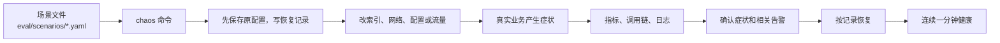
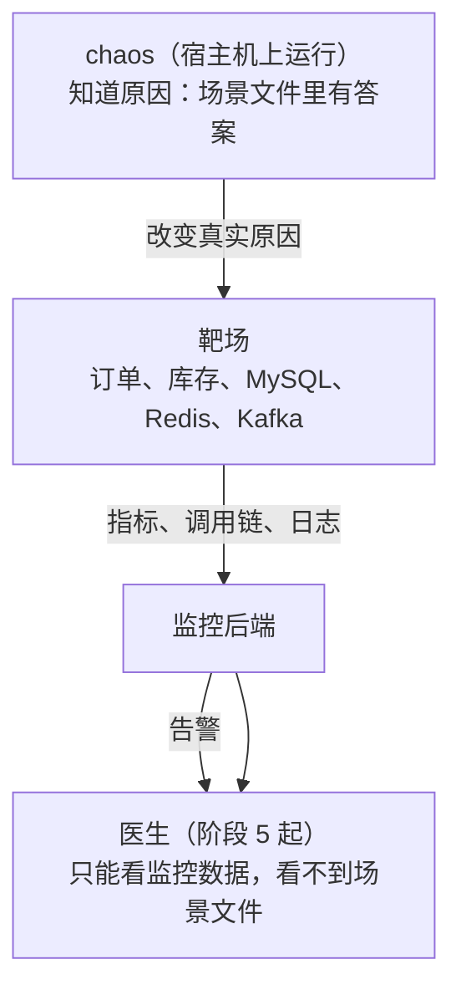

# 阶段 4 学习材料：故障注入与人工排障

以前我们知道系统“能工作”，也知道怎样看指标、调用链和日志。这个阶段要进一步回答：一个索引没了，问题怎样一步步传到用户？看到请求变慢，怎样区分数据库、网络和连接池？

阶段 4 写了一个故障注入工具 chaos 和 11 个故障场景（S01–S10、S13）。每个场景有控制地改变一个**真实的原因**（删索引、加网络延迟、改配置、换一份有缺陷的程序），再确认症状和告警真的出现了，最后把环境恢复干净。阶段 8 又加了 S11（无故障对照）和 S12（日志里的提示注入），现在一共 13 个。

**怎样读这份材料。** 主线有两条：

1. **怎样设计一个可复现、可验证、可恢复的故障实验**（第 5 节）。这是 chaos 工具本身的系统设计。
2. **每种故障从原因传到用户的症状链，以及人工怎样一步步查**（4.4 节起）。这是面试最常问的“线上 X 变慢了你怎么查”。

阶段 4 已完成：当时的 11 个场景连续两轮自测共 22/22 通过（数据台账 P4-18、P4-19）；后来改了缓存告警规则，又完整跑了一轮 11/11（P4-37）。现在场景已经增加到 13 个。失败的轮次同样保留在台账和[实测记录](../notes.md#phase-04)里。Go 语法见第 7 节和 [Mini-Redis 的学习文档](https://github.com/Li-Nepenthe/mini-redis/blob/main/docs/learn/README.md)。

## 1. 本阶段能回答的面试题

| 面试题 | 在哪里 |
|---|---|
| 怎么设计一次故障演练？为什么改真实原因，而不是让应用返回假错误？ | 5.1、5.2、八股 1 |
| 故障实验做完，怎样保证系统一定能恢复干净？ | 5.4、八股 1 |
| 怎样判断故障真的发生了、真的恢复了？ | 5.5 |
| 线上一条 SQL 突然变慢，你怎么排查？缺索引、网络慢、连接池小、行锁竞争怎样区分？ | 4.4–4.7、4.11、4.12、4.14、八股 2 |
| 连接池满了，一定是连接池太小吗？ | 4.7、4.12、4.14、八股 2 |
| 缓存击穿和雪崩，防护效果怎样量化？告警怎样不误报正常的冷启动？ | 4.8、4.9、5.6、八股 5 |
| 重试为什么会把系统打垮？重试应该怎样设计？ | 4.3、4.15、八股 3 |
| goroutine 泄漏怎么发现、怎么定位？ | 4.13、八股 4 |
| 消息积压了怎么排查？ | 4.10 |

## 2. 故障实验在系统里的位置

### 2.1 一次实验的流程



### 2.2 chaos 和医生的关系



chaos 负责制造原因和恢复环境；医生以后负责根据外部证据找原因。两者分开，医生才是在面对一个未知的问题，而不是读到工具写好的答案（5.1 节）。

### 2.3 各部分负责什么、不负责什么

| 部分 | 负责 | 不负责 |
|---|---|---|
| [scenario](../../internal/chaos/scenario/doc.go) | 读取场景文件，检查每个动作是否在白名单里 | 执行动作 |
| [action](../../internal/chaos/action/doc.go) | 执行白名单里的动作：删索引、发布配置、加网络延迟、调流量、删缓存；保存恢复所需的原状态 | 判断故障有没有出现 |
| [verify](../../internal/chaos/verify/doc.go) | 查 Prometheus：症状条件是否成立、相关告警是否 firing、系统是否连续一分钟健康 | 改环境 |
| [app](../../internal/chaos/app/doc.go) | 把上面三者串起来：先落盘恢复记录，再注入；恢复时尽量把每一步都做完 | 诊断原因 |
| 场景文件 [eval/scenarios](../../eval/scenarios/) | 每个场景的注入步骤、恢复步骤、症状条件、相关告警，以及标准答案和证据里程碑 | 被医生读到。archcheck 检查医生的容器不能挂载这个目录 |

## 3. 跑起来看什么

从仓库根目录操作，先按[操作手册](../operations.md#阶段-4准备与运行故障实验)准备本机环境和完整业务数据。密码来自环境变量，不能复制到笔记或截图中。

操作手册的宿主机示例只导出了实验账号的 `CHAOS_MYSQL_DSN`。阶段 7 以后，`healthy` 和 `selftest` 还要用一个只读账号检查有没有残留的医生索引，所以还要把只读基线账号也读进当前终端，否则会报“缺少 CHAOS_BASELINE_MYSQL_DSN”：

```powershell
Get-Content .env | ForEach-Object {
    if ($_ -match '^(CHAOS_BASELINE_MYSQL_DSN)=(.*)$') {
        [Environment]::SetEnvironmentVariable($Matches[1], $Matches[2], 'Process')
    }
}
```

本阶段健康基线的目标是 200 QPS，使用 10000 个活跃商品、64 个工作者。数据库里仍然保留五十万商品；“活跃”只表示压测器会选它们。扩大活跃范围后，缓存命中率也会改变，告警门槛必须重新核对。开发中确实发生过遗漏这个参数、健康检查被回源告警拦住的情况（数据台账 P4-16）。

**第 1 步：看有哪些场景。**

```text
go run ./cmd/chaos list
```

现在会列出 S01–S13 共 13 个编号；其中 S11、S12 是阶段 8 加的。

**第 2 步：确认系统健康。**

```text
go run ./cmd/chaos healthy
```

工具持续观察后返回成功。流量要先打开：没有请求就没有可靠的延迟分位数。这个命令检查延迟、错误比例、消费积压、采集与后端连接，也检查是否还有正在触发的告警。

**第 3 步：跑一个场景。** 以库存调用延迟为例：

```text
go run ./cmd/chaos inject S07
go run ./cmd/chaos verify S07
go run ./cmd/chaos restore S07
go run ./cmd/chaos healthy
```

注入命令只报告动作已执行。verify 另行查询业务指标和相关告警。恢复命令移除网络规则后，还要等 healthy 连续观察一分钟，才能确认请求和监控窗口都已恢复。

恢复耗时包含两段等待：修复已经生效时，过去的慢请求仍可能留在一分钟的指标窗口里；窗口里的数据恢复正常后，还要连续观察一分钟。因此首轮 S01、S02 的恢复检查接近两分钟，不能把整个数值当成重建索引的耗时（P4-6）。

**第 4 步：终端意外关闭了怎么办。**

```text
go run ./cmd/chaos restore-all
```

它读取宿主机的 `.opsdoctor-chaos.json`，恢复记录中的活动实验。这个文件包含原镜像和公开配置，不含密码；它不提交到 Git，也不进入业务或医生容器。恢复失败时先保留文件，查明原因后再执行同一命令。

**第 5 步：完整自测。**

```text
go run ./cmd/chaos selftest
```

每个场景输出一行实际结果，包括注入前健康、注入、发现症状与告警、恢复健康的时间。失败行同样保留。两遍完整自测需要较长时间（当时 11 个场景一轮约 45 分钟，P4-18；现在 13 个场景会更久），执行期间不要另开一次场景，也不要手工修改同一服务的配置。

## 4. 代码走读与场景

前三小节沿着一次真实的实验走代码；4.4 起逐个看场景：原理、怎样注入、症状怎样传到用户、人工怎样查、怎样修复。

### 4.1 阅读顺序

| 顺序 | 文件 | 重点看什么 |
|---|---|---|
| 1 | [cmd/chaos/main.go](../../cmd/chaos/main.go) | Ctrl+C 怎样变成 context 取消 |
| 2 | [app/app.go](../../internal/chaos/app/app.go) | 子命令怎样进入不同流程；`parseOverrides` 在覆盖场景参数之前先解析和校验命令行 |
| 3 | [app/engine.go](../../internal/chaos/app/engine.go) | `Inject`：先落盘，再改外部系统；`Restore`：最后才删除恢复记录 |
| 4 | [scenario/model.go](../../internal/chaos/scenario/model.go) | 一份实验需要哪些输入与证据 |
| 5 | [scenario/validate.go](../../internal/chaos/scenario/validate.go) | 为什么不开放任意 SQL 和命令 |
| 6 | [action/deploy.go](../../internal/chaos/action/deploy.go) | `Capture` 保存了什么；配置发布和原镜像恢复有什么不同 |
| 7 | [action/storage.go](../../internal/chaos/action/storage.go) | 索引列顺序、唯一性与缓存操作范围 |
| 8 | [verify/wait.go](../../internal/chaos/verify/wait.go) | 怎样判断真正出现、持续恢复 |
| 9 | [app/selftest.go](../../internal/chaos/app/selftest.go) | 失败与取消为什么仍进入清理路径 |
| 10 | [inventory_client.go](../../internal/shop/inventoryclient/inventory_client.go) | 单次与总时限怎样嵌套（`queryAttempt`），哪些错误能重试（`retryableStockErrors`），为什么扣减不重试 |
| 11 | [loadgen/app.go](../../internal/loadgen/app.go)、[burst.go](../../internal/loadgen/burst.go) | 控制接口（`controlServer`）怎样在运行中改速率和热点；`/burst` 怎样让已有工作者一起出发 |

### 4.2 一次实验从注入到恢复健康

以 S13 为例，按 `inject`、`verify`、`restore`、`healthy` 的顺序走一遍：

| 顺序 | 在哪里 | 做了什么 |
|---|---|---|
| 1 | `Engine.Inject` 开头的 `Executor.Capture` | 先记下将要改动的东西原来是什么样：订单服务当前镜像的内容 ID、公开配置和流量设置。这一步还没注入故障；但涉及部署的场景会先给原镜像打一个保留标签，防止恢复时找不到它。失败了可以直接退出 |
| 2 | 同上：`os.OpenFile` 带上 `O_CREATE` 和 `O_EXCL` | 独占创建 `.opsdoctor-chaos.json`。文件已经存在，说明上一场实验还没恢复，直接拒绝，不会覆盖（7.2 节） |
| 3 | 同上：写入后 `Sync` | 把完整场景和基线写进文件，要求操作系统刷到磁盘，然后才开始改外部环境 |
| 4 | 同上：依次执行 inject 步骤 | S13 先用新的环境变量重新发布订单服务（关熔断、最多重试 10 次、不退避、单次 50ms），再让代理把库存服务的响应推迟 80ms |
| 5 | verify（[verify/wait.go](../../internal/chaos/verify/wait.go) 的 `Symptom`） | 从记录的注入开始时间算起，3 分钟内等症状查询成立，并且看到相关告警 `InventoryRequestsAmplified` 真正 firing；两件事可以在不同的采样轮次里先后看到 |
| 6 | `Engine.Restore` | 按 restore 列表逐条恢复：先去掉延迟，再按原来的镜像和配置发布订单服务。某一步失败也继续做后面的，最后把错误合在一起报告 |
| 7 | 同上 | 全部恢复成功才删除记录文件；有一步失败就保留它，之后 `restore-all` 还能接着恢复 |
| 8 | `Healthy` | 健康条件要连续成立一分钟；中间有一次不健康，就从头计时 |

第 2、3 步放在第 4 步之前，是这一节最重要的顺序：先留好“怎样恢复”的记录，再动手。反过来的话，动作做到一半进程被杀，就没有人知道原来是什么样了。

### 4.3 S13 里，一次商品查询发出了几次 GetStock

注入以后，订单服务的库存客户端是这样配置的：总时限 800ms（默认值），单次时限 50ms，最多重试 10 次，退避 0，熔断关闭。库存服务的响应会被代理推迟 80ms。

| 时刻（约） | 发生了什么 |
|---|---|
| 0ms | `GetStock` 创建 800ms 的总时限；第 1 次尝试另有 50ms 的单次时限（`queryAttempt`），请求发往库存服务 |
| 很快 | 库存服务照常处理完，把响应发回来；代理把它扣住 80ms |
| 50ms | 单次时限先到，第 1 次以 `DeadlineExceeded` 失败。总时限还剩约 750ms，`retryableStockErrors` 允许重试，退避是 0，马上发第 2 次，`rpc_client_retries_total` 加 1 |
| 100ms、150ms…… | 每一次都在 50ms 时超时，晚到的响应被丢弃 |
| 约 550ms | 第 11 次（首次加 10 次重试）失败，重试次数用完，`GetStock` 返回错误，商品的库存状态降级 |

一次商品查询，库存服务收到了 11 次查询，每次都要照常处理。入口的 HTTP 请求速率不变，库存的 RPC 速率却变成好几倍。告警 `InventoryRequestsAmplified` 比较的正是这两个速率。两轮实测，库存 RPC 和订单 HTTP 的比值最高到 8.7 倍（P4-22）。

对照默认配置：单次时限是 0，表示每次尝试都直接用 800ms 的总时限，80ms 的延迟根本不会超时，第一次就成功。即使需要重试，重试逻辑（[resilience/retry.go](../../internal/platform/resilience/retry.go) 的 `Do`）也会先等一会儿：第一次重试前等 50ms 再加一个随机数，第二次等 100ms 再加随机数；最多重试 2 次，熔断器也在统计失败比例。下单时的 `Deduct` 不经过这段重试逻辑，最多发 1 次，失败也不重试（context 已经取消、或者熔断器打开时，一次也不发）。

### 4.4 先看用户，再找耗时落在哪里

下面每个场景都按同一条调查顺序展开：先用入口指标确认哪些接口受影响，再找一笔同一时间的慢请求，用调用链把它拆成查缓存、调用库存、查数据库、发消息等步骤，然后用对应日志和底层状态验证判断。排障不从猜原因开始。例如下单变慢，不足以说明缺了索引：可能在借数据库连接时排队，也可能 SQL 已执行完、响应在网络里等待。

### 4.5 S01：库存索引缺失

**原理。** 索引像按商品编号整理好的目录。有它时，MySQL 很快找到要扣减的行；没有它时，需要检查很多无关行。UPDATE 还要取得锁，扫描范围扩大后，其他更新也更容易被挡住。

**注入。** 用专用账号删除 `stock.uk_stock_sku`，数据和业务 SQL 保持原样。

**症状链。** 查找范围扩大 → UPDATE 持锁和等待增加 → 库存 RPC 变慢 → 订单调用预算耗尽。部分扣减结果可能进入待核对；客户端超时不能证明数据库没有执行。

**人工调查。** 先比较下单与商品查询，再找慢下单的库存 span。沿着它定位 UPDATE 模板，对这条 SQL 做 EXPLAIN，检查使用的索引和预计扫描行数，再用 SHOW INDEX 确认 `sku_id` 上的唯一索引确实不存在。最后结合锁等待数据，解释为什么其他请求也被拖慢。

开发中对真实 UPDATE 做 EXPLAIN，得到的是 `type=index`、`key=PRIMARY`，预计要扫描几十万行（[实测记录](../notes.md#phase-04)）。这里仍出现了一个索引名，但它是在遍历主键目录，不能按商品编号直接定位。只检查 key 是否为空，会漏掉这个问题。

**补基础：EXPLAIN 先看哪几列。** `key` 是实际用到的索引，`rows` 是预计要检查多少行，`type` 是怎样找数据。`type` 常见的几种，从慢到快大致是：`ALL`（全表扫描）、`index`（把整个索引从头到尾扫一遍）、`range`（在索引里扫一段范围）、`ref`（用普通索引找等值）、`eq_ref` 和 `const`（借助唯一索引，最多找到一行）。正常时按 `sku_id` 扣库存应该走 `uk_stock_sku`、预计一行；删掉索引后变成 `index` 加 `PRIMARY`、近五十万行：key 虽然不为空，扫描量却和全表扫描差不多。

**修复。** 恢复原唯一索引，观察扫描范围和锁等待下降，再等待健康基线。另行核对结果不明的订单，不能简单换一个幂等键重做。

### 4.6 S02：订单列表联合索引缺失

**原理。** 列表先按用户找订单，再按时间排序。联合索引把这两个顺序放在同一份目录中，避免每次都从大量历史订单里重新找和排。

**注入。** 删除 `orders.idx_orders_user_created`。

**症状链。** 用户筛选不能有效缩小扫描 → 大量订单参与读取和排序 → GET 列表耗时上升。它与库存索引问题的受影响接口不同。

**人工调查。** 先按 HTTP 方法和路由分开看，确认是 GET `/orders`。从慢调用链提取查询模板，检查 EXPLAIN 的扫描和排序，再核对 `user_id, created_at` 的索引列顺序。开发中的 EXPLAIN 返回 `type=ALL`，也就是把近两百万条订单全部扫一遍，以及 `Using where; Using filesort`（[实测记录](../notes.md#phase-04)）。filesort 表示排序不能直接借用索引顺序，并不单凭这个名字就说明发生了磁盘读写。

**补基础：联合索引为什么讲究列的顺序。** 联合索引 `(user_id, created_at)` 先按 `user_id` 排，同一个用户的订单再按 `created_at` 排。所以“找某个用户的订单，再按时间排序”时，MySQL 能直接找到这个用户的那一段，取出来的顺序已经排好了。如果建成 `(created_at, user_id)`，同一个用户的订单就散落在整个索引里，没法直接定位到这个用户的那一段。这就是“最左匹配”：查询要从索引最左边的列开始用起。至于能不能省掉排序，还要看排序键、等值条件和执行计划，以 EXPLAIN 为准；上面实测到的 `Using filesort`，是缺少这个索引时的结果。

**修复。** 按原顺序恢复联合索引。只建一个名称相同、列顺序不同的索引不算恢复，所以 chaos 删除和恢复前都要检查列顺序和唯一性（`expectedIndex`）。

### 4.7 S03：连接池只有两条连接

**原理。** Go 的 `*sql.DB` 是连接池。池中可借出的连接用完后，新的请求要先排队，等别人还回连接。

**注入。** 真正发布库存服务，把最大连接数和空闲连接数都设为 2。

**症状链。** 同时需要数据库的请求超过容量 → 等待借连接 → 剩余 SQL 执行时间减少。等待很长时才会进一步造成慢请求或超时。本场景直接验证的是借连接等待增加；不能因为出现了连接池告警，就宣称所有请求已经超时。

**人工调查。** 先看启动时间和生效配置，再对照连接上限、使用数、等待次数、累计等待时间。随后检查数据库执行计划和行锁，区分“还没借到连接”与“已经执行 SQL 但被锁挡住”。

调查时有一个容易走错的方向：看到库存调用很长，就直接去改 SQL。本项目的 SQL span 在驱动开始执行时才创建，借连接的排队发生在它之前。因此可能看到库存 RPC 很长，但 SQL span 开始得晚、执行得短。先看 `go_sql_wait_count_total` 的增长，再结合等待总时间；如果数据库自己执行很快、行锁也正常，而应用侧一直在排队，才更支持连接池容量这个解释。

**补基础：Go 连接池的几个设置。** 项目在 [mysqlx/mysql.go](../../internal/platform/mysqlx/mysql.go) 里设置连接池：`SetMaxOpenConns` 限制最多同时打开几条连接，`SetMaxIdleConns` 限制最多留几条空闲连接备用。连接都被借走以后，新的请求就在池子里排队。`db.Stats()` 里记着排过几次队、一共等了多久；项目把它注册成 Prometheus 指标，`go_sql_wait_count_total` 就是从这里来的。

**修复。** 回到实验前的连接池配置。容量要结合数据库总连接预算考虑，不能一遇到等待就无限调大（阶段 0 八股 3）。

### 4.8 S04：热门缓存失效后，同一个商品被重复查询

**原理。** singleflight 会让同一个商品的一批并发请求共用一次查库结果。没有这层合并时，它们可能同时发现缓存为空，各自去查数据库，这就是缓存击穿。

**注入。** 发布关闭 singleflight 的配置，删除热点商品缓存，再让一批用户同时查询商品详情，模拟秒杀开始时一起打开页面的用户。只发查询，不把下单也集中到热点；否则看到的可能是 S08 的库存行锁。为了让这个短暂现象能被每 10 秒采集一次的监控观察到，实验依次覆盖 400 个热门商品，每个商品只失效一次，每次同时发 16 个查询。

**症状链。** 热点缓存消失 → 同时到来的请求各自回源 → 相同商品的查询在短时间内增加 → 数据库和请求耗时可能上升。

**人工调查。** 第一步看回源突然增加时，入口流量是否也变了。第二步看同一商品的重叠查询计数和多条 SQL span，判断有没有重复工作。第三步看最近发布日志里的缓存配置。最后用相同突发、开启合并的对照验证解释。SQL span 不记录绑定参数，所以不能只凭 SQL 模板认定它们是同一商品；商品编号要沿调用链结合 HTTP 请求路径核对。

**正式对照看到了什么（P4-13）。** 两组都用 Compose 中的同一个 loadgen，完成 6400 次商品查询，没有失败；其他条件一致，只切换 singleflight：

| 观察项 | 开启合并回源 | 关闭合并回源 |
|---|---:|---:|
| 实际商品回源 | 400 次 | 6295 次 |
| 商品查询数据库的速率 | 19.365 次/秒 | 295.521 次/秒 |
| MySQL 全实例 SELECT 速率 | 330.084 次/秒 | 596.910 次/秒 |
| 商品 HTTP P99 估计 | 47.794ms | 85.799ms |
| 行锁等待时间增量 | 0ms | 0ms |

回源从 400 次变成 6295 次，但 P99 只从约 48ms 变成约 86ms：这个项目只按主键查一条商品记录，回源本身很便宜。所以“重复查询增加”和“用户明显变慢”是两件要分别测量的事，不能把前者写成“数据库已经被打垮”。

**告警为什么不直接数同一商品的并发查询。** 这个计数能帮助工程师确认多个请求在查同一份数据，但拿它直接报警，几乎已经把“合并回源失效”这个答案送给医生了。告警只描述回源比例、查询速率或商品 P99 的异常（5.6 节）。

**修复。** 恢复合并回源配置和原流量分布，让正常请求填回缓存。

### 4.9 S05：许多缓存一起失效

**原理。** 一大批缓存如果在同一时刻到期，许多商品都要重新查库，这叫缓存雪崩。给有效期加一点随机时间（抖动），可以把这一波回源分散开。

**注入。** 发布零抖动配置，再把一批已有商品缓存的到期时间对齐。没有清空 Redis，也没有改动订单幂等记录。

**症状链。** 许多键共同到期 → 多个商品未命中 → 实际回源增加 → 数据库压力和延迟可能上升。缓存逐渐重新填充后，这一波压力也会下降。

**人工调查。** 先对照未命中与回源曲线，再抽查多个商品的剩余有效期和调用链，查看新发布是否关闭了抖动。S04 要找的是同一商品的多条重叠查询；S05 要找的是大范围商品一起到期，即使同一商品的查询仍在合并，总回源也可能增加。事故发生后键已重新填充，就不能指望还看到原来的到期时间，要结合故障开始时的曲线和发布记录。

**修复。** 恢复过期抖动，等待正常流量重新填充。已经过期的缓存不需要人为还原，数据库仍是商品数据来源。

### 4.10 S06：消费者停止

**原理。** 下单和更新销量是通过 Kafka 分开的两步。消费者停了，订单仍能产生消息，但销量暂时跟不上。lag 表示尚未消费到的位置差。

**注入。** 停止 order-worker 容器。

**症状链。** 新订单继续产生 → 消费位置不前进 → lag 增长 → 销量更新落后。下单接口正常也不能证明整条业务链正常。

**人工调查。** 先确认生产仍成功，再看消费者管理端点、运行日志、三个分区的消费位置和 lag。不要只看某一个分区，也不要把“没有收到消息”直接归因于 Kafka 停机。消费者管理端口失联的告警（ServiceUnavailable）可能先出现，积压告警还要持续两分钟才触发；前者说明进程不可采集，积压曲线另行证明业务确实受到了影响，两个证据不能互相替代。

**修复。** 启动原消费者，观察积压下降。暂停流量、等追平后运行 `shopctl check`。

### 4.11 S07：库存响应卡在网络里

**原理。** 调用方的等待包含请求传输、服务端处理和响应传输。服务端处理快，不代表调用方很快能收到结果。

**注入。** Toxiproxy 在订单到库存的链路上，给响应方向增加 800ms 等待。代理只是晚一点转发真实数据。

**补基础：Toxiproxy。** 它是一个 TCP 代理。订单服务连库存服务时，连的其实是代理的地址，代理再把数据原样转给库存服务。在代理上加一条“延迟”规则，它就把经过的数据晚一点再转发；去掉规则，转发立刻恢复。业务服务的代码和配置都不用改。

**症状链。** 响应到达变晚 → 调用方的 800ms 预算耗尽 → 失败累计 → 熔断器暂时拒绝继续调用 → 商品库存降级、下单可能进入待核对。

**人工调查。** 对比同一次调用的客户端和服务端 gRPC span。如果客户端很长，服务端和 SQL 都短，优先调查链路和连接。再核对 DeadlineExceeded、熔断状态以及商品返回的库存状态。熔断以后，部分请求会很快失败，P99 甚至可能下降。这不是服务恢复了，而是它暂时不再发起那条慢调用；要一起看成功比例、熔断状态和降级结果。

**修复。** 移除延迟规则，等已有连接和熔断器恢复。已发生的待核对订单要另外处理，恢复网络不会自动证明它们的扣减结果。

### 4.12 S08：大家都在改同一行

**原理。** 同一商品的一行库存不能被多个事务同时改写。InnoDB 的锁加在索引记录上：扣某个商品的库存时，UPDATE 先拿到这一行的独占锁（X 锁），直到事务提交才放开；另一个事务想改同一行，只能排队。

**注入。** 改变真实订单流量，让它集中到同一个商品。实验前保证该商品有库存，不通过人为长事务或 sleep 制造等待。

**症状链。** 同一行的写入并发增加 → 行锁竞争 → 等待和持连接时间增加 → 下单变慢。

**人工调查。** 先看锁等待，再检查阻塞关系和涉及的行。随后对照 EXPLAIN：仍使用 `uk_stock_sku`，说明它与 S01 的全表扫描不同。结合订单日志确认流量确实集中到这个商品。锁等待总时间是所有请求等待的累计值：一秒里十个请求各等一百毫秒，计数就增加一千毫秒。所以曲线超过每秒一千毫秒并不矛盾，也不能当成某个请求等了那么久。

**修复。** 恢复分散流量。真实业务还可以缩短事务、控制同一商品并发；如果业务长期只有一个热点，需要重新考虑库存分配方式（阶段 1 的 5.3 节）。

### 4.13 S09：请求结束了，后台任务没结束

**原理。** goroutine 等在 channel 上时仍占资源。无缓冲 channel 必须有接收方准备好，发送方才能交出值；没有接收方，发送方永远停在那里。

**注入。** 发布另一份用构建标签 `leakbug` 编译的订单服务（7.1 节）。每次响应后启动一个发送结果的任务，但接收方不存在，所以任务停在发送处。代码里不写任何暗示，它看起来就像一段普通的业务代码。

**症状链。** 每个请求留下一个等待任务 → goroutine 数持续增长 → 栈和其他关联资源占用增加 → 继续运行可能遇到内存压力。

**人工调查。** 先对照发布版本与进程启动时间。入口流量若稳定而任务数持续上涨，抓取两次 goroutine profile，比较相同堆栈是否越来越多，再检查发送方与接收方的生命周期。

第二轮验收中，间隔约 20 秒抓了两份快照：任务总数从 1045 增到 5405，其中停在 `deliverResponse` 的从 938 增到 5299，都指向 [response_async.go](../../internal/shop/app/orderservice/response_async.go) 里同一行通道发送（P4-20；当时是第 29 行，可读性改造删掉注释后现在是第 22 行）。接着读这行和调用处，就能发现发送方一直在等一个不存在的接收方。

**修复。** 恢复原镜像。代码层面的修复是保证有接收方、使用合适的缓冲，或者在取消时退出。单纯增加内存只会延后问题。

### 4.14 S10：SQL 等的是网络

**原理。** 应用里的 SQL span 包含到数据库的网络往返，不能直接等同于数据库的执行时间。

**注入。** 在库存到 MySQL 的链路上，给响应方向增加真实延迟。

**症状链。** 多种 SQL 往返都变慢 → 连接占用更久 → 池等待可能增加 → 库存 RPC 和上游变慢。连接池告警可能是后果，而不一定是最初原因。

**人工调查。** 比较不同 SQL 是否一起变慢，再看数据库内部执行与锁等待。若执行计划仍正常、数据库内部等待不足以解释客户端耗时，就继续检查链路。S01 可以用缺失索引和扫描范围解释慢查询，S10 的这些证据仍然正常；S03 则要先证明时间花在借连接上。

**修复。** 移除延迟，观察 SQL、连接使用与入口延迟依次回落。

### 4.15 S13：一次失败带来更多请求

**原理。** 总时限决定这次逻辑调用最晚什么时候结束；单次时限决定这一回尝试最多等多久。若没有等待间隔、没有熔断，而且重试上限很高，一份入口流量会被放大成很多下游请求。

**注入。** 单次时限 50ms，最多重试十次，关闭退避和熔断，再把响应延迟到 80ms。正常默认仍是单次时限零、两次重试、启用退避与熔断。

**症状链。** 响应来不及在单次时限内返回 → 客户端继续尝试 → 库存收到更多查询 → 资源消耗和等待增加 → 更多调用来不及完成。这种相互加重的过程就是重试风暴。

**人工调查。** 先比较入口 HTTP 请求率与库存 RPC 请求率，再看 `rpc_client_retries_total`。找一笔商品请求，数出其下的多次 GetStock，并核对新发布的预算和保护参数。不能用配置值代替实际请求放大的证据：十次重试表示最多再试十次，总时限可能先到。本场景放大的是可重试的只读查询，不是重复扣减库存。

**修复。** 恢复退避、熔断和合理的重试上限，排查最初的延迟。

## 5. 系统设计与取舍

这一节讲 chaos 工具本身怎样设计。每个设计点按同一个顺序讲：要解决什么问题 → 怎么做 → 放弃了什么、为什么 → 代价和适用边界 → 规模变大十倍会怎样。

### 5.1 制造原因的和找原因的分开

**问题。** 这些场景以后要拿来考医生。如果医生能读到“这次删了哪个索引”，诊断就成了照抄答案。

**做法。** chaos 在宿主机上运行，场景文件（含标准答案 `ground_truth` 和证据里程碑）放在 [eval/scenarios](../../eval/scenarios/)。医生只能通过监控数据了解靶场，它的容器不挂载场景目录、拿不到恢复记录文件。archcheck 在 CI 里检查医生容器的挂载，防止有人不小心把答案挂进去。

**放弃了什么。** 让医生和注入器共享一个“故障状态”接口。方便调试，但医生就不需要真正调查了。

**代价。** 实验结束后要人工对照医生的结论和场景答案，阶段 8 的评测器专门做这件事。

**规模变大十倍。** 场景多了以后，答案要和题目一样被严格管理：谁能看到、什么时候冻结、改了要留记录。阶段 8 的“冻结清单”就是为此做的。

### 5.2 改真实原因，不放故障开关

**问题。** 最省事的做法是在业务代码里放一个开关：“打开就返回 500”。但这样制造出来的只是预设的表现，学不到证据之间的关系。

**做法。** 每个场景改变一个真实的原因，让症状自然地从原因传到用户：

| 场景 | 改了什么 | 怎么改 |
|---|---|---|
| S01、S02 | 数据库索引 | 用专用账号真的删掉索引 |
| S03、S04、S05、S13 | 服务配置 | 用新的环境变量真的重新发布服务 |
| S07、S10 | 网络 | Toxiproxy 真的把数据晚一点再转发 |
| S06 | 进程 | 真的停掉 order-worker |
| S08 | 流量 | 真的把下单集中到一个商品 |
| S09 | 程序 | 发布一份用构建标签编译的另一版程序 |

**为什么用配置发布和版本发布。** 发布是现实系统里最常见的变化，版本号和启动日志里的配置本身就是真实的线索。业务代码里没有任何“故障开关”，医生要像真实的运维一样，从“最近发布了什么”开始查。

**放弃了什么。** 应用内的故障开关、直接返回假错误。实现简单、可以精确控制，但真正的原因会同时影响延迟、锁、连接池、日志和调用链，假错误只能制造其中一个。

**代价。** 每个场景都要真的动环境，所以恢复必须可靠（5.4 节）；症状是否明显取决于真实流量和数据规模，可能不出现（S04 第一版就没出现，11.5 节）。

**规模变大十倍。** 在多实例、多机房的环境里，故障通常只注入一部分实例或一个机房（缩小“爆炸半径”），并且要有一键停止。

### 5.3 只允许白名单里的动作

**问题。** chaos 有删索引、发布服务的权限。如果场景文件可以写任意 SQL 或任意命令，一个写错的场景就能删掉整个库。

**做法。** [validate.go](../../internal/chaos/scenario/validate.go) 的 `ValidateStep` 规定了每种动作能碰什么：

- 只能删、恢复两个指定的索引，而且表名和索引名必须配对；
- 只能发布订单服务和库存服务，镜像只能是两个指定的版本，环境变量只能是开放的那几个，取值也要在范围内（`ValidateEnvironment`）；
- 网络延迟只能加在三条指定的代理上，最多 2 秒；
- 流量突发最多 500 个商品、每批最多 64 个请求。

外部命令用参数数组执行（7.3 节），不经过 shell 拼接；数据库账号也只有这两张表的权限。

**放弃了什么。** 通用的场景语言（任意 SQL、任意 Docker 命令）。灵活，但每多开放一种能力，就多一种把环境改坏、恢复不了的可能。

**代价。** 每加一种新故障，都要改代码、加校验、加测试。

**规模变大十倍。** 成熟的混沌工程平台也是这样：每种故障是一个审核过的“实验类型”，带参数范围和自动停止条件，而不是让人写脚本。

### 5.4 先落盘恢复记录，再动手

**问题。** 实验进行到一半，终端关了、进程被杀了、Docker 停了，环境就停在故障状态。必须有办法知道“原来是什么样”，并把它改回来。

**做法。**

1. **改动之前先保存原状态。** `Capture` 记下订单服务的镜像内容 ID、公开配置和流量设置。
2. **独占创建恢复记录，并刷到磁盘。** 用 `O_CREATE|O_EXCL` 创建 `.opsdoctor-chaos.json`：文件已经存在说明上一场还没恢复，直接拒绝，两场实验不会叠加。写完调用 `Sync`，然后才开始改环境。
3. **恢复时每一步都尝试。** 某一步失败也继续做后面的，最后把错误合在一起报告。
4. **全部成功才删除记录。** 有一步失败就保留记录，`restore-all` 可以接着恢复。
5. **恢复后连续一分钟健康才算完。**

**一次真实的失败（11.3 节）。** 首轮 S03 恢复失败了：配置发布覆盖了原来的镜像标签，容器也被重建，恢复时旧的镜像内容 ID 已经找不到。镜像内容 ID 能认出内容，但不会让 Docker 替我们保留内容。修复是发布前先给原镜像加一个独立的标签，保证它还有引用；恢复前再比较内容 ID，对不上就拒绝恢复。

**放弃了什么。** 只在内存里记原状态。实现简单，但进程一死就全没了。

**代价。** 记录文件只在本机，换一台机器就恢复不了；Docker 引擎停了，工具也无能为力，只能保留记录等它恢复。

**规模变大十倍。** 恢复记录要放进一个共享的、可靠的存储，并由一个常驻的控制器负责恢复，而不是依赖操作者手上的终端。

### 5.5 怎样判断“故障真的发生了”和“真的恢复了”

**问题。** 注入命令返回成功，只说明动作执行了，不说明症状出现了；去掉延迟规则，也不说明系统恢复了。

**做法。**

- **症状要满足两件事。** 场景文件里写了一个 PromQL 症状条件和一组相关告警。`Symptom` 从记录的注入开始时间算起，在 3 分钟内既要看到条件成立，也要看到列表里任意一条相关告警真正 firing（不是 pending）。两件事可以在不同的采样轮次里先后看到，看到过的会记住。只看到告警、业务指标没变，或者反过来，都不算。没有注入故障的对照场景 S11 不走这条路，改为检查系统健康。
- **健康要连续一分钟。** `Healthy` 检查延迟、错误比例、消费积压、采集与后端连接，以及没有正在触发的告警；要连续成立一分钟，中间有一次不健康就从头计时。
- **没有数据不等于正常。** 监控没数据时查询也会返回空，所以健康判断还要求流量与采集都正常。
- **删索引和恢复索引之前都核对结构。** `expectedIndex` 不只看索引名，还核对列顺序和唯一性；名字相同、结构不同的索引，既不会被误删，也不算恢复成功。
- **下一场实验之前检查有没有残留。** 阶段 7 医生能在人工批准后执行修复，于是健康检查又加了 `WithRepairs`：确认医生建过的索引（以 `idx_doctor_` 开头）和调过的连接池都已经撤掉，避免上一场的修复影响下一场。

**放弃了什么。** 注入后等固定的时间就认为症状出现了。简单，但症状可能根本没出现（S04 第一版就是这样），这样的实验结果没有意义。

**代价。** 每个场景都要设计一个准确的症状条件；健康检查要等至少一分钟，11 个场景的一轮自测要 45 分钟左右。

**规模变大十倍。** 场景多十倍，串行跑一轮就要十倍的时间。能并行的只有互不影响的部分，比如只读的查询检查；共用同一套实验环境时，注入、症状判断和恢复必须一场一场串行，否则一个场景的故障会混进另一个场景的症状和健康判断。真要扩大规模，得给每组场景准备独立的环境。

### 5.6 告警门槛：故障测过了，正常冷启动不能误报

**问题。** S04、S05 的回源告警最初是“每秒回源超过 50 次”。Claude 验收时发现：暂停访问后缓存自然过期，恢复访问时还没注入任何故障，回源告警就先响了。它会拖慢 healthy，也会把以后的医生叫起来做一次没有必要的调查。

**做法。** 先回查已有两轮实验的历史数据，再写候选规则，用 promtool 的时间线测试覆盖冷缓存、健康大流量、持续异常和少量请求四种情况，最后做真实的停流实验。最终的 `CacheLoadsHigh` 要求三个条件同时成立：

1. 回源比例超过 35%（回源次数除以商品请求次数）；
2. 当前和两分钟前的商品请求速率都超过每秒 20 次；
3. 连续 30 秒。

第 2 条是关键。正常冷启动和 S05 都会让许多商品重新查库，冷启动的比例甚至更高；区别在于冷启动之前没有流量，而 S05 是正在运行的业务突然大量回源。`offset 2m` 就是看两分钟前的窗口有没有流量。

**实测（P4-29、P4-30、P4-32 到 P4-35）：**

| 状态 | 回源比例峰值 | 新规则的结果 |
|---|---:|---|
| 冷缓存恢复后的五分钟 | 86.640% | 没有进入观察或触发状态 |
| 随后十五分钟正常运行，含一次自然到期 | 20.261% | 没有进入观察或触发状态 |
| S04，两次完整实验 | 90.384%–90.595% | 79.751s、96.507s 正式报警 |
| S05，两次完整实验 | 47.048%–49.441% | 108.156s、109.791s 正式报警 |

**放弃了什么。** 只把门槛从次数改成比例。冷启动的比例比 S05 更高，单靠比例分不开。

**代价。** 冷启动初期和每秒不超过 20 次的低流量时，这条规则不负责判断缓存异常（由接口耗时和错误率告警兜底）；换更大的活跃商品范围，要重新测量缓存正常填充需要多久，“两分钟”不是适用于所有系统的常数。

**规模变大十倍。** 告警规则要像代码一样有测试：promtool 的时间线测试已经放进 CI，以后改规则时自动重跑边界情况。

### 5.7 长实验的前提：库存、调用链容量和 Redis 内存

**问题。** 一轮自测要四十多分钟。实验进行到后半程，热门商品卖空了、Jaeger 把早期的调用链挤掉了、Redis 内存满了，后面的场景就没法做了。

**做法。**

- **补库存走正式接口。** 新增 `shopctl stock restock`，通过已有的 Release RPC 给 SKU 1–10000 各补 100000 件，不直接改表（P4-1）。第一次响应丢失不等于没有补成功，所以补货不自动重试，失败就停下、报告已经确认到哪里。
- **Jaeger 容量调到 30000 条。** 二十分钟后仍能查到实验开始时的调用链（P4-5）。
- **Redis 内存从 128 MiB 调到 512 MiB。** 详见 11.6 节：幂等记录要保留 24 小时，长实验会积累大量记录。没有清库、删幂等键或缩短期限，因为那会削弱防重复的保证。

**代价。** 本机资源占用变大：最终 18 个容器约 3.7 GiB（P4-23）。扩容不是永久的容量规划，换压测时长和订单速率，要先估算会保留多少条幂等记录。

## 6. 系统设计八股

每题先给一分钟口述版，面试时照着这个长度说；再给要点、项目里的例子和常见追问。

### 八股 1：怎样设计一次故障演练？怎样保证一定能恢复？

#### 一分钟口述版

我会从四个方面设计。第一，改真实的原因，而不是在业务代码里放一个返回假错误的开关，这样症状才会自然地沿着依赖传到用户，指标、日志、调用链之间的关系也是真的。我的项目里删真实的索引、真实地重新发布配置、用 Toxiproxy 加真实的网络延迟。第二，只开放白名单里的动作，每种动作限定能碰的表、服务和参数范围，避免一个写错的场景把环境改坏。第三，先保存原状态、把恢复记录刷到磁盘，再动手；恢复时每一步都尝试，全部成功才删记录，失败就保留，可以用 restore-all 接着恢复。第四，用监控判断结果：症状条件和相关告警都成立才算故障发生，健康条件连续一分钟才算恢复。另外，制造故障的工具和做诊断的一方要隔离，答案不能被诊断方读到。

#### 要点

- 真实原因、可控范围、可观测的症状、可靠的恢复。
- 先落盘再动手；恢复尽量做完；失败保留记录。
- 判断“发生了”和“恢复了”都要看监控，不看命令返回值。
- 缩小爆炸半径：一次只做一个场景，有一键恢复。

#### 项目里的例子

- [app/engine.go](../../internal/chaos/app/engine.go) 的 `Inject`、`Restore`；[scenario/validate.go](../../internal/chaos/scenario/validate.go)。
- 首轮 S03 恢复失败的教训：镜像内容 ID 不会替你保留镜像（5.4 节）。

#### 常见追问

1. **实验做到一半进程被杀了怎么办？** 恢复记录已经刷到磁盘，`restore-all` 读记录恢复。
2. **两个人同时跑实验怎么办？** 恢复记录是独占创建的，第二个人会被拒绝。
3. **为什么不在生产环境做？** 可以做，但要先在预发环境验证，生产上只对一小部分流量或实例注入，并设好自动停止条件。

### 八股 2：线上一条 SQL 突然变慢，你怎么排查？

#### 一分钟口述版

先确认是哪类请求变慢、从什么时候开始，找一笔慢请求的调用链，拿到 SQL 模板。然后要区分四种很像的情况。第一种是缺索引：EXPLAIN 显示扫描行数暴增，SHOW INDEX 里索引不见了，而且扫描范围扩大还会让更多行被锁，其他请求也变慢。第二种是行锁竞争：执行计划正常，还在走唯一索引，但锁等待很高，阻塞关系集中在同一行。第三种是连接池太小：SQL 自己执行很快，但 SQL span 开始得晚，借连接的等待次数和时间在涨。第四种是网络慢：多种 SQL 一起变慢，执行计划和数据库内部的等待都正常，时间花在往返上。这时连接池等待也会上升，但它是后果，扩池只会让更多请求一起等。我在项目里把这四种都做成了故障场景，分别验证过证据链。

#### 要点

- 调用链里的 SQL span 包含网络往返，借连接的等待发生在 span 之前。
- EXPLAIN 看 type、key、rows；`key` 不为空也可能在扫整个主键索引。
- 锁等待是累计值，不能当成单个请求等了多久。
- 连接池告警可能是原因，也可能是后果。

#### 项目里的例子

- 4.5 S01、4.7 S03、4.12 S08、4.14 S10。
- S01 实测：删索引后，扣减的 UPDATE 是 `type=index`、`key=PRIMARY`，沿主键索引扫描几十万行（[实测记录](../notes.md#phase-04)）。

#### 常见追问

1. **EXPLAIN 显示用了索引，就一定没问题吗？** 不一定。`type=index` 是把整个索引扫一遍，和全表扫描差不多。
2. **连接池满了，直接调大可以吗？** 先看 SQL 自己快不快。如果时间花在网络或锁上，调大只会让更多请求一起等，还会压到数据库的总连接数上限。
3. **怎样找出是哪一行被锁住了？** 查 InnoDB 的锁等待视图，看阻塞者和被阻塞者的事务、SQL 和锁住的记录。

### 八股 3：重试风暴是怎样形成的？重试应该怎样设计？

#### 一分钟口述版

重试风暴是下游变慢时，上游大量请求超时，然后同时重试，下游负载更高、更多请求超时，形成正反馈。我在项目里复现过：把单次尝试的时限设成 50 毫秒、最多重试 10 次、关掉退避和熔断，再让库存服务的响应延迟 80 毫秒，结果每一次尝试都赶不上单次时限，一次商品查询变成 11 次库存调用，库存的请求速率最高达到入口的 8.7 倍。设计重试要守住几条：只重试幂等的操作，扣库存这种写操作不重试；所有重试共用一个总时限；指数退避加随机抖动，让重试越来越稀、彼此错开；配合熔断，持续失败时暂时不再调用；控制重试占总请求的比例。

#### 要点

- 单次时限 < 总时限时，才有“超时后再试”的空间。
- 退避降低密度，抖动打散同步，熔断切断持续失败，总时限封顶。
- 只重试读操作和暂时性错误。
- 证据要看实际的请求放大，不能只看配置值。

#### 项目里的例子

- 4.3 节：S13 一次商品查询发出 11 次 GetStock 的时间线。
- [inventory_client.go](../../internal/shop/inventoryclient/inventory_client.go) 的 `queryAttempt`、`retryableStockErrors`；数据台账 P4-22。

#### 常见追问

1. **配置了 10 次重试，一定会发 11 次吗？** 不一定，总时限可能先到，上游也可能取消。
2. **重试放在哪一层？** 只放在离失败最近的一层；每一层都重试，次数会层层相乘。
3. **熔断和重试冲突吗？** 不冲突。重试处理偶发失败，熔断处理持续失败；熔断打开时重试也不会再发出去。

### 八股 4：goroutine 泄漏怎么发现、怎么定位？

#### 一分钟口述版

发现靠监控：流量没有增加，goroutine 数量却持续上涨，我的项目里 GoroutinesGrowing 告警就是看这条曲线。定位靠 goroutine profile：隔一段时间抓两次，比较哪个堆栈的数量在涨。一次快照里 goroutine 多不说明问题，可能只是正常的瞬时并发；更有力的证据是同一处等待的 goroutine 越来越多，而且请求结束后也不退出。我复现过一个场景：每次响应后启动一个 goroutine 往无缓冲 channel 发送结果，但没有接收方。20 秒里 goroutine 从 1045 涨到 5405，其中 5299 个停在同一行 channel 发送。读这一行和调用它的地方，就能看出发送方在等一个不存在的接收方。修复是保证有接收方、加缓冲，或者在取消时退出；加内存只会延后问题。

#### 要点

- 常见原因：channel 没有接收方或发送方、等待一个永远不会取消的 context、循环一直等 Ticker 的通道却不监听取消或别的退出信号（调用 `Ticker.Stop` 也不会关闭通道，循环不会因此退出）。
- 两次快照对比，看同一堆栈的增长。
- pprof 的 goroutine profile；Go 1.27 起还有专门找泄漏的 goroutineleak profile（Go 1.26 要加 `GOEXPERIMENT=goroutineleakprofile`）。

#### 项目里的例子

- 4.13 S09；[response_async.go](../../internal/shop/app/orderservice/response_async.go)；数据台账 P4-20。
- Go 层面的原理和更多例子见 [Mini-Redis 第 07 章“八股 3：goroutine 泄漏是怎样产生的？怎样排查？”](https://github.com/Li-Nepenthe/mini-redis/blob/main/docs/learn/07-channel-context与WaitGroup.md)。

#### 常见追问

1. **goroutine 很轻，泄漏一些有什么关系？** 每个都占栈和它引用的对象，无限积累最终会耗尽内存。
2. **怎样在测试里发现泄漏？** 测试结束时检查 goroutine 数量是否回到原来的水平，或者用 goleak 这类工具。
3. **为什么故障程序要用构建标签编译？** 正常程序里不能有故障开关；构建标签让两份实现在编译时二选一，运行中的程序无法切换。

### 八股 5：缓存击穿和雪崩，实验里怎样区分？防护效果怎样量化？

#### 一分钟口述版

击穿是一个热点键失效，大量请求同时查同一份数据；雪崩是很多键同时失效，大量请求查很多不同的数据。我在项目里分别做了实验。击穿关掉 singleflight，依次让 400 个热门商品各失效一次、各来 16 个并发查询，同样 6400 次查询，开启合并时回源 400 次，关闭时 6295 次，但商品 P99 只从 48 毫秒升到 86 毫秒，因为按主键查一条记录很便宜，所以“重复查询增加”和“用户变慢”要分开说。雪崩关掉过期抖动、把一批键的到期时间对齐。两者的区分要看重复查询是否集中在同一个商品上。告警上我踩过坑：按每秒回源次数告警会把正常的冷启动也报出来，后来改成回源比例超过 35%、并且两分钟前就已经有流量、连续 30 秒，冷启动和健康运行都不再误报。

#### 要点

- 击穿：同键并发；雪崩：多键同时到期；穿透：查不存在的数据。
- 量化：回源次数、数据库查询速率、P99，分开报告。
- 告警只写症状，不直接数“同键并发”（那等于给出答案）。
- 区分故障和冷启动要看背景流量。

#### 项目里的例子

- 4.8 S04、4.9 S05、5.6 节；数据台账 P4-13、P4-29 到 P4-35。

#### 常见追问

1. **singleflight 在多实例下还有效吗？** 只在一个进程内有效，多实例要用分布式锁或热点不过期。
2. **为什么回源增加了十几倍，P99 才多了一倍？** 回源本身很便宜。真实系统里回源要调远端服务或做复杂计算时，影响会大得多。
3. **告警为什么要求“连续 30 秒”？** 过滤短暂波动；代价是发现得稍晚，改规则后要重新测从注入到告警的总时间。

## 7. 用到的 Go 写法

### 7.1 已在 Mini-Redis 讲过的

| 写法 | 本阶段在哪里用 | 去哪里学 |
|---|---|---|
| context 的父子时限 | S13 的单次时限包在总时限里，子时限不会延长父时限 | [Mini-Redis 第 07 章](https://github.com/Li-Nepenthe/mini-redis/blob/main/docs/learn/07-channel-context与WaitGroup.md)“context”和“八股 4” |
| 无缓冲 channel 的交接；goroutine 泄漏 | S09 的发送方永远等不到接收方 | [Mini-Redis 第 07 章](https://github.com/Li-Nepenthe/mini-redis/blob/main/docs/learn/07-channel-context与WaitGroup.md)“channel 的基本操作”和“八股 3” |
| 关闭 channel 同时放行所有等待者 | loadgen 的 `/burst` 让已有工作者一起出发 | [Mini-Redis 第 07 章](https://github.com/Li-Nepenthe/mini-redis/blob/main/docs/learn/07-channel-context与WaitGroup.md)“八股 2：对已关闭的 channel 和 nil channel 操作会怎样？” |
| WaitGroup | 压测器关闭时，等整个工作池的 goroutine 都退出 | [Mini-Redis 第 02 章](https://github.com/Li-Nepenthe/mini-redis/blob/main/docs/learn/02-goroutine与调度.md)“等 goroutine 结束：sync.WaitGroup” |
| 构建标签 | S09 的另一份订单服务用 `//go:build leakbug` 编译 | [Mini-Redis 第 06 章](https://github.com/Li-Nepenthe/mini-redis/blob/main/docs/learn/06-错误处理.md)“只在某些平台编译的代码” |
| `errors.Join` 合并多个错误 | 恢复时每一步都尝试，最后合并报告 | [Mini-Redis 第 06 章](https://github.com/Li-Nepenthe/mini-redis/blob/main/docs/learn/06-错误处理.md)“合并多个错误：errors.Join” |
| goroutine profile 和 pprof | 定位 S09 的泄漏 | [Mini-Redis 第 08 章](https://github.com/Li-Nepenthe/mini-redis/blob/main/docs/learn/08-测试.md)“八股 3：怎样用 pprof 排查性能问题？” |

下面两节是 Mini-Redis 没有讲过的。

### 7.2 独占创建恢复文件

`O_EXCL` 与 `O_CREATE` 一起使用时，只有文件不存在才能创建。它把“检查是否存在”和“创建”交给操作系统一步完成，避免两个进程都先检查到不存在，再互相覆盖。

```go
package main

import (
	"fmt"
	"os"
	"path/filepath"
)

func main() {
	directory, err := os.MkdirTemp("", "opsdoctor-learning-")
	if err != nil {
		panic(err)
	}
	defer os.Remove(directory)
	path := filepath.Join(directory, "active.json")
	first, err := os.OpenFile(path, os.O_CREATE|os.O_EXCL|os.O_WRONLY, 0600)
	if err != nil {
		panic(err)
	}
	if err := first.Close(); err != nil {
		panic(err)
	}
	defer os.Remove(path)
	second, err := os.OpenFile(path, os.O_CREATE|os.O_EXCL|os.O_WRONLY, 0600)
	if err == nil {
		second.Close()
		panic("意外覆盖已有记录")
	}
	fmt.Println("第二次创建被拒绝：", os.IsExist(err)) // 第二次创建被拒绝： true
}
```

### 7.3 通过参数数组运行外部命令

`exec.CommandContext` 直接启动程序，每个参数单独传，不会先拼成一段 shell 代码，所以参数里的特殊字符不会被当成命令。context 到期会结束这个进程；如果命令已经让 Docker 在后台执行了操作，仍要靠恢复记录核对和收尾。

```go
package main

import (
	"context"
	"fmt"
	"os/exec"
	"strings"
	"time"
)

func main() {
	ctx, cancel := context.WithTimeout(context.Background(), 5*time.Second)
	defer cancel()
	command := exec.CommandContext(ctx, "go", "version")
	output, err := command.Output()
	if err != nil {
		panic(err)
	}
	fmt.Println("独立参数执行成功：", strings.HasPrefix(string(output), "go version ")) // 独立参数执行成功： true
}
```

## 8. 动手实验

每个实验做完都要恢复，并等 healthy 通过，再做下一个。

1. **区分 S01 和 S10。** 分别注入，找一笔慢下单，比较 SQL span、执行计划和数据库内部等待。
2. **看消费者追赶。** 注入 S06，记录三个分区的 lag；恢复后观察回落，再暂停流量核对销量。
3. **数一次查询发了几次 GetStock。** 注入 S13，在 Jaeger 里找一笔商品查询，数它下面的 GetStock span，对照 4.3 节的时间线。解释为什么缩短单次时限不等于延长总时限。
4. **追踪后台任务。** 注入 S09，间隔一段时间读取两份 goroutine profile，数相同发送堆栈；恢复原镜像后确认数量稳定。
5. **练习中断恢复。** 运行 selftest，在某个场景等待症状时按 Ctrl+C，观察恢复流程。另开终端检查活动记录是否已清除，最后运行 healthy。这一步是按代码推出来的，开发时没有手动这样跑过；取消和恢复的逻辑由单元测试（用假执行器）覆盖。

## 9. 常见误区与已知限制

- **命令成功不等于症状出现。** verify 需要真实指标和相关告警。
- **调用链里的 SQL 时间全是数据库执行时间。** 不对，它还包含网络往返；借连接的等待则发生在 SQL span 开始之前。
- **空列表就是“零故障”。** 监控无数据也会返回空结果，健康判断还要求流量与采集可用。
- **配置了十次重试就会重试十次。** 总时限、单次时限、退避和熔断会共同限制实际次数。
- **恢复服务就修正了过去的业务结果。** 实验产生的待核对订单仍需人工核对。根治扣库存超时的不确定性，需要让 Deduct 自身按请求编号去重，本阶段未实现。
- **回源次数涨了十几倍，数据库就被打垮了。** 要看回源本身贵不贵，分别测量回源次数和 P99。
- **`for` 能判断原因。** 它只要求条件持续。正常冷缓存也可能持续回源，因此还需要之前的流量作背景。
- **Jaeger 扩容就能永久保留。** 它仍是内存存储，重启后旧 trace 全部清空。
- **Docker 引擎停了，工具能替它恢复。** 不能。恢复记录要保留，等引擎可用后再继续。
- **Redis 扩容解决了容量问题。** 只要继续产生订单，未过期的幂等记录就会继续增加，更长时间的压测仍要先做容量估算。

## 10. 自测

先自己写下答案，再展开参考要点对照。系统设计方面的问题见第 1 节和第 6 节，这里偏重代码和实验细节。

1. `Engine.Inject` 为什么先调用 `Capture`，再创建记录文件，最后才执行注入步骤？
2. `Engine.Restore` 某一步失败时，为什么还要继续做后面的步骤？记录文件什么时候删除？
3. 为什么首轮 S03 恢复不了？现在怎样防止？
4. `ValidateStep` 对删索引的动作检查了什么？为什么表名和索引名要配对？
5. S01 删掉索引后，EXPLAIN 的 key 不是空的，为什么仍说明出了问题？
6. S03 里，为什么可能看到库存 RPC 很长、SQL span 却很短？
7. S04 为什么只发查询、不把下单也集中到热点？
8. S09 的另一份程序为什么用构建标签编译，而不是加一个环境变量开关？
9. 总时限 800ms、单次时限 50ms、最多重试十次，是否一定发十一条 RPC？
10. 订单消息未在五秒内确认，为什么不能直接判断没发送成功？

<details>
<summary>参考要点（先自己回答）</summary>

1. `Capture` 失败时故障还没注入（涉及部署的场景最多多出一个原镜像的保留标签），可以直接退出；记录文件写好并刷到磁盘以后再动手，动作做到一半被打断，也知道原来是什么样、怎样恢复。
2. 恢复要尽量把环境改回去，一步失败就停下会留下更多没恢复的部分；错误最后合并报告。全部成功才删除记录，否则保留给 `restore-all`。
3. 配置发布覆盖了原镜像的标签，容器重建后旧的镜像没有引用了，恢复时按内容 ID 找不到。现在发布前先给原镜像打一个独立的标签保留引用，恢复前比较内容 ID，对不上就拒绝。
4. 动作只能是删除或恢复两个指定的索引之一，并且表名和索引名必须是那两对之一。分别合法不够：`stock` 表配上 `idx_orders_user_created` 是错的组合。
5. `type=index` 加 `key=PRIMARY` 表示把整个主键索引扫了一遍，预计扫描约五十万行，和全表扫描差不多；正常时应该走 `uk_stock_sku`、预计一行。
6. SQL span 在驱动开始执行时才创建，借连接的排队发生在它之前。时间花在排队上，RPC 就长，SQL span 却开始得晚、执行得短。
7. 下单集中到热点会引发同一行库存的锁竞争（S08），看到的就不再是缓存问题了。
8. 正常程序里不能有故障开关，否则医生可以从配置里直接看到答案；构建标签让两份实现在编译时二选一，发布另一个版本才会使用它，和真实的“发布了有缺陷的版本”一样。
9. 不一定。十一次只是上限，总时限、上游取消、单次时限之间的关系都会影响实际次数。
10. kafka-go 的后台批次可以晚于调用方的等待继续执行，最后可能成功。要根据后续的确认和消费记录核对。

</details>

## 11. 开发过程回放

### 11.1 先处理长实验需要的基础条件

这次先要保证实验进行到后半程时，库存和调用链仍然可用。热门商品卖空后，扣减很快返回库存不足，原本想观察的行锁竞争就不一定还存在。Jaeger 若只保留几分钟，告警发出时也可能已经找不到故障刚开始的请求。

动手前先确定补库存只能走已有的 Release 接口，不能绕开业务直接改表。代码放在 shopctl 包内，避免再造一个补库存服务：`parseStock` 检查数量、范围和超时；`runStock` 建立客户端并选择操作；`restock` 逐个商品确认归还，失败就停。随后通过 Release RPC 给 SKU 1–10000 各补了 100000 件（P4-1），并把 Jaeger 容量设为 30000 条。

补库存的单元测试用假的 RPC 检查中途失败：失败时命令立即停下，报告已经确认到哪里。第一次响应丢失不等于没有补成功，所以没有加自动重试。

### 11.2 追查“未确认发送，但后来消费了”

目标是解释阶段 3 的 53 条消息未确认告警（P3-25），并避免健康状态下因为等待预算太短而报警。先读旧日志，发现当时没有保存底层错误，不能凭一条“未确认”还原最初为什么变慢。

这里先分清三件事：订单是否提交、调用方是否收到消息确认、消费者是否处理。这三个时刻并不相同。随后读固定版本 kafka-go 的 Writer：调用方的 context 决定是否继续等待，真正发送批次的后台任务使用另一份 context。于是调用方可以先超时返回，后台稍后才获得 broker（保存 Kafka 消息的服务进程）的成功回复。

写测试时没有换掉整个发送器：测试保留真实 Writer，只让假的 broker 暂时不回复，先取消调用方，再允许 broker 确认，观察到了这个先后顺序。代码审查还发现，订单只等两秒，而 Writer 单次写入允许三秒。于是新增五秒的独立消息确认预算（`ORDER_PUBLISH_TIMEOUT`），并让幂等处理时限和停机预算一起包含它；告警里加上错误类别和等待时长。现在这些代码在订单服务的 `publishCreated` 和 `processingBudget` 里（阶段 2 的 5.9 节）。

第一次五分钟基线没有复现消息告警，但出现了五次 HTTP 错误，其中一笔结果保存失败进入待核对，原始结果照实保留（P4-2）。第一次长实验在 318.7 秒左右遇到 Docker 引擎停止（P4-3）。用户重新启动后另起一轮，没有覆盖中断记录。第二轮实际跑了 1201.583 秒，240109 请求、0 错误，没有消息未确认告警（P4-4）。两秒基线也没有复现旧告警，因此不能拿这两轮计算“误报减少了多少”；能确认的是新预算通过了这次长实验。

### 11.3 写场景之前，先补齐可恢复的执行流程

目标是让一条命令能完成实验动作，同时在失败后知道怎样恢复。先确定只允许固定的表、索引、服务和环境变量，再写场景结构和加载校验。接着写 Docker、HTTP、MySQL、Redis 四类外部操作，最后由 app 把它们串起来。

拆分的原则是让流程测试只需要假的 Executor 和 Observer：`Engine.Inject` 和 `Engine.Restore` 不知道外部操作的细节，`Runner.Execute` 和 `Runner.Capture` 不知道流程，`verify` 的 `Symptom` 和 `Healthy` 只看监控。HTTP 解码的测试在 verify 包里做，不用为了测试取消流程真的停数据库。

首轮 S03 就在恢复时失败了（P4-6）：配置发布覆盖原标签，容器也被重建，恢复时旧的镜像内容 ID 已经找不到。我们暂停流量，从原提交重建正常版本完成了人工恢复。随后改成发布前先给原镜像加一个独立标签，确保它仍有引用；恢复前再比较内容 ID。新测试检查标签确实在发布前保留，以及标签内容不符时必须拒绝恢复。失败轮照实保留。

测试用假的执行器制造取消和恢复失败，检查取消后仍能恢复、某一步恢复失败后仍继续清理其他项，以及失败时记录不会被删除。监控测试分别检查空数据、NaN、尚未触发的 pending 告警和不相关告警。

### 11.4 S13 为什么还需要一个单次时限

原来的 GetStock 共享 800ms 总截止时间。第一下如果已经等满 800ms，再把最大重试次数从两次改成十次也没用，因为没有剩余时间可重试。

先定两个边界：单次时限只能缩短一次查询，总时限仍控制全部尝试；写请求不进入这个新分支。发现这个缺口后先询问用户。用户批准增加单次尝试时限，要求默认行为不变、单次不超过总时限、重试有硬上限，并且扣减仍只发一次。实现顺序是先改客户端（`inventoryclient.New` 校验单次不超过总时限，`GetStock` 只创建一次总截止时间，`queryAttempt` 按需给一次尝试更短的时间），再接环境配置（现在在订单服务的 `inventoryConfig` 里）和启动日志，最后补默认行为、真正多次查询及全部重试次数下扣减一次的测试。

S13 的证据也随之补齐：既要看到重试计数增加，也要看到库存实际收到的 RPC 数量比 HTTP 入口更多。只看一条“最大重试次数=10”的日志，不能证明运行时真的发生了十次尝试。

### 11.5 S04 为什么重做了两次流量方案

最初用 400 QPS 集中访问商品 1。实测却发现，缓存补好后几乎不再回源，真正升高的是行锁等待（P4-8）。原因是这个热点设置同时改变了下单商品：想看缓存，实际却测到了大家争抢同一行库存。

发现不一致后先停下这项方案，向用户说明证据。用户批准改成只查商品的有限突发，同时要求告警只能描述症状。实现上先写 loadgen 的 `/burst`：批次状态（`burstState`）在进入工作队列前拒绝越界或叠加，`dispatchBurst` 让已有工作者等都就位后一起出发、共用普通流量的并发上限，`finish` 记录真实完成情况。随后接入控制接口和场景动作。

最初只查一个热点，重复回源很少。接着对照 100 个商品、每个同时查 64 次（P4-11）：关闭合并后重复回源确实增加了，但正常组的库存查询也出现了连接池等待告警。这是流量本身带来的干扰，不能把它当成 singleflight 失效的证据。再把每批并发降到 16，同样 6400 次查询分给 400 个热点（P4-12），开启时回源 400 次、关闭时 6316 次，P99 只有 16ms 与 20ms 的差别。这个结果提醒我们：重复查询增加，与用户明显变慢，是两件需要分别测量的事。最后用同一提交的容器版本复验（P4-13），而不是把临时客户端的结果直接当成全部验收。

### 11.6 场景恢复了，为什么下单还是失败

调整后的 S04 已经在 63.397 秒看到缓存症状和告警，但恢复检查在三分钟时失败，输出指出 HTTP 错误比例不合格（P4-17）。我们没有改宽健康门槛，也没有继续下一场，而是先按状态码拆开请求：商品查询正常，下单却大量返回 503。

接着读订单日志，看到缓存写回失败和幂等结果待核对。两者都要写 Redis，于是检查 Redis 的 INFO：它已用到 128.03 MiB，超过原来的 128 MiB 写入预算；累计保留了 299587 个幂等键，错误统计里也有 OOM。这里 OOM 的意思是 Redis 因内存预算拒绝写入，不代表容器已经被系统杀死。

noeviction 表示内存不够时不自动淘汰旧键。这正是保护幂等凭据的选择：如果为了给缓存腾位置而删掉旧订单凭据，同一个请求可能再次执行。因此没有清库、删幂等键或缩短二十四小时期限，而是把 Redis 的写入预算改为 512 MiB，容器上限改为 768 MiB。重建使用原持久卷，前后幂等键数量一致。

容量调整后另起两轮实验，两轮各 11 项，最终 22/22 通过（P4-18、P4-19）。

### 11.7 为什么本机通过，CI 却启动失败

最后一次推送后，CI 从空数据目录启动 MySQL（P4-25）。它在创建实验账号后，尝试给 stock 表授权，却发现表还不存在。本机之前已经造过数，所以同一个脚本在本机没有报错。

先画清启动顺序就能找到问题：MySQL 初始化完成 → Go 服务连上数据库 → 服务执行迁移、创建业务表。脚本却在第一步就要求第三步的表已经存在。这次需要修的是先后顺序，而不是扩大账号权限：把脚本分成建账号和授权两段，表还没创建时只建账号；CI 等服务健康以后再显式授权一次。权限仍然只给 stock 和 orders 两张表。

验证时另开一个没有网络、没有宿主端口的临时 MySQL，使用全新的数据目录，7.454 秒完成首次启动，业务表出现前没有表级权限；连跑两次授权脚本，结果一直是两张表各三个权限（P4-26）。这个案例提醒我们：已有数据卷上的通过，还需要用空库启动来补充验证。

### 11.8 为什么故障测过了，正常冷启动还是误报

这次返工来自 Claude 的验收，过程见 5.6 节。顺序是先查旧规则和历史数据（P4-28），再写候选表达式及 promtool 时间线测试，然后热加载规则（让 Prometheus 重新读取文件，业务进程继续运行），最后做真正的停流实验：暂停十一分钟后恢复 200 QPS，前五分钟回源峰值 71.17 次/秒，超过旧门槛，但新规则没有进入观察或触发状态（P4-29）。随后长时间健康运行 1234 秒没有任何告警（P4-30），S04、S05 各两次完整流程都在三分钟内正式报警（P4-32 到 P4-35），额外完整自测 11/11 通过（P4-37）。中间有一次 S04 在构建步骤失败（P4-31），也照实记录。

这次还有一个独立的小问题：全量竞态测试里的一个用例只留 1ms，首次复测时操作系统还没调度到回调就已超时。我们保留了失败输出，同一份源码完整复跑后通过。它提醒我们，业务验收数据和测试程序自身的计时波动需要分别记录。

### 11.9 可读性改造（2026-11-11）

OpsDoctor 可读性改造的第 3 批改了 chaos 和 loadgen，代码由 GPT 改，Claude 审核：

1. **chaos 的三处拆分。** 命令行参数在覆盖场景之前先解析和校验（`parseOverrides`）；恢复快照的读取和公开字段的筛选分开；商品范围与流量设置的校验共用一个函数（`validSKURange`、`validLoadSettings`）。
2. **loadgen 的三处拆分。** `Run` 分成启动装配和控制服务（`controlServer`、`serve`）；固定工作者的任务消费拆成 `work`；普通请求的额度分派从计时循环里拆成 `dispatchRegular`。
3. **注释只写思路和设计。** S09 那份故障程序的注释改成中性的描述，不暗示缺陷在哪里，否则医生读代码时会得到提示。

阶段 2 改造时，订单服务的 `NewService` 改成接收 `Dependencies` 结构体，下单后等待消息确认的代码移进了 `publishCreated`；库存配置和重试判断分别移进 `inventoryConfig` 和 `retryableStockErrors`。11.2、11.4 节里提到的位置已按改造后的名字写。

**怎么验证：** 改造前先用 golden 把命令行输出、环境变量等对外行为固定下来，改完以后全部不变；拆分的函数逐个分支对照；CI 的集成测试全部通过。

## 12. 核对来源

### 12.1 外部事实

| 说法 | 出处 |
|---|---|
| EXPLAIN 的 type、key、rows；`index` 表示扫描整个索引 | MySQL 8.4 参考手册 [EXPLAIN Output Format](https://dev.mysql.com/doc/refman/8.4/en/explain-output.html) |
| UPDATE 给扫描到的索引记录加锁；用不上索引时扫描全表、锁住每一行 | MySQL 8.4 参考手册 [Locks Set by Different SQL Statements in InnoDB](https://dev.mysql.com/doc/refman/8.4/en/innodb-locks-set.html) |
| 联合索引的最左前缀；用索引避免 filesort | MySQL 8.4 参考手册 [Multiple-Column Indexes](https://dev.mysql.com/doc/refman/8.4/en/multiple-column-indexes.html)、[ORDER BY Optimization](https://dev.mysql.com/doc/refman/8.4/en/order-by-optimization.html) |
| `sql.DBStats` 的等待次数和等待时间 | Go 文档 [database/sql DBStats](https://pkg.go.dev/database/sql#DBStats) |
| Toxiproxy 的 latency 毒性和上下游方向 | [Shopify/toxiproxy](https://github.com/Shopify/toxiproxy#toxics) |
| Redis 的 noeviction 策略和内存上限 | Redis 文档 [Key eviction](https://redis.io/docs/latest/develop/reference/eviction/) |
| `O_EXCL` 与 `O_CREATE` 一起使用时，文件已存在就失败 | Go 文档 [os.OpenFile](https://pkg.go.dev/os#pkg-constants) |
| `exec.CommandContext` 不经过 shell，context 结束时终止进程 | Go 文档 [os/exec](https://pkg.go.dev/os/exec) |
| promtool 的规则单元测试 | Prometheus 文档 [Unit testing for rules](https://prometheus.io/docs/prometheus/latest/configuration/unit_testing_rules/) |
| `offset` 修饰符 | Prometheus 文档 [Querying basics: offset modifier](https://prometheus.io/docs/prometheus/latest/querying/basics/#offset-modifier) |
| kafka-go v0.4.51 的 Writer 在调用方超时后，后台批次仍可能成功 | 本仓库[决定记录](../decisions.md) 2026-10-24 一节 |

### 12.2 对照阅读（小林coding）

这一阶段的十一个场景，大多能在小林coding 找到对应的基础：MySQL 的索引和锁、Redis 的缓存问题、消息积压、熔断和重试。“遇到症状怎样一步步查”这部分小林没有讲，以本材料为准。

| 本材料 | 小林coding 对应文章 | 去那边重点看什么 |
|---|---|---|
| 4.5 S01 执行计划 | 《图解MySQL》[索引常见面试题 → 防止索引失效](https://www.xiaolincoding.com/mysql/index/index_interview.html#防止索引失效) | 执行计划里 key、rows、type 各是什么意思；为什么 index 和 ALL 差不多 |
| 4.5 S01 锁的范围 | 《图解MySQL》[update 没加索引会锁全表？](https://www.xiaolincoding.com/mysql/lock/update_index.html#为什么会发生这种的事故) | UPDATE 加的独占锁要到事务结束才释放；用不上索引时，扫过的记录都会被锁住 |
| 4.6 S02 联合索引 | 《图解MySQL》[联合索引](https://www.xiaolincoding.com/mysql/index/index_interview.html#联合索引)、[联合索引进行排序](https://www.xiaolincoding.com/mysql/index/index_interview.html#联合索引进行排序) | 最左匹配原则；为什么“筛选列 + 排序列”的联合索引能避免 Using filesort |
| 4.7 S03 连接 | 《图解MySQL》[执行一条 select 语句 → 第一步：连接器](https://www.xiaolincoding.com/mysql/base/how_select.html#第一步-连接器) | MySQL 自己的最大连接数 `max_connections` |
| 4.8、4.9 S04、S05 | 《图解Redis》[什么是缓存雪崩、击穿、穿透？](https://www.xiaolincoding.com/redis/cluster/cache_problem.html) | 击穿和雪崩的区别；阶段 2 读过，这里对照实验结果再看一遍 |
| 11.6 noeviction | 《图解Redis》[过期删除策略和内存淘汰策略有什么区别？](https://www.xiaolincoding.com/redis/module/strategy.html) | 内存满了以后，noeviction 和其他淘汰策略分别怎样处理 |
| 4.10 S06 积压 | 《消息队列面试题》[如何处理消息队列的消息积压问题？](https://www.xiaolincoding.com/interview/mq.html#如何处理消息队列的消息积压问题) | 积压的本质，以及为什么先定位、再扩容 |
| 4.11、4.15 S07、S13 | 《分布式面试题》[限流、熔断和降级有什么区别？](https://www.xiaolincoding.com/interview/cap.html#限流、熔断和降级有什么区别) | 熔断的三个状态；“重试也要受总时间和次数限制” |
| 4.12 S08 行锁 | 《图解MySQL》[MySQL 有哪些锁？ → Record Lock](https://www.xiaolincoding.com/mysql/lock/mysql_lock.html#record-lock) | 记录锁的 S 锁和 X 锁，两个事务改同一行时谁等谁 |
| 4.13 S09 | 《Golang面试题》[4.6 channel 在什么情况下会引起内存泄漏？](https://www.xiaolincoding.com/interview/golang.html#_4-6-channel在什么情况下会引起内存泄漏) | goroutine 永远卡在 channel 上就是泄漏 |

学完后，在[进度看板](../进度.md)上勾选阶段 4 的“学习验收”。
