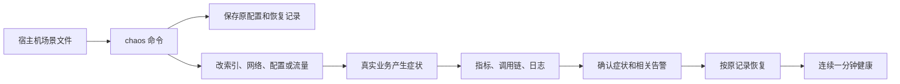

# 阶段 4 学习材料：故障注入与人工排障

> 阶段 4 已完成。连续两轮自测共 22/22 通过，完整成功与失败记录见[数据台账](../数据台账.md)和[实测记录](../notes.md#phase-04)。

以前我们知道系统“能工作”，也知道怎样看指标、调用链和日志。这个阶段要进一步回答：一个索引没了，问题怎样一步步传到用户？看到请求变慢，怎样区分数据库、网络和连接池？

## 1. 这个阶段做了什么



chaos 是做实验的工具。它负责制造原因和恢复环境。医生以后负责根据外部证据找原因。两者分开，医生才能面对一个未知的问题，而不是读到工具写好的答案。

场景用 YAML 保存。它是一种用缩进组织层级的文本格式，适合把动作顺序和观察条件放在一起阅读。

## 2. 怎么跑起来、看什么

从仓库根目录操作，先按根 README 准备本机环境和完整业务数据。长实验需要足够库存；补库存命令只在实验前、暂停流量后显式执行。密码来自环境变量，不能复制到笔记或截图中。

本阶段健康基线的目标是 200 QPS，使用 10000 个活跃商品、64 个工作者。各场景按定义临时改变流量；发生故障时，实际完成速率也可能低于目标。数据库里仍然保留五十万商品。这里的“活跃”只表示压测器会选它们，不是把数据库缩小。扩大活跃范围后，缓存命中率也会改变，所以告警门槛必须重新核对。开发中确实发生过遗漏这个参数、健康检查被回源告警拦住的情况，失败记录保留在数据台账 P4-16。

```text
go run ./cmd/chaos list
```

你应该看到 S01–S10 和 S13，共十一个编号。S11、S12 在后面的阶段实现。

```text
go run ./cmd/chaos healthy
```

你应该看到工具持续观察后返回成功。流量要先打开：没有请求就没有可靠的延迟分位数。这个命令检查延迟、错误比例、消费积压、采集与后端连接，也检查是否还有正在触发的告警。

下面以库存调用延迟为例。先确认系统健康，再逐条运行：

```text
go run ./cmd/chaos inject S07
go run ./cmd/chaos verify S07
go run ./cmd/chaos restore S07
go run ./cmd/chaos healthy
```

注入命令只报告动作已执行。verify 会另行查询业务指标和相关告警。恢复命令移除网络规则后，还要等 healthy 连续观察一分钟，才能确认请求和监控窗口都已恢复。

恢复耗时包含两段等待。修复已经生效时，过去的慢请求仍可能留在一分钟的指标窗口里。窗口里的数据恢复正常后，还要连续观察一分钟。因此首轮 S01、S02 的恢复检查接近两分钟，不能把整个数值当成重建索引的耗时。

如果终端意外关闭，先执行：

```text
go run ./cmd/chaos restore-all
```

它读取宿主机的 `.opsdoctor-chaos.json`，恢复记录中的活动实验。这个文件包含原镜像和公开配置，不含密码；它不提交到 Git，也不进入业务或医生容器。恢复失败时先保留文件，查明原因后再执行同一命令。

完整自测使用：

```text
go run ./cmd/chaos selftest
```

每个场景都会输出一行实际结果，包括注入前健康、注入、发现症状与告警、恢复健康的时间。失败行同样保留。两遍完整自测需要较长时间，执行期间不要另开一次场景，也不要手工修改同一服务的配置。

## 3. 开发过程回放

### 3.1 先处理长实验需要的基础条件

这次先要保证实验进行到后半程时，库存和调用链仍然可用。热门商品卖空后，扣减很快返回库存不足，原本想观察的行锁竞争就不一定还存在。Jaeger 若只保留几分钟，告警发出时也可能已经找不到故障刚开始的请求。

动手前先确定补库存只能走已有 Release 接口，不能绕开业务直接改表。文件继续放在 shopctl 包内，避免再造一个补库存服务：

| 函数 | 输入与返回 | 作用 |
|---|---|---|
| parseStock | 命令参数、输出对象 → stockOptions、error | 检查数量、范围和超时 |
| runStock | context、参数、配置、输出 → error | 建立客户端并选择操作 |
| restock | context、库存客户端、选项、输出 → error | 逐个商品确认归还，失败就停 |

先写显式的 stock restock 命令，再通过原有 Release RPC 给 SKU 1–10000 各补了 100000 件。没有直接更新 stock 表。随后把 Jaeger 容量设为 30000 条，并安排带标记请求的长时间流量实验。

补库存单元测试用假的 RPC 检查中途失败。失败时命令立即停下，报告已经确认到哪里。第一次响应丢失不等于没有补成功，所以没有加自动重试。

### 3.2 追查“未确认发送，但后来消费了”

目标是解释 P3-25 的 53 条告警，并避免健康状态下因为等待预算太短而报警。先读旧日志，发现当时没有保存底层错误，不能凭一条“未确认”还原最初为什么变慢。

这里先分清三件事：订单是否提交、调用方是否收到消息确认、消费者是否处理。这三个时刻并不相同。改动沿用原有分层：

| 函数 | 输入与返回 | 作用 |
|---|---|---|
| order.NewService | 业务依赖、收尾与确认预算、logger → Service | 分别保存两种等待预算 |
| Service.Create | context、下单内容、幂等键 → Created、error | 提交后独立等待消息确认 |
| publishErrorKind | error → string | 记录固定错误类别，不记录敏感参数 |
| events.NewPublisher | brokers、观测对象、logger → Publisher | 给真实 Writer 接上失败诊断 |
| processingBudget | 订单配置 → time.Duration | 让幂等与停机预算容纳完整收尾 |

随后读固定版本 kafka-go 的 Writer：调用方的 context 决定是否继续等待，真正发送批次的后台任务使用另一份 context。于是调用方可以先超时返回，后台稍后才获得 broker 的成功回复。这里的 broker 就是保存 Kafka 消息的服务进程。

写测试时没有换掉整个发送器。测试保留真实 Writer，只让假的 broker 暂时不回复。先取消调用方，再允许 broker 确认，测试观察到了这个先后顺序。代码审查还发现，订单只等两秒，而 Writer 单次写入允许三秒。于是新增五秒的独立消息确认预算，并让幂等处理时限和停机预算一起包含它。

第一次五分钟基线没有复现消息告警，但出现了五次 HTTP 错误，其中一笔结果保存失败进入待核对，原始结果照实保留。第一次长实验在 318.7 秒左右遇到 Docker 引擎停止。用户重新启动后另起一轮，没有覆盖中断记录。第二轮实际跑了 1201.583 秒，240109 请求、0 错误，没有消息未确认告警。最早的标记 trace 在二十分钟后仍有 12 个 span，Jaeger 当时占用 256 MiB。两秒基线也没有复现旧告警，因此不能拿这两轮计算“误报减少了多少”；能确认的是新预算通过了这次长实验。完整条件与失败记录见 notes 和数据台账。

### 3.3 写场景之前，先补齐可恢复的执行流程

目标是让一条命令能完成实验动作，同时在失败后知道怎样恢复。先确定只允许固定的表、索引、服务和环境变量，再写场景结构和加载校验。接着写 Docker、HTTP、MySQL、Redis 四类外部操作，最后由 app 把它们串起来。

| 函数 | 输入与返回 | 作用 |
|---|---|---|
| scenario.Load | 目录 → 场景列表、error | 读取授权的十一个定义 |
| Runner.Execute | context、Step → error | 执行一个已检查的外部动作 |
| Runner.Capture | context、Scenario → Baseline、error | 保存将要改变的配置和流量 |
| Engine.Inject | context、Scenario → Record、error | 落盘后按顺序操作 |
| Engine.Restore | context、Record → error | 尝试所有清理，成功后删除记录 |
| Client.Symptom | context、症状条件 → Result、error | 等业务指标和相关告警 |
| Client.Healthy | context → Result、error | 要求健康条件连续一分钟成立 |
| Engine.Trial | context、Scenario → Row | 组织单场实验并记录失败 |

这样拆分后，流程测试只需要假的 Executor 和 Observer；HTTP 解码的测试则在 verify 包里做，既能定位失败，也不用为了测试取消流程真的停数据库。

恢复前必须知道原来是什么样。首版先保存了原镜像内容 ID、公开配置和流量设置。内容 ID 可以理解成镜像的指纹；它能帮我们认出内容，但不会让 Docker 替我们保留内容。

首轮 S03 就在这里失败了。配置发布覆盖原标签，容器也被重建，恢复时旧 ID 已经找不到。我们暂停流量，从原提交重建正常版本完成了人工恢复。随后改成发布前先给原镜像加一个独立标签，确保它仍有引用；恢复前再比较内容 ID。新测试检查标签确实在发布前保留，以及标签内容不符时必须拒绝恢复。失败轮照实保留。

测试用假的执行器制造取消和恢复失败，检查取消后仍能恢复、某一步恢复失败后仍继续清理其他项，以及失败时记录不会被删除。监控测试则分别检查空数据、NaN、尚未触发的 pending 告警和不相关告警。

### 3.4 S13 为什么还需要一个时限

原来的 GetStock 共享 800ms 总截止时间。第一下如果已经等满 800ms，再把最大重试次数从两次改成十次也没用，因为没有剩余时间可重试。

先定两个边界：单次预算只能缩短一次查询，总预算仍控制全部尝试；写请求不进入这个新分支。

| 函数 | 输入与返回 | 作用 |
|---|---|---|
| inventoryclient.New | RPC、Config、logger → Client、error | 校验单次时限不超过总时限 |
| Client.GetStock | context、商品编号 → Stock、error | 只创建一次总截止时间 |
| Client.queryAttempt | context、商品编号 → RPC 响应、error | 按需给一次尝试更短的时间 |
| orderservice.loadConfig | 环境读取器 → Config、error | 读取新参数并检查组合预算 |

发现这个缺口后先询问用户。用户批准增加单次尝试时限，要求默认行为不变、单次不超过总时限、重试有硬上限，并且扣减仍只发一次。实现顺序是先改客户端，再接环境配置和启动日志，最后补默认行为、真正多次查询及全部重试次数下扣减一次的测试。

S13 的参考证据也随之补齐：既要看到重试计数增加，也要看到库存实际收到的 RPC 数量比 HTTP 入口更多。只看一条“最大重试次数=10”的日志，不能证明运行时真的发生了十次尝试。

### 3.5 S04 为什么重做了两次流量方案

最初用 400 QPS 集中访问商品 1。实测却发现，缓存补好后几乎不再回源，真正升高的是行锁等待。原因是这个热点设置同时改变了下单商品。我们想看缓存，实际却测到了大家争抢同一行库存。

这里的合并回源，是让同时查询同一商品的请求共用一次查库结果。Go 的 singleflight 就提供这项能力。我们需要对照的是这项保护开启和关闭时的区别。

发现不一致后先停下这项方案，向用户说明证据。用户批准改成只查商品的有限突发，同时要求告警只能描述症状。代码分成下面几处：

| 函数或方法 | 输入 → 返回 | 负责什么 |
|---|---|---|
| burstState.submit | 商品编号、请求数 → burstReport、error | 在进入工作队列前拒绝越界或叠加 |
| generator.dispatchBurst | context、任务通道、批次 → 无 | 让已有工作者一起出发，共用普通流量的并发上限 |
| burstState.finish | 批次号、失败标志、未发出数 → 无 | 记录真实完成情况，区分接收成功与业务成功 |
| action.Runner.burst | context、Step → error | 顺序发有限批次并等待结果，不另造 HTTP 工作者 |
| observedProducts.Get | context、商品编号 → Product、error | 观察同键查询是否重叠，仍执行原查询 |

先写 `/burst` 的批次状态和调度，让任务交给已有工作者，等这批人都就位后一起出发。随后接入控制接口和场景动作。测试拦住假的 HTTP 请求，检查固定数量的工作者是否同时到达，以及新批次是否被拒绝。取消测试还检查未发出的任务能被准确记录。

最初只查一个热点，重复回源很少。接着对照 100 个商品，每个同时查 64 次。关闭合并后，重复回源确实增加了；但正常组的库存查询也出现了连接池等待告警。这是流量本身带来的干扰，不能把它当成 singleflight 失效的证据。

再把每批并发降到 16，同样 6400 次查询分给 400 个热点。每个商品只经历一次缓存失效，批次之间至少隔 50ms。初步对照中，开启时回源 400 次、关闭时 6316 次；P99 只有 16ms 与 20ms 的差别。这个结果提醒我们：重复查询增加，与用户明显变慢，是两件需要分别测量的事。随后再用同一提交的容器版本复验，而不是把临时客户端的结果直接当成全部验收。

### 3.6 场景恢复了，为什么下单还是失败

调整后的 S04 已经在 63.397 秒看到缓存症状和告警，但恢复检查仍在三分钟时失败。输出指出 HTTP 错误比例不合格。我们没有改宽健康门槛，也没有继续下一场，而是先按状态码拆开请求：商品查询正常，下单却大量返回 503。

接着读订单日志，看到缓存写回失败和幂等结果待核对。两者都要写 Redis，于是检查 Redis 的 INFO。它已用到 128.03 MiB，超过原来的 128 MiB 写入预算；累计保留了 299587 个幂等键，错误统计里也有 OOM。这里 OOM 的意思是 Redis 因内存预算拒绝写入，不代表容器已经被系统杀死。

noeviction 表示内存不够时不自动淘汰旧键。这正是保护幂等凭据的选择：如果为了给缓存腾位置而删掉旧订单凭据，同一个请求可能再次执行。因此没有清库、删幂等键或缩短二十四小时期限，而是把现有 Redis 的写入预算改为 512 MiB，容器上限改为 768 MiB。这一步只修改 Compose 资源配置，没有新增函数或修改业务逻辑。重建使用原持久卷，前后幂等键数量一致。

容量调整后，健康检查在 70.133 秒通过，另起两轮实验。两轮各有十一项，最终 22/22 通过。症状和告警最晚在 111.032 秒被确认；恢复健康最长用时 141.182 秒，里面还包括连续一分钟的观察。扩容不是永久解决容量规划：只要继续产生订单，未过期凭据就会继续增加。以后换压测时长和订单速率，需要先估算保留记录的数量。完整失败表留在 P4-17，不能只展示后来的成功轮。

### 3.7 为什么本机通过，CI 却启动失败

最后一次推送后，CI 从空数据目录启动 MySQL。它在创建实验账号后，尝试给 stock 表授权，却发现表还不存在。本机之前已经造过数，所以同一个脚本在本机没有报错。

先画清启动顺序就能找到问题：MySQL 初始化完成 → Go 服务连上数据库 → 服务执行迁移、创建业务表。脚本却在第一步就要求第三步的表已经存在。这次需要修的是先后顺序，而不是扩大账号权限。

这次没有新增 Go 函数，改动集中在三个地方：

| 位置 | 输入与结果 | 作用 |
|---|---|---|
| 005_chaos_user.sh | 环境变量和现有表 → 建账号，表齐全时授权 | 空库先完成 MySQL 启动 |
| CI 的基础设施启动步骤 | 服务健康结果 → 再执行授权脚本 | 等实际迁移完成后再授权 |
| 根 README | 操作命令 → 用户按同一顺序准备 | 新旧数据卷都能照着执行 |

先把脚本分成建账号和授权两段。表还没创建时，脚本说明下一步该怎么做，然后结束自己的子 shell。接着在 CI 等服务健康的命令后补一次显式授权。权限仍然只给 stock 和 orders，没有改成整个 shop 库，也没有复制一份业务建表 SQL。

验证时另开一个没有网络、没有宿主端口的临时 MySQL，使用全新的数据目录。它在 7.454 秒完成首次启动，业务表出现前没有表级权限。只在临时库创建两张最小测试表后，连跑两次授权脚本，结果一直是两张表各三个权限，最多两个连接。原业务环境保持原样。这个案例提醒我们：已有数据卷上的通过，还需要用空库启动来补充验证。

### 3.8 为什么故障测过了，正常冷启动还是误报

这次返工来自 Claude 的验收：暂停访问后，缓存自然过期；重新开始访问时，系统还没注入任何故障，回源告警就先响了。它会拖慢 healthy，也会把以后的医生叫起来做一次没有必要的调查。

动手前先要想清楚，正常冷缓存和 S05 都会让许多商品重新查库。因此不能只把每秒 50 次换成一个更大的数字。我们从已有两轮实验重新查出商品请求数和回源数，先比较同一分钟里的比例。S05 最高只有约 51%–53%，而真正的冷缓存刚恢复时可能更高；比例本身仍不够。

这次没有新增 Go 函数，改动集中在配置与验证上：

| 位置 | 输入与结果 | 作用 |
|---|---|---|
| shop.yml 的 CacheLoadsHigh | 当前及过去的请求计数 → 告警状态 | 同时判断回源比例、此前流量和持续时间 |
| cache_alert.test.yaml | 人工构造的计数时间线 → promtool 检查结果 | 覆盖冷缓存、健康大流量、持续异常和少量请求 |
| S04.yaml、S05.yaml | 真实场景指标 → verify 的症状判断 | 使用同一比例门槛，并等待正式触发的告警 |
| CI | 固定版本 promtool → 检查结果 | 以后改规则时自动重跑边界测试 |

顺序是先查旧规则和历史数据，再写候选表达式及时间线测试，然后热加载规则。热加载是让 Prometheus 重新读取文件，业务进程继续运行。候选条件要求回源比例超过 35%，当前和两分钟前都已有每秒超过 20 次商品请求，再等待连续三十秒。

接着做真正的停流实验。暂停超过十一分钟后恢复 200 QPS，前五分钟采到的回源峰值为 71.17 次/秒，超过旧门槛，但新规则没有进入观察或触发状态。恢复两分钟时比例已降到约 20.6%，因此过去流量窗口重新有数据后，也没有把这波正常填充补报成故障。长时间健康运行和 S04、S05 的后续完整结果统一记在本节后面的测量表与数据台账。

这次还有一个独立的小问题：全量竞态测试里的一个用例只留 1ms，首次复测时操作系统还没调度到回调就已超时。我们保留了失败输出，同一份源码完整复跑后通过。它提醒我们，业务验收数据和测试程序自身的计时波动需要分别记录。

## 4. 阅读顺序

| 顺序 | 文件 | 重点看什么 |
|---|---|---|
| 1 | [cmd/chaos/main.go](../../cmd/chaos/main.go) | Ctrl+C 怎样变成 context 取消 |
| 2 | [app/app.go](../../internal/chaos/app/app.go) | 子命令怎样进入不同流程 |
| 3 | [app/engine.go](../../internal/chaos/app/engine.go) | 先落盘，再改外部系统，最后才删除恢复记录 |
| 4 | [scenario/model.go](../../internal/chaos/scenario/model.go) | 一份实验需要哪些输入与证据 |
| 5 | [scenario/validate.go](../../internal/chaos/scenario/validate.go) | 为什么不开放任意 SQL 和命令 |
| 6 | [action/deploy.go](../../internal/chaos/action/deploy.go) | 配置发布和原镜像恢复有什么不同 |
| 7 | [action/storage.go](../../internal/chaos/action/storage.go) | 索引列顺序、唯一性与缓存操作范围 |
| 8 | [verify/wait.go](../../internal/chaos/verify/wait.go) | 怎样判断真正出现、持续恢复 |
| 9 | [app/selftest.go](../../internal/chaos/app/selftest.go) | 失败与取消为什么仍进入清理路径 |
| 10 | [inventory_client.go](../../internal/shop/inventoryclient/inventory_client.go) | 单次与总时限怎样嵌套，为什么扣减不重试 |

## 5. 关键设计与 WHY

### 5.1 先看用户，再找耗时落在哪里

排障不从猜原因开始。先用入口指标确认哪些接口受影响，再找一笔同一时间的慢请求。调用链可以把这笔请求拆成查缓存、调用库存、查数据库、发消息等步骤。然后用对应日志和底层状态验证判断。

调用链中的一个步骤叫 span。它记录这一步什么时候开始、持续多久，以及父步骤是谁。下面说的 SQL span，就是数据库调用这一段的记录。

例如下单变慢，不足以说明缺了索引。可能在借数据库连接时排队，也可能 SQL 已执行完，但响应在网络里等待。下面每个场景都按这条调查顺序展开。

### 5.2 S01：库存索引缺失

**原理。** 索引像按商品编号整理好的目录。有它时，MySQL 很快找到要扣减的行；没有它时，需要检查很多无关行。UPDATE 还要取得锁，扫描范围扩大后，其他更新也更容易被挡住。

**注入。** 用专用账号删除 `stock.uk_stock_sku`，数据和业务 SQL 保持原样。

**症状链。** 查找范围扩大 → UPDATE 持锁和等待增加 → 库存 RPC 变慢 → 订单调用预算耗尽。部分扣减结果可能进入待核对；客户端超时不能证明数据库没有执行。

**人工调查。** 先比较下单与商品查询，再找慢下单的库存 span。沿着它定位 UPDATE 模板。对这条 SQL 做 EXPLAIN，检查使用的索引和预计扫描行数，再用 SHOW INDEX 确认 `sku_id` 上的唯一索引确实不存在。最后结合锁等待数据，解释为什么其他请求也被拖慢。

EXPLAIN 是让数据库说明“准备怎么执行”，不执行这次扣减。开发中对真实 UPDATE 得到的是 `type=index`、`key=PRIMARY`、预计扫描 498780 行。这里仍出现了一个索引名，但它是在遍历主键目录，不能按商品编号直接定位。只检查 key 是否为空，会漏掉这个问题。计划里的“全表扫描”描述的是检查范围接近全表，实际字段应按原结果记录。

**修复。** 恢复原唯一索引，观察扫描范围和锁等待下降，再等待健康基线。另行核对结果不明的订单，不能简单换一个幂等键重做。

### 5.3 S02：订单列表联合索引缺失

**原理。** 列表先按用户找订单，再按时间排序。联合索引把这两个顺序放在同一份目录中，避免每次都从大量历史订单里重新找和排。

**注入。** 删除 `orders.idx_orders_user_created`。

**症状链。** 用户筛选不能有效缩小扫描 → 大量订单参与读取和排序 → GET 列表耗时上升。它与库存索引问题的受影响接口不同。

**人工调查。** 先按 HTTP 方法和路由分开看，确认是 GET `/orders`。从慢调用链提取查询模板，检查 EXPLAIN 的扫描和排序，再核对 `user_id, created_at` 的索引列顺序。

实际查询还按 `id` 排序，让相同时间的订单保持稳定顺序。开发中的 EXPLAIN 返回 `type=ALL`、预计 1991940 行，以及 `Using where; Using filesort`。filesort 表示排序不能直接借用索引顺序，并不单凭这个名字就说明发生了磁盘读写。要把大范围扫描、排序和接口耗时一起看。

**修复。** 按原顺序恢复联合索引。只建一个名称相同、列顺序不同的索引不算恢复。

### 5.4 S03：连接池只有两条连接

**原理。** Go 的 `*sql.DB` 类似 Java 的 DataSource 连接池。请求不是随时都能拿到连接；池中可借出的连接用完后，它要先排队。

**注入。** 真正发布库存服务，把最大连接数和空闲连接数都设为 2。

**症状链。** 同时需要数据库的请求超过容量 → 等待借连接 → 剩余 SQL 执行时间减少。等待很长时才会进一步造成慢请求或超时。本场景直接验证的是借连接等待增加；不能因为出现了连接池告警，就宣称所有请求已经超时。

**人工调查。** 先看启动时间和生效配置，再对照连接上限、使用数、等待次数、累计等待时间。随后检查数据库执行计划和行锁，区分“还没借到连接”与“已经执行 SQL 但被锁挡住”。

调查时有一个容易走错的方向：看到库存调用很长，就直接去改 SQL。本项目的 SQL span 在驱动开始执行时才创建，借连接的排队发生在它之前。因此可能看到库存 RPC 很长，但 SQL span 开始得晚、执行得短。先看 `go_sql_wait_count_total` 的增长，再结合等待总时间；次数多不等于每次都等得很久。如果数据库自己执行很快、行锁也正常，而应用侧一直在排队，才更支持连接池容量这个解释。

**修复。** 回到实验前的连接池配置。容量要结合数据库总连接预算考虑，不能一遇到等待就无限调大。

### 5.5 S04：热门缓存失效后，同一个商品被重复查询

旧方案实测未通过：缓存回源没有持续增加，热点下单却引发行锁竞争。经用户批准，改成下面的有限商品查询突发。两组正式对照已完成，失败的旧方案也保留在台账里。

**原理。** singleflight 会让同一个商品的一批并发请求共用一次查库结果。没有这层合并时，它们可能同时发现缓存为空，各自去查数据库，这就是缓存击穿。

**注入。** 发布关闭 singleflight 的配置，删除热点商品缓存，再让一批用户同时查询商品详情。它模拟秒杀开始时一起打开页面的用户。只发查询，不把下单也集中到热点；否则看到的可能是 S08 的库存行锁。

为了让这个短暂现象能被每十秒采集一次的监控观察到，实验依次覆盖 400 个热门商品。每个商品只失效一次，每次同时发 16 个查询。可以理解为一组促销商品陆续开放，各自迎来一小批访客。总请求数有限，不会反复删除同一个键，也不会向业务 SQL 添加等待。

**症状链。** 热点缓存消失 → 同时到来的请求各自回源 → 相同商品的查询在短时间内增加 → 数据库和请求耗时可能上升。这里的“可能”需要实际并发支持；若数据库很快，第一笔已经填好缓存，后来的请求就不会重复查库。

**人工调查。** 对比缓存 miss 和真正查库的 `cache_loads_total`，再看同一时段的 SQL 调用链。确认它们集中到同一商品，并从启动日志核对 singleflight 是否关闭。不要把普通的首次未命中直接叫作击穿。

调查顺序可以更具体一点。第一步看回源突然增加时，入口流量是否也变了。第二步看同键重叠计数与多条 SQL span，判断有没有重复工作。第三步看正常发布日志里的缓存配置。最后用相同突发、开启合并的对照验证解释。SQL span 不记录绑定参数，因此不能只凭 SQL 模板就认定它们是同一商品；商品编号需要沿调用链结合 HTTP 请求路径核对。

**修复。** 恢复合并回源配置和原流量分布，让正常请求填回缓存。场景验收必须拿到重复回源的证据。

**怎样判断影响有多大。** 回源不是一种固定成本的操作。这个项目只按主键查一条商品记录，通常很便宜；即使重复查询增加，P99 也可能变化不大。假如真实系统还要连接远端服务、读取大对象或做复杂计算，同样数量的重复请求就可能压垮依赖。我们记录真实回源次数、数据库查询速率和 P99，不把“出现重复查询”写成“数据库已经被打垮”。

**告警为什么不直接数同键并发。** 这个计数能帮助工程师确认多个请求在查同一份数据。但拿它直接报警，几乎已经把“合并回源失效”这个答案送给医生了。告警只描述回源速率、查询速率或商品 P99 的异常；医生还需要自己从调用链、指标和最近发布中找到原因。

这个计数观察的是仓储查询调用是否重叠，其中也可能包含借数据库连接的等待。它不等于 MySQL 此刻正在并行执行的 SQL 数量。前一笔查询已返回、缓存却还没写好时，另一笔查询仍可能重复，但不会算成重叠。因此它也不等于全部重复回源次数，不能仅凭零就排除所有重复查询。

**正式对照看到了什么。** 两组都用 Compose 中的同一个 loadgen，完成 6400 次商品查询，没有失败。每个商品先填好缓存，再删除一次；其他条件一致，只切换 singleflight。结果见数据台账 P4-13：

| 观察项 | 开启合并回源 | 关闭合并回源 |
|---|---:|---:|
| 实际商品回源 | 400 次 | 6295 次 |
| 商品查询数据库的速率 | 19.365 次/秒 | 295.521 次/秒 |
| MySQL 全实例 SELECT 速率 | 330.084 次/秒 | 596.910 次/秒 |
| 商品 HTTP P99 估计 | 47.794ms | 85.799ms |
| 行锁等待时间增量 | 0ms | 0ms |
| 后续 80 秒内触发的告警 | 无 | 只有 CacheLoadsHigh |

这里的 P99 是按本轮请求的直方图增量估算的。直方图把耗时装进不同范围的桶，因此这些小数不是逐条请求测出的精确分位数；两组所在桶的上界分别为 50ms 和 100ms。全实例 SELECT 还包含库存查询和监控查询，不能全部算作商品回源。

这张表保留的是返工前的对照。当时使用“每秒回源超过 50 次”的告警。后来 Claude 验收发现，停流让缓存自然到期后，恢复正常访问也会越过这个门槛。前面的故障对照通过了，却没有覆盖这个正常使用过程。

返工改为看回源比例。例如一分钟有 1000 次商品查询，其中 400 次去了数据库，比例就是 40%。这里用 HTTP 商品请求作分母；缓存为了避免重复回源而做的第二次检查，不算第二个用户请求。不同服务的计数先分别求速率，再按服务汇总，可以正确处理服务重启后计数从零开始的情况。

新规则要求比例超过 35%，而且当前和两分钟前的商品请求速率都超过每秒 20 次。所有条件要连续成立 30 秒才发出告警。两分钟前的流量是一条背景信息：它帮助我们区分正在运行的业务突然大量回源，还是停流之后正常重新填充。门槛的实测过程见下节和数据台账。

### 5.6 S05：许多缓存一起失效

**原理。** 一大批缓存如果在同一时刻到期，许多商品都要重新查库，这叫缓存雪崩。给 TTL 加一点随机时间，可以把这一波回源分散开。TTL 就是一条缓存还能保留多久。

**注入。** 发布零抖动配置，再把一批已有商品缓存的到期时间对齐。没有清空 Redis，也没有改动订单幂等记录。

**症状链。** 许多键共同到期 → 多个商品未命中 → 实际回源增加 → 数据库压力和延迟可能上升。缓存逐渐重新填充后，这一波压力也会下降。

**人工调查。** 先对照 miss 与回源曲线，再抽查多个商品的剩余时间和调用链。查看新发布是否关闭了抖动。S04 要找的是同一商品的多条重叠查询；S05 要找的是大范围商品一起到期，即使同一商品的查询仍在合并，总回源也可能增加。两者不能只靠“涉及几个商品”来区分。

Redis 的 TTL 查询可以看到一个键还有多少秒过期。事故发生前抽样时，许多键的剩余时间接近，是一条线索；事故发生后键已重新填充，就不能指望还看到原来的到期时间。因此要结合故障开始时的曲线和发布记录，避免拿恢复后的快照否定过去的现象。

**修复。** 恢复过期抖动，等待正常流量重新填充。已经过期的缓存字节不需要人为还原，数据库仍是商品数据来源。

**为什么不能只看回源比例。** 缓存冷启动，是指缓存里还没有所需数据。它也会出现“大量不同商品未命中”。S05 与冷启动的回源曲线可能很像，因此单独把门槛从次数改成比例，还不足以排除误报。

我们还要看这波回源之前有没有业务流量。在 Prometheus 的查询表达式里，`offset 2m` 表示查看两分钟前的窗口：当前看最近一分钟，同时再看两分钟前的那一分钟。长时间停流时，过去的窗口没有流量，缓存可以先正常填充。持续运行时突然一起过期，过去的窗口仍有流量，比例升高就会进入三十秒观察期。

`for: 30s` 不是把每次异常的时间加起来。条件必须连续满足三十秒，中间一次不满足就重新计时。这能过滤短暂波动，也会让故障发现稍晚。因此修改规则以后，必须重新测 S04、S05 从注入到正式告警的总时间，不能只看表达式是否一度返回结果。

这条规则的代价是冷启动初期和每秒不超过 20 次的低流量没有足够背景信息。此时它不负责判断缓存异常，接口耗时和错误率告警继续工作。换更大的活跃商品范围，也要重新测量缓存正常填充需要多久；两分钟不是适用于所有系统的固定常数。

**这次怎样定门槛。** 先回查旧实验，选出候选门槛；再保持规则不变，实际测下面四种状态。正常目标流量为 200 QPS，压测器使用 10000 个活跃商品、64 个工作者。回源比例以一分钟窗口计算；表中列的是商品速率超过每秒 20 次时采到的峰值。

| 状态 | 回源比例峰值 | 回源速率峰值 | 新规则的结果 |
|---|---:|---:|---|
| 冷缓存恢复后的五分钟 | 86.640% | 71.172 次/秒 | 没有进入观察或触发状态 |
| 随后十五分钟正常运行，含一次自然到期 | 20.261% | 31.116 次/秒 | 没有进入观察或触发状态 |
| S04，两次完整实验 | 90.384%–90.595% | 140.449–143.084 次/秒 | 79.751s、96.507s 正式报警 |
| S05，两次完整实验 | 47.048%–49.441% | 71.585–75.381 次/秒 | 108.156s、109.791s 正式报警 |

35% 高于本轮正常到期时的 20.261%，低于两次 S05 的峰值。正常冷缓存的比例反而更高，所以还需要此前流量的前提。恢复访问两分钟后，比例已降到约 20.6%；历史流量窗口重新有数据时，这波正常填充也已过去。比例要持续三十秒才报警，四次真实实验仍都在三分钟内完成触发与恢复。

完整业务观测持续 1234.171 秒，回查这整段 ALERTS 历史没有任何告警。具体采样口径、四次完整流程和一次构建网络失败都保留在数据台账 P4-28 至 P4-39。随后额外完整 selftest 通过 11/11，其中 S04 用 85.438 秒报警、96.336 秒恢复，S05 用 101.794 秒报警、86.016 秒恢复。两者各完成了第三次完整流程，规则没有中途调整。这里的两轮定向故障数据是回源增加的证据；商品查询仍很便宜，不能据此写成“数据库已被压垮”。

### 5.7 S06：消费者停止

**原理。** 下单和更新销量是通过 Kafka 分开的两步。消费者停了，订单仍能产生消息，但销量暂时跟不上。lag 表示尚未消费到的位置差。

**注入。** 停止 order-worker 容器。

**症状链。** 新订单继续产生 → 消费位置不前进 → lag 增长 → 销量更新落后。下单接口正常也不能证明整条业务链正常。

**人工调查。** 先确认生产仍成功，再看消费者管理端点、运行日志、三个分区的消费位置和 lag。不要只看某一个分区，也不要把“没有收到消息”直接归因于 Kafka 停机。

本场景同时要求看到积压超过一千条，以及相关告警已触发。消费者管理端口失联的告警可能先出现，积压告警还要持续两分钟才触发，所以结果表可能记录 ServiceUnavailable。它说明进程不可采集；积压曲线另行证明业务确实受到了影响，两个证据不能互相替代。

**修复。** 启动原消费者，观察积压下降。暂停流量、等追平后运行 shopctl check；总量一致是一个核对结果，详细订单去重仍靠事务与去重记录。

### 5.8 S07：库存响应卡在网络里

**原理。** 调用方的等待包含请求传输、服务端处理和响应传输。服务端处理快，不代表调用方很快能收到结果。

**注入。** Toxiproxy 在订单至库存链路的响应方向增加 800ms 等待。代理只是晚一点转发真实数据。

**症状链。** 响应到达变晚 → 调用方的 800ms 预算耗尽 → 失败累计 → 熔断器暂时拒绝继续调用 → 商品库存降级、下单可能进入待核对。

**人工调查。** 对比同一次调用的客户端和服务端 gRPC span。如果客户端很长，服务端和 SQL 都短，优先调查链路和连接。再核对 DeadlineExceeded、熔断状态以及商品返回的库存状态。

熔断以后，部分请求会很快失败，P99 甚至可能下降。这不是服务恢复了，而是它暂时不再发起那条慢调用。要一起看成功比例、熔断状态和商品降级结果。本项目商品查询可以返回基本资料，但库存状态为 unknown；下单则不能把未知库存当成可以继续扣减。

**修复。** 移除本次延迟规则，等已有连接和熔断器恢复。已发生的待核对订单要另外处理，恢复网络不会自动证明它们的扣减结果。

### 5.9 S08：大家都在改同一行

**原理。** 同一商品的一行库存不能被多个事务同时任意改写。数据库用行锁保证更新顺序；请求集中到同一行时，它们只能依次取得这把锁。

**注入。** 改变真实订单流量，让它集中到同一个商品。实验前保证该商品有库存，不通过人为长事务或 sleep 制造等待。

**症状链。** 同一行的写入并发增加 → 行锁竞争 → 等待和持连接时间增加 → 下单变慢。症状是否明显取决于实际并发和写入耗时，要从测量中判断。

**人工调查。** 先看锁等待，再检查阻塞关系和涉及的行。随后对照 EXPLAIN：仍使用 `uk_stock_sku`，说明它与 S01 的全表扫描不同。结合订单日志确认流量确实集中到这个商品。

锁等待总时间是所有请求等待的累计值。一秒里如果十个请求各等一百毫秒，计数就增加一千毫秒。因此曲线超过每秒一千毫秒并不矛盾，也不能当成某个请求等了那么久。更不能只看这个全局数字就猜是哪张表；还要找阻塞关系、SQL 和商品编号。

**修复。** 恢复分散流量。真实业务还可以缩短事务、控制同一商品并发；如果业务长期只有一个热点，需要重新考虑库存分配方式。

### 5.10 S09：请求结束了，后台任务没结束

**原理。** goroutine 是 Go 运行时调度的任务，类似很轻的并发执行单元。它等在 channel 上时仍占资源。无缓冲 channel 必须有接收方准备好，发送方才能交出值。

**注入。** 发布另一份响应收尾实现。每次响应后启动一个发送结果的任务，但接收方不存在，所以任务停在发送处。

**症状链。** 每个请求留下一个等待任务 → goroutine 数持续增长 → 栈和其他关联资源占用增加 → 继续运行可能遇到内存压力。单次任务便宜也不能抵消无限积累。

**人工调查。** 先对照发布版本与进程启动时间。入口流量若稳定而任务数持续上涨，抓取两次 goroutine profile。profile 是运行时任务状态的快照；比较相同 `chan send` 堆栈是否越来越多，再检查发送方与接收方的生命周期。

一次快照里有很多 goroutine，可能只是正常的瞬时并发。更有力的证据是：流量没有增加，两次快照中同一处等待发送的任务却越来越多，而且请求结束后仍不退出。堆栈使用普通函数名；工程师需要读出发送与接收的关系，而不能靠名字里写着“泄漏”得到答案。

第二轮验收中，我们间隔约 20.125 秒抓了两份快照。任务总数从 1045 增到 5405，其中停在 `deliverResponse` 的任务从 938 增到 5299。两份快照都指向 `response_async.go:29` 的通道发送。接着读这行和调用处，就能发现发送方一直在等一个不存在的接收方。这个过程把“看见数量增长”推进到了“找到增长的位置和原因”。

**修复。** 恢复原镜像。代码层面的修复是保证接收、使用合适缓冲或在取消时退出。单纯增加内存只会延后问题。

### 5.11 S10：SQL 等的是网络

**原理。** 应用里的 SQL span 包含到数据库的网络往返，不能直接等同于数据库 CPU 执行时间。

**注入。** 在库存至 MySQL 链路的响应方向增加真实延迟。

**症状链。** 多种 SQL 往返都变慢 → 连接占用更久 → 池等待可能增加 → 库存 RPC 和上游变慢。连接池告警可能是后果，而不一定是最初原因。

**人工调查。** 比较不同 SQL 是否一起变慢，再看数据库内部执行与锁等待。若执行计划仍正常、数据库内部等待不足以解释客户端耗时，就继续检查链路。不要只看到连接池满就停在 S03 的判断上。

S01 可以用缺失索引和扫描范围解释慢查询，S10 的这些证据仍然正常。S03 则要先证明时间花在借连接，可能表现为 SQL span 开始前的空档。这几类问题都会拖长库存调用，所以要比较各层的时间落在哪里，不能只看一个总耗时就定根因。

**修复。** 移除延迟，观察 SQL、连接使用与入口延迟依次回落。

### 5.12 S13：一次失败带来更多请求

**原理。** 总时限决定这次逻辑调用最晚什么时候结束。单次时限决定这一回尝试最多等多久。例如总共 800ms，每次只等 50ms，第一回超时后仍可能有时间继续试。若没有等待间隔、没有熔断，而且重试上限很高，一份入口流量会被放大成很多下游请求。

**注入。** 单次时限 50ms，最多重试十次，关闭退避和熔断，再把响应延迟到 80ms。正常默认仍是单次时限零、两次重试、启用退避与熔断。

**症状链。** 响应来不及在单次时限内返回 → 客户端继续尝试 → 库存收到更多查询 → 资源消耗和等待增加 → 更多调用来不及完成。这种相互加重的过程就是重试风暴。

**人工调查。** 先比较入口 HTTP 请求率与库存 RPC 请求率，再看 `rpc_client_retries_total`。找一笔商品请求，数出其下的多次 GetStock，并核对新发布的预算和保护参数。不能用配置值代替实际请求放大证据。

十次重试表示第一次之外最多再试十次，不保证每个请求都能试满。总时限可能先到，进程也可能在等待中取消，所以要数实际发出的尝试。比较上下游速率时使用同一时间窗口，并区分 GetStock 和 Deduct；本场景放大的是可重试的只读查询，不是重复扣减库存。

**修复。** 恢复退避、熔断和合理的重试上限，排查最初的延迟。总预算始终有限。Deduct 无论怎样配置都只执行一次，因为重复扣库存会改变业务结果。

### 5.13 为什么“消息确认超时”仍要保留

等待确认到期，只能说明调用方没能在约定时间内确定结果。发送可能失败，也可能稍后成功。如果一律记成成功，就会掩盖真正漏发；如果直接自动重发，也可能造成重复。

本阶段把确认预算从两秒拆成独立的五秒，并补充诊断字段。它给短暂抖动留下余量。根治数据库订单和消息之间的一致性缺口，需要另外的可靠投递设计；本阶段仍不实现 Outbox。

## 6. 本阶段用到的 Go 写法

下面的完整程序都已在本机实际运行并经过 gofmt。单文件例子保存为 main.go，再执行 `go run main.go`。构建标签那一节按说明保存四个文件，在新目录中运行。

### 6.1 单次时限与父时限

WithTimeout 创建一份可以更早结束的 context。子时限不会延长父时限。这里用一秒总预算包住三次尝试，前两次各自等满二十毫秒，第三次直接完成。对照 Java，可以把它理解成每次 Future 等待有自己的上限，外层还保留整项工作的截止时间。

```go
package main

import (
	"context"
	"fmt"
	"time"
)

func main() {
	total, cancel := context.WithTimeout(context.Background(), time.Second)
	defer cancel()
	for attempt := 1; attempt <= 3; attempt++ {
		one, stop := context.WithTimeout(total, 20*time.Millisecond)
		if attempt < 3 {
			<-one.Done()
			fmt.Printf("第 %d 次：单次时限用完，总时限仍有效=%t\n", attempt, total.Err() == nil)
		} else {
			fmt.Println("第 3 次：完成")
		}
		stop()
	}
}
```

本机实际输出：

```text
第 1 次：单次时限用完，总时限仍有效=true
第 2 次：单次时限用完，总时限仍有效=true
第 3 次：完成
```

### 6.2 无缓冲 channel 的交接

channel 是传值的通道。make(chan int) 没有缓冲，发送方只有等到接收方接走值，才能继续执行。这个程序明确接收并等待任务结束，方便看清 S09 缺少接收方时停在哪里。

```go
package main

import "fmt"

func main() {
	result := make(chan int)
	ready := make(chan struct{})
	done := make(chan struct{})
	go func() {
		close(ready)
		result <- 201
		close(done)
	}()
	<-ready
	select {
	case <-done:
		panic("没有接收方，发送不可能完成")
	default:
		fmt.Println("接收之前，发送任务尚未结束")
	}
	fmt.Println("接收到状态：", <-result)
	<-done
	fmt.Println("发送任务已结束")
}
```

本机实际输出：

```text
接收之前，发送任务尚未结束
接收到状态： 201
发送任务已结束
```

### 6.3 独占创建恢复文件

O_EXCL 与 O_CREATE 一起使用时，只有文件不存在才能创建。它把“检查是否存在”和“创建”交给操作系统完成，避免两个进程都先检查到不存在，再互相覆盖。Java 可以对照 CREATE_NEW 打开选项。示例只在新临时目录中操作自己的文件。

```go
package main

import (
	"fmt"
	"os"
	"path/filepath"
)

func main() {
	directory, err := os.MkdirTemp("", "opsdoctor-learning-")
	if err != nil {
		panic(err)
	}
	defer os.Remove(directory)
	path := filepath.Join(directory, "active.json")
	first, err := os.OpenFile(path, os.O_CREATE|os.O_EXCL|os.O_WRONLY, 0600)
	if err != nil {
		panic(err)
	}
	if err := first.Close(); err != nil {
		panic(err)
	}
	defer os.Remove(path)
	second, err := os.OpenFile(path, os.O_CREATE|os.O_EXCL|os.O_WRONLY, 0600)
	if err == nil {
		second.Close()
		panic("意外覆盖已有记录")
	}
	fmt.Println("第二次创建被拒绝：", os.IsExist(err))
}
```

本机实际输出：

```text
第二次创建被拒绝： true
```

### 6.4 通过参数数组运行外部命令

exec.CommandContext 直接启动程序。go 和 version 是分开的参数，不会先拼成一段 shell 代码。context 到期会结束这个命令的等待与进程；如果命令已经让 Docker 后台执行了操作，仍要靠恢复记录核对和收尾。

```go
package main

import (
	"context"
	"fmt"
	"os/exec"
	"strings"
	"time"
)

func main() {
	ctx, cancel := context.WithTimeout(context.Background(), 5*time.Second)
	defer cancel()
	command := exec.CommandContext(ctx, "go", "version")
	output, err := command.Output()
	if err != nil {
		panic(err)
	}
	fmt.Println("独立参数执行成功：", strings.HasPrefix(string(output), "go version "))
}
```

本机实际输出：

```text
独立参数执行成功： true
```

### 6.5 构建标签：编译时选哪份实现

有时我们需要两个程序版本。Go 的构建标签决定某个文件是否参加编译。决定发生在生成可执行文件时，运行中的程序不能靠改环境变量切换这段代码。

S09 用这个方法生成另一份订单程序。它和正常程序有不同的镜像版本号。恢复时换回原镜像，就会重新使用正常实现。

下面是一个完整的小项目。把四份文件放进同一个新目录：

`go.mod`：

```text
module example.com/versiondemo

go 1.27.1
```

`main.go`：

```go
package main

import "fmt"

func main() {
	fmt.Println(versionName())
}
```

`version_default.go`：

```go
//go:build !alternate

package main

func versionName() string {
	return "正常版本"
}
```

`version_alternate.go`：

```go
//go:build alternate

package main

func versionName() string {
	return "另一版本"
}
```

在这个目录里运行：

```text
go run .
go run -tags alternate .
```

本次实际输出分别是“正常版本”和“另一版本”。`!alternate` 表示没有指定这个标签时参加编译。标签下面的空行也要保留。两个文件都声明 versionName，但每次只选中一个，所以不会发生重复定义。

### 6.6 关闭通道，让固定工作者一起出发

有时不是要多开工作者，而是要让已经存在的工作者等同一个信号。Go 中，关闭一个通道后，所有等着从它接收的 goroutine 都能继续。这里把它当作“出发信号”，不通过它传递业务数据。

下面的程序固定只创建三个工作者。`ready` 等大家就位，`finished` 等大家结束。两个 WaitGroup 负责不同的时刻，不能混用。

```go
package main

import (
	"fmt"
	"sync"
)

func main() {
	const workers = 3
	start := make(chan struct{})
	var ready, finished sync.WaitGroup
	ready.Add(workers)
	finished.Add(workers)
	for id := range workers {
		go func() {
			defer finished.Done()
			ready.Done() // 先报告已经就位。
			<-start      // 大家等待同一个出发信号。
			fmt.Println("开始查询的工作者：", id)
		}()
	}
	ready.Wait() // 确认三个工作者都已经就位。
	close(start) // 关闭通道会同时放行所有等待者。
	finished.Wait()
}
```

第一次实际运行依次打印了工作者 2、0、1，收尾复跑时是 2、1、0。你运行时顺序也可能不同，因为放行后由 Go 调度它们。这个例子只展示一起出发的信号；项目中的工作者由 `generator.run` 在启动时统一创建，每次突发会复用它们。

## 7. 动手实验

1. **区分 S01 和 S10。** 分别注入，找一笔慢下单，比较 SQL span、执行计划和数据库内部等待。每次都恢复并等 healthy 通过，再做下一次。
2. **看消费者追赶。** 注入 S06，记录三个分区的 lag；恢复后观察回落，再暂停流量核对销量。
3. **比较单次与总时限。** 先运行第 6.1 节的小程序，再看 S13 的同一 trace 里有几次查询。解释为什么缩短单次预算不等于延长总预算。
4. **追踪后台任务。** 注入 S09，间隔一段时间读取两份 goroutine profile，数相同发送堆栈；恢复原镜像后确认数量稳定。
5. **练习中断恢复。** 运行 selftest，在某个场景等待症状时按 Ctrl+C，观察恢复流程。另开终端检查活动记录是否已清除，最后运行 healthy。

## 8. 常见误区与已知限制

- 命令成功不等于症状出现。verify 需要真实指标和相关告警。
- 调用链里的 SQL 时间不全是数据库执行时间，还包含网络往返。借连接的等待则发生在本项目的驱动 SQL span 开始之前，需要同时看外层 RPC 和连接池统计。
- 空列表不总是“零故障”。监控无数据也会返回空结果，健康判断还要求流量与采集可用。
- 配置了十次重试不等于真的重试十次。总预算、单次预算、退避和熔断会共同限制实际次数。
- 恢复服务不等于修正过去的业务结果。实验产生的待核对记录仍需人工核对。根治 Deduct 超时的不确定性，需要让 Deduct 自身按请求 ID 去重，本阶段未实现。
- 有限确认预算无法消除所有消息结果不确定性。历史 53 次缺少底层错误，不能编造它们最初变慢的逐次原因。
- Jaeger 仍是内存存储。增加容量只延长当前进程的保留窗口，重启后旧 trace 仍会清空。
- Docker 引擎停止时工具无法替它恢复；恢复记录要保留，等引擎可用后再继续。
- 缓存与热点场景依赖实际流量、数据规模和缓存状态。不能通过降低门槛、忽略失败轮次把没有明显症状的实验写成成功。
- `for` 只要求条件持续，并不能判断原因。正常冷缓存也可能持续回源，因此还需要之前的流量作背景。
- 幂等记录会占用内存，默认保留二十四小时。Redis 扩容保留了原保证，但更长时间的压测仍需先做容量估算。

## 9. 必答问题

1. S01 和 S10 都可能显示 SQL 变慢，你怎样区分？
2. 为什么连接池太小会让 gRPC 超时？怎样与行锁等待区别？
3. S04 为什么关闭 singleflight？它模拟了哪一种真实变更？
4. S08 和 S01 的锁等待有什么不同？
5. 为什么要改原因，而不让应用直接返回假错误？
6. 为什么用配置或版本发布，而不在运行中的服务放一个故障开关？
7. S13 怎样形成？退避和熔断分别在哪里打断放大过程？
8. 总时限 800ms、单次时限 50ms、最多重试十次，是否一定发十一条 RPC？
9. 订单消息未在五秒内确认，为什么不能直接判断没发送成功？
10. 为什么只把回源速率改成比例，仍然不能区分正常冷缓存与 S05？新规则付出了什么代价？

<details>
<summary>参考答案要点</summary>

1. 缺索引看执行计划、索引清单和扫描引起的锁等待；网络变慢通常影响多种 SQL，而计划和数据库内部执行仍较快。
2. 调用预算从借连接前就开始消耗。连接池等待发生在进入数据库前；行锁等待发生在数据库执行事务时。
3. singleflight 原本会合并同商品查询。关闭它模拟一次取消保护的配置发布，让并发未命中有机会各自回源。
4. S08 是正确索引定位到同一热点行后的竞争；S01 是缺少索引扩大扫描和锁影响范围。
5. 真正的原因会同时影响延迟、锁、池、日志和调用链。假错误只能制造预设表现，无法学习证据之间的关系。
6. 发布是现实系统中常见的变化，版本与配置日志也是真实线索。特殊故障开关会把答案直接告诉诊断者。
7. 短单次超时后仍有总预算，连续重试放大下游压力。退避降低连续尝试的密度，熔断在持续失败时暂时停止发送。
8. 不一定。实际执行、等待、上游取消和剩余总预算都会影响次数；十一只是次数上限。
9. Writer 的后台批次可以晚于调用方等待继续执行，最后可能成功。需要根据后续确认和消费记录核对。
10. 两者都会让许多商品重新查库，冷缓存的比例甚至更高。本次再检查两分钟前是否已有足够流量，并要求连续三十秒异常；代价是冷启动初期、低流量及更大的工作集需要另行评估。

</details>

## 10. 本阶段新术语

| 词 | 大白话解释 |
|---|---|
| 故障注入 | 有控制地改变一个真实原因，再观察系统的反应 |
| 健康基线 | 开始实验前，系统持续正常运行时的状态 |
| 证据里程碑 | 排查过程中应当拿到的一项关键证据 |
| 回源 | 缓存没有给出结果，转而查询原始数据库 |
| 冷缓存 | 缓存里还没有所需数据，需要靠访问逐步填充 |
| 回源比例 | 同一个时间窗口里，数据库回源次数相对商品请求次数的比例 |
| offset | 把指标查询窗口向过去移动，用来查看之前发生了什么 |
| 缓存击穿 | 一个热点缓存失效，引出同时查询同一数据的请求 |
| 缓存雪崩 | 很多缓存一起失效，让一批请求都去查库 |
| 单次尝试时限 | 一次具体调用最多等多久 |
| 总时限 | 连同重试和等待，整次逻辑调用最多花多久 |
| 构建标签 | 编译时选择哪一份 Go 源文件的条件，运行后不能切换 |
| 镜像内容 ID | 指向某一份确切镜像内容的标识，不随同名标签变化 |
| pending / firing | 告警条件还在观察 / 已满足持续时间并正式触发 |
| 无缓冲通道 | 发送与接收必须碰面才能交出值的 Go channel |
