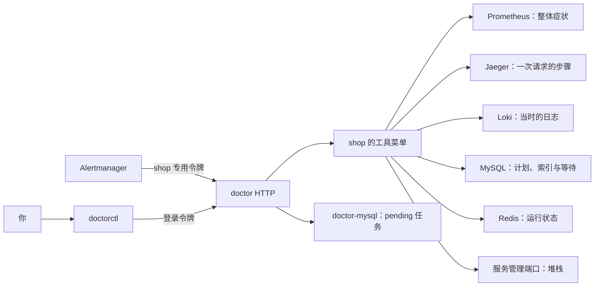

# 阶段 5 学习材料：医生接入层与工具层

现在先由你当“医生的大脑”。程序负责安全地取证，你负责决定下一步查什么、这些证据说明了什么。这个阶段没有接大模型，也不会自动修复。

## 1. 这个阶段做了什么



告警是“有人觉得系统不对劲了”。它不是根因。医生先把通知存起来，再提供一组查看工具。每个工具都有固定用途：查指标、找慢请求、看索引，等等。它们不能接收任意地址，也不能改数据库。

指标告诉你整体在哪段时间变慢。调用链把一笔请求拆成步骤，告诉你时间花在哪里。日志补充那一步发生了什么。数据库工具再验证具体猜想。把这几种证据连起来，才比“看见一个告警就猜原因”可靠。

## 2. 怎么跑起来、看什么

### 2.1 准备环境并登录

先按[根 README](../../README.md#阶段-5启动医生与手动取证)补齐本机 `.env`。不要重新复制示例覆盖现有密码。每次重建都明确使用 **10000 商品、200 QPS、64 个工作者**。这里只限定活跃商品范围，数据库仍保留五十万商品。默认五十万工作集会持续误触发 CacheLoadsHigh，当前留待单独修复，不能当作本轮健康基线。

下面使用 PowerShell 7，从仓库根目录执行。Docker Desktop 要先启动。

```powershell
$env:LOADGEN_PRODUCT_COUNT = '10000'
$env:LOADGEN_QPS = '200'
$env:LOADGEN_WORKERS = '64'
docker compose --env-file .env -f deploy/docker-compose.yml up -d --build --wait --wait-timeout 240
docker compose --env-file .env -f deploy/docker-compose.yml exec -T shop-mysql bash /docker-entrypoint-initdb.d/006_doctor_readonly.sh
Invoke-RestMethod http://127.0.0.1:8090/health/ready
```

你应该看到 doctor 和 doctor-mysql 健康，最后返回成功。首次空库先把 QPS 改成 0，按 README 完成造数后再开流量。初始化脚本第一次运行时可能还没有业务表，所以等迁移完成后再补授表级权限。脚本不会替你改已有账号的密码。

```powershell
# 只读本次需要的变量，不执行 .env 的内容，也不打印密码。
Get-Content .env | ForEach-Object {
    if ($_ -match '^(DOCTOR_ADMIN_EMAIL|DOCTOR_ADMIN_PASSWORD|CHAOS_MYSQL_PASSWORD|REDIS_PASSWORD)=(.*)$') {
        [Environment]::SetEnvironmentVariable($matches[1], $matches[2], 'Process')
    }
}
$body = @{ email = $env:DOCTOR_ADMIN_EMAIL; password = $env:DOCTOR_ADMIN_PASSWORD } | ConvertTo-Json
$login = Invoke-RestMethod -Method Post -Uri http://127.0.0.1:8090/api/v1/auth/login -ContentType application/json -Body $body
$env:DOCTOR_URL = 'http://127.0.0.1:8090'
$env:DOCTOR_TOKEN = $login.data.access_token
$env:CHAOS_MYSQL_DSN = "chaos:$($env:CHAOS_MYSQL_PASSWORD)@tcp(127.0.0.1:3306)/shop?parseTime=true"
go run ./cmd/doctorctl target list
go run ./cmd/doctorctl tool list --target shop
```

你应该看到 `shop` 和 16 个工具。登录令牌有一小时有效期，过期后重新登录。不要把 `$login` 或 `$env:DOCTOR_TOKEN` 打印到公开笔记里。chaos 账号只在你这个实验终端里使用，医生容器拿不到它。

### 2.2 手动诊断 S01：从症状走到根因

先确认没有遗留实验，再注入。这里的删除索引由人使用 chaos 完成，医生工具没有这项权限。

```powershell
go run ./cmd/chaos healthy
go run ./cmd/chaos inject S01
go run ./cmd/chaos verify S01
go run ./cmd/doctorctl tool run --target shop list_firing_alerts --args '{}'
```

你应该先看到健康检查通过，再看到 InventoryLatencyHigh 等症状告警。开发时两轮从注入起约 50.138s、40.080s 触发。告警告诉我们库存调用慢，还不能说明是网络、连接池还是 SQL。数字来自[台账 P5-14](../数据台账.md)，不是对任意机器的保证。

**第一步：确认影响范围。**

```powershell
go run ./cmd/doctorctl tool run --target shop service_topology --args '{}'
$metricArgs = @{ query = 'histogram_quantile(0.99,sum by(le)(rate(rpc_server_duration_seconds_bucket{service="inventory-service",method=~".*Deduct"}[1m])))'; lookback_seconds = 180 } | ConvertTo-Json -Compress
go run ./cmd/doctorctl tool run --target shop query_metrics --args $metricArgs
```

你应该看到订单服务通过 gRPC 调用库存服务，以及库存 Deduct 的 P99 上升。P99 是把请求耗时排序后，约 99% 请求都不超过的值。第一轮窗口里最后一个值约 0.989 秒。摘要里的 max 是整个回看窗口的最大值，恢复后它不会立即变小。

**第二步：挑一笔慢的扣库存请求。**

```powershell
$search = go run ./cmd/doctorctl tool run --target shop search_traces --args '{"service":"inventory-service","operation":"inventory.v1.InventoryService/Deduct","min_duration_ms":200,"lookback_seconds":180,"limit":1}' | ConvertFrom-Json
$search
$traceID = $search.data[0].trace_id
$traceArgs = @{ trace_id = $traceID } | ConvertTo-Json -Compress
go run ./cmd/doctorctl tool run --target shop get_trace --args $traceArgs
```

你应该看到同一笔请求的树形步骤。实测一次 POST /orders 为 824.790ms，其中库存 RPC 为 801.094ms，库存的 `sql.stmt.exec` 为 796.733ms。SQL 模板是：

```sql
UPDATE stock SET available = available - ?, updated_at = ?
WHERE sku_id = ? AND available >= ?
```

问号是绑定参数的位置，工具没有拿到真实订单参数。这个调用链把主要耗时指向库存 UPDATE，不能再只看见 RPC 慢就归因于网络。父步骤包含子步骤的耗时，别把三个数相加。

调用链有采样。搜索为空时，先确认故障流量还在，再稍等并重新搜索。不要用一条健康请求代替，也不要编造缺失步骤。第一轮随手搜到的是 GetStock，后来才通过 operation 明确筛出 Deduct；这个区别保留在开发记录里。

**第三步：看这条 SQL 怎么找行。**

```powershell
go run ./cmd/doctorctl tool run --target shop mysql_explain --args '{"sql":"SELECT * FROM stock WHERE sku_id = 1"}'
go run ./cmd/doctorctl tool run --target shop mysql_show_indexes --args '{"table":"stock"}'
go run ./cmd/doctorctl tool run --target shop mysql_table_stats --args '{"table":"stock"}'
```

为什么给 SELECT，而不是直接贴 UPDATE？工具只允许查看 SELECT 的执行计划。我们把 UPDATE 的查找条件转成 SELECT，查看“怎样定位这一行”，不执行扣库存。

实测计划显示 `type=ALL`、`key=NULL`、估计扫描 498780 行；索引列表只有 PRIMARY，缺少架构说明里用于 sku_id 查找的索引。ALL 表示计划扫描全表，rows 是估计值，不是这次真的执行并数出的行数。这些证据支持“按商品找库存时失去了有效索引”。

**第四步：检查连带影响。**

```powershell
go run ./cmd/doctorctl tool run --target shop mysql_lock_waits --args '{}'
go run ./cmd/doctorctl tool run --target shop mysql_status --args '{}'
go run ./cmd/doctorctl tool run --target shop mysql_top_queries --args '{"limit":5}'
$logArgs = @{ service = 'inventory-service'; trace_id = $traceID; lookback_seconds = 300; limit = 10 } | ConvertTo-Json -Compress
go run ./cmd/doctorctl tool run --target shop search_logs --args $logArgs
```

第一轮锁工具读到 stock 的六条等待关系。第二轮恰好读到空集合。这不矛盾：锁等待是一张瞬时照片，不是历史录像。结合一段时间的行锁指标和慢 UPDATE 判断，不要用一次空结果否定刚才发生过等待。top_queries 是数据库启动以来的累计摘要，也不能把累计第一名直接当成本次故障根因。

**第五步：由人恢复，再验证猜想。**

```powershell
go run ./cmd/chaos restore S01
go run ./cmd/chaos healthy
go run ./cmd/doctorctl tool run --target shop mysql_explain --args '{"sql":"SELECT * FROM stock WHERE sku_id = 1"}'
go run ./cmd/doctorctl tool run --target shop mysql_show_indexes --args '{"table":"stock"}'
```

你应该看到 sku_id 的唯一索引恢复，计划能够直接定位行。两轮恢复索引约 6.225s、5.031s，但告警清退和连续健康窗口都还需要约 130s。不能把 DDL 执行完当作整个系统已经恢复。中途任何命令失败都先 `chaos restore-all`，核实恢复成功后再结束实验。

证据链是：库存耗时升高 → 一笔 Deduct 的 UPDATE 占主要时间 → 同条件 SELECT 全表扫描 → 索引元数据确认缺失 → 恢复索引后计划和健康状态恢复。不是因为你事先知道场景叫 S01，才把原因写成索引。

### 2.3 看收到的诊断任务

```powershell
$headers = @{ Authorization = "Bearer $env:DOCTOR_TOKEN" }
$tasks = Invoke-RestMethod -Uri 'http://127.0.0.1:8090/api/v1/diagnoses?target=shop&status=pending&page_size=20' -Headers $headers
$tasks.data.items
```

你应该看到 `target=shop`、`status=pending`。第一轮 S01 实际创建了库存延迟、数据库连接池等待、行锁等待三个分组任务。重复通知会更新告警快照，不会每次再建一个任务。本阶段没有执行器，因此恢复后任务仍在；这不是后台卡住了。

## 3. 开发过程回放

### 3.1 先修会污染诊断任务的旧问题

这次要让告警开始建任务，所以先处理冷启动误报和测试干扰。动手前先区分“误报”与“系统真的慢”：goroutine 启动增长不等于泄漏，MySQL 冷启动后的下单变慢则是真实症状。

相关入口是 `TestRetryPolicy(t)`，没有返回值；它验证重试次数和剩余预算。`healthyQueries() []string` 列出健康条件；Prometheus 规则负责判断增长是否持续。先测旧规则，再加进程年龄条件，最后用合成时间线和真实 S09 验证。真实重启观测到增长率超过旧门槛的最后时刻约为启动后 64.976s，于是采用 90s 保护。S09 仍在 161.078s 触发。

1ms 的测试预算改放进标准库的虚拟时钟，五个用例的断言不变。README 把三类测试告警和全部 TEST 变量列全。随后单独提交这四项修复。没有顺手修改 OrderLatencyHigh。

### 3.2 先定查看接口，再连接真实后端

目标是让工具问“索引有哪些”，不必知道 HTTP JSON 或 MySQL 行怎样解析。先明确每一种证据需要哪些字段，再把具体产品留在适配器里。

| 函数 | 输入 → 输出 | 用途 |
|---|---|---|
| `SelectStatement` | SQL 文本 → 单条 SELECT 或错误 | 两层共同使用的 SQL 限制 |
| `mysqlinspect.New` | DSN → 客户端或错误 | 强制关闭多语句，固定三连接池 |
| `jaeger.Search` | context、搜索条件 → 调用链列表或错误 | 把时间和耗时转换成固定版本接受的参数 |
| `pprof.Goroutines` | context、服务名 → 堆栈分组或错误 | 只查配置中的服务，不接收地址 |

实际先读了固定 Jaeger 2.20.0 的接口说明，再请求本机 `/api/traces`，保存真实结构作为 httptest 夹具。SQL 与 Redis 使用原生协议，分别用数据库驱动替身、RESP 假服务和真实权限测试覆盖，没有硬把它们改成 HTTP。

这些文件分开，是因为 Prometheus 的序列、Jaeger 的父子步骤和 Loki 的日志各有不同边界。随后统一接到工具菜单，最后接服务入口。后续自查把八处较长函数拆成了有名字的步骤，减少读者在同一个函数里来回切换上下文。

### 3.3 把工具绑定到系统，而不是每次临时找地址

目标是让 A 系统的诊断始终使用 A 的连接。动手前先明确：工具参数不应拥有换地址、换账号的权力。

| 函数 | 输入 → 输出 | 用途 |
|---|---|---|
| `target.Load` | 目录、环境读取函数 → Catalog 或错误 | 读取全部配置，先查冲突，再逐套装配 |
| `credentials` | 配置、环境读取函数 → 凭据映射或错误 | 检查变量名以外的实际账号重复 |
| `tools.New` | 已绑定的 source 接口 → Registry | 按当前系统已有的数据源建立菜单 |
| `Registry.Run` | context、工具名、JSON → Result | 所有入口共用校验、十秒预算和结果上限 |

先写配置校验与独立客户端，再用 shop 和虚构 warehouse 的假后端测试：A 查到 11，B 查到 22，各自只命中自己的服务器。接着补未知 URL、主机、系统参数的拒绝测试，覆盖完整十六项菜单。CLI 最后通过 HTTP 接同一个 Registry；这样多开终端不会多开几份三连接池。

### 3.4 补上账号权限，才发现 Redis 原来没有认证

目标是让程序限制之外还有数据库自己的防线。先确认工具要读哪些表和列，不能直接给整库管理权限。

`mysqlinspect.query(ctx, sql, limit, args...)` 返回元数据表格；`redisinspect.Info(ctx, section)` 返回白名单运行信息。初始化脚本分别创建 MySQL diag_ro 和 Redis diag_ro。MySQL 业务表在空库首次启动时还不存在，所以脚本先创建身份和监控列权限，迁移后再补五张业务表的 SELECT。

真实 Redis 检查发现 default 是无密码全权限。这会绕过新建的只读账号。我先停下来询问，用户批准补业务密码，随后才修改订单客户端、chaos、exporter、测试和部署。密码从环境生成 ACL 文件，不放启动参数。

负向测试第一次被自动审批拦住，因为里面有 FLUSHALL。于是先用 ACL DRYRUN 查询是否允许，明确拒绝后再测试真实错误。第一版又把 DRYRUN 的普通拒绝字符串当成 error，测试因此失败；修正解析后通过。这两次都没有清库，失败记录没有删。

重建后的 S04/S05 回归先被健康检查挡住。原因是商品范围回到了默认五十万，健康回源比例约 44%，超过 35% 门槛，但请求错误为零。用户决定本阶段不改这条规则，明确设回一万商品后，两场景完整流程才通过。

### 3.5 把告警保存下来，再让人用同一路径取证

目标是网络重发不重复建任务，而且任务一开始就知道自己属于哪个系统。先确定身份来自已认证的路由，不能相信正文里的系统名。

| 函数 | 输入 → 输出 | 用途 |
|---|---|---|
| `alerts.Service.Receive` | context、已绑定系统、通知 → Receipt 或错误 | 格式检查后，在有限时间内保存 |
| `store.ReceiveAlerts` | 同上 → 同上 | 唯一键与事务保证分组去重 |
| `httpapi.New` | 已装配依赖 → Gin 路由 | 区分登录入口、工具入口、系统告警入口 |
| `app.RunCLI` | context、命令参数、环境读取器、输出 → error | 把人的命令转成固定医生 HTTP 请求 |

先建 users、diagnoses、diagnosis_alerts，再测三次顺序重发和二十路并发重发。随后验证 A 令牌不能推给 B，登录令牌和推送令牌也不能混用。最后切换 Alertmanager、Prometheus 和 Alloy 的原 alertsink 接线。

S01 第一轮实验脚本漏了专用 DSN，在注入前失败。补齐后通过恢复命令清理记录，再执行两轮完整实验。第一轮验证全部工具；第二轮明确搜索 Deduct，拿到慢 UPDATE。全量 staticcheck 又发现错误文字格式与 HTTP 状态码常量问题，修正后从头重跑检查。具体耗时、结果和失败轮次都在 notes，不把这段回放写成一次全过。

## 4. 阅读顺序

1. [cmd/doctor/main.go](../../cmd/doctor/main.go)：入口只负责等待启动函数返回。
2. [app/app.go](../../internal/doctor/app/app.go)：资源先后顺序和退出时怎样收尾。
3. [source/source.go](../../internal/doctor/source/source.go)：医生真正需要哪些查看能力。
4. [target/config.go](../../internal/doctor/target/config.go) 与 [catalog.go](../../internal/doctor/target/catalog.go)：从多份文件变成多套独立连接。
5. [tools/registry.go](../../internal/doctor/tools/registry.go) 与 [schema.go](../../internal/doctor/tools/schema.go)：参数怎样被拒绝，预算怎样传下去，结果怎样截断。
6. [tools/catalog_mysql.go](../../internal/doctor/tools/catalog_mysql.go) 与 [mysqlinspect/client.go](../../internal/doctor/source/mysqlinspect/client.go)：从一个工具追到固定 SQL。
7. [jaeger/client.go](../../internal/doctor/source/jaeger/client.go) 与 [tools/summary.go](../../internal/doctor/tools/summary.go)：怎样还原调用链，以及不完整数据怎样标记。
8. [alerts/service.go](../../internal/doctor/alerts/service.go) 与 [store/alerts.go](../../internal/doctor/store/alerts.go)：去重身份、事务和重复快照。
9. [httpapi/router.go](../../internal/doctor/httpapi/router.go)、[handlers.go](../../internal/doctor/httpapi/handlers.go)、[app/cli.go](../../internal/doctor/app/cli.go)：从终端到同一个 Registry 的整条路。
10. 最后读各包的测试和 [archcheck/doctor.go](../../tools/archcheck/doctor.go)：看每个边界怎样被故意破坏、再被挡住。

完整文件导航在[代码地图](../代码地图.md)。不必第一次就通读全部适配器，先把 mysql_explain 这一条路径读通。

## 5. 关键设计与 WHY

### 5.1 为什么要有 source 接口

工具需要的是证据，不是某个厂商的 JSON。source 把“我要什么”写成小接口，适配器负责“去哪里查、怎样解析”。这里没有另建通用 RPC 或 MCP 服务，都是 Go 进程里的普通方法调用。

接口放在医生这一侧，是因为医生知道自己需要多小的能力。实现包不必声明 `implements`；只要方法签名相同，就能赋给这个接口。测试也可以用一个很小的假实现替代真实后端。

### 5.2 系统隔离为什么在创建时完成

如果每次调用都让参数携带系统名和 URL，一次拼错就可能跨系统。这里先通过配置为 shop 创建一整套工具，之后调用只在这套菜单里找名字。

配置名称重复、两个系统使用同一个凭据变量名都会拒绝启动。换一个变量名却仍使用同一地址和用户名，也会被拒绝。测试中的 warehouse 是虚构系统，真实部署只有 shop。系统间没有共享的全局 MySQL 或 Redis 客户端。

### 5.3 十秒和四千字节为什么放在统一入口

如果每个工具自己决定超时，很容易有一个漏写。Registry 在校验后创建十秒 context，把它一路传到 HTTP 请求或数据库查询。MySQL 等连接也算在这十秒里。父调用如果只剩一秒，工具只有一秒，不会凭空得到新的十秒。

结果也有统一上限。`original_bytes` 是最终截断前的 Data JSON 大小，`bytes` 是包含状态、摘要等字段的完整 Result 大小。两者口径不同。超长时把前半段放进 `preview` 字符串，仍是合法 JSON，`truncated=true` 明确告诉你结果不完整。先摘要再截断，能优先留下数量、极值和最慢步骤。

这不等于无限大的后端结果都能读完。HTTP 适配器先限制响应最多 2 MiB；指标也限制序列和点数。超过边界会失败或明确标为 limited，不能把省略部分当作“没有”。

### 5.4 权限边界：读的一侧

医生自己的库可以写，因为它要保存任务。但它连接 shop 用的是另一套账号，不能拿 doctor 库的权限去改 shop。下面三层一起工作：

| 层 | 挡住什么 |
|---|---|
| 接入与部署 | 没有场景、chaos 状态、Docker socket、靶场业务密码；后端地址只能来自配置 |
| 工具代码 | 没有任意 SQL、任意 URL 或读 key 工具；查询只返回计划、元数据、统计和观测证据 |
| 数据库账号 | MySQL 写操作与超额连接被拒绝；Redis 读 key、写入、清库、配置命令被拒绝 |

**为什么 MySQL 账号有 SELECT，医生却拿不到业务行？** MySQL 做 EXPLAIN 也要验证表权限，因此 diag_ro 有五张业务表的 SELECT。账号本身确实有读取这些行的能力，不能说 SELECT 被数据库禁掉了。限制来自工具：唯一接受 SQL 的方法会先检查 SELECT，再自己加 EXPLAIN，返回计划而不执行原查询；其他方法的 SQL 都固定。若有人盗走账号直连数据库，这层工具限制并不能保护业务行，所以凭据仍必须保密。

MySQL 监控表只授权实际用到的列。SQL 统计读 `DIGEST_TEXT`，具体值已被替成问号，不读 `QUERY_SAMPLE_TEXT`。锁信息不读 `LOCK_DATA`。没有授予 PROCESS、GRANT OPTION、INSERT、UPDATE、DELETE 或 DDL。

Redis 只允许 INFO、SLOWLOG GET/LEN，以及客户端握手需要的 HELLO、PING。工具返回慢日志时还删去 key/value 参数，只留命令名、参数个数和耗时。允许“看慢日志”不等于允许 SLOWLOG RESET，更不等于能 GET 一个缓存键。

连接数也属于权限。故障时数据库已经忙，医生不能再抢几十条连接。账号 `MAX_USER_CONNECTIONS 3` 是数据库的硬限制，医生池上限也是 3；排队十秒就返回超时。doctorctl 经 HTTP 使用这个池，开多个终端不会每个再开三条。

以后模型会看到工具整理后的指标、SQL 模板、元数据、调用树、日志和架构说明，不会拿到 DSN 或原始客户端对象。本阶段还没有模型，也没有实现阶段 7 的统一脱敏；接入真实日志前必须另外考虑敏感信息，不能因为工具只读就认为内容都适合外发。

### 5.5 告警为什么不能每来一次就新建任务

发送方没有收到成功响应时，会再次发送。同一故障持续时也会重复提醒。用“系统名加分组键”做唯一身份，让重复通知找到已有 pending 任务。任务和告警快照在一个数据库事务里写，全部提交后才向发送方返回成功。

通知变成 resolved，只更新快照，不删除任务。本阶段没有执行器，任务一直 pending。后续任务完成时才需要释放活动分组身份；那属于后续状态机，不在这里假装已经做完。

### 5.6 Jaeger 为什么固定一种接口

当前固定 2.20.0 实测可用的是 `/api/traces` 搜索和 `/api/traces/{id}` 详情。这个旧 HTTP 接口不是稳定的公共契约，所以把真实响应做成测试夹具，并在 decisions 写清升级要回归的字段。不能只改镜像标签，然后发现 Grafana 或医生查不到链路。

医生目前只有 HTTP 和原生数据库连接，没有 gRPC 客户端。若将来增加 OTLP 导出器，仍要沿用阶段 3 的 `grpc.WithDisableServiceConfig()`，防止无用 TXT 查询拖住连接。

## 6. 本阶段用到的 Go 写法

### 6.1 接口由方法集合决定，不写 implements

Java 常见写法是类声明实现某个接口。Go 看这个类型的方法是否齐全。下面两个实现都能交给同一个使用方。保存为临时目录的 `main.go`，运行 `go run main.go`。

```go
package main

import "fmt"

type Counter interface { Count() int }
type Real struct{}
func (Real) Count() int { return 3 }
type Fake struct{ Value int }
func (f Fake) Count() int { return f.Value }
func show(c Counter) { fmt.Println(c.Count()) }

func main() {
    show(Real{})
    show(Fake{Value: 11})
}
```

输出 3 和 11。工具只依赖 Counter 这么小的能力，不必知道后面是真的数据库还是测试对象。

### 6.2 json.RawMessage：先保留 JSON，再按用途解码

不同工具的参数不同。统一入口先保留一段原始 JSON，再用本工具的字段规则解码。RawMessage 不是普通字符串；编码时它仍作为 JSON 内容放进去。

```go
package main

import (
    "encoding/json"
    "fmt"
)

type Request struct {
    Tool string `json:"tool"`
    Args json.RawMessage `json:"args"`
}

func main() {
    var r Request
    err := json.Unmarshal([]byte(`{"tool":"table","args":{"limit":3}}`), &r)
    if err != nil { panic(err) }
    var args struct { Limit int `json:"limit"` }
    if err := json.Unmarshal(r.Args, &args); err != nil { panic(err) }
    fmt.Println(r.Tool, args.Limit)
}
```

输出 `table 3`。项目还额外逐字段解码，以拒绝重复字段和未知字段；这个最小例子只解释 RawMessage 本身。

### 6.3 闭包：把系统连接留在创建工具的那一刻

闭包是一个带着外部变量的函数。这里用它记住工具属于哪套数据源，调用参数就不用再接收系统名。

```go
package main

import "fmt"

func bind(value int) func() int {
    return func() int { return value }
}

func main() {
    shop := bind(11)
    warehouse := bind(22)
    fmt.Println(shop(), warehouse())
}
```

输出 11 和 22。两个返回的函数各自记住一次 bind 调用里的值。项目里记住的是 source 接口；构造后不再替换。

### 6.4 testing/synctest：让截止时间测试不用赌调度速度

这是标准库给测试提供的虚拟时间。所有测试任务都在等待时，时钟可以直接前进。不用真的等十秒，也不会因为电脑慢就把 1ms 用完。

在仓库外的新临时目录保存为 `clock_test.go`，执行 `go mod init clockexample`，再执行 `go test -v`。不要把示例包写进项目根目录。

```go
package clockexample

import (
    "context"
    "testing"
    "testing/synctest"
    "time"
)

func TestDeadline(t *testing.T) {
    synctest.Test(t, func(t *testing.T) {
        started := time.Now()
        ctx, cancel := context.WithTimeout(t.Context(), 10*time.Second)
        defer cancel()
        <-ctx.Done()
        if time.Since(started) != 10*time.Second { t.Fatal("时间不符合预期") }
        if ctx.Err() != context.DeadlineExceeded { t.Fatal(ctx.Err()) }
    })
}
```

它验证的仍是十秒截止时间，只是时钟由测试控制。真实网络权限和连接上限仍要另外做集成测试。

## 7. 动手实验

### 实验一：试图把工具指向别的地址

```powershell
go run ./cmd/doctorctl tool run --target shop mysql_status --args '{"host":"other-host"}'
go run ./cmd/doctorctl tool run --target shop mysql_status --args '{}'
```

第一条应返回 invalid_argument，CLI 返回非零退出码；第二条正常。错误参数不是连接失败，它应在访问后端之前被拒绝。

### 实验二：试图让执行计划工具执行写入

```powershell
go run ./cmd/doctorctl tool run --target shop mysql_explain --args '{"sql":"UPDATE stock SET available=0"}'
go run ./cmd/doctorctl tool run --target shop mysql_explain --args '{"sql":"EXPLAIN SELECT * FROM stock"}'
go run ./cmd/doctorctl tool run --target shop mysql_explain --args '{"sql":"SELECT * FROM stock WHERE sku_id=1"}'
```

前两条都应拒绝；第三条返回计划。第二条虽然看起来只读，也要拒绝，因为 EXPLAIN 前缀必须由工具自己控制，不能让输入升级成 EXPLAIN ANALYZE。

### 实验三：观察结果怎样变短

```powershell
go run ./cmd/doctorctl tool run --target shop search_logs --args '{"service":"order-service","limit":100}'
go run ./cmd/doctorctl tool run --target shop search_logs --args '{"service":"order-service","limit":3}'
```

有足够日志时第一条会 `truncated=true`，第二条通常完整。比较 original_bytes、bytes 和摘要。返回太长时应缩小查询，而不是把预览里没有的内容理解为没发生。

### 实验四：自己重复 S01

按第 2.2 节执行一轮。先写下每一步准备验证的猜想，再运行命令。结束后必须恢复并通过 healthy。把“症状、证据、推论、仍不确定的部分”各写一行。不要为得到熟悉的答案而跳过与猜想不符的证据。

## 8. 常见误区

- “只读账号不能泄露数据。”它仍可能有 SELECT 能力，工具范围、凭据保密和结果处理都重要。
- “EXPLAIN 的 rows 就是实际读了多少行。”它是计划估计，工具没有执行 SELECT。
- “没有查到 trace 就没有这次请求。”采样、保留时间和导出失败都可能让证据缺失。
- “刚查没有锁等待，就没发生锁等待。”它是瞬时状态，要和一段时间的指标一起看。
- “重新启动后没再告警，旧任务应该自动消失。”任务保存的是一次通知与待处理工作，本阶段不会执行或删除它。
- “工具返回 200 就成功。”HTTP 传输成功和 Result.status=ok 是两回事，CLI 已检查 status。
- “修 Redis 认证顺便解决了所有健康告警。”没有。五十万工作集的 CacheLoadsHigh 误报仍保留，当前只复验一万商品基线。

## 9. 必答问题

1. 为什么接口要定义在使用方？这和 Java 的接口习惯有什么不同？
2. 适配器模式在这里解决了什么问题？
3. 工具结果为什么要截断和摘要？不做会怎样？
4. 为什么说只读数据库账号是最后一道防线？
5. 为什么 mysql_explain 只接受 SELECT？
6. 告警为什么需要去重？
7. 如果把系统提示里的安全规则全部删掉，医生能多看到什么？为什么？
8. 一个医生接管多个系统时，怎么保证诊断 A 时碰不到 B？为什么工具参数不放系统名？

## 10. 本阶段新术语

| 术语 | 大白话解释 |
|---|---|
| 适配器 | 把同一个查看问题翻译成不同产品能理解的请求，再把答案整理回来 |
| 工具注册表 | 一份可调用菜单，名字、字段规则和执行函数放在一起 |
| DSN | 数据库连接说明，通常包含地址、库名、账号和密码，要当密钥保管 |
| ACL | Redis 对某个账号明确列出的允许命令和允许键范围 |
| DIGEST_TEXT | 把具体值换成问号的 SQL 模板，用来归类统计 |
| 幂等去重 | 同一通知再来一次，仍指向同一份结果，而不是重复创建 |
| 指纹 fingerprint | Alertmanager 根据一条告警的标签算出的身份标记 |
| pending | 任务已保存，尚未开始执行 |
| 契约测试 | 用真实后端的请求和响应结构，检查我们的适配器有没有理解错 |
| 夹具 fixture | 测试保存的一份固定样例，这里包含真实 Jaeger 返回的结构 |
| 虚拟时钟 | 测试自己推进时间，不依赖真实等待和电脑调度速度 |

<details>
<summary>必答问题参考要点：先自己想，再展开</summary>

1. 使用方知道自己需要的最小能力，接口不必跟着实现膨胀。Go 靠方法集合满足接口，不写 implements；Java 也能按使用方需求设计接口，不是语言禁止，只是声明方式不同。
2. 把工具与 Prometheus、Jaeger 等产品格式隔开。工具不因一个 JSON 外壳变化而重写，测试也能换假后端。
3. 大结果会拖慢接口、挤掉重要证据，将来还会增加模型成本。摘要保留结构和重点，截断保证硬上限，标记说明结果不完整。
4. 如果工具层有漏洞，数据库仍能拒绝写入和超额连接。但只读账号仍可能读到数据，所以不是唯一防线。
5. 减少可接受 SQL 的范围。工具自己加 EXPLAIN，不允许 ANALYZE 真正执行查询，也不允许多语句或写语句。
6. 持续故障会重复通知，网络失败会重发。数据库唯一身份和事务让这些通知更新同一任务，不生成一堆重复工作。
7. 本阶段没有系统提示或模型。未来删掉提示里的限制，也不会凭空增加工具、地址、账号权限或挂载文件。代码和账号边界仍在。
8. 每个系统先创建独立客户端和工具菜单，任务绑定系统。参数不能临时换系统；配置重名、共享凭据和 A 令牌推 B 都有拒绝测试。

</details>
