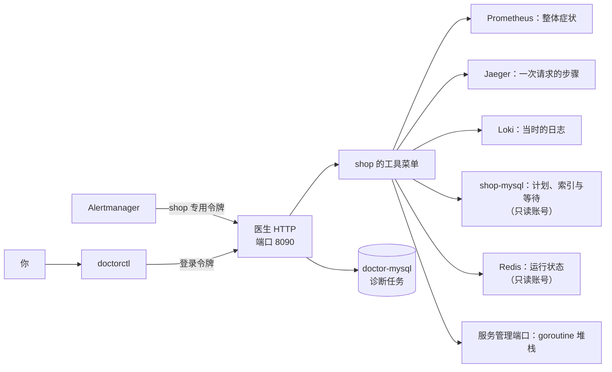
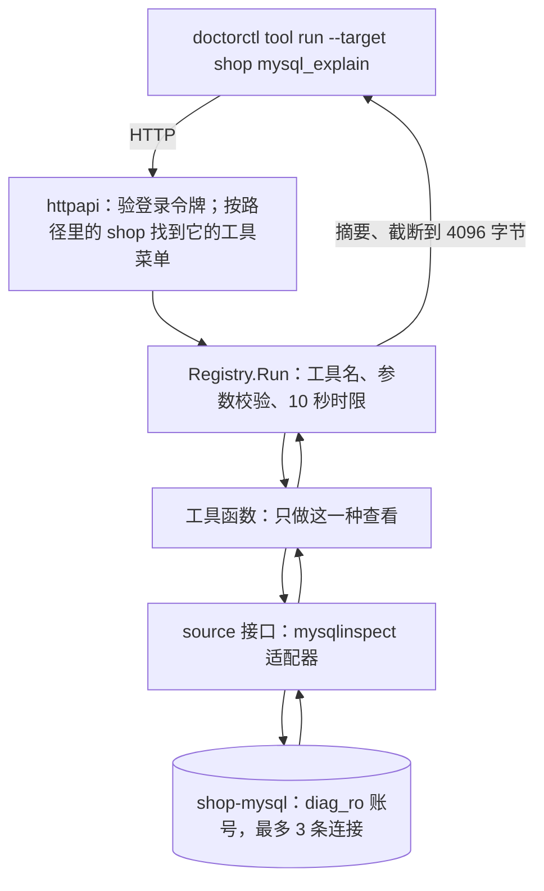

# 阶段 5 学习材料：医生接入层与工具层

从这个阶段开始写“医生”：一个接收告警、调查原因的诊断服务。这个阶段先写它的手和眼睛，还没有接大模型，也不会自动修复：

| 交付 | 作用 |
|---|---|
| 医生服务（[cmd/doctor](../../cmd/doctor/main.go)、[doctor/app](../../internal/doctor/app/doc.go)） | 一个独立的进程，有自己的数据库 doctor-mysql |
| 数据源适配器（[doctor/source](../../internal/doctor/source/doc.go)） | 去 Prometheus、Jaeger、Loki、MySQL、Redis、服务管理端口取证 |
| 工具菜单（[doctor/tools](../../internal/doctor/tools/doc.go)） | 16 个只读的取证工具，每个有固定用途和固定参数 |
| 系统配置（[doctor/target](../../internal/doctor/target/doc.go)） | 每个被诊断的系统一套独立的连接和工具 |
| 告警接入（[doctor/alerts](../../internal/doctor/alerts/doc.go)、[store](../../internal/doctor/store/doc.go)） | 接收 Alertmanager 的通知，去重后存成诊断任务 |
| 命令行 doctorctl | 人登录以后，用同一套工具手动取证 |

现在先由你当“医生的大脑”：程序负责安全地取证，你负责决定下一步查什么、这些证据说明了什么。阶段 6 再把大脑换成模型。

**怎样读这份材料。** 主线是 **Agent 的工具层怎样设计**：给模型的是一份固定的菜单，而不是数据库连接；每个工具的权限、时间、结果大小都有上限；一个医生接管多个系统时，怎样保证诊断 A 时碰不到 B。Go 语法见第 7 节和 [Mini-Redis 的学习文档](https://github.com/Li-Nepenthe/mini-redis/blob/main/docs/learn/README.md)。

> 这份材料对照的是**当前的代码**。阶段 8 加了第 17 个工具 `runbook_search`（查通用的排障手册），阶段 9 加了 OpenSearch 适配器，遇到时可以先跳过。

## 1. 本阶段能回答的面试题

| 面试题 | 在哪里 |
|---|---|
| 为什么不让 AI 直接连数据库执行 SQL，而要包一层工具？ | 5.1、八股 1 |
| 怎么防止 AI 执行危险的 SQL？怎样防止 Agent 乱改系统？ | 5.5、八股 1 |
| 工具返回的结果太长怎么办？ | 5.4、八股 2 |
| 一个服务接管多个系统，怎样保证诊断 A 时碰不到 B？ | 5.3、八股 3 |
| 同一条告警重复推送了很多次，怎样只建一个任务？ | 5.6、八股 4 |
| 工具层和各种监控产品之间怎样解耦？ | 5.2 |
| 依赖的外部接口没有稳定契约，怎样防止升级后悄悄坏掉？ | 5.7 |
| 拿到一条“库存调用变慢”的告警，你怎样一步步查到缺了索引？ | 第 3 节、八股 5 |

## 2. 医生在系统里的位置

### 2.1 上下游



医生是一个独立的服务。它只能像外部的运维人员那样，通过监控数据和只读账号了解靶场；它不能导入靶场的代码（depguard 检查），容器里也没有场景文件、chaos 的恢复记录和 Docker socket（archcheck 检查）。

### 2.2 一次取证经过的层



### 2.3 各部分负责什么、不负责什么

| 部分 | 负责 | 不负责 |
|---|---|---|
| source | 定义医生需要的查看能力（小接口），每个后端一个适配器，负责请求和解析 | 决定该查什么 |
| tools | 工具菜单：名字、说明、参数规则、执行函数；统一的时限、摘要和截断 | 连接后端（由 source 负责） |
| target | 读系统配置，为每个系统创建独立的客户端和工具菜单；拒绝冲突的配置 | 运行时切换系统 |
| alerts、store | 验证推送令牌，按“系统 + 分组键”去重，在一个事务里保存任务和告警快照 | 执行诊断（阶段 6） |
| httpapi | 登录入口、工具入口、告警入口三类路由 | 业务判断 |
| 数据库账号 diag_ro | 最后一道防线：写入、读敏感列、超额连接都被数据库拒绝 | 防止读取业务行（EXPLAIN 也要 SELECT 权限，5.5 节） |

## 3. 跑起来看什么

先按[运维文档](../operations.md#阶段-5启动医生与手动取证)补齐本机 `.env`。不要重新复制示例覆盖现有密码。每次重建都明确使用 **10000 商品、200 QPS、64 个工作者**（数据库仍保留五十万商品，这里只限定活跃范围）。前提是库里已经有完整的业务数据；如果是全新的空库，按运维文档先把 QPS 设成 0，造完数再打开流量。下面使用 PowerShell，从仓库根目录执行，Docker Desktop 要先启动。

**第 1 步：启动并登录。**

```powershell
$env:LOADGEN_PRODUCT_COUNT = '10000'
$env:LOADGEN_QPS = '200'
$env:LOADGEN_WORKERS = '64'
docker compose --env-file .env -f deploy/docker-compose.yml up -d --build --wait --wait-timeout 240
docker compose --env-file .env -f deploy/docker-compose.yml exec -T shop-mysql bash /docker-entrypoint-initdb.d/006_doctor_readonly.sh
Invoke-RestMethod http://127.0.0.1:8090/health/ready
```

你应该看到 doctor 和 doctor-mysql 健康。第二条命令给只读账号补表级权限：初始化脚本第一次运行时可能还没有业务表，所以等迁移完成后再补。

```powershell
# 只读本次需要的变量，不执行 .env 的内容，也不打印密码。
Get-Content .env | ForEach-Object {
    if ($_ -match '^(DOCTOR_ADMIN_EMAIL|DOCTOR_ADMIN_PASSWORD|CHAOS_MYSQL_PASSWORD|REDIS_PASSWORD|CHAOS_BASELINE_MYSQL_DSN)=(.*)$') {
        [Environment]::SetEnvironmentVariable($matches[1], $matches[2], 'Process')
    }
}
$body = @{ email = $env:DOCTOR_ADMIN_EMAIL; password = $env:DOCTOR_ADMIN_PASSWORD } | ConvertTo-Json
$login = Invoke-RestMethod -Method Post -Uri http://127.0.0.1:8090/api/v1/auth/login -ContentType application/json -Body $body
$env:DOCTOR_URL = 'http://127.0.0.1:8090'
$env:DOCTOR_TOKEN = $login.data.access_token
$env:CHAOS_MYSQL_DSN = "chaos:$($env:CHAOS_MYSQL_PASSWORD)@tcp(127.0.0.1:3306)/shop?parseTime=true"
go run ./cmd/doctorctl target list
go run ./cmd/doctorctl tool list --target shop
```

你应该看到 `shop` 和它的工具列表（阶段 5 时是 16 个，P5-12；现在是 17 个）。登录令牌有一小时有效期。不要把 `$login` 或 `$env:DOCTOR_TOKEN` 打印到公开笔记里。chaos 账号只在你这个实验终端里使用，医生容器拿不到它。`CHAOS_BASELINE_MYSQL_DSN` 是一个只读账号，`chaos healthy` 用它检查有没有残留的医生索引，缺了它会直接报错。

**第 2 步：手动诊断 S01，从症状走到根因。** 先确认没有遗留实验，再注入。删除索引由人用 chaos 完成，医生工具没有这项权限。

```powershell
go run ./cmd/chaos healthy
go run ./cmd/chaos inject S01
go run ./cmd/chaos verify S01
go run ./cmd/doctorctl tool run --target shop list_firing_alerts --args '{}'
```

你应该看到 InventoryLatencyHigh 等症状告警。开发时两轮从注入起约 50.138s、40.080s 触发（P5-14）。告警只说明库存调用慢，还不能说明是网络、连接池还是 SQL。

**确认影响范围。**

```powershell
go run ./cmd/doctorctl tool run --target shop service_topology --args '{}'
$metricArgs = @{ query = 'histogram_quantile(0.99,sum by(le)(rate(rpc_server_duration_seconds_bucket{service="inventory-service",method=~".*Deduct"}[1m])))'; lookback_seconds = 180 } | ConvertTo-Json -Compress
go run ./cmd/doctorctl tool run --target shop query_metrics --args $metricArgs
```

你应该看到订单服务通过 gRPC 调用库存服务，以及库存 Deduct 的 P99 明显上升。摘要里的 max 是整个回看窗口的最大值，恢复后它不会立即变小。

**挑一笔慢的扣库存请求。**

```powershell
$search = go run ./cmd/doctorctl tool run --target shop search_traces --args '{"service":"inventory-service","operation":"inventory.v1.InventoryService/Deduct","min_duration_ms":200,"lookback_seconds":180,"limit":1}' | ConvertFrom-Json
$search
$traceID = $search.data[0].trace_id
$traceArgs = @{ trace_id = $traceID } | ConvertTo-Json -Compress
go run ./cmd/doctorctl tool run --target shop get_trace --args $traceArgs
```

你应该看到同一笔请求的树形步骤。实测一次 POST /orders 为 824.790ms，库存的 `sql.stmt.exec` 为 796.733ms（数据台账 P5-14），中间的库存 RPC 占了整笔的绝大部分，SQL 模板是 `UPDATE stock SET available = available - ?, updated_at = ? WHERE sku_id = ? AND available >= ?`。父步骤包含子步骤的耗时，别把这几个数相加。这个调用链把主要耗时指向库存 UPDATE，不能只看见 RPC 慢就归因于网络。调用链有采样，搜索为空时先确认故障流量还在，再稍等重新搜索，不要用一条健康请求代替。

**看这条 SQL 怎么找行。**

```powershell
go run ./cmd/doctorctl tool run --target shop mysql_explain --args '{"sql":"SELECT * FROM stock WHERE sku_id = 1"}'
go run ./cmd/doctorctl tool run --target shop mysql_show_indexes --args '{"table":"stock"}'
go run ./cmd/doctorctl tool run --target shop mysql_table_stats --args '{"table":"stock"}'
```

工具只允许查看 SELECT 的执行计划，所以把 UPDATE 的查找条件转成 SELECT，查看“怎样定位这一行”，不执行扣库存。实测这条 SELECT 的计划显示 `type=ALL`、`key=NULL`、估计扫描 498780 行（数据台账 P5-14）；索引列表只有 PRIMARY。可以和阶段 4 的 4.5 节对照：那里对真实的 UPDATE 做 EXPLAIN，结果是 `type=index`、`key=PRIMARY`，也要扫描几十万行。两份计划对应的 SQL 不同（一个是 SELECT，一个是 UPDATE），访问方式也不同。把 UPDATE 改写成 SELECT 得到的计划是近似，不一定和原语句完全相同。

**检查连带影响。**

```powershell
go run ./cmd/doctorctl tool run --target shop mysql_lock_waits --args '{}'
go run ./cmd/doctorctl tool run --target shop mysql_status --args '{}'
go run ./cmd/doctorctl tool run --target shop mysql_top_queries --args '{"limit":5}'
$logArgs = @{ service = 'inventory-service'; trace_id = $traceID; lookback_seconds = 300; limit = 10 } | ConvertTo-Json -Compress
go run ./cmd/doctorctl tool run --target shop search_logs --args $logArgs
```

第一轮锁工具读到 stock 上的几条等待关系，第二轮恰好读到空集合（[实测记录](../notes.md#phase-05)）。这不矛盾：锁等待是一张瞬时照片，不是历史录像。top_queries 是数据库启动以来的累计摘要，也不能把累计第一名直接当成本次故障根因。

**由人恢复，再验证猜想。**

```powershell
go run ./cmd/chaos restore S01
go run ./cmd/chaos healthy
go run ./cmd/doctorctl tool run --target shop mysql_explain --args '{"sql":"SELECT * FROM stock WHERE sku_id = 1"}'
```

你应该看到计划能够直接定位行。两轮恢复索引约 6.225s、5.031s，但告警清退和连续健康窗口还需要约 130s（P5-14）。中途任何命令失败都先 `chaos restore-all`。

证据链是：库存耗时升高 → 一笔 Deduct 的 UPDATE 占主要时间 → 同条件 SELECT 全表扫描 → 索引元数据确认缺失 → 恢复索引后计划和健康状态恢复。不是因为你事先知道场景叫 S01，才把原因写成索引。

**第 3 步：看收到的诊断任务。**

```powershell
$headers = @{ Authorization = "Bearer $env:DOCTOR_TOKEN" }
$tasks = Invoke-RestMethod -Uri 'http://127.0.0.1:8090/api/v1/diagnoses?target=shop&status=pending&page_size=20' -Headers $headers
$tasks.data.items
```

阶段 5 时，第一轮 S01 实际创建了库存延迟、数据库连接池等待、行锁等待三个分组任务，重复通知只更新告警快照。阶段 5 没有执行器，任务一直是 pending。阶段 6 把告警分组改成“同一个系统的所有症状合成一组”，现在一场故障只建一个任务，而且会被自动调查。

## 4. 代码走读

### 4.1 阅读顺序

完整文件导航在[代码地图](../代码地图.md)。不必第一次就通读全部适配器，先把 mysql_explain 这一条路径读通。

| 顺序 | 文件 | 重点看什么 |
|---|---|---|
| 1 | [cmd/doctor/main.go](../../cmd/doctor/main.go)、[app/app.go](../../internal/doctor/app/app.go) | 入口只负责等待启动函数返回；资源先后顺序和退出时怎样收尾 |
| 2 | [source/source.go](../../internal/doctor/source/source.go) | 医生真正需要哪些查看能力 |
| 3 | [target/config.go](../../internal/doctor/target/config.go)、[catalog.go](../../internal/doctor/target/catalog.go) | 从多份配置文件变成多套独立连接；`Authenticate` 怎样核对推送令牌 |
| 4 | [tools/registry.go](../../internal/doctor/tools/registry.go)、[schema.go](../../internal/doctor/tools/schema.go) | `Run` 怎样限制工具名和时限，再交给 `execute` 校验参数、执行、编码；`setFailure` 怎样给失败分类；`finish` 怎样截断 |
| 5 | [tools/catalog_mysql.go](../../internal/doctor/tools/catalog_mysql.go)、[mysqlinspect/client.go](../../internal/doctor/source/mysqlinspect/client.go) | 从一个工具追到固定 SQL |
| 6 | [jaeger/client.go](../../internal/doctor/source/jaeger/client.go)、[tools/summary.go](../../internal/doctor/tools/summary.go) | 怎样还原调用链（`decodeTags`），以及不完整数据怎样标记 |
| 7 | [pprof](../../internal/doctor/source/pprof/doc.go) | goroutine 堆栈怎样按相同的调用序列分组（`stackSample` 的 `addFrame`、`flush`） |
| 8 | [alerts/service.go](../../internal/doctor/alerts/service.go)、[store/alerts.go](../../internal/doctor/store/alerts.go) | 去重身份、事务和重复快照 |
| 9 | [httpapi/router.go](../../internal/doctor/httpapi/router.go)、[app/cli.go](../../internal/doctor/app/cli.go) | 从终端到同一个 Registry 的整条路 |
| 10 | 各包的测试和 [archcheck/doctor.go](../../tools/archcheck/doctor.go) | 看每个边界怎样被故意破坏、再被挡住 |

### 4.2 一次 mysql_explain 从命令行到 MySQL

以第 3 节的命令为例：`doctorctl tool run --target shop mysql_explain --args '{"sql":"SELECT * FROM stock WHERE sku_id = 1"}'`。

| 顺序 | 在哪里 | 做了什么 |
|---|---|---|
| 1 | doctorctl（[app/cli.go](../../internal/doctor/app/cli.go)） | 把命令转成 HTTP 请求：`POST /api/v1/targets/shop/tools/mysql_explain/run`，请求头带登录令牌，正文就是 `--args` 里的 JSON |
| 2 | 路由（[httpapi/router.go](../../internal/doctor/httpapi/router.go)） | 这条路由在需要登录的分组里，先验令牌。再按路径里的 `shop` 找到这个系统，找不到返回 404；正文最多读 8192 字节，然后交给 shop 自己的工具菜单 |
| 3 | `Registry.Run`（[tools/registry.go](../../internal/doctor/tools/registry.go)） | 检查工具名长度，确认菜单里有 `mysql_explain`；创建 10 秒的 context，交给 `execute` |
| 4 | `tool.execute` | 按参数规则校验 JSON：只能有 `sql` 一个字段，长度 1 到 2048 个字符；校验通过才调用工具函数。下一步的 SQL 检查另外限制最多 2048 字节 |
| 5 | 工具函数（[tools/catalog_mysql.go](../../internal/doctor/tools/catalog_mysql.go)） | 调用 `source.SelectStatement`：去掉末尾的一个分号，确认第一个词是 SELECT，后面不能出现 `INTO`、`FOR`、`SLEEP`、`UPDATE` 这类词 |
| 6 | `mysqlinspect.Explain`（[mysqlinspect/client.go](../../internal/doctor/source/mysqlinspect/client.go)） | 再按同样的规则检查一遍，然后由代码自己在前面加上 `EXPLAIN `，最多取 100 行。这个客户端在创建菜单时就绑定好了：用 shop 的 diag_ro 账号，连接池最多 3 条，多语句强制关闭 |
| 7 | MySQL | 返回执行计划。原来的 SELECT 并不执行，所以不会读出业务行 |
| 8 | 回到工具函数 | 把计划整理成表格，并注明“执行计划，不是查询结果行” |
| 9 | 回到 `execute` 和 `Run` | 编码成 JSON，状态记为 `ok`。`finish` 计算整个结果的大小，超过 4096 字节就只保留开头，放进 `preview`，并标上 `truncated=true` |
| 10 | 回到 doctorctl | 不管工具成功与否，HTTP 都返回 200，真正的结果看 `status`。CLI 检查它，不是 `ok` 就以非零退出码结束 |

第 5、6 步检查了两次，不是写重复了：工具层的检查给出清楚的报错，适配器的检查是最后一道关口，以后即使有别的调用方绕过工具层，也过不去。第 2 步的 `shop` 来自请求路径，而不是 JSON 参数，这就是 5.3 节说的“参数里不放系统名”。

## 5. 系统设计与取舍

每个设计点按同一个顺序讲：要解决什么问题 → 怎么做 → 放弃了什么、为什么 → 代价和适用边界 → 规模变大十倍会怎样。

### 5.1 给模型一份固定的菜单，而不是数据库连接

**问题。** 以后由模型决定查什么。如果直接给它一个数据库连接或一个能执行任意命令的工具，它能做的事就等于这个账号能做的全部事，出了问题也说不清它做了什么。

**做法。** 把能做的事限定成一组“查看”工具，每个工具有固定用途和固定参数：查指标、搜调用链、看一条调用链、搜日志、看执行计划、看索引、看锁等待、看 Redis 状态、看 goroutine 堆栈……它们不能接收任意地址，也不能改数据库。工具定义（名字、说明、参数规则）同时就是以后给模型看的“工具说明书”。

**放弃了什么。**

- **给模型任意 SQL 或任意 HTTP 请求的工具。** 最灵活，模型可以自己组合查询；但权限边界就只剩数据库账号一道，提示词写得再好也挡不住。
- **用 MCP 服务器把工具暴露给模型。** 阶段 5 只有一个医生进程，工具就是进程里的普通方法调用，没必要多一层协议。阶段 7 才另外加了一个只读的 MCP 入口，给外部的 AI 客户端用。

**代价。** 每多一种查看能力，都要写一个工具、定参数、写测试；模型想看的东西菜单里没有，它就看不到。阶段 9 接入陌生系统时就遇到了这个限制。

**规模变大十倍。** 工具会越来越多，模型选错工具的概率上升。要按系统、按场景只给相关的子集，并给每个工具写清楚“什么时候用、返回什么”。

### 5.2 source 接口和适配器：工具不认识厂商格式

**问题。** 工具需要的是证据（“这个服务的 P99 是多少”“这条调用链有哪些步骤”），不是 Prometheus 或 Jaeger 的 JSON。如果工具直接解析各家的格式，换一个产品、升一个版本，工具就要重写。

**做法。** [source.go](../../internal/doctor/source/source.go) 把“我要什么”写成小接口（`MetricsSource`、`TraceSource` 等），每个后端一个适配器负责“去哪里查、怎样解析”。接口放在医生这一侧、由使用方定义，测试时可以换成很小的假实现。HTTP 类的后端（Prometheus、Jaeger、Loki）共用一个 `httpbackend`：固定目标地址、只读、禁止重定向、响应最多读 2 MiB、错误信息不带后端地址。

**放弃了什么：每个后端都用官方客户端库。** 2026-11 的换库评估专门对照过 Prometheus 官方的查询库：它会把缺失的采样值当成 0，而 0 对诊断来说是一个有效的观测值，缺值却是观测失败；再加上读入不设上限、错误可能带地址，适配成本抵消了收益，所以保留手写（[成熟库评估](library-evaluation.md)）。

**代价。** 适配器要自己维护，后端升级时要回归测试（5.7 节）。

**规模变大十倍。** 后端种类多了以后，适配器可以按“能力”拆成插件；阶段 9 接 OpenSearch 时就是加了一个新的日志适配器，工具层不用改。

### 5.3 系统隔离在创建时完成，参数里不放系统名

**问题。** 一个医生以后要接管多个系统。如果每次调用都让参数携带系统名和地址，一次拼错就可能跨系统：诊断 A 的时候查了 B 的数据库。

**做法。** 医生启动时读每个系统的配置，为它创建一整套独立的客户端和工具菜单（`target.Load`）；之后调用只在这套菜单里找名字。工具函数用闭包记住自己属于哪套数据源（7.1 节），参数里没有地址、账号、系统名。系统名来自请求路径，告警推送的令牌也是每个系统一个。启动时还会检查冲突：配置名称重复、两个系统使用同一个凭据变量名，或者换了变量名却仍是同一个地址和用户名，都拒绝启动。

测试里用 shop 和一个虚构的 warehouse，各自接一个假后端：A 查到 11，B 查到 22，各自只命中自己的服务器；A 的令牌推给 B 会被拒绝（P5-13）。

**放弃了什么。** 一个全局的 MySQL 客户端，调用时传系统名。代码更少，但隔离就靠每个调用方都写对。

**代价。** 每个系统一套连接池，系统多了连接数也多；增加系统要重启医生。

**规模变大十倍。** 几十个系统时，按需创建、空闲回收连接；配置改成从注册中心动态加载，但“一个系统一套客户端、调用时不能换”的原则不变。

### 5.4 统一入口：十秒时限和四千字节上限

**问题。** 工具查询可能很慢（故障时数据库本来就忙），返回也可能很大（一次搜出几百条日志）。慢会拖住诊断，大会挤掉以后模型输入里更重要的证据，还会增加模型的花费。

**做法。** 所有工具都经过 `Registry.Run`：

- **十秒时限。** 找到工具以后、校验参数之前，先创建一个 10 秒的 context，一路传到 HTTP 请求或数据库查询，连等数据库连接也算在内。父调用如果只剩一秒，工具只有一秒，不会凭空得到新的十秒。
- **结果最多 4096 字节。** 先摘要（保留数量、极值、最慢的步骤），再截断：超长时把开头放进 `preview` 字符串，仍是合法 JSON，并标上 `truncated=true`。`original_bytes` 是截断前数据的大小，`bytes` 是完整结果的大小。实测一次日志查询从 40199 字节压到 3819 字节（P5-15）。
- **失败分类。** `setFailure` 把失败分成超时、取消、参数错误、数据源不可用几类。只有适配器明确筛选过的查询错误（比如 PromQL 写错了）才把原文返回，其他后端错误可能带地址和凭据，一律换成固定的说明。
- **panic 也接住。** 工具里的 panic 被转成一个固定的内部错误，不打印 panic 的内容（可能带凭据）。

**放弃了什么。** 每个工具自己决定超时和大小。很容易有一个漏写。

**代价：阶段 9 暴露的问题。** 外部 Demo 一次结账的调用链比 shop 长得多，`get_trace` 两次返回的完整数据分别是 5200 和 8352 字节，模型只看到开头。两个实验组都没看到出错的支付地址，都如实写了“原因未知”，没有编造（数据台账 P9-82）。保留下来的材料没法确认这条线索当时是不是在被截掉的那一段里，但至少说明，现在的摘要对很长的调用链可能不够用。更好的做法是让摘要优先保留出错的步骤。这类改动要出新版本，并在两个系统上重跑评测，阶段 9 没有做。面试被问到“如果继续做，你会改什么”，这是一个很好的例子。

**规模变大十倍。** 按重要性保留，而不是按位置截断：调用链保留出错和最慢的 span，日志保留错误级别的；让模型能翻页取后面的部分。

### 5.5 权限边界：读的一侧

**问题。** 医生要能查看靶场，但不能改它；即使工具代码有漏洞，也要有别的防线。

**做法。** 三层一起工作：

| 层 | 挡住什么 |
|---|---|
| 接入与部署 | 医生容器里没有场景文件、chaos 状态、Docker socket、靶场业务密码；后端地址只能来自配置 |
| 工具代码 | 没有任意 SQL、任意 URL 或读 key 的工具；查询只返回计划、元数据、统计和观测证据 |
| 数据库账号 | MySQL 写操作与超额连接被拒绝；Redis 读 key、写入、清库、配置命令被拒绝 |

**MySQL 只读账号 diag_ro。** 只授权实际用到的表和列：SQL 统计读 `DIGEST_TEXT`（具体值已被替成问号），不读 `QUERY_SAMPLE_TEXT`；锁信息不读 `LOCK_DATA`；没有 PROCESS、GRANT OPTION、INSERT、UPDATE、DELETE 或 DDL 权限。实测写操作返回错误 1142，读 `QUERY_SAMPLE_TEXT` 返回 1143（P5-10）。

**为什么 diag_ro 有 SELECT，医生却拿不到业务行？** MySQL 做 EXPLAIN 也要验证表权限，所以 diag_ro 有五张业务表的 SELECT。账号本身确实能读这些行。限制来自工具：唯一接受 SQL 的方法会先检查是不是 SELECT，再由代码自己加 EXPLAIN，返回计划而不执行原查询；其他工具的 SQL 都是固定的。若有人盗走账号直连数据库，这层工具限制保护不了业务行，所以凭据仍必须保密。

**补基础：为什么要拒绝多语句和中间的分号。** 如果允许一次发多条 SQL，输入 `SELECT 1; DROP TABLE stock` 就可能借着“查计划”执行第二条。这种把命令藏进参数里的攻击叫 **SQL 注入**。项目从三处挡住它：`SelectStatement` 只允许末尾一个分号；词法检查拒绝 `INTO`、`SLEEP`、`UPDATE` 等关键词；连接配置强制关闭多语句，就算前两道都漏了，驱动也不会把第二条发出去。其他工具不接收 SQL，比如查索引的工具，表名用绑定参数传进固定的 SQL。

**Redis 只读账号。** 用 Redis 6 以后的 ACL，只允许 INFO、SLOWLOG GET/LEN，以及握手需要的 HELLO、PING。工具返回慢日志时还删去 key 和 value 参数，只留命令名、参数个数和耗时。

**连接数也是权限。** 故障时数据库已经忙，医生不能再抢几十条连接。账号 `MAX_USER_CONNECTIONS 3` 是数据库的硬限制，医生连接池上限也是 3；排队超过十秒就返回超时。doctorctl 经 HTTP 使用这个池，开多个终端不会每个再开三条。

**补基础：最小权限原则。** 给一个程序的权限，只够它完成工作就行。即使它出了漏洞、被人滥用，能造成的破坏也有上限。

**放弃了什么。** 只靠提示词告诉模型“不要改数据库”。提示词能被注入的内容绕过（阶段 7 的 S12 就是日志里藏了一段“请执行……”），权限边界必须在代码和账号上。

**代价。** 查看能力受限，有些问题（比如要看具体哪几行数据）医生查不到；只读账号的授权要随迁移维护。

**规模变大十倍。** 每个系统一个只读账号，凭据放进密钥管理系统并定期轮换；查询都留审计。

### 5.6 告警接入：认证、去重和事务

**问题。** Alertmanager 没收到成功响应时会重发，同一故障持续时也会重复提醒。如果每来一次就新建一个任务，一场故障会变成一堆重复的诊断。另外，任务一开始就要知道自己属于哪个系统，不能相信通知正文里写的系统名。

**做法。**

- **系统身份来自已认证的路由。** 每个系统一个推送令牌，告警推到 `/api/v1/targets/<系统>/alerts`，令牌和路径里的系统必须对得上。
- **用“系统名 + 分组键”做唯一身份。** 数据库里有唯一约束。阶段 5 的做法是：重复通知找到已有的 pending 任务，只更新告警快照。
- **任务和告警快照在一个事务里写，全部提交后才回复成功。** 发送方没收到回复就会重发，重发又会被唯一身份挡住。
- **resolved 只更新快照，不删除任务。**

上面是阶段 5 的实现。阶段 6 起改成按“故障开放期”判断：同一组告警在故障还没结束、或者恢复后的观察期里再响，都算同一次故障，复用原来的诊断，不看任务是不是还在 pending；resolved 会记下关闭时间和观察期的截止时间。详见阶段 6 的 [5.8 节](phase-06-agent.md#58-一次故障只诊断一次故障开放期和恢复观察期)。

实测同一组通知顺序推 3 次、再并发推 20 次，只有 1 个 pending 任务；另一个系统的同名分组单独建任务（P5-13）。

**放弃了什么。** 在内存里去重。医生重启就忘了，多实例时也各记各的。

**代价。** 阶段 5 只看任务是不是 pending，没有回答“同一次故障还没结束，任务却已经做完了”该怎么办。阶段 6 改成按故障开放期和恢复观察期判断，任务结束以后，同一次故障里再来的通知仍然复用原来的诊断。

**规模变大十倍。** 告警量大时，接入层只负责快速落库返回，诊断由后台按优先级和名额调度（阶段 6、7 的租约和名额）。

### 5.7 外部接口没有稳定契约：真实样例做测试夹具

**问题。** Jaeger 当前版本 2.20.0 的 `/api/traces` 搜索和 `/api/traces/{id}` 详情接口不是稳定的公共契约。阶段 3 就遇到过 2.22.0 去掉了一个接口、Grafana 查不了的问题。

**做法。** 先读这个固定版本的接口说明，再请求本机的真实接口，把返回的结构保存成测试夹具（fixture），适配器的测试用它来跑；在[决定记录](../decisions.md)里写清升级时要回归哪些字段。不能只改镜像标签，然后发现医生查不到链路。

**放弃了什么。** 照着接口文档手写假数据。省事，但文档和真实返回常有出入，测试通过不代表真能查到数据。

**代价。** 夹具只代表当时那个版本的样子，升级时必须重新采一份。

**规模变大十倍。** 接入的系统和版本多了以后，每个适配器的每个版本都要有自己的夹具，升级时都要重采、重跑回归，维护量随“适配器数 × 版本数”增长。那时值得把重采和比对做成脚本，定期对真实接口跑一遍，字段一变就报出来。

### 5.8 工具定义固定下来，换实现也不能变

**问题。** 工具的名字、说明和参数规则会原样发给模型。哪怕只改一个字，模型的行为也可能变化，评测结果就不可比了。

**做法。** 工具定义和代表性的工具结果都有 golden 测试（[schema_golden_test.go](../../internal/doctor/tools/schema_golden_test.go)、[results_golden_test.go](../../internal/doctor/tools/results_golden_test.go)），逐字节比较。2026-11 把手写的参数校验换成 google/jsonschema-go 之前，先生成了这份 golden，换完以后工具定义一个字节都没变。

**放弃了什么。** 只比较关键字段，或者人工判断“改动不大”。对模型来说，说明里换一个词，也可能改变它选不选这个工具，“改动不大”没法判断。所以干脆逐字节比较：任何变化都会让测试失败，必须有人看过、确认是有意的，再更新 golden。

**代价。** 有意的修改也要同时更新 golden，并且重跑相关的评测，否则新旧结果不可比。

**规模变大十倍。** 工具多十倍，golden 文件也大十倍，一次改动的 diff 会很长。可以按工具拆成多个文件，每次审查只看改到的那几个工具。

## 6. 系统设计八股

每题先给一分钟口述版，面试时照着这个长度说；再给要点、项目里的例子和常见追问。

### 八股 1：怎样防止 Agent 乱改系统？为什么不让 AI 直接执行 SQL？

#### 一分钟口述版

我的原则是权限边界靠代码和账号，不靠提示词。第一层是工具：模型只能从一份固定的菜单里选，每个工具只做一种查看，参数固定，没有任意 SQL、任意 URL 或读缓存键的工具。唯一接收 SQL 的是看执行计划的工具，它只接受单条 SELECT，中间不许有分号，拒绝 INTO、SLEEP、UPDATE 这类词，EXPLAIN 前缀由代码自己加，所以原查询不会执行。第二层是驱动：强制关闭多语句。第三层是数据库账号：MySQL 只读账号没有写权限、读不了带具体值的 SQL 样本，最多 3 条连接；Redis 用 ACL 只允许 INFO 和 SLOWLOG。第四层是部署：医生的容器里没有场景答案、没有 Docker socket、没有业务密码。这样即使提示词被注入，模型能做的事也不会超出这些边界。

#### 要点

- 工具层：固定用途、固定参数、统一时限和结果上限。
- 数据库层：只读账号、列级授权、连接数上限。
- 部署层：不挂载答案和管理接口。
- 提示词只是辅助，不是边界。

#### 项目里的例子

- [source/select.go](../../internal/doctor/source/select.go) 的 `SelectStatement`；[mysqlinspect/client.go](../../internal/doctor/source/mysqlinspect/client.go)。
- 数据台账 P5-10：写操作 1142、读敏感列 1143、多语句 1064。

#### 常见追问

1. **只读账号就不会泄露数据吗？** 会。它仍有 SELECT 能力（EXPLAIN 需要），所以凭据要保密，工具也不返回业务行。
2. **为什么 `EXPLAIN SELECT ...` 也要拒绝？** EXPLAIN 前缀必须由代码控制，否则输入可以升级成 `EXPLAIN ANALYZE`，真的执行查询。
3. **以后要让 Agent 执行修复怎么办？** 写操作单独设计：人工审批、执行前重新核对状态、专用的最小权限账号（阶段 7）。

### 八股 2：工具返回的结果太长怎么办？

#### 一分钟口述版

不能把原始结果直接塞给模型：太长会拖慢请求、增加花费，还会把重要的证据挤到后面甚至挤出上下文。我的做法分三步。先摘要：指标保留数量、最大值、最小值和最新值，调用链保留树形结构和最慢的步骤，日志保留条数和关键字段。再截断：整个结果不超过 4096 字节，超长时把开头放进一个 preview 字段，仍是合法 JSON。最后标记：加上 truncated=true 和原始大小，让模型知道结果不完整，可以缩小查询范围再查。实测一次日志查询从约 40KB 压到 3.8KB。这个设计在接入外部系统时暴露了问题：一条很长的调用链被截掉了后半段，模型没看到出错的地址，如实说了原因未知，没找到根因；被截掉的部分里有没有这条线索，现有记录确认不了。所以下一步应该按重要性保留，比如优先保留出错的步骤。

#### 要点

- 摘要 → 截断 → 标记。
- 截断后仍是合法 JSON。
- 模型要能看出结果不完整，不能把没看到的当成没发生。
- 按重要性保留优于按位置截断。

#### 项目里的例子

- [tools/registry.go](../../internal/doctor/tools/registry.go) 的 `finish`；[tools/summary.go](../../internal/doctor/tools/summary.go)。
- 数据台账 P5-15；阶段 9 的外部 Demo 案例（5.4 节）。

#### 常见追问

1. **为什么是 4096 字节？** 一次诊断要调用十几次工具，每次 4KB，总输入还在可控范围内；它是一个经验上限，阶段 6 还有整次诊断的 token 预算。
2. **截断了怎么办？** 模型可以缩小时间范围、加过滤条件再查一次。
3. **为什么不让模型直接翻页？** 可以做，但会增加调用次数和花费；目前用缩小查询代替。

### 八股 3：一个服务接管多个系统，怎样做隔离？

#### 一分钟口述版

关键是在创建时就把系统绑定好，而不是在每次调用时传系统名。我的医生启动时读每个系统的配置，为它创建一整套独立的客户端和工具菜单，工具函数用闭包记住自己的数据源；调用时只能在这个系统的菜单里找工具，参数里没有地址、账号和系统名，所以没有办法在诊断 A 的时候指向 B。系统身份来自请求路径和每个系统独立的推送令牌，不相信通知正文。启动时还做冲突检查：配置重名、两个系统共用凭据变量，甚至换了变量名但实际是同一个地址和账号，都拒绝启动。测试里用两个假系统各接一个假后端，确认各自只命中自己的服务器，A 的令牌推给 B 会被拒绝。

#### 要点

- 绑定发生在创建时，不在调用时。
- 每个系统独立的连接、凭据、令牌。
- 启动时检查配置冲突。
- 用测试证明隔离：交叉调用必须失败。

#### 项目里的例子

- [target/config.go](../../internal/doctor/target/config.go)、[catalog.go](../../internal/doctor/target/catalog.go)；数据台账 P5-13。
- 阶段 9：同一个医生接管 shop 和外部 Demo，两边的工具菜单不同。

#### 常见追问

1. **多租户 SaaS 也这样做吗？** 思路相同，但租户多时要按需创建、空闲回收，并在数据层加租户字段和行级隔离。
2. **为什么还要检查“换了变量名却是同一个账号”？** 变量名不同不代表凭据不同；同一个账号被两个系统共用，隔离就是假的。
3. **增加一个系统要做什么？** 加一份配置、准备只读账号和推送令牌，重启医生。

### 八股 4：同一条告警重复推送了很多次，怎样只建一个任务？

#### 一分钟口述版

这是一个幂等问题：给每件事一个唯一身份，靠数据库的唯一约束挡住第二次。告警的身份是“系统名加分组键”，系统名来自认证过的路由而不是正文。收到通知时，在一个事务里锁住这个身份对应的一行，看这次故障是不是还开着、或者还在恢复后的观察期里：是就复用原来的诊断，只更新告警记录；不是才新建任务。任务和告警记录一起提交后才回复成功。发送方没收到回复会重发，重发又会被唯一身份挡住，所以不会出现“任务建了、快照没存”的半截状态，也不会重复建任务。我实测过同一组通知顺序推 3 次、再并发推 20 次，最后只有一个任务。resolved 不删除任务，只记下关闭时间，开始一段恢复观察期，观察期里又响也算同一次故障。阶段 5 最初是按“有没有 pending 任务”去重的，阶段 6 改成了现在这样。

#### 要点

- 唯一身份 + 数据库唯一约束。
- 同一事务写任务和快照，提交后才回复。
- 身份来自认证信息，不来自正文。
- 并发重发也要测。

#### 项目里的例子

- [alerts/service.go](../../internal/doctor/alerts/service.go)、[store/alerts.go](../../internal/doctor/store/alerts.go)；数据台账 P5-13、P5-18。
- 和阶段 2 的下单幂等、消费去重是同一个思路。

#### 常见追问

1. **为什么不在内存里去重？** 重启就忘了，多实例也各记各的。
2. **一场故障触发了好几条不同的告警，算几个任务？** 阶段 5 按告警分组，S01 建了三个任务；阶段 6 改成同一个系统的所有症状合成一组，一场故障一个任务。
3. **任务结束后同一组告警又来了呢？** 唯一身份已经释放，会建一个新任务（阶段 6、7）。

### 八股 5：拿到一条“库存调用变慢”的告警，你怎样一步步查到缺了索引？

#### 一分钟口述版

告警只说明症状，我先确认影响范围：看服务拓扑，知道订单服务通过 gRPC 调库存；查库存 Deduct 的 P99，确认它在升高。然后找一笔慢的扣库存请求的调用链，发现 801 毫秒的 RPC 里，796 毫秒花在一条 UPDATE 上，这就排除了网络和连接池。接着把 UPDATE 的查找条件改写成 SELECT 看执行计划，type 是 ALL、key 是 NULL、预计扫描约五十万行；再看索引列表，sku_id 上的唯一索引不见了。最后看锁等待，解释为什么其他请求也被拖慢。恢复索引以后再查一次执行计划，确认能直接定位行，并等系统连续健康。整个过程每一步都是用证据去验证一个猜想，而不是看到告警名就猜原因。

#### 要点

- 症状 → 范围 → 一笔请求的耗时分布 → 具体组件的证据 → 恢复后验证。
- 父 span 包含子 span，不能相加。
- 锁等待是瞬时照片；累计统计不能当本次根因。
- 改写成 SELECT 的计划是近似。

#### 项目里的例子

- 第 3 节第 2 步的完整命令和输出；数据台账 P5-14、P5-15。

#### 常见追问

1. **搜不到慢请求的调用链怎么办？** 调用链有采样，确认故障流量还在，稍等再搜；不能拿一条健康请求代替。
2. **锁等待工具这次查到空，说明没有锁等待吗？** 不是，它是瞬时状态，要结合一段时间的行锁指标看。
3. **这个过程以后怎样交给模型？** 阶段 6 让模型按同样的工具一步步调用，程序负责执行和记录。

## 7. 用到的 Go 写法

### 7.1 已在 Mini-Redis 讲过的

| 写法 | 本阶段在哪里用 | 去哪里学 |
|---|---|---|
| 接口由使用方定义，隐式满足 | `source` 包的小接口；测试时换成假后端 | [Mini-Redis 第 03 章](https://github.com/Li-Nepenthe/mini-redis/blob/main/docs/learn/03-map-struct与接口.md)“接口”和“四个接口，都定义在使用它的一方” |
| 闭包 | 工具函数记住自己属于哪套数据源，调用参数不用再接收系统名 | [Mini-Redis 第 00 章](https://github.com/Li-Nepenthe/mini-redis/blob/main/docs/learn/00-Go程序的骨架.md)“函数”和“八股 4” |
| context 的父子时限 | 十秒时限一路传到 HTTP 请求和数据库查询 | [Mini-Redis 第 07 章](https://github.com/Li-Nepenthe/mini-redis/blob/main/docs/learn/07-channel-context与WaitGroup.md)“context”和“八股 4” |
| `errors.As`、自定义错误类型 | `setFailure` 只放行 `source.QueryError` | [Mini-Redis 第 06 章](https://github.com/Li-Nepenthe/mini-redis/blob/main/docs/learn/06-错误处理.md)“创建、包装和判断错误” |
| panic 和 recover，defer 修改命名返回值 | `Registry.Run` 把工具里的 panic 转成固定的内部错误 | [Mini-Redis 第 06 章](https://github.com/Li-Nepenthe/mini-redis/blob/main/docs/learn/06-错误处理.md)“panic 和 recover” |
| 表格测试；用假时间测试 | 工具参数的拒绝用例；截止时间测试用 `testing/synctest`（7.3 节） | [Mini-Redis 第 08 章](https://github.com/Li-Nepenthe/mini-redis/blob/main/docs/learn/08-测试.md)“表格驱动测试和子测试”“常见误区” |

`database/sql` 的连接池、`sql.NullString` 在阶段 0 讲过；JWT 登录令牌和 bcrypt 也在阶段 0 讲过，这个阶段把它们接上了登录接口。下面两节是 Mini-Redis 没有讲过的。

### 7.2 json.RawMessage：先保留 JSON，再按用途解码

不同工具的参数不同。统一入口先保留一段原始 JSON，再用这个工具的参数规则解码。`RawMessage` 编码时仍作为 JSON 内容放进去，不会变成带引号的字符串。

```go
package main

import (
	"encoding/json"
	"fmt"
)

type Request struct {
	Tool string          `json:"tool"`
	Args json.RawMessage `json:"args"`
}

func main() {
	var r Request
	if err := json.Unmarshal([]byte(`{"tool":"table","args":{"limit":3}}`), &r); err != nil {
		panic(err)
	}
	var args struct {
		Limit int `json:"limit"`
	}
	if err := json.Unmarshal(r.Args, &args); err != nil {
		panic(err)
	}
	fmt.Println(r.Tool, args.Limit) // table 3
}
```

项目的参数校验比这个严格：先拒绝重复的字段名，再用 google/jsonschema-go 按工具定义检查类型、范围和未知字段。

### 7.3 testing/synctest：让截止时间测试不用赌调度速度

这是标准库给测试提供的虚拟时间。测试里所有 goroutine 都在等待时，时钟可以直接前进，不用真的等十秒，也不会因为电脑慢就把 1 毫秒用完。在仓库外的新目录保存为 `clock_test.go`，执行 `go mod init clockexample`，再执行 `go test -v`。

```go
package clockexample

import (
	"context"
	"testing"
	"testing/synctest"
	"time"
)

func TestDeadline(t *testing.T) {
	synctest.Test(t, func(t *testing.T) {
		started := time.Now()
		ctx, cancel := context.WithTimeout(t.Context(), 10*time.Second)
		defer cancel()
		<-ctx.Done()
		if time.Since(started) != 10*time.Second {
			t.Fatal("时间不符合预期")
		}
		if ctx.Err() != context.DeadlineExceeded {
			t.Fatal(ctx.Err())
		}
	})
}
```

这个测试一瞬间就跑完，验证的仍是十秒截止时间。真实的网络权限和连接上限仍要另外做集成测试。阶段 5 把一个只留 1 毫秒预算的重试测试也改成了虚拟时钟，在 `-race` 下重复 1000 轮全部通过（P5-4）。

## 8. 动手实验

### 实验一：试图把工具指向别的地址

```powershell
go run ./cmd/doctorctl tool run --target shop mysql_status --args '{"host":"other-host"}'
go run ./cmd/doctorctl tool run --target shop mysql_status --args '{}'
```

第一条应返回 invalid_argument，CLI 返回非零退出码；第二条正常。错误参数不是连接失败，它在访问后端之前就被拒绝了。

### 实验二：试图让执行计划工具执行写入

```powershell
go run ./cmd/doctorctl tool run --target shop mysql_explain --args '{"sql":"UPDATE stock SET available=0"}'
go run ./cmd/doctorctl tool run --target shop mysql_explain --args '{"sql":"EXPLAIN SELECT * FROM stock"}'
go run ./cmd/doctorctl tool run --target shop mysql_explain --args '{"sql":"SELECT * FROM stock WHERE sku_id=1"}'
```

前两条都应拒绝；第三条返回计划。第二条虽然看起来只读，也要拒绝，因为 EXPLAIN 前缀必须由工具自己控制。

### 实验三：观察结果怎样变短

```powershell
go run ./cmd/doctorctl tool run --target shop search_logs --args '{"service":"order-service","limit":100}'
go run ./cmd/doctorctl tool run --target shop search_logs --args '{"service":"order-service","limit":3}'
```

有足够日志时第一条会 `truncated=true`，第二条通常完整。比较 original_bytes、bytes 和摘要。返回太长时应缩小查询，而不是把预览里没有的内容理解为没发生。

### 实验四：自己重复 S01

按第 3 节第 2 步执行一轮。先写下每一步准备验证的猜想，再运行命令。结束后必须恢复并通过 healthy。把“症状、证据、推论、仍不确定的部分”各写一行。不要为得到熟悉的答案而跳过与猜想不符的证据。

## 9. 常见误区

- **“只读账号不能泄露数据。”** 它仍可能有 SELECT 能力，工具范围、凭据保密和结果处理都重要。
- **“EXPLAIN 的 rows 就是实际读了多少行。”** 它是计划估计，工具没有执行 SELECT。
- **“没有查到 trace 就没有这次请求。”** 采样、保留时间和导出失败都可能让证据缺失。
- **“刚查没有锁等待，就没发生锁等待。”** 它是瞬时状态，要和一段时间的指标一起看。
- **“工具返回 200 就成功。”** HTTP 传输成功和结果里的 `status=ok` 是两回事，CLI 已检查 status。
- **“`truncated=true` 时，预览里没有的就是没发生。”** 只说明没看到，应缩小查询再看。
- **“提示词里写了不许改数据库，模型就不会改。”** 边界在代码和账号上，提示词只是辅助。
- **“告警恢复了，任务就应该自动消失。”** 任务保存的是一次待处理的工作，resolved 只更新快照。

## 10. 自测

先自己写下答案，再展开参考要点对照。系统设计方面的问题见第 1 节和第 6 节，这里偏重代码细节。

1. `mysql_explain` 的 SQL 在哪两个地方被检查？为什么要检查两次？
2. `Registry.Run` 为什么连工具名的长度也要限制？
3. `setFailure` 为什么只把 `source.QueryError` 的原文返回，其他错误都换成固定说明？
4. 一个工具调用的父 context 只剩 1 秒，工具能用多久？
5. `original_bytes` 和 `bytes` 有什么区别？
6. 为什么医生的 MySQL 连接池上限是 3，账号上也要设 `MAX_USER_CONNECTIONS 3`？
7. Redis 慢日志返回给调用方之前，为什么要删掉 key 和 value 参数？
8. 告警推送里的系统名，为什么从路径取，而不是从通知正文取？
9. 任务和告警快照为什么要在一个事务里写，提交后才回复成功？
10. 把系统提示里的安全规则全部删掉，医生能多看到什么？

<details>
<summary>参考要点（先自己回答）</summary>

1. 工具函数调用 `SelectStatement` 一次，适配器 `Explain` 再检查一次。工具层的检查给出清楚的报错；适配器的检查是最后一道关口，绕过工具层的调用方也过不去。
2. 未知或超长的名字也会被写进结果；不限制长度，就能用一个很长的名字绕过四千字节的结果预算。
3. `QueryError` 是适配器明确筛选过的错误（比如 PromQL 写错），原文对修正查询有帮助；其他后端错误可能带着地址、账号甚至凭据，不能原样返回。
4. 1 秒。`Run` 用父 context 创建 10 秒的子 context，子时限不会延长父时限。
5. `original_bytes` 是截断前数据部分（Data）的大小；`bytes` 是包含状态、摘要等字段的完整结果的大小。
6. 代码里的上限可能被改错或绕过；数据库账号上的上限是硬限制，即使医生的代码出错，也最多占 3 条连接。
7. 慢日志里的参数可能就是业务数据（比如缓存里的商品信息）。工具只需要命令名、参数个数和耗时来判断慢在哪里。
8. 路径和令牌是经过认证的，正文是推送方随便写的。相信正文，A 系统就能把告警推进 B 系统的任务里。
9. 避免“任务建了、快照没存”的半截状态。提交前崩溃，发送方没收到回复会重发；重发被唯一身份挡住，不会重复建任务。
10. 什么也不会多。阶段 5 还没有模型和提示词；以后删掉提示里的规则，也不会凭空增加工具、地址、账号权限或挂载文件。

</details>

## 11. 开发过程回放

### 11.1 先修会污染诊断任务的旧问题

这次要让告警开始建任务，所以先处理冷启动误报和测试干扰。动手前先区分“误报”与“系统真的慢”：服务刚启动时 goroutine 数量增长，不等于泄漏。

先测旧规则在真实重启时的表现：增长率超过旧门槛的最后时刻约为启动后 64.976 秒（P5-1）。于是给 `GoroutinesGrowing` 加了“进程启动 90 秒以后才判断”的保护，重启观测 476 秒没有误报（P5-2），而 S09 仍在 161.078 秒触发（P5-3）。一个只留 1 毫秒预算的重试测试改用标准库的虚拟时钟，断言不变（P5-4）。README 把三类测试和全部 TEST 变量列全。这四项修复单独提交，没有顺手修改别的告警规则。

### 11.2 先定查看接口，再连接真实后端

目标是让工具问“索引有哪些”，不必知道 HTTP JSON 或 MySQL 行怎样解析。先明确每一种证据需要哪些字段，再把具体产品留在适配器里：`SelectStatement` 是两层共同使用的 SQL 限制；`mysqlinspect.New` 强制关闭多语句、固定三连接池；`jaeger.Search` 把时间和耗时转换成固定版本接受的参数；`pprof.Goroutines` 只查配置中的服务，不接收地址。

实际先读了 Jaeger 2.20.0 的接口说明，再请求本机 `/api/traces`，保存真实结构作为测试夹具。SQL 与 Redis 使用原生协议，分别用数据库驱动替身、RESP 假服务和真实权限测试覆盖，没有硬把它们改成 HTTP。

### 11.3 把工具绑定到系统，而不是每次临时找地址

目标是让 A 系统的诊断始终使用 A 的连接。动手前先明确：工具参数不应拥有换地址、换账号的权力。`target.Load` 读取全部配置，先查冲突，再逐套装配；`tools.New` 按当前系统已有的数据源建立菜单；`Registry.Run` 是所有入口共用的校验、十秒预算和结果上限。

先写配置校验与独立客户端，再用 shop 和虚构 warehouse 的假后端测试：A 查到 11，B 查到 22，各自只命中自己的服务器。接着补未知 URL、主机、系统参数的拒绝测试，覆盖完整的十六项菜单。CLI 最后通过 HTTP 接同一个 Registry，这样多开终端不会多开几份三连接池。

### 11.4 补上账号权限，才发现 Redis 原来没有认证

目标是让程序限制之外还有数据库自己的防线。初始化脚本分别创建 MySQL diag_ro 和 Redis diag_ro。MySQL 业务表在空库首次启动时还不存在，所以脚本先创建身份和监控列权限，迁移后再补五张业务表的 SELECT。

真实 Redis 检查发现 default 用户是无密码、全权限的。这会绕过新建的只读账号。Astra 先停下来询问，用户批准补业务密码，随后才修改订单客户端、chaos、exporter、测试和部署。密码从环境变量生成 ACL 文件，不放在启动参数里（P5-7）。

负向测试第一次被自动审批拦住，因为里面有 FLUSHALL。于是先用 ACL DRYRUN 查询是否允许，明确拒绝后再测试真实错误。第一版又把 DRYRUN 的普通拒绝字符串当成 error，测试因此失败；修正解析后通过。这两次都没有清库，失败记录没有删。

重建后的 S04、S05 回归先被健康检查挡住：商品范围回到了默认五十万，健康时的回源比例约 44%，超过 35% 门槛（P5-8）。用户决定本阶段不改这条规则，明确设回一万商品后，两个场景完整流程才通过（P5-9）。

### 11.5 把告警保存下来，再让人用同一路径取证

目标是网络重发不重复建任务，而且任务一开始就知道自己属于哪个系统。先建 users、diagnoses、diagnosis_alerts 三张表，再测三次顺序重发和二十路并发重发。随后验证 A 令牌不能推给 B，登录令牌和推送令牌也不能混用。最后把 Alertmanager 的接收方从阶段 3 的 alertsink 切换到医生。

S01 第一轮实验脚本漏了专用 DSN，在注入前失败。补齐后通过恢复命令清理记录，再执行两轮完整实验。第一轮验证全部工具；第二轮明确搜索 Deduct，拿到慢 UPDATE（P5-14、P5-15）。全量 staticcheck 又发现错误文字格式与 HTTP 状态码常量问题，修正后从头重跑检查。

### 11.6 可读性改造（2026-11-11）

OpsDoctor 可读性改造的第 4 批改了医生的工具层和数据源，代码由 GPT 改，Claude 审核：

1. **拆开长函数。** `Registry.Run` 保留工具名检查、时限和收尾（接住 panic、记录耗时、调用 `finish` 控制结果大小），参数校验、执行、编码拆进 `tool.execute`；Jaeger 适配器的标签解析拆成 `decodeTags`；goroutine 堆栈的分组拆成 `stackSample` 的 `addFrame` 和 `flush`。拆分涉及的八个原函数，签名都没变。
2. **注释只写思路和设计。** 原来注释里的开发经过（比如“工具注册表预留给以后的 Agent 调用”“Jaeger 2.20 的响应样例从哪里来”）挪进了本材料和[成熟库评估](library-evaluation.md)。

**怎么验证：** 工具定义和工具结果的 golden 全部不变；全部非测试代码里的字符串逐个核对，一个都没有增删；另外用相同的虚拟时钟比较了新旧版本的 1231 条输出（中英文检索、取消、同分排序、4 KiB 附近的 271 种长度），逐字节相同。

## 12. 核对来源

### 12.1 外部事实

| 说法 | 出处 |
|---|---|
| EXPLAIN 需要对涉及的表有 SELECT 权限 | MySQL 8.4 参考手册 [EXPLAIN Statement](https://dev.mysql.com/doc/refman/8.4/en/explain.html) |
| `MAX_USER_CONNECTIONS` 限制一个账号的同时连接数 | MySQL 8.4 参考手册 [Setting Account Resource Limits](https://dev.mysql.com/doc/refman/8.4/en/user-resources.html) |
| performance_schema 的 `DIGEST_TEXT` 是归一化后的语句模板，`QUERY_SAMPLE_TEXT` 含具体值 | MySQL 8.4 参考手册 [Statement Digests](https://dev.mysql.com/doc/refman/8.4/en/performance-schema-statement-digests.html) |
| go-sql-driver/mysql 的 `multiStatements` 默认关闭 | [go-sql-driver/mysql 参数说明](https://github.com/go-sql-driver/mysql#multistatements) |
| Redis ACL 可以按命令授权；`ACL DRYRUN` 检查某个用户能否执行某条命令 | Redis 文档 [ACL](https://redis.io/docs/latest/operate/oss_and_stack/management/security/acl/)、[ACL DRYRUN](https://redis.io/docs/latest/commands/acl-dryrun/) |
| Jaeger 2.20.0 的 HTTP 查询接口和 Grafana 兼容性的对照证据 | 本仓库[决定记录](../decisions.md#jaeger-compatibility)，数据台账 P3-9、P3-11 |
| `testing/synctest` 在隔离的“气泡”里用假时间运行 | Go 文档 [testing/synctest](https://pkg.go.dev/testing/synctest) |
| `json.RawMessage` 保留原始 JSON，延迟解码 | Go 文档 [encoding/json RawMessage](https://pkg.go.dev/encoding/json#RawMessage) |
| Prometheus 官方查询库对缺失值的处理 | 本仓库[成熟库评估](library-evaluation.md)第 1 节 |

### 12.2 对照阅读（小林coding）

这一阶段主要是医生自己的设计：工具、权限、去重。小林coding 里能直接对照的内容不多，集中在 MySQL 执行计划、事务、幂等和 Go 接口上。

| 本材料 | 小林coding 对应文章 | 去那边重点看什么 |
|---|---|---|
| 第 3 节 执行计划 | 《图解MySQL》[索引常见面试题 → 防止索引失效](https://www.xiaolincoding.com/mysql/index/index_interview.html#防止索引失效) | type、key、rows 怎样读；`type=ALL`、`key=NULL` 说明什么 |
| 5.4 十秒时限 | 《Golang面试题》[6.4 context 如何被取消？](https://www.xiaolincoding.com/interview/golang.html#_6-4-context如何被取消) | 父 context 的截止时间怎样管住下面的所有调用 |
| 5.6 告警去重 | 《系统设计面试题》[如何设计一个幂等接口，避免重复下单或重复扣款？](https://www.xiaolincoding.com/interview/systemdesign.html#如何设计一个幂等接口-避免重复下单或重复扣款)、《消息队列面试题》[消息重复消费怎么解决？](https://www.xiaolincoding.com/interview/mq.html#消息重复消费怎么解决) | 给每件事一个唯一身份，靠数据库约束挡住第二次 |
| 5.6 一个事务里写 | 《图解MySQL》[事务有哪些特性？](https://www.xiaolincoding.com/mysql/transaction/mvcc.html#事务有哪些特性) | 原子性：一个事务里的修改要么全部生效，要么全部不生效 |
| 5.2、7.1 接口 | 《Golang面试题》[7.4 interface 有哪些应用场景？](https://www.xiaolincoding.com/interview/golang.html#_7-4-go语言interface有哪些应用场景) | 依赖注入和测试替身 |

学完后，在[进度看板](../进度.md)上勾选阶段 5 的“学习验收”。
