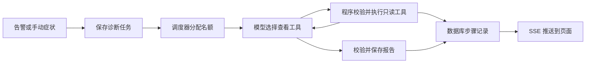

# 阶段 6 学习材料：让医生自己查证据，并把过程显示出来

阶段 5 的医生像一箱工具，需要人决定下一步查什么。这个阶段把这个决定交给模型：模型只提出“调哪个工具、传什么参数”，Go 程序负责检查参数、调用工具、保存结果和限制花费。最后的建议仍需要人执行。

| 交付 | 作用 |
|---|---|
| Agent 循环（[doctor/agent](../../internal/doctor/agent/doc.go)） | 一轮一轮地问模型、执行工具、把结果交回去，直到提交报告或用完预算 |
| 模型客户端（[doctor/llm](../../internal/doctor/llm/doc.go)） | 发请求、重试、脱敏、按实际用量记账 |
| 调度器（[doctor/run](../../internal/doctor/run/doc.go)） | 决定哪个诊断什么时候开始，全局和每个系统各有名额 |
| 费用账本和步骤记录（[doctor/store](../../internal/doctor/store/doc.go)） | 每一步都存进数据库；费用先预留、后结算，重启不清零 |
| 实时页面（[doctor/web](../../internal/doctor/web/doc.go)、[httpapi](../../internal/doctor/httpapi/doc.go)） | 登录后看诊断一步步进行，断线重连不丢步骤 |

**怎样读这份材料。** 这一阶段是整个项目在面试里最常被深挖的部分。主线是 **Agent 循环怎样设计**：模型和程序各管什么、什么时候停、怎样控制花费、为什么报告不能直接相信、同一场故障怎样只诊断一次。Go 语法见第 7 节和 [Mini-Redis 的学习文档](https://github.com/Li-Nepenthe/mini-redis/blob/main/docs/learn/README.md)。

> 这份材料对照的是**当前的代码**。阶段 7 改了预算口径（累计 token 从 8 万改成 40 万），加了断点恢复和人工审批，遇到时会注明。真实模型会花钱，日常学习保持 `LLM_PROVIDER=mock`。

## 1. 本阶段能回答的面试题

| 面试题 | 在哪里 |
|---|---|
| 你的 Agent 和直接调一次大模型接口有什么区别？ | 2.2、5.1、八股 1 |
| Function Calling 的原理是什么？模型乱调工具、参数填错了怎么办？ | 5.1、5.4、八股 2 |
| 为什么不用 LangChain、Eino 这类框架？ | 5.2、八股 5 |
| 怎么防止 Agent 死循环、一直烧钱？一次诊断的 token 为什么越来越多？ | 5.3、5.7、八股 3 |
| 模型说“查到了”，你怎么知道它没有编？ | 5.4、八股 4 |
| 同一个故障一直告警，会不会重复诊断？ | 5.8 |
| 多个诊断同时来了，怎样调度？ | 5.9 |
| 为什么用 SSE，不用 WebSocket？断线怎样不丢过程？ | 5.10、八股 6 |
| 页面怎样防 XSS 和 CSRF？哪些数据会发给模型服务商？ | 5.11、5.12 |
| 用了 RAG 吗？为什么不用向量数据库？ | 八股 5 |

## 2. Agent 在系统里的位置

### 2.1 一次诊断经过的部分



阶段 5 的工具层原样复用：模型拿到的就是那份 16 个工具的菜单（阶段 8 加到 17 个），执行时经过同一个 `Registry.Run`，权限一点也没有变大。

### 2.2 Agent 和“调一次大模型接口”有什么不同

调一次接口是一问一答：你把问题发过去，它回一段文字，就结束了。Agent 是一个循环：模型每轮决定下一步调用哪个工具，程序执行以后把结果交回去，模型看了结果再决定下一步，直到它认为证据够了、提交报告，或者用完预算。这种“想一步、查一步、看结果再想”的做法叫 **ReAct**（Reasoning + Acting）。本项目用模型原生的 Tool Calling 来传递“要调哪个工具”，不靠从文字里解析。

**补基础：模型为什么“记不住”上一轮。** 大模型的接口是无状态的：每次请求都要把从系统提示开始的整段对话重新发一遍，模型才知道之前查到了什么。所以诊断越往后，每轮的输入 token 越多，费用也越高。token 是模型计量文本的小单位，不等于一个汉字；服务商按输入和输出的 token 数收费。服务商的上下文缓存能让重复的前缀便宜很多，但不会变成免费。

### 2.3 各部分负责什么、不负责什么

| 部分 | 负责 | 不负责 |
|---|---|---|
| 模型 | 决定下一步查什么；最后写报告 | 执行任何操作；判断自己有没有权限 |
| agent | 拼对话、检查预算、执行工具请求、校验报告、兜底收尾 | 什么时候开始（调度器的事）；怎样连后端（工具层的事） |
| llm | 发请求、重试、按状态分类错误、脱敏、预留和结算费用 | 对话内容 |
| run（调度器） | 全局和每个系统的名额；取消；过时任务不再执行 | 诊断内容 |
| store | 步骤、报告、费用、故障开放期都存在数据库里 | 业务判断 |
| 页面 | 显示步骤和报告，模型输出一律当文字 | 执行模型输出的任何内容 |

## 3. 跑起来看什么

**第 1 步：确认不会意外花钱。** 在本机 `.env` 中设置 `LLM_PROVIDER=mock`。即使 Key 已填写，也不会因此自动使用真实模型。

```powershell
$env:LLM_PROVIDER = 'mock'
$env:LOADGEN_PRODUCT_COUNT = '10000'
$env:LOADGEN_WORKERS = '64'
$env:LOADGEN_QPS = '200'
docker compose --env-file .env -f deploy/docker-compose.yml up -d --build --wait --wait-timeout 240
```

浏览器打开 `http://127.0.0.1:8090`，用本机配置的初始账号登录。顶部应该显示“Mock 模式，不是真实诊断”。这是对当前运行进程的确认，比只看 `.env` 更可靠：改 `.env` 不会改变已经启动的容器。

**第 2 步：发起一次免费演示。** 在页面选 shop，填写“检查当前服务状态”，点击开始。你应该看到状态从等待执行变成正在诊断，然后出现模型步骤、查看结果和报告。Mock 只走固定脚本，不会根据故障找根因。开发时第一次在浏览器走通的 Mock 任务是 7 步、2 轮、2 次查看，¥0（数据台账 P6-3）。点击某个步骤，可以看实际发出的脱敏内容，以及模型或工具返回的内容。

**第 3 步：看指标。**

```powershell
(Invoke-WebRequest http://127.0.0.1:8090/metrics).Content -split "`n" |
    Select-String '^doctor_'
```

你应该看到任务状态、工具耗时、模型 token、费用和预算指标。诊断编号不是指标标签：每次新任务都会新增编号，长期运行会制造越来越多的时间序列（阶段 3 的 5.4 节）。单次过程去页面和数据库里查。

**第 4 步：真实模型验收结束后恢复。** 真实模式需要显式把 provider 改为 openai，并配置模型、Key、价格和总额度。阶段 6 用的是 DeepSeek 的 `deepseek-flash`，请求显式关闭思考模式。不要在聊天、命令参数或文档中放 Key。验收结束后，把本机 `.env` 的 provider 改回 mock，再执行：

```powershell
$env:LLM_PROVIDER = 'mock'
docker compose --env-file .env -f deploy/docker-compose.yml up -d --no-build --no-deps --wait doctor
```

你应该再次看到 Mock 横幅。集成测试和 chaos 自测只能在 Mock 下运行。

## 4. 代码走读

### 4.1 阅读顺序

| 顺序 | 文件 | 重点看什么 |
|---|---|---|
| 1 | [app/agent_wiring.go](../../internal/doctor/app/agent_wiring.go) | 数据库、工具、模型、循环和调度怎样接起来 |
| 2 | [llm/model.go](../../internal/doctor/llm/model.go) | 消息、工具请求和 `tool_call_id`；`Usage` 的六项用量和 `Add` |
| 3 | [agent/model.go](../../internal/doctor/agent/model.go) | `Limits`：一次诊断的全部上限 |
| 4 | [agent/loop.go](../../internal/doctor/agent/loop.go) | `Run` → `execute` 的循环；`ask` 拆成 `prepareRequest`、`checkRequestBudget`、保存发送意图、`recordAnswer`；`finish` 怎样兜底 |
| 5 | [agent/calls.go](../../internal/doctor/agent/calls.go) | `readTools`：并行结果怎样按原调用 ID 放回去 |
| 6 | [agent/report.go](../../internal/doctor/agent/report.go) | `validateReport`：格式、组件和证据步骤的三重校验 |
| 7 | [llm/openai/client.go](../../internal/doctor/llm/openai/client.go) | `Complete` 把每次尝试串起来：先预留费用（`reserveAttempt`），再发请求（`attempt`），最后结算（`settleResponse`） |
| 8 | [run/scheduler.go](../../internal/doctor/run/scheduler.go) | `dispatch` → `dispatchTask`：先 `canDispatch` 查数据库里的名额，再 `claim` 在内存里占位；取消为什么共用一张在途表 |
| 9 | [store/alerts.go](../../internal/doctor/store/alerts.go) | 故障开放期为何独立于报告状态 |
| 10 | [store/budget.go](../../internal/doctor/store/budget.go) | `Ledger.Reserve`、`Ledger.Settle`：费用怎样跨进程重启保存 |
| 11 | [httpapi/session.go](../../internal/doctor/httpapi/session.go)、[stream.go](../../internal/doctor/httpapi/stream.go) | Cookie、CSRF 与断线补发 |
| 12 | [web/static/app.js](../../internal/doctor/web/static/app.js) | 浏览器只显示文字，不执行模型输出 |

### 4.2 一次诊断怎样一轮一轮走完

| 顺序 | 在哪里 | 做了什么 |
|---|---|---|
| 1 | `agent.Run` | 准备两份时限：整次诊断 5 分钟；普通查证比它少 1 分钟，最后 1 分钟留给整理报告。拼好初始对话：系统提示、系统架构说明、症状。症状标明是“不可信数据”，防止里面的文字冒充指令 |
| 2 | `ask` → `prepareRequest` | 组装这一轮的请求：完整的对话历史、工具菜单、最多 4096 个输出 token、关闭思考模式。整个请求先脱敏，发给模型的就是审计里存的那一份 |
| 3 | `checkRequestBudget` | 发请求前先查预算：这一轮的输入加 4096 个输出，会不会超过单次上下文上限；会不会超过累计 token 余额（普通查证阶段还要再留出一份写报告的余量）；费用是否已到上限 |
| 4 | 保存发送意图 | 先保存一条“准备发请求”的步骤（`llm_pending`），再调用模型。阶段 7 的断点恢复靠它找回已经付费的回复 |
| 5 | 模型 | 返回一段说明文字和若干工具请求，比如 5.1 节的 `list_firing_alerts` |
| 6 | `recordAnswer` | 把回复脱敏后存成一个步骤，用 `Usage.Add` 累计用量，再接到对话历史后面 |
| 7 | `calls` → `readTools` | 只有文字、没有工具请求的回答不算结束，程序回一句“请调用工具或提交报告”。有工具请求，就最多四个并行执行，每份结果保存成一个步骤，再按原来的 `tool_call_id` 放回对话 |
| 8 | 回到 `execute` 的循环 | 检查轮数、工具次数、累计 token 和费用，都没到上限就进入下一轮，重复第 2 到 7 步 |
| 9 | 模型调用 `submit_report` | `validateReport` 检查 JSON 结构、组件名是不是系统里真有的、引用的证据步骤号是不是真的存在。全部通过才保存报告，循环结束 |
| 10 | 报告不合格，或者预算、普通时限用完 | 进入 `finish`：追加一句“请整理报告”，这时只给模型 `submit_report` 一个工具。报告校验失败还有一次修正机会；再不行就以“超出预算”结束，不把半成品当成功 |

这张表就是面试时“讲讲你的 Agent 是怎么工作的”的答案骨架：第 3 步讲预算，第 4 步讲断点，第 7 步讲并行和 tool_call_id，第 9 步讲为什么报告不能直接相信，第 10 步讲兜底。

## 5. 系统设计与取舍

每个设计点按同一个顺序讲：要解决什么问题 → 怎么做 → 放弃了什么、为什么 → 代价和适用边界 → 规模变大十倍会怎样。

### 5.1 模型提出请求，程序执行工具

**问题。** 模型要能“查东西”，但不能让它直接连数据库。

**做法。** Tool Calling 就是“模型说想调用哪个函数，以及传什么参数”。程序收到请求后，仍要检查工具名、字段、超时和系统绑定（阶段 5 的统一入口）。下面摘自正式 S02 的真实诊断 `5c143936176c1ce6bb948b6d68e75378`，提示版本 v6.2，已经过统一脱敏。第一轮还并行请求了架构说明，这里只展示告警工具这一对。

模型返回：

```json
{
  "content": "我会先核对当前告警和整体情况。",
  "role": "assistant",
  "tool_calls": [
    {
      "function": {
        "arguments": "{}",
        "name": "list_firing_alerts"
      },
      "id": "call_00_9cuDherpsgFsX9tMHKlw5383",
      "type": "function"
    }
  ]
}
```

程序执行后，在下一轮发回：

```json
{
  "role": "tool",
  "content": "{\"result\":{\"bytes\":393,\"data\":[{\"active_at\":\"2026-10-28T04:54:02.419683092Z\",\"annotations\":{\"summary\":\"订单列表 P99 超过 200 毫秒\"},\"labels\":{\"alertname\":\"OrderListLatencyHigh\",\"service\":\"order-service\",\"severity\":\"warning\"},\"value\":\"4.896021626494497e+00\"}],\"duration_ms\":6,\"original_bytes\":236,\"status\":\"ok\",\"summary\":\"当前 1 条 firing 告警\",\"tool\":\"list_firing_alerts\",\"truncated\":false},\"step\":4}",
  "tool_call_id": "call_00_9cuDherpsgFsX9tMHKlw5383"
}
```

模型并没有自己访问 Prometheus，它只给出了工具名和 `{}` 参数。程序找到已绑定 shop 的工具实例，查到告警，保存为本次诊断的第 4 步，再把结果放进 `role=tool` 的消息。

**`tool_call_id` 和 `step` 是两回事。** `tool_call_id` 原样沿用模型给的编号：一次可以请求多个工具，返回顺序也可能不同，这个编号说明“这份结果回答哪一次请求”。`step=4` 是数据库里的步骤号，报告引用证据时用的是它。下一轮仍保留原来的 assistant 工具请求，再接上每一份 tool 消息，模型才能继续。

这轮请求用了 5414 个输入 token、46 个输出 token，供应商报告其中 5248 个输入命中缓存。医生按全部输入未命中的价格保守记 ¥0.011196。

**放弃了什么。** 让模型在文字里写“调用 X”，再由程序解析。格式容易错，参数也没有结构。原生 Tool Calling 的参数本身就是 JSON，程序可以按工具定义校验。

**代价。** 模型给的参数可能不合法、工具名可能不存在，程序要把具体原因返回给模型，让它自己改（5.4 节）。

### 5.2 手写循环，不用 Agent 框架

**问题。** LangChain、Eino 这类框架提供现成的 Agent 循环、工具调用和重试。用不用？

**做法。** 手写循环。每一轮都要和审计、费用、恢复绑在一起：发请求前查预算、先存断点再发请求、工具结果按原编号放回、报告要过三道校验、费用先预留后结算。这些步骤之间的顺序就是正确性的一部分。

**放弃了什么：用框架。** 框架的默认行为（自动重试、内部的消息管理）恰好是这里需要严格控制的地方：比如 SDK 内部重试会绕过下一次的费用预留。用框架反而要绕开它的默认行为。手写的循环也方便用假模型做单元测试，不花钱就能测“模型乱给参数”“报告不合格”“预算耗尽”这些分支。

**代价。** 流式输出、多模型路由这些框架现成的功能，都要自己写或者暂时不做。模型客户端也是自己写的：2026-11 对照过官方的 openai-go SDK，它会把字符串形式的 token 数悄悄转成数字、默认跟随重定向、不限制回复大小，而 token 数要进账本乘以单价，宁可报错也不能让库自己凑一个数，所以保留手写（[成熟库评估](library-evaluation.md)第 5 节）。

**规模变大十倍。** 要支持多种 Agent（诊断、修复、复盘）时，可以把循环里通用的部分抽成自己的小框架，但预算、审计、断点这几个钩子必须是一等公民。

### 5.3 一次诊断的预算：每一种资源都有上限

**问题。** 模型可能一直猜指标名、反复查同一个证据，永远不提交报告；每一轮都要重发整段对话，越往后越贵。

**做法。** [agent/model.go](../../internal/doctor/agent/model.go) 的 `DefaultLimits`：

| 上限 | 当前值 | 防什么 |
|---|---|---|
| 轮数 | 15 轮 | 一直不提交报告 |
| 工具调用 | 40 次 | 反复查询 |
| 单次请求的上下文 | 约 6.4 万 token（输入估计加最多 4096 个输出） | 一轮请求太大，超出模型能处理的范围 |
| 累计 token | 40 万 | 反复重发整段对话，总用量失控 |
| 单次诊断费用 | 0.3 个货币单位 | 一次诊断花太多钱 |
| 时间 | 5 分钟，最后 1 分钟只整理报告 | 一直拖着不结束 |

任何一项到了上限，就进入收尾：只允许提交报告。普通查证阶段还要为最后的报告预留一份 token 余额，所以最后的报告和一次修正也不会越过累计上限。报告里记录是主动结束（voluntary）还是被预算逼着结束（budget），以及触发的原因。

**这些数字改过一次。** 阶段 6 时只有一个“累计 8 万 token 触发收尾”的阈值，而且最后一次报告还可以越过它。用户验收时发现 8 万很快就用完：每问模型一次，前面整段对话都会重发，重复输入同样计入累计量。阶段 7 把它拆成了单次上下文约 6.4 万、累计 40 万、单次费用 0.3 三个上限（[决定记录](../decisions.md)）。阶段 6 的真实诊断一般 9–11 轮、15–26 次查看、累计约 10 万 token（数据台账 P6-10 到 P6-35）。

**放弃了什么：检测“是否在原地打转”。** 比如连续几轮调用相同的工具、长时间没有新证据，就提前结束。效果更好，但判断规则不好定，容易误杀。现在只靠硬上限兜底，面试时可以作为改进方向来讲。

**代价。** 硬上限可能在模型快要找到答案时把它打断；上限要按模型和场景实测来定。

**规模变大十倍。** 诊断多了以后，除了单次的上限，还需要全局的费用账本（5.7 节）和调度名额（5.9 节）。

### 5.4 报告不能直接相信：三重校验和一次修正

**问题。** 模型可能交出不完整的 JSON，可能编一个系统里不存在的组件，也可能引用一个根本没查过的证据。

**做法。** `validateReport` 做三重校验：

1. **结构。** 按 JSON Schema 检查字段、类型和允许的值。
2. **组件。** 故障组件必须是系统架构说明里真有的名字（枚举值来自系统配置）。
3. **证据。** 报告引用的每条证据都给出步骤号，程序检查这个步骤真实存在于本次记录里。

不合格的报告不会被保存；程序把具体原因告诉模型，给一次修正机会。工具请求的参数不合格也一样：返回 `invalid_argument` 和原因，让模型自己改，同一轮的其他工具照常执行。

**格式正确不等于判断正确。** 程序判断不了“这一步是否真的支持这句话”。阶段 6 首轮 11 个场景的真实结果是：9 份报告格式合格，只有 6 个故障组件判对（数据台账 P6-40）。S10 有合法报告，却把网络延迟引起的连接占用当作连接池配置问题；S08 找到了行锁争用，但把毫秒换算成秒时错了三个数量级。“判断对不对”要靠阶段 8 的评测。

**放弃了什么。** 收到什么就存什么，让人来判断。那样页面上会出现格式不完整、引用不存在证据的报告，看起来像成功了。

**代价。** 有的诊断已经找到了正确的方向，却因为最后的 JSON 不合格而失败（首轮 S05、S09，P6-16、P6-27）。

### 5.5 先保存发送意图，再发请求

**问题。** 模型请求是要付费的。如果进程在“请求已经付费、回复还没存下来”的时候崩溃，重启以后不知道这一轮有没有发生过。

**做法。** 发请求前先保存一条 `llm_pending` 步骤，请求带上这个步骤号作为调用编号；回复到了先存回复，再接进对话。阶段 7 的断点恢复就是靠这些记录，从上一次保存的步骤继续，而不是从头再花一遍钱。

**代价。** 每一轮多写一次数据库。

### 5.6 并行查看，一个普通错误不抹掉其他证据

**问题。** 模型一轮可能请求好几个工具（查指标、查日志、查调用链），一个个查太慢；其中一个失败，也不能让其他结果作废。

**做法。** 用 `errgroup.Group` 最多四个并行。工具查询失败时返回带 status 的结果，不作为 group 的错误，其他工具继续；结果按完成顺序获得步骤号，但按模型请求的顺序放回对话。只有“保存步骤失败”才作为 group 的错误返回：模型不能引用一份数据库里没有的结果，所以这种错误要停止循环。父 context 取消时，全部查询一起中断。

**代价。** 四个并行是经验值；用 MySQL 的工具还受只读账号 3 条连接的限制。

### 5.7 全局费用账本：先预留、后结算

**问题。** 十个诊断同时进行时，每个都以为“总额度还剩 5 元”，一起花出去就超支了。请求中途被取消时，服务商可能已经生成了一部分内容，也要收费。

**做法。** [store/budget.go](../../internal/doctor/store/budget.go) 的账本：

- **联网前先预留。** `Ledger.Reserve` 在数据库里扣下这一轮最多可能花的钱，余额不够就不发请求。不同诊断不能各自以为还有同一笔余额。
- **回复到了再结算。** `Ledger.Settle` 按实际用量和保守单价（所有输入都按未命中缓存的价格算）结算，多扣的退回去。
- **不知道用了多少，就按预留的算。** 请求被取消、网络中断时，保留预留额，不把取消误认为免费。
- **重启不清零。** 账本在数据库里。实际费用超过估算时，停用原因也持久化，重启和提高上限都不能绕过它。

阶段 6 真实验收一共 22 个诊断，医生按保守口径记了 ¥4.829，服务商余额显示实际扣费 ¥1.09（数据台账 P6-36、P6-41）。宁可多算，不能少算。这里的费用是“项目用量账本”的口径，不是服务商的账单。

**补基础：先预留、后结算。** 这和住酒店先付押金很像。发请求前先扣下最多可能花的钱，回复到了按实际用量把多扣的退回去。

**放弃了什么。** 每个诊断自己在内存里记账。简单，但多个诊断、多次重启之间没法共享余额。

**代价。** 保守单价让账本比实际扣费高好几倍，额度会“提前用完”。

**规模变大十倍。** 账本要按账户、按团队分开，并定期和服务商的账单对账。

### 5.8 一次故障只诊断一次：故障开放期和恢复观察期

**问题。** “报告写完了”不代表“故障修好了”。同一故障可能持续几十分钟，Alertmanager 会重复通知。若每次都建任务，医生会反复花钱解释同一件事。

**做法。** 数据库另存“故障开放期”：首次 firing 建诊断；后续通知并入；整组 resolved 后还要观察一段时间，观察期内再次出现 firing，就继续使用原诊断。恢复通知丢失时，用十五分钟没有任何通知作为兜底。测试用可控时间推进，不真的等十五分钟。

**这个观察期来自一次真实失败。** S06 中，消费者停机先触发“服务不可用”。恢复进程后，它很快消失；但“消息积压”还在等自己的持续时间，半分钟后才发来。原实现已经关掉故障，于是又付费诊断了一次（数据台账 P6-18、P6-19）。

**观察期怎么定。** 不能随手设两分钟。告警里的 `for` 表示“症状持续多久才发送”，shop 最长是 2 分钟；加上一次 10 秒的规则评估，以及 Alertmanager 等待分组的 5 秒，共 135 秒。所以 shop 配为 3 分钟。其他系统可以不同，时间放在各自的接入配置中。实现以后重跑 S06，晚到的积压告警进入原任务，步骤和费用没有增加（P6-23）。

**放弃了什么。** 报告写完就关闭故障。简单，但同一场故障会被诊断好几次。

**代价。** 同一系统里两个重叠的故障可能合成一组；观察期内真正发生的新故障，也可能被并入上一场。已有报告不会因为新症状自动重跑，需要时可以手动发起诊断。

### 5.9 调度：全局两个名额，每个系统一个

**问题。** 多个诊断同时来了。全部同时跑，费用和数据库连接都扛不住；一个全局排队，A 系统一直出问题时，B 系统的诊断要一直等。

**做法。** 调度器同时检查两种名额：全局最多 2 个诊断同时执行，同一个系统同时只有 1 个。`dispatchTask` 先用 `canDispatch` 查数据库里的名额，再用 `claim` 在一把锁里同时检查两种名额并占位，避免两条任务都看见“还有一个空位”。等了太久的 pending 任务不再执行，避免打开医生时把昨天的告警全部变成今天的账单。取消和调度共用一张“在途表”：点击取消时，从表里找到这个诊断的 cancel 函数。

**放弃了什么：一个全局 FIFO 工作者。** 一个系统的诊断排在前面，另一个系统就要等它跑完。`TestScheduler` 里五个同系统任务和另一个系统的任务就是这个例子。

**代价。** 两个名额是保守值；同一系统同时发生两个独立故障时，第二个要等。

**规模变大十倍。** 名额按账户和系统的优先级分配；多个医生实例时，名额必须放进数据库并用租约保证（阶段 7）。

### 5.10 实时页面：SSE 推送，数据库是完整记录

**问题。** 诊断要几十秒，用户想看到它一步步在做什么；网络断了、页面刷新了，不能丢步骤。

**做法。** 用 SSE（Server-Sent Events）：一条持续送文字的 HTTP 响应。每个步骤都有递增的 seq，浏览器记住最后收到的编号；断线重连时用 `Last-Event-ID` 告诉服务端“从这个编号后继续”。**数据库才是完整记录，内存 channel 只是提醒有新步骤。** 先订阅，再补查数据库，避免两者之间漏事件。每个订阅者有 64 条缓冲，读太慢就断开，让它以后从数据库补齐；不能让一个慢浏览器拖住诊断和其他用户。

**放弃了什么：WebSocket。** WebSocket 是双向的，页面只看不说，用不上；SSE 是普通的 HTTP 响应，浏览器自带断线重连。

**代价。** 浏览器的 EventSource 不能设置 Authorization 请求头，登录要改用 Cookie（5.11 节）。

### 5.11 页面安全：HttpOnly Cookie、CSRF 和 textContent

**问题。** EventSource 不能带 Authorization 头；把 JWT 放进 URL 又会进入日志和浏览器历史。模型输出也可能含有 `<script>` 这样的文字。

**做法。**

| 攻击 | 攻击者想做什么 | 本项目怎么挡 |
|---|---|---|
| XSS（跨站脚本） | 让一段外来的脚本在你的页面里运行，偷走数据或冒充你操作 | 模型输出只用 `textContent` 显示，当文字不当代码；JWT 放在 HttpOnly Cookie 里，脚本读不到 |
| CSRF（跨站请求伪造） | 在别的网站里偷偷向本站发请求，借用你浏览器里已经登录的 Cookie | 修改类接口核对来源和 CSRF 值；`SameSite=Strict` 让浏览器在跨站请求里不带这个 Cookie |

本机用 HTTP，部署到 HTTPS 时打开 Cookie 的 Secure 属性。

### 5.12 哪些数据会发给模型服务商

**问题。** 系统提示、架构说明、告警、手动症状、工具结果都会发给模型服务商。只读权限能限制能查什么，不能保证查到的文字里没有秘密。

**做法。** 出站内容统一脱敏：清理 `sk-` 开头的 Key、Bearer、JWT、`password=` 等形状；同时替换已知的环境凭据和连接串中的密码。审计存的就是实际发出的清理版本，不另存未清理的副本。

**代价。** 形状识别可能漏掉任意格式的敏感信息，也可能误伤类似 token 的普通字符串。真实系统接入前必须清理说明书与日志，不能宣称这已解决所有数据外发的风险。

### 5.13 提示词有版本号，只写通用规则

**问题。** 同一模型在不同提示下可能改变查证顺序和报告。没有版本号，就无法解释两次结果为什么不同。

**做法。** 提示词放在 [agent/prompts](../../internal/doctor/agent/prompts/) 里，带版本号；每次诊断记录用的是哪个版本。阶段 6 第一次 S01 冒烟能查到索引和执行计划，但最终报告 JSON 不合法（P6-6）。提示从 v6.1 升到 v6.2，只增加通用约束：查到足够证据即可提交、报告简短、JSON 必须完整、每条建议都有风险等级。**没有写入任何场景的答案。** 第二次冒烟提交了合法报告（P6-8），但机制解释仍混淆了普通查询和更新加锁。

**代价。** 中途改提示词以后，新旧结果不能直接比较，旧版本的失败要保留。

## 6. 系统设计八股

每题先给一分钟口述版，面试时照着这个长度说；再给要点、项目里的例子和常见追问。

### 八股 1：Agent 是什么？和直接调一次大模型有什么区别？

#### 一分钟口述版

调一次大模型接口是一问一答。Agent 是一个循环：模型每轮决定下一步调用哪个工具，程序执行工具后把结果交回去，模型看了结果再决定下一步，直到它提交报告或者用完预算，这种思考和行动交替进行的方式叫 ReAct。在我的项目里，模型从不直接访问任何系统，它只通过 Tool Calling 说“我要调哪个工具、传什么参数”；程序负责校验参数、执行只读工具、把结果存成一个带编号的步骤，再按模型给的调用编号放回对话。程序还负责每一轮前检查预算、发请求前保存断点、最后校验报告。所以模型是决策者，程序是执行者和守门人，权限边界在程序和数据库账号上，不在提示词里。

#### 要点

- 循环：决策 → 执行 → 观察 → 再决策。
- 模型只产出结构化的工具请求；执行在程序里。
- 程序负责：校验、执行、记录、预算、兜底。
- 接口无状态，每轮重发整段对话。

#### 项目里的例子

- 4.2 节的十步走读；5.1 节的真实工具调用和回复。

#### 常见追问

1. **模型怎么知道有哪些工具？** 每轮请求里带着工具菜单：名字、说明和参数的 JSON Schema。
2. **一轮可以调几个工具？** 模型可以一次请求多个，程序最多四个并行执行。
3. **模型直接回一段文字、不调工具怎么办？** 不算结束，程序提示它调用工具或提交报告。

### 八股 2：Function Calling 的原理是什么？模型乱调工具、参数填错了怎么办？

#### 一分钟口述版

Function Calling 是模型的一种输出格式：请求里带上每个工具的名字、说明和参数的 JSON Schema，模型如果决定调用，就返回工具名、一个 JSON 参数字符串和一个调用编号，执行完全在宿主程序里。程序把结果作为 role 为 tool 的消息、带着同一个调用编号放回对话，模型才知道这份结果回答的是哪个请求。模型可能调不存在的工具、参数不合法、或者参数合法但查不到东西，我的处理是：都不当成异常中断，而是把具体原因作为工具结果返回，让模型自己修正；同一轮的其他工具照常执行。工具名长度、参数大小、字段类型和范围都由统一入口校验，不合格的不会碰到后端。不管模型怎么写，它能做的事都不会超出工具菜单。

#### 要点

- 工具定义 = 名字 + 说明 + 参数 JSON Schema。
- 返回 = 工具名 + 参数 JSON + 调用编号；执行在程序里。
- 错误作为工具结果返回，让模型自己修正。
- 调用编号用来配对请求和结果，不是证据步骤号。

#### 项目里的例子

- [agent/calls.go](../../internal/doctor/agent/calls.go) 的 `readTools`、`readTool`；阶段 5 的 `Registry.Run`。

#### 常见追问

1. **参数是 JSON 字符串，模型写坏了怎么办？** 解析失败就返回 invalid_argument 和原因。
2. **工具执行超时怎么办？** 每个工具有 10 秒上限，超时也作为结果返回。
3. **工具定义能随便改吗？** 不能，定义会原样发给模型，有 golden 测试固定（阶段 5 的 5.8 节）。

### 八股 3：怎么防止 Agent 死循环、一直烧钱？

#### 一分钟口述版

靠硬上限加全局账本。单次诊断有六种上限：最多 15 轮、40 次工具调用、单次请求的上下文约 6.4 万 token、累计 40 万 token、单次费用 0.3 元、总时间 5 分钟，其中最后 1 分钟只能整理报告。任何一项到了，就进入收尾，只给模型提交报告这一个工具，而且普通阶段会提前为最后的报告预留 token，收尾也不会越线。全局还有一个费用账本：每次请求前先在数据库里预留这一轮最多可能花的钱，余额不够就不发；回复到了按保守单价结算，不知道用量就按预留的算，重启也不清零。另外等太久的告警不再执行，同一场故障只诊断一次。现在没做的是检测“原地打转”，比如连续几轮没有新证据就提前结束，这是我会继续做的改进。

#### 要点

- 单次：轮数、工具、上下文、累计 token、费用、时间。
- 全局：先预留后结算的账本，持久化。
- 收尾：只允许提交报告，预留余量。
- 去重：故障开放期，一场故障一次诊断。

#### 项目里的例子

- [agent/model.go](../../internal/doctor/agent/model.go) 的 `DefaultLimits`；[agent/loop.go](../../internal/doctor/agent/loop.go) 的 `checkRequestBudget`。
- 阶段 6 的 22 个真实诊断：保守账本 ¥4.829，实际扣费 ¥1.09（P6-36、P6-41）。

#### 常见追问

1. **token 为什么越来越多？怎么省？** 每轮重发整段对话。省钱靠工具结果先摘要、最多 4KB；证据够了就提交；上下文缓存让相同前缀便宜很多。
2. **累计上限为什么从 8 万改成 40 万？** 重发历史使累计量增长很快，8 万经常在正常查证中就用完；阶段 7 拆成单次上下文和累计两个上限，再加单次费用。
3. **预留的钱比实际多很多怎么办？** 结算时退回差额；不知道用量才保留预留。

### 八股 4：模型说“查到了”，你怎么知道它没有编？

#### 一分钟口述版

分两层。第一层是程序能确定性核对的事实：报告里每条证据都要写出步骤号，程序检查这个步骤真实存在于本次诊断的记录里；故障组件必须是系统架构说明里真有的名字；JSON 结构不合格就不保存，给一次修正机会。这能挡住引用不存在的证据、编造组件这类问题。第二层是程序判断不了的：这一步的结果是不是真的支持这句话、因果关系对不对。这只能靠评测，我在阶段 8 用标准答案和模型评委做了量化。阶段 6 首轮 11 个场景就说明了两层的差别：9 份报告格式合格，但只有 6 个组件判对，还有把毫秒换算成秒时错了三个数量级的。所以格式正确不等于判断正确，我不会用“页面显示成功”替代根因核对。

#### 要点

- 模型是决策者，不是事实裁判；事实由代码核对。
- 可核对：步骤存在、组件存在、结构合法。
- 不可核对：证据是否支持结论 → 评测。
- 失败的报告照实保留，不用最好的结果替换首轮。

#### 项目里的例子

- [agent/report.go](../../internal/doctor/agent/report.go) 的 `validateReport`；数据台账 P6-40。

#### 常见追问

1. **能不能让另一个模型来检查？** 阶段 8 就是这样做的（模型评委），但评委也会看错，要有人工复核和一致性检查。
2. **报告里的建议操作会被执行吗？** 阶段 6 只保存建议；阶段 7 才有人工审批和执行前的状态核对。
3. **怎样减少模型编造？** 提示词要求每条结论引用证据；工具结果里明确标出截断和缺失；不给模型可以“凑答案”的工具。

### 八股 5：为什么不用 LangChain、Eino？用了 RAG 吗？

#### 一分钟口述版

不用框架，是因为我需要完全掌控每一步的顺序：每轮调用前查预算、先存断点再发请求、工具结果按原编号放回、报告要过三道校验、费用先预留后结算，这些都和审计、费用、恢复绑在一起，框架的默认行为比如内部自动重试，反而会绕过费用预留。手写的循环也方便用假模型做单元测试。代价是流式输出这些现成功能要自己写。RAG 上，我用了检索，但不是向量检索：阶段 8 的一个实验组多一个手册检索工具，对十几 KB 的通用排查手册做 BM25 关键词检索，中文按相邻两个字切词，模型需要时自己调用。手册小、关键词明确，比如指标名和错误码，BM25 够用、结果可解释，也不用额外的嵌入模型和向量库。评测里加手册的组和只用工具的组，故障组件定位都是 36/39，说明在这个规模上实时证据比静态知识更重要。

#### 要点

- 框架的默认行为和项目的正确性要求冲突时，手写。
- 检索不等于向量检索；小规模、关键词明确时 BM25 更合适。
- 用对照实验说明检索的价值，而不是默认它有用。

#### 项目里的例子

- 阶段 8 的 `runbook_search` 工具；Terra 模型 E1、E2 两组组件定位都是 36/39（数据台账 P10-2、P10-3）。

#### 常见追问

1. **什么时候该用向量检索？** 文档多、表述多样、关键词对不上时，比如几千篇历史故障复盘。
2. **BM25 是什么？** 按词频和逆文档频率给文档打分的关键词检索算法，不需要训练。
3. **36/39 是什么意思？** 故障组件定位：报告里的故障组件和标准答案精确一致的次数。不是根因正确率。

### 八股 6：SSE 和 WebSocket 怎么选？断线怎样不丢数据？

#### 一分钟口述版

最核心的区别是方向：SSE 是服务端单向推送，本质上是一条不断写数据的 HTTP 响应，浏览器自带断线重连，大模型的流式接口用的都是它；WebSocket 是全双工，只有真正需要双向实时交互时才值得引入。我的诊断页面只看不说，所以选 SSE。断线不丢数据靠两点：每个步骤都有递增的编号，浏览器重连时通过 Last-Event-ID 告诉服务端从哪里继续；数据库才是完整记录，内存里的通知只是提醒有新步骤，服务端先订阅再补查数据库，避免中间漏事件。每个订阅者有 64 条缓冲，读得太慢就断开它，让它重连时从数据库补齐，不让一个慢浏览器拖住诊断。

#### 要点

- SSE：单向、HTTP、自动重连、事件编号。
- WebSocket：双向、要单独的协议升级。
- 数据库是唯一完整记录；先订阅再补查。
- 慢订阅者断开，不阻塞生产者。

#### 项目里的例子

- [httpapi/stream.go](../../internal/doctor/httpapi/stream.go) 的 `streamSteps`、`sendMissing`。

#### 常见追问

1. **EventSource 不能带 Authorization 头怎么办？** 改用 HttpOnly Cookie，并配合 CSRF 校验和 SameSite。
2. **为什么不在内存里保存全部步骤？** 进程重启就没了，多个实例也看不到彼此的内存。
3. **SSE 有连接数限制吗？** HTTP/1.1 下浏览器对同一域名的连接数有限制，HTTP/2 可以复用一条连接。

## 7. 用到的 Go 写法

### 7.1 已在 Mini-Redis 讲过的

| 写法 | 本阶段在哪里用 | 去哪里学 |
|---|---|---|
| 自定义错误类型、`%w`、`errors.Is` | 预算错误 `llm.ErrDiagnosisBudget` 是固定值，调用方不用比较中文文字 | [Mini-Redis 第 06 章](https://github.com/Li-Nepenthe/mini-redis/blob/main/docs/learn/06-错误处理.md)“创建、包装和判断错误” |
| errgroup：一组 goroutine，限制并发、收集第一个错误 | `readTools` 最多四个工具并行 | [Mini-Redis 第 02 章](https://github.com/Li-Nepenthe/mini-redis/blob/main/docs/learn/02-goroutine与调度.md) |
| select 的 default | 订阅者的 channel 满了就断开它，不让诊断等浏览器 | [Mini-Redis 第 05 章](https://github.com/Li-Nepenthe/mini-redis/blob/main/docs/learn/05-时间-select与GC.md)“select 的规则” |
| context 的取消一路往下传 | 点击取消 → 调度器找到在途的 cancel → Agent 的 context → 模型请求和工具查询 | [Mini-Redis 第 07 章](https://github.com/Li-Nepenthe/mini-redis/blob/main/docs/learn/07-channel-context与WaitGroup.md)“context” |
| 锁保护共享的 map | 调度器的在途表 `running` | [Mini-Redis 第 04 章](https://github.com/Li-Nepenthe/mini-redis/blob/main/docs/learn/04-锁.md)“sync.Mutex” |
| 用假实现做测试 | 假模型脚本、内存 Transport，测试不联网、不花钱 | [Mini-Redis 第 08 章](https://github.com/Li-Nepenthe/mini-redis/blob/main/docs/learn/08-测试.md)“替身：把难控制的东西换掉” |

阶段 5 讲过 `json.RawMessage` 和 `testing/synctest`。下面两节是 Mini-Redis 没有讲过的。

### 7.2 JSON 数字先保留原文

把 JSON 解到 `any` 时，普通解码会把数字变成 float64。证据步骤号是整数，不能先丢掉精度再判断。`UseNumber` 让解码器先保留数字的文本形式，再按用途转成整数。

```go
package main

import (
	"encoding/json"
	"fmt"
	"strings"
)

func main() {
	decoder := json.NewDecoder(strings.NewReader(`{"step":17}`))
	decoder.UseNumber()
	var value map[string]any
	if err := decoder.Decode(&value); err != nil {
		panic(err)
	}
	step, err := value["step"].(json.Number).Int64()
	if err != nil {
		panic(err)
	}
	fmt.Println(step) // 17
}
```

### 7.3 SSE 的写法：写一条事件，立刻刷出去

SSE 的每条事件是几行文本：`id:`、`event:`、`data:`，最后一个空行。HTTP 服务器默认会把输出攒在缓冲区里，所以每写完一条都要调用 `http.ResponseController` 的 `Flush`，让浏览器立刻收到。项目的 `writeEvent` 就是这样写的，写之前还会设置一次写超时，防止一个卡住的连接一直占着 goroutine。浏览器那边用 `EventSource` 接收，断线后自动重连，并在请求头 `Last-Event-ID` 里带上最后收到的 `id`。

## 8. 动手实验

1. 在 Mock 模式发起任务，展开模型和工具步骤。找一组 `tool_call_id` 与 tool 回复，指出它和 step 的区别。
2. 在浏览器刷新诊断页面，比较刷新前后的步骤编号。应当完整且不重复；不要用刷新来启动第二份诊断。
3. 修改临时测试里的报告，把 `evidence.step` 改成不存在的编号。运行 `go test ./internal/doctor/agent -run TestLoopCorrection -v`，观察纠正流程。还原测试修改后再继续。
4. 运行 `go test ./internal/doctor/run -run TestScheduler -v`，读五个同系统任务与另一个系统任务的例子，解释为什么不能只开一个全局 FIFO 工作者。
5. 运行 `go test ./internal/doctor/llm/openai -run 'TestCancel' -v`，对比等待响应头、等待正文两种取消。测试只用内存 HTTP 替身，不会调用真实模型。

## 9. 常见误区

- **“Mock 有报告，诊断就是对的。”** 它只证明接线和页面可用。
- **“收到报告，故障就恢复了。”** 关闭故障开放期要等整组恢复后的观察期结束。
- **“请求取消了就不收费。”** 供应商可能已经生成了一部分内容，账本保留预留额。
- **“工具返回空数组，就是没有异常。”** 也可能是指标名或筛选条件写错。
- **“引用了真实步骤，引用就是准确的。”** 程序只能核对步骤存在，不能核对它是否支持结论。
- **“报告格式合格，就是判断正确。”** 首轮 9 份格式合格，只有 6 个组件判对。
- **“只读账号能保证数据不外发。”** 工具结果会发给模型服务商，日志和说明书也需要脱敏。
- **“提示词里写清楚规则，模型就会照做。”** 提示词是建议，边界在代码和账号上。
- **“改 `.env` 就切换了模型。”** 旧容器不会变，要重建并从页面横幅确认。

## 10. 自测

先自己写下答案，再展开参考要点对照。系统设计方面的问题见第 1 节和第 6 节，这里偏重代码细节。

1. `ask` 为什么在调用模型之前先保存一条 `llm_pending` 步骤？
2. `prepareRequest` 为什么把脱敏后的字节再解码回请求，而不是直接发原来的请求？
3. `checkRequestBudget` 在普通阶段为什么要求 `2*requestTokens` 不超过余额？
4. `readTools` 里，工具查询失败和保存步骤失败分别怎么处理？
5. 并行工具的结果按什么顺序放回对话？步骤号按什么顺序分配？
6. `validateReport` 检查了哪三件事？哪一件程序做不到？
7. `claim` 为什么要在一把锁里同时检查全局名额和系统名额？
8. 点击取消后，信号经过哪些层，怎样让 HTTP 请求停下来？
9. SSE 为什么先订阅、再补查数据库，而不是反过来？
10. 为什么提示词需要版本号？中途改了提示词，旧的失败记录怎么处理？

<details>
<summary>参考要点（先自己回答）</summary>

1. 模型请求要付费。进程在“已经付费、回复还没保存”时崩溃，重启后要能用这个步骤号找回回复，而不是再发一次（阶段 7 的断点恢复）。
2. 保证发给模型的内容就是审计里存的那一份脱敏版本，脚本和 HTTP 客户端收到的都一样，不会有未清理的内容出站。
3. 普通阶段要为最后的报告预留一份同样大小的余额，这样被迫收尾时，报告和一次修正也不会越过累计上限。
4. 查询失败包装成带 status 的结果，其他工具照常进行，模型可以据此修正；保存步骤失败作为 group 的错误返回，循环停止，因为模型不能引用一份数据库里没有的结果。
5. 按模型请求的顺序放回；步骤号按查询完成的先后顺序分配。
6. JSON 结构、组件是否存在、证据步骤是否存在。程序判断不了“这一步是否真的支持这句话”。
7. 分开检查时，两条任务可能都看见“还有一个空位”，然后一起占用。在同一把锁里检查和占位，一次只有一条任务能通过。
8. 页面 POST 取消 → 调度器在在途表里找到 cancel → Agent 的 context 被取消 → 模型请求用 `NewRequestWithContext` 发出，工具查询也用同一个 context，都会停下。只有保存结束状态时另开一个短的独立 context。
9. 先补查再订阅，两步之间产生的新步骤会漏掉；先订阅再补查，最多收到重复的步骤，按编号去重即可。
10. 同一模型在不同提示下可能改变查证顺序和报告，没有版本号就无法解释两次结果为什么不同。旧版本的失败要保留，并注明各自的版本，不能用新版本的结果替换。

</details>

## 11. 开发过程回放

### 11.1 先修工具反馈和实验基线

这次先解决两个问题：模型写错 SQL 时，需要知道错在哪里；重建压测器后，也要知道它实际请求多少商品。

动手前先把两种边界分开：能帮助修正列名和语法的信息可以返回，连接密码和普通后端错误不能返回。于是 `SelectStatement` 改成指出多语句、注释、禁用函数等具体原因；压测器的控制接口返回实际的商品数和工作者数（`controlState.snapshot`），chaos 的健康检查在开始前核对这些实验条件（`verify.WithBaseline`），不相信终端里的环境变量。这部分单独提交为 `5c723d3`（P6-1）。

### 11.2 先规定对话与审计，再接真实模型

目标是让模型实现可以替换，Agent 不需要知道 HTTP 的细节。先确定一轮请求、一次工具调用和一次费用记录长什么样：`llm.Client.Complete` 完成一轮对话，错误时也保留已发生的费用；`Redactor.JSON` 保持结构，只清理敏感文字；`Ledger.Reserve` 先确认有额度，再允许联网；`Ledger.Settle` 退回已知差额，未知费用保留预留。

先写内存 Transport 测试，让 HTTP 客户端以为收到供应商回复，实际上不联网。再把费用预留放到真实发送之前。这样能测试重试次数、Retry-After、取消和审计字节，而不花钱调试基础协议。

复查时发现一个边界：实际费用超过估算，原实现只让当前诊断失败，重启后仍可能继续发送。于是加了一条迁移，持久化停用原因，同时把实际费用记全。集成测试用很小的测试金额证明重启和提高上限都不会绕过它。

### 11.3 把循环、任务和页面接起来

循环负责下一步查什么，调度负责什么时候能开始，仓储负责把每一步留下来。把它们分开以后，可以单独测试“模型乱给参数”和“同系统任务太多”，不用同时启动所有组件。

先完成 Mock 正常循环、错误纠正、预算与并发测试，再接调度与真实仓储，最后接页面。真实仓储测试发现两个问题：没有报告的 SQL NULL 不能直接扫描到 RawMessage；对告警结构做浅拷贝，仍共享里面的 map。分别改为先读字节切片、创建全新结构后再解码，修复后 race 集成通过（P6-2）。

第一次浏览器走通的 Mock 任务是七步（P6-3）。实际观看页面又发现，运行中的轮数要等结束才更新；改为按已保存步骤实时汇总。手动任务刚开始时，数据库尚未写入实际模型，页面曾短暂显示 Mock；后来改为在 running 事件后重读已绑定的模型。这些问题都是接线时看到的，不是事后编出来的设计故事。

### 11.4 真实调用揭示了什么

第一次 S01 冒烟能查到索引和执行计划，但最终报告 JSON 不合法（P6-6）。程序按要求拒绝，任务以超出预算结束，没有把候选文字当作成功报告。提示从 v6.1 升到 v6.2 以后，第二次冒烟提交了合法报告（P6-8），但机制解释仍混淆普通查询和更新加锁（5.13 节）。

真实取消通过页面点击完成：第三次模型 HTTP 请求正在等待时收到取消，日志记录中断，任务进入 cancelled；从取消接口返回到结束日志约 51.57 毫秒（P6-9）。没有完整用量的这次请求保留预留额。

### 11.5 在 S06 恢复时发现了第二份账单

首轮 S06 报告正确指出消费者退出，但恢复后又多建了一份诊断（P6-19）。沿着通知时间查，发现“服务不可用”先恢复，“消息积压”稍后才达到持续时间门槛。问题出在什么时候认定故障结束，不在模型重试。

先保留两份任务和费用，再向用户确认规则。用户要求按每个系统的告警时长推算，因此没有把两分钟写死成全局配置。实现三分钟观察期后，先用可控时间和真实事务测试期限，再重跑 S06：晚到的积压告警进入原任务，步骤和费用没有增加（P6-23）。

这轮报告本身却判错了：恢复流量曾带来短暂的下单延迟，模型被历史发送慢的证据带偏。我们把“没有重复花钱”和“根因是否正确”分开记录。修好工程机制不等于模型判断也通过了。

### 11.6 把报告格式、判断质量和页面接线分开检查

11 个场景的首轮结束后，9 份报告通过格式校验，6 个组件与标准一致（P6-40）。S05 和 S09 没交出合法 JSON。S10 有合法报告，却把网络延迟引起的连接占用当作连接池配置问题。S08 找到了行锁争用，但把累计等待的毫秒换算成秒时错了三个数量级。S13 识别出重试在放大请求，却把历史连接池和熔断记录当成本轮原因。这些错误提醒我们：查到真实数字，还要核对时间、单位和因果关系。

补看页面时，有的诊断二十多秒就结束了，最初打开详情已经太晚。后续改为在告警出现时直接打开正在执行的任务，观察工具步骤增加，再等终态。S07 补跑确实展示了实时过程，却在最终报告格式上失败（P6-33）。补跑单列，不用最好的结果替换首轮。S09 同版本重跑提交了报告（P6-35），它找到了响应收尾模块，却把上一场重试风暴当成泄漏的触发条件，记为部分正确。

结束后把 `.env` 和运行中的医生都切回 Mock（P6-39）。最后复核的官方余额显示扣费 ¥1.09，医生按保守口径记 ¥4.829，两者都低于本次 ¥20 的授权上限（P6-36、P6-41）。

### 11.7 可读性改造（2026-11-11）

OpsDoctor 可读性改造的第 5 批改了 Agent、模型客户端和调度器，第 6 批改了仓储，代码由 GPT 改，Claude 审核：

1. **拆开 `session.ask`。** 原来 75 行的函数拆成 `prepareRequest`（组装和脱敏）、`checkRequestBudget`（预算检查）、保存发送意图、`recordAnswer`（保存回复、接入对话）四步，先后顺序不变；用量累加改成 `Usage.Add`，并补了逐字段的测试。
2. **模型客户端的单次尝试。** `Client.attempt` 改为返回一个结果结构体，请求、结算、重试仍由 `Complete` 串起来；预留和结算分别拆成 `reserveAttempt`、`settleResponse`。
3. **调度器。** `dispatch` 里分配一个任务的部分拆成 `dispatchTask`，先 `canDispatch` 后 `claim`。
4. **仓储。** 账本的 `Reserve`、`Settle` 签名不变；领取执行权的 `claimLease` 拆成读取、判断资格、读名额、提交几步（阶段 7 的内容）。

**怎么验证：** 改造前用 golden 把模型请求的字节、步骤 JSON、HTTP 和 SSE 的输出固定下来，改完以后全部不变；Agent 的 702 个字符串逐文件核对一致；拆分的函数逐行对照，变异测试确认关键分支都有测试守着。

## 12. 核对来源

### 12.1 外部事实

| 说法 | 出处 |
|---|---|
| Tool Calling 的请求格式：工具定义、`tool_calls`、`role=tool` 和 `tool_call_id` | OpenAI 文档 [Function calling](https://platform.openai.com/docs/guides/function-calling)；DeepSeek 文档 [Function Calling](https://api-docs.deepseek.com/guides/function_calling) |
| 上下文缓存命中的输入按更低的价格计费 | DeepSeek 文档 [Context Caching](https://api-docs.deepseek.com/guides/kv_cache) |
| SSE 的事件格式、`Last-Event-ID` 和自动重连 | WHATWG HTML 标准 [Server-sent events](https://html.spec.whatwg.org/multipage/server-sent-events.html) |
| `EventSource` 不能设置自定义请求头 | MDN [EventSource](https://developer.mozilla.org/en-US/docs/Web/API/EventSource) |
| Cookie 的 HttpOnly、Secure、SameSite 属性 | MDN [Set-Cookie](https://developer.mozilla.org/en-US/docs/Web/HTTP/Reference/Headers/Set-Cookie) |
| `textContent` 把内容当纯文本，不解析 HTML | MDN [Node.textContent](https://developer.mozilla.org/en-US/docs/Web/API/Node/textContent) |
| `errgroup.Group` 的 `SetLimit` 和 `Wait` | [golang.org/x/sync/errgroup](https://pkg.go.dev/golang.org/x/sync/errgroup) |
| `http.ResponseController` 的 `Flush` 和 `SetWriteDeadline` | Go 文档 [net/http ResponseController](https://pkg.go.dev/net/http#ResponseController) |
| openai-go SDK 的对照结论 | 本仓库[成熟库评估](library-evaluation.md)第 5 节 |

### 12.2 对照阅读

这一阶段的面试题，小林coding 的姊妹站“小林面试笔记”（xiaolinnote.com）有《Agent面试题》《LLM工具调用面试题》《大模型工程面试题》三套，和本阶段几乎一一对应；网络和 Go 的基础题仍在小林coding。

| 本材料 | 对应文章 | 去那边重点看什么 |
|---|---|---|
| 2.2、八股 1 Agent 是什么 | 《Agent面试题》[1. 什么是 Agent？与大模型有什么本质不同？](https://xiaolinnote.com/ai/agent/1_whatisagent.html)、[5. ReAct 是啥？具体是怎么实现的？](https://xiaolinnote.com/ai/agent/5_react.html) | “自主闭环”：自己决定下一步、行动、看结果再调整 |
| 5.1、八股 2 Tool Calling | 《LLM工具调用面试题》[1. 什么是 Function Calling？原理是什么？](https://xiaolinnote.com/ai/tools/1_function_calling.html)、[18. 工具调用格式非法、参数错误、超时或失败时，Agent 如何容错？](https://xiaolinnote.com/ai/tools/18_tool_reliability.html) | 模型只输出“调哪个函数、传什么参数”，执行在宿主代码里；出了错怎样反馈给模型 |
| 5.2 手写循环 | 《Agent面试题》[13. 为什么有时候选择“手搓”Agent，而不是直接用成熟框架？](https://xiaolinnote.com/ai/agent/13_handcode.html) | 框架抽象层多、难调试；核心逻辑手写，完全可控 |
| 5.3、八股 3 预算 | 《Agent面试题》[20. Agent 为什么会出现路径震荡、重复调用和死循环？怎么检测和治理？](https://xiaolinnote.com/ai/agent/20_loop_stability.html) | 用步数、时间、token、成本做全局预算；“长时间没有向完成推进”是更好的信号 |
| 5.3 token 与缓存 | 《大模型工程面试题》[14. KV Cache 是什么？Prompt Caching 的原理是什么？](https://xiaolinnote.com/ai/llm/kv_cache_prompt_caching.html) | 为什么相同的前缀能命中缓存、变便宜 |
| 5.10、八股 6 SSE | 《LLM工具调用面试题》[14. 说说 WebSocket 和 SSE 通信的区别及局限性？](https://xiaolinnote.com/ai/tools/14_sse_vs_websocket.html)、《图解网络》[既然有 HTTP 协议，为什么还要有 WebSocket？](https://www.xiaolincoding.com/network/2_http/http_websocket.html) | 单向推送用 SSE，真正需要双向实时才用 WebSocket |
| 5.4、八股 4 幻觉 | 《Agent面试题》[23. Agent 的“任务幻觉”是什么？](https://xiaolinnote.com/ai/agent/23_task_hallucination.html)、《大模型工程面试题》[18. 大模型为什么会出现幻觉？怎么缓解？](https://xiaolinnote.com/ai/llm/hallucination.html) | 模型只做决策，事实要由代码核对 |
| 7.1 select default | 《Golang面试题》[4.9 什么是 select？](https://www.xiaolincoding.com/interview/golang.html#_4-9-什么是select)、[4.10 select 的执行机制是怎样的？](https://www.xiaolincoding.com/interview/golang.html#_4-10-select的执行机制是怎样的) | 所有分支都不能执行时，有 default 就走 default，不会阻塞 |

学完后，在[进度看板](../进度.md)上勾选阶段 6 的“学习验收”。
