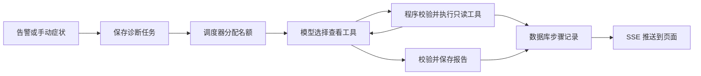

# 阶段 6：让医生自己查证据，并把过程显示出来

这份材料写给已经会 Java、刚开始学 Go 的你。建议先在 Mock 模式走一次，再读代码。真实模型会花钱；日常学习保持 `LLM_PROVIDER=mock`。

## 1. 这个阶段做了什么



图里的 SSE 是一条持续推送文字的 HTTP 连接。服务器每保存一步，就把这一步送给浏览器，不需要浏览器反复刷新。

阶段 5 的医生像一箱工具，需要人决定下一步查什么。现在把这个决定交给模型。模型只提出请求，Go 程序负责检查参数、调用工具、保存结果和限制花费。最后的建议仍需要人执行。本阶段没有修复按钮，也没有崩溃后的继续执行。

## 2. 怎么跑起来、看什么

### 2.1 先确认不会意外花钱

在本机 `.env` 中设置 `LLM_PROVIDER=mock`。即使 Key 已填写，也不会因此自动使用真实模型。重建前仍要设置一万商品的实验工作集，不能只改文件后继续使用旧容器。

```powershell
$env:LLM_PROVIDER = 'mock'
$env:LOADGEN_PRODUCT_COUNT = '10000'
$env:LOADGEN_WORKERS = '64'
$env:LOADGEN_QPS = '200'
docker compose --env-file .env -f deploy/docker-compose.yml up -d --build --wait --wait-timeout 240
```

你应该看到服务健康。已有数据保留；首次空库按根 README 先暂停流量再造数。浏览器打开 `http://127.0.0.1:8090`，用本机配置的初始账号登录。顶部应该显示“Mock 模式，不是真实诊断”。这是对当前运行进程的确认，比只看 `.env` 更可靠。

### 2.2 发起一次免费演示

在页面选 shop，填写“检查当前服务状态”，点击开始。你应该看到状态从等待执行变成正在诊断，然后出现模型步骤、查看结果和报告。Mock 只走固定脚本，不会根据故障找根因。报告中也有相同标识。

点击某个步骤，可以看实际发出的脱敏内容，以及模型或工具返回的内容。每次模型调用都有自己的模型名。它与任务开始时的模型不同，页面会提示，不会把两种模型的结果混成一份。

### 2.3 查看指标与命令行工具

```powershell
(Invoke-WebRequest http://127.0.0.1:8090/metrics).Content -split "`n" |
    Select-String '^doctor_'
```

你应该看到任务状态、工具耗时、模型 token、费用和预算指标。token 是模型计量文本的小单位，不等于一个汉字；服务商按输入和输出的 token 数收费。不要把某个诊断编号加进指标标签；每次新任务都会新增编号，长期运行会制造越来越多时间序列。单次过程去页面和数据库里查。

doctorctl 的使用方式没有变，仍按根 README 登录，把 JWT 放环境变量后运行 `target list`、`tool list --target shop`、`tool run --target shop ...`。它和 Agent 使用同一个工具注册表，没有为命令行开放更多权限。

### 2.4 真实模型验收结束后恢复

真实模式需要显式把 provider 改为 openai，并配置模型、Key、价格和总额度。4.1 Flash 使用 `deepseek-flash`，请求显式关闭思考模式。不要在聊天、命令参数或文档中放 Key。验收结束后，把本机 `.env` 的 provider 改回 mock，再执行：

```powershell
$env:LLM_PROVIDER = 'mock'
docker compose --env-file .env -f deploy/docker-compose.yml up -d --no-build --no-deps --wait doctor
```

你应该再次看到 Mock 横幅。单改环境文件不会改变已经启动的进程。集成测试和 chaos 自测只能在 Mock 下运行，并遵守根 README 的暂停流量、暂停通知与恢复顺序。

## 3. 开发过程回放

### 3.1 先修工具反馈和实验基线

这次先解决两个问题。模型写错 SQL 时，需要知道错在哪里。重建压测器后，也要知道它实际请求多少商品。

动手前先把两种边界分开：能帮助修正列名和语法的信息可以返回；连接密码和普通后端错误不能返回。工作集则必须向正在运行的进程查询，不能相信终端里的环境变量。

| 函数 | 输入与输出 | 作用 |
|---|---|---|
| SelectStatement | SQL → 通过或具体错误 | 指出多语句、注释、禁用函数等原因 |
| controlState.snapshot | 无 → 当前控制设置 | 返回实际商品数和固定工作者数 |
| verify.WithBaseline | 观察器、控制地址、预期参数 → 观察器 | 在健康检查前核对实验条件 |

先改返回信息，再补测试，最后同步 README、计划书和 decisions。这部分单独提交为 `5c723d3`。真实权限测试不靠打印数据库错误通过，而是检查被允许的错误号。基线不符直接失败，没有改变五十万商品的代码默认值，也没有修改 CacheLoadsHigh。

### 3.2 先规定对话与审计，再接真实模型

目标是让模型实现可以替换，Agent 不需要知道 HTTP 的细节。先确定一轮请求、一次工具调用和一次费用记录长什么样。

| 函数 | 输入与输出 | 作用 |
|---|---|---|
| llm.Client.Complete | context、Request → Response、error | 完成一轮对话，错误时也保留已发生费用 |
| Redactor.JSON | JSON → 清理后的 JSON | 保持结构，只清理敏感文字 |
| Ledger.Reserve | 归属、正文、预留额 → 尝试编号 | 先确认有额度，再允许联网 |
| Ledger.Settle | 尝试编号、用量 → error | 退回已知差额，未知费用保留预留 |

先写内存 Transport 测试，让 HTTP 客户端以为收到供应商回复，实际上不联网。再把费用预留放到真实发送之前。这样能测试重试次数、Retry-After、取消和审计字节，而不花钱调试基础协议。

复查时发现一个边界：实际费用超过估算，原实现只让当前诊断失败。重启后仍可能继续发送。于是加了一条迁移，持久化停用原因，同时把实际费用记全。集成测试用很小的测试金额证明重启和提高上限都不会绕过它。

### 3.3 把循环、任务和页面接起来

循环负责下一步查什么，调度负责什么时候能开始，仓储负责把每一步留下来。把它们分开以后，可以单独测试“模型乱给参数”和“同系统任务太多”，不用同时启动所有组件。

| 函数 | 输入与输出 | 作用 |
|---|---|---|
| agent.Run | context、系统绑定输入 → 报告与计数 | 管理本次对话与总时限 |
| session.readTools | 本轮工具请求 → error | 最多四个查看并行，把每份结果交回模型 |
| Scheduler.dispatch | context → error | 清理过时告警，再分配全局与系统名额 |
| Store.RecordStep | 诊断编号、步骤 → 已编号步骤 | 在事务中分配编号并保存 |
| api.stream | 已登录 HTTP 请求 → SSE | 从数据库补发，再跟随新步骤 |

先完成 Mock 正常循环、错误纠正、预算与并发测试，再接调度与真实仓储，最后接页面。真实仓储测试发现两个问题：没有报告的 SQL NULL 不能直接扫描到 RawMessage；对告警结构做浅拷贝，仍共享里面的 map。分别改为先读字节切片、创建全新结构后再解码。修复后 race 集成通过。

第一次浏览器走通的 Mock 任务是七步。实际观看页面又发现，运行中的轮数要等结束才更新；改为按已保存步骤实时汇总。手动任务刚开始时，数据库尚未写入实际模型，页面曾短暂显示 Mock。后来改为在 running 事件后重读已绑定的模型。这些问题都是接线时看到的，不是事后编出来的设计故事。

### 3.4 真实调用揭示了什么

第一次 S01 冒烟能查到索引和执行计划，但最终报告 JSON 不合法。程序按要求拒绝，任务结束为超出预算。没有把候选文字当作成功报告。

提示从 v6.1 升到 v6.2，只增加通用约束：查到足够证据即可提交、报告简短、JSON 必须完整、每条建议包括 manual 都有 risk。没有写入场景答案。第二次冒烟提交了合法报告，但机制解释仍混淆普通查询和更新加锁。这说明“格式正确”和“判断正确”是两回事。

真实取消通过页面点击完成。第三次模型 HTTP 请求正在等待时收到取消，日志记录中断，任务进入 cancelled。没有完整用量的这次请求保留预留额，不把取消误认为免费。完整数字与失败过程见[数据台账](../数据台账.md)的阶段 6 和[原始记录](../notes.md#phase-06)。

### 3.5 在 S06 恢复时发现了第二份账单

首轮 S06 报告正确指出消费者退出，但恢复后又多建了一份诊断。沿着通知时间查，发现“服务不可用”先恢复，“消息积压”稍后才达到持续时间门槛。问题出在什么时候认定故障结束，不在模型重试。

先保留两份任务和费用，再向用户确认规则。用户要求按每个系统的告警时长推算，因此没有把两分钟写死成全局配置。实现三分钟观察期后，先用可控时间和真实事务测试期限，再重跑 S06。晚到的积压告警进入原任务，页面单独显示，步骤和费用没有增加。

这轮报告本身却判错了。恢复流量曾带来短暂的下单延迟，模型被历史发送慢的证据带偏。我们把“没有重复花钱”和“根因是否正确”分开记录。修好工程机制不等于模型判断也通过了。

### 3.6 把报告格式、判断质量和页面接线分开检查

11 个场景的首轮结束后，9 份报告通过格式校验，6 个组件与标准一致。S05 和 S09 没交出合法 JSON。S10 有合法报告，却把网络延迟引起的连接占用当作连接池配置问题。不能用“页面显示成功”替代根因核对。

S08 找到了行锁争用，但把累计等待的毫秒换算成秒时错了三个数量级。S13 识别出重试在放大请求，却把历史连接池和熔断记录当成本轮原因。这些错误提醒我们：查到真实数字，还要核对时间、单位和因果关系。

补看页面时，有的诊断二十多秒就结束了，最初打开详情已经太晚。后续改为在告警出现时直接打开 running（正在执行）任务，观察工具步骤增加，再等终态。S07 补跑确实展示了实时过程，却在最终报告格式上失败。补跑单列，不用最好的结果替换首轮。所有调用都计入费用，未知费用仍保留预留。

最后，S09同版本重跑提交了报告。它找到了响应收尾模块，却把上一场重试风暴当成泄漏的触发条件。这次记为部分正确，首轮格式失败仍保留。结束后把.env和运行中的医生都切回Mock，再做真实数据库集成检查。最后复核的官方余额显示扣费¥1.09；医生按较保守口径记¥4.829000。两者都低于本次¥20上限，详细口径见汇报书。

S02 补充实验恢复后，第一次 healthy 因消费积压未连续低于 10 而超时。原样再跑才通过。我们没有调整健康门槛，也没有把暂停流量当作恢复。这些不顺利的过程和具体时刻都保存在 notes。

## 4. 阅读顺序

| 顺序 | 文件 | 重点看什么 |
|---|---|---|
| 1 | [cmd/doctor/main.go](../../cmd/doctor/main.go) | 程序只把启动结果转成退出码 |
| 2 | [app/agent_wiring.go](../../internal/doctor/app/agent_wiring.go) | 数据库、工具、模型、循环和调度怎样接起来 |
| 3 | [llm/model.go](../../internal/doctor/llm/model.go) | 消息与 tool_call_id，不先陷入 HTTP 细节 |
| 4 | [agent/loop.go](../../internal/doctor/agent/loop.go) | 循环什么时候继续，什么时候结束 |
| 5 | [agent/calls.go](../../internal/doctor/agent/calls.go) | 并行结果怎样按原调用 ID 放回去 |
| 6 | [agent/report.go](../../internal/doctor/agent/report.go) | 格式、组件和证据步骤的三重校验 |
| 7 | [run/scheduler.go](../../internal/doctor/run/scheduler.go) | 分配名额与取消为什么共用一张在途表 |
| 8 | [store/alerts.go](../../internal/doctor/store/alerts.go) | 故障开放期为何独立于报告状态 |
| 9 | [store/budget.go](../../internal/doctor/store/budget.go) | 费用怎样跨进程重启保存 |
| 10 | [httpapi/session.go](../../internal/doctor/httpapi/session.go)、[stream.go](../../internal/doctor/httpapi/stream.go) | Cookie、CSRF 与断线补发 |
| 11 | [web/static/app.js](../../internal/doctor/web/static/app.js) | 浏览器只显示文字，不执行模型输出 |

## 5. 关键设计与 WHY

### 5.1 模型提出请求，程序执行工具

Tool Calling 就是“模型说想调用哪个函数，以及传什么参数”。它不是模型直接连数据库。程序收到请求后，仍要检查工具名、字段、超时和系统绑定。

下面摘自正式 S02 的真实诊断 `5c143936176c1ce6bb948b6d68e75378`，提示版本 v6.2。第一轮还并行请求了架构说明；这里只展示告警工具这一对，省略同轮的另一对。内容来自实际发送后的审计记录，已经过统一脱敏。

模型返回：

```json
{
  "content": "我会先核对当前告警和整体情况。",
  "role": "assistant",
  "tool_calls": [
    {
      "function": {
        "arguments": "{}",
        "name": "list_firing_alerts"
      },
      "id": "call_00_9cuDherpsgFsX9tMHKlw5383",
      "type": "function"
    }
  ]
}
```

程序执行后，在下一轮发回：

```json
{
  "role": "tool",
  "content": "{\"result\":{\"bytes\":393,\"data\":[{\"active_at\":\"2026-10-28T04:54:02.419683092Z\",\"annotations\":{\"summary\":\"订单列表 P99 超过 200 毫秒\"},\"labels\":{\"alertname\":\"OrderListLatencyHigh\",\"service\":\"order-service\",\"severity\":\"warning\"},\"value\":\"4.896021626494497e+00\"}],\"duration_ms\":6,\"original_bytes\":236,\"status\":\"ok\",\"summary\":\"当前 1 条 firing 告警\",\"tool\":\"list_firing_alerts\",\"truncated\":false},\"step\":4}",
  "tool_call_id": "call_00_9cuDherpsgFsX9tMHKlw5383"
}
```

模型并没有自己访问 Prometheus。它给出了工具名和 `{}` 参数。程序找到已绑定 shop 的工具实例，查到告警，保存为本次诊断的第 4 步，再把结果放进 `role=tool` 的消息。

`tool_call_id` 原样沿用模型给的编号。一次可以请求多个工具，返回顺序也可能不同；这个编号说明“这份结果回答哪一次请求”。它不是数据库步骤号。`step=4` 才是报告引用证据时使用的步骤号。下一轮仍保留原来的 assistant 工具请求，再接上每一份 tool 消息，模型才能继续。

这轮请求用了 5414 个输入 token、46 个输出 token，供应商报告其中 5248 个输入命中缓存。医生按全部输入未命中的价格保守记 ¥0.011196。不是把整场诊断费用都归到这一轮。


### 5.2 并行查看，不让一个普通错误抹掉其他证据

查指标和查日志通常可以同时做，最多四个并行。工具查询失败时返回带 status 的结果，其他工具继续。比如调用链不存在，模型仍然可以读当前指标。

保存审计失败是另一回事。模型不能继续引用一份数据库里没有的结果，因此这种错误会停止循环。代码使用普通 errgroup.Group，普通工具失败不返回 group error，只有保存失败才返回。父 context 的取消仍传给全部查询。

### 5.3 一次故障只诊断一次

“报告写完了”不代表“故障修好了”。同一故障可能持续几十分钟，Alertmanager 会重复通知。若每次都建任务，医生会反复花钱解释同一件事。

所以数据库另存故障开放期。首次 firing 建诊断；后续通知并入；整组 resolved 后还要观察一段时间。观察期内再次出现 firing，就继续使用原诊断。等这些告警也全部恢复，再重新开始观察。重复发送同一份 resolved 不会不断延长等待。恢复通知丢失时，用十五分钟没有任何通知作为兜底。测试用可控时间推进，不真的睡十五分钟。

这个观察期来自一次真实失败。S06 中，消费者停机先触发“服务不可用”。恢复进程后，它很快消失。但“消息积压”还在等自己的持续时间满足，半分钟后才发来。原实现已经关掉故障，于是又付费诊断了一次。两份记录都保留在数据台账 P6-18、P6-19 中。

不能随手设两分钟。告警里的 for 表示“症状持续多久才发送”；shop 最长是 2 分钟。加上一次 10 秒的规则评估，以及 Alertmanager 等待分组的 5 秒，共 135 秒。所以 shop 配为 3 分钟。其他系统可以不同，时间放在各自接入配置中。医生之外的测试读取实际规则核对这个下界。

页面把这期间补入的症状列在“恢复观察期内的后续告警”，保存到达时间，报告不重跑。验收脚本读取 targets 接口的 fault.open；只有它变成 false 才开始下一场。fault.recovery_until 是预计结束时间，若再次响起告警，就不能继续把旧期限当作承诺。

代价也要记住：同一系统里两个重叠故障可能合成一组。观察期内真正发生的新故障，也可能被并入上一场。已有报告不会因为新症状自动重跑；需要调查时可以手动发起诊断。不能把这套时间规则宣传为能够完美识别每个独立事故。

### 5.4 成本控制的三道关

第一道是单次诊断预算。最多十五轮、四十次查看、累计八万 token 触发收尾。普通阶段四分钟，最后一分钟只整理报告。最后机会可能继续增加 token，所以八万是触发阈值，不是含最后报告的严格总 token 上限。

第二道是全局金额。真实请求发出前，先在数据库预留；不同诊断不能各自以为还有同一笔余额。已知用量按保守单价结算，未知用量保留预留。重启不清零。页面顶端显示包含预留的累计费用，因此在请求结束后可能下降。指标还用有限分类说明是总额度用尽、本次预留不足，还是实际费用超过估算后触发了保护；不会把任意错误文字放进标签。

第三道是过时任务。等了太久的告警不再执行，避免打开医生时把昨天的 pending 全部变成今天的账单。旧 running 本阶段只能标失败；恢复到上次步骤是阶段 7 的工作。

### 5.5 页面怎么登录，又怎么防脚本注入

普通 fetch 可以带 Authorization，但浏览器 EventSource 不能设置这个头。把 JWT 放 URL 会进入日志与历史。因此页面用 HttpOnly Cookie，浏览器自动带上，JavaScript 读不到其中的 JWT。

Cookie 也可能被浏览器自动带到恶意页面发起的请求，所以修改接口还要核对来源和 CSRF 值。SameSite=Strict 再挡住跨站携带。本机用 HTTP，部署到 HTTPS 时打开 Secure。

模型输出不是可信 HTML。即使里面出现 `<script>` 或带事件的图片标签，也只作为 textContent 显示。CSRF 负责别人不能借你的登录状态提交请求；防脚本注入负责页面不能把外来文字当程序执行。两者解决的问题不同。

### 5.6 页面断线为什么不会丢过程

SSE 可以理解为一条持续送文字的 HTTP 响应。这里每个步骤都有递增 seq，浏览器记住最后收到的编号。断线重连时用 Last-Event-ID 告诉服务端“从这个编号后继续”。

数据库才是完整记录，内存 channel 只是提醒有新步骤。先订阅，再补查数据库，避免两者之间漏事件。每个订阅者有六十四条缓冲，读太慢就断开；不能让一个慢浏览器拖住诊断和其他用户。

### 5.7 哪些数据会离开本机

系统提示、架构说明、告警、手动症状、工具结果都会发给模型服务商。只读权限能限制能查什么，不能自动保证查到的文字没有秘密。

因此出站内容统一脱敏：清理 sk- Key、Bearer、JWT、password= 等形状；同时替换已知环境凭据和连接串中的密码。审计存实际发出的清理版本，不另存未清理副本。形状识别仍可能漏掉任意格式的敏感信息，也可能误伤类似 token 的普通字符串。真实系统接入前必须清理说明书与日志，不能宣称这已解决所有数据外发风险。

### 5.8 格式通过不代表事实正确

报告的 Schema 只能检查字段、类型和允许的值。程序还能检查证据步骤确实存在，却不能自动判断“这一步真的支持这句话”。第一次有效冒烟就是例子：组件正确，机制里仍有不准确的锁解释。

三个写工具名出现在 suggested_actions 中，也不代表医生拿到了写权限。这里只保存建议。阶段 7 才会增加审批和写执行器，届时仍需再次检查参数，不能信任本阶段保存的任意 args。

## 6. 本阶段用到的 Go 写法

以下各段都是独立的完整程序。复制一段到临时目录的 `main.go`，运行 `go run main.go`。不要把多个 `package main` 拼进同一文件。

### 6.1 用常量类型表示固定错误

Go 的 error 是有 `Error() string` 方法的接口。为字符串定义一个自己的类型，就可以让常量实现这个接口。这样预算错误是固定值，不需要可被重新赋值的包级变量。

```go
package main

import (
	"errors"
	"fmt"
)

type failure string

func (value failure) Error() string { return string(value) }

const budget failure = "额度不足"

func main() {
	err := fmt.Errorf("本轮停止：%w", budget)
	fmt.Println(errors.Is(err, budget))
}
```

你应该看到 true。`%w` 保留原错误，调用方不用比较整段中文文字来判断原因。

### 6.2 JSON 数字先保留原文

把 JSON 解到 `any` 时，普通解码会把数字变成 float64。证据步骤号是整数，不能先丢掉精度再判断。UseNumber 让解码器先保留数字的文本形式，再按用途转成整数。

```go
package main

import (
	"encoding/json"
	"fmt"
	"strings"
)

func main() {
	decoder := json.NewDecoder(strings.NewReader(`{"step":17}`))
	decoder.UseNumber()
	var value map[string]any
	if err := decoder.Decode(&value); err != nil {
		panic(err)
	}
	step, err := value["step"].(json.Number).Int64()
	if err != nil {
		panic(err)
	}
	fmt.Println(step)
}
```

你应该看到 17。项目的结构校验先确认类型，再做断言；示例为了突出转换，输入固定为合法数字。

### 6.3 channel 满了，也可以选择不等待

浏览器读得慢，不能让保存诊断的 goroutine 一直等它。select 的 default 表示“其他分支现在都不能完成，就走这里”。本项目在这里断开慢订阅，让它以后从数据库补齐。

```go
package main

import "fmt"

func main() {
	events := make(chan int, 1)
	events <- 1
	select {
	case events <- 2:
		fmt.Println("已发送第二条")
	default:
		fmt.Println("缓冲已满，改走补发")
	}
	fmt.Println(<-events)
}
```

你应该先看到缓冲已满，再看到 1。default 不是免费加速；它要求你明确处理没送出去的数据。本项目能这么做，是因为步骤已经保存到数据库。

## 7. 动手实验

1. 在 Mock 模式发起任务，展开模型和工具步骤。找一组 tool_call_id 与 tool 回复，指出它和 step 的区别。
2. 在浏览器刷新诊断页面，比较刷新前后的步骤编号。应当完整且不重复；不要用刷新来启动第二份诊断。
3. 修改临时测试里的报告，把 evidence.step 改成不存在的编号。运行 `go test ./internal/doctor/agent -run TestLoopCorrection -v`，观察纠正流程。还原测试修改后再继续。
4. 运行 `go test ./internal/doctor/run -run TestScheduler -v`，读五个同系统任务与另一个系统任务的例子，解释为什么不能只开一个全局 FIFO 工作者。
5. 用 `TestCancel` 和 `TestCancelBody` 对比等待响应头、等待正文两种取消。测试只用内存 HTTP 替身，不会调用真实模型。

## 8. 常见误区

- Mock 有报告，不代表诊断正确。它只证明接线和页面可用。
- 收到报告不代表故障恢复。关闭故障开放期要等整组恢复后的观察期结束。
- 请求取消不代表没收费。供应商可能已经生成了一部分内容。
- 工具返回空数组不一定是没有异常，也可能是指标名或筛选条件写错。
- 引用了真实步骤不代表引用准确。仍需核对观察与原结果是否一致。
- 只读账号不是数据不会外发的保证。日志和说明书也需要脱敏。
- 改 `.env` 不会改变旧容器。重建后要从运行状态确认 provider 和负载参数。

## 9. 必答问题

1. Tool Calling 一轮中模型返回什么，程序回传什么，tool_call_id 有什么作用？
2. Agent 在什么情况下结束，为什么一定要有预算？
3. errgroup 在这里怎么用，一个工具失败会不会取消其他工具？
4. 点击取消后，信号经过哪些层，怎样让 HTTP 停下来？
5. SSE 和 WebSocket 怎么取舍，Last-Event-ID 怎样补发？
6. 为什么提示词需要版本号？

<details>
<summary>参考答案要点</summary>

1. 模型给工具名、JSON参数和调用ID；程序校验、执行、保存步骤，再用role=tool和同一个ID返回结果。一次并行多个工具也不会配错。
2. 合法报告、取消、不可继续的错误、预算耗尽都会结束。预算约束查证时间、资源和付费，防止一直猜指标名或反复查同一证据。
3. 最多四个并行。普通工具错误包装成结果，其他查看继续；保存审计失败才作为group错误返回。父context取消仍会中断全部查看。
4. 页面POST取消→调度器找到在途cancel→Agent的context→模型NewRequestWithContext与工具查询。短暂独立context只用于保存结束状态，不继续查证或生成。
5. 页面只需要服务端送步骤，SSE比双向WebSocket更直接。重连按seq补数据库，内存通知不能作为唯一记录。
6. 同一模型在不同提示下可能改变查证顺序和报告。没有版本号，就无法解释两次结果为什么不同。中途修改要保留旧失败与各自版本。

</details>

## 10. 本阶段新术语

| 术语 | 一句话解释 |
|---|---|
| Agent 循环 | 程序反复询问模型下一步查什么，再把结果交回去 |
| Tool Calling | 模型用结构化消息提出函数名与参数 |
| JSON Schema | 描述JSON必须有哪些字段、类型和范围的规则 |
| 故障开放期 | 从首次告警到恢复观察期结束，把通知归为同一事件的时间段 |
| 费用预留 | 联网前先占住一笔预算，避免并发请求超支 |
| 上下文缓存 | 服务商复用相同消息前缀的计算结果 |
| SSE | 服务器通过一条HTTP连接持续发送事件文本 |
| CSRF | 别的网站利用浏览器自动携带的登录状态提交请求 |
| HttpOnly | 让网页脚本不能直接读取某个Cookie的属性 |
| 提示注入 | 不可信文字伪装成指令，试图改变模型或程序行为 |
