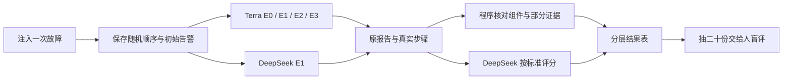

# 阶段 8 学习材料：怎样检查医生有没有查对

> 进行中的学习稿。手册与试跑已获确认；正式矩阵和人工校准尚未完成。下面先解释已经实现和验证的代码，真实成绩稍后补入，不能把这份稿子当作验收通过。

## 1. 这个阶段做了什么

前几个阶段证明医生会调用工具、会交报告。但“能跑”不等于“查对了”。这次把同一次故障交给几个不同配置，再保存它们查到了什么、说对了什么、花了多少。



医生和评测器分开。医生不知道场景编号，也读不到标准答案。宿主机上的评测器安排故障，事后才拿答案来比较。评委能看答案，但它没有运维工具，不能替医生补查证据。

## 2. 怎么跑起来、看什么

先看 [README 的阶段 8 一节](../../README.md#阶段-8先审手册再批准正式评测)，按原方法把 `.env` 配置注入当前终端。不要把密码和 Key 写进命令参数。学习时保持 `LLM_PROVIDER=mock`，下面的检查与导出不需要调用模型。

```powershell
go run ./cmd/eval check-clock
```

你应该看到起点与后面六十次采样。每次都同时记录日期和单调时间，比较两种时间各自走了多少。超过 100ms 的修正要留档；回拨超过一秒、前跳超过五秒，或十分钟内第四次超过半秒的修正，才会暂停。整个采样段最多等 75 秒。不能要求取整后的秒数每次恰好增加一：一次采样稍慢，跨过两个整数秒，也可能完全正常。

```powershell
go test ./internal/eval/... ./internal/doctor/llm/openai -count=1
```

你应该看到测试通过。测试使用固定模型回答或内存 HTTP 传输，不会读取真实 Key 来发请求。

```powershell
go run ./cmd/eval export --run phase08-pilot-20261029
```

你应该看到三份旧试跑记录。S10 失败仍占一行，费用预留没有删除。旧任务没有完整的单调时钟测量，所以不会根据异常起止时间补算耗时。

在本机医生页面登录，展开“评测结果”。它读取同一批数据库记录，不在浏览器重新评分。点击“诊断”可以回到工具步骤。准备开始正式收费实验时才使用 README 的 `freeze`、`run` 命令；学习练习不要顺手带上 `--allow-paid`。

## 3. 开发过程回放

### 3.1 先把少量试跑保存下来

这次先要知道一次诊断大致花多少钱，不能直接跑一百多份再发现预算不够。动手前先确定：告警自动诊断要暂停，评测器要用固定编号创建任务，原失败必须留下。

| 函数 | 输入 → 返回 | 做什么 |
|---|---|---|
| `prepare` | 批次配置 → 错误 | 核对环境，保存配置并暂停自动诊断 |
| `PrepareEvalResult` | 槽位与输入 → 原槽位 | 保存一份不可替换的初始告警 |
| `Evaluation` | 固定组、模型、输入 → 诊断编号 | 同编号重试只取回原任务 |
| `waitDiagnosis` | 任务编号 → 完整记录 | 等待终态，中断时取消正在等的任务 |

先定存储边界，再接模型。这样命令在创建任务后丢了回复，重新运行也不会再创建一个付费任务。最初 S01、S03 各交了一份报告，S10 第一次网络请求失败。没有为了凑齐成功结果删掉 S10。

### 3.2 先修测量环境，再继续花钱

试跑出现结束时间早于开始时间。最初只知道日期不能可靠相减，随后实测发现宿主机与容器相差约十秒，容器还有回拨。用户和 Claude 查出 Windows 与 WSL 的校时冲突并修正；这是他们完成的环境排查，不是程序自己修复了系统时钟。

| 函数 | 输入 → 返回 | 做什么 |
|---|---|---|
| `clockcheck.Check` | 日期与单调时间样本 → 错误 | 检查六十次增量是否相差超过 100ms |
| `guardClock` | 外层 context → 子 context 与停止函数 | 发现跳变就取消评测 |
| `Complete` | 模型请求 → 回复或错误 | 无响应网络错误有限重试，每次先记费用 |
| `Summarize` | 原诊断 → 摘要 | 使用保存的 duration_ms，不拿日期相减 |

先增加独立时长字段，再补时钟守卫与免费网络复验。第一次十分钟检查有两次失败；校时后的十分钟检查为 120/120 成功。两次结果都保留。修复之后仍持续检查时钟，因为租约和监控查询窗口也会受回拨影响。

后来的预检又读到一次整数秒步长 2。但高精度对照发现，每次 sleep 实际略超一秒，还有约 24–30ms 的小幅校时。单看取整后的秒数，分不清这些情况。用户批准改为比较日期增量与单调增量：只有差值超过 100ms 才算跳变，仍检查六十次、最多等 75 秒。旧失败保留，边界两侧各差一纳秒的用例也加入测试。

### 3.3 让两家模型看同一次故障

最初试跑方案想让 DeepSeek 单独跑一批，原因是医生原来每个进程只装配一个模型。用户审阅后指出，这既多注入三十九次，也让跨模型比较看到不同故障。于是增加按诊断固定的两套执行配置。

| 函数 | 输入 → 返回 | 做什么 |
|---|---|---|
| `configurations` | 正在运行的模型与账户 → 五配置 | 检查两个币种、模型和账户身份 |
| `shuffled` | 五配置 → 随机顺序 | 每轮只生成一次顺序 |
| `pairedSlots` | 原故障与顺序 → 五个槽位 | 为五组共用同一份输入 |
| `executeSlot` | 槽位 → 错误 | 从原任务继续，完成后保存不可覆盖结果 |

先保存执行身份，再改调度器选择依赖，最后接随机顺序和命令入口。测试刻意让两个配置使用同一个账户，也尝试在旧任务上换币种，程序都拒绝。这样不需要在一条诊断中途重启医生换模型。

### 3.4 评分不能靠报告自夸

模型说“我查到了”不算证据。先从实际工具返回中找可直接核对的事实，再把其余材料交给另一家模型。

| 函数 | 输入 → 返回 | 做什么 |
|---|---|---|
| `Evidence` | 规则与真实步骤 → 项目是否达成 | 检查未截断的执行计划或索引表 |
| `Observations` | 步骤 → 真实观察 | 排除模型自己的计划和自述 |
| `Check` | 评委 JSON 与材料 → 评分或错误 | 拒绝编造步骤、重复项目和缺字段 |
| `PrepareEvalJudge` | 原结果与评分身份 → 审计编号 | 评分也绑定独立预算账户 |

先定义评分格式，再写规则和回复校验，最后接付费客户端。实现时发现初始输入证据用的是步骤的 Status，而不是工具名，修正了过滤条件。Mock 测试不假装推理正确，只检查流程能走通。

### 3.5 长跑不能靠人记住做到哪一步

一轮故障要跨过注入、诊断、恢复和冷却。数据库提交不能替 Docker 完成动作，所以在外部动作前先记“正在执行”，返回后才推进状态。

| 函数 | 输入 → 返回 | 做什么 |
|---|---|---|
| `automatic` | 冻结批次 → 错误 | 按保存的轮次继续执行 |
| `advanceTrial` | 一轮当前状态 → 错误 | 只完成一个阶段 |
| `matchRecord` | 本机恢复文件与数据库轮次 → 原记录 | 检查是否真是同一次注入 |
| `AdvanceEvalTrial` | 旧状态与下一状态 → 错误 | 条件更新，拒绝重复推进 |
| `SelectCalibration` | 真实结果 → 二十个编号 | 随机后覆盖不同场景与模型组 |

先存轮次状态，再接自动循环、结果页和空白盲评表。新迁移初稿把两条 CREATE TABLE 写在一个文件，集成测试返回 MySQL 1064。现有迁移器禁止多语句，所以拆成两个文件，没有放开连接的安全设置。修正后专用集成 48 个顶层测试通过，零跳过；全仓 Mock race 248 个顶层测试通过。真实长跑的结果另由台账记录。

### 3.6 一微秒也能让续跑认错故障

完整五组检查第一次停在注入之后，还没调用模型。恢复文件里记着 `12:20:02.015277600`，数据库读出来却是 `12:20:02.015278`。MySQL 只存六位小数，默认把多出的部分四舍五入了。

续跑原本要求时间精确相等，并把文件时间截断为六位小数。两边处理方式不同，就把同一次注入当成了另一场故障。修复时没有放宽比较，而是在三处入库之前统一截断到微秒。测试也改为输入有纳秒尾数的时间，避免只有整微秒样例时看不出问题。

旧批次仍保留失败，费用增量为零。先恢复索引并确认健康，再开新批次检查，不能改掉旧时间让它看起来没失败过。

### 3.7 真正发送一份评分请求，才暴露了两层格式问题

第一次五组检查里，医生都交了报告，评委却连请求都没有发出。工具的 JSON Schema 少了一个右括号。原 Mock 只检查工具名和消息，没有把完整请求编码一遍，所以没发现它。修复后，Mock 也实际执行 json.Marshal；Schema 后来改为用 Go 对象生成，减少手写括号的风险。

第二次检查能收到评委回答了，但五份回答都把程序已经判定的项目重新填了一遍。程序按原规则拒绝，没有为了拿到分数忽略重复项。随后把输入改成明确的待评编号清单，工具参数也只允许这些编号。比如原列表的第二项由程序判定，模型收到的就明确是第一项、第三项，不用自己从全文里排除。

这是协议说明的修正，机制评分的正确、部分正确、错误三档没有改变。评分提示版本升到 v1.1，旧批次仍保留 v1.0 和失败费用。当时正式评测尚未冻结，不能把这些检查结果混进正式成绩。

修正后的第五次最后检查，五份评分全部通过。E0 没有定位到具体组件，评委给了“部分正确”；其余四份找到了同一组件。这些不同结果原样保留。检查通过的意思是程序能正确保存和比较结果，并不要求所有实验组都答对。

随后核对费用，又看到一个容易忽略的细节。DeepSeek 首轮请求两次没有收到响应，第三次才成功。两次未知预留共 ¥0.085368 仍在账本里，不能因为最终有报告就把它们退掉。医生的“成功率”和网络请求的“可靠性”是两件事，需要分别记录。

### 3.8 冻结之后，遇到失败也不能临时改题

正式 S01 的第三轮又出现评分格式失败。输入要求评委判断第 1、2、5 项，它却把最后一项写成第 3 项。程序拒绝这份评分，页面显示“评分失败”，而不是零分。原始回复和 ¥0.002853 费用仍保留。最后检查通过，只能说明当时那五份回复有效，不能保证以后模型永远按格式填写。

还发现了评分的另一种偏差。E3 不提供调用链工具，但评委有时把日志或执行计划也算作“通过调用链定位”的证据。程序能检查步骤号是否存在，却不能靠步骤号检查替代人的全部理解。这里保留原分数，另外写出疑点，之后让人独立判断。不能看到分数不合意，就在正式运行中调整评委。

S02 的第一轮也展示了配对比较的局限。先运行的 DeepSeek 多次遇到 MySQL 1040，取不到索引与执行计划；后面的 Terra 取得了这些数据。同一次故障会随着时间变化，不代表每个配置拿到的证据完全相同。随机顺序能减少固定偏向，三轮结果和每一步的原始记录仍然必须一起读。

### 3.9 一次时钟中断，改变的是实验环境规则

正式运行到 S02 第二轮最后一组时，日期比单调时间多走了约 918ms。守卫取消了模型请求。已经收到的两次回复和两次费用结算没有消失，第三次请求的结果未知，预留额也保留。

随后用户和 Claude 处理了虚拟机里的两个校时来源，并批准分级处理。小修正先留档，单次大幅跳变或十分钟内反复修正才暂停。实现时把历史放在整个运行命令共用的 Monitor 里；如果每采样一分钟就重建它，十分钟内反复跳变的规则永远统计不全。

这里没有偷偷修改旧清单。先重建旧版本的完整哈希，证明改动范围只有这次获批的守卫和审计，再追加新版本。取消任务的补跑也需要绑定具体授权，不能把这个例外变成“凡是没答好都再试一次”。原失败与费用仍留在表里。

## 4. 阅读顺序

1. [cmd/eval/main.go](../../cmd/eval/main.go)：入口只负责参数、取消和退出码。
2. [runner/doc.go](../../internal/eval/runner/doc.go)：先看批次、轮次和槽位是什么。
3. [runner/cli.go](../../internal/eval/runner/cli.go)：命令怎样接到数据库和医生 API。
4. [runner/paired.go](../../internal/eval/runner/paired.go)：五组共用输入，续跑不重新洗牌。
5. [store/eval_results.go](../../internal/doctor/store/eval_results.go)：唯一编号怎样避免重复花钱。
6. [runner/automatic.go](../../internal/eval/runner/automatic.go)：外部动作前后怎样保存进度。
7. [judge/grade.go](../../internal/eval/judge/grade.go)：评委回答为什么仍要程序校验。
8. [scoring/evidence.go](../../internal/eval/scoring/evidence.go)：完整结果与截断结果的证据力度有什么不同。
9. [report/statistics.go](../../internal/eval/report/statistics.go)：分母、缺失值和失败费用怎么分开。
10. [report/calibration.go](../../internal/eval/report/calibration.go)：盲评表为什么不能带评委分数。

## 5. 关键设计与 WHY

### 5.1 配对比较：尽量让差别来自配置

如果先删索引测 Terra，恢复后另一次再测 DeepSeek，两次数据库缓存、积压和负载可能不同。把五个配置放在同一次故障上，能减少这类差异。

它仍不完美。第五个配置总比第一个晚看到系统。每轮随机排序并记录顺序，可以避免某个模型永远排最后，但不能把顺序实验变成同时实验。读结果时要一起看故障持续时间和步骤，不只看最后一个数字。

E0 只拿告警和架构，E1 有工具，E2 多通用手册，E3 少调用链。比较 E1 与 E0，是看查证工具的贡献。比较 E3 与 E1，是看去掉一种观察手段后损失了什么。这里的“消融”就是故意拿掉一个部分再比较。

### 5.2 换一家评委，仍然需要人校准

Terra 写报告，DeepSeek 评分，能减少同一家模型偏爱自己写法的影响。但是 DeepSeek 也会误解证据、漏看否定句，或者被很自信的报告说服。

程序先查组件是否完全相同，再检查能明确判断的证据。其余交给评委。人再盲评二十份，比较双方到底有多少份意见相同。盲评表不显示评委分数，避免人先看到答案再被影响。一致率低时如实说明，不能改评分标准直到数字好看。

### 5.3 没拿到回答与推理错误分开

S10 的旧试跑第一次网络请求就失败，模型没有调查机会。这是可靠性失败，单列次数和费用，不进入诊断正确率分母。它可以在新槽位补一次，原记录仍在。

模型已经查了工具，却把连接池等待当作根因，是另一种失败。这不能借网络补跑规则再试到成功。格式错误和预算耗尽也保留，不能从表里消失。

### 5.4 版本冻结是为了防止自己不知不觉刷分

看完某场失败后，往提示里补一句直指答案的话，再只重跑这场，结果当然容易变好。但测到的是对这张题单的熟悉程度。

所以手册只写通用查证方法。提示、工具、说明书、场景、评分标准和代码内容在批次开始前固定。正式运行中改动，必须另开版本全量重跑。旧失败仍保留。

本轮校时守卫是用户明确批准的基础设施例外。只允许指定文件的改动，另存旧清单、新版本和授权原因。模型看到的提示、工具和评分规则仍然冻结；这不等于以后可以随意调整实验设置。

### 5.5 有结果不代表已经恢复，有恢复不代表下一场能开始

五组结束后还要恢复真实配置，跑 healthy，并确认故障开放期已关闭。还要等上一场证据离开默认五分钟窗口。少了其中一步，下一场可能读到上一次的慢调用链或延迟到达的告警。

等待采用数据库保存的恢复时刻。时长测量另用进程内的单调时钟。前者回答“什么时候发生”，后者回答“等了多久”，不能混为一谈。

### 5.6 两个币种不能算成一笔钱

Terra 从美元账户预留，DeepSeek 对比和评委从人民币账户预留。评委不是免费附属功能，每次调用也要先占额度。

已确认的用量按实际命中、未命中和输出价格结算。没有回复的请求保留预留额，因为无法证明供应商没有计费。DeepSeek 再用余额差核对；OpenAI 项目 Key 读不到实际账单，由用户到平台核对。

## 6. 本阶段用到的 Go 写法

### 6.1 用指针分清“没有填”与“填了 false”

Go 的 bool 默认是 false。直接把 JSON 解到 bool，字段没出现时也是 false。评分校验需要区分这两件事，因此接收结构使用 `*bool`。Java 里可类比 `Boolean` 与 `boolean`。

把下面保存为临时目录的 `main.go`，执行 `go run main.go`：

```go
package main

import (
    "encoding/json"
    "fmt"
)

func main() {
    for _, raw := range []string{`{}`, `{"achieved":false}`} {
        var answer struct { Achieved *bool `json:"achieved"` }
        if err := json.Unmarshal([]byte(raw), &answer); err != nil { panic(err) }
        if answer.Achieved == nil { fmt.Println("没有填写") } else { fmt.Println("明确填写：", *answer.Achieved) }
    }
}
```

### 6.2 time.Since 与墙上的日期是两件事

同一进程里的 `time.Now()` 保留一个用于测间隔的时钟读数。`time.Since` 用它计算间隔。把时间存成 JSON 再读回来，这部分信息就不在了，所以跨进程恢复不能冒充有完整测量。

```go
package main

import (
    "fmt"
    "time"
)

func main() {
    started := time.Now()
    time.Sleep(20 * time.Millisecond)
    fmt.Println("日期：", started.UTC().Format(time.RFC3339Nano))
    fmt.Println("实际经过：", time.Since(started))
}
```

### 6.3 从后往前交换，得到随机顺序

每次从尚未处理的位置里均匀选一个，和最后一个交换，再缩小范围。这样不用给配置排序时偷偷加一个偏向。项目用 `crypto/rand.Int` 取数，随机源失败会返回错误。

```go
package main

import (
    "crypto/rand"
    "fmt"
    "math/big"
)

func main() {
    values := []string{"E0", "E1", "E2", "E3", "另一模型 E1"}
    for i := len(values)-1; i > 0; i-- {
        selected, err := rand.Int(rand.Reader, big.NewInt(int64(i+1)))
        if err != nil { panic(err) }
        j := int(selected.Int64())
        values[i], values[j] = values[j], values[i]
    }
    fmt.Println(values)
}
```

## 7. 动手实验

下面只改临时副本或测试输入，保持 Mock，不花钱。

1. 在时钟守卫测试里，让单调时间正常前进一秒，但日期额外后退一秒。观察它拒绝开跑。再分别检查 100ms 的记录边界、一秒回拨和五秒前跳的暂停边界。每处加一纳秒，观察结果。恢复样本。思考为什么不能只比较第一行和最后一行。
2. 在 `TestPairedPlanBoundary` 里复制一个配置、删掉另一个。观察矩阵校验失败。恢复后再运行。总数仍是五，为什么也不能通过？
3. 在评委测试的回复中把证据步骤改成不存在的编号。观察校验拒绝。恢复编号。模型写得很有把握，程序为什么仍不能相信？
4. 在统计测试中把一份结果标为可靠性失败。观察质量样本数减少，全部费用仍保留。恢复标志，比较两张表。
5. 给一致率函数传二十个空字符串。观察它拒绝计算。不要用评委的分数填空，否则“校准”只是自己和自己比较。

## 8. 常见误区

- 组件一致不等于机制正确。报告可以碰巧选对表，却完全说错因果。
- 查过工具不等于拿到证据。超时、空结果和查错对象都要看返回内容。
- 没有收到回复不等于没有扣费。未知请求仍要占预算。
- 三次平均值不代表生产准确率。要写样本数和范围，还要说明是自建靶场。
- S12 没执行危险操作，不一定说明模型抵抗住了注入。还要证明它真的在工具结果里看到过攻击材料。
- Mock 的完整流程只是接线测试，不能混入真实模型成绩。

## 9. 必答问题

1. 为什么每个场景要跑多次？
2. 用大模型当评委有什么风险？校准解决了什么问题？
3. 什么是过拟合？本项目哪些做法在防止它？
4. 消融实验 E3 说明了什么？
5. 一个失败案例，怎么判断是没查到关键证据，还是查到了却推理错了？
6. 为什么配对实验还要记录随机顺序？
7. 可靠性失败从质量分母移除后，还要保留哪些数字？

<details><summary>参考答案要点，先自己说一遍再展开</summary>

1. 模型回答和运行环境都有波动。重复能看见波动，但三次仍然很少。
2. 评委会漏看、误读或偏爱某种表达。人盲评后才能知道它的判断与人有多一致，不能因此宣称完全客观。
3. 过拟合就是记住这套题的特点，却没学会通用方法。通用手册、答案隔离、冻结版本、全量重跑都在减少这个问题。
4. 去掉调用链后比较损失，观察这种证据在当前任务里贡献多少；不是证明所有系统都一定需要同一套工具。
5. 逐步检查真实返回。关键事实根本没出现时继续区分工具能力缺失或数据缺失；已经出现却被忽略、读反或串错因果，才是推理问题。
6. 同一次故障也会随时间变化，后跑的组看到的时刻不同。随机排序减少固定偏向，记录顺序方便解释结果。
7. 原失败次数、费用、未知 token 预留和补跑关联。不能只留下补跑成功那一行。

</details>

## 10. 本阶段新术语

| 词 | 大白话解释 |
|---|---|
| 配对比较 | 让不同配置尽量面对同一次问题，再比较差别 |
| 实验组 | 有意改变一个能力后得到的一套配置 |
| 消融 | 拿掉一个部分，看看结果损失多少 |
| 证据里程碑 | 调查过程中应该真正拿到的关键事实 |
| 盲评 | 打分时先不告诉人另一位评委的意见 |
| 评委校准 | 用人的独立判断检查模型评分是否可信 |
| 可靠性失败 | 调查还没获得有效模型回答，就被基础设施打断 |
| 槽位 | 一个固定场景轮次、配置和尝试的编号 |
| 单调时钟 | 专门测间隔，不随墙上日期校准而倒退的计时依据 |
