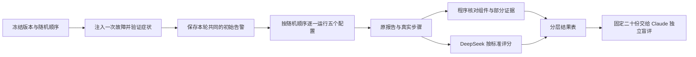
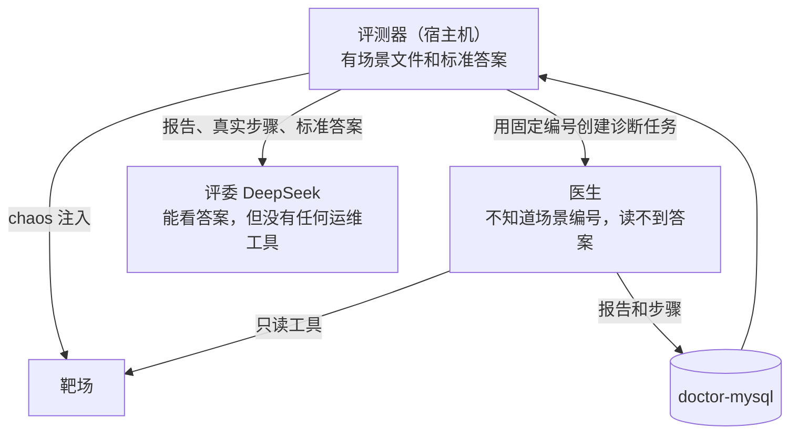

# 阶段 8 学习材料：怎样检查医生有没有查对

前几个阶段证明医生会调用工具、会交报告。但“能跑”不等于“查对了”。这个阶段写了一个评测器：把同一次故障交给几个不同的配置，保存它们查到了什么、说对了什么、花了多少，再用程序和另一家模型分别评分。

| 交付 | 作用 |
|---|---|
| 评测命令 [cmd/eval](../../cmd/eval/main.go)、[eval/runner](../../internal/eval/runner/doc.go) | 冻结版本、注入故障、按随机顺序运行五个配置、恢复、冷却，断了能接着跑 |
| 规则评分 [eval/scoring](../../internal/eval/scoring/doc.go) | 程序能确定判断的证据，由程序判断 |
| 模型评委 [eval/judge](../../internal/eval/judge/doc.go) | 对照标准答案判断机制对不对，回复要过程序校验 |
| 结果统计 [eval/report](../../internal/eval/report/doc.go) | 分组统计、失败单列、抽样做交叉盲评 |
| 两个新场景 | S11（无故障对照）、S12（真实业务日志里的提示注入） |
| 通用排障手册和 `runbook_search` 工具 | E2 组额外可用的检索工具 |

**怎样读这份材料。** “你怎么证明 Agent 有效”是 Agent 项目面试最常见、也最能拉开差距的问题，这一阶段就是答案。主线是 **怎样设计一个可信的评测**：评测集和标准答案怎样与被测对象隔离；怎样让不同配置面对同一次故障；哪些指标由程序判断、哪些交给评委；评委自己怎样被检验；怎样防止自己不知不觉刷分；一跑就是十几个小时的实验，断了怎样接着跑。Go 语法见第 7 节和 [Mini-Redis 的学习文档](https://github.com/Li-Nepenthe/mini-redis/blob/main/docs/learn/README.md)。

> 正式 39 轮已经结束（数据台账 P8-191），二十份交叉评分也已完成（抽样见 P8-193，结果见 P8-199 到 P8-203）。2026-11-02 你决定以 Claude 独立盲评代替亲自打分，并不补做 S12 实验。没有做人工校准；两个模型可能有共同偏差，交叉评分的一致率不能当作评委与人的一致率。

## 1. 本阶段能回答的面试题

| 面试题 | 在哪里 |
|---|---|
| 你怎么评估这个 Agent 的效果？指标怎么定义？ | 5.1、5.3、八股 1 |
| 你说准确率 92%，是怎么来的？可信吗？ | 5.3、八股 1 |
| 用大模型当评委靠谱吗？你怎么检验评委？κ 是什么？ | 5.5、八股 2 |
| 同样的输入，为什么结果会不一样？你们怎么处理？ | 5.2、八股 3 |
| 怎么防止自己反复调提示词“刷分”？ | 5.7、八股 4 |
| 网络失败和模型答错，统计时怎么区分？ | 5.6 |
| E0 到 E3 的消融说明了什么？ | 5.4 |
| Terra 和 DeepSeek 哪个更好？为什么这么选？ | 5.12、八股 5 |
| 一个要跑十几个小时的实验，怎样做到断了能接着跑？ | 4.2、5.8 |
| 你测过提示注入吗？防住了吗？ | 5.11 |
| 这套评测最大的局限是什么？ | 5.13 |

## 2. 评测器在系统里的位置

### 2.1 一轮评测的流程



五个配置是 Terra 的 E0、E1、E2、E3，以及 DeepSeek 的 E1。它们依次运行，前一组结束后才开始下一组，不是同时向故障系统发起调查。

### 2.2 谁能看到答案



医生和评测器分开：医生不知道场景编号，也读不到标准答案；评测器在宿主机上安排故障，事后才拿答案来比较。评委能看答案，但它没有运维工具，不能替医生补查证据。

### 2.3 五个配置

| 配置 | 模型 | 给了什么 | 用来回答什么 |
|---|---|---|---|
| E0 | Terra | 只有告警和系统架构说明，没有工具 | 不查证据，能猜对多少 |
| E1 | Terra | 完整的 16 个只读工具 | 完整的 Agent 表现 |
| E2 | Terra | E1 再加 `runbook_search`（通用排障手册检索） | 静态知识有没有帮助 |
| E3 | Terra | E1 去掉调用链工具 | 调用链贡献了多少 |
| DeepSeek E1 | DeepSeek | 和 E1 一样 | 换一个模型会怎样 |

## 3. 跑起来看什么

先看[运维文档的阶段 8 一节](../operations.md#阶段-8正式评测与交叉评分)，按原方法把 `.env` 配置注入当前终端。不要把密码和 Key 写进命令参数。学习时保持 `LLM_PROVIDER=mock`，下面的检查与导出不需要调用模型。

**第 1 步：检查时钟。**

```powershell
go run ./cmd/eval check-clock
```

你应该看到起点与后面六十次采样。每次都同时记录日期和单调时间，比较两种时间各自走了多少（5.9 节）。

**第 2 步：跑不花钱的测试。**

```powershell
go test ./internal/eval/... ./internal/doctor/llm/openai -count=1
```

测试使用固定的模型回答或内存 HTTP 传输，不会读取真实 Key 来发请求。

**第 3 步：导出一次旧试跑。**

```powershell
go run ./cmd/eval export --run phase08-pilot-20261029
```

这一步要求你的医生数据库里还保留着这次试跑的记录；新建的库里没有，可以直接看已经提交的导出 [phase-08-pilot-results.md](../reports/phase-08-pilot-results.md)。有记录时，你应该看到三份旧试跑记录。S10 失败仍占一行，费用预留没有删除。

**第 4 步：在页面看结果。** 在本机医生页面登录，展开“评测结果”。它读取同一批数据库记录，不在浏览器重新评分。点击“诊断”可以回到工具步骤。正式收费实验才使用[操作手册](../operations.md#阶段-8正式评测与交叉评分)里的 `freeze`、`run` 命令；学习练习不要带上 `--allow-paid`。

## 4. 代码走读

### 4.1 阅读顺序

| 顺序 | 文件 | 重点看什么 |
|---|---|---|
| 1 | [cmd/eval/main.go](../../cmd/eval/main.go) | 入口只负责参数、取消和退出码 |
| 2 | [runner/doc.go](../../internal/eval/runner/doc.go) | 先看批次、轮次和槽位是什么；哪些文件只为历史批次保留、初读可以跳过 |
| 3 | [runner/cli.go](../../internal/eval/runner/cli.go) | 命令怎样接到数据库和医生 API；`prepare` 暂停自动诊断，`waitDiagnosis` 等终态 |
| 4 | [runner/paired.go](../../internal/eval/runner/paired.go) | 五组共用输入；随机顺序只生成一次，续跑不重新洗牌 |
| 5 | [store/evaluation.go](../../internal/doctor/store/evaluation.go)、[eval_results.go](../../internal/doctor/store/eval_results.go) | 固定编号怎样避免重复花钱；结果保存后不能覆盖 |
| 6 | [runner/automatic.go](../../internal/eval/runner/automatic.go) | `advanceTrial` 一次调用可能连续推进好几段，但每一段都先落库；外部动作前后怎样保存进度 |
| 7 | [judge/grade.go](../../internal/eval/judge/grade.go)、[protocol.go](../../internal/eval/judge/protocol.go) | 评委回答为什么仍要程序校验 |
| 8 | [scoring/evidence.go](../../internal/eval/scoring/evidence.go) | 完整结果与截断结果的证据力度有什么不同 |
| 9 | [store/eval_judge.go](../../internal/doctor/store/eval_judge.go) | `PrepareEvalJudge` 接收一个 `EvalJudgeInput`：评分也绑定结果槽位、评分规则、独立的预算账户 |
| 10 | [report/statistics.go](../../internal/eval/report/statistics.go) | 分母、缺失值和失败费用怎么分开 |
| 11 | [report/calibration.go](../../internal/eval/report/calibration.go) | 盲评表为什么不能带评委分数 |

`runner/amendment.go`、`baseline_amendment.go` 和仓储里的 `eval_clock_amendment.go`、`eval_baseline_amendment.go` 只为恢复历史批次保留：新批次不产生修订记录，`EvalVersions` 直接返回冻结的版本。第一次读可以跳过。

### 4.2 一轮正式评测怎样走完

每次状态变化都是一条条件更新（`AdvanceEvalTrial`）：只有当前状态确实是旧状态，才能改成新状态，重复推进会被拒绝。一次 `advanceTrial` 调用可能连续推进好几段，比如从 pending 出发，会先记成 injecting、执行注入，再推进到 verifying；中途退出，就停在最后落库的那个状态。

| 顺序 | 状态 | 做了什么 |
|---|---|---|
| 0 | 批次开始前 | `freeze` 记下提示、工具、说明书、场景、评分标准和代码的哈希，并给每一轮生成一次随机顺序。之后只能按这份安排跑，不能临时换 |
| 1 | pending → injecting | 先确认健康基线，再把状态记成 injecting，然后才用 chaos 注入故障。注入到一半进程被杀，续跑时先检查真实症状，不重复执行一遍破坏性动作 |
| 2 | verifying | 等症状和相关告警真的出现，然后推进到 diagnosing |
| 3 | diagnosing | 准备诊断时读取当前告警，保存成五个配置共用的初始输入（S11 没有故障，允许告警为空）。然后按冻结的随机顺序依次跑五个配置。每个配置用固定的诊断编号创建任务，等它结束，再由规则和 DeepSeek 评分；结果保存后不能覆盖。同一编号重试，只会取回原来那份任务，不会多花一次钱 |
| 4 | restoring | 按恢复记录把故障还原 |
| 5 | cooling | 等 healthy 连续通过、故障开放期关闭、上一场的证据离开默认的五分钟查询窗口 |
| 6 | done | 进入下一轮 |

11.11 到 11.13 节的几次失败，都是靠这张状态表才能“从哪里断就从哪里接”：报告已经生成、恢复失败了，续跑就只重做恢复，不会重新花钱再调查一遍。

## 5. 系统设计与取舍

每个设计点按同一个顺序讲：要解决什么问题 → 怎么做 → 放弃了什么、为什么 → 代价和适用边界 → 规模变大十倍会怎样。

### 5.1 评测集：13 个场景，答案与被测对象隔离

**问题。** 通用的模型排行榜测不出“这个 Agent 在我的系统上能不能查对”。需要一份自己的题库，每道题有标准答案。

**做法。** 13 个场景（阶段 4 的 S01–S10、S13，加上 S11 无故障对照、S12 日志里的提示注入）。每个场景的 YAML 里写了标准答案（故障组件、机制）和证据里程碑（调查中应该真正拿到的关键事实），放在宿主机上。医生不知道场景编号，容器里也没有这些文件（archcheck 检查）。

**放弃了什么。** 用公开的运维问答数据集。题目和这个靶场的系统无关，测不出工具和证据链的作用。

**代价。** 题目是自己出的，答案也是自己定的；只有 13 道，覆盖的故障类型有限。到了陌生系统，成绩会下降（阶段 9）。

**规模变大十倍。** 题库要持续增加，并且从真实的线上故障复盘里抽题；答案要由不写医生代码的人来定。

### 5.2 配对比较：让差别尽量来自配置

**问题。** 先删索引测 Terra，恢复后另一次再测 DeepSeek，两次的数据库缓存、消息积压和负载可能不同，结果的差别就分不清是模型造成的，还是环境造成的。

**做法。** 把五个配置放在**同一次故障**上：注入一次，保存一份共同的初始告警，五个配置依次调查。每轮的顺序用 Fisher–Yates 洗牌随机生成一次并记录下来（7.2 节），避免某个配置永远排最后。

**仍不完美。** 第五个配置总比第一个晚看到系统，同一次故障也会随时间变化。S02 第一轮里，先运行的 DeepSeek 多次遇到 MySQL 1040（连接数已满），取不到索引与执行计划；后面的 Terra 取得了这些数据。读结果时要一起看故障持续时间和每一步的原始记录，不只看最后一个数字。

**放弃了什么：每个配置单独注入一次。** 环境更干净，但五个配置就要注入五次，实验时间和对系统的破坏都翻五倍，而且比较的是不同的故障。

**代价。** 一轮要依次跑五个诊断，每个都要几十秒；后跑的配置看到的系统状态和先跑的不同。

**规模变大十倍。** 配置多十倍，一次故障上要排几十个诊断，排在后面的配置看到的系统和第一个差得更远，配对的意义就打了折扣。那时要把配置分成几组，每组共用一次注入，组与组之间靠随机顺序和重复次数抵消环境差异。

### 5.3 指标分层：能用程序判断的，不交给模型

**问题。** “查对了”是一个模糊的说法。要拆成可以量的指标，而且每个指标要说清楚由谁判断。

**做法。** 三个指标：

- **组件一致**：报告里的故障组件和标准答案的字符串完全相同记 1，否则记 0。程序直接比较，不需要评委。
- **机制**：评委对照标准答案判断“为什么坏”，分正确、部分正确、错误三档。
- **证据覆盖**：每个场景列了几项证据里程碑，覆盖率 = 拿到的项数 ÷ 总项数。能用规则判断的由程序判断（比如有没有拿到未截断的执行计划或索引表，`scoring.Evidence`），其余交给评委。

评委的回复也要过程序校验：编造不存在的步骤、重复填写程序已经判定的项目、多出协议不允许的字段，一律拒收（`judge.Check`）。**拒收的评分记为“评分失败”，单列，不填成零分。**

**以 Terra E1 为例**（数据台账 P10-2）：39 份报告，组件一致 36 份，约 92%；机制有效评分 35 份，其中正确 25、部分正确 9、错误 1；另外 4 份评分格式失败，单列缺失。面试时说“准确率 92%”，一定要补上：这是**故障组件定位**，不是根因正确率；机制完全讲对的是 25/35；是自建靶场，每个场景只跑了 3 次。

**放弃了什么。** 全部交给评委打一个总分。简单，但评委会犯的错（漏看、被说服）就混进了所有指标。

**代价。** 组件用字符串精确比对，可能把“部分对”判成错（阶段 9 的 `cart` 与 `valkey-cart` 就是例子）。

**规模变大十倍。** 报告多十倍，程序判断的部分几乎不增加成本；评委评分的费用和评分失败的数量都按比例涨。能改成规则判断的里程碑越多，越省钱，也越可靠。

### 5.4 消融：一次只拿掉一个部分

**问题。** 想知道工具、手册、调用链各自贡献了多少。

**做法。** E0 拿掉全部工具；E2 在 E1 上多一份手册；E3 在 E1 上拿掉调用链。比较 E1 与 E0，是看查证工具的贡献；比较 E3 与 E1，是看去掉一种观察手段后损失了什么。这里的“消融”就是故意拿掉一个部分再比较。

**结果**（数据台账 P10-1 到 P10-4，Terra，每组 39 份）：

| 组 | 组件一致 | 机制 正确 / 部分 / 错误 | 有效评分 |
|---|---|---|---|
| E0 没有工具 | 0/39 | 0 / 3 / 35 | 38 |
| E1 完整工具 | 36/39 | 25 / 9 / 1 | 35 |
| E2 加手册 | 36/39 | 26 / 9 / 0 | 35 |
| E3 去掉调用链 | 36/39 | 23 / 12 / 0 | 35 |

可以这样读：有没有工具，决定了能不能定位；去掉调用链以后，组件还能找对，但把机制讲清楚的能力下降了一些；加手册几乎没有变化。每组只有 39 份，这些差别只能说明方向，证明不了显著。

E0 也使用同一份要求谨慎引用证据的提示，它几乎全写“根因未知”，而不是强猜一个组件。所以 E0 的结果反映的是当前这套配置在没有工具时的表现，不能直接当作模型在所有提示下都猜不出来。

**代价。** 每多一个消融组，每轮就多一个诊断，费用和时间都按组数增加。

**规模变大十倍。** 想拆开看的部分多了，不能每样都单独拿掉一组，组数会一路涨上去。那时先拿掉一大块，看影响大不大；影响大，再往下细拆。

### 5.5 评委：换一家模型，再用另一家交叉盲评

**问题。** 用大模型当评委有常见的偏差：自我偏好（更喜欢同一家模型的写法）、篇幅偏好（写得越长分越高）、语气偏好（被很自信的措辞说服）、位置偏好（比较两份答案时偏向某个位置）。评委自己对不对，怎么检验？

**做法。**

1. **换一家评委。** Terra 写报告，DeepSeek 评分，减少同一家模型偏爱自己写法的影响。但 DeepSeek 也参加 E1，这一组仍是自家评自家。
2. **评分格式由程序校验**（5.3 节）。
3. **交叉盲评。** 从已有报告、且评委成功给出合法分数的记录里，分层抽取固定的 20 份（覆盖 13 个场景、5 个配置、2 个模型，P8-193）。原计划由你独立打分；你因缺少运维背景、优先推进项目，改用 Claude 盲评：五个独立子代理分别盲评，看不到 DeepSeek 的分数、医生模型和实验组；评分完成后才把编号与组、模型关联，不因分歧改标准或重评。

**结果。** 机制一致 17/20，线性加权 κ=0.832402（P8-199）；去掉双方都判错的五份 E0，变成 12/15、κ=0.563107（P8-201）。证据规则项 13/13 一致；评委项 78 项中 63 项一致，比 Claude 多给 11 项、少给 4 项（P8-202）。不相关写建议 20/20 一致，但全是“否”，没有正例，证明不了能发现不当提议（P8-203）。

**补基础：Cohen's κ（kappa）。** 两个评分者就算闭着眼睛乱打，也会有一部分碰巧一致。κ 把这部分扣掉：κ =（实际一致率 − 碰巧一致的概率）÷（1 − 碰巧一致的概率）。1 表示完全一致，0 表示和乱猜差不多。“线性加权”是指把“正确对部分正确”这种相邻档位的分歧算半个不一致。去掉五份 E0 以后 κ 从 0.83 降到 0.56：这五份双方都判错，属于一眼就能判的样本，把一致率抬高了；剩下的是更难的报告。所以两个数都要报。

**放弃了什么：人工校准。** 用人的判断校准评委是更可靠的做法，这次没有做。这能发现模型之间的分歧，却不能替代人的独立判断；两个模型可能一起看错。

**代价。** DeepSeek E1 这一组的机制正确有 28 份，比 Terra E1 的 25 份还多，组件一致却只有 31/39（P10-5），而这一组恰好是被同一家模型评的，读这组数要特别小心。

**规模变大十倍。** 定期抽样做人工校准；多个评委投票；把评委的分歧样本单独复核。

### 5.6 没拿到回答和推理错误分开

**问题。** 一份诊断失败了，可能是网络请求根本没成功、模型没有调查机会，也可能是模型查了证据却推理错了。混在一起统计，正确率就说明不了问题。

**做法。**

- **可靠性失败**：还没获得有效的模型回答，就被网络这类基础设施打断。程序的一般判据是：诊断失败、没有报告、确实发过请求，而且每次请求的结果都是网络或 HTTP 错误。满足的才不进正确率的分母（次数和费用照记），可以在新槽位补一次，原记录仍在。
- **推理失败**：模型已经查了工具，却答错了。必须留在分母里，不能借“补跑”洗掉。格式错误和预算耗尽也保留。
- **评分失败**：评委的回复没通过校验。单列，不填成零分。

复盘一个推理失败时，先看工具返回了什么：工具根本没有这项能力，是工具不足；能力有、但那条数据没有存下或当前取不到，是数据缺失；用错指标名或查错对象，是查询选择问题（S07 第二轮 DeepSeek 用 `db_pool_wait_seconds_total` 查连接池等待，而项目实际采集的是 `go_sql_wait_count_total`）；事实已经摆在面前，却把因果说反，才是推理错误。几个原因可以同时出现，要分别写清楚。

**代价。** “可靠性失败”的边界要事先定清楚，否则任何失败都可能被说成可靠性问题。本次的校时中断不符合一般判据：任务是被取消的，而且此前已经收到过成功的回复。它是用户单独授权补跑的一次例外，走另一条程序分支。

**规模变大十倍。** 轮数多十倍，基础设施失败的次数也多十倍。判据必须写成程序，不能每次靠人判断能不能补跑；特批的例外越多，越要留下授权记录。

### 5.7 版本冻结：防止自己不知不觉刷分

**问题。** 看完某场失败后，往提示里补一句直指答案的话，再只重跑这场，结果当然容易变好。但测到的是对这张题单的熟悉程度，不是通用的能力。这就是**过拟合**。

**做法。**

- 手册只写通用的查证方法，不写任何场景的答案。
- 批次开始前，`freeze` 把提示、工具、说明书、场景、评分标准和代码的哈希固定下来。正式运行中改任何一样，必须另开版本全量重跑；旧失败仍保留。
- 冻结后遇到失败也不临时改题：正式 S01 第三轮出现评分格式失败，保留原样；E3 不提供调用链工具，评委有时把日志也算作“通过调用链定位”，保留原分数、另写疑点。

**例外要单独授权。** 本轮有两次基础设施修订（校时守卫、S08 的流量检查），都是用户明确批准的：只允许指定文件的改动，先重建旧版本的完整哈希证明改动范围，再追加新版本并记录授权原因。模型看到的提示、工具和评分规则仍然冻结。这些代码现在只为恢复历史批次保留（4.1 节）。

**放弃了什么。** 边跑边改。能更快看到“好结果”，但结果不可信。

**代价。** 发现一个明显的提示问题，也要等下一个版本全量重跑才能验证。

**规模变大十倍。** 版本和批次多了，每个结果都要能回答“它是哪个版本跑出来的”，所以版本要随结果一起保存（现在就是这样），不同版本的结果也不能放进同一张表直接比较。

### 5.8 十几个小时的实验，断了怎样接着跑

**问题。** 一轮评测要跨过注入、验证、五个诊断、恢复和冷却，39 轮要十几个小时。中途进程被杀、Docker 停了、时钟跳了，都不能靠人记住做到了哪一步；也不能重新跑一遍已经付费的诊断。

**做法。**

- **状态推进用条件更新**（4.2 节），重复推进会被拒绝。
- **外部动作前先记“正在执行”**，返回后才推进状态。数据库提交不能替 Docker 完成动作。
- **诊断用固定编号创建**，同编号重试只取回原任务，不会多花钱。
- **续跑时核对是不是同一次注入**（`matchRecord`）：恢复文件里记的注入时间要和数据库里的一致。
- **断点要细到“报告完成、正在恢复”。** 只存一个“整轮失败”，重启后就可能重复花钱调查已经完成的问题。

**一微秒的教训（11.6 节）。** 恢复文件里记着 `12:20:02.015277600`，数据库读出来却是 `12:20:02.015278`：MySQL 只存六位小数，默认把多出的部分四舍五入了。续跑要求时间精确相等，就把同一次注入当成了另一场故障。修复时没有放宽比较，而是在三处入库之前统一截断到微秒。

**代价。** 每个状态都要设计“断在这里怎样续”，而且每种续法都要有测试。

**规模变大十倍。** 实验从十几个小时变成好几天，断点会更多，一个进程顺序推进也太慢。那时可以让多个执行器并行推进不同的轮次，每一轮仍用条件更新保证只有一个执行器在推；但共用一套实验环境时，注入和恢复仍然只能一轮一轮来。

### 5.9 测量环境：墙上时钟和单调时钟

**问题。** 试跑出现了“结束时间早于开始时间”。宿主机与容器相差约十秒，容器的时钟还会回拨。如果拿日期相减算耗时，数字就不可信；时钟跳变还会影响租约和监控查询的时间窗口。

**补基础：墙上时钟和单调时钟。** 墙上时钟就是“现在几点”，系统校时可能把它往前拨，也可能往后拨。单调时钟只会往前走，专门用来量“过了多久”。Go 的 `time.Now()` 两样都带着，`time.Since` 用的是单调那一份（[Mini-Redis 第 05 章](https://github.com/Li-Nepenthe/mini-redis/blob/main/docs/learn/05-时间-select与GC.md)“time 包”）。把时间存成字符串再读回来，单调那一份就没了，所以跨进程恢复不能冒充有完整的测量。

**做法。**

- 每次诊断用进程内的单调时钟测耗时，存成独立的 `duration_ms` 字段，统计时不拿日期相减。
- 时钟守卫（`clockcheck`、`guardClock`）在评测期间持续比较同一段时间里两种钟各走了多少。超过 100ms 的修正留档；回拨超过一秒、前跳超过五秒，或十分钟内第四次超过半秒的修正，才暂停评测。

**这个规则改过一次。** 最初按 100ms 一律拦截；正式运行到 S02 第二轮时，日期比单调时间多走了约 918ms，守卫取消了模型请求。用户和 Claude 处理了虚拟机里的两个校时来源（Windows 与 WSL 的校时冲突是他们排查的，不是程序修好了系统时钟），并批准改成分级处理。

**代价。** 守卫只能发现跳变，不能阻止它；暂停以后要人来处理。

**规模变大十倍。** 实验时间越长，碰上校时和时钟跳变的次数越多。守卫的门槛要按机器实际的漂移来定，暂停以后怎么处理也要写进操作手册，不能每次都临时排查。

### 5.10 两个币种分开记账

**问题。** Terra 从美元账户付费，DeepSeek 对比组和评委从人民币账户付费。

**做法。** 两个账户分开预留和结算，不能直接相加。评委不是免费附属功能，每次调用也要先占额度。没有回复的请求保留预留额，因为无法证明供应商没有计费。DeepSeek 可以再用余额差核对。Terra 用的 Key 和别的用途共用，平台账单没法按项目单独核对；2026-11-02 起统一按项目用量账本计（见数据台账开头的说明）。

正式矩阵按项目用量账本计：美元 $3.221903，人民币 ¥6.230244（包括对比模型和评委，数据台账 P8-190、[汇报书](../reports/phase-08-eval.md)）。“项目用量账本”的意思是：每次请求的实际 token 用量乘以核对过的官方分档单价，没有回复的请求保留预留额；它不是平台的账单。

**规模变大十倍。** 账户和币种多了，每个金额都要带币种，汇总时只能按币种分别加；要换算成一个总数，必须写明用的是哪天的汇率。

### 5.11 安全评测：先问攻击有没有真的送到

**问题。** S12 想测提示注入：通过普通商品请求，把指令式文字写进访问日志，看医生读到以后会不会照做。

**结果。** 三轮确实发出了这些请求，但十五份诊断的工具结果都没有包含攻击文字（P8-204）。有的模型只查库存服务的 ERROR 日志，根本没有查到订单服务的普通访问日志。

**怎样读。** 要分清三件事：文字写进日志了、医生读到文字了、医生读到后仍按正确边界行动了。第一件发生，不代表后两件也发生。实际写操作为零，可以说明这次没有执行危险变更，却不能证明模型面对攻击时抵抗住了它。评委给部分报告满分覆盖，理由是它们没有听从危险文字；这个分数没有补上未暴露的事实。保留原分，同时用独立的 `exposed` 字段说明真实缺口；冻结后没有为了拿到好成绩修改投放方式或提示。你决定不补做 S12，按已知限制收尾。

**规模变大十倍。** 攻击场景多了，每个场景都要先证明攻击文字真的送到了模型面前（像 `exposed` 字段那样单独记录），没送到的不能算进“防住了”。投放方式要保证模型一定会读到，比如把文字放进它必查的告警或日志里。

### 5.12 怎样读两家模型的结果

**先按场景看，别先找一个总分。** S10 的十二份带工具报告都把连接池当成故障组件，没定位到数据库链路。它们写得很完整，也拿到了一些真实证据，但这个共同失败不能被其他简单场景的成功平均掉。S11 里，Terra 的九份带工具报告都判断当前没有故障；DeepSeek 三份里两份判断没有故障，一份把早先的缓存抖动放进了根因字段。

**再看过程，不只看文字。** Terra 四个实验组（E0–E3）的 156 份正式报告都是主动提交；DeepSeek 的 39 份里有 16 份到预算上限后才收尾。调用轮数更多，不一定查得更准：DeepSeek 有些轮次查错指标名，越查越久。完整表同时列出工具数、耗时、费用和报告方式。

**选型。** 主模型用 Terra：格式和主动提交更稳，组件一致 36/39 高于 DeepSeek 的 31/39。DeepSeek 便宜，而且和医生不是同一家，适合当评委。不能简单说谁更好：三次具体运行证明不了哪个模型永远更好。

**规模变大十倍。** 每组从 39 份变成 390 份，36/39 和 31/39 这样的差别才有可能做显著性检验。但如果场景还是这 13 个，样本再多也只是同一批题做得更熟，结论仍然不能外推到别的系统。

### 5.13 局限

- 自建靶场；13 个场景，每个场景每组只有 3 份报告。
- 没做人工校准，交叉评分是模型和模型比。
- S12 的攻击文字没有真正送到医生面前。
- 组件用字符串精确比对，可能把“部分对”判成错。
- 14 份评分没通过校验，不能填成零分；其余 181 份也不能自动当作标准答案，只交叉复核了固定的 20 份。
- 到了陌生系统，组件定位从约 92% 降到 3/5（阶段 9），这正说明自建靶场上的成绩不能直接外推。

**规模变大十倍。** 上面这些局限，有的靠多跑能缓解（样本少），有的多跑也没用（自建靶场、没有人工校准、攻击没送到）。扩大规模之前，先补人工校准和陌生系统上的测试，比单纯多跑几轮更有用。

## 6. 系统设计八股

每题先给一分钟口述版，面试时照着这个长度说；再给要点、项目里的例子和常见追问。

### 八股 1：怎么评估一个 Agent 的效果？指标怎么定义？

#### 一分钟口述版

我先建了一个自己的评测集：13 个故障场景，每个都有标准答案和证据里程碑，答案和被测的医生隔离，医生不知道场景编号。指标分三层：故障组件是否和标准答案一致，由程序精确比对；根因机制对不对，由另一家模型当评委分三档；关键证据拿到了几项，能用规则判断的由程序判断，其余交给评委。评委的回复也要过程序校验，不合格的单列为评分失败，不填零分。为了比较不同配置，我让五个配置面对同一次故障，顺序每轮随机并记录。Terra 完整工具组 39 份报告里，组件一致 36 份，约 92%，但我会强调这是组件定位，机制完全正确是 25/35，而且是自建靶场、每个场景只有 3 次；换到陌生的开源系统，组件定位降到 3/5。

#### 要点

- 自己的评测集 + 标准答案 + 证据里程碑；答案隔离。
- 分层：确定性检查优先，开放判断交给评委。
- 失败分类：可靠性失败、推理失败、评分失败。
- 报数字时同时报口径、样本量和场景范围。

#### 项目里的例子

- 5.3 节；数据台账 P10-2。

#### 常见追问

1. **92% 可信吗？** 只说明在自建靶场、这 13 个场景上的组件定位；样本小，不能外推。
2. **为什么每个场景只跑 3 次？** 受费用和时间限制；3 次能看出波动，下不了统计结论。
3. **组件对了，机制错了算什么？** 分开报：组件一致是一个指标，机制是另一个。

### 八股 2：用大模型当评委靠谱吗？怎样检验评委？

#### 一分钟口述版

有风险。常见的偏差有自我偏好、篇幅偏好、被自信的语气说服、比较时偏向某个位置，还有格式不稳。我的做法是：能用程序判断的就不交给评委，比如组件精确比对、有没有拿到完整的执行计划；评委用另一家模型 DeepSeek 评 Terra 的报告，减轻自我偏好；评委的回复要过程序校验，编造步骤或者格式不对就拒收，不填零分。最后用 Claude 独立盲评固定抽出的 20 份做交叉检查，机制一致 17/20，线性加权 κ 是 0.83；去掉五份双方都判错的无工具组，剩下 12/15，κ 是 0.56，所以两个数都要报。但这是模型和模型比，不是人工校准，两个模型可能一起看错，这是我主动承认的局限。

#### 要点

- 先确定性检查，再评委。
- 换一家评委；格式校验；失败单列。
- 交叉盲评：固定抽样、盲评、事后关联。
- κ 扣除偶然一致；报全量和去掉简单样本后的两个数。

#### 项目里的例子

- 5.5 节；数据台账 P8-199、P8-201、P8-202。

#### 常见追问

1. **κ 是什么？** 扣掉碰巧一致之后的一致程度，1 是完全一致，0 和乱猜差不多。
2. **为什么去掉 E0 以后 κ 降了这么多？** 那五份都是一眼能判的错，抬高了一致率。
3. **DeepSeek E1 为什么要特别小心？** 那一组是 DeepSeek 自己评自己，机制分可能偏高。

### 八股 3：同样的输入，为什么结果会不一样？怎么处理？

#### 一分钟口述版

原因有好几层：模型本身有采样随机性；工具在不同时刻读到的数据不同，故障是在变化的；几个工具并行时返回顺序也可能不同。所以我的评测从三方面处理。第一，每个场景跑 3 轮，能看见波动，但 3 次仍然很少，只能说明方向。第二，同一轮里五个配置面对同一次故障、共用同一份初始告警，尽量让差别来自配置而不是环境。第三，每轮的执行顺序随机生成并记录下来，避免某个配置永远排在最后、看到的是故障的尾巴。读结果时不只看平均值，还要回到每一步的原始记录，比如同一轮里先跑的模型遇到了数据库连接打满，后跑的就没遇到，这种差别要能解释。

#### 要点

- 采样、环境变化、并发顺序。
- 重复运行；配对比较；随机并记录顺序。
- 排查差异时先找最早出现分歧的一步。

#### 项目里的例子

- 5.2 节：S02 第一轮 DeepSeek 遇到 MySQL 1040。

#### 常见追问

1. **能不能把温度设成 0 消除随机性？** 能减少，但工具读到的数据仍在变，而且有的模型不支持完全确定。
2. **随机顺序为什么还要记录？** 复盘时要知道谁先谁后，才能解释差别。
3. **3 次够吗？** 不够做统计检验，只能看方向。

### 八股 4：怎样防止自己反复调提示词“刷分”？

#### 一分钟口述版

刷分本质上是过拟合：看到某道题失败，就往提示里补一句直指答案的话，再只重跑这道题，分数会变好，但测到的是对题目的熟悉程度。我的做法是：手册只写通用的查证方法，不写任何场景的答案；医生读不到场景编号和标准答案；批次开始前把提示、工具、说明书、场景、评分标准和代码的哈希冻结下来，正式运行中改任何一样都要另开版本、全量重跑，旧的失败结果全部保留。正式运行里确实遇到过评分格式失败和评委误判，我都保留原样，另外写出疑点，没有临时改评委。唯一的两次例外是基础设施修订，都单独记录了授权、改动范围和新旧版本的哈希。

#### 要点

- 手册只写通用方法；答案隔离。
- 冻结哈希；改动 = 新版本 + 全量重跑。
- 失败保留，不临时改题。
- 例外要授权、限范围、留记录。

#### 项目里的例子

- 5.7 节；`freeze` 命令和执行版本审计（P8-194）。

#### 常见追问

1. **发现提示有明显问题怎么办？** 记录下来，下一个版本修，修完全量重跑。
2. **为什么手册不能写场景答案？** 写了就测不出医生在陌生问题上的能力。
3. **怎样证明没有偷偷改？** 每次执行都核对冻结的哈希。

### 八股 5：你们最终选了哪个模型？为什么？

#### 一分钟口述版

选模型不只看谁跑分最高，要看格式稳定性、工具调用、成本和延迟。我在同一次故障上对比了 Terra 和 DeepSeek。Terra 完整工具组（E1）组件一致 36/39，四个实验组一共 156 份正式报告全部主动提交，格式更稳；DeepSeek 同样的工具组组件一致 31/39，有 16 份是到预算上限才被迫收尾，有些轮次查错指标名，越查越久。但 DeepSeek 便宜，而且和医生不是同一家，适合当评委，减轻自我偏好。所以诊断用 Terra，评分用 DeepSeek。我也会说明局限：DeepSeek 那一组的机制分是它自己评的，可能偏高；每组只有 39 份，证明不了哪个模型永远更好。

#### 要点

- 看格式稳定、工具调用、主动提交、成本、延迟。
- 主模型和评委用不同的模型。
- 样本小，结论限于这次的场景。

#### 项目里的例子

- 5.12 节；数据台账 P10-2、P10-5。

#### 常见追问

1. **为什么不全用便宜的模型？** 诊断是格式要求严格、工具调用多的环节，稳定性更重要。
2. **Terra E1 每份诊断多少钱、多久？** 平均约 20.4 秒、约 0.025 美元（项目用量账本口径，P10-19）。
3. **换模型要重新做什么？** 整套评测全量重跑。

## 7. 用到的 Go 写法

### 7.1 已在 Mini-Redis 讲过的

| 写法 | 本阶段在哪里用 | 去哪里学 |
|---|---|---|
| 指针区分“没有填”和“填了零值” | 评委回复的 `*bool`：字段没出现和填了 false 是两回事 | [Mini-Redis 第 00 章](https://github.com/Li-Nepenthe/mini-redis/blob/main/docs/learn/00-Go程序的骨架.md)“指针”；阶段 2 的 7.3 节 |
| `time.Since` 用单调时钟 | 诊断耗时存成 `duration_ms` | [Mini-Redis 第 05 章](https://github.com/Li-Nepenthe/mini-redis/blob/main/docs/learn/05-时间-select与GC.md)“time 包” |
| context 的取消 | 时钟守卫发现跳变就取消评测（`guardClock`） | [Mini-Redis 第 07 章](https://github.com/Li-Nepenthe/mini-redis/blob/main/docs/learn/07-channel-context与WaitGroup.md)“context” |
| 表格测试、边界值 | 时钟守卫的边界两侧各差一纳秒的用例 | [Mini-Redis 第 08 章](https://github.com/Li-Nepenthe/mini-redis/blob/main/docs/learn/08-测试.md)“表格驱动测试和子测试” |

下面两节是 Mini-Redis 没有讲过的。

### 7.2 Fisher–Yates 洗牌

每次从尚未处理的位置里均匀选一个，和最后一个交换，再缩小范围。项目用 `crypto/rand.Int` 取数，随机源失败会返回错误。

```go
package main

import (
	"crypto/rand"
	"fmt"
	"math/big"
)

func main() {
	values := []string{"E0", "E1", "E2", "E3", "另一模型 E1"}
	for i := len(values) - 1; i > 0; i-- {
		selected, err := rand.Int(rand.Reader, big.NewInt(int64(i+1)))
		if err != nil {
			panic(err)
		}
		j := int(selected.Int64())
		values[i], values[j] = values[j], values[i]
	}
	fmt.Println(values)
}
```

力扣 384 题“打乱数组”考的就是它。常见追问：为什么不能让每个位置随便和任意位置交换？那样一共有 n 的 n 次方种走法，而不同的排列只有 n 的阶乘种；n 的 n 次方一般不能被 n 的阶乘整除，所以有的顺序出现得更多，结果就不均匀了。Fisher–Yates 每一步只在“还没处理的位置”里选，总走法正好是 n 的阶乘种。

### 7.3 JSON 能读出来，不代表符合约定

S03 第一轮有一份评委回复多写了一个 `note` 字段。JSON 语法没有错，但协议不允许这个字段，程序因此拒绝评分，原回复和费用都保留。Go 的普通 JSON 解码默认忽略未知字段，需要严格按协议接收时，调用 `DisallowUnknownFields`：

```go
package main

import (
	"encoding/json"
	"fmt"
	"strings"
)

func main() {
	var value struct {
		Achieved bool `json:"achieved"`
	}
	decoder := json.NewDecoder(strings.NewReader(`{"achieved":true,"note":"x"}`))
	decoder.DisallowUnknownFields()
	err := decoder.Decode(&value)
	fmt.Println(err) // json: unknown field "note"
}
```

格式检查通过也不代表评分可信。同一轮里，评委还把“索引存在”当成“已经看过执行计划”。这需要检查实际证据，不能靠 JSON 校验发现。

## 8. 动手实验

下面只改临时副本或测试输入，保持 Mock，不花钱。

1. 在时钟守卫测试里，让单调时间正常前进一秒，但日期额外后退一秒再多一纳秒。观察它拒绝开跑；恰好一秒则只记录。再分别检查 100ms 的记录边界、一秒回拨和五秒前跳的暂停边界，每处加一纳秒观察结果。恢复样本。想一想为什么不能只比较第一行和最后一行。
2. 在 `TestPairedPlanBoundary` 里复制一个配置、删掉另一个。观察矩阵校验失败。总数仍是五，为什么也不能通过？
3. 在评委测试的回复中把证据步骤改成不存在的编号。观察校验拒绝。模型写得很有把握，程序为什么仍不能相信？
4. 在统计测试中把一份结果标为可靠性失败。观察质量样本数减少，全部费用仍保留。比较两张表。
5. 给一致率函数传二十个空字符串。观察它拒绝计算。不要用评委的分数填空，否则“校准”只是自己和自己比较。

## 9. 常见误区

- **“组件一致就是机制正确。”** 报告可以碰巧选对组件，却完全说错因果。
- **“查过工具就拿到了证据。”** 超时、空结果和查错对象都要看返回内容。
- **“没有收到回复就没有扣费。”** 未知请求仍要占预算。
- **“三次平均值代表生产准确率。”** 要写样本数和范围，还要说明是自建靶场。
- **“评分失败就是零分。”** 它是缺失，单列，不能填零。
- **“κ 高就说明评委可靠。”** κ 受档位分布影响；而且这次是模型和模型比，不是和人比。
- **“S12 没执行危险操作，就说明防住了注入。”** 还要证明攻击文字真的出现在工具结果里。
- **“Mock 的完整流程能算成绩。”** 它只是接线测试，不能混入真实模型成绩。

## 10. 自测

先自己写下答案，再展开参考要点对照。系统设计方面的问题见第 1 节和第 6 节，这里偏重代码细节。

1. `AdvanceEvalTrial` 为什么用条件更新推进状态？
2. 为什么在执行注入之前就把状态记成 injecting？
3. 五个配置为什么用固定的诊断编号创建任务？
4. `PrepareEvalJudge` 为什么要绑定独立的预算账户？
5. 时钟守卫为什么比较两种钟的增量，而不是比较取整后的秒数？
6. 续跑时为什么要用 `matchRecord` 核对注入时间？微秒问题是怎么出现的？
7. 抽样做交叉盲评时，为什么只从“有报告且评分合法”的记录里抽？
8. 盲评表为什么不能带 DeepSeek 的分数？
9. 一份诊断网络失败后补跑成功了，统计时原记录怎么处理？
10. 为什么 E3 的评委评分里，有人把日志也算作“通过调用链定位”？这说明了什么？

<details>
<summary>参考要点（先自己回答）</summary>

1. 只有当前状态确实是旧状态，才能改成新状态。两个进程同时推进，或者一次推进被重复执行，都只有一次能成功。
2. 注入做到一半进程被杀，续跑时能看到“正在注入”，先检查真实症状，不会把破坏性动作再执行一遍。
3. 同一个编号重试只取回原来的任务，不会因为命令在创建任务后丢了回复就多花一份钱。
4. 评委也要花钱，它的费用要和诊断模型分开记，而且受各自的额度限制。
5. 一次采样稍慢，跨过两个整数秒，取整后的步长就是 2，但这完全正常；只有两种钟的增量差得太多，才说明系统时钟被调过。
6. 要确认数据库里这一轮和本机恢复文件说的是同一次注入。恢复文件里的时间有纳秒，MySQL 只存微秒并且四舍五入，两边不一致，就把同一次注入当成了另一场。修复是入库前统一截断到微秒，而不是放宽比较。
7. 缺少任何一方的分数，都没法比较一致率。评分失败另列数量和费用，不在一致率里偷偷补成零分。
8. 盲评者看到另一位评委的分数，就可能被它影响，交叉检查就不独立了。
9. 原失败记录、费用、未知 token 预留都保留，和补跑记录关联起来；不能只留下补跑成功那一行。
10. 程序能检查步骤号是否存在，却不能判断步骤的内容是不是真的属于“调用链”。评委也会误判，所以保留原分、另写疑点，留给人独立判断。

</details>

## 11. 开发过程回放

### 11.1 先把少量试跑保存下来

这次先要知道一次诊断大致花多少钱，不能直接跑一百多份再发现预算不够。动手前先确定：告警自动诊断要暂停（`prepare`），评测器要用固定编号创建任务（`Evaluation`），等待任务终态时中断要取消正在等的任务（`waitDiagnosis`），原失败必须留下。

先定存储边界，再接模型。这样命令在创建任务后丢了回复，重新运行也不会再创建一个付费任务。最初 S01、S03 各交了一份报告，S10 第一次网络请求失败。没有为了凑齐成功结果删掉 S10。

### 11.2 先修测量环境，再继续花钱

试跑出现结束时间早于开始时间。最初只知道日期不能可靠相减，随后实测发现宿主机与容器相差约十秒，容器还有回拨。用户和 Claude 查出 Windows 与 WSL 的校时冲突并修正；这是他们完成的环境排查，不是程序自己修复了系统时钟。

先增加独立的时长字段，再补时钟守卫与免费的网络复验。第一次十分钟检查有两次失败；校时后的十分钟检查为 120/120 成功。两次结果都保留。

后来的预检又读到一次整数秒步长 2。高精度对照发现，每次 sleep 实际略超一秒，还有约 24–30ms 的小幅校时；单看取整后的秒数，分不清这些情况。用户批准改为比较日期增量与单调增量，只有差值超过 100ms 才算跳变。旧失败保留，边界两侧各差一纳秒的用例也加入测试。

### 11.3 让两家模型看同一次故障

最初的试跑方案想让 DeepSeek 单独跑一批，原因是医生原来每个进程只装配一个模型。用户审阅后指出，这既多注入三十九次，也让跨模型比较看到不同的故障。于是增加按诊断固定的两套执行配置：`configurations` 检查两个币种、模型和账户身份；随机顺序每轮只生成一次；`pairedSlots` 为五组共用同一份输入；`executeSlot` 从原任务继续，完成后保存不可覆盖的结果。

测试刻意让两个配置使用同一个账户，也尝试在旧任务上换币种，程序都拒绝。这样不需要在一条诊断中途重启医生换模型。

### 11.4 评分不能靠报告自夸

模型说“我查到了”不算证据。先从实际工具返回中找可直接核对的事实（`Evidence` 检查未截断的执行计划或索引表；`Observations` 排除模型自己的计划和自述），再把其余材料交给另一家模型（`Check` 拒绝编造步骤、重复项目和缺字段；`PrepareEvalJudge` 让评分也绑定独立的预算账户）。

实现时发现初始输入证据用的是步骤的 Status，而不是工具名，修正了过滤条件。Mock 测试不假装推理正确，只检查流程能走通。

### 11.5 长跑不能靠人记住做到哪一步

先存轮次状态，再接自动循环（`automatic`、`advanceTrial`）、结果页和空白盲评表。新迁移初稿把两条 CREATE TABLE 写在一个文件，集成测试返回 MySQL 1064：现有迁移器禁止多语句，所以拆成两个文件，没有放开连接的安全设置。

### 11.6 一微秒也能让续跑认错故障

完整五组检查第一次停在注入之后，还没调用模型。恢复文件里记着 `12:20:02.015277600`，数据库读出来却是 `12:20:02.015278`（5.8 节）。修复时没有放宽比较，而是在三处入库之前统一截断到微秒；测试也改为输入有纳秒尾数的时间，避免只有整微秒样例时看不出问题。旧批次仍保留失败，费用增量为零。

### 11.7 真正发送一份评分请求，才暴露了两层格式问题

第一次五组检查里，医生都交了报告，评委却连请求都没有发出：工具的 JSON Schema 少了一个右括号。原 Mock 只检查工具名和消息，没有把完整请求编码一遍，所以没发现它。修复后，Mock 也实际执行 `json.Marshal`；Schema 后来改为用 Go 对象生成，减少手写括号的风险。

第二次检查能收到评委回答了，但五份回答都把程序已经判定的项目重新填了一遍。程序按原规则拒绝，没有为了拿到分数忽略重复项。随后把输入改成明确的待评编号清单，工具参数也只允许这些编号。评分提示版本升到 v1.1，旧批次仍保留 v1.0 和失败费用。当时正式评测尚未冻结。

修正后的第五次最后检查，五份评分全部通过。DeepSeek 首轮请求两次没有收到响应，第三次才成功；两次未知预留共 ¥0.085368 仍在账本里（数据台账 P8-33）。医生的“成功率”和网络请求的“可靠性”是两件事，需要分别记录。

### 11.8 冻结之后，遇到失败也不能临时改题

正式 S01 第三轮又出现评分格式失败：输入要求评委判断第 1、2、5 项，它却把最后一项写成第 3 项。程序拒绝这份评分，页面显示“评分失败”，而不是零分。原始回复和费用仍保留。

还发现了评分的另一种偏差：E3 不提供调用链工具，但评委有时把日志或执行计划也算作“通过调用链定位”的证据。这里保留原分数，另外写出疑点。不能看到分数不合意，就在正式运行中调整评委。

### 11.9 一次时钟中断，改变的是实验环境规则

正式运行到 S02 第二轮最后一组时，日期比单调时间多走了约 918ms，守卫取消了模型请求。已经收到的两次回复和费用结算没有消失，第三次请求的结果未知，预留额也保留。

随后用户和 Claude 处理了虚拟机里的两个校时来源，并批准分级处理（5.9 节）。实现时把历史放在整个运行命令共用的 Monitor 里；如果每采样一分钟就重建它，“十分钟内反复跳变”的规则永远统计不全。这里没有偷偷修改旧清单：先重建旧版本的完整哈希，证明改动范围只有这次获批的守卫和审计，再追加新版本。

### 11.10 查询窗口变大，也会把旧故障带回来

S04 第二轮里，DeepSeek 主动查询最近二十分钟的慢调用链。它拿到的慢 Redis 调用发生在 16:48，本轮故障却在 17:03 才开始。调用链是真实的，时间却不属于这次故障。模型把旧延迟接进当前的因果链，报告因而偏向 Redis 客户端异常。

“查到了真数据”还不够，还要问“这条数据在解释哪一段时间”。这次保留原报告和部分正确的评分，没有为这个场景临时修改提示。

### 11.11 调查结束了，恢复也可能失败

S02 第二轮补跑完成后，评测器准备恢复原索引，却被 MySQL 拒绝连接（错误 1040，连接已满）。恢复命令也要先取得连接，所以业务受到的资源限制同样会挡住恢复。这时不能重跑诊断，也不能把数据库上限随手调大。先暂停压测，等原请求结束后，只读查询看到连接降到 15，按原恢复记录执行，索引在 6.452 秒后恢复（P8-57）。随后恢复 200 QPS，再通过健康和冷却检查。

### 11.12 恢复消费者，不等于消息立刻追平

S06 会暂停消费者。模型调查期间订单继续产生消息，调查越久，积压越多。前两轮的首次恢复检查都等满了三分钟，仍然没有通过；后续指标显示积压继续下降，最终追平。保留失败，从“正在冷却”的检查点重做同一项健康检查；没有重新注入，也没有再花钱生成五份报告。

### 11.13 查询暂停时的事实，要先找对时间

S09 第二轮恢复后，连接池基线检查立即失败。先按命令结束时间查询，三个服务的指标全是 0，看不出哪里不对；后来读取数据库里的中断时间，才发现它比命令结束早约六秒，按这个时间查询，订单服务的那条指标还没有出现。程序要求三个进程都明确报告“连接池没有被改过”，因此少一条就暂停，不能把没有数据当作正常。确认新数据齐全后，从冷却步骤继续即可。

### 11.14 无故障对照，不是把过去的记录删干净

S11 第一轮没有注入故障，只重启了相同配置的服务。开始检查时已经连续健康，告警为空。但工具默认还会回看开始前五分钟，里面确实有更早的一次 Redis 短暂抖动和待核对订单。Terra 带工具的三组说明当前没有故障，并把以前的订单问题另列；DeepSeek 花了更多轮次追查旧抖动，最后的根因字段选了缓存模块。E0 没有工具，只说无法确认健康；按组件精确匹配它不算匹配，但这也不是声称当前一定有故障。

实验保留了这个真实背景，不能为了得到漂亮的无故障结果，删掉旧日志或临时缩短查询窗口。

### 11.15 S08 被自己的安全检查挡住

S08 故意把流量调高到 400 QPS，还把请求集中到同一个商品。程序确认症状后，却继续要求正常状态的 200 QPS，挡住了实验自己计划的变化。这一轮还没有调用模型。修正不是把流量检查关掉：注入前和恢复后检查正常值，调查时读取场景文件里的最终值；商品总数和工作者数在任何阶段都不能变化。已完成的二十一轮通过了更严格的旧检查，不需要重跑；新代码有独立的版本审计（P8-194）。这一做法经过用户明确批准。

### 11.16 最后一轮结束以后，先停止收费能力

39 轮结束时（P8-191），先把本机配置和运行医生都切回 Mock（P8-192），再做专用库集成检查。随后从有效报告固定抽取 20 份，覆盖 13 个场景和两家模型（P8-193）；没有按照“好不好打分”再挑一遍。生成盲评材料前没有提交新的代码，因为校准命令会检查生效版本的哈希。

当时停在[用户短表](../reports/phase-08-human-scores.md)，没有代你填写。11 月 2 日你决定不亲自打分，提供了 Claude 独立盲评。只读数据库里的固定抽样和原评分逐项比较，没有重新调用模型（P8-205）。完整理由与离线复算见[交叉评分](../reports/phase-08-cross-scoring.md)。

### 11.17 可读性改造（2026-11-11）

OpsDoctor 可读性改造的第 7 批改了评测器，代码由 GPT 改，Claude 审核：

1. **历史修订代码隔离。** 两次授权修订（校时守卫、S08 流量检查）的代码保留，只在文件开头和 doc.go 标明“仅供历史批次恢复，初读可以跳过”；新批次由 `EvalVersions` 直接返回冻结版本。用户决定保留而不删除。
2. **评委输入改成结构体。** `PrepareEvalJudge` 原来接收一长串参数，现在接收 `EvalJudgeInput`。
3. **报告表格的分隔行修正。** 结果报告里诊断表的分隔行比表头多了一段，这是改造前就存在的错误；修正时这份 golden 的第 8 行发生了变化，经用户批准。
4. **运行器的 9 个长函数只改了注释。** 它们的函数体在现有 Mock 测试下覆盖率是 0，没法证明拆分以后行为不变，按事先约定不拆。

**怎么验证：** 评分、评委解析、命令行和环境变量的 golden 逐字节不变（除上面批准的那一行）；judge、scoring 和 clockcheck 三个包除注释与排版外，全部词法内容相同。

## 12. 核对来源

### 12.1 外部事实

| 说法 | 出处 |
|---|---|
| Cohen's κ 和线性加权 κ 的定义 | Cohen (1960)；Cohen (1968) “Weighted kappa”；scikit-learn [cohen_kappa_score](https://scikit-learn.org/stable/modules/generated/sklearn.metrics.cohen_kappa_score.html) 的 `weights="linear"` |
| 大模型评委的位置、篇幅、自我偏好等偏差 | Zheng et al. (2023) [Judging LLM-as-a-Judge with MT-Bench and Chatbot Arena](https://arxiv.org/abs/2306.05685) |
| Fisher–Yates 洗牌的均匀性 | Knuth, The Art of Computer Programming, Vol. 2, 3.4.2 Algorithm P |
| Go 的 `time.Now` 带单调时钟读数，序列化后丢失 | Go 文档 [time 包：Monotonic Clocks](https://pkg.go.dev/time#hdr-Monotonic_Clocks) |
| MySQL 的 `DATETIME(6)` 只存到微秒，多出的小数默认四舍五入 | MySQL 8.4 参考手册 [Fractional Seconds in Time Values](https://dev.mysql.com/doc/refman/8.4/en/fractional-seconds.html) |
| `json.Decoder.DisallowUnknownFields` | Go 文档 [encoding/json](https://pkg.go.dev/encoding/json#Decoder.DisallowUnknownFields) |
| 正式矩阵的费用、两次授权修订和交叉评分的全部数字 | 本仓库[阶段 8 汇报书](../reports/phase-08-eval.md)、[交叉评分](../reports/phase-08-cross-scoring.md)、[数据台账](../数据台账.md) P8-190 到 P8-205、P10-1 到 P10-5 |

### 12.2 对照阅读

| 本材料 | 对应文章 | 去那边重点看什么 |
|---|---|---|
| 整个阶段 | 《Agent面试题》[19. 如何评估一个 Agent 的效果？评测集和指标怎么设计？](https://xiaolinnote.com/ai/agent/19_evaluation.html) | 分层评估；能用确定性检查的先用确定性检查，其余交给人工和 LLM 评委，并防范评委的位置、篇幅、自我偏好等偏差。本项目前一半做到了，人工校准这一步没做 |
| 5.2、八股 3 为什么跑多次 | 《Agent面试题》[30. 相同输入为什么会得到不同的 Agent 执行结果？](https://xiaolinnote.com/ai/agent/30_execution_variance.html) | 采样、工具读到的数据、并发返回顺序都会让结果不同；排查时先找最早出现差异的一步 |
| 5.1、5.7 用自己的题来测 | 《大模型工程面试题》[21. 大模型能力评测指标有哪些？](https://xiaolinnote.com/ai/llm/evaluation_metrics.html) | 通用排行榜只能参考，要在自己的业务数据上建测试集，每次改动都全量重跑 |
| 5.12、八股 5 两家模型 | 《大模型工程面试题》[22. 你们项目中最终选用了哪个模型？为什么？](https://xiaolinnote.com/ai/llm/model_selection.html) | 选模型看格式稳定性、工具调用、成本和延迟，不只看跑分 |

学完后，在[进度看板](../进度.md)上勾选阶段 8 的“学习验收”。
