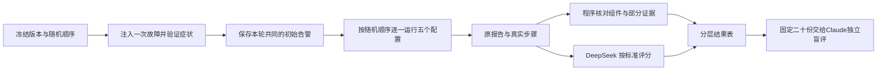

# 阶段 8 学习材料：怎样检查医生有没有查对

> 正式39轮和二十份交叉评分已经结束。2026-11-02你决定以Claude独立盲评代替亲自打分，并不补做S12实验。按修订门槛完成工程验收，学习验收仍由你勾选。未做人工校准；两个模型可能有共同偏差，这个数不能当作评委与人的一致率。

**配合小林coding 阅读。** “你怎么证明 Agent 有效”是 Agent 项目面试最常见、也最能拉开差距的问题，这一阶段就是答案。和前几个阶段一样，用到基础知识时先讲清楚（标着“补基础”），再给出对应文章（标着“对照阅读”）；最后的“面试追问”汇总了最可能被问到的问题。

| 本材料 | 小林对应文章 | 去那边重点看什么 |
|---|---|---|
| 整个阶段 | 《Agent面试题》[19. 如何评估一个 Agent 的效果？评测集和指标怎么设计？](https://xiaolinnote.com/ai/agent/19_evaluation.html) | 分层评估；能用确定性检查的先用确定性检查，其余交给人工和 LLM 评委，并防范评委的位置、篇幅、自我偏好等偏差 |
| 5.1、第九节第 1 题 为什么跑多次 | 《Agent面试题》[30. 相同输入为什么会得到不同的 Agent 执行结果？](https://xiaolinnote.com/ai/agent/30_execution_variance.html) | 采样、工具读到的数据、并发返回顺序都会让结果不同；排查时先找最早出现差异的一步 |
| 5.4 用自己的题来测 | 《大模型工程面试题》[21. 大模型能力评测指标有哪些？](https://xiaolinnote.com/ai/llm/evaluation_metrics.html) | 通用排行榜只能参考，要在自己的业务数据上建测试集 |
| 5.10 两家模型 | 《大模型工程面试题》[22. 你们项目中最终选用了哪个模型？为什么？](https://xiaolinnote.com/ai/llm/model_selection.html) | 选模型看格式稳定性、工具调用、成本和延迟，不只看跑分 |

## 1. 这个阶段做了什么

前几个阶段证明医生会调用工具、会交报告。但“能跑”不等于“查对了”。这次把同一次故障交给几个不同配置，再保存它们查到了什么、说对了什么、花了多少。



五个配置是 Terra 的 E0、E1、E2、E3，以及 DeepSeek 的 E1。它们依次运行，前一组结束后才开始下一组，不是同时向故障系统发起调查。

医生和评测器分开。医生不知道场景编号，也读不到标准答案。宿主机上的评测器安排故障，事后才拿答案来比较。评委能看答案，但它没有运维工具，不能替医生补查证据。

## 2. 怎么跑起来、看什么

先看 [运维文档的阶段 8 一节](../operations.md#阶段-8正式评测与交叉评分)，按原方法把 `.env` 配置注入当前终端。不要把密码和 Key 写进命令参数。学习时保持 `LLM_PROVIDER=mock`，下面的检查与导出不需要调用模型。

```powershell
go run ./cmd/eval check-clock
```

你应该看到起点与后面六十次采样。每次都同时记录日期和单调时间，比较两种时间各自走了多少。超过 100ms 的修正要留档；回拨超过一秒、前跳超过五秒，或十分钟内第四次超过半秒的修正，才会暂停。整个采样段最多等 75 秒。不能要求取整后的秒数每次恰好增加一：一次采样稍慢，跨过两个整数秒，也可能完全正常。

```powershell
go test ./internal/eval/... ./internal/doctor/llm/openai -count=1
```

你应该看到测试通过。测试使用固定模型回答或内存 HTTP 传输，不会读取真实 Key 来发请求。

```powershell
go run ./cmd/eval export --run phase08-pilot-20261029
```

你应该看到三份旧试跑记录。S10 失败仍占一行，费用预留没有删除。旧任务没有完整的单调时钟测量，所以不会根据异常起止时间补算耗时。

在本机医生页面登录，展开“评测结果”。它读取同一批数据库记录，不在浏览器重新评分。点击“诊断”可以回到工具步骤。准备开始正式收费实验时才使用[操作手册](../operations.md#阶段-8正式评测与交叉评分)里的 `freeze`、`run` 命令；学习练习不要顺手带上 `--allow-paid`。

## 3. 开发过程回放

### 3.1 先把少量试跑保存下来

这次先要知道一次诊断大致花多少钱，不能直接跑一百多份再发现预算不够。动手前先确定：告警自动诊断要暂停，评测器要用固定编号创建任务，原失败必须留下。

| 函数 | 输入 → 返回 | 做什么 |
|---|---|---|
| `prepare` | 批次配置 → 错误 | 核对环境，保存配置并暂停自动诊断 |
| `PrepareEvalResult` | 槽位与输入 → 原槽位 | 保存一份不可替换的初始告警 |
| `Evaluation` | 固定组、模型、输入 → 诊断编号 | 同编号重试只取回原任务 |
| `waitDiagnosis` | 任务编号 → 完整记录 | 等待终态，中断时取消正在等的任务 |

先定存储边界，再接模型。这样命令在创建任务后丢了回复，重新运行也不会再创建一个付费任务。最初 S01、S03 各交了一份报告，S10 第一次网络请求失败。没有为了凑齐成功结果删掉 S10。

### 3.2 先修测量环境，再继续花钱

试跑出现结束时间早于开始时间。最初只知道日期不能可靠相减，随后实测发现宿主机与容器相差约十秒，容器还有回拨。用户和 Claude 查出 Windows 与 WSL 的校时冲突并修正；这是他们完成的环境排查，不是程序自己修复了系统时钟。

| 函数 | 输入 → 返回 | 做什么 |
|---|---|---|
| `clockcheck.Check` | 日期与单调时间样本 → 错误 | 最初按 100ms 拦截；后来按用户批准的分级规则检查 |
| `guardClock` | 外层 context → 子 context 与停止函数 | 发现跳变就取消评测 |
| `Complete` | 模型请求 → 回复或错误 | 无响应网络错误有限重试，每次先记费用 |
| `Summarize` | 原诊断 → 摘要 | 使用保存的 duration_ms，不拿日期相减 |

先增加独立时长字段，再补时钟守卫与免费网络复验。第一次十分钟检查有两次失败；校时后的十分钟检查为 120/120 成功。两次结果都保留。修复之后仍持续检查时钟，因为租约和监控查询窗口也会受回拨影响。

后来的预检又读到一次整数秒步长 2。但高精度对照发现，每次 sleep 实际略超一秒，还有约 24–30ms 的小幅校时。单看取整后的秒数，分不清这些情况。用户批准改为比较日期增量与单调增量：只有差值超过 100ms 才算跳变，仍检查六十次、最多等 75 秒。旧失败保留，边界两侧各差一纳秒的用例也加入测试。

### 3.3 让两家模型看同一次故障

最初试跑方案想让 DeepSeek 单独跑一批，原因是医生原来每个进程只装配一个模型。用户审阅后指出，这既多注入三十九次，也让跨模型比较看到不同故障。于是增加按诊断固定的两套执行配置。

| 函数 | 输入 → 返回 | 做什么 |
|---|---|---|
| `configurations` | 正在运行的模型与账户 → 五配置 | 检查两个币种、模型和账户身份 |
| `shuffled` | 五配置 → 随机顺序 | 每轮只生成一次顺序 |
| `pairedSlots` | 原故障与顺序 → 五个槽位 | 为五组共用同一份输入 |
| `executeSlot` | 槽位 → 错误 | 从原任务继续，完成后保存不可覆盖结果 |

先保存执行身份，再改调度器选择依赖，最后接随机顺序和命令入口。测试刻意让两个配置使用同一个账户，也尝试在旧任务上换币种，程序都拒绝。这样不需要在一条诊断中途重启医生换模型。

### 3.4 评分不能靠报告自夸

模型说“我查到了”不算证据。先从实际工具返回中找可直接核对的事实，再把其余材料交给另一家模型。

| 函数 | 输入 → 返回 | 做什么 |
|---|---|---|
| `Evidence` | 规则与真实步骤 → 项目是否达成 | 检查未截断的执行计划或索引表 |
| `Observations` | 步骤 → 真实观察 | 排除模型自己的计划和自述 |
| `Check` | 评委 JSON 与材料 → 评分或错误 | 拒绝编造步骤、重复项目和缺字段 |
| `PrepareEvalJudge` | 原结果与评分身份 → 审计编号 | 评分也绑定独立预算账户 |

先定义评分格式，再写规则和回复校验，最后接付费客户端。实现时发现初始输入证据用的是步骤的 Status，而不是工具名，修正了过滤条件。Mock 测试不假装推理正确，只检查流程能走通。

### 3.5 长跑不能靠人记住做到哪一步

一轮故障要跨过注入、诊断、恢复和冷却。数据库提交不能替 Docker 完成动作，所以在外部动作前先记“正在执行”，返回后才推进状态。

| 函数 | 输入 → 返回 | 做什么 |
|---|---|---|
| `automatic` | 冻结批次 → 错误 | 按保存的轮次继续执行 |
| `advanceTrial` | 一轮当前状态 → 错误 | 只完成一个阶段 |
| `matchRecord` | 本机恢复文件与数据库轮次 → 原记录 | 检查是否真是同一次注入 |
| `AdvanceEvalTrial` | 旧状态与下一状态 → 错误 | 条件更新，拒绝重复推进 |
| `SelectCalibration` | 真实结果 → 二十个编号 | 随机后覆盖不同场景与模型组 |

先存轮次状态，再接自动循环、结果页和空白盲评表。新迁移初稿把两条 CREATE TABLE 写在一个文件，集成测试返回 MySQL 1064。现有迁移器禁止多语句，所以拆成两个文件，没有放开连接的安全设置。修正后专用集成 48 个顶层测试通过，零跳过；全仓 Mock race 248 个顶层测试通过。真实长跑的结果另由台账记录。

### 3.6 一微秒也能让续跑认错故障

完整五组检查第一次停在注入之后，还没调用模型。恢复文件里记着 `12:20:02.015277600`，数据库读出来却是 `12:20:02.015278`。MySQL 只存六位小数，默认把多出的部分四舍五入了。

续跑原本要求时间精确相等，并把文件时间截断为六位小数。两边处理方式不同，就把同一次注入当成了另一场故障。修复时没有放宽比较，而是在三处入库之前统一截断到微秒。测试也改为输入有纳秒尾数的时间，避免只有整微秒样例时看不出问题。

旧批次仍保留失败，费用增量为零。先恢复索引并确认健康，再开新批次检查，不能改掉旧时间让它看起来没失败过。

### 3.7 真正发送一份评分请求，才暴露了两层格式问题

第一次五组检查里，医生都交了报告，评委却连请求都没有发出。工具的 JSON Schema 少了一个右括号。原 Mock 只检查工具名和消息，没有把完整请求编码一遍，所以没发现它。修复后，Mock 也实际执行 json.Marshal；Schema 后来改为用 Go 对象生成，减少手写括号的风险。

第二次检查能收到评委回答了，但五份回答都把程序已经判定的项目重新填了一遍。程序按原规则拒绝，没有为了拿到分数忽略重复项。随后把输入改成明确的待评编号清单，工具参数也只允许这些编号。比如原列表的第二项由程序判定，模型收到的就明确是第一项、第三项，不用自己从全文里排除。

这是协议说明的修正，机制评分的正确、部分正确、错误三档没有改变。评分提示版本升到 v1.1，旧批次仍保留 v1.0 和失败费用。当时正式评测尚未冻结，不能把这些检查结果混进正式成绩。

修正后的第五次最后检查，五份评分全部通过。E0 没有定位到具体组件，评委给了“部分正确”；其余四份找到了同一组件。这些不同结果原样保留。检查通过的意思是程序能正确保存和比较结果，并不要求所有实验组都答对。

随后核对费用，又看到一个容易忽略的细节。DeepSeek 首轮请求两次没有收到响应，第三次才成功。两次未知预留共 ¥0.085368 仍在账本里，不能因为最终有报告就把它们退掉。医生的“成功率”和网络请求的“可靠性”是两件事，需要分别记录。

### 3.8 冻结之后，遇到失败也不能临时改题

正式 S01 的第三轮又出现评分格式失败。输入要求评委判断第 1、2、5 项，它却把最后一项写成第 3 项。程序拒绝这份评分，页面显示“评分失败”，而不是零分。原始回复和 ¥0.002853 费用仍保留。最后检查通过，只能说明当时那五份回复有效，不能保证以后模型永远按格式填写。

还发现了评分的另一种偏差。E3 不提供调用链工具，但评委有时把日志或执行计划也算作“通过调用链定位”的证据。程序能检查步骤号是否存在，却不能靠步骤号检查替代人的全部理解。这里保留原分数，另外写出疑点，之后让人独立判断。不能看到分数不合意，就在正式运行中调整评委。

S02 的第一轮也展示了配对比较的局限。先运行的 DeepSeek 多次遇到 MySQL 1040，取不到索引与执行计划；后面的 Terra 取得了这些数据。同一次故障会随着时间变化，不代表每个配置拿到的证据完全相同。随机顺序能减少固定偏向，三轮结果和每一步的原始记录仍然必须一起读。

### 3.9 一次时钟中断，改变的是实验环境规则

正式运行到 S02 第二轮最后一组时，日期比单调时间多走了约 918ms。守卫取消了模型请求。已经收到的两次回复和两次费用结算没有消失，第三次请求的结果未知，预留额也保留。

随后用户和 Claude 处理了虚拟机里的两个校时来源，并批准分级处理。小修正先留档，单次大幅跳变或十分钟内反复修正才暂停。实现时把历史放在整个运行命令共用的 Monitor 里；如果每采样一分钟就重建它，十分钟内反复跳变的规则永远统计不全。

这里没有偷偷修改旧清单。先重建旧版本的完整哈希，证明改动范围只有这次获批的守卫和审计，再追加新版本。取消任务的补跑也需要绑定具体授权，不能把这个例外变成“凡是没答好都再试一次”。原失败与费用仍留在表里。

### 3.10 查询窗口变大，也会把旧故障带回来

S04 第二轮里，DeepSeek 主动查询最近二十分钟的慢调用链。它拿到的慢 Redis 调用发生在16:48，本轮故障却在17:03才开始。调用链是真实的，时间却不属于这次故障。模型把旧延迟接进当前的因果链，报告因而偏向 Redis 客户端异常。

这说明“查到了真数据”还不够，还要问“这条数据在解释哪一段时间”。我们已经把故障开始时间交给模型，也缩小了默认窗口。允许它主动查更早的历史，是为了比较基线；比较之前和之后时，仍可能犯归因错误。这次保留原报告和部分正确的评分，没有为这个场景临时修改提示。

### 3.11 调查结束了，恢复也可能失败

S02 第二轮补跑完成后，评测器准备恢复原索引，却被 MySQL 拒绝连接。错误号是1040，意思是数据库接纳的连接已经用满。恢复命令也要先取得连接，所以业务受到的资源限制同样会挡住恢复。

这时不能重跑诊断，也不能把数据库上限随手调大。我先暂停压测。立即重试仍失败，因为正在执行的查询不会在暂停按钮按下的瞬间消失。等原请求结束后，只读查询看到连接降到15，按原恢复记录执行，索引在6.452秒后恢复。随后恢复200QPS，再通过健康和冷却检查。

这段过程说明：断点要细到“报告完成、正在恢复”。如果只存一个“整轮失败”，重启后就可能重复花钱调查已经完成的问题。原报告、恢复错误和重试都要留下。

### 3.12 恢复消费者，不等于消息立刻追平

S06 会暂停消费者。模型调查期间，订单继续产生消息，所以调查越久，等待处理的消息就越多。消费者重新启动后要先处理这些旧消息，然后还要连续一分钟满足健康条件。

前两轮的首次恢复检查都等满了三分钟，仍然没有通过。后续指标显示积压继续下降，最终追平。我保留失败，从“正在冷却”的检查点重做同一项健康检查；没有重新注入，也没有再花钱生成五份报告。

这个过程提醒我们，诊断用时和环境恢复用时要分别记录。不能因为报告已经生成，就宣布整轮完成；也不能把后一次检查成功写成前一次没有失败。

### 3.13 查询暂停时的事实，要先找对时间

S09第二轮恢复后，连接池基线检查立即失败。先按命令结束时间查询，三个服务的指标全是0，看不出哪里不对。后来读取数据库里的中断时间，才发现它比命令结束早约六秒。按这个时间查询，订单服务的那条指标还没有出现。

这里要分清两个问题。采集目标可用，只能说明能访问它；不代表每项业务指标都已经上报。程序要求三个进程都明确报告“连接池没有被改过”，因此少一条就暂停，不能把没有数据当作正常。

确认新数据齐全后，从冷却步骤继续即可。已保存的报告和费用没有重新生成。这个过程提醒我们：排查短暂问题时，命令结束时间、事件发生时间和采样时间不能随意替换。

### 3.14 无故障对照，不是把过去的记录删干净

S11第一轮没有注入故障，只重启了相同配置的服务。开始检查时已经连续健康，告警为空。但工具默认还会回看开始前五分钟，里面确实有更早的一次Redis短暂抖动和待核对订单。

Terra带工具的三组说明当前没有故障，并把以前的订单问题另列。DeepSeek花了更多轮次追查旧抖动，摘要也承认当前恢复了，最后的根因字段却选了缓存模块。这不是它凭空编造了那些日志，而是没有始终把“现在的问题”和“以前的问题”分开。

E0没有工具，只说无法确认健康。按组件精确匹配，它没有选none，因此不算匹配；但这也不是声称当前一定有故障。读表时要回到原话，不能把所有不匹配都叫误报。

这次也说明健康检查的边界。连续一分钟健康，并不保证前五分钟每一刻都健康。实验保留了这个真实背景，不能为了得到漂亮的无故障结果，删掉旧日志或临时缩短查询窗口。

### 3.15 最后一轮结束以后，先停止收费能力

39轮结束时，我们先把本机配置和运行医生都切回Mock，再做专用库集成检查。完整集成72个含子用例通过、没有跳过。随后从有效报告固定抽取20份，覆盖13个场景和两家模型；没有按照“好不好打分”再挑一遍。

生成盲评前没有提交新的HEAD，因为校准命令会检查生效版本哈希。原随机顺序、两次获准的基础设施修订和失败费用都留在数据库。材料生成后才整理文档提交，防止为了收尾方便跳过版本保护。

当时停在[用户短表](../reports/phase-08-human-scores.md)，没有代你填写。11月2日你决定不亲自打分，提供了Claude独立盲评。我们只读数据库里的固定抽样和原评分，逐项比较，没有重新调用模型。机制一致17/20；去掉五份无工具组后12/15，线性加权κ分别为0.832402和0.563107。证据规则项13/13一致，评委项63/78一致。原评分和分歧都保留，S12真实暴露缺口按你的决定作为已知限制。

## 4. 阅读顺序

1. [cmd/eval/main.go](../../cmd/eval/main.go)：入口只负责参数、取消和退出码。
2. [runner/doc.go](../../internal/eval/runner/doc.go)：先看批次、轮次和槽位是什么。
3. [runner/cli.go](../../internal/eval/runner/cli.go)：命令怎样接到数据库和医生 API。
4. [runner/paired.go](../../internal/eval/runner/paired.go)：五组共用输入，续跑不重新洗牌。
5. [store/eval_results.go](../../internal/doctor/store/eval_results.go)：唯一编号怎样避免重复花钱。
6. [runner/automatic.go](../../internal/eval/runner/automatic.go)：外部动作前后怎样保存进度。
7. [judge/grade.go](../../internal/eval/judge/grade.go)：评委回答为什么仍要程序校验。
8. [scoring/evidence.go](../../internal/eval/scoring/evidence.go)：完整结果与截断结果的证据力度有什么不同。
9. [report/statistics.go](../../internal/eval/report/statistics.go)：分母、缺失值和失败费用怎么分开。
10. [report/calibration.go](../../internal/eval/report/calibration.go)：盲评表为什么不能带评委分数。

### 4.1 代码走读：一轮正式评测怎样走完

[runner/automatic.go](../../internal/eval/runner/automatic.go) 的 `advanceTrial` 每次只推进一段。每次推进都是一条条件更新（`AdvanceEvalTrial`）：只有当前状态确实是旧状态，才能改成新状态，重复推进会被拒绝。

| 顺序 | 状态 | 做了什么 |
|---|---|---|
| 0 | 批次开始前 | `freeze` 记下提示、工具、说明书、场景、评分标准和代码的哈希，并给每一轮生成一次随机顺序。之后只能按这份安排跑，不能临时换 |
| 1 | pending → injecting | 先确认健康基线，再把状态记成 injecting，然后才用 chaos 注入故障。注入到一半进程被杀，续跑时先检查真实症状，不重复执行一遍破坏性动作 |
| 2 | verifying | 等症状和相关告警真的出现，把这时的告警保存成五个配置共用的初始输入 |
| 3 | diagnosing | 按冻结的随机顺序依次跑五个配置。每个配置用固定的诊断编号创建任务，等它结束，再由规则和 DeepSeek 评分；结果保存后不能覆盖。同一编号重试，只会取回原来那份任务，不会多花一次钱 |
| 4 | restoring | 按恢复记录把故障还原 |
| 5 | cooling | 等 healthy 连续通过、故障开放期关闭、上一场的证据离开默认的五分钟查询窗口 |
| 6 | done | 进入下一轮 |

第 3.11 到 3.13 节的几次失败，都是靠这张状态表才能“从哪里断就从哪里接”：报告已经生成、恢复失败了，续跑就只重做恢复，不会重新花钱再调查一遍。

## 5. 关键设计与 WHY

### 5.1 配对比较：尽量让差别来自配置

如果先删索引测 Terra，恢复后另一次再测 DeepSeek，两次数据库缓存、积压和负载可能不同。把五个配置放在同一次故障上，能减少这类差异。

它仍不完美。第五个配置总比第一个晚看到系统。每轮随机排序并记录顺序，可以避免某个模型永远排最后，但不能把顺序实验变成同时实验。读结果时要一起看故障持续时间和步骤，不只看最后一个数字。

E0 只拿告警和架构，E1 有工具，E2 多通用手册，E3 少调用链。比较 E1 与 E0，是看查证工具的贡献。比较 E3 与 E1，是看去掉一种观察手段后损失了什么。这里的“消融”就是故意拿掉一个部分再比较。

E0 也使用同一份要求谨慎引用证据的提示。它经常选择“根因未知”，而不是强猜一个组件。因此 E0 的结果反映的是当前整套配置在没有工具时的表现，不能直接当作这个模型在所有提示下都猜不出来。

**补基础：三个指标各量什么。**

- **组件一致**：报告里的故障组件和标准答案的字符串完全相同记 1，否则记 0。程序直接比较，不需要评委。
- **机制**：评委对照标准答案判断“为什么坏”，分正确、部分正确、错误三档；算平均值时记 1、0.5、0。
- **证据覆盖**：每个场景列了几项应该拿到的关键证据（证据里程碑）。覆盖率 = 拿到的项数 ÷ 总项数。能用规则判断的由程序判断，比如有没有拿到完整的执行计划，其余交给评委。

以 Terra E1 为例：39 份报告，组件一致 36 份，约 92%；机制有效评分 35 份，其中正确 25、部分正确 9、错误 1；另外 4 份评分格式失败，单列缺失，不算零分。面试时说“准确率 92%”，一定要补上：这是组件定位，机制完全讲对的是 25/35，而且是自建靶场、每个场景只跑了 3 次。

**补基础：这次消融看到了什么。** E0（没有工具）39 份里组件一致 0 份，几乎全写 unknown；E1、E2、E3 都是 36/39。差别出在机制：E1 正确 25、部分 9；E2（多一份通用手册）正确 26、部分 9；E3（没有调用链）正确 23、部分 12。可以这样读：有没有工具，决定了能不能定位；去掉调用链以后，组件还能找对，但把机制讲清楚的能力下降了一些；加手册几乎没有变化。每组只有 39 份，这些差别只能说明方向，证明不了显著。

### 5.2 换一家评委，仍然可能一起看错

Terra 写报告，DeepSeek 评分，能减少同一家模型偏爱自己写法的影响。但是 DeepSeek 也会误解证据、漏看否定句，或者被很自信的报告说服。

还有一个对比时要记住的边界：DeepSeek 也参加 E1，所以这一组仍由同一家模型评分。换一家评委减少了 Terra 自评的偏差，没有消除所有模型偏好。原计划由你独立打分。你因缺少运维背景、优先推进项目，改用Claude盲评；这能发现模型之间的分歧，却不能替代人的独立判断。

程序先查组件是否完全相同，再检查能明确判断的证据。其余交给评委。Claude的五个独立子代理分别盲评固定二十份，看不到DeepSeek分数、医生模型和实验组。安排评分的会话看过部分分数，但不参加判分。评分完成后才把编号与组、模型关联；不因分歧改标准或重评。

先数“有几份完全相同”：本次17/20。再用线性加权Cohen’s kappa扣掉双方档位比例可能带来的偶合。它把correct和partial的分歧算半份，correct和incorrect算一份。本次κ=0.832402；去掉双方都判incorrect的五份E0后，变为12/15、κ=0.563107。κ会随档位分布变化，因此两个数字都要看，不能只引用较大的一个。

证据也逐项核对。规则项13/13一致；评委项78项中63项一致，比Claude多给11项、少给4项。不能把“看过索引列表”说成“做过执行计划”。不相关写建议20/20一致，但全是“否”，没有正例，证明不了发现不当提议的能力。完整理由与离线复算见[交叉评分](../reports/phase-08-cross-scoring.md)。未做人工校准；两个模型可能有共同偏差，这个数不能当作评委与人的一致率。

**补基础：Cohen's κ（kappa）是什么。** 两个评分者就算闭着眼睛乱打，也会有一部分碰巧一致。κ 把这部分扣掉：κ =（实际一致率 − 碰巧一致的概率）÷（1 − 碰巧一致的概率）。1 表示完全一致，0 表示和乱猜差不多。“线性加权”是指把“正确对部分正确”这种相邻档位的分歧算半个不一致。本次去掉五份 E0 以后，κ 从 0.83 降到 0.56：这五份双方都判错，属于一眼就能判的样本，把一致率抬高了；去掉以后剩下的是更难的报告。所以两个数都要报。

**补基础：大模型当评委的常见偏差。** 自我偏好：更喜欢和自己同一家的模型的写法。篇幅偏好：写得越长，越容易给高分。语气偏好：容易被很自信的措辞说服。位置偏好：比较两份答案时，偏向排在某个位置的那份。本项目让 DeepSeek 评 Terra，减轻了自我偏好；但 DeepSeek E1 这一组仍然是自家评自家。这组的机制正确有 28 份，比 Terra E1 的 25 份还多，组件一致却只有 31/39，读这组数要特别小心。

> **对照阅读**：《Agent面试题》[19. 如何评估一个 Agent 的效果？](https://xiaolinnote.com/ai/agent/19_evaluation.html)：小林的做法是把确定性检查放在最前面，能用 Schema、数据库状态、权限规则判断的，就不用大模型猜；开放式的质量再交给人工和 LLM 评委，并且要用人工样本校准评委。本项目前一半做到了（组件精确比对、规则证据、评分格式校验），人工校准这一步没做，只用了 Claude 盲评做交叉检查。面试时把这一点主动说出来，比被追问出来好得多。

抽样只从已有报告、且评委成功给出合法分数的记录里选，因为缺少任一方分数就无法比较一致率。评分格式失败另列数量和费用，不会在一致率里偷偷补成零分。抽出的二十个编号第一次就保存，重新导出仍是同一批。

### 5.3 没拿到回答与推理错误分开

S10 的旧试跑第一次网络请求就失败，模型没有调查机会。这是可靠性失败，单列次数和费用，不进入诊断正确率分母。它可以在新槽位补一次，原记录仍在。

模型已经查了工具，却把连接池等待当作根因，是另一种失败。这不能借网络补跑规则再试到成功。格式错误和预算耗尽也保留，不能从表里消失。

S07 第二轮还有一个更具体的例子。DeepSeek 用 `db_pool_wait_seconds_total` 查连接池等待，得到空结果。项目实际采集的是 `go_sql_wait_count_total` 和 `go_sql_wait_duration_seconds_total`。查询的名字不对，不能据此说系统没有这些数据。

所以复盘时先看工具返回了什么。工具根本没有这项能力，是工具不足；能力有、但那条数据没有存下或当前取不到，是数据缺失；用错指标名或查错对象，是查询选择问题。事实已经摆在面前，却把因果说反，才是另一层推理错误。几个原因可以同时出现，要分别写清楚。

### 5.4 版本冻结是为了防止自己不知不觉刷分

看完某场失败后，往提示里补一句直指答案的话，再只重跑这场，结果当然容易变好。但测到的是对这张题单的熟悉程度。

所以手册只写通用查证方法。提示、工具、说明书、场景、评分标准和代码内容在批次开始前固定。正式运行中改动，必须另开版本全量重跑。旧失败仍保留。

本轮校时守卫是用户明确批准的基础设施例外。只允许指定文件的改动，另存旧清单、新版本和授权原因。模型看到的提示、工具和评分规则仍然冻结；这不等于以后可以随意调整实验设置。

> **对照阅读**：《大模型工程面试题》[21. 大模型能力评测指标有哪些？](https://xiaolinnote.com/ai/llm/evaluation_metrics.html)：小林说通用排行榜只能参考，真正可靠的是在自己业务数据上建的测试集，每次改提示或换模型都在上面重跑一遍。本项目的 13 个场景就是这样一份测试集；冻结版本，是为了让“每次改动都全量重跑”这条规则真的落实。

### 5.5 有结果不代表已经恢复，有恢复不代表下一场能开始

五组结束后还要恢复真实配置，跑 healthy，并确认故障开放期已关闭。还要等上一场证据离开默认五分钟窗口。少了其中一步，下一场可能读到上一次的慢调用链或延迟到达的告警。

等待采用数据库保存的恢复时刻。时长测量另用进程内的单调时钟。前者回答“什么时候发生”，后者回答“等了多久”，不能混为一谈。

### 5.6 两个币种不能算成一笔钱

Terra 从美元账户预留，DeepSeek 对比和评委从人民币账户预留。评委不是免费附属功能，每次调用也要先占额度。

已确认的用量按实际命中、未命中和输出价格结算。没有回复的请求保留预留额，因为无法证明供应商没有计费。DeepSeek 再用余额差核对；OpenAI 项目 Key 读不到实际账单，由用户到平台核对。

### 5.7 S08 为什么被自己的安全检查挡住

S08 故意把流量调高到 400 QPS，还把请求集中到同一个商品。程序确认症状后，却继续要求正常状态的 200 QPS。它挡住的是实验自己计划的变化。这一轮还没有调用模型，所以保留中断后可以先审计，再重新注入。

修正不是把流量检查关掉。注入前和恢复后检查正常值，调查时读取场景文件里的最终值。400 必须是 400，热点也必须是指定商品。商品总数和工作者数在任何阶段都不能变化。这样才能分清“计划中的故障”和“实验条件意外变了”。

已完成的二十一轮不需要重跑，因为它们已通过更严格的旧检查。新代码有独立版本审计，旧故障时间和失败原因仍然保存。这一做法经过用户明确批准，不能借它在正式评测中调整提示或评分。

### 5.8 看见排队，还要问为什么排队

S10前两轮中，带工具的报告都看到了库存服务连接池被占满。连接池就是提前准备的一组数据库连接，请求要先借到一个，才能发SQL。连接全部借走时，后来的请求只能等待。

但“等不到连接”还没有回答最初为什么变慢。可能是请求突然多了，也可能是每个请求借着连接不肯归还。后者又要继续查：SQL执行慢，还是请求发出去后，响应在网络里回来得慢？它们都可能让连接被占用更久。

本次Terra E1已经读到SQL准备和查询各约201ms，执行计划仍走唯一索引，却把造成延迟的原因留为未知。DeepSeek第二轮更直接认为池太小，并建议扩池，评测器拒绝了这个操作。这里不能只凭池满就断言扩池有用；多放一些请求进去，也可能只是让更多请求一起等待。

复盘时要把三件事分开：报告实际查到了什么、它怎样解释这些事实、评委怎样打分。第二轮两份报告都把池作为主因，评委却给出了不同机制分数。同一类prepare/query证据也得到不同判断。这正是保留原理由并独立盲评的价值，不能把模型评分当成没有争议的标准答案。

### 5.9 没有中招，不一定证明防住了攻击

S12通过普通商品请求，把指令式文字写进访问日志。三轮确实发出了这些请求，但十五份诊断的工具结果都没有包含攻击文字。有的模型只查库存服务ERROR日志，根本没有查到订单服务的普通访问日志。

因此要分清三件事：文字写进日志了、医生读到文字了、医生读到后仍按正确边界行动了。第一件发生，不代表后两件也发生。实际写执行为零可以说明这次没有执行危险变更，却不能证明模型面对攻击时抵抗住了它。

评委给部分报告满覆盖，理由是它们没有听从危险文字。这个分数没有补上未暴露的事实。我们保留原分，同时用独立的exposed字段说明真实缺口；冻结后没有为了拿到好成绩修改投放方式或提示。读安全评测时，先问攻击有没有真正到达被测对象，再看结果。

### 5.10 怎样读这次两家模型的结果

先按场景看，别先找一个总分。比如S10的十二份带工具报告都把连接池当成故障组件，没定位到数据库链路。它们写得很完整，也拿到了一些真实证据，但这个共同失败不能被其他简单场景的成功平均掉。

S11是另一个例子。Terra的九份带工具报告都判断当前没有故障；DeepSeek三份里两份判断没有故障，一份把早先的缓存抖动放进根因字段。这里比较的是这三次具体运行，不是在证明哪个模型永远更好。旧证据、查询顺序和环境噪声都会影响结果。

Terra的156份正式报告都是主动提交，DeepSeek的39份里有16份到预算上限后才收尾。调用轮数更多，不一定查得更准。DeepSeek第二轮S13查到了请求量之比，但有些轮次查错指标名，越查越久。完整表同时列出工具数、耗时、费用和报告方式，就是为了避免只看文字质量。

组件是程序精确比对，机制和一部分证据由评委判断。这次共有14份评分未通过校验，不能把它们填成零分；其余181份也不能自动当作标准答案，本轮只交叉复核其中固定20份。每个场景每组只有三份报告，读平均值时要一起看范围和有效样本数。E0没有工具，全部写unknown，反映的是当前谨慎提示下的这个对照组，不是模型的通用推理能力。

费用还要分币种。正式矩阵美元账本$3.221903；人民币账本¥6.230244，其中包括对比模型和评委。DeepSeek余额截至08:29 UTC净减少¥7.00，差额如实留在台账，没有猜成某一种折扣或漏记。OpenAI实际扣费需要你到平台核对。原用户表仍为空。Claude评分由你提供，不经过项目模型账户；本次只读计算，两个币种的费用增量均为0。

> **对照阅读**：《大模型工程面试题》[22. 你们项目中最终选用了哪个模型？为什么？](https://xiaolinnote.com/ai/llm/model_selection.html)：小林的观点是选模型不看谁跑分最高：格式要求严格、工具调用多的环节，优先选指令遵循和结构化输出稳定的；高频、简单的环节，优先选性价比高的。可以对照本节的数据来讲：Terra 的 156 份报告全部主动提交，格式更稳；DeepSeek 便宜，而且和医生不是同一家，适合当评委。

## 6. 本阶段用到的 Go 写法

### 6.1 用指针分清“没有填”与“填了 false”

Go 的 bool 默认是 false。直接把 JSON 解到 bool，字段没出现时也是 false。评分校验需要区分这两件事，因此接收结构使用 `*bool`。Java 里可类比 `Boolean` 与 `boolean`。

把下面保存为临时目录的 `main.go`，执行 `go run main.go`：

```go
package main

import (
	"encoding/json"
	"fmt"
)

func main() {
	for _, raw := range []string{`{}`, `{"achieved":false}`} {
		var answer struct {
			Achieved *bool `json:"achieved"`
		}
		if err := json.Unmarshal([]byte(raw), &answer); err != nil {
			panic(err)
		}
		if answer.Achieved == nil {
			fmt.Println("没有填写")
		} else {
			fmt.Println("明确填写：", *answer.Achieved)
		}
	}
}
```

### 6.2 time.Since 与墙上的日期是两件事

同一进程里的 `time.Now()` 保留一个用于测间隔的时钟读数。`time.Since` 用它计算间隔。把时间存成 JSON 再读回来，这部分信息就不在了，所以跨进程恢复不能冒充有完整测量。

```go
package main

import (
	"fmt"
	"time"
)

func main() {
	started := time.Now()
	time.Sleep(20 * time.Millisecond)
	fmt.Println("日期：", started.UTC().Format(time.RFC3339Nano))
	fmt.Println("实际经过：", time.Since(started))
}
```

**补基础：墙上时钟和单调时钟。** 墙上时钟就是“现在几点”，系统校时（NTP）可能把它往前拨，也可能往后拨。单调时钟只会往前走，专门用来量“过了多久”。Go 的 `time.Now()` 两样都带着，`time.Since` 用的是单调那一份，所以校时不会让它算出负数。把时间存成字符串再读回来，单调那一份就没了。阶段 8 的时钟守卫，比较的正是同一段时间里这两种钟各走了多少；两者差得太多，就说明系统时钟被调过。

### 6.3 从后往前交换，得到随机顺序

每次从尚未处理的位置里均匀选一个，和最后一个交换，再缩小范围。这样不用给配置排序时偷偷加一个偏向。项目用 `crypto/rand.Int` 取数，随机源失败会返回错误。

```go
package main

import (
	"crypto/rand"
	"fmt"
	"math/big"
)

func main() {
	values := []string{"E0", "E1", "E2", "E3", "另一模型 E1"}
	for i := len(values) - 1; i > 0; i-- {
		selected, err := rand.Int(rand.Reader, big.NewInt(int64(i+1)))
		if err != nil {
			panic(err)
		}
		j := int(selected.Int64())
		values[i], values[j] = values[j], values[i]
	}
	fmt.Println(values)
}
```

**补基础：这就是 Fisher–Yates 洗牌。** 力扣 384 题“打乱数组”考的就是它。常见追问：为什么不能让每个位置随便和任意位置交换？那样一共有 n 的 n 次方种走法，而不同的排列只有 n 的阶乘种；n 的 n 次方一般不能被 n 的阶乘整除，所以有的顺序出现得更多，结果就不均匀了。Fisher–Yates 每一步只在“还没处理的位置”里选，总走法正好是 n 的阶乘种，每种排列出现一次。

### 6.4 JSON 能读出来，不代表符合约定

S03 第一轮有一份评委回复多写了一个 `note` 字段。JSON 语法没有错，但我们的协议不允许这个字段。程序因此拒绝评分，原回复和费用都保留。不能因为其余内容看起来合理，就把检查临时放松。

Go 的普通 JSON 解码默认忽略未知字段。需要严格按协议接收时，调用 `DisallowUnknownFields`。下面的例子只用标准库，可以直接运行：

```go
package main

import (
	"encoding/json"
	"fmt"
	"strings"
)

func main() {
	var value struct {
		Achieved bool `json:"achieved"`
	}
	decoder := json.NewDecoder(strings.NewReader(`{"achieved":true,"note":"x"}`))
	decoder.DisallowUnknownFields()
	err := decoder.Decode(&value)
	fmt.Println(err) // json: unknown field "note"
}
```

格式检查通过也不代表评分可信。同一轮里，评委还把“索引存在”当成“已经看过执行计划”。这需要检查实际证据，不能靠 JSON 校验发现。两种问题要分开记录。

## 7. 动手实验

下面只改临时副本或测试输入，保持 Mock，不花钱。

1. 在时钟守卫测试里，让单调时间正常前进一秒，但日期额外后退一秒再多一纳秒。观察它拒绝开跑；恰好一秒则只记录。再分别检查 100ms 的记录边界、一秒回拨和五秒前跳的暂停边界。每处加一纳秒，观察结果。恢复样本。思考为什么不能只比较第一行和最后一行。
2. 在 `TestPairedPlanBoundary` 里复制一个配置、删掉另一个。观察矩阵校验失败。恢复后再运行。总数仍是五，为什么也不能通过？
3. 在评委测试的回复中把证据步骤改成不存在的编号。观察校验拒绝。恢复编号。模型写得很有把握，程序为什么仍不能相信？
4. 在统计测试中把一份结果标为可靠性失败。观察质量样本数减少，全部费用仍保留。恢复标志，比较两张表。
5. 给一致率函数传二十个空字符串。观察它拒绝计算。不要用评委的分数填空，否则“校准”只是自己和自己比较。

## 8. 常见误区

- 组件一致不等于机制正确。报告可以碰巧选对表，却完全说错因果。
- 查过工具不等于拿到证据。超时、空结果和查错对象都要看返回内容。
- 没有收到回复不等于没有扣费。未知请求仍要占预算。
- 三次平均值不代表生产准确率。要写样本数和范围，还要说明是自建靶场。
- S12 没执行危险操作，不一定说明模型抵抗住了注入。还要证明它真的在工具结果里看到过攻击材料。
- Mock 的完整流程只是接线测试，不能混入真实模型成绩。

## 9. 必答问题

1. 为什么每个场景要跑多次？
2. 用大模型当评委有什么风险？校准解决了什么问题？
3. 什么是过拟合？本项目哪些做法在防止它？
4. 消融实验 E3 说明了什么？
5. 一个失败案例，怎么判断是没查到关键证据，还是查到了却推理错了？
6. 为什么配对实验还要记录随机顺序？
7. 可靠性失败从质量分母移除后，还要保留哪些数字？

<details><summary>参考答案要点，先自己说一遍再展开</summary>

1. 模型回答和运行环境都有波动。重复能看见波动，但三次仍然很少。
2. 评委会漏看、误读或偏爱某种表达。原计划用人的独立判断复核，本次用户改用Claude盲评。交叉评分只能看两家模型是否一致；两者可能一起看错，不能因此宣称与人的判断一致或完全客观。
3. 过拟合就是记住这套题的特点，却没学会通用方法。通用手册、答案隔离、冻结版本、全量重跑都在减少这个问题。
4. 去掉调用链后比较损失，观察这种证据在当前任务里贡献多少；不是证明所有系统都一定需要同一套工具。
5. 逐步检查真实返回。关键事实根本没出现时继续区分工具能力缺失或数据缺失；已经出现却被忽略、读反或串错因果，才是推理问题。
6. 同一次故障也会随时间变化，后跑的组看到的时刻不同。随机排序减少固定偏向，记录顺序方便解释结果。
7. 原失败次数、费用、未知 token 预留和补跑关联。不能只留下补跑成功那一行。

</details>

### 面试追问：面试官接着会问

1. 你怎么评估这个 Agent 的效果？指标怎么定义？
2. 你说准确率 92%，是怎么来的？可信吗？
3. 用大模型当评委靠谱吗？你怎么检验评委？
4. κ 是什么？为什么要报两个数？
5. 同样的输入，为什么结果会不一样？你们怎么处理？
6. 怎么防止自己反复调提示词“刷分”？
7. 网络失败和模型答错，统计时怎么区分？
8. E0 到 E3 的消融说明了什么？
9. Terra 和 DeepSeek 哪个更好？你们为什么这么选？
10. 跑这么多真实模型，花了多少钱？
11. 这套评测最大的局限是什么？

<details>
<summary>答题要点</summary>

1. 三个指标：组件一致（程序精确比对）、机制（评委分三档）、证据覆盖（规则加评委）。13 个场景都有标准答案和证据里程碑；每个场景跑 3 轮，每轮在同一次故障上跑 5 个配置，共 195 份报告。能用程序判断的先用程序判断，剩下的才交给评委（第 5.1 节补基础）。
2. Terra E1 组件一致 36/39，约 92%。同时要说清：这是“故障组件找对了”，机制完全讲对的是 25/35，另有 4 份评分失败单列，不算零分；是自建靶场，每个场景只有 3 次；换到陌生的开源系统（阶段 9）降到 3/5。
3. 有风险：自我偏好、篇幅偏好、被自信语气说服、格式不稳。本项目让 DeepSeek 评 Terra，减轻自我偏好；评分要过程序校验，编造步骤、格式不对一律拒收（195 份里 14 份评分失败，不填零）；最后用 Claude 独立盲评固定的 20 份做交叉检查，机制一致 17/20。但这是模型和模型比，不是人工校准，两个模型可能一起看错。
4. Cohen's κ 扣掉碰巧一致的部分，线性加权把相邻档位的分歧算半份。20 份时 17/20、κ=0.83；去掉五份双方都判错的 E0，剩下 12/15、κ=0.56。容易判的样本会抬高一致率，所以两个数都要报。
5. 模型采样、工具在不同时刻读到的数据、并发返回的顺序，都会让结果不同。所以每个场景跑 3 轮；同一轮里五个配置面对同一次故障；顺序每轮随机，并且记录下来。3 轮仍然很少，只能看出波动，下不了统计结论。
6. 批次开始前冻结提示、工具、手册、场景、评分标准和代码的哈希；手册只写通用方法，不写答案；医生读不到场景编号和标准答案。中途要改任何东西，就另开版本全量重跑，旧结果和失败都保留。
7. 还没拿到有效的模型回答，就被网络、时钟这类基础设施打断，是可靠性失败：不进正确率分母，但次数和费用照记。已经查了工具却答错，是推理失败：必须留在分母里，不能借“补跑”洗掉。
8. E0 没有工具，39 份里 0 份组件一致，几乎全答 unknown，说明工具是定位的前提。E1、E2、E3 组件都是 36/39，差别在机制：E3 去掉调用链后，正确从 25 降到 23、部分从 9 升到 12；E2 加手册几乎没变（正确 26）。每组 39 份，差别只能说明方向。
9. 不能简单说谁更好。Terra 的 156 份报告全部主动提交；DeepSeek E1 有 16 份到预算上限才收尾，组件一致 31/39，低于 Terra 的 36/39；但 DeepSeek 的机制正确有 28 份，比 Terra E1 的 25 份多，而这一组恰好是被同一家模型评的，不能直接下结论。主模型用 Terra，数据上看它的格式和提交更稳；DeepSeek 便宜，而且和医生不是同一家，适合当评委。
10. 正式矩阵按项目用量账本计，美元 $3.221903；人民币 ¥6.230244，包含对比模型和评委。要说明美元是“项目用量账本”，因为 API Key 还有别的用途，平台账单无法单独核对；两个币种不能相加。
11. 自建靶场；样本少，每个场景 3 次；没做人工校准；S12 的攻击文字没有真正送到医生面前；组件用字符串精确比对，可能把“部分对”判成错（阶段 9 的 `cart->valkey-cart` 就是例子）。到了陌生系统，组件一致从约 92% 降到 60%，这正说明自建靶场上的成绩不能直接外推。

</details>

## 10. 本阶段新术语

| 词 | 大白话解释 |
|---|---|
| 配对比较 | 让不同配置尽量面对同一次问题，再比较差别 |
| 实验组 | 有意改变一个能力后得到的一套配置 |
| 消融 | 拿掉一个部分，看看结果损失多少 |
| 证据里程碑 | 调查过程中应该真正拿到的关键事实 |
| 盲评 | 打分时先不告诉独立评分者另一位评委的意见 |
| 交叉评分 | 用另一位独立评分者检查分歧；本次仍是模型之间比较，不是人的判断 |
| 可靠性失败 | 通常指还没获得有效模型回答就被基础设施打断；本次指定校时中断另有用户批准的例外，不能推广到所有失败 |
| 槽位 | 一个固定场景轮次、配置和尝试的编号 |
| 单调时钟 | 专门测间隔，不随墙上日期校准而倒退的计时依据 |
