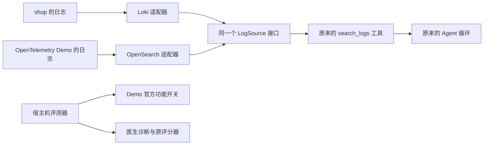

# 阶段 9 学习材料：接入陌生系统与第二个日志实现

**面试时怎样一分钟讲清这个阶段。** 这份材料证据很多，先记住下面这段，再回头看细节：

> 为了检验医生是不是只会做自己出的题，我把它接到一个从没见过的开源系统 OpenTelemetry Demo 上。它的日志存在 OpenSearch 里，我按原来的日志接口写了第二个实现，工具和 Agent 的代码一行没改，并用同一张契约测试表验证两种后端行为一致。接入时发现采集器因为字段类型冲突，正在拒收一部分日志；于是先修采集，再给每份诊断单独审计它用到的日志窗口，然后才开始评测。在 5 个官方故障上跑 E1 和 E2，组件定位从自建系统的约 92% 降到 60%（3/5）。失败分析找到了具体原因：一次是工具结果的 4 KB 上限截掉了关键错误，一次是推理少走了一步，加上组件按字符串精确比对。我没有为了提高分数去改提示或补答案，而是把它们记为下一版的改进方向。

| 交付 | 作用 |
|---|---|
| 第二个日志适配器（[source/opensearch](../../internal/doctor/source/opensearch/doc.go)） | 按原来的 `LogSource` 接口查 OpenSearch |
| 日志接口的契约测试（[log_contract_test.go](../../internal/doctor/source/log_contract_test.go)） | 同一张用例表分别跑 Loki 和 OpenSearch |
| 外部系统的接入配置（[deploy/doctor/targets](../../deploy/doctor/targets/)、[deploy/opentelemetry](../../deploy/opentelemetry/README.md)） | Demo 的数据源地址、字段和系统说明书 |
| 医生独立部署（[deploy/doctor/compose.yaml](../../deploy/doctor/compose.yaml)、[接入指南](../onboarding.md)） | 只启动医生和它自己的 MySQL，不依赖 shop |
| 外部场景控制和泛化评测（[eval/runner](../../internal/eval/runner/doc.go) 的 `generalization*.go`） | 通过官方功能开关注入故障；每份诊断审计采集窗口 |
| 采集修复（[Collector 配置](../../deploy/opentelemetry/otelcol-config-extras.phase09.yaml)） | 修好 Demo 采集器拒收日志的问题 |

**怎样读这份材料。** 主线是 **一个 Agent 怎样接入陌生系统，以及怎样诚实地评估它在陌生系统上的效果**：接口和适配器怎样让工具与产品解耦；缺少数据源时怎样降级；为什么采集质量要先于诊断评分；“适配成功”和“泛化效果好”为什么是两个结论。Go 语法见第 7 节和 [Mini-Redis 的学习文档](https://github.com/Li-Nepenthe/mini-redis/blob/main/docs/learn/README.md)。

> 阶段 9 已完成：2026-11-03 Claude 验收通过并合并到 main。正式结果见第 5.10 节和数据台账 P9-77。学习验收由你自己勾选。

## 1. 本阶段能回答的面试题

| 面试题 | 在哪里 |
|---|---|
| 你的医生能接别的系统吗？接一个新系统要做哪些事？ | 5.1–5.5、八股 1 |
| 在陌生系统上掉到 60%，说明了什么？失败的案例分别失败在哪里？ | 5.10、八股 2 |
| 为什么不让模型直接写 OpenSearch 的查询语句？ | 5.1 |
| Elasticsearch / OpenSearch 为什么查得快？text 和 keyword 有什么区别？Loki 和 ELK 有什么区别？ | 5.1、八股 3 |
| 契约测试是什么？为什么要用？ | 5.1、八股 4 |
| 日志都能查到了，为什么还要检查采集器？ | 5.7、八股 5 |
| 医生缺少数据库直查工具时，怎么办？ | 5.3 |
| 外部系统的故障怎样注入、怎样保证恢复？ | 5.6 |
| 结果不好，为什么不改提示词再跑一遍？ | 5.10 |

## 2. 陌生系统在整个项目里的位置

### 2.1 一个医生，两套靶场



OpenTelemetry Demo（下面简称 Demo）是 OpenTelemetry 官方的一个多语言电商示例，十几个服务用 Go、.NET、Node、Python 等多种语言写成，有官方定义好的故障开关。它的指标和调用链可以复用已有的 Prometheus、Jaeger 适配器，日志却保存在 OpenSearch 里，所以这次补上了日志接口的第二个实现。

图中有两条边界：医生只能查证，不能接触控制 Demo 行为的开关服务或标准答案；评测器知道注入了什么，但它给医生的输入只有现象和故障时间。

### 2.2 两个系统的工具菜单不同

| 能力 | shop | Demo |
|---|---|---|
| 指标、调用链、日志 | 有 | 有（日志换成 OpenSearch） |
| MySQL 执行计划、索引、锁等待等 6 个工具 | 有 | 没有（Demo 用 PostgreSQL，现有检查器解释不了） |
| Redis 运行状态 | 有 | 没有（Demo 用 Valkey，这次没有为它接入只读检查） |
| goroutine 堆栈 | 有 | 没有（大部分服务不是 Go，也没有 pprof 地址） |
| 合计 | 16 个 | 8 个（P9-8） |

### 2.3 各部分负责什么、不负责什么

| 部分 | 负责 | 不负责 |
|---|---|---|
| opensearch 适配器 | 把统一的日志条件翻译成 OpenSearch 查询；只查配置里固定的索引；把响应整理成统一的日志条目 | 决定查什么；写入或删除任何数据 |
| target 加载器 | 读每个系统的配置，按实际有的数据源注册工具；配置冲突就拒绝启动 | 运行时切换系统 |
| 系统说明书 [otel-demo.profile.md](../../deploy/doctor/targets/otel-demo.profile.md) | 告诉医生正常架构和组件名 | 任何故障的答案 |
| 评测器的泛化部分 | 改 Demo 的功能开关、验证症状、审计采集窗口、恢复、冷却 | 诊断 |

## 3. 跑起来看什么

先按[第二系统部署说明](../../deploy/opentelemetry/README.md)检查资源、取得固定源码并配置环境。不要同时启动两套靶场；切换时停止对应的业务和观测组件，保留医生及医生数据库。

**第 1 步：独立部署医生。** 医生现在可以只启动它自己和它的 MySQL。通用步骤见[医生部署说明](../../deploy/doctor/README.md)，自己的系统怎样写配置见[接入指南](../onboarding.md)。阶段 9 用通用的双服务文件，再加一份只覆盖本阶段身份、预算和端口的文件：

```text
docker compose --env-file .env.phase09-doctor -p opsdoctor-phase09-doctor -f deploy/doctor/compose.yaml -f deploy/opentelemetry/doctor.phase09.yaml up -d --build --wait --wait-timeout 240
```

两份 `-f` 的顺序有意义：先定义通用服务，再覆盖本阶段的差异。它使用新网络和新的 `doctor-state` 数据卷，不连接原医生库。实测从准备配置到登录、列出工具菜单约 34 秒，医生进程里没有任何 `SHOP_` 变量（P9-25）。

**第 2 步：看工具菜单。** 需要已经配置 `DOCTOR_URL` 和登录取得的 `DOCTOR_TOKEN`：

```text
go run ./cmd/doctorctl target list
go run ./cmd/doctorctl tool list --target otel-demo
```

本次独立实例的目标只有 otel-demo，列出 8 个只读工具；不应出现 MySQL 元数据、Redis 直查或 goroutine 堆栈工具（P9-26）。

**第 3 步：查一次日志。** 在 Demo 正常产生流量时：

```text
go run ./cmd/doctorctl tool run --target otel-demo search_logs --args '{"service":"ad","lookback_seconds":300,"limit":3}'
```

你应该看到统一的日志条目，含 `time_ns`、`service`、`line`。和查 shop 时的格式完全一样，调用者没有填写 LogQL、OpenSearch DSL、后端地址或索引。同一个医生同时登记两个系统时，两边同格式的 `search_logs` 都返回 `status=ok`（P9-9）。

**第 4 步：用本地模拟后端理解接口。**

```text
go test ./internal/doctor/source -run TestLogSourceContract -count=1 -v
go test ./internal/doctor/source/opensearch ./internal/doctor/target -count=1
go test ./internal/eval/runner -run 'TestGeneralization|TestDemo' -count=1
```

你应该看到相同的日志契约用例分别在 Loki 与 OpenSearch 下执行。这些测试使用本地 HTTP 服务、假数据和 Mock，不调用付费模型。

**第 5 步：真实日志集成测试。** 按[测试文件](../../internal/doctor/source/opensearch/integration_test.go)设置 `TEST_OPENSEARCH_URL` 等变量，再执行：

```text
go test -race ./internal/doctor/source/opensearch -run TestIntegrationSearchLogs -count=1 -v
```

你应该看到按服务、按服务加关键词两次查询都取得既有日志（P9-3）。测试只读取，不创建索引、造数或清理数据。

收费评测不是随手实验。它使用 `eval generalization` 的独立批次入口，先保存冻结清单，再运行获授权的批次；实际批次、费用与结果以[数据台账](../数据台账.md)为准，不要从这里复制命令反复付费。

## 4. 代码走读

### 4.1 阅读顺序

| 顺序 | 文件 | 重点看什么 |
|---|---|---|
| 1 | [target/catalog.go](../../internal/doctor/target/catalog.go) | 同一个医生怎样为各个系统分别建立依赖；日志后端二选一 |
| 2 | [source/source.go](../../internal/doctor/source/source.go) | `LogSource`、`LogQuery`、`LogEntry`：调用者能依赖什么 |
| 3 | [loki/client.go](../../internal/doctor/source/loki/client.go) 与 [opensearch/client.go](../../internal/doctor/source/opensearch/client.go) 并排读 | 一组相同的条件怎样变成两种不同的协议 |
| 4 | [opensearch/config.go](../../internal/doctor/source/opensearch/config.go)、[response.go](../../internal/doctor/source/opensearch/response.go) | 固定索引、`.keyword`、带点号的键和时间精度 |
| 5 | [log_contract_test.go](../../internal/doctor/source/log_contract_test.go)、[opensearch/client_test.go](../../internal/doctor/source/opensearch/client_test.go)、[target/opensearch_test.go](../../internal/doctor/target/opensearch_test.go) | 分清共同的承诺和产品自己的细节 |
| 6 | [jaeger/client.go](../../internal/doctor/source/jaeger/client.go) 的 `New` | 只给 Jaeger 加了一个安全的部署前缀 |
| 7 | [runner/generalization.go](../../internal/eval/runner/generalization.go) → [generalization_scenario.go](../../internal/eval/runner/generalization_scenario.go) → [generalization_run.go](../../internal/eval/runner/generalization_run.go) → [generalization_collection.go](../../internal/eval/runner/generalization_collection.go) | 一轮“注入前保存 → 验证 → 诊断与采集窗口留证 → 核对质量 → 恢复” |
| 8 | [deploy/doctor/compose.yaml](../../deploy/doctor/compose.yaml)、[doctor.phase09.yaml](../../deploy/opentelemetry/doctor.phase09.yaml) | 通用部署和本阶段的薄覆盖 |
| 9 | [场景来源](../../eval/scenarios/otel-demo/README.md)、[本阶段原始记录](../notes.md#phase-09)、[日志修复专项报告](../reports/phase-09-logging-fix.md) | 把“代码支持”“真实跑过”“效果如何”分开 |

### 4.2 一次 search_logs 怎样查到 OpenSearch

| 顺序 | 在哪里 | 做了什么 |
|---|---|---|
| 1 | `search_logs` 工具，经过 `Registry.Run` | 和阶段 5 一样：校验服务、级别、关键词、trace、时间和条数，创建 10 秒的 context |
| 2 | `opensearch.Client.Search` | `expression` 把条件翻译成 5.1 节那段 JSON：服务和 trace 用 term 精确匹配，级别忽略大小写，正文用 match_phrase，按时间倒序 |
| 3 | 同上 | 只向配置里固定的那个索引发送 `_search`，不跟随重定向，响应只读有限的字节数 |
| 4 | `entries`（response.go） | 先检查分片失败和超时，有问题就明确报错；再用 `fieldValue` 按配置的字段路径取值，同时兼容嵌套对象和带点号的完整键；`timestamp` 把时间转成 Unix 纳秒字符串 |
| 5 | 回到工具 | 整理成 `LogEntry{time_ns, service, line}`，和 Loki 返回的格式完全一样，然后照常经过摘要和 4 KB 上限 |

第 2 到 4 步就是“适配器”要做的全部事情。工具层只认第 1 步和第 5 步，所以换成 OpenSearch 时，工具和 Agent 一行都不用改。

### 4.3 一轮外部场景实验

| 顺序 | 做了什么 |
|---|---|
| 1 | 保存 Demo 完整的原功能开关配置和本轮预期配置（`changeDemoFlag` 只改选定开关的命中分支） |
| 2 | 写入开关并读回（`writeDemoFlags`），HTTP 成功不等于行为已经生效 |
| 3 | 等症状查询成立（最多五分钟），保存故障开始时间 |
| 4 | 创建诊断之前，先保存 Collector 的容器身份和一条已有日志作为锚点（`beginCollectorWindow`） |
| 5 | 医生诊断；结束后保存 Collector 的原始日志窗口，核对身份、锚点和计数（`collectorWindow.finish`），得出采集质量 normal、affected 或 unknown |
| 6 | 采集质量 normal 才交给评委评分；否则单列，暂停后续槽位 |
| 7 | 恢复完整的原配置并读回核对（`restoreDemoRecord`）；当前状态既不是原配置也不是本轮配置，就不覆盖 |
| 8 | 等健康：五分钟内必须出现一轮全部场景同时健康；再冷却五分钟 |

和阶段 8 一样，每一步都有断点，状态用条件更新推进；同一个故障也用固定的诊断编号，续跑不会重复花钱。

## 5. 系统设计与取舍

每个设计点按同一个顺序讲：要解决什么问题 → 怎么做 → 放弃了什么、为什么 → 代价和适用边界 → 规模变大十倍会怎样。

### 5.1 同一个接口的第二个实现，用契约测试证明

**问题。** 工具想查日志，不应该因为换了存储产品就换一套参数。阶段 5 定义了 `LogSource` 接口，但只有 Loki 一个实现，这个接口到底能不能容纳别的产品，还没有被检验过。

**做法。** 写 OpenSearch 适配器，实现同一个接口；接入层按系统配置把任意一个放到相同的位置。一组同样的条件（服务 ad、级别 WARN、关键词 connection、指定 trace、时间区间、最多几条），Loki 收到的是：

```text
{service="ad"} |= "connection" | json | level="WARN" | trace_id="0123456789abcdef"
```

时间起止、条数上限和倒序方向放在 `/loki/api/v1/query_range` 的查询参数里。OpenSearch 收到的是发往配置里固定索引 `/otel-logs-*/_search` 的 JSON（条数与时间只用于说明结构）：

```json
{
  "size": 3,
  "track_total_hits": false,
  "query": {
    "bool": {
      "filter": [
        {"term": {"resource.service.name.keyword": "ad"}},
        {"range": {"observedTimestamp": {
          "gte": "2026-11-03T04:00:00Z",
          "lte": "2026-11-03T04:05:00Z",
          "format": "strict_date_optional_time_nanos"
        }}},
        {"term": {"severity.text.keyword": {"value": "WARN", "case_insensitive": true}}},
        {"term": {"traceId.keyword": "0123456789abcdef"}}
      ],
      "must": [{"match_phrase": {"body": "connection"}}]
    }
  },
  "sort": [{"observedTimestamp": "desc"}]
}
```

查询结构由代码固定，模型给的值只占一个位置：Loki 那边用 `strconv.Quote` 把值变成合法的字符串，OpenSearch 那边由 JSON 编码器编码。即使关键词里有引号或查询语法，也只是普通文字。

**契约测试。** 用同一张用例表（服务、级别、关键词、特殊字符、trace、时间、条数、空结果、超时）分别跑两个实现，期望结果完全相同，同时分别检查各自发出的请求。它证明“换实现不用改调用方”这个承诺在这些用例下真的成立。

**补基础：倒排索引，以及 text 和 keyword。** OpenSearch 是从 Elasticsearch 分出来的开源版本，两者原理相同。它们查日志快，靠的是**倒排索引**：先把每条日志的正文切成一个个词，再记下“每个词出现在哪些文档里”，就像书末尾的索引页。字段有两种存法：`text` 会先切词再建索引，适合全文搜索，查正文用的 `match_phrase` 走的就是它；`keyword` 不切词，整串当作一个值，适合精确匹配、排序和聚合，服务名、trace ID 用的就是 `.keyword`。同一个字段可以两种都建，所以 `resource.service.name` 和 `resource.service.name.keyword` 会同时存在。OpenSearch 默认用 BM25 给全文搜索的结果打分，阶段 8 的 `runbook_search` 用的也是 BM25。

**补基础：Loki 和 OpenSearch 的区别。** Loki 只给少量标签（比如 service）建索引，正文不建；查询时先用标签缩小范围，再像 grep 一样逐行过滤正文。所以它存储便宜、写入轻，但在大量日志里搜正文会慢。OpenSearch 给正文也建倒排索引，搜索快、能排相关度，代价是索引占空间、写入更重。

**放弃了什么：让模型直接写查询语句。** 那等于把整个后端的查询能力交给它：它可能查别的索引、扫全量数据，或者被日志里的文字诱导着去构造查询。模型也要学两种查询语言。

**代价。** 接口共用不代表产品细节消失：Loki 的 `|=` 是子串筛选，OpenSearch 的 `match_phrase` 受字段分析器影响，中文、标点等检索细节要按实际采集配置核验。契约测试也证明不了真实集群已接通，那由集成测试负责。

**一个真实的差异。** 收尾时把工具的级别枚举和真实样本对照，发现工具只接受大写 INFO，Demo 的 frontend 写的却是小写 info：同一个固定窗口里，精确匹配 INFO 查到 0 条，忽略大小写后 1896 条（P9-21）。原契约夹具用的是大写，所以没覆盖到。修正只给级别的 term 加了 `case_insensitive`，服务和 trace 仍精确匹配。

**规模变大十倍。** 接更多日志产品时，每一个都要写适配器、跑同一张契约表、做真实集成测试；契约表本身也要随新发现的差异（比如大小写）不断补充。

### 5.2 字段来自配置，日志后端二选一

**问题。** 同一条日志经过不同的采集器，服务名可能叫 `serviceName`，也可能藏在 resource 里面。把字段写死进适配器，换一条采集链路就又得改代码。

**做法。** 字段映射写在系统配置里（[otel-demo.yaml](../../deploy/doctor/targets/otel-demo.yaml)），启动时校验。配置保存的是“当前部署怎样存数据”，查询参数保存的是“这次想找什么”，两者变化的频率不同。日志后端只能二选一：同时写了 Loki 和 OpenSearch，就直接报错，不让代码按装配顺序悄悄挑一个，把“查错库”隐藏成看似正常的结果。

**真实字段要实际核验。** 查询中用的 `.keyword` 是索引映射里的精确匹配子字段，原始文档 `_source` 里并没有同名字段；resource 里的 `service.name` 又是一个带点号的完整键。所以读取响应时不能只按点号机械地拆层，要同时兼容嵌套对象和带点号的键（`fieldValue`）。真实结构保存在[字段证据](../reports/phase-09-opensearch-schema.json)。

**代价。** 每接一个系统，都要先从真实的映射和样本确认字段。

### 5.3 缺数据时减少能力，而不是跨系统补证据

**问题。** Demo 用 PostgreSQL，现有的 MySQL 检查器解释不了它的执行计划；Valkey 没有配只读账号；大部分服务不是 Go，也没有 pprof 地址。

**做法。** 接入层只注册实际有数据源的工具，其他的不注册（降级接入）。Demo 只有 8 个工具，shop 有 16 个（P9-8）。系统说明书里告诉医生哪些能力缺失。

**放弃了什么。** 拿 shop 的数据库工具替 Demo 查询，或者临时给医生加一个任意 SQL 或任意 URL 的工具。前者查的是别的系统，后者打破了权限边界。

**代价。** 有些问题只能写 unknown。指标里仍可能有 PostgreSQL 或 Valkey 的统计，但“看到统计”与“能直接查询锁等待”是两种能力。这次的失败案例不能直接归因于缺少数据库工具，因为这不是一个隔离单一变量的对照实验。

**规模变大十倍。** 要为常见的数据库（PostgreSQL、MongoDB 等）各写一套只读检查器，每套都要有自己的只读账号和权限测试。

### 5.4 只读不能只看 HTTP 方法

**问题。** OpenSearch 的搜索接口用 POST 传查询体。POST 是不是意味着会写入？

**做法。** POST 本身不表示会写入业务数据，关键是代码只构造指定索引的 `_search` 路径，没有任意路径、删除或更新的入口；不跟随重定向；响应有上限。

**代价。** 代码约束不能替代服务账号的权限。这次官方 Demo 禁用了安全插件；真实集群开启认证时，应配置只读账号，账号和密码仍从环境变量取得。不能因为本机查询成功就声称已经验证了生产集群的账号授权。

### 5.5 医生独立部署，不依赖 shop

**问题。** 原来的完整演示 Compose 逐项列出 `SHOP_` 变量、默认挂载全部系统配置。接一个新系统时，还要先填 shop 的整套账号，这让演示环境变成了部署依赖。

**做法。** 先核对真实的启动配置：Go 程序只要求医生自身的库、登录与 JWT，系统凭据由各系统的 YAML 引用，本来就没有 shop 必填。所以这次只补部署入口，没有改 Go 代码：

- [deploy/doctor/compose.yaml](../../deploy/doctor/compose.yaml) 只定义医生和医生的 MySQL 两个服务；
- 阶段 9 的 [doctor.phase09.yaml](../../deploy/opentelemetry/doctor.phase09.yaml) 只覆盖容器名、本阶段的两个预算账户和宿主端口；
- 医生自己的配置放 `.env.phase09-doctor`，各系统引用的凭据放另一个文件，由 `DOCTOR_TARGET_ENV_FILE` 交给医生进程。加载器仍会检查每份 YAML 声明的变量，缺了就拒绝启动。

**新库不等于新预算。** 新的医生库不会继承旧账。切换之前先核对了旧库阶段 9 的生成请求和美元支出都是 0，旧账证据保留（P9-27），才没有把部署隔离变成预算重置。

**代价。** 更换系统配置文件后要重启医生才会重新加载。

### 5.6 外部场景控制：先保存原状，只改命中分支

**问题。** Demo 的故障通过官方的功能开关打开。评测器和 Demo 的开关服务之间没有同一个事务：进程写完开关后退出，重跑时不知道上次的动作是否已经发生。

**补基础：功能开关（feature flag）。** 程序里预先写好了“出错”的代码分支，由开关服务 flagd 在运行时决定走哪一条，不用重新部署。真实公司常用功能开关做灰度发布，或者出问题时紧急关掉某个功能。医生接触不到开关服务，只能像值班工程师一样，从指标、调用链和日志里找原因。

**做法。**

- **先保存完整的原配置和本轮预期配置**，之后每次推进都核对当前状态。恢复时当前状态若既不是原配置、也不是本轮注入的配置，说明有人改过，不自动覆盖。
- **写入后读回。** HTTP 成功不等于行为已经生效。
- **只改命中分支。** 商品错误场景是按商品 ID 匹配的。删除整段 targeting 也能制造错误，却会把单个商品的问题扩大到所有商品，题目就变了。最终只改原条件的命中分支，保留条件和非命中分支。
- **症状要按真实行为写。** 购物车清空错误不一定让结账 HTTP 返回失败：上游实现忽略了这个返回值。所以这场的症状查的是购物车的错误 span，不能把自己想象的症状写成验收条件。

**代价。** 每接一个外部系统，都要读它的开关配置和上游源码，才知道“只改一处”应该改在哪里。

### 5.7 采集质量要先于诊断评分

**问题。** 第一次真实查询成功以后，检查 Collector（接收各服务遥测数据、再转发到后端的采集器）的日志，发现 OpenSearch 写入报 `mapper_parsing_exception`：一部分新日志正在被拒收。如果不修，医生“没查到”和“数据根本没进来”就混在一起了。

**原因。** cart 的 ASP.NET 启动日志把属性 `http` 写成了一段文本（端口号）；frontend 的日志又有 `http.request.method` 这样的属性，OpenSearch 把点号当成对象路径，要求 `http` 是一个对象，和已有的 text 类型冲突。修复前的窗口里共有 316 个最终丢弃事件，`dropped_items` 报告和为 6209（P9-13）。这是受影响请求的条目数报告和，批量写入可能部分成功，不能写成“丢了 6209 条”。

**做法。**

1. **只改采集配置。** 在 Collector 配置里加一条改名规则，把日志属性的 `http.` 前缀改成 `http_`。没有删除或重建索引、数据卷，医生用到的五个字段映射前后完全相同（P9-15）。
2. **固定窗口观察。** 修复后 600 秒的固定窗口里，最终丢弃、`dropped_items` 和映射错误都是 0，17/17 个预期日志源都有新记录（P9-14）。这只支持这个窗口内的结论，不能扩大成端到端零丢失。
3. **每份诊断单独审计采集窗口。** 固定窗口通过，不能替后来的诊断证明数据齐全。创建诊断前，先保存 Collector 的容器身份和一条已有日志作为锚点（用来检查日志是否因为轮转丢掉了前半段）；诊断结束后保存原始窗口，核对身份、锚点和计数：

| 采集质量 | 需要什么证据 | 处理 |
|---|---|---|
| `normal` | 非空原始日志，完整窗口、容器身份、保留锚点与文件摘要都通过检查，且没有丢弃或映射错误 | 正常评分、进入统计 |
| `affected` | 已观察到最终丢弃或映射错误 | 单列原报告与费用，暂停评分和后续槽位 |
| `unknown` | 缺少审计、空输出、无法验证完整窗口 | 同样单列，不按正常处理 |

**放弃了什么。** 只在开始前修一次就默认后面都正常；或者把采集异常的样本直接算成模型答错。前者无法证明，后者改变了比较的含义。

**代价。** 每份诊断多一份审计；审计本身失败也会让实验中断（首轮试跑就是因为读不到锚点而在创建任务前停下，11.7 节）。

### 5.8 Jaeger 的部署前缀：只给这一个产品放开

**问题。** Demo 把 Jaeger 放在 `/jaeger/ui` 之下。原适配器只接受站点根地址，单改配置会被共享的 HTTP 校验拒绝；把共享校验直接放宽，又会影响其他数据源的边界。

**做法。** 只让 Jaeger 的 `New` 接受经过校验的普通路径段作为前缀，存在私有字段里；去掉前缀后仍由原 HTTP 客户端检查根地址。搜索和详情只在前缀后面追加代码固定的 API 路径。编码、点路径、空段、反斜杠、查询串、片段、凭据和重定向仍被拒绝。Prometheus、Loki、pprof 等没有这个需求，它们的规则保持原样。

**代价。** 每遇到一种部署差异，都要单独判断能不能放开、放开多少。

### 5.9 健康基线：同一轮全部通过，没有调用的点不能删

**问题。** 正式评测前回放历史指标，发现有些时刻同时是“调用增量为零、错误增量也为零”。健康条件要求“有调用且没有错误”，这些点确实不健康。

**做法。** 不删这些点，也不改健康判据。用户批准的办法只改变等待方式：恢复后每五秒重新检查全部场景，五分钟内必须出现一轮**全部同时健康**；不同轮次的成功不能拼起来；查询报错立即停止。真实运行时，OT04 冷却后的健康轮询用了约 35 秒、八轮才出现一轮全部通过（P9-71）。原生指标显示 spanmetrics 的样本间隔中位数约 60 秒（P9-73），短窗口内已完成的调用计数会出现平台，需要等到下一批增量。

**代价。** 健康检查变慢；而且“首次观察到健康”不等于“业务在那一刻恢复”。

### 5.10 适配成功和泛化效果是两个结论

**问题。** 第二个适配器能工作，说明原接口可以容纳另一种日志后端。医生能不能在陌生系统上找对根因，是另一个问题，要看固定的场景、冻结的版本和真实的诊断记录。

**做法。** 在 Demo 官方的 5 个故障上，用 Terra（`gpt-6.1-terra`）跑 E1 和 E2 各一次，DeepSeek 评分，提示、手册和评分标准都沿用阶段 8 冻结的版本（P9-76）。

**结果**（P9-77）：十份报告都主动提交、采集质量都是 normal、原评分都有效。

| 实验组 | 精确组件命中 | 机制 正确 / 部分 / 错误 | 平均证据覆盖度 |
|---|---|---|---|
| E1：工具 | 3/5 | 2 / 2 / 1 | 0.75 |
| E2：工具与通用手册 | 3/5 | 2 / 2 / 1 | 0.75 |

同为 Terra 的 E1/E2，阶段 8 各为 36/39（P10-2、P10-3），这次各为 3/5，描述性地下降约 32 个百分点（[两阶段并列结果](../reports/phase-09-results-summary.md)）。但阶段 8 是十三场景各三次，这次是五场景各一次，故障类型和可用工具（8 个对 16 个）都不同，不能把差值全算在“泛化能力”上。

**失败分析**（[失败分析](../reports/phase-09-failure-analysis.md)）：

- **OT02 购物车清空失败**：两份报告的组件写的是 `cart->valkey-cart`，标准答案是 `cart`，字符串精确比较不相等。报告找到了 EmptyCart 的连接异常方向，但没识别出它的专用存储客户端连向了错误地址、其他购物车操作仍用正常客户端，机制评为部分正确；证据覆盖度却是 1。不能因为字符串里含有 cart，就事后改成命中。
- **OT04 结账的支付调用无法连接**：两组都选了 unknown，并在报告里说明失败链路的后半段被截断，确认不了下游组件。完整的工具结果确认 `get_trace` 返回了 `truncated=true`：写着“连不上错误支付地址”的那一段正好在被截掉的后半截（阶段 5 的 5.4 节）。诚实写出缺少证据是对的，但没找出根因，机制仍是错误。
- **OT05 部分商品详情查询失败**：定位到 product-catalog，却没确认具体商品和完整错误详情，机制部分正确。

**放弃了什么：看着错题改提示再重跑。** 那样测到的是“对这套题有多熟”。正确做法是把改进（比如摘要优先保留出错的 span）做成新版本，在 shop 和 Demo 两个系统上全量重跑，旧结果和失败都保留。

**费用。** 正式批次 USD $0.325033、CNY ¥0.196047（P9-78），按项目用量账本计，两个币种不相加。每份诊断平均 5.4 轮、约 21 次工具、约 26 秒（P9-81）。

### 5.11 HTTP 成功不等于评分成功

**问题。** 正式批次之前的试跑里，医生交了一份报告，DeepSeek 的 API 请求也成功了，返回了一次 `submit_grade`；但工具参数里那段 JSON 的第一项 `reason` 缺少闭合引号（P9-53）。

**做法。** API 响应有两层：外层告诉客户端模型回复和用量，内层工具参数才是要采纳的评分。外层能解析、费用能结算，内层仍可能是不合法的 JSON。冻结校验拒绝这份评分，记为“评分失败”：原文里出现 `correct` 不等于有效评分，默认的 `coverage=0` 也不是测出了零覆盖率。原回答、原失败和费用都保留，不修一下 JSON 或再问一次来让门槛变绿。

之后用户批准按阶段 8 的方式处理评分失败：同一批次里前两份评分失败可以继续，累计到第三份才暂停（P9-58）。API 失败、回答或费用无法确认，以及诊断、采集异常仍会停止。

## 6. 系统设计八股

每题先给一分钟口述版，面试时照着这个长度说；再给要点、项目里的例子和常见追问。

### 八股 1：一个 Agent 怎样接入一个新系统？

#### 一分钟口述版

关键是让工具层和具体产品解耦。我的医生通过一组小接口取证据，比如日志接口只认“服务、级别、关键词、trace、时间、条数”这几个条件，返回统一的日志条目；每种后端写一个适配器负责翻译。接 OpenTelemetry Demo 时，它的日志在 OpenSearch，我按同一个接口写了第二个适配器，用同一张契约测试表证明两种后端行为一致，工具和 Agent 一行没改。接入一个系统要做四件事：写一份接入配置，包括数据源地址、日志字段和只读凭据的变量名；写一份系统说明书，只写架构和组件名，不写故障答案；准备只读账号；缺少的数据源就不注册对应的工具，比如 Demo 用 PostgreSQL，我就不给它 MySQL 工具，而不是临时开一个任意 SQL 的工具。医生也改成了可以独立部署，只启动它自己和它的数据库。

#### 要点

- 接口 + 适配器；契约测试证明可替换。
- 字段放配置，启动时校验；后端二选一。
- 缺数据源就降级，不跨系统补证据。
- 独立部署：医生配置和系统凭据分开。

#### 项目里的例子

- [opensearch](../../internal/doctor/source/opensearch/doc.go) 适配器；[接入指南](../onboarding.md)；数据台账 P9-8、P9-25。

#### 常见追问

1. **最花时间的是哪一步？** 没有形成分项计时，不能说哪一步最长；实际遇到的问题有资源核验、上游 Compose 拆分、版本固定、健康探测超时和字段核验。
2. **为什么字段不写死？** 同一条日志经过不同采集器，字段名不同；写死就要为每条采集链路改代码。
3. **怎样保证接新系统不影响旧系统？** 每个系统一套独立的客户端和工具菜单（阶段 5 的 5.3 节），新适配器有自己的测试。

### 八股 2：在陌生系统上掉到 60%，说明了什么？

#### 一分钟口述版

首先说明自建靶场上的成绩有“主场优势”，不能直接外推：同样是 Terra 完整工具组，自建靶场组件定位 36/39，开源 Demo 是 3/5。但我不会把差距全归因于泛化能力，因为两边的场景数、运行次数、故障类型和可用工具都不一样，Demo 只有 8 个工具。更有价值的是逐个看失败原因：一个是工具结果的 4KB 上限把调用链后半段截掉了，关键错误正好在后面，医生如实写了原因未知；一个是推理少走了一步，找到了连接异常的方向，但没识别出是专用客户端连错了地址，加上组件按字符串精确比对；还有一个定位对了服务，没确认具体商品。这些都记成下一版的改进方向，比如摘要优先保留出错的步骤；我没有看着错题改提示再重跑，因为那样测的是对题目的熟悉程度。

#### 要点

- 自建靶场的成绩不能外推。
- 差值要说明样本和条件的差异。
- 逐个失败分析：工具限制、推理、评分口径。
- 改进做成新版本、全量重跑。

#### 项目里的例子

- 5.10 节；数据台账 P9-77、P10-2；[失败分析](../reports/phase-09-failure-analysis.md)。

#### 常见追问

1. **E2 加手册为什么没用？** 两组汇总相同，但每个场景每组只跑一次，不能宣称手册在所有陌生系统上都无效。
2. **OT04 写 unknown 为什么不算对？** 诚实地承认缺少证据是好的，但没找到根因，按原规则仍是错误。
3. **下一步怎么改？** 摘要优先保留出错和最慢的 span；组件比对考虑层级关系；然后在两个系统上全量重跑。

### 八股 3：Elasticsearch / OpenSearch 为什么查得快？Loki 和 ELK 有什么区别？

#### 一分钟口述版

ES 和 OpenSearch 快在倒排索引：写入时先把正文切成词，记录每个词出现在哪些文档里，查询一个词时直接拿到文档列表，不用一条条扫。字段有两种：text 会切词，用于全文搜索；keyword 不切词，整串作为一个值，用于精确匹配、排序和聚合，所以常见同一个字段同时有 text 和 .keyword 两个版本。全文搜索的结果默认用 BM25 打分。Loki 的思路不同：它只给少量标签建索引，比如服务名，正文不建索引，查询时先按标签缩小范围，再逐行过滤正文，所以存储便宜、写入轻，但大量日志里搜正文会慢；ELK 给正文建倒排索引，搜索快、能按相关度排序，代价是更占存储、写入更重。我的项目两种都接了：shop 用 Loki，开源 Demo 用 OpenSearch，医生通过同一个日志接口使用它们。

#### 要点

- 倒排索引：词 → 文档列表。
- text 切词全文搜索；keyword 精确匹配、排序、聚合。
- Loki：标签索引 + 逐行过滤；ELK：全文倒排索引。
- 选型看查询方式和成本。

#### 项目里的例子

- 5.1 节的两种查询；数据台账 P9-9。

#### 常见追问

1. **为什么用 `.keyword` 查服务名？** 服务名要整串精确匹配，切词会把它拆开。
2. **match_phrase 和 term 有什么区别？** term 不分析输入，精确匹配整个值；match_phrase 先分析输入，再要求这些词按顺序相邻出现。
3. **mapping 冲突是什么？** 同一个字段名在不同文档里类型不一致，后来的文档写入失败。Demo 的采集器就遇到了这个问题（5.7 节）。

### 八股 4：契约测试是什么？为什么要用？

#### 一分钟口述版

契约测试是用同一份行为要求去测一个接口的多个实现，或者测服务的提供方和调用方是否遵守同一份约定。我的项目里，日志接口有 Loki 和 OpenSearch 两个实现，我写了一张用例表，覆盖服务、级别、关键词、特殊字符、trace、时间范围、条数上限、空结果和超时，两个实现跑同一张表，期望结果完全相同，同时分别检查各自发出的请求是否正确。它证明的是“换实现不用改调用方”这个承诺在这些用例下成立。它证明不了真实集群已经接通，那要靠集成测试；也证明不了所有语言的任意文本检索结果逐字一样。后来真实样本里发现日志级别有大小写差异，契约表原来没覆盖到，就补了进去。

#### 要点

- 同一张表，多个实现，相同期望。
- 同时检查结果和发出的请求。
- 和集成测试分工：契约测行为约定，集成测真实连通。
- 发现新差异就补进契约表。

#### 项目里的例子

- [log_contract_test.go](../../internal/doctor/source/log_contract_test.go)；数据台账 P9-21。

#### 常见追问

1. **只测响应能解码，算契约测试吗？** 不算。还要检查条件有没有被正确翻译成请求。
2. **微服务之间的契约测试怎么做？** 调用方写下期望的请求和响应，提供方在 CI 里验证自己满足它（比如 Pact）。
3. **契约表谁来维护？** 接口的定义方；每个实现都必须通过。

### 八股 5：日志采集链路怎样保证完整？

#### 一分钟口述版

“查得到日志”只说明已经写进去的可读，不说明新日志都进来了。我接开源 Demo 时，第一次查询成功后去看采集器的日志，发现 OpenSearch 在报字段映射冲突，一部分新日志正在被拒收。原因是两个服务对同一个属性名用了不同的类型，一个写成文本，一个当成对象路径。修复只改了采集器配置，把冲突的属性改名，没有删索引或数据卷；修复后在固定的十分钟窗口里，丢弃和映射错误都是零，每个预期的日志源都有新记录。但固定窗口通过不能替后面的诊断作保证，所以每份诊断我都单独审计它用到的采集窗口：保存采集器身份、锚点和原始日志，核对后得出正常、受影响或无法确认三种状态，后两种不进入正常统计，费用照记。这样“医生没查到”和“数据根本没进来”就不会混在一起。

#### 要点

- 查询成功 ≠ 采集完整。
- 修复只动采集配置，保留证据。
- 固定窗口的结论不能外推到每份诊断。
- 每份诊断审计采集窗口；异常单列。

#### 项目里的例子

- 5.7 节；数据台账 P9-13、P9-14、P9-15；[日志修复专项报告](../reports/phase-09-logging-fix.md)。

#### 常见追问

1. **采集器报告丢弃为零，就是零丢失吗？** 不是，还可能有没上报或者没到达采集器的数据。
2. **`dropped_items` 是丢了几条吗？** 是失败请求的条目数报告和，批量写入可能部分成功，不是去重后的缺失条数。
3. **为什么要锚点？** 检查日志有没有因为轮转丢掉窗口的前半段。

## 7. 用到的 Go 写法

本阶段没有引入新的 Go 语法，用到的写法前面都讲过：

| 写法 | 本阶段在哪里用 | 去哪里学 |
|---|---|---|
| 接口的隐式实现；同一个接口的多个实现 | `LogSource` 的 Loki 和 OpenSearch 两个实现 | [Mini-Redis 第 03 章](https://github.com/Li-Nepenthe/mini-redis/blob/main/docs/learn/03-map-struct与接口.md)“接口”；阶段 5 的 5.2 节 |
| 表格测试；同一张表跑多个实现 | 日志契约测试 | [Mini-Redis 第 08 章](https://github.com/Li-Nepenthe/mini-redis/blob/main/docs/learn/08-测试.md)“表格驱动测试和子测试” |
| `json.Marshal` 编码值 | OpenSearch 查询体；关键词里的引号只是文字 | 阶段 7 的 7.2 节 |
| `Decoder.UseNumber` | 解析较大的整数，避免先经过浮点数而损失精度 | 阶段 6 的 7.2 节 |
| 带 context 的 HTTP 请求 | 取消信号一直传到网络层 | [Mini-Redis 第 07 章](https://github.com/Li-Nepenthe/mini-redis/blob/main/docs/learn/07-channel-context与WaitGroup.md)“context” |
| 单调时钟测耗时 | 症状和恢复的首次观察耗时（[generalization_timing.go](../../internal/eval/runner/generalization_timing.go)） | 阶段 8 的 5.9 节 |

## 8. 动手实验

以下实验在没有运行冻结评测批次时做。修改只限本地测试或临时配置，结束后恢复；都不需要创建诊断或调用付费模型。

### 实验一：让相同查询在两个后端之间切换

运行 `TestLogSourceContract`，找到“按关键字”的那一行用例。把它的关键词和相应的模拟日志改成另一段普通文字，仍然只保留一份期望值，再运行测试。两个实现接收同一条件。接着只破坏一个实现的翻译（比如暂时漏掉关键词条件），观察请求检查失败；最后补回。体会契约不只是“响应能解码”。

### 实验二：观察 JSON 值能否变成查询结构

运行 `TestKeywordJSONValues`，在关键词表里增加含引号、反斜杠与查询符号的一段文字。观察编码后再解码的值是否与原文相等。不要为了演示把真实查询代码改成字符串拼接。

### 实验三：破坏字段映射

在 `TestLogBackendConfig` 的模拟配置里去掉 `trace_id`，或者同时保留 Loki 与 OpenSearch。先观察配置被拒绝，再恢复。再读 `TestResponseBoundary` 的“完整点键”“嵌套字段”“缺服务”和“缺消息”用例：把含点号的服务键换成嵌套对象，接口仍应读到同一来源；去掉服务则必须报错。

### 实验四：保护一个特定商品的场景范围

运行 `TestDemoFlagMutation`，阅读商品条件的原配置和修改后的断言。暂时让期望值丢失原匹配条件，观察断言失败，再恢复。重点是确认“只改命中分支”的承诺：删除 targeting 会影响所有商品，题目就变了。

### 实验五：采集质量与部署前缀

```text
go test ./internal/doctor/source/jaeger -run 'TestDeploymentPrefix|TestInvalidDeploymentPrefix' -count=1 -v
go test ./internal/eval/runner -run TestCollector -count=1 -v
go test ./internal/eval/report -run 'TestCollectionQuality|TestMarkdownCollectionQuality|TestStatisticsCollectionQuality' -count=1 -v
```

根地址与安全前缀都能使用相同的 Search/Get 契约，坏前缀被拒绝。采集用例让正常窗口、丢弃、空输出、证据损坏和取消走不同分支；找到受影响样本退出正常分母、费用仍保留的断言。

## 9. 常见误区

- **“有同一个接口，就能连接任何日志产品。”** 每个新后端仍需要具体适配器、字段配置和真实接入验证。
- **“`.keyword` 一定是原 JSON 的嵌套路径。”** 它是映射子字段，原日志还可能保留带点号的键。
- **“后端 HTTP 成功就代表取得完整日志。”** OpenSearch 可能部分分片失败或查询超时，适配器要明确返回。
- **“查询成功，采集就是完整的。”** 采集器可能正在拒收新日志。
- **“采集器报告丢弃为零，就等于端到端零丢失。”** 结论只覆盖固定窗口，还可能有没上报的数据。
- **“采集异常单列，就不用记这份报告的费用。”** 原始请求、报告和费用继续保留，只是不进正常统计。
- **“独立医生也要准备 shop 的所有密码。”** 只需准备选中系统实际引用的凭据。
- **“没有错误指标就表示健康。”** 也可能没有流量；健康条件还要有实际调用。
- **“没有调用也没有错误的点，可以从分母里删掉。”** 删除它会改变门槛。
- **“恢复就是把已知开关设回 off。”** 原配置可能包含其他值，要恢复完整快照并读回确认。
- **“评委 HTTP 成功、回复里写了 correct，就有有效评分。”** 内层参数仍须通过校验。
- **“结果差就补一条专门手册。”** 这会改变冻结版本，不能把改过的结果塞进原批次。

## 10. 自测

先自己写下答案，再展开参考要点对照。系统设计方面的问题见第 1 节和第 6 节，这里偏重代码和实验细节。

1. 同一次 `search_logs` 调用，Loki 和 OpenSearch 收到的查询分别长什么样？关键词里的引号会不会改变查询结构？
2. 为什么日志级别的 term 要加 `case_insensitive`，服务和 trace 却不加？
3. 查询中的 `.keyword` 为什么不能原样拿去读取 `_source`？
4. 同时配置了 Loki 和 OpenSearch，为什么要报错？
5. Demo 为什么只有 8 个工具？缺的工具能不能用 shop 的代替？
6. 如果注入后程序退出，为什么不能直接重新打开开关再诊断？
7. 为什么创建诊断之前要先保存 Collector 的锚点？
8. `affected`、`unknown` 与模型答错有什么区别？
9. 为什么 OT02 的覆盖度是 1，组件仍判不中、机制仍是部分正确？
10. 试跑里 API 账本是 ok、评分却是 failed，为什么？为什么不能修好 JSON 再采纳？

<details>
<summary>参考要点（先自己回答）</summary>

1. Loki 收到 LogQL 和 URL 参数；OpenSearch 收到发往固定索引的 JSON：服务和 trace 用 term，级别用忽略大小写的 term，正文用 match_phrase，按时间倒序。不会：结构由代码固定，值经过 `strconv.Quote` 或 JSON 编码，只是普通文字。
2. 工具只接受大写的级别，Demo 的服务写的是小写 info；服务名和 trace ID 必须精确匹配，忽略大小写可能匹配到别的服务。
3. `.keyword` 是索引映射里的精确匹配子字段，原始文档里没有同名字段；而且 `service.name` 可能是一个带点号的完整键，不能按点号拆层。
4. 让代码按装配顺序悄悄挑一个，会把“查错库”隐藏成看似正常的结果。
5. Demo 用 PostgreSQL、Valkey，大部分服务不是 Go，没有对应的只读检查器、账号或 pprof 地址。不能，用 shop 的工具查的是另一个系统。
6. 上一次写入可能已经成功，重新注入会丢失原开始时间并混入旧证据。要核对保存的原配置、本轮预期配置和数据库里的轮次状态，确认不了就停止。
7. 窗口起点附近的日志可能因为轮转被删掉；有锚点才能证明窗口是完整的。
8. 两者都是采集质量问题：affected 是已经观察到丢弃或映射错误，unknown 是无法完整核对。都不能直接算成模型推理错误；它们单列，费用照记。
9. 证据里程碑都拿到了，但组件字符串 `cart->valkey-cart` 和答案 `cart` 不精确相等；机制上没识别出专用客户端连错了地址。三个指标各自独立，覆盖度高不代表根因判断正确。
10. 外层 API 响应和内层评分参数是两层；内层 JSON 缺了闭合引号，冻结校验拒绝采纳。修改回答或再问一次，等于挑一份成功的结果，评分就不独立了。

</details>

## 11. 开发过程回放

### 11.1 先弄清系统怎样部署，再填写接入信息

这次首先要解决的不是“医生怎样推理”，而是本机能否在保留原数据的条件下运行另一个完整系统。开工时先核对阶段授权、分支与用户未提交的修改，再检查 Windows、Docker 和 WSL 的真实资源（P9-1），没有通过删除历史测试卷腾空间。

部署按文件分工：[versions.env](../../deploy/opentelemetry/versions.env) 固定镜像和观测元数据的版本；[compose.phase09.yaml](../../deploy/opentelemetry/compose.phase09.yaml) 覆盖容器名、网络名和端口，隔离原项目与第二系统；[otel-demo.yaml](../../deploy/doctor/targets/otel-demo.yaml) 把数据源地址和实际字段交给医生；[otel-demo.profile.md](../../deploy/doctor/targets/otel-demo.profile.md) 把正常架构与组件名交给医生，不解释任何故障。

实际遇到两处版本细节：上游版本文件仍含可变标签；先展开的 `service.version` 不会因为稍后覆盖镜像版本就自动更新，因此版本覆盖也显式固定了派生属性。启动时还遇到 payment 健康探测超时：业务已经监听端口，但 Node 探测本身会加载自动遥测模块。复核原命令能成功、只是超过原探测预算后，只放宽了这个探测的超时，没有改业务和场景（P9-4）。

### 11.2 把第二个日志后端接到现有接口后面

目标是继续调用原来的 `search_logs`。动手前先读已有的 `LogQuery`、`LogEntry` 与 Loki 实现，确认上层需要的是结构化条件和统一日志条目。新实现拆成：`Config.Validate` 在连接前拒绝不完整的配置；`New` 固定后端身份与 HTTP 边界；`expression` 把统一条件翻译成 DSL；`Search` 串起校验、编码、请求与解析；`entries` 校验来源、整理顺序并限制数量；`fieldValue` 兼容嵌套对象和带点号的键；`timestamp` 保留时间精度。

测试分成共同契约与产品边界两类：共同契约把同一张用例表分别交给两个本地后端；产品测试再补上分片失败、重定向、缺字段、特殊字符和响应大小等情形。真实集成查询按服务返回 3 条、加关键词返回 1 条（P9-3）。

### 11.3 给外部系统增加实验控制，不改变医生的诊断方法

宿主机评测器有自己的外部场景入口（`parseGeneralization`、`loadGeneralizationCases`、`changeDemoFlag`、`writeDemoFlags`、`demoQuery`、`advanceDemoTrial`、`restoreDemoRecord`），医生仍使用原来的工具和循环。先定义外部场景字段，再核对公开文档与固定源码，随后把注入和恢复接到原来的轮次、槽位和评分记录上。单元测试验证配置只改指定位置、旧预算账户被拒、版本变化暂停，以及恢复快照不会被覆写。商品场景只改命中分支、购物车场景按真实的错误 span 写症状，都是在这一步核对出来的（5.6 节）。

### 11.4 查询成功以后，继续检查采集是否完整

第一次真实查询成功以后，检查 Collector 日志发现映射冲突（5.7 节）。先保存完整原始日志、索引身份和字段映射，再核对上游固定源码与修复讨论，最终只在 Collector 配置里加一条改名语句。配置数组合并会替换原数组，所以也显式保留了上游已有的两条规则。启用前核对目标字段命名空间为空；修复后医生用到的五个字段映射前后相同，原索引没有重建（P9-15）。固定窗口观察通过（P9-14），其中 image-provider 在官方遥测表里本来就不输出日志，单列为例外；同窗另有 10 条 Jaeger 的 `Will retry`，所以不能写“整个 Collector 零错误”。

### 11.5 查询成功以后还要核对字段的实际取值

收尾时把工具的级别枚举与真实样本对照，才发现大小写差异（5.1 节，P9-21）。修正只在新适配器里给级别 term 加 `case_insensitive`，补了大小写与不同级别的 Mock 回归，再用真实 OpenSearch 和新的 Mock 医生验证。当时尚未发生诊断评测，也没有修改冻结的提示、工具、手册或评分。

### 11.6 把医生自己的部署与 shop 演示分开

用户要求“医生可以单独部署”。核对后发现 Go 程序本来就不要求 shop 的变量，限制来自原完整演示的 Compose，所以只补部署入口（5.5 节）。实测独立部署约 34 秒到登录和菜单，没有 `SHOP_` 变量（P9-25）；恢复 Demo 后菜单为 8 个只读工具，`query_metrics` 查询 `up` 返回 `status=ok` 但序列数是 0（P9-26）。这只证明查询完成了，不能写成已取得非空指标。

### 11.7 给每份诊断留下自己的采集窗口

采集修复通过审核后，用户追加了逐份诊断观察 Collector 的要求（5.7 节）。取消或写库异常时，保存证据不能继续使用已经取消的 context，所以查看终态、读取日志与保存摘要各有独立的有限收尾时间；槽位关联失败时先取消已创建的任务，再读取原任务的状态与费用。

首轮试跑在症状通过后，评测器无法确认 Collector 的起点日志，返回错误，没有创建收费任务（P9-41）。后来在同一个 Collector 上免费复现了原因：最后一条日志晚于截止时间时，Docker 的 `--tail 1` 再按时间过滤会得到空，而更早的合法日志仍在。修复改为读取全部保留的行，选择截止前最近的一条，仍保留输出上限和各项校验（P9-43、P9-44）。原批次不会因补丁成功而改成成功。

### 11.8 收窄 OT01 的判定对象，接通带前缀的 Jaeger

开跑前，OT01 原健康查询统计整个 ad 服务的错误，包含了 flagd EventStream 的 CLIENT span。CLIENT 表示这个服务正在调用别人，SERVER 表示正在处理别人发来的请求；官方广告故障作用在 GetAds 的服务端处理。用户只批准把症状和健康两条查询限定到 `SPAN_KIND_SERVER` 的 GetAds，发给医生的现象、标准答案和证据里程碑都没改（[改动审计](../reports/phase-09-ot01-baseline-amendment.json)）。EventStream 的背景噪声保留给医生面对（P9-36、P9-37、P9-42）。

同一时期还发现 Demo 的 Jaeger 带部署前缀，只给 Jaeger 加了安全的前缀支持（5.8 节），并用真实的[搜索](../reports/phase-09-jaeger-prefix-search.json)和[详情](../reports/phase-09-jaeger-prefix-get.json)验证。

### 11.9 试跑：真实报告出现了，评委却没有交出有效评分

使用新编号 `phase09-pilot2-20261103-terra` 的试跑完成了 1 份 OT01/E1 报告：医生主动提交，5 轮、23 次查证工具，组件 `ad` 与标准一致，同时写明“具体触发原因尚未确定”（P9-51）。这份报告的采集窗口是 normal（P9-52）。接着 DeepSeek 评分失败（5.11 节，P9-53）。费用够用（P9-54），但评委失败、轮次停在 diagnosing，所以没有放行正式批次。原 flags 已紧急恢复并核对，但没有倒填成“恢复完成”。

### 11.10 先改失败处置和等待方式，再用真实双 Mock 走完全流程

用户决定不再追加付费试跑。评分失败的处置按阶段 8 的规则恢复（P9-58）；OT03 的症状与健康查询限定到 payment 的 `Charge` 服务端处理，五个场景的症状等待和恢复等待延长到五分钟（P9-59），健康判据不变。

历史健康回放时 OT03、OT04 都没达到全部通过（P9-60、P9-61），当时按约定停止（P9-62）。用户批准只改变基线的等待方式（5.9 节），新代码通过 CI 后，在真实 Demo 上用 Mock 医生和 Mock 评委完整跑完五场景 E1/E2（P9-69 到 P9-72）：五次症状、五次恢复和十一份基线记录全部通过，十份诊断的采集质量都是 normal。Mock 给出的 unknown、incorrect 是流程占位值，不能统计为零准确率。随后核对时钟、网络、预算与余额，88 项放行检查全部通过（P9-74、P9-75）。88 是工程核对项数，不是样本数。

计时用新增的[观察计时](../../internal/eval/runner/generalization_timing.go)：注入时保存原始的 `time.Now()`，恢复写入并读回一致时另存起点，首次谓词通过后用同一进程的单调时钟记耗时；续跑丢失原起点时明确写“耗时未知”，不拿数据库的更新时间凑数。

### 11.11 正式批次

新正式批次 `phase09-formal-20261103T181204Z-terra` 沿用冻结的版本，完整走完五次注入及恢复，E1/E2 各产生五份 Terra 报告（P9-76、P9-77）。结果和失败分析见 5.10 节。正式五次症状首次通过在 45–166 秒之间，恢复首次观察在 0.04–116 秒之间，都在五分钟以内（P9-80）；这些是首次观察，不是业务精确恢复的时刻。运行结束后医生切回 Mock，Demo 停止，原容器、数据卷和旧批次都保留（P9-79）。

### 11.12 可读性改造（2026-11-11）

OpsDoctor 可读性改造的第 4 批改了数据源，第 7 批改了评测器：

1. 原来写在 OpenSearch 适配器注释里的历史（“工具只接受大写级别，精确匹配曾查到 0 条”）挪进了本材料 11.5 节，代码注释只保留“为什么只放宽级别的大小写”。
2. 评测器的泛化部分有 9 个长函数和 `runGeneralization` 只改了注释：它们的函数体在现有 Mock 测试下覆盖率是 0，没法证明拆分以后行为不变。
3. 配对、账户和续跑的约束仍在原处：E1/E2 共用同一次注入；医生和评委各用本阶段的独立账户；续跑先核对原记录再推进。

**怎么验证：** 工具结果的 golden、评分和命令行的 golden 逐字节不变；只改注释的文件去掉注释后逐个 token 比较，完全相同。

## 12. 核对来源

### 12.1 外部事实

| 说法 | 出处 |
|---|---|
| OpenTelemetry Demo 的架构、服务语言和官方故障开关 | [OpenTelemetry Demo 文档](https://opentelemetry.io/docs/demo/)、[Feature Flags](https://opentelemetry.io/docs/demo/feature-flags/) |
| OpenSearch 的 term、match_phrase、range 查询；term 的 `case_insensitive` 参数 | OpenSearch 文档 [Term query](https://docs.opensearch.org/latest/query-dsl/term/term/)、[Match phrase](https://docs.opensearch.org/latest/query-dsl/full-text/match-phrase/) |
| text 与 keyword 字段、多字段（`.keyword` 子字段） | OpenSearch 文档 [Keyword field type](https://docs.opensearch.org/latest/field-types/supported-field-types/keyword/) |
| 默认用 BM25 计算相关度 | OpenSearch 文档 [Similarity](https://docs.opensearch.org/latest/field-types/mapping-parameters/similarity/) |
| Loki 只给标签建索引，正文在查询时过滤 | Grafana Loki 文档 [Loki overview](https://grafana.com/docs/loki/latest/get-started/overview/) |
| LogQL 的行过滤 `|=` 和标签过滤 | Grafana Loki 文档 [Log queries](https://grafana.com/docs/loki/latest/query/log_queries/) |
| OpenTelemetry Collector 的 transform 处理器 | [opentelemetry-collector-contrib transformprocessor](https://github.com/open-telemetry/opentelemetry-collector-contrib/tree/main/processor/transformprocessor) |
| 采集修复、正式结果和失败分析的全部数字 | 本仓库[日志修复专项报告](../reports/phase-09-logging-fix.md)、[失败分析](../reports/phase-09-failure-analysis.md)、[两阶段并列结果](../reports/phase-09-results-summary.md)、[数据台账](../数据台账.md) P9 段 |

### 12.2 对照阅读

| 本材料 | 对应文章 | 去那边重点看什么 |
|---|---|---|
| 5.1 同一个接口的第二个实现 | 《Golang面试题》[7.4 Go 语言 interface 有哪些应用场景？](https://www.xiaolincoding.com/interview/golang.html#_7-4-go语言interface有哪些应用场景) | 依赖注入和解耦：使用方只认接口，换实现不用改调用方 |
| 5.10 为什么要在陌生系统上测 | 《大模型工程面试题》[21. 大模型能力评测指标有哪些？](https://xiaolinnote.com/ai/llm/evaluation_metrics.html) | 只在见过的题上测会高估能力 |
| 5.7 采集质量与成绩分开 | 《Agent面试题》[19. 如何评估一个 Agent 的效果？](https://xiaolinnote.com/ai/agent/19_evaluation.html) | 先用确定性检查确认环境和数据可信，再评判 Agent 本身 |
| 5.10 失败分析 | 《Agent面试题》[30. 相同输入为什么会得到不同的 Agent 执行结果？](https://xiaolinnote.com/ai/agent/30_execution_variance.html) | 排查时先找最早出现差异的那一步；失败分析就是逐步找“证据在哪一步断了” |

学完后，在[进度看板](../进度.md)上勾选阶段 9 的“学习验收”。
