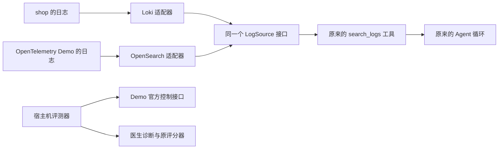

# 阶段 9 学习材料：陌生系统与第二个日志实现

## 1. 这个阶段做了什么

以前医生只接过自己写的 shop。这里把一个公开的电商示例 OpenTelemetry Demo 接进来，观察原来的工具和诊断方法到了陌生系统是否仍然有用。它的指标和调用链可以复用已有适配器，日志却保存在 OpenSearch；因此，这次也实际补上了日志接口的第二个实现。



图中有两条边界。医生只能查证，不能接触控制 Demo 行为的接口或标准答案。评测器知道注入了什么，但它给医生的输入只有现象和故障时间。

目前已经有真实 OpenSearch 查询证据：按服务查询和增加关键词后的查询都成功，见[台账 P9-3](../数据台账.md#阶段-9开源靶场泛化测试进行中)。随后又发现采集器拒收部分日志，完成了采集配置修复和首十分钟观察，见台账 P9-13、P9-14、P9-15 与[日志修复专项报告](../reports/phase-09-logging-fix.md)。查询成功、采集修复与医生诊断效果是不同结论；当前仍等 Claude 审核采集修复后再付费，尚无泛化准确率，也未完成阶段验收。

## 2. 怎么跑起来、看什么

先按[第二系统部署说明](../../deploy/opentelemetry/README.md)检查资源、取得固定源码并配置环境。不要同时启动两套靶场；切换时停止对应业务和观测组件，保留医生及医生数据库。部署文件中的 `stop` 会保留容器与数据。

这里先做不产生模型费用的观察。下面命令均从仓库根目录执行；`doctorctl` 还需要已经配置 `DOCTOR_URL` 和通过登录取得的 `DOCTOR_TOKEN`，登录方法沿用[运行说明](../operations.md)。令牌只放在环境变量里。

```text
go run ./cmd/doctorctl target list
go run ./cmd/doctorctl tool list --target otel-demo
```

你应该看到 shop 与 otel-demo 同时登记。otel-demo 会列出已配置数据源对应的工具，不应出现 MySQL 元数据、Redis 直查或 goroutine 堆栈工具。两个系统被登记，并不意味着两套靶场都必须同时运行。

在 Demo 正常产生流量时查询日志：

```text
go run ./cmd/doctorctl tool run --target otel-demo search_logs --args '{"service":"ad","lookback_seconds":300,"limit":3}'
```

你应该看到统一的日志条目，含 `time_ns`、`service`、`line`。实际条数由该时段的数据决定；如果没有日志，先检查服务名、时间和后端，不要把本书的预期当作实测结果。

对照 shop 时，在 shop 运行、Demo 停止的时段使用同样的参数结构：

```text
go run ./cmd/doctorctl tool run --target shop search_logs --args '{"service":"order-service","lookback_seconds":300,"limit":3}'
```

你应该仍然得到上述统一结构。变化的是系统和服务名，调用者没有填写 LogQL、OpenSearch DSL、后端地址或索引。

先用本地模拟后端理解接口，再考虑连接真实服务：

```text
go test ./internal/doctor/source -run TestLogSourceContract -count=1 -v
go test ./internal/doctor/source/opensearch ./internal/doctor/target -count=1
go test ./internal/eval/runner -run 'TestGeneralization|TestDemo' -count=1
```

你应该看到相同的日志契约用例分别在 Loki 与 OpenSearch 下执行。未设置真实测试环境变量时，OpenSearch 的集成测试会明确跳过；跳过不等于真实后端通过。上述单元测试使用本地 HTTP 服务、假数据和 Mock，不调用付费模型。

真实日志集成测试需按[测试文件](../../internal/doctor/source/opensearch/integration_test.go)设置 `TEST_OPENSEARCH_URL`、`TEST_OPENSEARCH_INDEX`、`TEST_OPENSEARCH_FIELDS`、`TEST_OPENSEARCH_SERVICE` 和 `TEST_OPENSEARCH_KEYWORD`；启用安全插件时还要提供只读账号环境变量。再执行：

```text
go test -race ./internal/doctor/source/opensearch -run TestIntegrationSearchLogs -count=1 -v
```

你应该看到按服务、按服务加关键词两次查询都取得既有日志。测试只读取，不创建索引、造数或清理数据。Windows 的 `-race` 仍需要 gcc 可见和 `CGO_ENABLED=1`。

收费评测不是本节的随手实验。它使用 `eval generalization` 的独立批次入口，先保存冻结清单，再运行已授权的试跑；E1、E2、模型身份和两个币种的预算都要核对。当前采集修复仍等用户转交 Claude 审核，审核通过前保持付费暂停，不能用一次诊断来探测是否已经修好。实际批次、费用与结果以后以[数据台账](../数据台账.md)为准，不从这里复制一个新批次反复付费。

## 3. 开发过程回放

### 3.1 先弄清系统怎样部署，再填写接入信息

这次首先要解决的不是“医生怎样推理”，而是本机能否在保留原数据的条件下运行另一个完整系统。开工时先核对阶段授权、分支与用户未提交修改，再检查 Windows、Docker 和 WSL 的真实资源。普通沙箱中的部分只读查询失败，按已授权范围取得资源信息后才继续。实际资源记录在台账 P9-1，没有通过删除历史测试卷腾空间。

部署部分不是一组新的 Go 业务函数，而是下面这些文件各管一件事：

| 文件 | 接收什么、产生什么 | 为什么单独放 |
|---|---|---|
| [versions.env](../../deploy/opentelemetry/versions.env) | 覆盖上游版本变量与派生资源属性 | 固定镜像和观测元数据的版本 |
| [compose.phase09.yaml](../../deploy/opentelemetry/compose.phase09.yaml) | 覆盖容器名、网络名和发布端口 | 隔离原项目与第二系统 |
| [otel-demo.yaml](../../deploy/doctor/targets/otel-demo.yaml) | 把固定数据源地址和实际字段交给医生 | 描述怎样连接，不携带答案 |
| [otel-demo.profile.md](../../deploy/doctor/targets/otel-demo.profile.md) | 把正常架构与组件标识交给医生 | 解释系统，不解释某场故障 |

先从官方说明和固定 tag 读取预期，再看本机解析后的镜像清单，最后查询真实日志的索引、字段和样本。这里实际遇到两处版本细节：上游版本文件仍含可变标签；而先展开的 `service.version` 不会因为稍后覆盖镜像版本就自动更新。因此版本覆盖也显式固定了派生属性。

启动还遇到了 payment 健康探测超时。业务已经监听端口，没有观察到 OOM，但 Node 探测本身会加载自动遥测模块。复核原命令确实能够成功但超过原探测预算后，只放宽相同探测的超时，没有改业务和场景。首次失败保留在 notes，测量见台账 P9-4。

### 3.2 把第二个日志后端接到现有接口后面

目标是继续调用原来的 `search_logs`。动手前先读已有 `LogQuery`、`LogEntry` 与 Loki 实现，确认上层需要的是结构化条件和统一日志条目，不是某个产品的原始响应。

新增实现按下面几步拆开：

| 函数 | 输入 | 返回 | 作用 |
|---|---|---|---|
| `Config.Validate` | 根地址、索引、字段和可选账号配置 | 校验错误 | 在连接前拒绝不完整或越界配置 |
| `New` | 已校验的配置 | 客户端或错误 | 固定后端身份与 HTTP 边界，不主动查询 |
| `expression` | 日志条件、字段映射 | 查询 JSON 的数据结构 | 把统一条件翻译成 DSL |
| `Search` | 上下文、日志条件 | 日志条目或错误 | 串起校验、编码、请求与解析 |
| `entries` | 后端响应、条件和字段映射 | 统一日志条目或错误 | 校验来源、整理顺序并限制数量 |
| `fieldValue` | 一个 JSON 对象、字段路径 | 字段值或空值 | 兼容嵌套对象和包含点号的原始键 |
| `timestamp` | 时间字段 | Unix 纳秒字符串或错误 | 保留时间精度，统一接口格式 |

查询翻译、HTTP 边界和响应整理分别放进文件，读者可以先理解“查什么”，再理解“怎样访问”和“怎样还原结果”。接入层把新客户端交给原来的日志依赖，因此工具层和 Agent 不需要知道这个客户端叫什么。

测试分成共同契约与产品边界两类。共同契约把同一张用例表分别交给两个本地后端，检查查询条件和最终结果；产品测试再补上分片失败、重定向、缺字段、特殊字符和响应大小等情形。

真实字段核验进一步确认了一个容易忽略的区别：查询中使用的 `.keyword` 是索引映射里的精确匹配子字段，原始 `_source` 中却没有同名字段。与此同时，resource 里的 `service.name` 是一个带点号的键。响应读取因此不能只按点号机械地拆层。真实结构保存在[字段证据](../reports/phase-09-opensearch-schema.json)，日志集成查询见台账 P9-3。

### 3.3 给外部系统增加实验控制，不改变医生的诊断方法

日志能查到了，下一步仍要证明“故障确实发生了、诊断输入没有答案、恢复可核对”。宿主机评测器因此有自己的外部场景入口；医生仍使用原来的工具和循环。

| 函数 | 输入 | 返回 | 负责的步骤 |
|---|---|---|---|
| `parseGeneralization` | 命令行参数 | 已校验选项或错误 | 限定批次、系统、实验组和本机端点 |
| `loadGeneralizationCases` | 固定目录、明确选择的编号 | 场景表或错误 | 严格读取，不自动扩大场景范围 |
| `changeDemoFlag` | 原完整配置、选定场景 | 修改后的配置或错误 | 只改选定开关，并保留其他配置 |
| `writeDemoFlags` | 官方控制地址、配置 | 写入并读回的结果 | 不把 HTTP 成功当成行为已经生效 |
| `demoQuery` | Prometheus 地址、条件 | 条件是否成立或错误 | 检查真实、有限的指标样本 |
| `advanceDemoTrial` | 已保存轮次状态、冻结安排 | 下一步结果或错误 | 推进注入、验证、诊断、恢复与冷却 |
| `restoreDemoRecord` | 保存的原快照和当前配置 | 恢复结果或错误 | 确认恢复，不覆盖来历不明的改动 |

先定义外部场景字段，再核对公开文档与固定源码，随后把注入和恢复接到原来的轮次、槽位和评分记录上。单元测试验证配置只改指定位置、旧预算账户被拒、版本变化暂停，以及恢复快照不会被覆写。

场景资料核对中发现，商品错误是按商品 ID 匹配的。删除整段 targeting 虽然也能制造错误，却会把单个商品问题扩大到所有商品。最终实现只改变原条件的命中分支，保留条件和非命中分支；这是复现原场景的边界，不是为了让医生更容易答对。

另一个需要区分的事实是，购物车清空错误不必让结账 HTTP 返回失败。上游结账实现忽略该返回值，所以本场验症状查的是购物车错误 span；不能把自己想象的症状写成验收条件。

### 3.4 查询成功以后，继续检查采集是否完整

第一次真实查询成功以后，检查 Collector 日志时发现 OpenSearch 写入报 `mapper_parsing_exception`。Collector 是把各服务遥测数据送到后端的采集器；它还能查询到旧日志，不代表每条新日志都成功写入。

实际样本里，cart 的 ASP.NET 启动日志把 `attributes.http` 写成端口文本。frontend 的 API 日志又包含 `http.request.method` 等属性；OpenSearch 将点号解释为对象路径，要求同一个 `http` 成为对象，与既有 text 类型冲突。最后修复前窗口内共有 316 个最终丢弃事件，`dropped_items` 报告和为 6209（P9-13）。这是受影响混合请求的条目数报告和；批量写入可能部分成功，不能把它写成唯一丢失 6209 条，更不能按服务或五个场景平摊。

先保存完整原始日志、索引身份和字段映射，再核对上游固定源码与修复讨论。最终只在 [Collector extras 配置](../../deploy/opentelemetry/otelcol-config-extras.phase09.yaml)增加一条日志属性改名语句：把 `http.` 前缀改为 `http_`。例如 `http.request.method` 变为 `http_request.method`，原来的文本 `http`、属性值和正文保留。配置数组合并会替换原数组，因此也显式保留上游已有的两条 scope 规则。

启用前已核对目标字段命名空间为空。配置校验退出码为 0，医生使用的五个字段完整 mapping 前后 5/5 相同，原索引 UUID 未变（P9-15）。这次没有删除或重建索引、数据卷，也不会补回历史缺口。

### 3.5 首十分钟观察通过，付费评测仍未开始

修复后固定观察窗口为 UTC `2026-11-03T05:04:46.894786114Z` 至 `05:14:47.000000000Z`，共 600.105213886 秒。这个窗口内，最终 `Dropping data` 事件、OpenSearch 日志 `dropped_items` 报告和、mapping 错误均为 0，17/17 个预期 OTLP 日志源都有新记录（P9-14）。OTLP 是服务向采集器传输遥测数据的协议，这里的分母来自固定版官方启用日志的来源，不能直接用容器总数替代。

`image-provider` 在官方遥测表中为 `logs=False`，窗口内没有日志，单列为例外。email 的 9 条日志中有 1 条精确匹配本次合成测试标记；这是受控验证样本，不当作自然流量或真实结账覆盖。同窗另有 10 条 Jaeger traces 的 `Will retry`，所以不能写“整个 Collector 零错误”，也不能由最终丢弃报告为零推断端到端没有静默丢失。逐服务响应和计数口径见[专项报告](../reports/phase-09-logging-fix.md)与[固定窗口汇总](../reports/phase-09-log-fix-after.json)。

目前可复核的真实过程已经包括资源检查、部署与字段核验、第二日志实现的集成查询、采集缺陷量化与配置修复后的固定窗口观察。单元测试使用模拟后端；真实 OpenSearch 测试只查既有日志。付费诊断、正式评分、与 shop 的准确率差异和接入总耗时，仍需后续实际记录补齐。当前等 Claude 审核采集修复，不能由观察通过推出泛化评测完成。

本节只回放实际发生的核对与实现，不编造一次未运行的完整 Mock 彩排。用户已经明确取消了这种彩排，单元测试和 CI 继续使用 Mock。

### 3.6 查询成功以后还要核对字段的实际取值

收尾时把冻结工具的级别枚举与真实样本对照，才发现工具只接受大写 INFO，frontend 却写小写 info。原契约夹具使用大写，早先真实集成只查服务和关键词，所以都没有覆盖这个差异。同一个固定窗口，旧的精确 INFO 查询为 0，忽略大小写后为 1896 条（P9-21）。这与 HTTP method 的计数是不同口径。

修正只在新适配器中给级别 term 添加 `case_insensitive`，服务和 trace 继续精确匹配。补了大小写与不同级别的 Mock 回归，再用实际 OpenSearch 和新 Mock 医生验证：Go 集成带 INFO 返回 10 条，医生返回 5 条，见 P9-21、P9-23。全仓重验另存 P9-22，原检查没有覆盖。这是把第二实现补齐到原接口约定，尚未发生诊断评测，也没有修改冻结提示、工具、手册或评分。

## 4. 阅读顺序

1. 从 [doctor 入口](../../cmd/doctor/main.go)和[组装包](../../internal/doctor/app/doc.go)了解谁创建医生，再看 [接入目录加载](../../internal/doctor/target/catalog.go)。重点找同一个医生怎样为各个系统分别建立依赖。
2. 读 [source.go](../../internal/doctor/source/source.go)中的 `LogSource`、`LogQuery` 和 `LogEntry`。先明确调用者能依赖什么。
3. 并排读 [Loki 查询](../../internal/doctor/source/loki/client.go)与 [OpenSearch 查询](../../internal/doctor/source/opensearch/client.go)。只追一组相同条件怎样变成不同协议。
4. 读 [OpenSearch 配置](../../internal/doctor/source/opensearch/config.go)与[响应整理](../../internal/doctor/source/opensearch/response.go)。重点看固定索引、`.keyword`、点键和时间精度。
5. 读[共同契约测试](../../internal/doctor/source/log_contract_test.go)，再读[产品边界测试](../../internal/doctor/source/opensearch/client_test.go)和[接入隔离测试](../../internal/doctor/target/opensearch_test.go)。分清共同承诺与产品细节。
6. 从 [eval 入口](../../cmd/eval/main.go)进入[泛化命令](../../internal/eval/runner/generalization.go)，接着看[外部场景控制](../../internal/eval/runner/generalization_scenario.go)与[轮次推进](../../internal/eval/runner/generalization_run.go)。只跟一次“注入前保存 → 验证 → 诊断 → 恢复”。
7. 最后对照[场景来源](../../eval/scenarios/otel-demo/README.md)、[本阶段原始记录](../notes.md#phase-09)、[日志修复专项报告](../reports/phase-09-logging-fix.md)与[台账](../数据台账.md)。把“代码支持”“真实跑过”“效果如何”分开讲。

## 5. 关键设计与 WHY

### 5.1 同一个接口的第二个实现

要解决的问题是：工具想查日志，不应该因为换了存储产品就换一套参数。接口是一份双方约定。Loki 和 OpenSearch 都能根据 `LogQuery` 返回 `LogEntry`，接入层就可以把任意一个放到相同的位置。

Java 读者可以把它理解成变量类型仍是日志查询接口，实际对象变成另一种实现。Go 不需要在类型声明里写 `implements`：方法符合接口就能赋给这个接口。这种写法在阶段 5 已出现，这次重点是验证另一个实现能否兑现相同承诺。

用一组**解释用途的条件**看翻译，不把它当作真实故障记录：服务 ad、级别 WARN、关键词 connection、指定 trace ID、固定时间区间、最多若干条日志。

Loki 收到的 LogQL 形状如下：

```text
{service="ad"} |= "connection" | json | level="WARN" | trace_id="0123456789abcdef"
```

时间起止、条数上限和倒序方向另放在 `/loki/api/v1/query_range` 的查询参数中。`strconv.Quote` 把输入变成合法字符串值，关键词里的引号或管道符不会成为新的 LogQL 运算。

OpenSearch 则向配置中的 `/otel-logs-*/_search` 发送 JSON，下面的条数与时间只用于说明结构：

```json
{
  "size": 3,
  "track_total_hits": false,
  "query": {
    "bool": {
      "filter": [
        {"term": {"resource.service.name.keyword": "ad"}},
        {"range": {"observedTimestamp": {
          "gte": "2026-11-03T04:00:00Z",
          "lte": "2026-11-03T04:05:00Z",
          "format": "strict_date_optional_time_nanos"
        }}},
        {"term": {"severity.text.keyword": {"value": "WARN", "case_insensitive": true}}},
        {"term": {"traceId.keyword": "0123456789abcdef"}}
      ],
      "must": [{"match_phrase": {"body": "connection"}}]
    }
  },
  "sort": [{"observedTimestamp": "desc"}]
}
```

`term` 匹配字段的完整值；服务和 trace 保持精确匹配，日志级别另加 `case_insensitive`，让工具规定的大写 INFO 能匹配来源中的小写 info。`range` 表示时间区间，`match_phrase` 表示正文短语匹配。这些结构由代码固定；关键词只占一个值。即使值里有看起来像查询语法的文字，JSON 编码器也只会把它编码成文字。

| 共同的部分 | Loki 的具体做法 | OpenSearch 的具体做法 |
|---|---|---|
| 服务、级别、关键词、trace、时间、上限 | 翻译成 LogQL 和 URL 参数 | 翻译成 JSON DSL |
| 当前系统绑定的数据源 | 固定 Loki 根地址 | 固定根地址、索引与字段映射 |
| 返回统一日志条目 | 解析日志流和时间值 | 解析 hits 与 `_source`，转换日期 |
| 倒序、有界、能取消 | 上下文传给 HTTP 请求，整理结果 | 同样传上下文并检查响应、排序和截断 |

两者共用的是接口、工具参数、工具执行边界和契约测试表；HTTP 形状与响应解析仍各自实现。不要把接口共用理解成所有产品细节消失：Loki 的 `|=` 是子串筛选，OpenSearch 的 `match_phrase` 受字段分析器影响，中文、标点等检索细节仍应按实际采集配置核验。

契约测试给同一个条件和同一组期望日志，分别运行两个实现，并分别检查各自发出的请求。它证明这些用例下查询翻译、统一结果、顺序、上限和取消行为符合约定。它不会证明真实集群已接通，也不能证明所有语言的任意文本检索结果逐字等价；真实集成测试承担前一件事。

### 5.2 为什么字段来自配置

同一条日志经过不同采集器，服务名可能叫 `serviceName`，也可能藏在 resource 里面。把字段写死进适配器，换采集链路就又得改代码。配置保存的是当前部署怎样存数据；查询参数保存的是这次想找什么，两者有不同的变化频率。

字段配置要先经过校验，日志后端也只能二选一。若同时写了 Loki 与 OpenSearch，让代码按装配顺序悄悄挑一个，会把“查错库”隐藏成看似正常的结果。因此接入层直接报错。

### 5.3 只读不能只看 HTTP 方法

OpenSearch 的搜索接口可以用 POST 传较大的查询体，POST 本身不表示这里会写入业务数据。关键是代码只构造指定索引的 `_search` 路径，没有任意路径、删除或更新入口。

不过，代码约束不替代服务账号权限。本次官方 Demo 禁用了安全插件；如果真实集群开启认证，应配置只读账号，账号和密码仍从环境变量取得。不能因本机查询成功就声称已经验证了生产集群的账号授权。

### 5.4 缺数据时减少能力，而不是偷偷跨系统补证据

Demo 使用 PostgreSQL，现有 MySQL 检查器不能解释它的执行计划。其他语言的服务也没有本次接入所需的 Go pprof 地址。接入层因此不注册对应工具，告诉医生哪些能力缺失。

指标里仍可能有 PostgreSQL 或 Valkey 的统计，但“看到统计”与“能直接查询锁等待或运行命令”是两种能力。不能拿 shop 的数据库工具替 Demo 查询，更不能临时给医生增加任意 SQL 或 URL 工具。

### 5.5 一场实验先保存原状，再观察与恢复

外部控制接口与医生数据库之间没有同一个事务。若进程在写开关后退出，重跑命令并不知道上次动作是否已经发生。因此先保存原完整配置和本轮预期配置，之后每次推进都核对当前状态。

恢复也先核对：当前状态若既不是原配置，也不是本轮注入配置，可能有人做过别的修改，不能自动覆盖。恢复确认另存文件，原快照不截断。比“关掉我记得的几个开关”更可靠的做法是恢复完整原状，并保留核对依据。

### 5.6 适配成功与泛化效果是不同的结论

第二适配器成功说明原接口可以容纳另一种日志后端。医生能否在缺少数据库直查的陌生系统中找对根因，还要看固定场景、冻结版本和真实诊断记录。

E1 和 E2 的区别仍然只是是否提供通用手册检索。不能发现某场答错，就往提示或手册塞入这个场景的答案；那会变成新的实验版本。比较时也要说明模型、组别、样本、故障类型和可用数据不同，不能把两个系统的平均准确率差异都归因于“泛化能力”。

医生与评委也各有账本：美元账户为 `phase-09-openai`，人民币账户为 `phase-09-deepseek`，不延用阶段 8 的账户，两个币种不相加。美元费用统一写“按项目用量账本计”：Key 与其他用途共用，平台账单无法单独核对，不能把项目计算值称作平台独立扣费。

### 5.7 为什么日志修复要先于诊断评分

医生只能使用真正到达工具结果中的证据。若某类日志被采集器拒收，报告里没有它，可能是数据链路缺失，不能直接归因于模型没有查对。先保存修复前缺口、核对修复后实际字段与逐服务样本，才能说明随后诊断是在什么证据条件下进行。

这里也要区分两种计数：`dropped_items` 是采集器对失败请求的报告，逐服务查询是索引中已有文档的观察。前者不是去重后的缺失文档清单，后者也没有所有服务生成日志的完整分母。因此首十分钟结果只能支持该固定窗口内的验证结论，不能扩大成永久保证或端到端零丢失。

## 6. 本阶段用到的 Go 写法

本阶段没有首次引入新的 Go 语法。接口的隐式实现、结构体与标签、map、context、defer 和表格驱动测试在前面阶段已经使用，这里是把它们用于第二实现和外部实验。

值得回头理解的是标准库的具体用法：`json.Marshal` 负责把值转成合法 JSON；`Decoder.UseNumber` 避免较大的整数先经过浮点数而损失精度；带 context 的 HTTP 请求让取消信号继续传到网络层。它们不是本阶段新发明的语言机制，直接对照上述真实代码读即可，本节不另外编造重复的小程序。

## 7. 动手实验

以下实验在没有运行冻结评测批次时做。修改只限你选定的本地测试或临时配置，结束后用编辑器恢复本次改动；不要还原其他人的未提交文件。都不需要创建诊断或调用付费模型。

### 实验一：让相同查询在两个后端之间切换

先运行 `TestLogSourceContract`，找到“按关键字”的同一行用例。把它的关键词和相应模拟日志改成另一段普通文字，仍然只保留一份期望值，再运行测试。

你应该看到两个实现接收同一条件。接着只破坏一个实现的翻译，例如暂时漏掉关键词条件，观察请求检查失败；最后补回条件。这里要体会，契约不只是“响应能解码”。

### 实验二：观察 JSON 值能否变成查询结构

运行 `TestKeywordJSONValues`，再在其关键词表里增加含引号、反斜杠与查询符号的一段文字。观察编码后再解码的值是否与原文相等。

随后暂时把断言期望改成另一段文字，确认测试确实会失败，再恢复。不要为了演示而把真实查询代码改成字符串拼接；这个实验只需要本地夹具。

### 实验三：破坏字段映射

在 `TestLogBackendConfig` 的模拟配置里去掉 `trace_id`，或者同时保留 Loki 与 OpenSearch。先观察配置被拒绝，再补齐字段或删掉冲突项，观察原测试恢复通过。

再读 `TestResponseBoundary` 的“完整点键”“嵌套字段”“缺服务”和“缺消息”用例。把含点号的服务键换成嵌套对象，接口仍应读到同一来源；去掉服务则必须报错，不能拿查询参数替后端伪造来源。

### 实验四：保护一个特定商品的场景范围

运行 `TestDemoFlagMutation`，阅读用于商品条件的原配置和修改后断言。暂时让期望值丢失原匹配条件，观察断言失败，再恢复原条件。

重点不是打开真实故障，而是确认“只改命中分支”的承诺。若删除 targeting，所有商品都可能被影响；即使得到更明显的错误，也已经变了题目。

## 8. 常见误区

- **注册了两个系统，就要同时启动两套靶场。** 注册是医生保存两份独立依赖，运行策略仍是一次只开一套靶场。
- **有同一个接口，就能连接任何日志产品。** 每个新后端仍需要具体适配器、字段配置和真实接入验证。
- **`resource.service.name.keyword` 一定是原 JSON 的嵌套路径。** `.keyword` 是映射子字段，原日志还可能保留带点号的键。
- **后端 HTTP 成功就代表取得完整日志。** OpenSearch 可能部分分片失败或查询超时；适配器要把这些情况明确返回。
- **采集器报告丢弃为零，就等于端到端零丢失。** 还可能有未上报或尚未到达采集器的数据；本次结论只覆盖固定窗口，并保留 Jaeger 重试和官方未启用日志的例外。
- **没有错误指标就表示健康。** 也可能没有流量或没有采集到样本；健康条件还要有实际调用作为对照。
- **恢复就是把已知开关设回 off。** 原配置可能包含其他值，完整快照和读回确认才是本轮恢复依据。
- **拿到错误日志就算定位根因。** 还要分清错误产生的位置、传播路径，以及缺少哪些证据。
- **结果差就补一条专门手册。** 这会改变冻结版本；不能把改过的结果继续塞进原批次。

## 9. 必答问题

1. 在开源靶场上的准确率比自己的低多少？主要原因是什么？
2. 接入一个陌生系统，最花时间的是哪一步？
3. 数据缺失时，医生的表现发生了什么变化？
4. 同一次 `search_logs` 调用，Loki 和 OpenSearch 收到的查询分别长什么样？为什么不让 AI 直接写查询语句？
5. 为什么把日志字段名放进接入配置，而不是写死在适配器里？
6. 契约测试和普通单元测试有什么不同？它在这里证明了什么？
7. 查询中的 `.keyword` 为什么不能原样拿去读取 `_source`？
8. 如果注入后程序退出，为什么不能直接重新打开开关再诊断？
9. 为什么真实日志查询成功以后，还要检查 Collector？首十分钟的丢弃报告为零证明了什么？

<details>
<summary>参考答案要点</summary>

1. 本材料编写时尚无归档的阶段 9 正式结果，不能给出差值。完成后应从台账取同一模型、对应组别的各自分母与正确数，单独展示；再用原始步骤分析推理、工具、数据和评分问题，不能仅凭平均值归因。
2. 尚未形成接入全过程的分项计时，不能宣称哪一步耗时最长。已实际遇到资源核验、上游 Compose 拆分与可变版本、派生属性以及 Node 健康探测耗时等问题，按 notes 复述真实过程。
3. 已能证明缺少 PostgreSQL 直查、Valkey 直查与 pprof 时，相应工具不注册。对准确率、证据覆盖或诊断耗时的影响仍需真实结果和步骤；不能把能力降级直接等同于已经测得效果下降。
4. 共同条件在 Loki 中变为 LogQL 和 URL 参数，在 OpenSearch 中变为固定索引上的 term、range、match_phrase 与排序 JSON。让代码翻译才能保留服务、索引、字段、时间和数量边界；模型不用学习并获得整个后端查询能力。
5. 字段随采集链路变化，属于接入信息。把它写进配置并校验，才能换字段而不修改实现；必须从真实 mapping 和样本确认。
6. 这里的契约测试用同一张行为表、同一接口和共同期望运行两个实现，同时分别检查各自的请求。产品边界单元测试补充其余细节；真实连通、账号权限和所有文本分析语义不由这张本地表单独证明。
7. `.keyword` 是索引中的精确匹配子字段；原始 JSON 可能只有 text 原字段。读取时还要兼容 `service.name` 是完整键的情况。
8. 上一次写入可能已经成功，重新注入会丢失原开始时间并混入旧证据。应核对保存的完整原配置、本轮预期配置、恢复证明与数据库轮次状态，无法确认就停止。
9. 查询成功只证明已有数据可读，采集器仍可能拒收某类新日志。本次固定窗口内没有最终丢弃或 mapping 错误报告，17/17 个预期 OTLP 日志源有新记录；image-provider 官方未启用日志，email 包含合成样本，同窗仍有 Jaeger 重试。这支持本次配置修复的窗口验证，不能推出端到端零丢失或医生准确率。

</details>

## 10. 本阶段新术语

| 术语 | 一句话解释 |
|---|---|
| 泛化 | 把原来在一套系统里建立的方法用于陌生系统，观察还能解决哪些问题 |
| OpenSearch | 本阶段保存和检索外部系统日志的后端产品 |
| 适配器 | 在统一接口与某种具体产品协议之间翻译的实现 |
| DSL | 为某类问题设计的语言；这里特指描述 OpenSearch 查询的 JSON 结构 |
| 索引 | OpenSearch 中组织一类文档并提供检索的范围，不等同于 MySQL 的单个 B+ 树索引 |
| mapping | OpenSearch 对各字段名称、类型和检索方式的定义 |
| OTLP | OpenTelemetry 用来传输指标、调用链和日志的协议 |
| Collector | 接收各服务遥测数据、处理后发送到后端的采集器 |
| 合成样本 | 为核对链路而主动构造、带有可识别标记的测试数据，不能冒充自然业务流量 |
| keyword 子字段 | 用于按完整值精确匹配的索引字段 |
| `_source` | 一条 OpenSearch 文档保存的原始内容 |
| 契约测试 | 让不同实现接受同一组接口行为要求的测试 |
| targeting | 上游配置里根据请求属性选择变体的条件；它只属于评测控制一侧 |
| 降级接入 | 缺少某种数据源时，明确减少可用工具，而不是假装仍有完整证据 |
