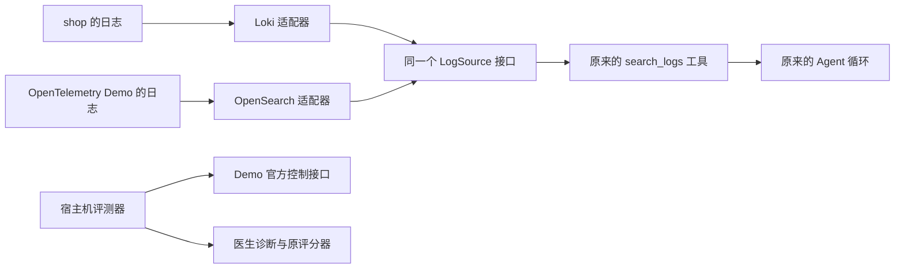

# 阶段 9 学习材料：陌生系统与第二个日志实现

## 1. 这个阶段做了什么

以前医生只接过自己写的 shop。这里把一个公开的电商示例 OpenTelemetry Demo 接进来，观察原来的工具和诊断方法到了陌生系统是否仍然有用。它的指标和调用链可以复用已有适配器，日志却保存在 OpenSearch；因此，这次也实际补上了日志接口的第二个实现。



图中有两条边界。医生只能查证，不能接触控制 Demo 行为的接口或标准答案。评测器知道注入了什么，但它给医生的输入只有现象和故障时间。

目前已经有真实 OpenSearch 查询证据：按服务查询和增加关键词后的查询都成功，见[台账 P9-3](../数据台账.md#阶段-9开源靶场泛化测试进行中)。随后又发现采集器拒收部分日志，完成了采集配置修复和首十分钟观察，见台账 P9-13、P9-14、P9-15 与[日志修复专项报告](../reports/phase-09-logging-fix.md)。采集修复已通过 Claude 审核，用户已批准按独立预算运行评测。查询成功、采集修复与医生诊断效果仍是不同结论，本材料不把接线和开跑前验证换算成泛化准确率。

此前新编号试跑产生了 1 份 Terra E1 报告，医生正常提交、采集质量 normal；DeepSeek 的内层评分 JSON 失败，批次自动中断，正式 E1/E2 没有开启。实际费用分别为 USD $0.027179、CNY ¥0.014920（P9-51–P9-54）。美元按项目用量账本计；Key 与其他用途共用，平台账单无法单独核对。原报告、失败与晚健康的真实回放见第 3.11、3.12 节。

随后用户要求先做免费历史健康回放，再在真实 Demo 上完成医生与评委均为 Mock 的全场景 E1/E2 彩排。本轮停在历史健康门槛：并非所有可评估点都通过，所以没有启动这次完整 Mock 矩阵，也没有新增付费诊断。新增计时能力目前只有单元测试验证，没有本轮真实故障的症状或恢复耗时，见第 3.13、3.14 节。阶段 9 尚未完成，工程与学习验收都未勾选。

## 2. 怎么跑起来、看什么

先按[第二系统部署说明](../../deploy/opentelemetry/README.md)检查资源、取得固定源码并配置环境。不要同时启动两套靶场；切换时停止对应业务和观测组件，保留医生及医生数据库。部署文件中的 `stop` 会保留容器与数据。

医生现在可以单独部署，只启动医生和它自己的 MySQL。通用步骤见[医生部署说明](../../deploy/doctor/README.md)，自己的系统怎样写配置见[接入指南](../onboarding.md)。阶段 9 的实际入口以通用双服务文件为基础，加一份只覆盖本阶段身份、预算和评测端口的配置；已经准备好私有 `.env.phase09-doctor` 和所选目标目录时，使用：

```text
docker compose --env-file .env.phase09-doctor -p opsdoctor-phase09-doctor -f deploy/doctor/compose.yaml -f deploy/opentelemetry/doctor.phase09.yaml up -d --build --wait --wait-timeout 240
```

两份 `-f` 的顺序有意义：先定义通用服务，再覆盖本阶段差异；后面的文件不能单独启动。它使用新网络和新 `doctor-state` 卷，不连接原医生库。宿主评测器也必须把 `DOCTOR_MYSQL_DSN` 指向新库的回环端口 `3309`；容器内医生使用本项目的 `doctor-mysql:3306`。

这里先做不产生模型费用的观察。下面命令均从仓库根目录执行；`doctorctl` 还需要已经配置 `DOCTOR_URL` 和通过登录取得的 `DOCTOR_TOKEN`，登录方法沿用[运行说明](../operations.md)。令牌只放在环境变量里。

```text
go run ./cmd/doctorctl target list
go run ./cmd/doctorctl tool list --target otel-demo
```

本次独立实例的目标只有 otel-demo，列出 8 个只读工具；不应出现 MySQL 元数据、Redis 直查或 goroutine 堆栈工具（P9-25、P9-26）。同一医生同时登记 shop 与 otel-demo 的早先实测仍保留在 P9-8、P9-9。工具菜单来自本次挂载的目标目录，不能把旧实例的菜单当作新实例的预期。

在 Demo 正常产生流量时查询日志：

```text
go run ./cmd/doctorctl tool run --target otel-demo search_logs --args '{"service":"ad","lookback_seconds":300,"limit":3}'
```

你应该看到统一的日志条目，含 `time_ns`、`service`、`line`。实际条数由该时段的数据决定；如果没有日志，先检查服务名、时间和后端，不要把本书的预期当作实测结果。

下面是早先双系统对照使用的同类调用；只有配置中已登记 shop，且 shop 运行、Demo 停止时才适用。本次只挂 otel-demo 的独立实例不会自动拥有 shop：

```text
go run ./cmd/doctorctl tool run --target shop search_logs --args '{"service":"order-service","lookback_seconds":300,"limit":3}'
```

你应该仍然得到上述统一结构。变化的是系统和服务名，调用者没有填写 LogQL、OpenSearch DSL、后端地址或索引。

先用本地模拟后端理解接口，再考虑连接真实服务：

```text
go test ./internal/doctor/source -run TestLogSourceContract -count=1 -v
go test ./internal/doctor/source/opensearch ./internal/doctor/target -count=1
go test ./internal/eval/runner -run 'TestGeneralization|TestDemo' -count=1
```

你应该看到相同的日志契约用例分别在 Loki 与 OpenSearch 下执行。未设置真实测试环境变量时，OpenSearch 的集成测试会明确跳过；跳过不等于真实后端通过。上述单元测试使用本地 HTTP 服务、假数据和 Mock，不调用付费模型。

真实日志集成测试需按[测试文件](../../internal/doctor/source/opensearch/integration_test.go)设置 `TEST_OPENSEARCH_URL`、`TEST_OPENSEARCH_INDEX`、`TEST_OPENSEARCH_FIELDS`、`TEST_OPENSEARCH_SERVICE` 和 `TEST_OPENSEARCH_KEYWORD`；启用安全插件时还要提供只读账号环境变量。再执行：

```text
go test -race ./internal/doctor/source/opensearch -run TestIntegrationSearchLogs -count=1 -v
```

你应该看到按服务、按服务加关键词两次查询都取得既有日志。测试只读取，不创建索引、造数或清理数据。Windows 的 `-race` 仍需要 gcc 可见和 `CGO_ENABLED=1`。

收费评测不是本节的随手实验。它使用 `eval generalization` 的独立批次入口，先保存冻结清单，再运行获授权的批次；E1、E2、模型身份和两个币种的预算都要核对。[原运行安排](../reports/phase-09-approved-run-plan.json)保留其授权与预估时点，不当作实际费用。此前用户批准的新编号试跑因评分失败而暂停，原记录不重评、不补分。最新安排不再增加试跑，而是要求历史健康、真实 Demo 上的双 Mock 彩排和 CI 都通过后才进入新正式批次；本轮历史检查未通过，后续未开启。实际批次、费用与结果以[数据台账](../数据台账.md)为准，不从这里复制一个新批次反复付费。

## 3. 开发过程回放

### 3.1 先弄清系统怎样部署，再填写接入信息

这次首先要解决的不是“医生怎样推理”，而是本机能否在保留原数据的条件下运行另一个完整系统。开工时先核对阶段授权、分支与用户未提交修改，再检查 Windows、Docker 和 WSL 的真实资源。普通沙箱中的部分只读查询失败，按已授权范围取得资源信息后才继续。实际资源记录在台账 P9-1，没有通过删除历史测试卷腾空间。

部署部分不是一组新的 Go 业务函数，而是下面这些文件各管一件事：

| 文件 | 接收什么、产生什么 | 为什么单独放 |
|---|---|---|
| [versions.env](../../deploy/opentelemetry/versions.env) | 覆盖上游版本变量与派生资源属性 | 固定镜像和观测元数据的版本 |
| [compose.phase09.yaml](../../deploy/opentelemetry/compose.phase09.yaml) | 覆盖容器名、网络名和发布端口 | 隔离原项目与第二系统 |
| [otel-demo.yaml](../../deploy/doctor/targets/otel-demo.yaml) | 把固定数据源地址和实际字段交给医生 | 描述怎样连接，不携带答案 |
| [otel-demo.profile.md](../../deploy/doctor/targets/otel-demo.profile.md) | 把正常架构与组件标识交给医生 | 解释系统，不解释某场故障 |

先从官方说明和固定 tag 读取预期，再看本机解析后的镜像清单，最后查询真实日志的索引、字段和样本。这里实际遇到两处版本细节：上游版本文件仍含可变标签；而先展开的 `service.version` 不会因为稍后覆盖镜像版本就自动更新。因此版本覆盖也显式固定了派生属性。

启动还遇到了 payment 健康探测超时。业务已经监听端口，没有观察到 OOM，但 Node 探测本身会加载自动遥测模块。复核原命令确实能够成功但超过原探测预算后，只放宽相同探测的超时，没有改业务和场景。首次失败保留在 notes，测量见台账 P9-4。

### 3.2 把第二个日志后端接到现有接口后面

目标是继续调用原来的 `search_logs`。动手前先读已有 `LogQuery`、`LogEntry` 与 Loki 实现，确认上层需要的是结构化条件和统一日志条目，不是某个产品的原始响应。

新增实现按下面几步拆开：

| 函数 | 输入 | 返回 | 作用 |
|---|---|---|---|
| `Config.Validate` | 根地址、索引、字段和可选账号配置 | 校验错误 | 在连接前拒绝不完整或越界配置 |
| `New` | 已校验的配置 | 客户端或错误 | 固定后端身份与 HTTP 边界，不主动查询 |
| `expression` | 日志条件、字段映射 | 查询 JSON 的数据结构 | 把统一条件翻译成 DSL |
| `Search` | 上下文、日志条件 | 日志条目或错误 | 串起校验、编码、请求与解析 |
| `entries` | 后端响应、条件和字段映射 | 统一日志条目或错误 | 校验来源、整理顺序并限制数量 |
| `fieldValue` | 一个 JSON 对象、字段路径 | 字段值或空值 | 兼容嵌套对象和包含点号的原始键 |
| `timestamp` | 时间字段 | Unix 纳秒字符串或错误 | 保留时间精度，统一接口格式 |

查询翻译、HTTP 边界和响应整理分别放进文件，读者可以先理解“查什么”，再理解“怎样访问”和“怎样还原结果”。接入层把新客户端交给原来的日志依赖，因此工具层和 Agent 不需要知道这个客户端叫什么。

测试分成共同契约与产品边界两类。共同契约把同一张用例表分别交给两个本地后端，检查查询条件和最终结果；产品测试再补上分片失败、重定向、缺字段、特殊字符和响应大小等情形。

真实字段核验进一步确认了一个容易忽略的区别：查询中使用的 `.keyword` 是索引映射里的精确匹配子字段，原始 `_source` 中却没有同名字段。与此同时，resource 里的 `service.name` 是一个带点号的键。响应读取因此不能只按点号机械地拆层。真实结构保存在[字段证据](../reports/phase-09-opensearch-schema.json)，日志集成查询见台账 P9-3。

### 3.3 给外部系统增加实验控制，不改变医生的诊断方法

日志能查到了，下一步仍要证明“故障确实发生了、诊断输入没有答案、恢复可核对”。宿主机评测器因此有自己的外部场景入口；医生仍使用原来的工具和循环。

| 函数 | 输入 | 返回 | 负责的步骤 |
|---|---|---|---|
| `parseGeneralization` | 命令行参数 | 已校验选项或错误 | 限定批次、系统、实验组和本机端点 |
| `loadGeneralizationCases` | 固定目录、明确选择的编号 | 场景表或错误 | 严格读取，不自动扩大场景范围 |
| `changeDemoFlag` | 原完整配置、选定场景 | 修改后的配置或错误 | 只改选定开关，并保留其他配置 |
| `writeDemoFlags` | 官方控制地址、配置 | 写入并读回的结果 | 不把 HTTP 成功当成行为已经生效 |
| `demoQuery` | Prometheus 地址、条件 | 条件是否成立或错误 | 检查真实、有限的指标样本 |
| `advanceDemoTrial` | 已保存轮次状态、冻结安排 | 下一步结果或错误 | 推进注入、验证、诊断、恢复与冷却 |
| `restoreDemoRecord` | 保存的原快照和当前配置 | 恢复结果或错误 | 确认恢复，不覆盖来历不明的改动 |

先定义外部场景字段，再核对公开文档与固定源码，随后把注入和恢复接到原来的轮次、槽位和评分记录上。单元测试验证配置只改指定位置、旧预算账户被拒、版本变化暂停，以及恢复快照不会被覆写。

场景资料核对中发现，商品错误是按商品 ID 匹配的。删除整段 targeting 虽然也能制造错误，却会把单个商品问题扩大到所有商品。最终实现只改变原条件的命中分支，保留条件和非命中分支；这是复现原场景的边界，不是为了让医生更容易答对。

另一个需要区分的事实是，购物车清空错误不必让结账 HTTP 返回失败。上游结账实现忽略该返回值，所以本场验症状查的是购物车错误 span；不能把自己想象的症状写成验收条件。

### 3.4 查询成功以后，继续检查采集是否完整

第一次真实查询成功以后，检查 Collector 日志时发现 OpenSearch 写入报 `mapper_parsing_exception`。Collector 是把各服务遥测数据送到后端的采集器；它还能查询到旧日志，不代表每条新日志都成功写入。

实际样本里，cart 的 ASP.NET 启动日志把 `attributes.http` 写成端口文本。frontend 的 API 日志又包含 `http.request.method` 等属性；OpenSearch 将点号解释为对象路径，要求同一个 `http` 成为对象，与既有 text 类型冲突。最后修复前窗口内共有 316 个最终丢弃事件，`dropped_items` 报告和为 6209（P9-13）。这是受影响混合请求的条目数报告和；批量写入可能部分成功，不能把它写成唯一丢失 6209 条，更不能按服务或五个场景平摊。

先保存完整原始日志、索引身份和字段映射，再核对上游固定源码与修复讨论。最终只在 [Collector extras 配置](../../deploy/opentelemetry/otelcol-config-extras.phase09.yaml)增加一条日志属性改名语句：把 `http.` 前缀改为 `http_`。例如 `http.request.method` 变为 `http_request.method`，原来的文本 `http`、属性值和正文保留。配置数组合并会替换原数组，因此也显式保留上游已有的两条 scope 规则。

启用前已核对目标字段命名空间为空。配置校验退出码为 0，医生使用的五个字段完整 mapping 前后 5/5 相同，原索引 UUID 未变（P9-15）。这次没有删除或重建索引、数据卷，也不会补回历史缺口。

### 3.5 首十分钟观察通过，保留当时的验收边界

修复后固定观察窗口为 UTC `2026-11-03T05:04:46.894786114Z` 至 `05:14:47.000000000Z`，共 600.105213886 秒。这个窗口内，最终 `Dropping data` 事件、OpenSearch 日志 `dropped_items` 报告和、mapping 错误均为 0，17/17 个预期 OTLP 日志源都有新记录（P9-14）。OTLP 是服务向采集器传输遥测数据的协议，这里的分母来自固定版官方启用日志的来源，不能直接用容器总数替代。

`image-provider` 在官方遥测表中为 `logs=False`，窗口内没有日志，单列为例外。email 的 9 条日志中有 1 条精确匹配本次合成测试标记；这是受控验证样本，不当作自然流量或真实结账覆盖。同窗另有 10 条 Jaeger traces 的 `Will retry`，所以不能写“整个 Collector 零错误”，也不能由最终丢弃报告为零推断端到端没有静默丢失。逐服务响应和计数口径见[专项报告](../reports/phase-09-logging-fix.md)与[固定窗口汇总](../reports/phase-09-log-fix-after.json)。

到这个观察点，真实过程已经包括资源检查、部署与字段核验、第二日志实现的集成查询、采集缺陷量化与配置修复后的固定窗口观察。单元测试使用模拟后端；真实 OpenSearch 测试只查既有日志。当时尚待 Claude 审核，也未开始付费诊断。后来审核通过，仍不能回头把这次观察当作诊断或正式评分；与 shop 的准确率差异必须来自后续实际结果。

本节只回放实际发生的核对与实现，不编造一次未运行的完整 Mock 彩排。当时用户取消了这种彩排，单元测试和 CI 继续使用 Mock；后来的用户要求又增加了真实 Demo 上的免费双 Mock 彩排门槛，其实际停点见第 3.13、3.14 节。

### 3.6 查询成功以后还要核对字段的实际取值

收尾时把冻结工具的级别枚举与真实样本对照，才发现工具只接受大写 INFO，frontend 却写小写 info。原契约夹具使用大写，早先真实集成只查服务和关键词，所以都没有覆盖这个差异。同一个固定窗口，旧的精确 INFO 查询为 0，忽略大小写后为 1896 条（P9-21）。这与 HTTP method 的计数是不同口径。

修正只在新适配器中给级别 term 添加 `case_insensitive`，服务和 trace 继续精确匹配。补了大小写与不同级别的 Mock 回归，再用实际 OpenSearch 和新 Mock 医生验证：Go 集成带 INFO 返回 10 条，医生返回 5 条，见 P9-21、P9-23。全仓重验另存 P9-22，原检查没有覆盖。这是把第二实现补齐到原接口约定；当时尚未发生诊断评测，也没有修改冻结提示、工具、手册或评分。

### 3.7 把医生自己的部署与 shop 演示分开

用户随后要求“医生可单独部署”。先核对真实启动配置，发现 Go 程序只要求医生自身的库、登录与 JWT；系统凭据由目标 YAML 引用，并没有 shop 必填。原完整演示的 Compose 却逐项列出 `SHOP_` 变量，还默认挂载全部目标。因此，这次补的是部署入口，没有为此改 Go 的工具或 Agent。

把公共的两个服务写入 [deploy/doctor/compose.yaml](../../deploy/doctor/compose.yaml)，阶段 9 原专用文件改为[薄覆盖](../../deploy/opentelemetry/doctor.phase09.yaml)。基础文件定义 MySQL、医生镜像、挂载与健康检查，薄覆盖只补固定容器名、本阶段两个预算账户和宿主 `3309` 端口。这避免复制两套相同服务配置后各自修改，也让新系统接入不必先填 shop 的整套账号。

两类环境文件分别处理两个问题。`.env.phase09-doctor` 供 Compose 填写医生自己的配置和路径；`DOCTOR_TARGET_ENV_FILE` 指定的 `.env.phase09-targets` 把目标 YAML 引用的凭据交给医生进程。Compose 的 `environment` 优先于容器 `env_file`，所以前者只列医生与模型的通用变量，不再逐项展开 `SHOP_` 等系统变量。Git 忽略和 Docker 构建排除也分别核对，避免嵌套私有 env 被 `COPY . .` 带进构建上下文。

实测前重新检查资源（P9-24），把 otel-demo 的 YAML 和 profile 精确复制到仓库外单独目录，并核对旧库阶段 9 生成请求与美元支出均为 0，才切换到新状态卷（P9-27）。新库不迁移阶段 8 或旧诊断数据；原库只 stop，容器和卷保留。这个零支出前提很关键，不能把更换数据库当成费用预算重新开始。

在已有本机源码和镜像的条件下，从准备私有文件、验证配置、构建到健康为 33.696456 秒，到登录和菜单为 33.8045 秒；医生进程中没有 `SHOP_` 环境变量，目标只有 otel-demo（P9-25）。恢复 Demo 后，菜单为 8 个只读工具，frontend 加 INFO 和关键词的日志查询返回 5 条；`query_metrics` 查询 `up` 虽然返回 `status=ok`，但序列数是 0（P9-26）。它证明该查询完成，不能写成已取得非空指标，更不能据此判定全部业务健康。

独立部署后的全仓检查单独留在 P9-28。收尾时再次 stop Demo，仅新医生与新库保留运行，原项目和历史数据保持原状（P9-27）。这段回放记录的是部署、登录、菜单和只读查询；当时没有跑整轮 Mock 注入与评分，也没有付费诊断，采集修复仍在等待 Claude 审核。后续授权和接线修复有自己的证据，不能覆盖这次验收的实际条件。

### 3.8 给每份诊断留下自己的采集窗口

采集修复通过审核后，用户追加了逐份诊断观察 Collector 的要求。原因是固定窗口通过只能说明那个时间段，不能替后来的诊断证明数据齐全。Collector 是接收并转送遥测数据的进程；这里查看它的 Docker 日志由宿主评测器完成，医生没有得到新的系统权限。

先在创建诊断前保存容器身份和一条保留日志作为锚点，再在诊断结束后保存原始窗口。锚点是起点附近已经存在的记录，用它检查日志是否因轮转而丢掉前半段。原始文件、时间边界、字节摘要和计数保存在一起，首次质量摘要也独占保存；恢复执行时复用原件，不能重新选择一段更好的时间。

| 函数 | 输入与返回 | 解决什么问题 |
|---|---|---|
| `beginCollectorWindow` | 槽位身份和起点，返回窗口或错误 | 先留证，再允许创建模型任务 |
| `collectorWindow.finish` | 原窗口和终点，返回审计对象 | 保存原始日志，核对身份、锚点与计数 |
| `CollectionQuality` | 已保存摘要，返回 normal、affected 或 unknown | 正常必须有完整成功证据，不能靠默认值猜测 |
| `checkCollectorSummary` | 阶段 9 摘要，返回是否暂停 | 受影响或未知时停在评分之前 |

取消或写库异常时，保存证据不能继续使用已经取消的上下文。因此查看终态、读取日志与保存摘要各有独立的有限收尾时间；槽位关联失败时先取消已创建任务，再读取原任务的状态与费用。原始文件不覆盖，宿主摘要和数据库结果能够相互追溯。代码见[窗口审计](../../internal/eval/runner/generalization_collection.go)，Mock 回归见[采集检查](../reports/phase-09-collection-checks.json)。

### 3.9 把 OT01 的判定对象限定到业务入口

开跑前，OT01 原健康查询统计整个 ad 服务的错误，包含了 flagd EventStream 的 CLIENT span。CLIENT 表示这个服务正在调用别人，SERVER 表示正在处理别人发来的请求；它们虽属于同一个服务标签，却不一定是同一个故障对象。官方广告故障作用在 GetAds 的服务端处理，不能混用两者来判断本场症状。

先保存原健康失败与同一时间窗口的只读对照，随后向用户提交精确差异。用户只批准修改症状验证和健康验证的查询，让它们都限定到 `SPAN_KIND_SERVER` 的 `oteldemo.AdService/GetAds`。发给医生的现象描述、标准答案、解释和证据里程碑没有改；其他字段的逐项哈希和查询之外的全部字节都核对相等，见[改动审计](../reports/phase-09-ot01-baseline-amendment.json)。

这不是按医生答错的情况修改题目，也没有证明一次故障注入或恢复成功。EventStream 错误的原因和稳定性仍由独立观察核对，本次查询范围修订不替它下结论。

### 3.10 接通带部署前缀的 Jaeger

真实接入预检发现，Demo 把 Jaeger 放在 `/jaeger/ui` 之下。base path 就是应用部署在站点下的这段固定前缀。原适配器只接受站点根地址，单改 YAML 仍会被共享 HTTP 校验拒绝；把共享校验直接放宽，又会影响其他数据源的边界。

最终只让 [Jaeger 的 `New`](../../internal/doctor/source/jaeger/client.go)校验普通路径段，把固定前缀保存在私有字段，去掉路径后仍让原 HTTP 客户端检查根地址。搜索和详情只在这个前缀后追加代码固定的 API；编码、点路径、空段、反斜杠、查询串、片段、凭据和重定向仍被拒绝。

先用同一份样例回归根地址与带前缀地址的 Search/Get，再用镜像 `phase09-20261102.4` 执行真实[搜索](../reports/phase-09-jaeger-prefix-search.json)，从搜索结果取得实际 trace ID 并[读取详情](../reports/phase-09-jaeger-prefix-get.json)。[Jaeger 接线后的 Mock 检查](../reports/phase-09-jaeger-prefix-checks.json)另行保存，公共 HTTP 客户端、工具、Agent 和评分规则没有因此改变。调用链可读仍只是接线证据。

### 3.11 真实报告出现了，评委却没有交出有效评分

首次批次在创建模型任务前被锚点检查阻止，没有诊断；这段历史保留在 P9-41。修复并获用户批准后，使用新编号 `phase09-pilot2-20261103-terra`，没有覆盖原空槽位或重置两个费用账户。

新试跑完成 1 份 OT01/E1 报告（P9-51）：医生状态为 `succeeded`，提交方式 `voluntary`，表示主动提交；5 轮调查、23 次查证工具，另有 1 次 `submit_report`。输入 50,506、输出 1,323 token，保存的耗时为 31.070 秒。组件字段 `ad` 与标准组件一致，只记组件 1/1；医生同时写明“具体触发原因尚未确定”。读[原报告与步骤](../reports/phase-09-pilot2-doctor-analysis.json)和[事实复核](../reports/phase-09-pilot2-doctor-analysis.md)，不能根据我们知道的场景答案，替模型把机制补全。

这次也有属于该报告自己的 Collector 窗口。P9-52 保存的原始日志为 32,799 字节，采集质量 normal，最终 drop、OpenSearch 日志 dropped_items 报告和、mapper 行与次数均为 0；[审计](../reports/phase-09-pilot2-collector-audit.json)和[原始窗口](../reports/phase-09-pilot2-collector-window.log)可以相互核对。这只能说明这份窗口通过检查，历史缺口没有回填，也没有端到端零丢失的证明。

接下来才到另一家模型评分。DeepSeek 的 API 请求成功，返回一次 `submit_grade`；但工具参数本身还包着一段 JSON 字符串，里面第一项 `reason` 缺少闭合引号。冻结校验在解码时就返回“评分 JSON 格式不合法”，还没有走到机制和证据的采纳。P9-53 的[失败专项](../reports/phase-09-pilot2-judge-failure.md)保留[原响应](../reports/phase-09-pilot2-judge-response.log)和精确位置。

于是出现了两个都真实的状态：HTTP 账本 `ok`，评分记录 `failed`。原文中出现 `correct` 不等于有效评分；默认 `coverage=0` 也不是测出了零覆盖率。机制和证据有效评分为 0 份，应保留为缺失。不能修一下 JSON 或再问一次来让门槛变绿，原回答、原失败与费用都继续留在[结果导出](../reports/phase-09-pilot2-results.md)中。这段回放到此停住，没有一场优化后成功的正式实验。

可见工具轨迹出现过 EventStream，但它没有被写成这份报告的根因。是否影响内部假设或调查效率，无法从一次外显轨迹量化；不把“最终没写它”扩大成“完全没有受到干扰”（P9-51）。

### 3.12 费用够用，仍不能把中断轮次算成完成

P9-54 汇总新 run 的全部 6 次请求，均已结算且无未知预留。医生实际 USD $0.027179，评委实际 CNY ¥0.014920；按用户要求分别乘以 10，正式估算为 $0.271790、¥0.149200。项目剩余分别为 $9.972821、¥9.985080，13:10 查询的 DeepSeek 余额为 ¥5.66。两币种分别比较，不相加；美元按项目用量账本计，Key 与其他用途共用，平台账单无法单独核对。

[放行检查](../reports/phase-09-pilot2-formal-entry-gate.json)仍然是 `allow_formal=false`。钱够不代表整套流程已经通过：评委失败，trial 停在 diagnosing，正常恢复与冷却没有完成。完整原 flags 已紧急恢复并核对 SHA，但不能把这个动作倒填成 `trial.done` 或补上 `restored_at`。

本次首次保存的健康查询通过记录在 13:10。它是较晚的观察，不是精确恢复时刻，也不能证明三分钟内恢复。快照中的运行配置检查为 false，是因为医生已切回 Mock、comparison 已关闭；这是安全清理，不是又发生了一次模型失败。

P9-55 记录最终 stop 了 Demo 的 28 个容器，只留下 Mock 独立医生与新库，旧项目、原卷、原中断批次与账本均保留。正式批次没有创建，也没有重评。这次试跑未改 Go、提示、工具、手册、评分或场景条件；文档归档的 CI 按自己的提交单列在 P9-56。当时停下等待用户决定怎样处理评分失败；后续授权和实现另记在下一节，工程与学习验收继续保持未勾选。

### 3.13 先改变评测器的失败处置，再检查新批次能否开始

用户随后决定不再追加付费试跑，要求先验证历史健康条件，再在真实 Demo 上完成全部场景的 E1/E2 免费彩排。这里的“双 Mock”指医生固定脚本和评委固定脚本：E1/E2 仍使用同一个 `primary` 执行配置，只改变是否提供通用手册。医生默认 Mock 不装配真实 comparison；评测入口因此单独兼容只有 Mock primary 的情况，没有通过伪装真实 provider 来绕过边界。

评分失败也按用户授权恢复阶段 8 的处理方式，但实现限于[宿主评测器](../../internal/eval/runner/generalization_run.go)：已确认取得原回答、用量与费用，且只有冻结评分校验未通过时，保留该份缺失评分，前两份允许流程继续；同一新批次累计到第三份才暂停（P9-58）。API 失败、回答或费用无法确认，以及诊断、采集异常仍会停止。没有修改评委提示、评分校验或 rubric，也没有增加重新评分请求。pilot2 的原失败、原费用与机制及证据分缺失全部保留，新规则不会回头把它改成成功。

接着核对 OT03 的实际业务指标。免费查询找到了 payment 的 `SPAN_KIND_SERVER`、`oteldemo.PaymentService/Charge`，而不是只凭服务名猜测。用户批准症状与健康查询只增加这个业务范围，并将五个场景的症状等待上限及阶段 9 恢复等待上限延长到五分钟（P9-59）。[查询原件](../reports/phase-09-payment-span-discovery.json)和[逐字段修订审计](../reports/phase-09-scenario-window-amendment.json)分别保存依据和改动：两分钟指标回看窗、有调用且错误为零才算健康、有错误才算症状的条件保留；医生收到的现象、标准答案和证据里程碑也保持原样。

这里有三个不同的时间。查询里的 `[2m]` 决定每次看多长的指标历史；`within=5m` 决定注入后最多等多久看到症状，恢复也最多等五分钟；原有恢复后五分钟冷却负责隔开实验。延长等待不会把空指标变成健康，也不会自动证明故障能在新期限内恢复。

### 3.14 历史健康没有全过，真实彩排停在起跑之前

本轮从已保留的历史指标回放健康谓词，没有注入新故障。完整范围、停机覆盖、开关操作区间与两种筛选口径见[历史回放报告](../reports/phase-09-historical-baseline-replay.md)及[对应开关 off 对照](../reports/phase-09-historical-baseline-mask-comparison.json)。历史采样并非独立的诊断实验；相邻评估点的两分钟回看窗还会重叠。

下表数字取自台账 P9-60、P9-61，每格都是“历史健康谓词通过点数 / 可完整评估点数”。对应开关 off 口径允许其他场景的开关开启，全部五开关 off 则统一排除其他故障及恢复后的两分钟回看污染；两个分母不可互换。

| 场景 | 对应开关 off（P9-61） | 全部五开关 off（P9-60） |
|---|---|---|
| OT01 | 364/364 | 364/364 |
| OT02 | 390/390 | 364/364 |
| OT03 | 354/390 | 328/364 |
| OT04 | 350/390 | 326/364 |
| OT05 | 390/390 | 364/364 |

两种口径下 OT03、OT04 都没有达到 100%。其中全 off 口径先按环境覆盖筛选：655 个候选点中，291 个停机或覆盖不完整的点单列不可评估，余下 364 个点才进入各场景相同的分母（P9-60）。筛选依据不是“该点有没有业务调用”，不会只留下业务繁忙的时间。

失败点中出现了调用增量和错误增量同时为零，也就是 `calls/error=0/0`。这些时刻有符合要求的环境连续采样，因此留在可评估分母中；健康谓词要求先有调用，不能因为错误为零就把它们改算成功，也不能通过删去零调用点让比例达到全过。这里只能说明已有 spanmetrics 视图不满足健康条件，不能据此断定业务完全没有交易，或直接归因于某个控制面问题。

历史检查未达到用户要求的门槛，所以本次完整双 Mock 矩阵和新付费批次都未启动（P9-62）。没有本轮新注入的首次症状时间，也没有本轮恢复到首次健康的实测耗时；OT03 的新业务范围仍未经过一次新故障的触发与恢复复验。历史每三十秒的谓词通过比例不能称为五分钟等待成功率，更不能称为医生准确率。

为了以后有准确计时，新增了[观察计时 helper](../../internal/eval/runner/generalization_timing.go)和[本地单元测试](../../internal/eval/runner/generalization_timing_test.go)。它在注入时保存原始 `time.Now()`，在恢复写入并读回一致时另存一个起点；首次谓词通过后分别记耗时、UTC 时刻与实际查询次数。耗时只用同一进程保留下来的单调时钟，不包括随后冷却。续跑丢失原起点时，明确写 `monotonic_elapsed_known=false`，不拿数据库最后更新时间近似补数。证据文件独占写入，不能刷新已经保存的首次观察。

UTC 是便于跨系统对照的日历时间，校时可能让它跳变。单调时钟则是同一进程中计算经过多久的标尺，Java 读者可以类比 `System.nanoTime()`。Go 时间经 `UTC()` 得到的副本，或从 JSON 读回的时间，不再包含原来的单调时钟信息；所以代码同时保存对照时间和“耗时是否可知”，而不是只输出一个看起来精确的秒数。

这项计时能力通过的是临时文件和合成时间的单元验证，属于 Mock 测试证据（P9-62）。首轮检查发现七处错误信息以大写 `Demo` 开头而违反 ST1005，随后只修文案；复核评分返回分类并补测试后，[最终全仓检查](../reports/phase-09-preformal-verified-checks.json)已通过，原[首轮失败](../reports/phase-09-preformal-checks.json)与[过渡检查](../reports/phase-09-preformal-final-checks.json)均保留（P9-63）。实现能记时间，与已经测得真实恢复时间是不同的结论，本轮仍只有前者。

本轮新增模型请求为零，新增费用分别为 USD $0、CNY ¥0。免费检查结束后已 stop Demo，保留 Mock 医生与新库、旧中断批次和原数据卷（P9-64）。这些安全收尾与工程检查也不替代尚未进行的完整真实彩排或正式评测。

## 4. 阅读顺序

1. 从 [doctor 入口](../../cmd/doctor/main.go)和[组装包](../../internal/doctor/app/doc.go)了解谁创建医生，再看 [接入目录加载](../../internal/doctor/target/catalog.go)。重点找同一个医生怎样为各个系统分别建立依赖。
2. 读 [source.go](../../internal/doctor/source/source.go)中的 `LogSource`、`LogQuery` 和 `LogEntry`。先明确调用者能依赖什么。
3. 并排读 [Loki 查询](../../internal/doctor/source/loki/client.go)与 [OpenSearch 查询](../../internal/doctor/source/opensearch/client.go)。只追一组相同条件怎样变成不同协议。
4. 读 [OpenSearch 配置](../../internal/doctor/source/opensearch/config.go)与[响应整理](../../internal/doctor/source/opensearch/response.go)。重点看固定索引、`.keyword`、点键和时间精度。
5. 读[共同契约测试](../../internal/doctor/source/log_contract_test.go)，再读[产品边界测试](../../internal/doctor/source/opensearch/client_test.go)和[接入隔离测试](../../internal/doctor/target/opensearch_test.go)。分清共同承诺与产品细节。
6. 从 [eval 入口](../../cmd/eval/main.go)进入[泛化命令](../../internal/eval/runner/generalization.go)，接着看[外部场景控制](../../internal/eval/runner/generalization_scenario.go)、[轮次推进](../../internal/eval/runner/generalization_run.go)与[采集窗口审计](../../internal/eval/runner/generalization_collection.go)。跟一次“注入前保存 → 验证 → 诊断与窗口留证 → 核对质量 → 恢复”，再对照[分表导出](../../internal/eval/report/markdown.go)。
7. 对照[通用独立部署](../../deploy/doctor/compose.yaml)与[阶段 9 薄覆盖](../../deploy/opentelemetry/doctor.phase09.yaml)，再读[自己的系统接入指南](../onboarding.md)，找出目标目录、凭据与医生数据库各自的边界。
8. 最后对照[场景来源](../../eval/scenarios/otel-demo/README.md)、[本阶段原始记录](../notes.md#phase-09)、[日志修复专项报告](../reports/phase-09-logging-fix.md)与[台账](../数据台账.md)。把“代码支持”“真实跑过”“效果如何”分开讲。

## 5. 关键设计与 WHY

### 5.1 同一个接口的第二个实现

要解决的问题是：工具想查日志，不应该因为换了存储产品就换一套参数。接口是一份双方约定。Loki 和 OpenSearch 都能根据 `LogQuery` 返回 `LogEntry`，接入层就可以把任意一个放到相同的位置。

Java 读者可以把它理解成变量类型仍是日志查询接口，实际对象变成另一种实现。Go 不需要在类型声明里写 `implements`：方法符合接口就能赋给这个接口。这种写法在阶段 5 已出现，这次重点是验证另一个实现能否兑现相同承诺。

用一组**解释用途的条件**看翻译，不把它当作真实故障记录：服务 ad、级别 WARN、关键词 connection、指定 trace ID、固定时间区间、最多若干条日志。

Loki 收到的 LogQL 形状如下：

```text
{service="ad"} |= "connection" | json | level="WARN" | trace_id="0123456789abcdef"
```

时间起止、条数上限和倒序方向另放在 `/loki/api/v1/query_range` 的查询参数中。`strconv.Quote` 把输入变成合法字符串值，关键词里的引号或管道符不会成为新的 LogQL 运算。

OpenSearch 则向配置中的 `/otel-logs-*/_search` 发送 JSON，下面的条数与时间只用于说明结构：

```json
{
  "size": 3,
  "track_total_hits": false,
  "query": {
    "bool": {
      "filter": [
        {"term": {"resource.service.name.keyword": "ad"}},
        {"range": {"observedTimestamp": {
          "gte": "2026-11-03T04:00:00Z",
          "lte": "2026-11-03T04:05:00Z",
          "format": "strict_date_optional_time_nanos"
        }}},
        {"term": {"severity.text.keyword": {"value": "WARN", "case_insensitive": true}}},
        {"term": {"traceId.keyword": "0123456789abcdef"}}
      ],
      "must": [{"match_phrase": {"body": "connection"}}]
    }
  },
  "sort": [{"observedTimestamp": "desc"}]
}
```

`term` 匹配字段的完整值；服务和 trace 保持精确匹配，日志级别另加 `case_insensitive`，让工具规定的大写 INFO 能匹配来源中的小写 info。`range` 表示时间区间，`match_phrase` 表示正文短语匹配。这些结构由代码固定；关键词只占一个值。即使值里有看起来像查询语法的文字，JSON 编码器也只会把它编码成文字。

| 共同的部分 | Loki 的具体做法 | OpenSearch 的具体做法 |
|---|---|---|
| 服务、级别、关键词、trace、时间、上限 | 翻译成 LogQL 和 URL 参数 | 翻译成 JSON DSL |
| 当前系统绑定的数据源 | 固定 Loki 根地址 | 固定根地址、索引与字段映射 |
| 返回统一日志条目 | 解析日志流和时间值 | 解析 hits 与 `_source`，转换日期 |
| 倒序、有界、能取消 | 上下文传给 HTTP 请求，整理结果 | 同样传上下文并检查响应、排序和截断 |

两者共用的是接口、工具参数、工具执行边界和契约测试表；HTTP 形状与响应解析仍各自实现。不要把接口共用理解成所有产品细节消失：Loki 的 `|=` 是子串筛选，OpenSearch 的 `match_phrase` 受字段分析器影响，中文、标点等检索细节仍应按实际采集配置核验。

契约测试给同一个条件和同一组期望日志，分别运行两个实现，并分别检查各自发出的请求。它证明这些用例下查询翻译、统一结果、顺序、上限和取消行为符合约定。它不会证明真实集群已接通，也不能证明所有语言的任意文本检索结果逐字等价；真实集成测试承担前一件事。

### 5.2 为什么字段来自配置

同一条日志经过不同采集器，服务名可能叫 `serviceName`，也可能藏在 resource 里面。把字段写死进适配器，换采集链路就又得改代码。配置保存的是当前部署怎样存数据；查询参数保存的是这次想找什么，两者有不同的变化频率。

字段配置要先经过校验，日志后端也只能二选一。若同时写了 Loki 与 OpenSearch，让代码按装配顺序悄悄挑一个，会把“查错库”隐藏成看似正常的结果。因此接入层直接报错。

### 5.3 只读不能只看 HTTP 方法

OpenSearch 的搜索接口可以用 POST 传较大的查询体，POST 本身不表示这里会写入业务数据。关键是代码只构造指定索引的 `_search` 路径，没有任意路径、删除或更新入口。

不过，代码约束不替代服务账号权限。本次官方 Demo 禁用了安全插件；如果真实集群开启认证，应配置只读账号，账号和密码仍从环境变量取得。不能因本机查询成功就声称已经验证了生产集群的账号授权。

### 5.4 缺数据时减少能力，而不是偷偷跨系统补证据

Demo 使用 PostgreSQL，现有 MySQL 检查器不能解释它的执行计划。其他语言的服务也没有本次接入所需的 Go pprof 地址。接入层因此不注册对应工具，告诉医生哪些能力缺失。

指标里仍可能有 PostgreSQL 或 Valkey 的统计，但“看到统计”与“能直接查询锁等待或运行命令”是两种能力。不能拿 shop 的数据库工具替 Demo 查询，更不能临时给医生增加任意 SQL 或 URL 工具。

### 5.5 一场实验先保存原状，再观察与恢复

外部控制接口与医生数据库之间没有同一个事务。若进程在写开关后退出，重跑命令并不知道上次动作是否已经发生。因此先保存原完整配置和本轮预期配置，之后每次推进都核对当前状态。

恢复也先核对：当前状态若既不是原配置，也不是本轮注入配置，可能有人做过别的修改，不能自动覆盖。恢复确认另存文件，原快照不截断。比“关掉我记得的几个开关”更可靠的做法是恢复完整原状，并保留核对依据。

### 5.6 适配成功与泛化效果是不同的结论

第二适配器成功说明原接口可以容纳另一种日志后端。医生能否在缺少数据库直查的陌生系统中找对根因，还要看固定场景、冻结版本和真实诊断记录。

E1 和 E2 的区别仍然只是是否提供通用手册检索。不能发现某场答错，就往提示或手册塞入这个场景的答案；那会变成新的实验版本。比较时也要说明模型、组别、样本、故障类型和可用数据不同，不能把两个系统的平均准确率差异都归因于“泛化能力”。

医生与评委也各有账本：美元账户为 `phase-09-openai`，人民币账户为 `phase-09-deepseek`，不延用阶段 8 的账户，两个币种不相加。美元费用统一写“按项目用量账本计”：Key 与其他用途共用，平台账单无法单独核对，不能把项目计算值称作平台独立扣费。

### 5.7 为什么日志修复要先于诊断评分

医生只能使用真正到达工具结果中的证据。若某类日志被采集器拒收，报告里没有它，可能是数据链路缺失，不能直接归因于模型没有查对。先保存修复前缺口、核对修复后实际字段与逐服务样本，才能说明随后诊断是在什么证据条件下进行。

这里也要区分两种计数：`dropped_items` 是采集器对失败请求的报告，逐服务查询是索引中已有文档的观察。前者不是去重后的缺失文档清单，后者也没有所有服务生成日志的完整分母。因此首十分钟结果只能支持该固定窗口内的验证结论，不能扩大成永久保证或端到端零丢失。

### 5.8 为什么独立医生不应该要求 shop 的变量

医生自身的配置回答“任务存哪里、谁能登录、使用什么模型”。目标配置回答“这套系统的证据在哪里、使用哪个独立只读账号”。只有选中了 shop 的 YAML，才需要它引用的凭据；诊断另一个系统时仍要求 `SHOP_`，会让演示环境变成部署依赖。

因此通用 Compose 只固定医生自身变量，把任意系统凭据通过外部 `env_file` 交给目标加载器。加载器仍会检查每份 YAML 声明的变量，缺少就拒绝启动，并没有用“可独立部署”放宽账号边界。更换目标文件后需先停止医生再用同一配置启动，才会重新加载；已经加载的多个系统之间切换 target 则不用重启。

新医生库保存的是另一套运行状态与账本。地址、项目和卷分开，能避免把试验写入阶段 8 原始库；它不会自动继承旧账。P9-27 先核对旧阶段 9 支出为零，再切换到新库，并保留旧账证据，才没有把部署隔离变成预算重置。

### 5.9 为什么 Jaeger 的固定前缀不等于任意地址

部署前缀回答的是“已绑定的 Jaeger 安装在哪一层目录”，工具参数回答的是“查哪个服务或哪条调用链”。前者只在启动配置里出现，后者仍受原来的服务、时间、条数和 trace ID 校验约束。请求只发往启动时绑定的主机，不用工具参数重新选择主机，也不会跟随后端重定向。

这里选择单独修改 Jaeger，是因为接入发现了这个产品的实际部署差异。Prometheus、Loki、pprof 等来源没有这个新增需求，它们的共享根地址限制保持原样。配置可变不等于放开所有路径或所有产品。

### 5.10 为什么采集质量要与模型成绩分开

一份报告可能写对组件，但恰好遇到日志缺口；也可能采集正常，模型却推理错误。这是两种不同的问题。把采集异常样本直接算成模型答错，或者只留下成功样本，都会改变比较的含义。

| 采集质量 | 需要什么证据 | 阶段 9 的处理 |
|---|---|---|
| `normal` | 非空原始日志，完整窗口、容器身份、保留锚点与文件摘要均通过检查，且无目标异常 | 仍须通过原诊断与预算检查，才允许评分和参与正常统计 |
| `affected` | 已观察到任一信号最终丢弃或 mapper 映射错误 | 单列原报告与费用，暂停评分和后续槽位，不自动补跑 |
| `unknown` | 缺少审计、空输出、无法验证完整窗口或其他审计失败 | 同样单列，不按正常或零错误处理 |

mapper 错误行数与出现次数也分开保存：同一原始行的 error 字符串可能重复出现错误名称，不能把它们当成多条原始日志。`dropped_items` 继续只是最终失败请求的报告和，不是去重后的缺失文档数。所有排除样本的钱仍计入各自的总账本；已有评分保留原文，但不进入正常组件、机制、覆盖率等聚合。旧阶段 8 不追溯增加这次窗口门槛。

### 5.11 为什么 HTTP 成功不等于评分成功

API 响应有两层结构：外层告诉客户端模型回复和用量，内层工具参数才是要采纳的评分。外层可正常解析、费用可正常结算，内层仍可能是不合法 JSON，或者引用了不存在的步骤。冻结校验必须拒绝这些内容，不能看到一段 `correct` 就直接拿去统计。

这个区分也决定费用怎样保留。发生过的请求不会因为评分无效而自动免费；同时，无效评分不能被填成零分。预算门槛回答能否承担下一批，评分、采集与恢复门槛回答这次流程是否完成，各项都要成立才可以继续。

## 6. 本阶段用到的 Go 写法

本阶段没有首次引入新的 Go 语法。接口的隐式实现、结构体与标签、map、context、defer 和表格驱动测试在前面阶段已经使用，这里是把它们用于第二实现和外部实验。

值得回头理解的是标准库的具体用法：`json.Marshal` 负责把值转成合法 JSON；`Decoder.UseNumber` 避免较大的整数先经过浮点数而损失精度；带 context 的 HTTP 请求让取消信号继续传到网络层。它们不是本阶段新发明的语言机制，直接对照上述真实代码读即可，本节不另外编造重复的小程序。

## 7. 动手实验

以下实验在没有运行冻结评测批次时做。修改只限你选定的本地测试或临时配置，结束后用编辑器恢复本次改动；不要还原其他人的未提交文件。都不需要创建诊断或调用付费模型。

### 实验一：让相同查询在两个后端之间切换

先运行 `TestLogSourceContract`，找到“按关键字”的同一行用例。把它的关键词和相应模拟日志改成另一段普通文字，仍然只保留一份期望值，再运行测试。

你应该看到两个实现接收同一条件。接着只破坏一个实现的翻译，例如暂时漏掉关键词条件，观察请求检查失败；最后补回条件。这里要体会，契约不只是“响应能解码”。

### 实验二：观察 JSON 值能否变成查询结构

运行 `TestKeywordJSONValues`，再在其关键词表里增加含引号、反斜杠与查询符号的一段文字。观察编码后再解码的值是否与原文相等。

随后暂时把断言期望改成另一段文字，确认测试确实会失败，再恢复。不要为了演示而把真实查询代码改成字符串拼接；这个实验只需要本地夹具。

### 实验三：破坏字段映射

在 `TestLogBackendConfig` 的模拟配置里去掉 `trace_id`，或者同时保留 Loki 与 OpenSearch。先观察配置被拒绝，再补齐字段或删掉冲突项，观察原测试恢复通过。

再读 `TestResponseBoundary` 的“完整点键”“嵌套字段”“缺服务”和“缺消息”用例。把含点号的服务键换成嵌套对象，接口仍应读到同一来源；去掉服务则必须报错，不能拿查询参数替后端伪造来源。

### 实验四：保护一个特定商品的场景范围

运行 `TestDemoFlagMutation`，阅读用于商品条件的原配置和修改后断言。暂时让期望值丢失原匹配条件，观察断言失败，再恢复原条件。

重点不是打开真实故障，而是确认“只改命中分支”的承诺。若删除 targeting，所有商品都可能被影响；即使得到更明显的错误，也已经变了题目。

### 实验五：只用本地夹具观察采集质量与部署前缀

从仓库根目录运行这些已有单元测试；它们使用本地 HTTP 服务、临时文件和假命令，不查看真实 Docker，也不创建模型诊断：

```text
go test ./internal/doctor/source/jaeger -run 'TestDeploymentPrefix|TestInvalidDeploymentPrefix' -count=1 -v
go test ./internal/eval/runner -run TestCollector -count=1 -v
go test ./internal/eval/report -run 'TestCollectionQuality|TestMarkdownCollectionQuality|TestStatisticsCollectionQuality' -count=1 -v
```

你应该看到根地址与安全前缀都能使用相同 Search/Get 契约，坏前缀被拒绝。采集用例则分别让正常窗口、丢弃、空输出、证据损坏和取消走不同分支。对照导出测试，找到受影响样本退出正常分母、费用仍保留的断言；不要把这些 Mock 数据写入真实成绩。

## 8. 常见误区

- **注册了两个系统，就要同时启动两套靶场。** 注册是医生保存两份独立依赖，运行策略仍是一次只开一套靶场。
- **独立医生也必须准备 shop 的所有密码。** 只需准备选中目标实际引用的凭据；当前只选 Demo 的部署实测中没有 `SHOP_` 变量。
- **有同一个接口，就能连接任何日志产品。** 每个新后端仍需要具体适配器、字段配置和真实接入验证。
- **`resource.service.name.keyword` 一定是原 JSON 的嵌套路径。** `.keyword` 是映射子字段，原日志还可能保留带点号的键。
- **后端 HTTP 成功就代表取得完整日志。** OpenSearch 可能部分分片失败或查询超时；适配器要把这些情况明确返回。
- **Jaeger 的部署前缀能填任意 API 或 URL。** 只能配置安全的固定路径段，搜索和详情的 API 仍由代码追加；其他来源没有放宽根地址规则。
- **采集器报告丢弃为零，就等于端到端零丢失。** 还可能有未上报或尚未到达采集器的数据；本次结论只覆盖固定窗口，并保留 Jaeger 重试和官方未启用日志的例外。
- **修复观察通过后，后面的诊断都自动算采集正常。** 阶段 9 每份诊断有自己的窗口，缺少证据时为 unknown，不进入正常统计。
- **采集异常单列，就不需要记这份报告的费用。** 原始请求、报告和费用继续保留，排除只改变正常统计资格。
- **没有错误指标就表示健康。** 也可能没有流量或没有采集到样本；健康条件还要有实际调用作为对照。
- **恢复就是把已知开关设回 off。** 原配置可能包含其他值，完整快照和读回确认才是本轮恢复依据。
- **拿到错误日志就算定位根因。** 还要分清错误产生的位置、传播路径，以及缺少哪些证据。
- **结果差就补一条专门手册。** 这会改变冻结版本；不能把改过的结果继续塞进原批次。
- **评委 HTTP 成功，返回中又写了 correct，就有有效评分。** 内层参数仍须通过冻结校验；本次没有通过，机制与证据分保持缺失。
- **剩余额度足够，就可以越过失败评分跑正式批次。** 费用只是门槛之一，本次评分失败且正常恢复冷却未完成，正式批次没有放行。
- **开关已恢复，晚些时候又看到健康，就证明按时恢复。** 只能陈述实际观察；本次 13:10 的记录不能证明三分钟内恢复，也不改写中断轮次状态。
- **回放时没有调用也没有错误，可以从分母里删掉。** 环境覆盖完整时，这就是不满足“有调用才健康”的失败点；删除它会改变门槛。
- **每三十秒的健康谓词通过比例，就是五分钟内恢复的成功率。** 前者是历史时点查询，后者需要一次真实动作及其后的等待过程，本轮没有后者。

## 9. 必答问题

1. 在开源靶场上的准确率比自己的低多少？主要原因是什么？
2. 接入一个陌生系统，最花时间的是哪一步？
3. 数据缺失时，医生的表现发生了什么变化？
4. 同一次 `search_logs` 调用，Loki 和 OpenSearch 收到的查询分别长什么样？为什么不让 AI 直接写查询语句？
5. 为什么把日志字段名放进接入配置，而不是写死在适配器里？
6. 契约测试和普通单元测试有什么不同？它在这里证明了什么？
7. 查询中的 `.keyword` 为什么不能原样拿去读取 `_source`？
8. 如果注入后程序退出，为什么不能直接重新打开开关再诊断？
9. 为什么真实日志查询成功以后，还要检查 Collector？首十分钟的丢弃报告为零证明了什么？
10. 为什么医生可以不改 Go 代码就摆脱 shop 的部署依赖？更换新库前为什么还要核对旧账？
11. Jaeger 的 base path 怎样接入？为什么没有直接放宽公共 HTTP 客户端？
12. `affected`、`unknown` 与模型答错有什么区别？排除以后费用怎样处理？
13. OT01 为什么只改健康与症状判定的 GetAds SERVER 范围？哪些内容必须保持冻结？
14. 这次为什么出现 API 账本 ok、评分却 failed？为什么不能修 JSON 或再问一次？
15. 在 pilot2 当时的停点，原 flags 已恢复、费用也够用，为什么正式批次仍未开启？13:10 的健康记录能证明什么？
16. 后来历史回放为什么仍未放行？没有调用也没有错误的点应该怎样处理？
17. 新增计时 helper 为什么同时保存 UTC 与单调耗时？本轮是否已经测出了真实恢复耗时？

<details>
<summary>参考答案要点</summary>

1. 当前只有一份 Terra E1 试跑报告，组件一致 1/1，但机制与证据评分失败而缺失，没有阶段 9 正式结果，不能给出准确率差值。完成后应从台账取同一模型、对应组别的各自分母与正确数，单独展示；再分析原始步骤，不能仅凭平均值归因。
2. 尚未形成接入全过程的分项计时，不能宣称哪一步耗时最长。已实际遇到资源核验、上游 Compose 拆分与可变版本、派生属性以及 Node 健康探测耗时等问题，按 notes 复述真实过程。
3. 已能证明缺少 PostgreSQL 直查、Valkey 直查与 pprof 时，相应工具不注册。对准确率、证据覆盖或诊断耗时的影响仍需真实结果和步骤；不能把能力降级直接等同于已经测得效果下降。
4. 共同条件在 Loki 中变为 LogQL 和 URL 参数，在 OpenSearch 中变为固定索引上的 term、range、match_phrase 与排序 JSON。让代码翻译才能保留服务、索引、字段、时间和数量边界；模型不用学习并获得整个后端查询能力。
5. 字段随采集链路变化，属于接入信息。把它写进配置并校验，才能换字段而不修改实现；必须从真实 mapping 和样本确认。
6. 这里的契约测试用同一张行为表、同一接口和共同期望运行两个实现，同时分别检查各自的请求。产品边界单元测试补充其余细节；真实连通、账号权限和所有文本分析语义不由这张本地表单独证明。
7. `.keyword` 是索引中的精确匹配子字段；原始 JSON 可能只有 text 原字段。读取时还要兼容 `service.name` 是完整键的情况。
8. 上一次写入可能已经成功，重新注入会丢失原开始时间并混入旧证据。应核对保存的完整原配置、本轮预期配置、恢复证明与数据库轮次状态，无法确认就停止。
9. 查询成功只证明已有数据可读，采集器仍可能拒收某类新日志。本次固定窗口内没有最终丢弃或 mapping 错误报告，17/17 个预期 OTLP 日志源有新记录；image-provider 官方未启用日志，email 包含合成样本，同窗仍有 Jaeger 重试。这支持本次配置修复的窗口验证，不能推出端到端零丢失或医生准确率。
10. Go 启动配置本来就将医生自身与目标凭据分开，限制来自原完整演示 Compose 的必填变量和默认挂载。新的通用双服务 Compose 加目标目录、外部凭据文件即可独立部署。新库不自动继承旧账，必须保留并核对旧支出；本次阶段 9 原支出为零，不能推广为随时换库就能重新取得预算。
11. Jaeger 配置可追加经过校验的普通部署前缀，适配器只在其后追加固定 API。公共 HTTP 客户端仍校验根地址，其他来源不受影响；编码、点路径、查询串、凭据和重定向继续被拒绝。真实 Search/Get 原件与本地 Mock 契约是两类验证。
12. affected 表示已观察到采集异常，unknown 表示证据无法完整核对，二者都不能直接归因为模型推理错误。它们单列、不评分或不汇入正常统计，但原报告、已有评分和实际费用全部保留，两个币种仍分开。
13. 原服务级统计同时包含控制面 CLIENT span，而本场官方故障作用在 GetAds SERVER。用户只批准收窄验证查询；现象描述、标准答案和证据里程碑保持原样，原失败和逐字段核对留档。独立观察支持默认 deadline 背景，但有有限样本边界；收窄查询不证明它健康，最终报告未把它写成根因也不证明模型内部无干扰。
14. 外层 API 响应和内层评分工具参数是两层检查。本次内层 reason 缺闭合引号，冻结解码拒绝采纳；字面的 correct 与默认 coverage=0 均不是有效评分。应保留原失败和费用，不通过修改回答或重复收费挑到一份成功结果。
15. 按当时授权，还缺评委成功和正常轮次完成。紧急恢复没有倒填 trial 状态或恢复冷却；13:10 只是首次保存的健康通过观察，不能证明精确恢复时间或三分钟内恢复。快照中的 Mock 配置来自安全清理，不能再算一次模型失败。后来的新批次处置规则另见第 3.13 节，不回改 pilot2。
16. 两种 off 筛选口径下都存在健康谓词失败点，没有达到用户要求的全部通过。环境连续采样通过时，调用与错误同为零的点仍保留在分母中，因为健康条件同时要求有调用和错误为零；不能删点，也不能把历史时点通过比例当作五分钟等待成功率。
17. UTC 用于和日志、恢复文件对照；同进程的单调时钟用于计算不受校时跳变影响的耗时。续跑缺少原单调锚点时明确未知。本轮只有 helper 与 Mock 单元验证，没有启动新的真实故障彩排，因此没有新增症状或恢复耗时。

</details>

## 10. 本阶段新术语

| 术语 | 一句话解释 |
|---|---|
| 泛化 | 把原来在一套系统里建立的方法用于陌生系统，观察还能解决哪些问题 |
| OpenSearch | 本阶段保存和检索外部系统日志的后端产品 |
| 适配器 | 在统一接口与某种具体产品协议之间翻译的实现 |
| DSL | 为某类问题设计的语言；这里特指描述 OpenSearch 查询的 JSON 结构 |
| 索引 | OpenSearch 中组织一类文档并提供检索的范围，不等同于 MySQL 的单个 B+ 树索引 |
| mapping | OpenSearch 对各字段名称、类型和检索方式的定义 |
| OTLP | OpenTelemetry 用来传输指标、调用链和日志的协议 |
| Collector | 接收各服务遥测数据、处理后发送到后端的采集器 |
| 合成样本 | 为核对链路而主动构造、带有可识别标记的测试数据，不能冒充自然业务流量 |
| keyword 子字段 | 用于按完整值精确匹配的索引字段 |
| `_source` | 一条 OpenSearch 文档保存的原始内容 |
| 契约测试 | 让不同实现接受同一组接口行为要求的测试 |
| targeting | 上游配置里根据请求属性选择变体的条件；它只属于评测控制一侧 |
| 降级接入 | 缺少某种数据源时，明确减少可用工具，而不是假装仍有完整证据 |
| Compose 覆盖文件 | 在先加载的服务定义上补充部署差异，本阶段用薄覆盖复用通用医生双服务配置 |
| base path | 一个应用在站点下固定部署的路径前缀，例如 Jaeger 的 `/jaeger/ui` |
| 日志保留锚点 | 诊断前已经存在的一条原始日志，用来核对窗口起点是否仍被保留 |
| 采集质量 | 一份诊断所用证据窗口的可验证状态，与模型是否推理正确分开记录 |
| 评分协议校验 | 检查评委返回的结构、字段和步骤引用是否合法，通过后才采纳评分 |
| 放行门槛 | 在继续正式批次前必须全部通过的条件，预算足够只是其中一项 |
| 历史健康回放 | 在保存的历史时间点重新计算健康谓词，不能替代一次实际注入与恢复等待 |
| 单调时钟 | 用于同一进程内计算经过多久的时钟，不拿校时后的日历时间近似替代 |

### 本轮真实回放补记：噪声与开跑前失败

用户批准OT01只改两条判定查询，随后免费比较没有开关、开启和恢复期间的EventStream。起止时刻比“某分钟报了几个错”更有解释力：本次捕获的长流在切换后继续存活，到默认deadline才结束；这支持背景机制，但内存淘汰和未导出让我们不能推断所有历史。数据和边界见台账P9-36、P9-37、P9-42，保留噪声给医生面对。

首轮试跑没有产生模型诊断。症状通过后，评测器无法确认Collector的起点日志，先返回错误，没有创建收费任务。原批次和空诊断槽位保留，随后恢复完整开关并切回Mock，见P9-41。这里学到的是把审计证明放在创建任务之前：证明失败可以使试验中断，却不能为了继续跑而把无法证明的数据当作正常。

后来在同一Collector上免费复现了锚点读取的机制：最后一条日志晚于截止时间时，Docker的tail1再until过滤会得到空；更早合法日志仍在。最小修复读取全部保留行后选择截止前最近一条，仍保留输出上限和空日志失败、身份/时间/轮转校验。真实只读对照与全仓检查通过，见P9-43、P9-44。原失败调用的raw没有保存，不能声称取回了原次字节；原批次也不会因补丁成功而改成成功。
