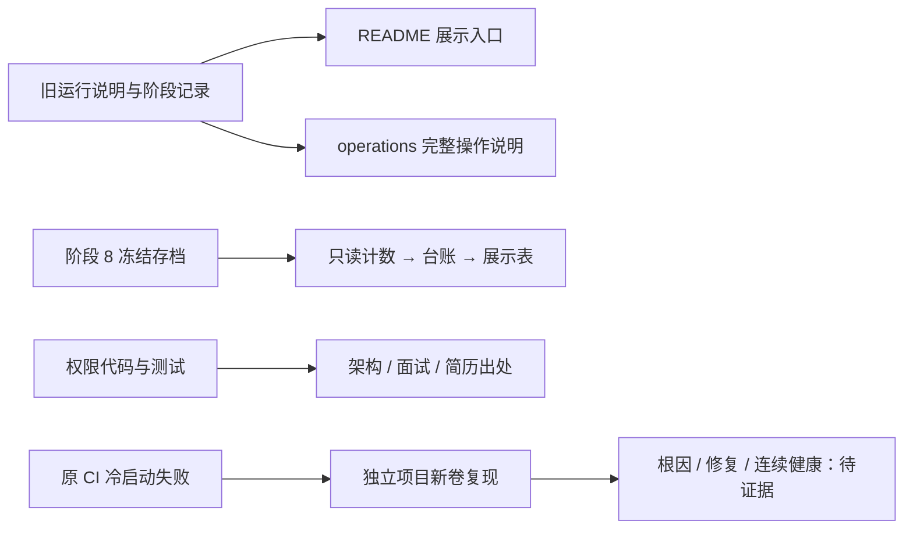

# 阶段 10 学习材料：把工程讲清楚（进行中）

> 当前是学习初稿。展示文档与本地 Mock 检查已有结果；worker 冷启动根因、修复后的五次健康、新克隆演示和最终 CI 仍待完成。本文只回放已经发生的工作，后续实测再补。

## 一、这个阶段做了什么



项目做出来以后，还要让读者知道它解决什么问题、怎样运行、哪些结论有证据。这个阶段把已有工程整理成一个清楚的展示入口，同时检查新用户是否真能按说明跑起来。我们没有通过修改医生提示或评分来美化阶段 8 的成绩；这些成绩仍对应原冻结版本。

用户希望尽早开始投递，因此明确决定先做阶段 10。阶段 9 是推迟，范围和以后要补的地方都保留在[决策记录](../decisions.md#phase-10-order)。学习验收仍留给用户本人。

## 二、怎么跑起来、看什么

所有命令从仓库根目录运行。需要真正启动时，先按[根 README](../../README.md#快速开始)创建 `opsdoctor-fresh` 免费 Mock 项目。已有原环境先停回，两个项目不能同时占用同一组端口。这里不重复整套安装命令，避免以后两份说明发生分叉。

第一步只读检查代码说明：

```text
go run ./tools/commentcheck ./...
```

你应该看到注释检查成功。它能发现缺失的包、文件和函数说明；文字是否讲清“为什么”，还需要自己读。

第二步查看隔离项目的服务状态：

```text
docker compose -p opsdoctor-fresh --env-file .env -f deploy/docker-compose.yml ps --all
```

你应该看到 `opsdoctor-fresh` 的服务；如果尚未按 README 创建它，列表为空。这里显式写项目名，避免 Compose 文件里的 `name: opsdoctor` 指向用户原环境。

第三步只读确认冻结区没有本阶段代码改动：

```text
git diff main -- internal/doctor/agent/prompts internal/doctor/tools docs/runbooks internal/eval/scoring internal/eval/judge eval/scenarios
```

你应该看到空输出。本阶段的成绩展示读取存档，不在这些地方改行为。这个命令只检查列出的路径，不是全仓库沙箱。

第四步打开医生页面 `http://127.0.0.1:8090`，登录后确认“Mock 模式，不是真实诊断”，再按 README 的三分钟脚本创建一次演示任务。

你应该看到真实工具结果和带 Mock 标记的报告。固定脚本不推断根因，不能用这份报告评判诊断正确率。真正的模型效果沿阶段 8 存档阅读，不需要再次付费。

第五步结束学习时停回测试项目：

```text
docker compose -p opsdoctor-fresh --env-file .env -f deploy/docker-compose.yml stop
```

你应该看到该项目的进程停止。容器和数据卷仍保留，不执行删除卷或全局清理命令。

## 三、开发过程回放

以下过程依据 [notes 的阶段 10 记录](../notes.md#phase-10)。正在进行的冷启动试验不写成已经修复。

### 1. 先明确这次从哪里开始

这次要把工程整理成可展示的成果，动手前先要确认阶段边界。用户已确认阶段 8 合并到 `main/f851460`，明确允许先做阶段 10；学习验收没勾，并不抵消这次授权。

这一步没有拆新的业务函数。我们先读 AGENTS、进度和计划书，核对原分支与两处用户文件，再从 main 创建 `phase-10-showcase`。这样后面的提交才有清楚的起点。

普通沙箱第一次执行 Git 切换和 Docker 只读检查时被权限限制拒绝。在用户已授权的任务范围内使用提权调用后继续，没有把拒绝误认为仓库或 Docker 本身坏了。随后保存原容器与卷清单，确认原 OpsDoctor 没有运行，QQ 容器仍运行；两处用户文件的哈希另行保存，提交时排除。

验证关注的是“有没有碰错对象”。阶段 8 的原始数据在医生 MySQL 卷里，不能用清空原环境来证明新用户部署。后续冷启动都应通过独立项目和新卷完成。

### 2. 把运行说明和展示入口各自写清楚

这次要让读者先理解项目，再按需查命令。动手前先区分两种材料：根 README 是展示入口；旧 README 中逐阶段的详细命令是操作参考。医生读取的 `docs/runbooks/` 是另一种材料，已经冻结，不能拿来存项目运维笔记。

文件因此分成根 `README.md` 与 `docs/operations.md`，架构、项目自身排查和简历再分别放独立文档。这部分没有新增 Go 函数，主要工作是重组说明和校正相对路径。

先整体迁移旧说明，再写新入口，可以逐段对照是否丢了命令。随后把快速开始固定在免费 Mock、独立 Compose 项目和 small 数据上，演示实际工具与步骤；真实模型效果引用旧报告。

验证时，对迁移内容反向归一标题和相对链接，检查原段落与命令是否还在。快速开始的 PowerShell 语法也做了解析；语法正确只能说明命令能被 shell 理解，不能代替新克隆部署实测。

这里的取舍是保留历史。旧阶段的失败和当时的命令有学习价值，所以放在完整运维文档中，并在开头说明当前 Mock 约定和历史付费命令的授权边界。

### 3. 评测表先数清楚，再写进 README

这次要做的是展示已有结果，不是重新评分。动手前先确定两件事：缺失评分不能算零分；原取消与获准补跑必须用不同槽位关联。

读取和计数集中在[离线汇总脚本](../reports/phase-10-eval-summary.py)，输出[汇总 JSON](../reports/phase-10-eval-summary.json)，再把可引用数字记到[台账](../数据台账.md) P10-1–P10-5。脚本按报告表的原槽位编号关联评分表，没有调用医生或模型。

实际顺序是先读导出结构，再写关联与加总检查。第一次把报告行当成十四列，断言直接拒绝；改成实际十三列后，又发现 S02 第二轮 E3 的取消记录与 `/makeup` 补跑不能共用一个评分键。否则原取消的“未评分”会盖掉补跑结果。

修正关联后，五组的报告数、三档机制计数和评分失败总数都能对上原记录。然后才把数字放进 README，并保留有效评分分母。我们没有重评或把失败删掉来凑一张好看的表。

### 4. 清理时先判断东西还是否有用途

这次要去掉过期说明，动手前先查引用，而不是看到旧阶段名称就删代码。扫描 `cmd`、`internal`、`tools` 的 TODO/FIXME 后，没有发现待补的这类标记。

实际修改落在库存配置类型注释、alertsink 文件/包说明和 shopctl 阅读顺序。它们只是把“未来才实现”的句子对齐现状，没有新增类型、函数或 SQL。

alertsink 看起来像历史遗留，但阶段 3 学习材料和命令仍引用它，所以保留并解释用途。验证采用引用检查、三层说明自查和现有注释/架构工具；没有为了清理删掉学习所需入口。

冷启动是另一个问题。现在仍在独立环境找原 worker 退出的条件；成功启动过几次不能反推原失败原因。等日志证明根因后，才能讲“改了哪段行为，为什么能修复”，目前不编造这个结论。

## 四、阅读顺序

| 顺序 | 文件 | 重点看什么 |
|---|---|---|
| 1 | [cmd/order-worker/main.go](../../cmd/order-worker/main.go) | 入口怎样把启动错误交给进程退出状态 |
| 2 | [orderworker/doc.go](../../internal/shop/app/orderworker/doc.go) | 先看消费者组装包的位置、接口和文件分工，再读实现 |
| 3 | [架构说明](../architecture.md) | 把告警→报告、注入→评测两条路线放到一起 |
| 4 | [README](../../README.md) 与 [operations](../operations.md) | 展示入口怎样引导读者找到完整操作，而不覆盖历史记录 |
| 5 | [评测汇总脚本](../reports/phase-10-eval-summary.py) | 原报告和评分怎样按槽位关联，失败怎样保留 |
| 6 | [数据台账](../数据台账.md) | 同一个数字的样本、版本、命令和限制是否齐全 |
| 7 | [简历草稿](../resume-draft.md) 与 [本阶段报告](../reports/phase-10-showcase.md) | 哪些话能对外说，哪些验收仍待补证据 |

## 五、关键设计与 WHY

### 展示入口为什么不塞满操作历史

初次阅读的人先关心项目解决什么问题。详细的每阶段命令会打断这条主线，所以根 README 保留快速开始和导航，完整命令放到 operations。代价是要维护相对链接和历史状态说明，因此迁移时做了逐段对照。

### 为什么新目录还必须指定 Compose 项目名

Compose 项目名决定容器、网络和命名卷的归属。本仓库写死了 `name: opsdoctor`，换克隆目录并不会自动隔离。显式使用 `opsdoctor-fresh`，再核对原清单，才能把新用户试验和阶段 8 原始数据分开。

### 为什么未复现不能写成修好了

一项偶发启动故障可能受时间和资源条件影响。新环境成功只说明那一次启动成功；它没有解释原进程为什么退出。现在先查 worker 和 Kafka 的日志，再根据因果修复，最后用修复后的连续冷启动检验；加重启策略或加长等待本身不能提供根因证据。

### 为什么评分失败要独立列一列

“模型说错”和“评委没给出合法分数”是两件事。把评分失败填零会混淆它们，直接删掉又会让读者看不到缺失规模。因此表里同时显示报告数、有效评分数和失败数，三档机制只在有效评分中统计。

### 为什么交叉评分和费用都要说明口径

交叉评分只比较两个模型的判断，不会产生人的校准结果。README 因此同时写全部样本和去掉 E0 的一致率，并说明共同偏差风险。

费用也要先解释是什么数。美元按项目用量账本计：实际 token 按核对过的单价分档结算，未知请求保留预留。共用 Key 的平台账单无法单独归给本项目；人民币与美元不相加，DeepSeek 未归因差额继续保留。

## 六、本阶段用到的 Go 写法

无。本阶段目前没有首次引入的 Go 语法或语言机制，主要是说明整理、离线汇总和启动排查。因此不为凑章节编造新的 Go 小程序。阅读 worker 时需要复习 context、错误返回和优雅退出，可回看已有阶段学习材料。

## 七、动手实验

下面四项只针对自己按 README 创建的 `opsdoctor-fresh` Mock 项目。不要在用户原 `opsdoctor` 上做，不删卷、不改冻结区、不启用真实模型。

1. **打错项目名 → 观察空列表 → 改回正确名称。** 先用 `docker compose -p opsdoctor-fresh-typo --env-file .env -f deploy/docker-compose.yml ps --all`，再换成 `-p opsdoctor-fresh`。两条都是只读。解释为什么目录相同，看到的容器却不同。
2. **暂停医生 → 观察就绪失败 → 启回原 Mock 进程。** 先确认隔离项目中没有自己的进行中任务，再运行 `docker compose -p opsdoctor-fresh --env-file .env -f deploy/docker-compose.yml stop doctor`。页面暂时不可用；随后用同一前缀执行 `start --wait doctor`，观察原有诊断历史仍在。这里不删除医生卷，也不借重建切到真实模型。
3. **切断页面网络 → 观察加载失败 → 恢复网络。** 在已有 Mock 诊断详情页，用浏览器开发者工具暂时切 Offline，再恢复联网并刷新。步骤来自医生保存的记录，不依赖模型重新诊断。对照 SSE 的序号和页面显示，解释为什么前端连接断了不等于诊断数据丢了。
4. **在临时副本藏掉评分失败列 → 观察分母对不上 → 恢复该列。** 把 README 评测表复制到本机临时笔记，只在副本中试改。核对三档计数为何不等于全部报告数，再恢复“有效评分”和“失败”两类信息。不要改原始报告、评分或台账。

## 八、常见误区

- 换目录就当成隔离。固定 Compose 名称仍可能指向原项目，必须指定项目名并核对标签与卷。
- Mock 报告有证据步骤，就以为证明了诊断能力。它证明工具与存储流程，模型选择由固定脚本替代。
- 没复现旧故障，就把复现前成功的启动算作修复后验收。根因与修复尚未建立，这两种证据不能互换。
- 把评分失败当模型答错，或直接去掉。应明确保留缺失及其分母。
- 只引用全部样本较高的一致率。去掉 E0 的结果必须一起给，且不能称人工校准。
- 美元账本等于已核对的平台扣费。共用 Key 无法单独核对，未知预留和两种币种还要分别说明。

## 九、必答问题

1. 用三分钟介绍这个项目。
2. 用十五分钟讲清楚架构和关键取舍。
3. 这个项目的局限性是什么？如果要用到真实生产环境，还缺什么？
4. 面试官问“一般企业不会给 AI 这么大权限”，你怎么回答？
5. 为什么这次展示没有顺便修改失败场景的提示、工具或评分？
6. 你凭什么说新用户部署已经验证？目前还缺什么证据？

先自己回答，再展开文末要点。阶段 0–8 的问题还应沿各阶段学习材料逐项复习。

## 十、本阶段新术语

| 术语 | 一句话解释 |
|---|---|
| 冷启动 | 从尚未初始化的数据与服务状态开始启动，容易暴露旧卷隐藏的时序问题 |
| Compose 项目名 | 把一组容器、网络和命名卷归为一套环境的标识 |
| 冻结版本 | 用提交号和内容哈希固定实验行为，让后来的读者知道成绩对应哪份代码 |
| 评分缺失 | 报告已经存在，但没有得到符合协议的评分，应单列而不是填零 |
| 项目用量账本 | 用项目请求的实际 token 与已核对单价计算的记录，另保留未知请求预留 |

<details>
<summary>参考答案要点：先用自己的话回答，再对照</summary>

**1. 三分钟介绍**

- 先讲问题：排障证据分散在指标、调用链、日志和数据库中。
- 再讲链路：Go 靶场产生真实症状，医生调用受限工具查证，提交带步骤引用的报告，修复需要人批。
- 用阶段 8 存档说明效果，同时主动讲 S10 误判、评分失败、S12 未暴露与阶段 9 推迟。出处：[README](../../README.md)、台账 P8-191、P8-204、P10-1–P10-5。

**2. 十五分钟讲架构**

- 从订单、库存、Redis、Kafka 和销量事务讲业务流，再说明观测数据怎样汇合。
- 沿告警去重→调度/租约→Agent/工具→报告/SSE→审批讲控制流，指出独立医生库与固定数据源。
- 用接口分层、单实例 MySQL、SSE、受限修复与冻结评测解释取舍。出处：[architecture](../architecture.md)、[代码地图](../代码地图.md)。

**3. 局限与生产缺口**

- 只有自建靶场小样本，没有阶段 9 外部系统验证；日志只有 Loki。
- 交叉评分不是人工校准，评委尺度也不一致；S12 没读到攻击材料，不能宣称真实暴露防御通过。
- 生产接入还需要审批人隔离、完整隐私治理、可靠性与业务一致性补强。出处：[README 已知限制](../../README.md#已知限制)、[阶段 8 失败分析](../reports/phase-08-failure-analysis.md)。

**4. 企业为什么敢接入**

- 先承认不能直接拿实验系统接生产；再说明权限是代码和账号保证，不靠让模型自己守规矩。
- 只给固定目的地和有限工具；写工具申请保存确切参数，人批准后执行，MCP 只读。
- 主动说出误批风险、INDEX 账号和日志隐私的剩余边界。出处：[README 权限边界](../../README.md#权限边界)、[阶段 7 学习材料](phase-07-reliability.md)。

**5. 为什么保留冻结区**

- 当前成绩对应原提示、工具、手册、场景和评分；展示文案的提交不能替代原运行版本。
- 修这几处会改变实验含义，需要新冻结和相应重跑，而不是沿用旧成绩。
- 本阶段只做只读统计和诚实呈现，失败是要讲清楚的结果。出处：台账 P8-38、P8-54、P8-194，[原清单](../reports/phase-08-formal-manifest.json)。

**6. 新用户部署证据**

- 应从 git clone 计时，用 README 启动隔离项目、完成一次三分钟 Mock 演示，并保存前后容器与卷清单。
- 本机缓存若保留就明确写出，再用 CI 新 runner 的冷启动时间补充；不删除用户原数据来追求“干净”。
- 当前初稿仍缺根因、修复后五次健康、新克隆计时和最终 CI，不能提前说验收完成。出处：[本阶段报告](../reports/phase-10-showcase.md#五工程验收结果)、[notes](../notes.md#phase-10)。

</details>
