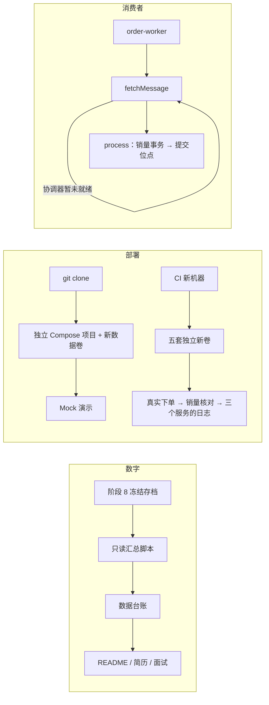

# 阶段 10 学习材料：数字溯源与独立环境验收

**面试时怎样一分钟讲清这个阶段。** 先记住下面这段，再回头看细节：

> 项目做完以后，我专门花了一个阶段做两件事：让每个数字都查得到出处，让别人拿到代码真的能跑起来。数字方面，README 和简历里的数字都对应数据台账里的一条记录，写明样本、版本、命令和限制；评测表用一个只读脚本从原始导出里数出来，评分失败单独一列，既不当零分，也不删掉。部署方面，我从 `git clone` 开始计时，用独立的 Compose 项目名和全新的数据卷照着 README 走一遍，约 5 分钟完成一次 Mock 演示（数据台账 P10-15）；CI 每次运行也在全新的 runner 上冷启动五套独立环境，真实下单，再核对销量和三个服务的日志。这个过程中我追到了一个偶发的冷启动失败：Kafka 消费组的协调器还没准备好时，worker 把一个可以恢复的错误当成致命错误退出了。我把时间窗口放大，复现出真实错误，读 kafka-go 的源码确认原因，最后只在“还没拿到消息”这一层加了有限次数的重取。

| 交付 | 作用 |
|---|---|
| 根 [README](../../README.md)、[操作手册](../operations.md)、[架构说明](../architecture.md)、[面试题汇总](../interview.md)、[简历草稿](../resume-draft.md)、[项目排障](../troubleshooting.md) | 展示入口、完整命令、架构、面试和简历材料分开放 |
| [评测汇总脚本](../reports/phase-10-eval-summary.py)和数据台账 P10-1 至 P10-5 | 从阶段 8 的原始导出里只读地数出评测表 |
| [consumer.go](../../internal/shop/events/consumer.go) 的 `fetchMessage` | 消费组协调器暂未就绪时，有限次数地重取 |
| [CI](../../.github/workflows/ci.yml) 的“五轮独立全新卷冷启动、真实消费与日志” | 每次 CI 运行都在新的 runner 上做五轮冷启动、真实下单、查日志 |
| [Alloy 配置](../../deploy/alloy/config.alloy)按 `COMPOSE_PROJECT_NAME` 发现容器 | 独立项目也能采到自己的日志 |

2026-11-09 又把演示步骤和完整评测表从 README 挪进了[演示与结果](../demo-and-results.md)，README 只留三个核心结果。

**怎样读这份材料。** 主线是 **怎样让别人相信、并且能复现你的结果**：数字怎样溯源，独立环境怎样验收，隔离的边界在哪里；以及一个偶发问题怎样复现、修复的边界怎样划。Go 语法见第 7 节和 [Mini-Redis 的学习文档](https://github.com/Li-Nepenthe/mini-redis/blob/main/docs/learn/README.md)。

> 阶段 10 已由 Claude 验收并合并 main（231ee48）。用户为了尽早投递，决定先做阶段 10，阶段 9 推迟到 2026-11-03 完成（[决策记录](../decisions.md#phase-10-order)）。学习验收由你自己勾选。

## 1. 本阶段能回答的面试题

| 面试题 | 在哪里 |
|---|---|
| 简历上的数字是怎么来的？能核对吗？ | 5.2、八股 4 |
| 评分失败为什么既不能算零分，也不能删掉？ | 5.2 |
| 你怎么证明别人拿到代码能跑起来？ | 5.3、5.5 |
| 同一台机器上跑两套环境，怎样互不干扰？ | 5.3、5.6 |
| 讲一个你遇到的最难排查的问题。偶发问题复现不了怎么办？ | 八股 1、11.7 |
| 重试应该包住哪一段？为什么不直接给容器加 `restart: always`？ | 5.4、八股 2 |
| 健康检查通过了，服务就一定能用吗？ | 5.5、八股 3 |
| 为什么用 Docker Compose，不用 Kubernetes？ | 八股 3 |
| Kafka 的消费组和协调器是什么？Rebalance 会带来什么问题？ | 5.4、八股 5 |

## 2. 这个阶段在系统里的位置

### 2.1 三条线



第一条线回答“数字从哪来”，第二条回答“别人能不能跑起来”，第三条是第二条验收时发现并修好的问题。

这个阶段**不改**会影响评测成绩的东西：提示词、工具、手册、场景和评分规则都保持阶段 8 冻结时的样子，README 里的成绩仍然对应原来的冻结版本。

### 2.2 各部分负责什么、不负责什么

| 部分 | 负责 | 不负责 |
|---|---|---|
| 根 README | 项目解决什么问题、三个核心结果、快速开始、导航 | 逐阶段的历史命令 |
| 操作手册 | 全部操作命令和历史上的付费命令，开头写明当前的 Mock 约定 | 展示 |
| 数据台账 | 每个可引用数字的样本、版本、命令和限制 | 判断成绩好坏 |
| 评测汇总脚本 | 只读地数报告，按槽位关联评分 | 重新评分、调用模型 |
| CI 冷启动步骤 | 新机器、新数据卷、真实消费和日志 | 证明生产环境可靠 |
| `fetchMessage` | 还没拿到消息时的协调器暂态错误 | 处理消息、提交位点时的错误 |

## 3. 跑起来看什么

所有命令从仓库根目录运行。前两步不需要 Docker。

**第 1 步：重新数一遍评测表。**

```text
python docs/reports/phase-10-eval-summary.py
```

你应该看到五组结果，和[演示与结果](../demo-and-results.md#评测结果)里的评测表一致：Terra 的 E1、E2、E3 组件一致都是 36/39，E0 是 0/39，DeepSeek E1 是 31/39；评分失败依次是 E0 1 份、E1 4 份、E2 4 份、E3 4 份、DeepSeek 1 份（数据台账 P10-1 至 P10-5）。脚本只读[阶段 8 的正式结果](../reports/phase-08-formal-results.md)，不联网，也不重新评分。

它会重写[汇总 JSON](../reports/phase-10-eval-summary.json)。在 Windows 上换行符会变成 CRLF，`git status` 显示这个文件改了，`git diff` 却看不到内容差异，说明数字和存档完全一样。看完用 `git checkout -- docs/reports/phase-10-eval-summary.json` 还原。

**第 2 步：跑消费者的重取测试。**

```text
go test ./internal/shop/events -run 'Coordinator|FetchError|FetchRetry' -count=1 -v
```

你应该看到 8 个测试通过，整组约 7 秒，大部分时间花在真实的退避等待上。测试用脚本读取器和测试处理函数驱动真实的消费循环，不连接 Kafka，也不连销量库。

**第 3 步：查看隔离项目的状态（需要 Docker）。** 先按[根 README](../../README.md#快速开始)创建 `opsdoctor-fresh` 免费 Mock 项目。原来的 `opsdoctor` 项目要先停掉，两套不能同时占用同一组端口。

```text
docker compose -p opsdoctor-fresh --env-file .env -f deploy/docker-compose.yml ps --all
```

你应该看到 `opsdoctor-fresh` 的服务；还没创建时列表为空。这里要显式指定项目名：Compose 文件里写死了 `name: opsdoctor`，不指定就会指向原来的环境。指定的办法有两种：命令行的 `-p` 优先级最高，这里用它；README 的快速开始用的是环境变量 `COMPOSE_PROJECT_NAME=opsdoctor-fresh`。

**第 4 步：走一遍演示。** 打开医生页面 `http://127.0.0.1:8090`，登录后确认页面写着 Mock 模式，再按[演示与结果](../demo-and-results.md#三分钟演示)的“三分钟演示”创建一次诊断。你应该看到真实的工具结果和带 Mock 标记的报告。固定脚本代替了模型，不会推断根因，所以这份报告不能用来评判诊断准确率；真实模型的效果看阶段 8 的存档，不需要再付费。

**第 5 步：停回测试项目。**

```text
docker compose -p opsdoctor-fresh --env-file .env -f deploy/docker-compose.yml stop
```

容器和数据卷都保留。不要执行删除数据卷或全局清理的命令。

## 4. 代码走读

### 4.1 阅读顺序

| 顺序 | 文件 | 重点看什么 |
|---|---|---|
| 1 | [cmd/order-worker/main.go](../../cmd/order-worker/main.go) | 入口怎样把启动错误交给进程的退出状态 |
| 2 | [orderworker/doc.go](../../internal/shop/app/orderworker/doc.go) | 消费者在哪里组装、由谁关闭 |
| 3 | [events/doc.go](../../internal/shop/events/doc.go) 和 [MessageReader](../../internal/shop/events/consumer.go#L24) | 取消息和提交位点为什么分开 |
| 4 | [consumer.go](../../internal/shop/events/consumer.go) 的 `Run`、`fetchMessage`、`process` | 重取只包住取消息，没有包住业务处理 |
| 5 | [consumer_fetch_test.go](../../internal/shop/events/consumer_fetch_test.go) | 先读错误 16 的恢复，再读预算、空闲、永久错误和取消 |
| 6 | [CI](../../.github/workflows/ci.yml) 的“五轮独立全新卷冷启动、真实消费与日志” | 健康以后还要验什么 |
| 7 | [Compose](../../deploy/docker-compose.yml) 里 Alloy 的 `COMPOSE_PROJECT_NAME` 和 [config.alloy](../../deploy/alloy/config.alloy) | 项目名怎样只保留一个来源 |
| 8 | [评测汇总脚本](../reports/phase-10-eval-summary.py) | 报告和评分怎样按槽位关联，失败怎样保留 |
| 9 | [数据台账](../数据台账.md)的 P10 段 | 一条记录要写清哪几样东西 |

### 4.2 一条订单消息从拉取到提交

| 顺序 | 在哪里 | 做了什么 |
|---|---|---|
| 1 | `Run` | 循环开头先看停机信号，然后调用 `fetchMessage` |
| 2 | `fetchMessage` | 调用 `reader.FetchMessage`；成功了、已经在停机、或者错误不属于 14、15、16，就原样返回 |
| 3 | `recoverableCoordinatorError` | 用 `errors.Is` 判断是不是 14、15、16 这三种协调器错误；项目把它们都当成可以稍后再试 |
| 4 | `fetchMessage` | 是这三种、而且 3 次重取还没用完：记一条警告日志，调用 `waitFetchRetry` 退避（依次 250、500、1000 毫秒），再用**同一个读取器**重取；用完了就返回“重试预算耗尽” |
| 5 | `waitFetchRetry` | 用 select 同时等计时器和停机信号，停机能打断退避 |
| 6 | `Run` | 拿到消息后，另开一个“不随停机取消、但有处理时限”的 context，交给 `process` |
| 7 | `process` | 解码 → 销量事务 → 提交位点。解码或销量事务失败时，还没有请求提交位点；提交位点失败时，只知道客户端没确认成功，broker 可能已经记下。两种情况 `Run` 都退出，重启后从 broker 记录的位置继续，重放的消息由销量事务去重 |

重取次数是 `fetchMessage` 里的局部变量，所以每取一条消息都从 0 开始算。它限制的是**连续**的协调器错误。

### 4.3 一次冷启动验收（CI）

| 顺序 | 做了什么 | 为什么 |
|---|---|---|
| 1 | 先把正常冒烟用的项目 stop | 端口相同，任何时刻只运行一套 |
| 2 | 用新项目名 `opsdoctor-cold-<运行编号>-<轮次>` 执行 `up --wait` | 本仓库的数据卷由 Compose 按项目命名，没用过的项目名就有全新的数据卷，相当于第一次部署 |
| 3 | 健康以后再等 20 秒，检查所有服务都在运行 | worker 的健康检查只 Ping MySQL；多等 20 秒，覆盖消费组前几次入组的时间 |
| 4 | small 造数，再真实下一单：每轮新建一个唯一的 trace ID，父 span ID 固定，采样位设为 1 | 强制采样；第 6 步用这个唯一的 trace ID 去 Loki 查日志 |
| 5 | 30 秒内反复运行 `shopctl check`，直到销量和订单总量对上 | Kafka 能列出主题、worker 能连数据库，都不等于消息真的被消费了 |
| 6 | 90 秒内按 trace_id 查 Loki，要同时查到 order-service、inventory-service、order-worker 三个服务的日志 | 证明独立项目名下，日志采集也接通了 |
| 7 | 不管成功失败，都把容器状态和 MySQL、worker、Kafka、Alloy、Loki 的日志尾部写进 runner 的临时目录，再 stop；作业失败时，下一步会把日志打印到 CI 输出 | 失败要能事后分析。临时目录不上传，随 runner 回收，所以成功的作业里只能看到每轮的结果摘要；stop 保留数据卷，不能靠删卷把一次失败变成下一次的成功 |

五轮逐轮串行。

### 4.4 评测表怎样数出来

| 顺序 | 做了什么 |
|---|---|
| 1 | 只读阶段 8 正式结果里的**逐报告表**，不读按场景的平均值，避免把平均值又当成样本 |
| 2 | 只取 13 列、首列以 S 开头的样本行，其余行跳过；样本行里状态是取消的跳过，其余必须是成功、而且不是混合模型，否则断言失败 |
| 3 | 用“批次/场景/轮次/模型档-配置”作为槽位编号（模型档是 primary 或 comparison，两个模型都有 E1，要靠它区分）；获准补跑的那一份加上 `/makeup`，不和原来取消的那份共用编号 |
| 4 | 从评分表按同一个槽位编号取评分，一个槽位只能有一份评分 |
| 5 | 断言总共 195 份报告、14 份评分失败（P8-191）、每组正好 39 份；任何一条对不上就停止，不输出 |
| 6 | 按组统计组件一致数和机制三档，评分失败单独一列 |

## 5. 系统设计与取舍

每个设计点按同一个顺序讲：要解决什么问题 → 怎么做 → 放弃了什么、为什么 → 代价和适用边界 → 规模变大十倍会怎样。

### 5.1 展示入口和操作手册分开

**问题。** 原来的 README 按阶段堆满了命令，第一次来的读者要翻很久才知道这个项目解决什么问题；可这些命令又是真实的历史记录，删掉就丢了复现方法。

**做法。** 根 README 只讲项目是什么、核心结果和快速开始；旧 README 里逐阶段的详细命令整体迁到[操作手册](../operations.md)，开头写明现在的 Mock 约定和历史付费命令的授权边界。架构、项目自身的排障和简历各自一份文档。迁移时把旧内容和新文件逐段对照，确认命令和段落都还在。医生读取的 `docs/runbooks/` 是评测冻结的一部分，不拿来存项目的运维笔记。

**放弃了什么。** 一份 README 包办一切。写起来省事，但展示和操作两类读者会互相干扰。

**代价。** 文档变多，相对链接和“当前状态”要在几处同步，迁移时必须逐段核对。

**规模变大十倍。** 文档多十倍，人工核对链接就靠不住了，要在 CI 里检查相对链接和锚点。阶段 10 结束前用脚本查过一次，缺失为 0（P10-18）。

### 5.2 数字溯源：台账、只读脚本和单列的评分失败

**问题。** README 和简历里会出现“36/39”（P10-2）、“3/5”（P9-77）、“约 0.025 美元”（P10-19）这样的数字。面试官一追问“怎么来的”，就要能说出样本、版本、命令和限制。如果数字是手抄的，抄错一个或者口径变了，都没人发现。

**做法。**

1. **台账是唯一来源。** 每个可引用的数字在[数据台账](../数据台账.md)里有一条记录：编号、结论、命令和来源、限制。学习材料引用数字时写上编号；根 README 的核心结果给出原始报告、脚本和测量条件的链接；简历草稿用一张“数字与口径”表对应台账编号。
2. **评测表由脚本数出来。** [汇总脚本](../reports/phase-10-eval-summary.py)只读阶段 8 的存档，按槽位关联报告和评分，最后断言总数（4.4 节）。它不调用医生，也不调用模型。
3. **评分失败单独一列。** “模型答错了”和“评委没交出合法评分”是两件事。填零，会把评委的问题算到模型头上；删掉，读者又看不到缺了多少。所以表里同时写报告数、有效评分数和评分失败数，机制三档只在有效评分里统计。以 Terra E1 为例：正确、部分正确、错误是 25 + 9 + 1 = 35 份有效评分，加上 4 份评分失败才是 39（P10-2）。
4. **口径写在数字旁边。** 36/39（P10-2）是故障组件定位，不是根因正确率。交叉评分同时写全部样本和去掉 E0 的一致率，并说明这是模型和模型比，不是人工校准。美元按项目用量账本计：实际 token 用量乘以核对过的单价，用量未知的请求保留预留额；Key 还有别的用途，平台账单无法单独核对。人民币和美元分开写，不相加。

**放弃了什么。** 为了展示好看而重新评分、把失败删掉，或者改提示词再跑一遍失败的场景。那样得到的已经不是原冻结版本的成绩。

**代价。** 表格更复杂，分母不止一个，读者要多读一句说明。

**规模变大十倍。** 数字多十倍，台账要能被程序读取：要么 README 里的数字由脚本从台账生成，要么 CI 检查 README 引用的编号都存在、数值一致，不能再靠人工比对。

### 5.3 独立环境验收：从 git clone 开始计时

**问题。** “别人能跑起来”不能靠作者在自己配好的环境里试。作者的机器上有缓存的镜像、已经初始化的数据卷，很多问题会被掩盖。可是旧环境里又有阶段 8 的原始数据，不能为了“干净”把它删掉。

**做法。**

- **从远端 `git clone` 开始计时**，照着 README 一步步做，用免费的 Mock 模式完成一次演示。第一次实走从克隆到演示完成用了 502.941 秒，其中首次走查 189.890 秒（P10-7）；修复以后，最终版本再走一次用了 304.934 秒（P10-15）。慢的那次也保留，不用快的替换。
- **用独立的 Compose 项目名。** Compose 用项目名区分容器、网络和数据卷。本仓库的 Compose 文件写死了 `name: opsdoctor`，换一个目录克隆也不会自动隔离，所以要显式指定项目名：README 用环境变量 `COMPOSE_PROJECT_NAME=opsdoctor-fresh`，本材料的命令用优先级更高的 `-p`。本仓库的数据卷由 Compose 按项目命名，一个从没用过的项目名就会得到全新的数据卷，相当于第一次部署；同名项目再启动会复用旧卷，所以最终验收另起了 `opsdoctor-fresh-final`（P10-15）。
- **前后各存一份清单。** 测试前后对比原有容器的 ID、挂载和状态，以及数据卷列表：原有的 19 个 OpsDoctor 容器和另外 2 个无关项目的容器都没变，原数据卷删除数是 0（P10-8）。
- **本机缓存如实说明，再用 CI 补上。** 本机保留了镜像和 Go 模块的缓存，所以本机的时间不是真正的冷启动。CI 在全新的 runner 上计时，从拉取镜像、构建到默认项目首次 `up --wait` 就绪，第一次是 337.594 秒（P10-9），最终版本是 269.488 秒（P10-14），都不含 clone。

**隔离的边界。** 项目名只隔离容器、网络和命名数据卷，不隔离镜像标签。这次构建更新了 5 个全局的 Go 镜像标签；原来的容器仍然用原来的镜像 ID，不受影响，但不能把“容器没变”说成“Docker 里什么都没变”（P10-8）。应用里写死的过滤条件也不会跟着项目名变，5.6 节就是这样发现的。

**放弃了什么。** 清空原环境，再测“干净部署”。那样最省事，但会删掉阶段 8 的原始数据。

**代价。** 本机留下了 20 个测试项目和 138 个测试数据卷，全部是停止状态（P10-16），以后要按精确的项目标签人工清理，不能用全局清理命令。

**规模变大十倍。** 部署目标多了（不同的操作系统、不同的 Docker 版本），一个人手工走一遍就不够了：要把“从克隆到演示”写成 CI 里的端到端任务，在几种环境上定期跑；测试环境也要有自动的生命周期管理，按标签创建、按标签清理。

### 5.4 有界重取只包住“拿到消息之前”

**问题。** CI 从空数据卷冷启动时，order-worker 偶尔以退出码 1 退出，重跑一次又好了。受控复现（11.5、11.7 节）发现：Kafka 刚启动时，负责这个消费组的协调器还没加载完，`FetchMessage` 返回错误 16（Not Coordinator For Group）。kafka-go 的读取器其实还在后台继续入组，是我们的上层代码把拉取时的任何错误都当成了致命错误（P10-10）。

**补基础：消费组协调器和错误 14、15、16。** 一个消费者想加入消费组，要先找到负责这个组的那台 broker，也就是**协调器**，再申请入组。本项目用的 kafka-go 走经典的入组流程：协调器从组里选一个消费者当 leader，由它计算分区分配，再经协调器发给每个成员；然后才开始拉消息。协调器靠内部主题 `__consumer_offsets` 保存各个组的读取位置。这个主题默认 50 个分区，每个组按组名落在其中一个分区上，那个分区的 leader 就是这个组的协调器。

三种错误码的含义各不相同：14 是协调器还在加载这个组的数据；15 是协调器暂时不可用；16 是收到请求的 broker 不是这个组的协调器。Kafka 刚启动、还在加载内部分区时就可能遇到它们，这次受控复现看到的就是错误 16 出现在加载完成之前（P10-10）。但单凭收到 15 或 16，不能断定一定是冷启动加载造成的。

**做法。**

- **只在取消息这一层重取。** `fetchMessage` 只对 14、15、16 重取，沿用同一个读取器；第一次读取失败以后最多再取 3 次，退避依次是 250、500、1000 毫秒。成功取到一条消息，次数就重新开始算。
- **拿到消息以后的错误照旧退出。** 解码、销量事务、提交位点失败时，哪怕错误码也是 16，也不重试，不取下一条。拿到消息之前还没有任何业务副作用，等一等是安全的；拿到之后，数据库可能已经写成功、位点还没提交，这时如果继续取下一条，就会越过一条还没确认的消息。
- **其他错误直接返回。** 鉴权失败、版本不支持、未知错误都不重试，让运维马上看到。
- **不给整个 Fetch 加短时限。** 恢复以后主题里暂时没有新订单是正常的空闲，worker 应该一直等，不能因为一个短时限把安静的系统当成故障。
- **退避可以被停机打断**（`waitFetchRetry`）。

**放弃了什么。**

- **给容器加 `restart: always`。** 症状会消失，但每次冷启动都可能先失败一次，真正持续的故障也会被一次次重启藏起来。
- **把重试包在整个“取消息、处理、提交”外面。** 写起来更简单，但会在已经有副作用的地方重试。
- **无限重试。** 协调器持续不可用，可能是真的环境问题，应该退出，让人看到。

**代价。** 协调器持续不可用、3 次重取都失败时，worker 仍然会退出，要靠部署平台把它重新拉起来。

**规模变大十倍。** worker 实例多了，协调器恢复的那一刻会有一批 worker 同时重取，退避要加随机量把它们错开（和阶段 2 的 [5.4 节](phase-02-order.md#54-重试只重试读操作所有重试共用一个总时限)一样）。实例和分区多了，Rebalance 的停顿也更明显，可以考虑协作式的再均衡（八股 5）。

### 5.5 健康检查之外，还要验真实的消息

**问题。** worker 的健康接口只 Ping MySQL。Compose 的 `up --wait` 返回成功，只说明有健康检查的服务在那一刻是 healthy、其余服务在运行，不说明消费者已经入组、能处理消息。受控复现里，`up` 已经返回 0，多观察 20 秒才看到 worker 退出（P10-10）。

**做法。** CI 在健康以后再观察 20 秒、确认所有服务都在运行，然后真实下一单，等销量总量追平，再按 trace_id 查三个服务的日志（4.3 节）。五套全新数据卷依次跑，每轮都把日志临时保存在 runner 上，失败时打印到 CI 输出。修复后默认配置连续 5/5 通过（P10-13），最终代码的 CI 也是 5/5（P10-14）。

**放弃了什么。** 另一种做法是把“消费者已入组”写进 worker 的健康检查。那样健康检查就依赖 Kafka 的内部状态，Kafka 短暂抖动时 worker 也会被标成不健康。这次没有改健康检查的含义，只在验收里检查真实效果。

**代价。** CI 变长：每轮约 50 秒，五轮串行，第一轮之前还有拉取和构建（P10-14）。总量核对只能发现“少了”或“多了”，局部的错误可能互相抵消，不能当成消息可靠性的证明。

**规模变大十倍。** 服务多了，每条消费链路都要有自己的端到端检查，五轮串行会太慢。可以并行跑多套环境，或者只对改动涉及的链路做完整验收，其他链路抽查。

### 5.6 日志采集跟着项目名走

**问题。** 读取器修好以后，五轮都能消费，但还没证明独立环境的日志通了。复核发现 Alloy（日志采集器）只找项目标签为 `opsdoctor` 的容器；换了项目名，它找的还是原来那个项目，独立环境自己的日志采不到。

**做法。** Compose 把最终的项目名通过 `COMPOSE_PROJECT_NAME` 传给 Alloy，[config.alloy](../../deploy/alloy/config.alloy) 用 `sys.env` 读取。项目名只有一个来源，就是 Compose 最终使用的那个，不再手填第二份。验证时先查官方对这个变量的说明，分别渲染默认和自定义的项目名，用固定版本的 Alloy 校验配置，再从远端新克隆、在全新数据卷上重跑：同一笔订单在 2.017 秒内查到三个服务的日志（P10-17）。

**放弃了什么。** 在 `.env` 里另设一个“采集项目名”。两份名字很容易忘记同步。

**代价。** 采集配置依赖 Compose 注入的环境变量；脱离 Compose 单独运行 Alloy 时，要自己设置这个变量。

**规模变大十倍。** 环境多了，靠项目名过滤会越来越脆弱。更常见的做法是每个环境有独立的采集器和存储，或者日志带上环境标签，查询时按标签区分。

## 6. 系统设计八股

每题先给一分钟口述版，面试时照着这个长度说；再给要点、项目里的例子和常见追问。

### 八股 1：讲一个你排查过的最难的问题

#### 一分钟口述版

CI 从空数据卷冷启动时，消费订单消息的 worker 偶尔以退出码 1 退出，重跑一次又好了。难点有两个：原来的 CI 只保存了 MySQL 的日志，没有 worker 和 Kafka 的；本地用原版本连续试了十轮也没复现。我先补全了 CI 的诊断日志，再想办法放大我怀疑的时间窗口：把 Kafka 内部 offsets 主题的分区从 50 加到 500，并把 CPU 限到 0.25 核，让协调器加载得更慢。终于复现出真实错误：worker 启动 10 秒后因为 Kafka 错误 16 退出，而 Kafka 又过了 12 秒才加载完协调元数据。我去读 kafka-go 的源码，发现返回这个错误时读取器其实还在后台继续入组，问题出在我们的上层代码把拉取时的任何错误都当成了致命错误。修复只在“还没拿到消息”这一层，对 14、15、16 三种错误最多重取 3 次；拿到消息以后的错误照旧退出。我新增了 8 个测试，包括“处理阶段遇到错误 16 也必须退出”这样的反例；同样的放大条件下，修复后的 worker 记下第一次重取、退避 250 毫秒，没有退出；等 Kafka 加载完、消费组稳定以后，它处理并提交了新订单。

#### 要点

- 按“现象 → 难点 → 方法 → 根因 → 修复 → 验证 → 反思”七步讲。
- 复现偶发问题：先补观测，再放大时间窗口。
- 读第三方库的源码，分清是库的行为还是自己的用法。
- 修复要划清边界：只恢复没有副作用的那一段。

#### 项目里的例子

- 5.4 节；11.5、11.7 节；数据台账 P10-6、P10-10、P10-11、P10-13；[根因记录](../reports/phase-10-startup-root-cause.json)。
- 另一个排障故事：阶段 3 的 DNS TXT 查询。闲置后调用库存全部超时，最后发现 grpc-go 要等 TXT 记录查完才发调用（[阶段 3 八股 5](phase-03-observability.md#八股-5一个接口突然变慢了你怎么一步步定位)）。

#### 常见追问

1. **为什么不直接加 `restart: always`？** 重启能让症状消失，根因还在：每次冷启动都可能先失败一次，真正持续的故障也会被藏起来。
2. **你能确定原来 CI 那次也是错误 16 吗？** 不能。那次 CI 没有保存 worker 和 Kafka 的日志。我只能说，受控实验复现了一条真实的失败路径，并把它修好了。
3. **为什么本地十轮都复现不了？** 原因没有确定，十轮只记录了“没复现”（P10-6）。我的推测是加载通常赶在 worker 第一次拉取之前完成，所以放大分区数、限制 CPU 去拉长加载时间；放大以后确实复现了（P10-10）。

### 八股 2：哪些错误能重试？重试应该包住哪一段？

#### 一分钟口述版

判断能不能重试，看两件事：错误是不是暂时的，重做一次有没有副作用。暂时的错误比如网络抖动、超时、对方说“我还没准备好”；永久的比如鉴权失败、参数错误，重试只会浪费时间、推迟报警。有没有副作用，要看重试包住的范围：读操作、或者还没开始做的操作，重做是安全的；已经产生副作用的写操作，重做可能执行两次，除非它本身是幂等的。所以重试要包住尽量小的、没有副作用的那一段。我的 worker 就是这样：只对“拿到消息之前”的三种协调器暂态错误重取，因为那时还没有任何业务修改；拿到消息以后，销量事务或提交位点出错就退出，重启后从 broker 记录的位置继续；同一条消息被重放时，靠销量事务去重保证只加一次销量。另外，重试一定要有上限：普通的 RPC 重试要有次数和总时限；消息读取器这种空闲时本来就要一直等的，只限连续错误的次数，不给整个读取加总时限。退避要指数增长，实例多时加随机量；等待要能被取消。

#### 要点

- 可以重试 = 暂时的错误 + 重做没有副作用（或者本身幂等）。
- 包住最小的那一段，副作用之后不重试。
- 有上限、指数退避、随机量、可以取消。
- 超过上限就失败，让人看到。

#### 项目里的例子

- 5.4 节；阶段 2 的[重试只重试读操作](phase-02-order.md#54-重试只重试读操作所有重试共用一个总时限)；阶段 4 的[重试风暴](phase-04-chaos.md#八股-3重试风暴是怎样形成的重试应该怎样设计)。

#### 常见追问

1. **`restart: always` 也是一种重试，为什么不用？** 它重试的是整个进程，范围太大，而且会藏起持续的故障。它适合当最后一道兜底，不能代替对具体错误的处理。
2. **为什么不给 Fetch 加一个短超时？** 主题里没有新消息时，等待就是正常状态；加短超时会把安静的系统当成故障。
3. **处理消息时数据库超时了，能直接重试吗？** 不能：事务可能已经提交了。我的做法是退出，重启后从 broker 记录的位置继续，重放的消息靠销量事务里的已处理记录去重。

### 八股 3：健康检查通过了，服务就一定能用吗？

#### 一分钟口述版

不一定。健康检查只证明它检查的那件事在那一刻成立。我的 worker 健康接口只 Ping MySQL，所以它亮绿灯时，消费者可能还没加入消费组；我真的遇到过 Compose 的 `up --wait` 已经返回成功、随后 worker 因为 Kafka 协调器错误退出的情况。所以要分清几层：存活，是进程还活着、没有卡死；就绪，是能接流量了、依赖都连上了；真实可用，是一笔真实的业务能走通。Kubernetes 用三种探针表达前两层：liveness 连续失败达到阈值，kubelet 会终止容器、按重启策略处理；readiness 失败时，这个 Pod 从匹配的 Service 端点里摘掉，不再分到流量；配置了 startup 探针时，它成功之前另外两种探针不执行，给启动慢的程序留时间。真实可用要靠端到端的验收：我的 CI 在全部健康以后还会真实下一单，等销量追平，再按 trace_id 查三个服务的日志。探针也不能写得太重：把下游依赖都放进 liveness，下游一抖，所有实例会一起被重启，反而放大故障。

#### 要点

- 健康检查只证明它检查的东西。
- 存活、就绪、真实可用是三层。
- liveness 连续失败才重启，readiness 失败摘掉 Service 流量，startup 成功前不跑另外两种探针。
- liveness 不要依赖下游。

#### 项目里的例子

- 5.5 节；阶段 0 的[容器启动了，不等于能用了](phase-00-foundation.md#511-docker-compose容器启动了不等于能用了)；数据台账 P10-10、P10-13。

#### 常见追问

1. **`depends_on` 的 `condition: service_healthy` 有什么用？** 只控制启动顺序：等依赖健康了再启动自己。运行中依赖挂了它不管，应用自己还要处理重连。
2. **为什么用 Docker Compose，不用 Kubernetes？** 这是一个单机就能跑完整套的学习和演示项目：19 个容器，一条命令启动，别人容易复现。Kubernetes 解决的是多机调度、扩缩容和自愈，这里用不上，反而抬高部署门槛。医生把状态都存在自己的 MySQL 里，以后迁到 Kubernetes，业务代码不用改，要补的是探针、配置和存储。
3. **worker 的就绪应该怎样判断？** 可以检查消费者是否已经分到分区、最近有没有成功拉取；但要注意主题空闲时“没拉到消息”是正常的。

### 八股 4：简历上的数字是怎么来的？怎样让结果可信？

#### 一分钟口述版

我的每个数字都能查到出处。项目里有一份数据台账，每条记录写明结论、样本、命令或脚本、代码版本和限制，学习材料里的数字旁边都带编号，简历草稿有一张数字和台账编号的对照表，README 的结果链接到原始报告和脚本；比如组件定位 36/39 是 P10-2，外部系统的 3/5 是 P9-77。评测表不是手抄的，是一个只读脚本从阶段 8 的原始导出里数出来的，脚本最后会断言总数，对不上就停止。可信还要靠口径说清楚：36/39 是故障组件定位，不是根因正确率，根因机制完全正确是 25/35；评委没交出合法评分的 4 份单独一列，不算零分，也不删掉；交叉评分是模型和模型比，不是人工校准；费用按项目用量账本算，平台账单因为 Key 共用核对不了。最后，结果对应冻结的版本，做展示时我没有为了美化成绩去改提示词、工具或评分，失败的场景比如 S10 也原样保留。

#### 要点

- 台账编号：样本、命令、版本、限制。
- 脚本计数，断言总数。
- 分母和口径写清楚；缺失的单列。
- 冻结版本，不为展示改评测。

#### 项目里的例子

- 5.2 节；[数据台账](../数据台账.md)；[汇总脚本](../reports/phase-10-eval-summary.py)。

#### 常见追问

1. **为什么不直接说“准确率 92%”？** 92% 是自建靶场 E1 的故障组件定位 36/39（P10-2）。可以说，但要马上补一句：这是组件定位、自建靶场、每个场景 3 次，并主动给出根因机制和陌生系统的结果。只说 92%，被追问时会答不上来。
2. **评分失败为什么不重评？** 重评等于挑一份成功的结果，评分就不独立了。
3. **阶段 8 的正式评测花了多少钱？** 正式矩阵美元 3.221903、人民币 6.230244，分开记、不相加（P8-190）；美元按项目用量账本计。DeepSeek 的余额还有 0.769756 元的差额没有归因（P8-197）。阶段 6、7 的试跑和阶段 9 的费用另外记在台账里，没有合成一个全项目的总数。

### 八股 5：Kafka 的消费组是怎么工作的？Rebalance 会带来什么问题？

#### 一分钟口述版

Kafka 的消费者是主动去 broker 拉消息的。同一个消费组里的消费者分摊一个主题的分区，一个分区同一时刻只分给组里的一个消费者，所以组内消费者比分区多时，多出来的会闲着；不同的组各自保存位点、互不影响，每个组都能读到全部分区，从哪里开始读由已提交的位点或重置策略决定，过期删除的消息读不到。每个组有一个协调器，是某一台 broker，负责管理成员、触发再均衡、保存这个组提交的位点。消费者加入、离开、心跳超时，或者分区数变化，都会触发 Rebalance，也就是重新分配分区。传统的 eager 方式要求所有成员先放下手上的分区再重新分配，这段时间整个组都停止消费；而且如果某个消费者处理完消息、还没提交位点，分区就被分给了别人，这条消息会被再消费一次，所以消费端必须幂等。协作式再均衡只撤回需要转移的分区，其他分区照常消费，代价是交接可能要多一轮；Kafka 4.0 起还有一种新的消费组协议，把分配放到 broker 上做，Kafka 官方的消费者客户端要配置 `group.protocol=consumer` 才会用它。我的项目用的 kafka-go 走经典协议，订单主题 3 个分区，一个 order-worker 组；冷启动时协调器还没准备好，就是这次错误 16 的来源。

#### 要点

- 组内分摊分区，组间各读一遍；消费者比分区多就会闲置。
- 协调器管理成员和位点。
- eager 方式的 Rebalance 会让全组暂停；交接时没提交的消息会被重放。
- 消费端要幂等。

#### 项目里的例子

- 5.4 节；[consumer.go](../../internal/shop/events/consumer.go) 的 `NewReader`；阶段 2 的[先写数据库，再提交位点](phase-02-order.md#57-消息先写数据库再提交位点)。

#### 常见追问

1. **怎样减少 Rebalance？** 心跳和处理超时设得合理，处理慢的消息不要拖过两次拉取之间允许的最长间隔；用静态成员（给消费者固定的实例编号），实例在会话超时之前带着同一个编号回来，就不触发再均衡；用协作式的分配策略，减少每次再均衡要停下来的分区。
2. **消息积压了怎么办？** 先看是消费变慢了还是生产变多了。分区数够的话加消费者；不够就要先加分区，因为一个分区只能给组里的一个消费者（[阶段 4 的消费者停止实验](phase-04-chaos.md#410-s06消费者停止)）。
3. **你的 worker 为什么只有一个？** 靶场的流量很小，一个消费者处理 3 个分区足够。它停下时消息会积压，阶段 4 的 S06 正好用这个做故障实验。

## 7. 用到的 Go 写法

本阶段没有引入新的 Go 语法，用到的写法前面都讲过：

| 写法 | 本阶段在哪里用 | 去哪里学 |
|---|---|---|
| select 同时等计时器和取消 | `waitFetchRetry`：`time.NewTimer` 加 `ctx.Done()`；`time.Sleep` 不能被取消打断（实验一） | [Mini-Redis 第 05 章](https://github.com/Li-Nepenthe/mini-redis/blob/main/docs/learn/05-时间-select与GC.md)“Ticker、Timer 和 select” |
| `errors.Is` 沿包装链判断错误 | `recoverableCoordinatorError`：被 `%w` 包过的错误 16 也能认出来 | [Mini-Redis 第 06 章](https://github.com/Li-Nepenthe/mini-redis/blob/main/docs/learn/06-错误处理.md)“创建、包装和判断错误” |
| `errors.Join` 合并两个错误 | 退避被取消时，同时保留取消原因和原来的协调器错误 | 同上，“合并多个错误：errors.Join” |
| context 传递停机信号 | `fetchMessage` 沿用调用方的 ctx，不另加短时限 | [Mini-Redis 第 07 章](https://github.com/Li-Nepenthe/mini-redis/blob/main/docs/learn/07-channel-context与WaitGroup.md)“context” |
| `context.WithoutCancel` 加 `WithTimeout` | `Run` 给手上的消息另留有限的处理时间，停机信号不打断它 | 阶段 0 的 [7.4 节](phase-00-foundation.md#74-contextwithoutcancel让清理有自己的时间) |
| 用假读取器写测试 | `fetchErrorReader` 按脚本返回错误，不启动 Kafka | [Mini-Redis 第 08 章](https://github.com/Li-Nepenthe/mini-redis/blob/main/docs/learn/08-测试.md) |

## 8. 动手实验

前三个实验只改本地代码、跑单元测试，不需要 Docker，写这份材料时都实际跑过。做完用 `git checkout -- internal/shop/events/consumer.go` 还原。

### 实验一：把 select 换成 Sleep

把 `waitFetchRetry` 的函数体换成：

```go
time.Sleep(delay)
return nil
```

再运行：

```text
go test ./internal/shop/events -run 'Coordinator|FetchError|FetchRetry' -count=1
```

你会看到两个测试失败：`TestConsumerCancelCoordinatorRetry` 报“取消后仍继续读取：calls=2”，`TestFetchRetryWaitCancellation` 报“计时器没有及时响应取消”。Sleep 期间停机信号进不来，退避结束后循环又去读了一次。想一想：生产环境里退避最多一秒，为什么也值得能被打断？（提示：停机有总时限。）

### 实验二：把所有错误都当成可以恢复

把 `recoverableCoordinatorError` 的函数体改成 `return err != nil`，只跑永久错误的测试，并给它 10 秒时限：

```text
go test ./internal/shop/events -run TestConsumerPermanentFetchError -count=1 -timeout 10s
```

你会看到 `panic: test timed out after 10s`，堆栈停在 `consumer_test.go` 里假读取器等新消息的那一行。测试只准备了一个鉴权错误，消费者却回来取第二次，假读取器没有消息可给，只好一直等。这个测试要求鉴权失败时只读一次就退出。推到真实环境：如果鉴权错误持续返回，消费者会多试三次才退出，报警推迟，报出的错误开头也变成了“重试预算耗尽”。

### 实验三：改了重取次数，测试为什么还通过

把 `coordinatorMaxRetries` 从 3 改成 1，跑实验一的命令。你会看到全部通过。读 `TestConsumerCoordinatorRetryBudget`：它按 `coordinatorMaxRetries + 1` 准备错误、检查读取次数，测的是“次数用完就退出”这条规则，不是“正好 3 次”这个数。想一想：这个数该不该由测试锁死？如果有人把 3 改成 100，谁能发现？

### 实验四：打错项目名（需要 Docker，只读）

```text
docker compose -p opsdoctor-fresh-typo --env-file .env -f deploy/docker-compose.yml ps --all
docker compose -p opsdoctor-fresh --env-file .env -f deploy/docker-compose.yml ps --all
```

第一条应该是空列表，第二条列出 fresh 项目的服务。两条都只读。解释：目录和 Compose 文件都一样，为什么看到的容器不同？这个实验写材料时没有实际运行，结果是按 Compose 的项目名规则推出的。

### 实验五：藏掉评分失败那一列（纸上实验）

把[演示与结果](../demo-and-results.md#评测结果)里的评测表复制到本机的临时笔记，只在副本里藏掉评分失败那一列，再核对 Terra E1 的机制三档：25 + 9 + 1 = 35（P10-2），不等于 39 份报告。读者会以为少了 4 份报告，还是以为那 4 份都答错了？然后把这一列恢复。不要改原始报告、评分和台账。

## 9. 常见误区

- **“换了目录克隆，就和原环境隔离了。”** Compose 文件写死了项目名，要用 `-p` 或 `COMPOSE_PROJECT_NAME` 显式指定，并核对容器标签和数据卷。
- **“项目名不同，就是完全隔离。”** 镜像标签是全局的；应用里写死的过滤条件（比如 Alloy 的项目标签）也不会自动跟着变。
- **“Mock 报告里有证据步骤，说明诊断能力没问题。”** Mock 证明的是工具和存储流程；选工具、推断根因的是固定脚本，不是模型。
- **“修复前那几轮也启动成功了，可以算进修复后的验收。”** 原版成功、受控失败、同条件下修复后的对照、默认配置回归，回答的是不同问题，不能互相替代。
- **“健康检查绿了，消费者就能用了。”** worker 的健康检查只 Ping 数据库。
- **“错误码一样，处理就一样。”** 同样是 16，拿到消息之前可以重取，拿到之后必须退出。
- **“评分失败就是模型答错了。”** 是评委没交出合法评分；它单独一列，不进机制三档的分母。
- **“只报全部样本的一致率就够了。”** 去掉 E0 的结果必须一起给，而且不能叫人工校准。
- **“项目用量账本就是平台扣费。”** Key 共用，平台账单无法单独核对；未知请求的预留和两种币种都要分开说明。

## 10. 自测

先自己写下答案，再展开参考要点对照。系统设计方面的问题见第 1 节和第 6 节，这里偏重代码和实验细节。

1. `fetchMessage` 的重取次数为什么是局部变量？如果改成 `Consumer` 的字段、而且不重置，会发生什么？
2. `fetchMessage` 返回错误后，`Run` 为什么还要先检查 `ctx.Err()`？
3. 退避被取消时，`fetchMessage` 为什么用 `errors.Join` 同时返回两个错误？
4. `TestConsumerCoordinatorErrorAfterFetch` 为什么故意在队列里多放一条消息？
5. CI 的冷启动验收为什么在健康以后还要等 20 秒？为什么最后只 stop、不删数据卷？
6. 汇总脚本为什么只读逐报告表，不读按场景的平均值？S02 第二轮 E3 为什么要加 `/makeup`？
7. 第一次新克隆走查用了 189.890 秒，后来排练只用了 152.167 秒。为什么两个数都要保留？
8. 你凭什么说新用户部署已经验证过？还缺什么证据？

<details>
<summary>参考要点（先自己回答）</summary>

1. 次数限制的是“连续的”协调器错误。局部变量让每取一条消息都从 0 开始；改成字段又不重置，进程跑久了，几次相隔很远的偶发错误也会累计到上限，健康的 worker 会被误杀。`TestConsumerCoordinatorBudgetResets` 防的就是这个。
2. 停机时 `FetchMessage` 也会返回错误（context 被取消了）。所以出现读取错误时先看调用方的 ctx：已经结束就当正常退出、返回 nil，否则才上报读取错误。注意它不判断错误本身的原因：鉴权错误恰好和停机同时出现，也会返回 nil。
3. 两个信息都有用：取消说明是停机打断的，协调器错误说明当时在等什么。调用方用 `errors.Is` 能认出其中任何一个。
4. 如果重取包错了层，处理失败后循环会去取第二条，越过一条没确认的消息；测试用“只取了一条”（`fetched` 等于 1）来发现这种行为。
5. worker 的健康检查只 Ping MySQL；多等 20 秒，覆盖消费组前几次入组的时间，入组失败导致的退出就能被看到。删数据卷会把失败现场变成下一次的“成功”，失败也没法事后分析。
6. 平均值不是样本，从它反推计数会出错。S02 第二轮 E3 原来那份被取消，后来获准补跑一次；两份要用不同的编号，否则原来那份的“未评分”会盖掉补跑的结果。
7. 第一次走查的 189.890 秒包含浏览器自动化定位控件失败、改用页面实际控件，以及接口复核的时间；只报快的那次等于挑结果。两个数都写，并说明各自的条件。
8. 从 `git clone` 开始计时，按 README 在独立项目和新数据卷上完成演示，前后对比原有容器和数据卷（P10-7、P10-8、P10-15）；CI 在全新的 runner 上冷启动并真实消费（P10-9、P10-14）。还缺的：本机保留了镜像缓存；只在一台 Windows 机器和 GitHub 的 Ubuntu runner 上验证过；原来那次 CI 失败没有日志，确切原因未知。

</details>

## 11. 开发过程回放

以下过程依据 [notes 的阶段 10 记录](../notes.md#phase-10)，大体按发生顺序写，分清早期没有复现、后来已验证的修复，以及原来那次 CI 因为缺日志而留下的未知。

### 11.1 先确认从哪里开始

用户确认阶段 8 已合并到 main（f851460），并明确允许先做阶段 10。动手前先读 AGENTS、进度和计划书，核对原分支和用户的两处未提交文件，再从 main 创建 `phase-10-showcase` 分支。普通沙箱第一次执行 Git 切换和 Docker 只读检查时被权限限制拒绝，在用户授权的范围内提权后继续，没有把拒绝误认为仓库或 Docker 坏了。随后保存原有容器和数据卷的清单，确认原 OpsDoctor 没有运行；两处用户文件的哈希另外保存，提交时排除。

阶段 8 的原始数据在医生 MySQL 的数据卷里，所以后面的冷启动都用独立项目和新数据卷，不能靠清空原环境来证明新用户能部署。

### 11.2 把展示入口和运行说明分开

做法见 5.1 节。先把旧 README 整体迁到操作手册，再写新入口，方便逐段对照有没有丢命令。快速开始固定在免费 Mock、独立 Compose 项目和 small 数据上，演示真实的工具和步骤，真实模型的效果引用旧报告。验证时对迁移内容做了标题和相对链接的反向对照；快速开始的 PowerShell 语法也解析过，但语法正确只说明 shell 能读懂，不能代替新克隆实测。

### 11.3 评测表先数清楚，再写进 README

写汇总脚本时，第一次把报告行当成 14 列，断言直接拒绝；改成实际的 13 列以后，又发现 S02 第二轮 E3 的取消记录和 `/makeup` 补跑不能共用一个评分键，否则原取消的“未评分”会盖掉补跑的结果。修正关联后，五组的报告数、机制三档和评分失败总数都和原记录对上，然后才写进 README 和台账 P10-1 至 P10-5。没有重评，也没有删掉失败来凑一张好看的表。

### 11.4 清理时先查用途

扫描 `cmd`、`internal`、`tools` 的 TODO 和 FIXME，没有待补的标记。实际修改的是库存配置类型的注释、alertsink 的文件和包说明、shopctl 的阅读顺序，把“以后才实现”的句子改成现状，没有新增类型、函数或 SQL。alertsink 看起来像遗留代码，但阶段 3 的学习材料和命令还在用，所以保留，并写清用途。

### 11.5 先跑原版基线，再加强 CI 验收

worker 的健康接口只 Ping MySQL，健康不说明消费者已经入组。动手修之前，先用原版 f851460 在独立全新卷上串行启动了十轮，都没有复现历史上的冷启动退出；最小环境里还出现了主动 stop 后遥测收尾退出 1 的情况，要和启动失败分开（P10-6）。

随后在 CI 里加了首次 up 的计时，并在原有冒烟之后串行启动五套独立新卷：等健康、多观察 20 秒、small 造数、真实下单、核对销量；成功和失败都把 worker、Kafka、MySQL 的日志写进 runner 的临时目录。这些改动和展示文档一起推送为 5806a7e。

### 11.6 在全新克隆里实走一遍，再看首轮 CI

做法见 5.3 节。从远端取得刚推送的 5806a7e，按说明设置项目名、Mock、关闭模型对比、去掉两家的 Key、暂停流量。第一次页面走查遇到了实际问题：浏览器文档初始化需要时间，自动化脚本按 role 定位折叠控件没有匹配到，刷新页面状态后改用实际控件展开成功。这一次的 189.890 秒全部保留；再按验证过的步骤排练一次三分钟脚本，用时 152.167 秒；从 clone 到演示完成累计 502.941 秒（P10-7）。Mock 任务成功结束，费用和 token 为零。演示后 stop：原有容器和数据卷不变，fresh 的 19 个容器停止、9 个数据卷保留（P10-8）。同时发现镜像标签不受项目名隔离。

之后 5806a7e 的 [CI 41458417476](https://github.com/Li-Nepenthe/opsdoctor/actions/runs/41458417476) 全部通过，首次冷启动 337.594 秒，五套真实消费 5/5（P10-9）。但当时既没有根因，也没有修复，所以这五轮不能叫“修复后五次通过”。排查没有因为 CI 变绿就结束。

### 11.7 等到真实错误，再修取消息之前的边界

用原版 f851460、独立新卷和 Mock，把 Kafka 内部 offsets 主题的分区从默认的 50 临时放大到 500，并限制 0.25 CPU；业务主题仍是 3 个分区。这是为了放大初始化的时间差，不是新的默认部署。worker 在 14:21:05.152 UTC 启动，14:21:15.256 因错误 16 退出 1，没有被 OOM 杀掉；Kafka 到 14:21:27.151 才记录内部协调元数据加载完成（P10-10，[时序与日志哈希](../reports/phase-10-startup-root-cause.json)）。Compose up 已经返回 0，是多观察的 20 秒发现了退出。

这个实验解释了一条真实的失败路径，但不能给原来那次 CI 倒填证据：[CI 41447608555](https://github.com/Li-Nepenthe/opsdoctor/actions/runs/41447608555) 当时没有保存 worker 和 Kafka 的日志，无法证明那次也是错误 16。

读 kafka-go v0.4.51 的 `Reader.run`、`FetchMessage` 和消费组入口，确认返回错误时同一个读取器仍在后台继续入组，于是只在拉取这一层加了 `fetchMessage`、`recoverableCoordinatorError` 和 `waitFetchRetry`（5.4 节）。顺序是：先把错误时序和库的源码对上，再改 `Run` 里直接调用 Fetch 的地方；用脚本读取器补齐预算、空闲、永久错误、取消和“拿到消息以后出错”的反例，共 8 个测试；然后跑静态检查和竞态测试，最后回到原来的放大环境做真实对照。没有先给容器加重启策略，也没有让循环吞掉所有错误。

静态检查抓到新的错误文案以大写的 Kafka 开头，改成中文上下文后通过。第一次真实修复实验用的是旧文案版本；最终文案版本在同样的放大条件下：14:35:44 记下错误 16 后的第一次重取（退避 250 毫秒），14:35:56 协调元数据加载完成，14:35:59 消费组稳定，14:36:06 同一个 worker 处理并提交了订单 401（P10-11）。两个版本的结果分开保存，不混成同一个构建的结论。

最终本地检查：commentcheck 426 个文件；全仓 Mock 竞态测试 272 个顶层、906 个含子测试通过，56 个依赖外部服务的测试跳过，0 失败（P10-12）。本地跳过不等于集成通过。修复提交 364a889 的 [CI 41463487800](https://github.com/Li-Nepenthe/opsdoctor/actions/runs/41463487800) 通过（记在 P10-14 的备注里）；本地默认配置的五轮全新卷也通过（P10-13）。

### 11.8 把项目名传给日志采集器，再跑最终的新克隆

做法见 5.6 节，提交 c246734。最终新克隆从 clone 到演示 304.934 秒、页面 102.415 秒，工具、报告、SSE 和零 token、零费用都核对过（P10-15）。最终代码的 [CI 41466035640](https://github.com/Li-Nepenthe/opsdoctor/actions/runs/41466035640) 在新 runner 上从拉取、构建到默认项目首次 `up --wait` 就绪用了 269.488 秒（不含 clone），另外五套独立项目的消费和三个服务的日志都通过（P10-14）。旧的五轮只测了启动和消费，不能追写成日志也通过。

最后只 stop，保留 20 个测试项目和 138 个数据卷，原有资源对照不变（P10-16）。以后清理按[项目排障](../troubleshooting.md)核对精确的标签，不清理整个 Docker。

### 11.9 可读性改造（2026-11-11）

可读性改造时，`consumer.go` 只改了注释，并把 `NewConsumer` 的长参数列表分行（02bc8f1、c17f946），行为不变。本材料按新的 12 节结构重写；原来散在“必答问题”“面试追问”里的项目级问题，挪进了第 6、10 节和[系统设计总览](system-overview.md)。

## 12. 核对来源

### 12.1 外部事实

| 说法 | 出处 |
|---|---|
| 协议错误码 14 COORDINATOR_LOAD_IN_PROGRESS、15 COORDINATOR_NOT_AVAILABLE、16 NOT_COORDINATOR | Kafka 文档 [Protocol: Error Codes](https://kafka.apache.org/44/design/protocol/#error-codes) |
| `__consumer_offsets` 默认 50 个分区（`offsets.topic.num.partitions`） | Kafka 文档 [Broker Configs](https://kafka.apache.org/44/configuration/broker-configs/#brokerconfigs_offsets.topic.num.partitions) |
| kafka-go 的错误常量 `GroupLoadInProgress`、`GroupCoordinatorNotAvailable`、`NotCoordinatorForGroup`；读取器在后台入组 | kafka-go v0.4.51 的 [error.go](https://github.com/segmentio/kafka-go/blob/v0.4.51/error.go)、[reader.go](https://github.com/segmentio/kafka-go/blob/v0.4.51/reader.go) |
| 协作式再均衡 | [KIP-429](https://cwiki.apache.org/confluence/display/KAFKA/KIP-429%3A+Kafka+Consumer+Incremental+Rebalance+Protocol) |
| 静态成员 | [KIP-345](https://cwiki.apache.org/confluence/display/KAFKA/KIP-345%3A+Introduce+static+membership+protocol+to+reduce+consumer+rebalances) |
| 新一代消费组协议在 Kafka 4.0 正式可用；官方消费者客户端用 `group.protocol=consumer` 选择它 | [KIP-848](https://cwiki.apache.org/confluence/display/KAFKA/KIP-848%3A+The+Next+Generation+of+the+Consumer+Rebalance+Protocol)、[Kafka 4.0 发布公告](https://kafka.apache.org/blog/2025/03/18/apache-kafka-4.0.0-release-announcement/)、Kafka 文档 [Consumer Rebalance Protocol](https://kafka.apache.org/40/operations/consumer-rebalance-protocol/) |
| kafka-go 走经典入组流程，由组 leader 计算分区分配 | kafka-go v0.4.51 的 [consumergroup.go](https://github.com/segmentio/kafka-go/blob/v0.4.51/consumergroup.go) |
| Compose 项目名决定容器、网络和数据卷的归属；`-p`、`name` 和 `COMPOSE_PROJECT_NAME` | Docker 文档 [Specify a project name](https://docs.docker.com/compose/how-tos/project-name/) |
| `depends_on` 的 `service_healthy` 只控制启动顺序；`up --wait` 等服务 running 或 healthy | Docker 文档 [Control startup order](https://docs.docker.com/compose/how-tos/startup-order/)、[docker compose up](https://docs.docker.com/reference/cli/docker/compose/up/) |
| 卷由 Compose 按项目命名；显式 `name` 或 `external` 的卷可以跨项目复用 | Docker 文档 [Volumes](https://docs.docker.com/reference/compose-file/volumes/) |
| liveness、readiness、startup 三种探针；失败阈值和失败后的处理 | Kubernetes 文档 [Liveness, Readiness, and Startup Probes](https://kubernetes.io/docs/concepts/configuration/liveness-readiness-startup-probes/)、[Configure Liveness, Readiness and Startup Probes](https://kubernetes.io/docs/tasks/configure-pod-container/configure-liveness-readiness-startup-probes/) |
| Alloy 用 `sys.env` 读环境变量 | Grafana Alloy 文档 [sys](https://grafana.com/docs/alloy/latest/reference/stdlib/sys/) |
| 本阶段的全部数字 | [数据台账](../数据台账.md) P10 段、[本阶段汇报](../reports/phase-10-showcase.md) |

### 12.2 对照阅读

| 本材料 | 对应文章 | 去那边重点看什么 |
|---|---|---|
| 八股 5 消费组 | 《消息队列面试题》[Kafka 的模型介绍一下](https://www.xiaolincoding.com/interview/mq.html#kafka-的模型介绍一下-kafka-是推送还是拉取)、[Kafka 的 Rebalance 是什么，会带来什么问题？](https://www.xiaolincoding.com/interview/mq.html#kafka-的-rebalance-是什么-会带来什么问题) | 消费者组和分区分配；消费者入组、重新分配分区时为什么会短暂停顿 |
| 5.4 有界重取、八股 2 | 《分布式面试题》[限流、熔断和降级有什么区别？](https://www.xiaolincoding.com/interview/cap.html#限流、熔断和降级有什么区别) | 重试也要受总时间和次数限制 |

学完后，在[进度看板](../进度.md)上勾选阶段 10 的“学习验收”。
