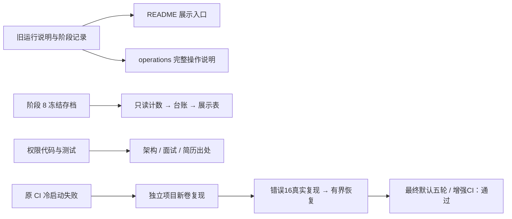

# 阶段 10 学习材料：把工程讲清楚

> 阶段 10 已由 Claude 验收并合并 main（231ee48）；推迟的阶段 9 随后也已完成并合并（2026-11-03）。本文只回放真实发生的整理、复现、修复与验证；原CI缺日志，不能反推它当时必定同错。学习验收仍由你本人决定。

**配合小林coding 阅读与面试准备。** 这一阶段本身就是在为展示和面试做准备：全部阶段的必答题汇总在[面试题汇总](../interview.md)，简历的每一句话和出处在[简历草稿](../resume-draft.md)。本材料最后的“面试追问”补上了最常见的几个项目级追问。第三节第 7 部分的 Kafka 错误 16，是“讲一个你遇到的最难的问题”的现成答案，那一节末尾附了面试版讲法。

| 本材料 | 小林对应文章 | 去那边重点看什么 |
|---|---|---|
| 三.7 消费组 | 《消息队列面试题》[Kafka 的模型介绍一下](https://www.xiaolincoding.com/interview/mq.html#kafka-的模型介绍一下-kafka-是推送还是拉取)、[Kafka 的 Rebalance 是什么，会带来什么问题？](https://www.xiaolincoding.com/interview/mq.html#kafka-的-rebalance-是什么-会带来什么问题) | 消费者组和分区分配；消费者入组、重新分配分区时为什么会短暂停顿 |
| 三.7 有界重取 | 《分布式面试题》[限流、熔断和降级有什么区别？](https://www.xiaolincoding.com/interview/cap.html#限流、熔断和降级有什么区别) | “重试也要受总时间和次数限制” |

## 一、这个阶段做了什么



项目做出来以后，还要让读者知道它解决什么问题、怎样运行、哪些结论有证据。这个阶段把已有工程整理成一个清楚的展示入口，同时检查新用户是否真能按说明跑起来。我们没有通过修改医生提示或评分来美化阶段 8 的成绩；这些成绩仍对应原冻结版本。

用户希望尽早开始投递，因此明确决定先做阶段 10。阶段 9 是推迟，范围和以后要补的地方都保留在[决策记录](../decisions.md#phase-10-order)。学习验收仍留给用户本人。（阶段 9 后来在 2026-11-03 完成，结果见[阶段 9 学习材料](phase-09-generalization.md)。）

## 二、怎么跑起来、看什么

所有命令从仓库根目录运行。需要真正启动时，先按[根 README](../../README.md#快速开始)创建 `opsdoctor-fresh` 免费 Mock 项目。已有原环境先停回，两个项目不能同时占用同一组端口。这里不重复整套安装命令，避免以后两份说明发生分叉。

第一步只读检查代码说明：

```text
go run ./tools/commentcheck ./...
```

你应该看到注释检查成功。它能发现缺失的包、文件和函数说明；文字是否讲清“为什么”，还需要自己读。

第二步查看隔离项目的服务状态：

```text
docker compose -p opsdoctor-fresh --env-file .env -f deploy/docker-compose.yml ps --all
```

你应该看到 `opsdoctor-fresh` 的服务；如果尚未按 README 创建它，列表为空。这里显式写项目名，避免 Compose 文件里的 `name: opsdoctor` 指向用户原环境。

第三步只读确认冻结区没有本阶段代码改动：

```text
git diff main -- internal/doctor/agent/prompts internal/doctor/tools docs/runbooks internal/eval/scoring internal/eval/judge eval/scenarios
```

你应该看到空输出。本阶段的成绩展示读取存档，不在这些地方改行为。这个命令只检查列出的路径，不是全仓库沙箱。

第四步打开医生页面 `http://127.0.0.1:8090`，登录后确认“Mock 模式，不是真实诊断”，再按 README 的三分钟脚本创建一次演示任务。

你应该看到真实工具结果和带 Mock 标记的报告。固定脚本不推断根因，不能用这份报告评判诊断正确率。真正的模型效果沿阶段 8 存档阅读，不需要再次付费。

第五步结束学习时停回测试项目：

```text
docker compose -p opsdoctor-fresh --env-file .env -f deploy/docker-compose.yml stop
```

你应该看到该项目的进程停止。容器和数据卷仍保留，不执行删除卷或全局清理命令。

## 三、开发过程回放

以下过程依据 [notes 的阶段 10 记录](../notes.md#phase-10)。下文按发生顺序区分早期未复现、后来已验证的修复，以及原 CI 缺日志留下的未知。

### 1. 先明确这次从哪里开始

这次要把工程整理成可展示的成果，动手前先要确认阶段边界。用户已确认阶段 8 合并到 `main/f851460`，明确允许先做阶段 10；学习验收没勾，并不抵消这次授权。

这一步没有拆新的业务函数。我们先读 AGENTS、进度和计划书，核对原分支与两处用户文件，再从 main 创建 `phase-10-showcase`。这样后面的提交才有清楚的起点。

普通沙箱第一次执行 Git 切换和 Docker 只读检查时被权限限制拒绝。在用户已授权的任务范围内使用提权调用后继续，没有把拒绝误认为仓库或 Docker 本身坏了。随后保存原容器与卷清单，确认原 OpsDoctor 没有运行，QQ 容器仍运行；两处用户文件的哈希另行保存，提交时排除。

验证关注的是“有没有碰错对象”。阶段 8 的原始数据在医生 MySQL 卷里，不能用清空原环境来证明新用户部署。后续冷启动都应通过独立项目和新卷完成。

### 2. 把运行说明和展示入口各自写清楚

这次要让读者先理解项目，再按需查命令。动手前先区分两种材料：根 README 是展示入口；旧 README 中逐阶段的详细命令是操作参考。医生读取的 `docs/runbooks/` 是另一种材料，已经冻结，不能拿来存项目运维笔记。

文件因此分成根 `README.md` 与 `docs/operations.md`，架构、项目自身排查和简历再分别放独立文档。这部分没有新增 Go 函数，主要工作是重组说明和校正相对路径。

先整体迁移旧说明，再写新入口，可以逐段对照是否丢了命令。随后把快速开始固定在免费 Mock、独立 Compose 项目和 small 数据上，演示实际工具与步骤；真实模型效果引用旧报告。

验证时，对迁移内容反向归一标题和相对链接，检查原段落与命令是否还在。快速开始的 PowerShell 语法也做了解析；语法正确只能说明命令能被 shell 理解，不能代替新克隆部署实测。

这里的取舍是保留历史。旧阶段的失败和当时的命令有学习价值，所以放在完整运维文档中，并在开头说明当前 Mock 约定和历史付费命令的授权边界。

### 3. 评测表先数清楚，再写进 README

这次要做的是展示已有结果，不是重新评分。动手前先确定两件事：缺失评分不能算零分；原取消与获准补跑必须用不同槽位关联。

读取和计数集中在[离线汇总脚本](../reports/phase-10-eval-summary.py)，输出[汇总 JSON](../reports/phase-10-eval-summary.json)，再把可引用数字记到[台账](../数据台账.md) P10-1–P10-5。脚本按报告表的原槽位编号关联评分表，没有调用医生或模型。

实际顺序是先读导出结构，再写关联与加总检查。第一次把报告行当成十四列，断言直接拒绝；改成实际十三列后，又发现 S02 第二轮 E3 的取消记录与 `/makeup` 补跑不能共用一个评分键。否则原取消的“未评分”会盖掉补跑结果。

修正关联后，五组的报告数、三档机制计数和评分失败总数都能对上原记录。然后才把数字放进 README，并保留有效评分分母。我们没有重评或把失败删掉来凑一张好看的表。

### 4. 清理时先判断东西还是否有用途

这次要去掉过期说明，动手前先查引用，而不是看到旧阶段名称就删代码。扫描 `cmd`、`internal`、`tools` 的 TODO/FIXME 后，没有发现待补的这类标记。

实际修改落在库存配置类型注释、alertsink 文件/包说明和 shopctl 阅读顺序。它们只是把“未来才实现”的句子对齐现状，没有新增类型、函数或 SQL。

alertsink 看起来像历史遗留，但阶段 3 学习材料和命令仍引用它，所以保留并解释用途。验证采用引用检查、三层说明自查和现有注释/架构工具；没有为了清理删掉学习所需入口。

冷启动是另一条工作线。当时独立环境还没有复现 worker 退出，成功启动过几次不能反推原失败原因。后面继续放大协调器初始化条件，直到取得真实错误时序，再动消费代码，过程见本节第七部分。

### 5. 在全新克隆里实走一遍

这次要验证说明是否真能带新用户完成演示。动手前先明确计时起点是远端 `git clone`，不是已有环境准备好之后；数据卷必须是新项目的，原项目保持停止。本机已经缓存的镜像、模块和构建产物保留，并如实披露。

这一环没有新增业务函数。流程按 README 分成克隆与配置、启动与精确授权、small 造数、页面演示、接口复核与停止；原始结果分别保存在 [fresh-demo](../reports/phase-10-fresh-demo.json) 和 [docker-preservation](../reports/phase-10-docker-preservation.json)。

先从远端取得提交 5806a7e，再按说明设置项目名、Mock、关闭模型对比、移除两家 Key 和暂停流量。首次就绪后，使用浏览器登录、发起手动诊断、展开真实工具结果，引用阶段 8 存档说明真实模型的效果；没有重跑模型。

第一次页面走查发生了实际问题：浏览器文档初始化需要时间，按 role 定位 summary 控件没有匹配到，刷新页面状态后改用实际控件展开成功。之后又核对了报告、SSE 和实际模型。这次 189.890 秒全部保留，再按已验证步骤排练一次三分钟脚本，用时 152.167 秒。首次就绪为 135.823 秒，从 clone 到演示完成累计 502.941 秒，即 8 分 22.941 秒（P10-7）。后一次较快不能替换首次记录。

接口证明这份 Mock 任务成功结束，保存真实查看结果和步骤；费用与 token 为零。演示结束用 stop 停回 fresh。前后清单中，原 19 个 OpsDoctor 和 2 个 QQ 容器的 ID、挂载、状态不变，原卷删除为零；fresh 的 19 个容器停止，9 个数据卷保留（P10-8）。这里还发现一个要公开说明的边界：项目名隔离容器和卷，却不隔离镜像标签，本次构建更新了 5 个全局 Go 镜像标签，原容器仍持有原镜像 ID。不能把“容器没变”扩大成“全局镜像映射没变”。

### 6. 首轮 CI 通过时，仍保留根因未明

这次要补足本机缓存带来的局限，并验证 Kafka 实际消费。动手前先看健康检查到底测了什么：worker 的健康接口只 Ping MySQL，健康灯亮还不能说明消费者已经入组并处理消息。

因此在现有 CI 里加首次 up 的计时，再把默认项目 stop，串行启动五套独立新卷；每套等待健康、多观察二十秒、small 造数、真实 HTTP 下单，再用销量核对确认追平。成功和失败都保留 worker、Kafka、MySQL 日志；这些步骤没有改业务启动行为。

提交 5806a7e 的 [CI 41458417476](https://github.com/Li-Nepenthe/opsdoctor/actions/runs/41458417476) 全通过。全新 runner 的首次镜像拉取、构建与启动为 337.594 秒；之后复用该 runner 镜像，五套新卷真实消费 5/5 通过（P10-9，[详细计时](../reports/phase-10-ci-first.json)）。这能说明本次部署与消费成功。

但原版 f851460 的十轮本地试验同样没有复现历史启动失败。最小环境还出现了主动 stop 后遥测收尾退出 1 的情况，必须与启动失败区分并保留（P10-6）。当时没有根因，也没有业务修复，所以不能把这批 CI 五轮改称“修复后五次通过”。随后继续找能产生同类错误的条件，没有因首轮 CI 变绿就结束排查。

### 7. 先等到真实错误，再修取得消息之前的边界

**这次要做什么。** 目标是让协调器暂未就绪时的消费者有有限的恢复机会，同时保留消息处理与提交失败的原有边界。消费组协调器是 Kafka 里负责管理消费者组与读取位置的角色；它的端口可访问，不等于内部状态已经加载完成。

**动手前先想什么。** 首先要判断错发生在消息取得之前，还是已经开始处理之后。前者没有业务副作用，能在有限范围内等待；后者可能已经写了数据库或处于位点未确认状态，不能因为错误码相同就继续取下一条。其次要确认原 Reader 是否还在工作，避免无必要地重建读取器、丢掉它的恢复过程。

这次使用原 f851460、独立全新卷、Mock，把 Kafka 内部 offsets 分区从默认 50 临时放大到 500，并限制 0.25 CPU；业务主题仍是原来的 3 个分区。这是为了放大初始化时序，不是新的默认部署。worker 在 14:21:05.152 UTC 启动，14:21:15.256 因错误 16（Not Coordinator For Group）退出 1，OOM=false；Kafka 到 14:21:27.151 才记录内部协调元数据加载完成（P10-10，[原时序与日志哈希](../reports/phase-10-startup-root-cause.json)）。Compose up 已返回 0，追加二十秒观察才发现进程退出。

这个实测解释了代码中一条真实失败路径，却不能给旧 CI 倒填证据。CI41447608555 当时没有保存 worker 与 Kafka 日志，因此无法直接证明它那一次也是错误 16。

**拆成哪些函数。** 阅读 kafka-go v0.4.51 的 Reader.run、FetchMessage 与 consumer group 入口后，确认错误返回时同一个 Reader 仍会在后台继续入组。原上层 Run 却把 FetchMessage 的任何错误直接当成进程致命错误。因此只在拉取这一层加三个小函数：

| 函数 | 参数与返回值 | 作用与调用关系 |
|---|---|---|
| [Consumer.Run](../../internal/shop/events/consumer.go#L77) | `ctx` → `error` | 调用 fetchMessage；取得消息后仍沿原 process 处理并提交 |
| [Consumer.fetchMessage](../../internal/shop/events/consumer.go#L108) | `ctx` → `kafka.Message, error` | 沿用原 Reader，只对可恢复协调器错误做有界重取 |
| [recoverableCoordinatorError](../../internal/shop/events/consumer.go#L131) | `err` → `bool` | 用 errors.Is 识别 14、15、16，包括被上下文包装的错误 |
| [waitFetchRetry](../../internal/shop/events/consumer.go#L136) | `ctx, delay` → `error` | 等定时器或取消；由 fetchMessage 调用 |

初次读取后，最多额外重取三次，退避依次为 250、500、1000ms。成功取得一条消息就结束本份预算，下一条重新计数。预算限制的是连续协调器错误次数；恢复后主题暂时没有订单，是正常空闲，因此不额外给整个 Fetch 加短 deadline。

**按什么顺序写。** 先将错误时序与库源码对上，再把原 Run 的直接 Fetch 改为小范围封装；随后用脚本读取器模拟协议错误、正常消息与取消，补齐预算和消息副作用的反例。最后运行静态检查、竞态测试，再回到原放大环境做真实对照。没有先给容器加重启策略，也没有让循环吞掉所有错误。

**怎么验证。** [新增八个测试](../../internal/shop/events/consumer_fetch_test.go)分别检查协调器错误后只提交一次、永久错误立即失败、重取预算、每条消息重置预算、恢复后的空闲 context、不重试已经取得消息后的处理/提交错误、消费循环取消，以及定时器取消。持续错误会退出，处理或 Commit 的错误 16 也会退出；这些反例防止把“恢复”变成无条件忽略错误。

静态检查曾抓到新错误文案以 Kafka 大写开头，改为中文上下文后重新通过。首个真实修复实验用旧错误文案版本通过；最终文案版随后在相同放大条件下，也观察到同一个 worker 记录 retry=1、250ms 退避后继续运行，再消费订单 401 成功。两个版本的结果分别保留，不混作同一个最终构建。

最终修复的本地检查为 commentcheck 426 文件，全仓 Mock race 272 顶层、906 含子例通过，56 个依赖测试跳过、0 失败（P10-12，[检查和源码哈希](../reports/phase-10-checks.json)）。独立复查与定向竞态检查也通过；本地 skip 仍不是集成通过。修复提交 364a889 已推送，[CI41463487800](https://github.com/Li-Nepenthe/opsdoctor/actions/runs/41463487800) 已通过；最终默认五轮也完成，见P10-13。日志隔离修复后的增强CI见P10-14。

**遇到的问题和取舍。** 恢复只发生在尚未取得消息时，错误范围只包含 14/15/16；鉴权、版本和未知错误直接返回，解码、SQL、提交位点的原失败行为不变。我们接受持续协调器故障超过预算后仍退出，以便运维看到失败；也保留空闲读取没有额外短时限，避免安静的系统反而被误杀。历史 CI 的确切错误仍未知，文档把受控复现结论与这个限制一起写出。

**补基础：消费组协调器和错误 14、15、16。** 一个消费者想加入消费组，要先问 Kafka“这个组归谁管”，找到负责它的那台 broker，也就是**协调器**；然后申请入组，由协调器分配分区，最后才开始拉消息。协调器靠一个内部主题 `__consumer_offsets` 保存各组的读取位置，默认 50 个分区，每个组按组名落在其中一个分区上，那个分区的 leader 就是这个组的协调器。Kafka 刚启动时，要先把这些分区的数据加载进来，加载完之前问它，就会得到三种“暂时没准备好”的错误：14（协调器还在加载）、15（协调器暂时不可用）、16（我不是这个组的协调器）。这次把内部分区从 50 放大到 500、又限制了 CPU，就是故意拉长加载时间，让这个时间窗口变大、容易复现。

**面试时怎样讲这个排障故事。** 按“现象 → 难点 → 方法 → 根因 → 修复 → 验证 → 反思”来讲：

1. **现象**：CI 从空数据卷冷启动时，order-worker 偶尔以退出码 1 退出，重跑一次又好了。
2. **难点**：原 CI 只保存了 MySQL 的日志，没有 worker 和 Kafka 的日志；本地连续十轮也复现不了。
3. **方法**：先补全 CI 的诊断日志；再想办法放大怀疑的时间窗口：把 Kafka 内部 offsets 分区从 50 加到 500，并把 CPU 限到 0.25 核。终于复现出真实错误：worker 14:21:05 启动，14:21:15 因错误 16 退出，Kafka 到 14:21:27 才加载完协调元数据。
4. **根因**：读 kafka-go v0.4.51 的源码，发现 `FetchMessage` 返回这类错误时，同一个 Reader 其实还在后台继续入组；是我们的上层代码把拉取时的任何错误都当成致命错误，直接退出了。
5. **修复**：只在“还没拿到消息”的拉取这一层，对 14、15、16 做最多 3 次重取，退避依次是 250、500、1000 毫秒；每成功拿到一条消息就重置次数。拿到消息以后的处理和提交出错，照旧退出，不重试。
6. **验证**：新增 8 个测试，其中包括“处理阶段遇到错误 16 也必须退出”这样的反例；在同样的放大条件下对照，修复后 worker 记录 retry=1，退避 250 毫秒后继续运行，并成功消费了订单；再跑默认配置五轮和 CI。
7. **反思**：没有用 `restart: always` 把症状藏起来；历史那次 CI 没有日志，所以不说“它当时一定也是错误 16”。

这个故事能同时展示四件事：会加观测、会放大问题去复现、会读第三方库源码、修复时能清楚划出边界。

### 8. 把项目名真正传到日志采集器，再跑最终新克隆

**要解决什么。** 读取器修复后五次能消费，但这还没有证明隔离环境的日志通了。复核发现Alloy只找标签为opsdoctor的容器，换项目名后会读错范围。

**动手前先想什么。** Compose已经知道最终项目名，应只保留一个来源；再手填另一个采集项目名，很容易忘记同步。

**拆成什么。** 在Compose给Alloy传COMPOSE_PROJECT_NAME，config.alloy用sys.env读取；没有新Go函数，也没有改医生LogSource或工具。CI订单加唯一traceparent，随后查Loki的三个业务服务。

**实际顺序。** 先查官方变量语义、渲染默认与自定义项目名，再用固定镜像validate通过。随后提交c246734，从远端新克隆、全新卷重跑。Alloy实际项目名为opsdoctor-fresh-final；同一订单的订单、库存、消费者日志齐全（P10-17）。

**如何验证。** 最终clone到演示304.934秒，页面102.415秒，工具、报告、SSE与零token/费用都核对过（P10-15）；增强CI的新runner首次拉取构建269.488秒，另五独立项目消费和三服务日志均过（P10-14）。本机缓存限制与较慢的首轮记录不覆盖。

**问题和取舍。** 旧五轮只测启动与消费，不能追写成日志通过；全局Go镜像标签还会随构建更新，项目名仅隔离容器和卷。最后只stop，保留20个测试项目和138个卷，原资源对照不变（P10-16）；以后人工清理按[项目排查说明](../troubleshooting.md)核对精确标签，不清整个Docker。

## 四、阅读顺序

| 顺序 | 文件 | 重点看什么 |
|---|---|---|
| 1 | [cmd/order-worker/main.go](../../cmd/order-worker/main.go) | 入口怎样把启动错误交给进程退出状态 |
| 2 | [orderworker/doc.go](../../internal/shop/app/orderworker/doc.go) | 先看消费者组装包的位置、接口和文件分工 |
| 3 | [events/doc.go](../../internal/shop/events/doc.go) 与 [MessageReader](../../internal/shop/events/consumer.go#L38) | 先理解 Fetch、业务处理与 Commit 的接口边界 |
| 4 | [consumer.go](../../internal/shop/events/consumer.go) | 对照 Run、fetchMessage 和 process，确认重试没有包住业务副作用 |
| 5 | [consumer_fetch_test.go](../../internal/shop/events/consumer_fetch_test.go) | 先读错误 16 恢复，再读预算、空闲 context、永久错误和取消反例 |
| 6 | [架构说明](../architecture.md) | 把告警→报告、注入→评测两条路线放到一起 |
| 7 | [README](../../README.md) 与 [operations](../operations.md) | 展示入口怎样引导读者找到完整操作，而不覆盖历史记录 |
| 8 | [评测汇总脚本](../reports/phase-10-eval-summary.py) | 原报告和评分怎样按槽位关联，失败怎样保留 |
| 9 | [数据台账](../数据台账.md) | 同一个数字的样本、版本、命令和限制是否齐全 |
| 10 | [简历草稿](../resume-draft.md) 与 [本阶段报告](../reports/phase-10-showcase.md) | 哪些话有证据，哪些局限必须如实复述 |

## 五、关键设计与 WHY

### 展示入口为什么不塞满操作历史

初次阅读的人先关心项目解决什么问题。详细的每阶段命令会打断这条主线，所以根 README 保留快速开始和导航，完整命令放到 operations。代价是要维护相对链接和历史状态说明，因此迁移时做了逐段对照。

### 为什么新目录还必须指定 Compose 项目名

Compose 项目名决定容器、网络和命名卷的归属。本仓库写死了 `name: opsdoctor`，换克隆目录并不会自动隔离。显式使用 `opsdoctor-fresh`，再核对原清单，才能把新用户试验和阶段 8 原始数据分开。镜像标签仍是全局的，所以还要单独披露构建对标签的更新，不能把项目名当成对所有 Docker 对象的隔离。

### 为什么恢复只包住 Fetch

拿到消息之前，暂态协调器错误还没有产生业务修改；取得消息之后，数据库可能已经成功而位点尚未确认。把两段包在同一个重试里，可能越过未完成消息。因此恢复只针对原 Reader 的 Fetch，处理、解码和提交继续沿用原失败边界。

为什么还要限制次数：持续失败可能真有环境问题，不能无限遮住。为什么不加整个 Fetch 的短 deadline：正常空闲就应该等消息。错误预算按连续错误计数，每条成功取得的消息后重置；等待本身由 context 取消打断。

### 为什么评分失败要独立列一列

“模型说错”和“评委没给出合法分数”是两件事。把评分失败填零会混淆它们，直接删掉又会让读者看不到缺失规模。因此表里同时显示报告数、有效评分数和失败数，三档机制只在有效评分中统计。

### 为什么交叉评分和费用都要说明口径

交叉评分只比较两个模型的判断，不会产生人的校准结果。README 因此同时写全部样本和去掉 E0 的一致率，并说明共同偏差风险。

费用也要先解释是什么数。美元按项目用量账本计：实际 token 按核对过的单价分档结算，未知请求保留预留。共用 Key 的平台账单无法单独归给本项目；人民币与美元不相加，DeepSeek 未归因差额继续保留。

## 六、本阶段用到的 Go 写法

无首次引入的 Go 语法。修复复用了前面阶段已有的三种能力，这里对照真实代码理解，不另编小程序。

- `context` 携带停止信号。fetchMessage 沿用调用方的 ctx，空闲读取不人为增加短 deadline；取消时 Run 按原停机路径返回。
- `time.Timer` 提供“到时间”这个事件。waitFetchRetry 用 select 同时等 timer.C 和 ctx.Done，取消可以打断退避；defer Stop 负责收尾。直接 Sleep 做不到这一点。
- `errors.Is` 沿包装链识别原错误。测试中的包装错误 16 仍能匹配；解码、SQL、Commit 的失败却不会经过这个恢复函数，边界由调用位置决定。

## 七、动手实验

下面四项只针对自己按 README 创建的 `opsdoctor-fresh` Mock 项目。不要在用户原 `opsdoctor` 上做，不删卷、不改冻结区、不启用真实模型。

1. **打错项目名 → 观察空列表 → 改回正确名称。** 先用 `docker compose -p opsdoctor-fresh-typo --env-file .env -f deploy/docker-compose.yml ps --all`，再换成 `-p opsdoctor-fresh`。两条都是只读。解释为什么目录相同，看到的容器却不同。
2. **暂停医生 → 观察就绪失败 → 启回原 Mock 进程。** 先确认隔离项目中没有自己的进行中任务，再运行 `docker compose -p opsdoctor-fresh --env-file .env -f deploy/docker-compose.yml stop doctor`。页面暂时不可用；随后用同一前缀执行 `start --wait doctor`，观察原有诊断历史仍在。这里不删除医生卷，也不借重建切到真实模型。
3. **切断页面网络 → 观察加载失败 → 恢复网络。** 在已有 Mock 诊断详情页，用浏览器开发者工具暂时切 Offline，再恢复联网并刷新。步骤来自医生保存的记录，不依赖模型重新诊断。对照 SSE 的序号和页面显示，解释为什么前端连接断了不等于诊断数据丢了。
4. **在临时副本藏掉评分失败列 → 观察分母对不上 → 恢复该列。** 把 README 评测表复制到本机临时笔记，只在副本中试改。核对三档计数为何不等于全部报告数，再恢复“有效评分”和“失败”两类信息。不要改原始报告、评分或台账。

## 八、常见误区

- 换目录就当成隔离。固定 Compose 名称仍可能指向原项目，必须指定项目名并核对标签与卷。
- Mock 报告有证据步骤，就以为证明了诊断能力。它证明工具与存储流程，模型选择由固定脚本替代。
- 把修复前成功启动的轮次算作修复后验收。原版成功、受控失败、同条件修复对照与默认配置回归回答不同问题，不能互换。
- 把评分失败当模型答错，或直接去掉。应明确保留缺失及其分母。
- 只引用全部样本较高的一致率。去掉 E0 的结果必须一起给，且不能称人工校准。
- 美元账本等于已核对的平台扣费。共用 Key 无法单独核对，未知预留和两种币种还要分别说明。

## 九、必答问题

1. 用三分钟介绍这个项目。
2. 用十五分钟讲清楚架构和关键取舍。
3. 这个项目的局限性是什么？如果要用到真实生产环境，还缺什么？
4. 面试官问“一般企业不会给 AI 这么大权限”，你怎么回答？
5. 为什么这次展示没有顺便修改失败场景的提示、工具或评分？
6. 你凭什么说新用户部署已经验证？目前还缺什么证据？
7. 为什么错误 16 有时可以重取，有时必须退出？

先自己回答，再展开文末要点。阶段 0–8 的问题还应沿各阶段学习材料逐项复习。

## 十、本阶段新术语

| 术语 | 一句话解释 |
|---|---|
| 冷启动 | 从尚未初始化的数据与服务状态开始启动，容易暴露旧卷隐藏的时序问题 |
| Compose 项目名 | 把一组容器、网络和命名卷归为一套环境的标识 |
| 冻结版本 | 用提交号和内容哈希固定实验行为，让后来的读者知道成绩对应哪份代码 |
| 评分缺失 | 报告已经存在，但没有得到符合协议的评分，应单列而不是填零 |
| 项目用量账本 | 用项目请求的实际 token 与已核对单价计算的记录，另保留未知请求预留 |
| 消费组协调器 | Kafka 中管理一个消费者组与读取位置的角色；启动时还需要加载自己的内部元数据 |
| 有界重取 | 只在允许的错误与次数内重新取得消息，超过预算就保留失败并退出 |

<details>
<summary>参考答案要点：先用自己的话回答，再对照</summary>

**1. 三分钟介绍**

- 先讲问题：排障证据分散在指标、调用链、日志和数据库中。
- 再讲链路：Go 靶场产生真实症状，医生调用受限工具查证，提交带步骤引用的报告，修复需要人批。
- 用阶段 8 存档说明效果，同时主动讲 S10 误判、评分失败、S12 未暴露，以及阶段 9 在陌生系统上组件定位降到 3/5。出处：[README](../../README.md)、台账 P8-191、P8-204、P10-1–P10-5。

**2. 十五分钟讲架构**

- 从订单、库存、Redis、Kafka 和销量事务讲业务流，再说明观测数据怎样汇合。
- 沿告警去重→调度/租约→Agent/工具→报告/SSE→审批讲控制流，指出独立医生库与固定数据源。
- 用接口分层、单实例 MySQL、SSE、受限修复与冻结评测解释取舍。出处：[architecture](../architecture.md)、[代码地图](../代码地图.md)。

**3. 局限与生产缺口**

- 自建靶场是小样本；外部只在一个开源系统上测过（5 个场景各 1 次，组件定位 3/5）；日志支持 Loki 和 OpenSearch，数据库直查只支持 MySQL。
- 交叉评分不是人工校准，评委尺度也不一致；S12 没读到攻击材料，不能宣称真实暴露防御通过。
- 生产接入还需要审批人隔离、完整隐私治理、可靠性与业务一致性补强。出处：[README 已知限制](../demo-and-results.md#已知限制)、[阶段 8 失败分析](../reports/phase-08-failure-analysis.md)。

**4. 企业为什么敢接入**

- 先承认不能直接拿实验系统接生产；再说明权限是代码和账号保证，不靠让模型自己守规矩。
- 只给固定目的地和有限工具；写工具申请保存确切参数，人批准后执行，MCP 只读。
- 主动说出误批风险、INDEX 账号和日志隐私的剩余边界。出处：[README 权限边界](../demo-and-results.md#权限边界)、[阶段 7 学习材料](phase-07-reliability.md)。

**5. 为什么保留冻结区**

- 当前成绩对应原提示、工具、手册、场景和评分；展示文案的提交不能替代原运行版本。
- 修这几处会改变实验含义，需要新冻结和相应重跑，而不是沿用旧成绩。
- 本阶段只做只读统计和诚实呈现，失败是要讲清楚的结果。出处：台账 P8-38、P8-54、P8-194，[原清单](../reports/phase-08-formal-manifest.json)。

**6. 新用户部署证据**

- 应从 git clone 计时，用 README 启动隔离项目、完成一次三分钟 Mock 演示，并保存前后容器与卷清单。
- 本机缓存若保留就明确写出，再用 CI 新 runner 的冷启动时间补充；不删除用户原数据来追求“干净”。
- 新克隆至演示完成为 502.941 秒，缓存保留；首轮 CI 新 runner 的首次启动为 337.594 秒，后续五套新卷真实消费通过（P10-7、P10-9）。受控协调器错误路径已在 364a889 修复；默认五轮和增强CI已通过（P10-13、P10-14），最终c246734新克隆304.934秒完成演示、页面102.415秒（P10-15）；缓存和历史CI缺日志的边界继续保留。出处：[本阶段报告](../reports/phase-10-showcase.md#五工程验收结果)、[notes](../notes.md#phase-10)。

**7. 相同错误码为何不同处理**

- 先问消息是否已经取得。Fetch 阶段尚无业务副作用，14/15/16 可交给同一个仍在恢复的 Reader 有界重取。
- 解码、SQL 或提交位点阶段不能进入这个封装；即使错误也是 16，也要保留原失败，不取下一条。
- 初次加最多三次重取、每条消息重置、可取消退避与空闲不附加 deadline 都有独立测试。出处：[consumer.go](../../internal/shop/events/consumer.go)、[consumer_fetch_test.go](../../internal/shop/events/consumer_fetch_test.go)。

</details>

### 面试追问：面试官接着会问

1. 讲一个你在这个项目里遇到的最难排查的问题。
2. 为什么不直接给容器加 `restart: always`？
3. 你怎么证明别人拿到代码能跑起来？
4. 这个项目哪些是你自己做的？用了 AI 吗？
5. 如果继续做下去，你最想改什么？
6. 为什么用 Docker Compose，不用 Kubernetes？
7. 你简历上写的这些数字，能核对吗？

<details>
<summary>答题要点</summary>

1. 讲 Kafka 错误 16，按第三节第 7 部分末尾的七步讲。重点放在“怎样复现一个偶发问题”和“修复的边界划在哪里”。
2. 重启能让症状消失，根因却还在：每次冷启动都可能先失败一次，而且真正的持续故障也会被它藏起来。这个问题只发生在“还没拿到消息”的启动阶段，所以就在这一层做最多 3 次的有界重取；处理和提交阶段的错误照旧退出，超过次数也退出，让运维看得见。
3. 从 `git clone` 开始计时，用独立的 Compose 项目名和全新的数据卷，照 README 走完一次三分钟 Mock 演示：最终新克隆到演示完成用了 304.934 秒。CI 每次还会在全新的机器上冷启动五套独立环境，真实下单，核对销量和三个服务的日志。本机保留了镜像缓存，这一点要如实说明。
4. 要如实回答。可以这样讲：项目由我规划和验收，代码主要由 AI 编程助手按我写的计划书分阶段实现；我负责拆分阶段、定每一阶段的验收标准、审查代码和实验数据，并做关键取舍，比如先做展示阶段、用独立盲评做交叉检查、批准基线等待方案。说完马上挑一个具体模块证明你真的懂，比如 Agent 循环的预算检查、审批的条件更新，或者错误 16 的修复。面试官最在意的，是你能不能讲清楚每一部分为什么这样设计。
5. 从真实的失败出发：调用链摘要优先保留出错的步骤（阶段 9 的 OT04 就是被截断的）；给 Agent 加“有没有进展”的检测，而不只靠硬上限；请有运维经验的人做一轮人工校准；审批改成发起人和审批人分离、按角色授权。每一项都要出新版本，在两个系统上全量重跑。
6. 这是一个单机就能跑完整套的学习和演示项目：19 个容器，一条命令启动，别人也容易复现。Kubernetes 解决的是多机调度、扩缩容和自愈，这里用不上，反而抬高部署门槛。医生把状态都存在自己的 MySQL 里，以后真要迁到 Kubernetes，也不需要改业务代码。
7. 能。README 和简历里的数字都标了数据台账编号，比如 P9-77；台账记着样本、版本、命令和限制，原始报告和导出也在仓库里。美元写的是“按项目用量账本计”，因为 Key 还有别的用途，平台账单无法单独核对。面试前，把自己最常说的几个数字（92%、3/5、κ、费用）的出处各过一遍。

</details>
