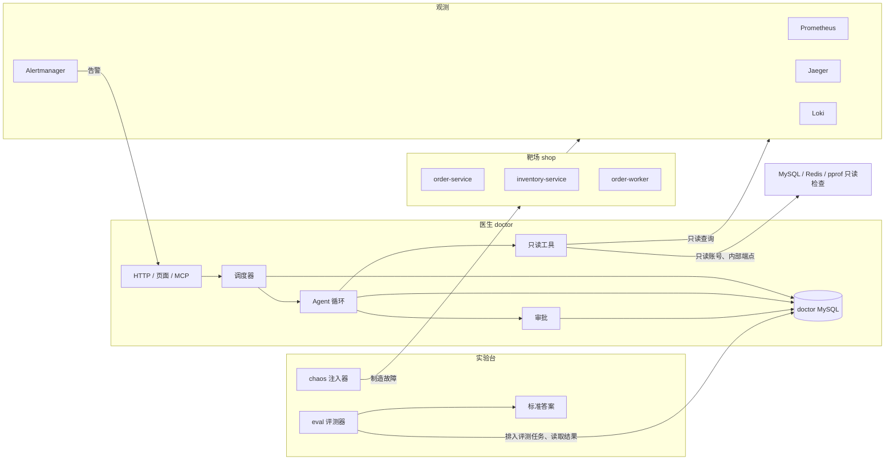

# 系统设计总览

这份材料把 OpsDoctor 当成一道系统设计题来讲：它由哪些模块组成、模块之间怎样协作、最重要的几个取舍是什么。面试时被问到“介绍一下你的项目”，就从这里讲起；被追问到某一块，再去对应阶段的学习材料里找细节。

> 可读性改造第 1 批写初版，第 8 批定稿（2026-11-11）。数字全部来自[数据台账](../数据台账.md)，旁边写着条目编号。
>
> 怎样用：先背熟第 1 节的两分钟介绍；面试官说“详细讲讲”，按第 8 节的四条路线讲；被问到局限、最难的问题、AI 参与这类项目层面的问题，看第 9 节。全部面试题的索引在[面试题汇总](../interview.md)。

## 1. 两分钟介绍（口述版）

OpsDoctor 是一个用大模型做故障诊断的 Agent。它接收微服务的告警，像运维工程师一样，通过查指标、调用链、日志和 SQL 执行计划一步步取证，最后给出根因报告；报告里引用的证据，必须指向它在这次诊断里真实查过的步骤。如果需要修改系统，比如建索引、调连接池，它只能先提交审批单，由人批准后才执行。

为了能反复验证它，项目里还有两样东西：一个用 Go 写的电商靶场，包括订单、库存和消费者三个服务，用到了 MySQL、Redis、Kafka；以及一套故障注入和评测工具，能在靶场里制造真实的故障，比如删掉索引、调小连接池，再让医生去诊断，最后和标准答案对比。

设计上最核心的约束是：医生只能像一个外部运维人员那样，通过观测数据和只读检查了解系统，看不到靶场代码，也拿不到标准答案；它的权限由代码和数据库账号保证，而不是靠提示词。诊断的每一步都持久化到 MySQL，进程崩溃后，在恢复时限内能接着跑，页面也能实时看到每一步。

结果上，在自建靶场的 13 类场景（其中一类是没有故障的健康对照）、每类 3 轮里，主模型 Terra 配完整工具（E1 组）时，故障组件定位是 36/39，根因机制完全正确 25/35（P10-2）；这一组平均每次诊断约 20.4 秒，诊断模型的项目用量账本均费约 0.025 美元（P10-19）。接入外部的 OpenTelemetry Demo 后，五个场景里组件定位是 3/5（P9-77），说明自建靶场的成绩不能直接外推到陌生系统。

> 说到 AI 在开发中的作用时，按 [README 的“作者与 AI 协作”](../../README.md#作者与-ai-协作)一节的口径讲，具体说法见 9.1 节。

## 2. 模块划分

| 模块 | 负责什么 | 为什么单独成一块 | 细节在哪 |
|---|---|---|---|
| platform | 配置、日志、HTTP 公共处理、连接池、迁移、停机 | 每个服务都要用，统一实现才能行为一致 | [阶段 0](phase-00-foundation.md) |
| shop 靶场 | 商品、库存、订单、销量 | 提供真实的业务流量和真实的故障症状 | [阶段 1](phase-01-inventory.md)、[阶段 2](phase-02-order.md) |
| 观测 | 指标、调用链、日志、告警 | 医生最主要的信息来源；另外还有 MySQL、Redis、pprof 的只读检查和系统说明书 | [阶段 3](phase-03-observability.md) |
| chaos 注入器 | 用真实的配置、结构、网络变化制造故障，并恢复 | 故障必须可复现、可恢复，评测才有意义 | [阶段 4](phase-04-chaos.md) |
| doctor 医生 | 接告警、调度诊断、调模型、执行工具、审批、持久化 | 项目的主体；必须能独立部署到别的系统 | [阶段 5](phase-05-doctor-tools.md)、[阶段 6](phase-06-agent.md)、[阶段 7](phase-07-reliability.md) |
| eval 评测器 | 冻结版本、配对运行、评分、导出 | 知道标准答案，所以必须和医生隔开 | [阶段 8](phase-08-eval.md)、[阶段 9](phase-09-generalization.md) |

## 3. 依赖方向和隔离

**代码层面。** 只有一个 Go 模块，依赖方向靠 CI 检查：

- platform 不能导入任何业务包；
- 医生不能导入 shop、chaos、eval 的代码，只能通过观测数据和只读检查了解靶场；
- 只有 chaos 和 eval 能读取标准答案目录。

前两条由 depguard 检查，第三条由 archcheck 检查（[阶段 0 的 5.1、5.10 节](phase-00-foundation.md)）。

**部署层面。** 医生的容器不挂载标准答案，也没有 Docker 的控制权限；连靶场数据库用的是只读账号，建索引用的是单独一个只有 INDEX 权限的账号。所以即使模型被诱导，它能做的也只是查看当前系统允许的证据、提交审批单。

**为什么要隔得这么严。** 如果医生能看到注入器的代码或标准答案，评测成绩就没有意义了；如果医生能直接改系统，一次错误的判断就可能造成真实的损失。

## 4. 核心流程一：告警 → 诊断 → 报告

1. **接告警。** Alertmanager 把告警推给医生。医生在一个事务里保存通知、归并成故障组、创建待执行的诊断任务。故障组还开着、或者刚恢复还在观察期内时，后续告警加入同一个任务，避免为一次事故反复诊断；观察期过后再次告警，或者开着的故障组太久没有新告警（静默超时）之后再次告警，都会创建新任务。评测期间到达的告警只留记录，不自动诊断。
2. **调度。** 调度器按“总并发数”和“每个系统的并发数”两个名额领取任务，用数据库租约证明“这个任务现在由我执行”。
3. **Agent 循环。** 每一轮把系统提示、系统说明书、告警和之前的工具结果发给模型；模型返回要调用的工具和参数；医生校验参数后执行只读工具，把结果截断到固定大小再交回模型。调用模型之前先记下这次请求；工具执行完立刻保存结果，再进入下一轮。
4. **预算。** 轮数、token、费用、时长都有上限。快用完时，医生要求模型只用已有证据提交报告。
5. **报告。** 报告里引用的证据，必须是当前诊断里真实保存过的步骤编号，不能编造。证据列表可以为空，那表示模型没有找到可引用的证据。
6. **写操作。** 模型想建索引或调连接池时，只能生成审批单。人在页面上批准后，执行器只按审批单里保存的参数执行。

细节在[阶段 5](phase-05-doctor-tools.md)（工具和隔离）、[阶段 6](phase-06-agent.md)（循环、预算、实时页面）、[阶段 7](phase-07-reliability.md)（审批、租约、断点恢复）。

## 5. 核心流程二：注入 → 评测

1. **冻结。** 开跑前保存代码版本、提示词、手册、评分规则和模型版本，以及每一轮各配置的执行顺序。
2. **注入。** 确认靶场健康、流量正常后，注入器制造一个真实的故障，并确认症状确实出现了。13 类场景里有一类（S11）是健康对照：只重启容器、不制造故障，看医生会不会误报。
3. **配对运行。** 同一个场景的同一轮里（健康对照就是同一次重启之后），按保存好的随机顺序依次运行几种配置：没有工具、完整工具、加检索手册、去掉调用链、换一个模型（DeepSeek）。
4. **评分。** 故障组件由程序和标准答案精确比对；证据里程碑中能按规则判断的（比如是否真的查到了全表扫描、缺索引）也由程序核对；根因机制和其余证据由 DeepSeek 模型当评委打分。
5. **恢复。** 注入器恢复故障，等系统健康、冷却后，再开始下一轮。

细节在[阶段 4](phase-04-chaos.md)和[阶段 8](phase-08-eval.md)。模型评委的一致性和局限，见阶段 8 的交叉评分。

## 6. 最重要的五个取舍

每个取舍都按“选了什么 → 放弃了什么 → 代价 → 规模变大十倍会怎样”来讲，最后一行指向细节所在的阶段材料。

### 6.1 医生只读，写操作必须人工审批

- **选了什么：** 工具是一份固定的菜单：查看类工具各有固定的用途和参数边界（比如 `query_metrics` 接受 PromQL，但只能查本系统的 Prometheus），没有“执行任意 SQL”“执行任意命令”这样的万能工具；另外只有三种写申请工具，它们只能生成审批单，执行时只用审批单里保存的参数。
- **放弃了什么：** 让 Agent 自动修复。自动修复更快，但一次误判就可能删错东西、调错配置。
- **代价：** 修复要等人；固定工具覆盖不到的问题，医生查不到。
- **规模变大十倍：** 审批单也多十倍，人会成为瓶颈，还容易“看都不看就批”。阶段 7 给的方向是发起人和审批人分离、按角色授权，并配合灰度和回滚。“低风险操作在白名单内自动执行”是另一个可以评估的方案，但阶段 7 把它列为放弃的做法：谁来判断低风险是个问题，在线建索引也会消耗资源，所以目前全部由人审批。
- **细节：** [阶段 5 的 5.1 节](phase-05-doctor-tools.md#51-给模型一份固定的菜单而不是数据库连接)、[阶段 7 的 5.4 节](phase-07-reliability.md#54-写操作必须人工审批批准和具体参数绑定)、[5.7 节](phase-07-reliability.md#57-权限边界完整版)。

### 6.2 每一步都持久化，数据库是事实来源

- **选了什么：** 每次调用模型之前先记下请求，每个工具结果执行完立刻写进 MySQL，再继续下一步。进程崩溃后，新的执行者从数据库里重建对话：已经保存的只读结果原样回放，不重新查；已经保存的模型回复也原样回放，只有缺回复（包括模型已经回复、但进程在保存之前中断的情况）或者还需要继续推理时，才再调用模型。
- **放弃了什么：** 把对话放在内存里，速度更快，但崩溃后一切从头来，费用也会重复花。
- **代价：** 每一步多一次数据库写入；恢复逻辑变复杂（租约、费用预留、结果不确定的写操作都要处理）。恢复也有时限：接手一个中断的 running 任务时，它最后一次更新如果已经超过恢复时限（默认 2 分钟），就结束它，而不是接着跑；等待审批的任务另有规则，等人超过两分钟仍然可以批准后继续。
- **规模变大十倍：** 诊断和步骤多十倍，医生库的写入和存储会先感到压力：阶段 7 给的做法是定期归档已经结束的诊断，恢复时只读最后一轮需要的步骤。再往上，可以考虑把大的工具结果放进对象存储、库里只存引用，那时完整记录就由数据库和对象存储一起保管。页面的实时推送始终只是提醒。
- **细节：** [阶段 6 的 5.5 节](phase-06-agent.md#55-先保存发送意图再发请求)、[阶段 7 的 5.1 节](phase-07-reliability.md#51-用数据库租约而不是一把锁)、[5.2 节](phase-07-reliability.md#52-恢复的是对话的事实不是-go-的调用栈)。

### 6.3 单实例医生加 MySQL，不上分布式调度

- **选了什么：** 一个医生进程。调度器先在本进程里占名额；跨进程的互斥靠 MySQL：领取任务时在事务里再核对名额、写租约，每次写步骤都核对执行编号。
- **放弃了什么：** 消息队列加多实例调度。规模大时更合适，但多出来的基础设施和一致性问题，对一个诊断服务来说不划算。
- **代价：** 没有高可用；医生进程挂了，要等它重启。正在运行的诊断，只有中断不超过恢复时限（默认 2 分钟）才接着跑。
- **规模变大十倍：** 告警和诊断多十倍时，先多开几个医生实例：跨进程的名额在领取租约的事务里核对，写步骤时核对执行编号，旧的持有者即使还在运行也写不进去。实例再多，领取任务的竞争会集中在数据库的协调行上，阶段 7 给的方向是按系统分片，或者用 `SKIP LOCKED` 并行领取；消息队列分发是再往后可以评估的选项。
- **细节：** [阶段 6 的 5.9 节](phase-06-agent.md#59-调度全局两个名额每个系统一个)、[阶段 7 的 5.1 节](phase-07-reliability.md#51-用数据库租约而不是一把锁)。

### 6.4 数据源接口：工具不关心后端是谁

- **选了什么：** 工具通过“查日志”“查指标”这样的统一接口取数据，后端地址、认证和响应格式由适配器处理。比如日志工具只传服务、级别、关键词、时间这些条件，具体是 Loki 还是 OpenSearch，由每个系统的接入配置决定。
- **放弃了什么：** 让工具自己连后端、自己解析各种响应格式。那样每接一个新系统都要改工具。
- **代价：** 不同后端的查询语义不完全相同（比如 Loki 是子串匹配，OpenSearch 是分词匹配），接口只能保证“条件一样”，不能保证“结果完全一样”。指标这一层只做到“地址和认证由适配器管”：消息积压工具在代码里写死了 `kafka_consumergroup_lag` 这个指标名（[catalog_metrics.go](../../internal/doctor/tools/catalog_metrics.go)）。阶段 9 用这个接口接入了外部 Demo 的 OpenSearch。
- **规模变大十倍：** 后端种类多十倍，每种都要一个适配器，并且跑同一张契约测试表；新系统的指标名和语义与靶场一致时，写死的表达式可以直接复用；不一致时，要么把这类表达式挪进接入配置，要么不注册这个工具（阶段 9 的降级做法）。
- **细节：** [阶段 5 的 5.2 节](phase-05-doctor-tools.md#52-source-接口和适配器工具不认识厂商格式)、[阶段 9 的 5.1 节](phase-09-generalization.md#51-同一个接口的第二个实现用契约测试证明)、[5.3 节](phase-09-generalization.md#53-缺数据时减少能力而不是跨系统补证据)。

### 6.5 评测用配对实验和冻结版本，并承认评委的局限

- **选了什么：** 同一个场景的同一轮里运行多种配置，减少“这次故障恰好好诊断”带来的偏差；开跑前冻结提示词、手册和评分规则，中途不改。正式运行期间只有两次执行代码的修订（校时和流量守卫），都经过批准并留档。
- **放弃了什么：** 每种配置各注入各的故障。环境更干净，但每次注入的缓存、负载和时序都不一样，差异更难归给配置。配对也不完美：同一次故障里，后跑的配置看到的系统状态和先跑的不同。
- **代价：** 一轮要依次跑完所有配置，时间长；根因机制由 DeepSeek 模型当评委（评 Terra 的报告时是跨模型）；Claude 对固定抽出的 20 份交叉盲评，机制一致 17/20（P8-199），去掉无工具的 E0 后是 12/15（P8-201）。没有做人工校准，两个模型可能有共同的偏差；DeepSeek 对照组的诊断模型也参与了评委环节，可能有共同偏差（P10-5）。
- **规模变大十倍：** 场景和配置多十倍，一次故障上排几十个诊断，后面的配置看到的系统和第一个差得更远。阶段 8 给的方向是把配置分成几组，每组共用一次注入，组间随机化，并增加重复次数；多套靶场并行是另一个可以评估的方案。评委的工作量也多十倍，要抽样做人工校准，不能全靠模型评委。
- **细节：** [阶段 8 的 5.2 节](phase-08-eval.md#52-配对比较让差别尽量来自配置)、[5.5 节](phase-08-eval.md#55-评委换一家模型再用另一家交叉盲评)、[5.7 节](phase-08-eval.md#57-版本冻结防止自己不知不觉刷分)。

## 7. 关键数字和口径

| 数字 | 含义 | 台账 |
|---|---|---|
| 36/39 | Terra 完整工具组（E1）的**故障组件定位**：报告里的故障组件和标准答案精确一致。不是根因正确率。同样用完整工具的 DeepSeek 对照组是 31/39（P10-5） | P10-2 |
| 25/35 | Terra E1 的**根因机制完全正确**；有效评分 35 份，4 份评分失败保留为缺失 | P10-2 |
| 约 20.4 秒、约 0.025 美元 | Terra E1 的 39 份报告的平均诊断耗时和**诊断模型的项目用量账本**均费；不含注入、恢复和评委 | P10-19 |
| 6,295 → 400 次 | singleflight 合并同一商品的并发查询后，数据库回源次数减少 93.6% | P10-20 |
| 3/5 | 外部 OpenTelemetry Demo 五个场景，Terra 的 E1、E2 各跑一次，两组组件定位各 3/5；和自建靶场分开说，样本很小 | P9-77 |

这些都是单机 Docker 上自建靶场或外部 Demo 的实验结果，不代表生产环境的准确率。费用是项目用量账本：每次请求的实际 token 用量乘以 2026-10-29 核对过的官方单价，分档结算；用量未知的请求保留预留额。平台账单因为 Key 和其他用途共用，无法单独核对。

## 8. 十五分钟讲架构

面试官说“详细讲讲你的项目”时，按下面四条路线讲，每条三到四分钟，一边讲一边画第 2 节的图。每条路线讲完停一下，看面试官想往哪里深挖；深挖的内容在每一点后面的链接里，“2 · 5.5”表示阶段 2 学习材料的 5.5 节。

### 8.1 沿一次下单，讲业务和一致性

1. 订单服务先用 Redis 的幂等键占位。同一个键重试时按记录的状态处理：已完成就返回原结果，处理中或待核对返回 409。[2 · 5.5](phase-02-order.md#55-接口幂等同一个下单请求只执行一次)
2. 通过 gRPC 调库存服务扣减：一条带条件的 UPDATE 把检查和扣减放在一起，防止超卖。[1 · 5.3](phase-01-inventory.md#53-防止超卖把检查和扣减放进一条-update)
3. 写订单、发 Kafka 消息；worker 在一个事务里写已处理记录和加销量，再提交位点：至少一次投递，加上消费幂等。[2 · 5.7](phase-02-order.md#57-消息先写数据库再提交位点)
4. 中途失败时，先分清“确定没发生”和“不知道发生了没有”，后者标记待核对。没有做 Outbox，消息没发出去时销量可能少算，靠核对发现。[2 · 5.6](phase-02-order.md#56-下单中途失败分清确定没发生和不知道发生了没有)、[2 · 5.8](phase-02-order.md#58-订单写成功了消息却没发出去)
5. 商品查询走 Cache Aside，空值缓存、singleflight、有效期加随机量。[2 · 5.1](phase-02-order.md#51-商品缓存先查缓存没有再查数据库)、[2 · 5.2](phase-02-order.md#52-缓存的三个经典问题穿透击穿雪崩)
6. 库存服务变慢时：超时跟着请求往下传，读可以重试、写不重试，熔断和降级保护订单服务。[2 · 5.3](phase-02-order.md#53-服务治理限流熔断降级)、[2 · 5.4](phase-02-order.md#54-重试只重试读操作所有重试共用一个总时限)

### 8.2 沿一条告警，讲诊断

1. Alertmanager 推送告警，医生在一个事务里归并故障组、创建任务；同一个系统、同一个分组键、还在开放期或恢复观察期里的通知，并进同一个诊断。[5 · 5.6](phase-05-doctor-tools.md#56-告警接入认证去重和事务)、[6 · 5.8](phase-06-agent.md#58-一次故障只诊断一次故障开放期和恢复观察期)
2. 调度器按全局和每个系统两种名额领取任务（本进程先占位，跨进程在领取租约的事务里再核对），数据库租约证明“这个任务现在归我”。[6 · 5.9](phase-06-agent.md#59-调度全局两个名额每个系统一个)、[7 · 5.1](phase-07-reliability.md#51-用数据库租约而不是一把锁)
3. Agent 循环：模型提出工具调用，程序校验后执行只读工具，结果先摘要、再截断到 4 KB；每一步先保存再继续。[6 · 5.1](phase-06-agent.md#51-模型提出请求程序执行工具)、[5 · 5.4](phase-05-doctor-tools.md#54-统一入口十秒时限和四千字节上限)、[6 · 5.5](phase-06-agent.md#55-先保存发送意图再发请求)
4. 六种预算上限加全局费用账本，防止死循环和超支。[6 · 5.3](phase-06-agent.md#53-一次诊断的预算每一种资源都有上限)、[6 · 5.7](phase-06-agent.md#57-全局费用账本先预留后结算)
5. 报告过三重校验，证据必须指向这次诊断里真实保存的步骤。[6 · 5.4](phase-06-agent.md#54-报告不能直接相信三重校验和一次修正)
6. 页面用 SSE 实时看每一步，断线后从数据库补齐。[6 · 5.10](phase-06-agent.md#510-实时页面sse-推送数据库是完整记录)

### 8.3 沿一次写操作，讲安全和恢复

1. 模型只能申请三种有限的修改；审批单保存确切的语句和参数，人批准后，执行器只按审批单执行。[7 · 5.4](phase-07-reliability.md#54-写操作必须人工审批批准和具体参数绑定)
2. 权限分四层：工具、审批、数据库账号、资源上限。[7 · 5.7](phase-07-reliability.md#57-权限边界完整版)
3. 执行时进程崩溃：恢复前先查真实状态（索引是不是已经建好；连接池看服务实例、配置修订号、最后一次操作编号和当前值），不盲目重做。[7 · 5.5](phase-07-reliability.md#55-批准以后为什么还要检查真实状态)
4. 最坏情况：模型被提示注入完全控制，也只能查看证据、提交申请。[7 · 5.7](phase-07-reliability.md#57-权限边界完整版)、[7 · 5.8](phase-07-reliability.md#58-提示注入消息结构用-json-字符串封住)

### 8.4 沿一次评测，讲怎样证明它有效

1. 注入真实的原因，而不是让应用返回假错误；动手前先把恢复记录写到磁盘。[4 · 5.2](phase-04-chaos.md#52-改真实原因不放故障开关)、[4 · 5.4](phase-04-chaos.md#54-先落盘恢复记录再动手)
2. 答案和医生隔离；五个配置面对同一次故障，顺序随机并记录。[8 · 5.1](phase-08-eval.md#51-评测集13-个场景答案与被测对象隔离)、[8 · 5.2](phase-08-eval.md#52-配对比较让差别尽量来自配置)
3. 指标分层：组件由程序比对，机制由 DeepSeek 评委打分（评 Terra 的报告时是跨模型，DeepSeek 对照组则是自评），再用 Claude 对固定抽样的 20 份交叉盲评，检查评委。[8 · 5.3](phase-08-eval.md#53-指标分层能用程序判断的不交给模型)、[8 · 5.5](phase-08-eval.md#55-评委换一家模型再用另一家交叉盲评)
4. 版本冻结，失败原样保留；换到陌生的开源系统，Terra 的 E1、E2 各跑一次，组件定位都是 3/5（P9-77），逐个分析失败原因。[8 · 5.7](phase-08-eval.md#57-版本冻结防止自己不知不觉刷分)、[9 · 5.10](phase-09-generalization.md#510-适配成功和泛化效果是两个结论)
5. 最后用第 6 节的取舍收尾：为什么只读加审批、为什么单实例加 MySQL。

## 9. 项目层面的追问

这些问题不属于某一个阶段，答案写在这里。

### 9.1 你在这个项目里做了什么？用了 AI 吗？

要如实回答，口径和 [README 的“作者与 AI 协作”](../../README.md#作者与-ai-协作)一致。README 写的分工是：需求拆分、系统架构、技术选型和功能边界的取舍由我主导；开发中用 Claude Code、Codex 协作，辅助通用代码实现、重复性工作、测试和文档整理。可以展开讲：我负责拆分阶段、定每个阶段的验收标准、审查代码和实验数据，并做关键取舍，比如业务和诊断服务解耦、医生只读加人工审批、用另一家模型独立盲评来检查评委、先做展示阶段。

说完马上挑一个模块证明你真的懂，比如 Agent 循环的预算检查、审批的条件更新，或者错误 16 的修复边界。面试官最在意的，是你能不能讲清楚每一部分为什么这样设计。AI 写了多少代码，按实际情况回答，不要夸大自己写的部分，提交记录都在仓库里。

### 9.2 最难的地方是什么？

挑一条自己理解最深、能讲到证据的，并主动说还没解决的限制：

- **排障：** Kafka 冷启动时的错误 16，补日志、放大时间窗口复现、读源码定根因、只在拿到消息之前重取。[10 · 八股 1](phase-10-showcase.md#八股-1讲一个你排查过的最难的问题)
- **排障：** 闲置后调用库存全部超时，最后查到 grpc-go 要等 DNS 的 TXT 记录查完才发调用。[3 · 八股 5](phase-03-observability.md#八股-5一个接口突然变慢了你怎么一步步定位)
- **工程：** 十几个小时的评测怎样可信：同一次故障配对、版本冻结、费用结果不确定、时钟跳变、断点续跑，每一处都要留审计。[8 · 5.2](phase-08-eval.md#52-配对比较让差别尽量来自配置)、[8 · 5.7](phase-08-eval.md#57-版本冻结防止自己不知不觉刷分)、[8 · 5.10](phase-08-eval.md#510-两个币种分开记账)、[8 · 5.8](phase-08-eval.md#58-十几个小时的实验断了怎样接着跑)、[8 · 5.9](phase-08-eval.md#59-测量环境墙上时钟和单调时钟)

### 9.3 局限是什么？要用到生产还缺什么？

- **效果的证据：** 自建靶场 13 个场景、每个 3 轮（P8-191）；陌生系统只测了一个开源 Demo 的 5 个场景，Terra 的 E1、E2 各跑一次（各 3/5，P9-77，[9 · 5.10](phase-09-generalization.md#510-适配成功和泛化效果是两个结论)）；没有人工校准；提示注入场景里攻击文字没被医生读到，模型层面会不会上当没有真正检验（P8-204）。[8 · 5.13](phase-08-eval.md#513-局限)
- **覆盖范围：** 日志支持 Loki 和 OpenSearch；执行计划、索引、锁等待这些数据库检查只支持 MySQL，Redis 只有只读的状态检查；goroutine 堆栈只适用于 Go 服务。缺数据源的系统少注册相应的工具。[9 · 5.3](phase-09-generalization.md#53-缺数据时减少能力而不是跨系统补证据)
- **安全和运维：** 医生是单实例（6.3 节）；任何登录用户都能审批，没有角色分离；出站脱敏按形状匹配，不能保证清干净。[7 · 5.7](phase-07-reliability.md#57-权限边界完整版)
- **业务：** 没有 Outbox，补偿也可能失败；总量核对不能代替逐笔一致。[2 · 5.11](phase-02-order.md#511-已知限制)

### 9.4 如果继续做，你先改什么？

前两项来自已经观察到的问题，后两项是已知的局限。凡是改变诊断或评分的改动，都要出新版本、在两个系统上全量重跑，不能沿用旧成绩：

- **工具结果按重要性保留。** 调用链摘要优先保留出错和最慢的步骤；外部 Demo 的 OT04 里，长调用链被 4 KB 上限截断，医生在看得到的结果里没找到出错的地址，只能报原因未知；被截掉的部分里有没有这条线索，现有记录确认不了。[5 · 八股 2](phase-05-doctor-tools.md#八股-2工具返回的结果太长怎么办)
- **检测原地打转。** DeepSeek 对照组有些轮次查错指标名、越查越久。连续几轮没有新证据就提前收尾，而不只靠硬上限。[6 · 八股 3](phase-06-agent.md#八股-3怎么防止-agent-死循环一直烧钱)
- **人工校准。** 请有运维经验的人评一批报告，检验模型评委。[8 · 5.5](phase-08-eval.md#55-评委换一家模型再用另一家交叉盲评)
- **审批分权。** 发起人和审批人分离，按角色授权。[7 · 5.7](phase-07-reliability.md#57-权限边界完整版)

### 9.5 为什么用自建靶场？

自建系统能控制故障原因、恢复动作和标准答案，实验可以反复复现，也方便学习。代价是题目和作者的实现相关，成绩不能外推到陌生系统，所以阶段 9 接了一个从没见过的开源系统单独测，结果和自建靶场分开报。[4 · 5.1](phase-04-chaos.md#51-制造原因的和找原因的分开)、[9 · 5.10](phase-09-generalization.md#510-适配成功和泛化效果是两个结论)

### 9.6 其他项目级追问

| 问题 | 在哪里 |
|---|---|
| 一般企业不会给 AI 这么大权限，你怎么看？ | [7 · 八股 3](phase-07-reliability.md#八股-3agent-能改生产环境吗人工审批怎样设计)、[7 · 5.7](phase-07-reliability.md#57-权限边界完整版) |
| 准确率 92% 是怎么来的？可信吗？ | [8 · 八股 1](phase-08-eval.md#八股-1怎么评估一个-agent-的效果指标怎么定义) |
| 简历上的数字能核对吗？阶段 8 的正式评测花了多少钱？ | [10 · 八股 4](phase-10-showcase.md#八股-4简历上的数字是怎么来的怎样让结果可信) |
| 你怎么证明别人拿到代码能跑起来？ | [10 · 5.3](phase-10-showcase.md#53-独立环境验收从-git-clone-开始计时) |
| 为什么用 Docker Compose，不用 Kubernetes？ | [10 · 八股 3](phase-10-showcase.md#八股-3健康检查通过了服务就一定能用吗) |
| 为什么不用 LangChain 这类框架？ | [6 · 八股 5](phase-06-agent.md#八股-5为什么不用-langchaineino用了-rag-吗) |

## 10. 按阶段读

| 阶段 | 系统设计主线 |
|---|---|
| [0 地基](phase-00-foundation.md) | 公共骨架怎么抽；依赖方向怎样用工具保证；迁移和停机怎样做才安全 |
| [1 库存](phase-01-inventory.md) | 防超卖的几种做法和取舍 |
| [2 订单](phase-02-order.md) | 缓存、消息、幂等、限流、熔断、重试；一致性的边界 |
| [3 可观测性](phase-03-observability.md) | 指标、调用链、日志怎样关联；告警怎么设计 |
| [4 故障实验](phase-04-chaos.md) | 故障怎样做到可复现、可验证、可恢复 |
| [5 医生工具](phase-05-doctor-tools.md) | 只读权限、统一的限时和截断、多系统隔离、告警去重 |
| [6 Agent](phase-06-agent.md) | 工具调用循环、预算、取消、实时推送 |
| [7 审批与恢复](phase-07-reliability.md) | 租约、断点恢复、人工审批、权限边界 |
| [8 评测](phase-08-eval.md) | 配对实验、模型评委和它的局限 |
| [9 泛化](phase-09-generalization.md) | 接入陌生系统、数据源降级；外部 Demo 为什么是 3/5 |
| [10 展示](phase-10-showcase.md) | 数字溯源、独立环境验收、偶发问题的复现和修复边界 |
