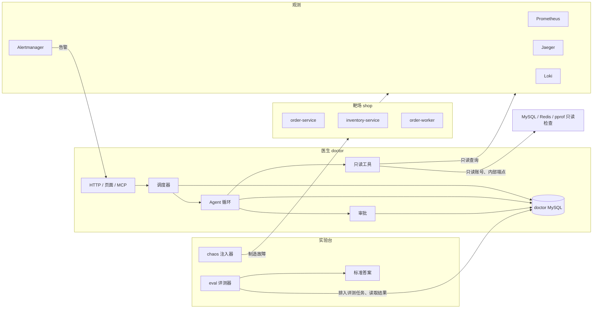

# 系统设计总览

这份材料把 OpsDoctor 当成一道系统设计题来讲：它由哪些模块组成、模块之间怎样协作、最重要的几个取舍是什么。面试时被问到“介绍一下你的项目”，就从这里讲起；被追问到某一块，再去对应阶段的学习材料里找细节。

> 这是初版，写于可读性改造第 1 批（2026-11-11）。之后每改完一个阶段会补充，第 8 批定稿。数字全部来自[数据台账](../数据台账.md)，旁边写着条目编号。

## 1. 两分钟介绍（口述版）

OpsDoctor 是一个用大模型做故障诊断的 Agent。它接收微服务的告警，像运维工程师一样，通过查指标、调用链、日志和 SQL 执行计划一步步取证，最后给出根因报告；报告里引用的证据，必须指向它在这次诊断里真实查过的步骤。如果需要修改系统，比如建索引、调连接池，它只能先提交审批单，由人批准后才执行。

为了能反复验证它，项目里还有两样东西：一个用 Go 写的电商靶场，包括订单、库存和消费者三个服务，用到了 MySQL、Redis、Kafka；以及一套故障注入和评测工具，能在靶场里制造真实的故障，比如删掉索引、调小连接池，再让医生去诊断，最后和标准答案对比。

设计上最核心的约束是：医生只能像一个外部运维人员那样，通过观测数据和只读检查了解系统，看不到靶场代码，也拿不到标准答案；它的权限由代码和数据库账号保证，而不是靠提示词。诊断的每一步都持久化到 MySQL，进程崩溃后，在恢复时限内能接着跑，页面也能实时看到每一步。

结果上，在自建靶场的 13 类场景（其中一类是没有故障的健康对照）、每类 3 轮里，主模型 Terra 配完整工具（E1 组）时，故障组件定位是 36/39，根因机制完全正确 25/35（P10-2）；这一组平均每次诊断约 20.4 秒，诊断模型的项目用量账本均费约 0.025 美元（P10-19）。接入外部的 OpenTelemetry Demo 后，五个场景里组件定位是 3/5（P9-77），说明自建靶场的成绩不能直接外推到陌生系统。

> 说到 AI 在开发中的作用时，按 [README 的“作者与 AI 协作”](../../README.md#作者与-ai-协作)一节的口径讲。

## 2. 模块划分

| 模块 | 负责什么 | 为什么单独成一块 | 细节在哪 |
|---|---|---|---|
| platform | 配置、日志、HTTP 公共处理、连接池、迁移、停机 | 每个服务都要用，统一实现才能行为一致 | [阶段 0](phase-00-foundation.md) |
| shop 靶场 | 商品、库存、订单、销量 | 提供真实的业务流量和真实的故障症状 | [阶段 1](phase-01-inventory.md)、[阶段 2](phase-02-order.md) |
| 观测 | 指标、调用链、日志、告警 | 医生最主要的信息来源；另外还有 MySQL、Redis、pprof 的只读检查和系统说明书 | [阶段 3](phase-03-observability.md) |
| chaos 注入器 | 用真实的配置、结构、网络变化制造故障，并恢复 | 故障必须可复现、可恢复，评测才有意义 | [阶段 4](phase-04-chaos.md) |
| doctor 医生 | 接告警、调度诊断、调模型、执行工具、审批、持久化 | 项目的主体；必须能独立部署到别的系统 | [阶段 5](phase-05-doctor-tools.md)、[阶段 6](phase-06-agent.md)、[阶段 7](phase-07-reliability.md) |
| eval 评测器 | 冻结版本、配对运行、评分、导出 | 知道标准答案，所以必须和医生隔开 | [阶段 8](phase-08-eval.md)、[阶段 9](phase-09-generalization.md) |

## 3. 依赖方向和隔离

**代码层面。** 只有一个 Go 模块，依赖方向靠 CI 检查：

- platform 不能导入任何业务包；
- 医生不能导入 shop、chaos、eval 的代码，只能通过观测数据和只读检查了解靶场；
- 只有 chaos 和 eval 能读取标准答案目录。

前两条由 depguard 检查，第三条由 archcheck 检查（[阶段 0 的 5.1、5.10 节](phase-00-foundation.md)）。

**部署层面。** 医生的容器不挂载标准答案，也没有 Docker 的控制权限；连靶场数据库用的是只读账号，建索引用的是单独一个只有 INDEX 权限的账号。所以即使模型被诱导，它能做的也只是查看当前系统允许的证据、提交审批单。

**为什么要隔得这么严。** 如果医生能看到注入器的代码或标准答案，评测成绩就没有意义了；如果医生能直接改系统，一次错误的判断就可能造成真实的损失。

## 4. 核心流程一：告警 → 诊断 → 报告

1. **接告警。** Alertmanager 把告警推给医生。医生在一个事务里保存通知、归并成故障组、创建待执行的诊断任务。故障组还开着、或者刚恢复还在观察期内时，后续告警加入同一个任务，避免为一次事故反复诊断；观察期过后再次告警，或者开着的故障组太久没有新告警（静默超时）之后再次告警，都会创建新任务。评测期间到达的告警只留记录，不自动诊断。
2. **调度。** 调度器按“总并发数”和“每个系统的并发数”两个名额领取任务，用数据库租约证明“这个任务现在由我执行”。
3. **Agent 循环。** 每一轮把系统提示、系统说明书、告警和之前的工具结果发给模型；模型返回要调用的工具和参数；医生校验参数后执行只读工具，把结果截断到固定大小再交回模型。调用模型之前先记下这次请求；工具执行完立刻保存结果，再进入下一轮。
4. **预算。** 轮数、token、费用、时长都有上限。快用完时，医生要求模型只用已有证据提交报告。
5. **报告。** 报告里引用的证据，必须是当前诊断里真实保存过的步骤编号，不能编造。证据列表可以为空，那表示模型没有找到可引用的证据。
6. **写操作。** 模型想建索引或调连接池时，只能生成审批单。人在页面上批准后，执行器只按审批单里保存的参数执行。

细节在[阶段 5](phase-05-doctor-tools.md)（工具和隔离）、[阶段 6](phase-06-agent.md)（循环、预算、实时页面）、[阶段 7](phase-07-reliability.md)（审批、租约、断点恢复）。

## 5. 核心流程二：注入 → 评测

1. **冻结。** 开跑前保存代码版本、提示词、手册、评分规则和模型版本，以及每一轮各配置的执行顺序。
2. **注入。** 确认靶场健康、流量正常后，注入器制造一个真实的故障，并确认症状确实出现了。13 类场景里有一类（S11）是健康对照：只重启容器、不制造故障，看医生会不会误报。
3. **配对运行。** 同一个场景的同一轮里（健康对照就是同一次重启之后），按保存好的随机顺序依次运行几种配置：没有工具、完整工具、加检索手册、去掉调用链、换一个模型（DeepSeek）。
4. **评分。** 故障组件由程序和标准答案精确比对；证据里程碑中能按规则判断的（比如是否真的查到了全表扫描、缺索引）也由程序核对；根因机制和其余证据由 DeepSeek 模型当评委打分。
5. **恢复。** 注入器恢复故障，等系统健康、冷却后，再开始下一轮。

细节在[阶段 4](phase-04-chaos.md)和[阶段 8](phase-08-eval.md)。模型评委的一致性和局限，见阶段 8 的交叉评分。

## 6. 最重要的五个取舍

每个取舍都按“选了什么 → 放弃了什么 → 代价”来讲。

### 6.1 医生只读，写操作必须人工审批

- **选了什么：** 工具只有固定的只读查询，没有“执行任意 SQL”“执行任意命令”这样的万能工具；写操作只能生成审批单，执行时只用审批单里保存的参数。
- **放弃了什么：** 让 Agent 自动修复。自动修复更快，但一次误判就可能删错东西、调错配置。
- **代价：** 修复要等人；固定工具覆盖不到的问题，医生查不到。

### 6.2 每一步都持久化，数据库是事实来源

- **选了什么：** 每次调用模型之前先记下请求，每个工具结果执行完立刻写进 MySQL，再继续下一步。进程崩溃后，新的执行者从数据库里重建对话：已经保存的只读结果原样回放，不重新查；已经拿到的模型回复也不重新要，只有缺回复或者还需要继续推理时才再调用模型。
- **放弃了什么：** 把对话放在内存里，速度更快，但崩溃后一切从头来，费用也会重复花。
- **代价：** 每一步多一次数据库写入；恢复逻辑变复杂（租约、费用预留、结果不确定的写操作都要处理）。恢复也有时限：中断超过恢复时限（默认 2 分钟）的旧诊断会被结束，而不是接着跑。

### 6.3 单实例医生加 MySQL，不上分布式调度

- **选了什么：** 一个医生进程，调度和互斥都靠 MySQL 的事务和租约。
- **放弃了什么：** 消息队列加多实例调度。规模大时更合适，但多出来的基础设施和一致性问题，对一个诊断服务来说不划算。
- **代价：** 没有高可用；医生进程挂了，要等它重启，而且只有中断时间在恢复时限（默认 2 分钟）以内的诊断能接着跑。

### 6.4 数据源接口：工具不关心后端是谁

- **选了什么：** 工具通过“查日志”“查指标”这样的统一接口取数据，后端地址、认证和响应格式由适配器处理。比如日志工具只传服务、级别、关键词、时间这些条件，具体是 Loki 还是 OpenSearch，由每个系统的接入配置决定。
- **放弃了什么：** 让工具自己连后端、自己解析各种响应格式。那样每接一个新系统都要改工具。
- **代价：** 不同后端的查询语义不完全相同（比如 Loki 是子串匹配，OpenSearch 是分词匹配），接口只能保证“条件一样”，不能保证“结果完全一样”。抽象也没有做到底：一部分指标工具仍然在工具里写固定的 PromQL（比如 Kafka 消费延迟）。阶段 9 用这个接口接入了外部 Demo 的 OpenSearch。

### 6.5 评测用配对实验和冻结版本，并承认评委的局限

- **选了什么：** 同一个场景的同一轮里运行多种配置，减少“这次故障恰好好诊断”带来的偏差；开跑前冻结提示词、手册和评分规则，中途不改。正式运行期间只有两次执行代码的修订（校时和流量守卫），都经过批准并留档。
- **放弃了什么：** 每种配置各注入各的故障，实现简单，但每次故障的难度不同，配置之间没法比。
- **代价：** 一轮要依次跑完所有配置，时间长；根因机制由 DeepSeek 模型当评委，和 Claude 交叉评分的一致率是 17/20（P8-199），没有做人工校准，两个模型可能有共同的偏差；DeepSeek 对照组的诊断模型也参与了评委环节，可能有共同偏差（P10-5）。

## 7. 关键数字和口径

| 数字 | 含义 | 台账 |
|---|---|---|
| 36/39 | Terra 完整工具组（E1）的**故障组件定位**：报告里的故障组件和标准答案精确一致。不是根因正确率。同样用完整工具的 DeepSeek 对照组是 31/39（P10-5） | P10-2 |
| 25/35 | Terra E1 的**根因机制完全正确**；有效评分 35 份，4 份评分失败保留为缺失 | P10-2 |
| 约 20.4 秒、约 0.025 美元 | Terra E1 的 39 份报告的平均诊断耗时和**诊断模型的项目用量账本**均费；不含注入、恢复和评委 | P10-19 |
| 6,295 → 400 次 | singleflight 合并同一商品的并发查询后，数据库回源次数减少 93.6% | P10-20 |
| 3/5 | 外部 OpenTelemetry Demo 五个场景的组件定位；和自建靶场分开说，样本很小 | P9-77 |

这些都是单机 Docker 上自建靶场或外部 Demo 的实验结果，不代表生产环境的准确率。费用是项目用量账本：每次请求的实际 token 用量乘以 2026-10-29 核对过的官方单价，分档结算；用量未知的请求保留预留额。平台账单因为 Key 和其他用途共用，无法单独核对。

## 8. 按阶段读

| 阶段 | 系统设计主线 |
|---|---|
| [0 地基](phase-00-foundation.md) | 公共骨架怎么抽；依赖方向怎样用工具保证；迁移和停机怎样做才安全 |
| [1 库存](phase-01-inventory.md) | 防超卖的几种做法和取舍 |
| [2 订单](phase-02-order.md) | 缓存、消息、幂等、限流、熔断、重试；一致性的边界 |
| [3 可观测性](phase-03-observability.md) | 指标、调用链、日志怎样关联；告警怎么设计 |
| [4 故障实验](phase-04-chaos.md) | 故障怎样做到可复现、可验证、可恢复 |
| [5 医生工具](phase-05-doctor-tools.md) | 只读权限、统一的限时和截断、多系统隔离、告警去重 |
| [6 Agent](phase-06-agent.md) | 工具调用循环、预算、取消、实时推送 |
| [7 审批与恢复](phase-07-reliability.md) | 租约、断点恢复、人工审批、权限边界 |
| [8 评测](phase-08-eval.md) | 配对实验、模型评委和它的局限 |
| [9 泛化](phase-09-generalization.md) | 接入陌生系统、数据源降级；外部 Demo 为什么是 3/5 |
| [10 展示](phase-10-showcase.md) | 数字溯源、独立部署 |

阶段 1–10 的学习材料会在可读性改造的后续批次里，按“系统设计为主线”的结构逐个改写。
