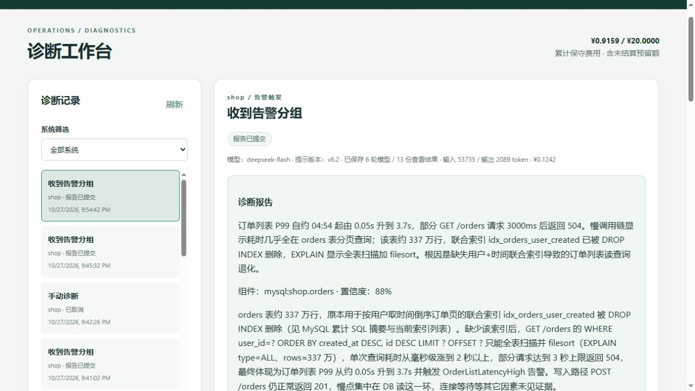
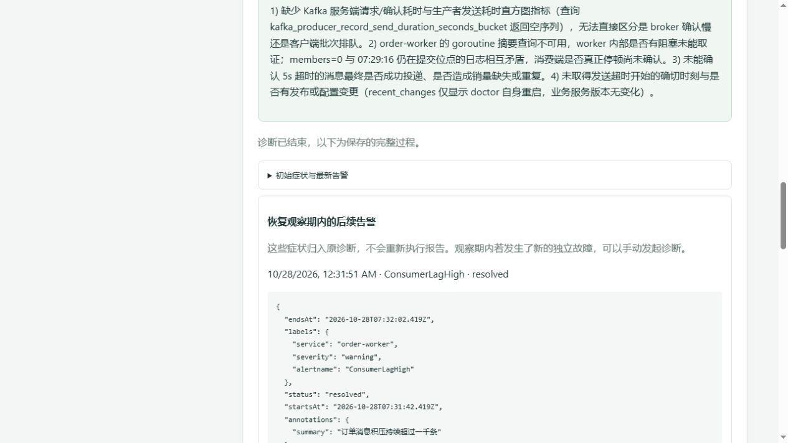
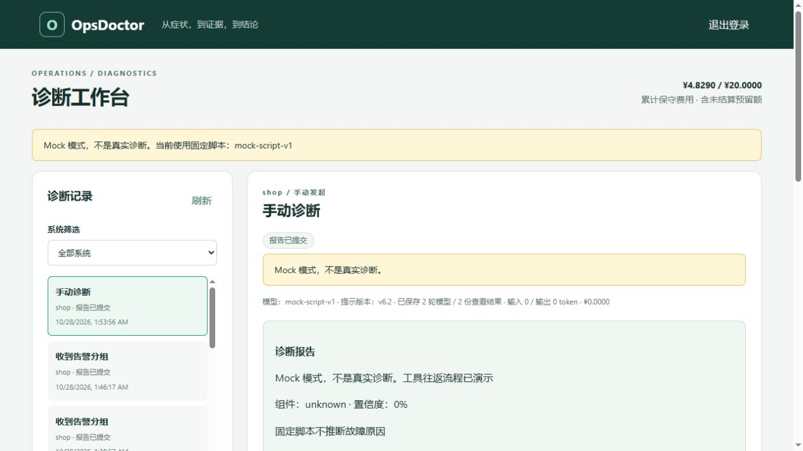

# 阶段 6 汇报书：Agent 循环与实时页面

## 一、总览

医生现在可以接收告警、自动选择只读工具、保存证据并生成报告，页面同步展示过程。

本阶段把阶段 5 的工具箱接到了模型循环上。程序负责身份、工具校验、费用、取消和审计，模型只决定下一步查什么。默认 Mock 是免费演示，不代表真实诊断能力。真实验收使用用户指定的 DeepSeek 4.1 Flash，逐场保留正确与错误判断。

| 计划交付 | 状态 | 结果 |
|---|---|---|
| llm 兼容客户端、Mock、token 与实际模型名 | 已完成 | 非流式工具调用；明确选择 provider；重试前逐次预留费用 |
| Agent 只读循环与 submit_report | 已完成 | 嵌入提示 v6.2；结构及语义校验；证据必须来自本任务 |
| 调度、取消、状态 | 已完成 | 总并发 2、每系统 1；过时告警取消；重启遗留 running 失败化 |
| events 与 SSE | 已完成 | 入库后通知、断线补发、15 秒心跳、64 条缓冲、慢订阅者断开 |
| 实时页面 | 已完成 | 登录、筛选、手动发起、详情、取消、模型名和 Mock/预算横幅 |
| 医生指标 | 已完成 | 任务、工具、模型用量与费用；标签没有诊断 ID |
| 成本计算 | 已完成 | 按输入未命中价格保守记账；持久化全局额度；未知费用保留预留 |
| 真实模型验收与如实记录 | 已完成 | 11场首轮及全部补充已记录；失败、误判和费用保留，详见第五节 |

阶段 5 遗留的 SQL 纠错信息和压测基线保护单独提交为 `5c723d3`。主体实现提交 `547daf0`；恢复观察期与预算原因补齐为 `8f2db3d`，固定 Linux CI [40651268284](https://github.com/Li-Nepenthe/opsdoctor/actions/runs/40651268284) 全部通过。工作分支是 `phase-06-agent`，基于 main `f8ab9ae`。用户的阶段 0 学习材料排版、库存入口两个 defer 修改未纳入本阶段。

## 二、新引入的技术与依赖

没有新增第三方 Go 模块，也没有新增容器。HTTP、嵌入文件、JSON 和 SSE 采用标准库及已有 Gin；并行查看工具复用已有 `golang.org/x/sync/errgroup`。镜像和 Go 工具版本沿用仓库固定版本。

| 技术或库 | 版本 | 用在哪里 | 为什么选它 | 放弃的替代方案 |
|---|---|---|---|---|
| DeepSeek 官方对话接口 | 模型列表实际返回 DeepSeek-V4.1-Flash，API id `deepseek-flash` | 真实非思考工具调用 | 用户指定；官方接口支持工具调用和缓存用量 | 没有改用其他供应商或 Pro |
| 原生 EventSource / SSE | 浏览器标准接口 | 服务器向页面送步骤 | 本阶段主要是单向事件，HTTP 补发即可 | WebSocket 增加双向连接管理，本阶段不需要 |
| embed + HTML/JS/CSS | Go 1.27.1 | 一个二进制包含页面和提示词 | 本机部署无需前端构建工具 | 未引入 React、Node 构建链 |
| testing/synctest 与假 HTTP Transport | Go 1.27.1 | 可控取消、重试和费用测试 | 不用真实付费请求验证基础协议 | 不依赖毫秒级真实调度或外部模型 |

官方依据：[模型与定价](https://api-docs.deepseek.com/zh-cn/quick_start/pricing/)、[工具调用](https://api-docs.deepseek.com/zh-cn/guides/tool_calls)、[上下文缓存](https://api-docs.deepseek.com/zh-cn/guides/kv_cache)、[余额查询](https://api-docs.deepseek.com/zh-cn/api/get-user-balance)。实际查模型列表与余额的时间和数值见数据台账；文档中的型号名称不代替真实接口核对。

## 三、代码明细

### 3.1 包与职责

| 包路径 | 新增 / 修改 | 职责 | 对外提供什么 |
|---|---|---|---|
| internal/doctor/llm、openai、mock | 新增 | 统一消息、费用、脱敏和模型协议 | Client、Request/Response、Ledger、Redactor |
| internal/doctor/agent | 新增 | 一次诊断的查证与报告循环 | Agent.Run、Input、Result、Recorder |
| internal/doctor/run | 新增 | 排队、名额、取消、终态 | Scheduler、Repository、BudgetStatus |
| internal/doctor/events | 新增 | 已保存步骤的通知 | Hub、Subscription |
| internal/doctor/web | 新增 | 嵌入页面与静态资源 | Handler |
| internal/doctor/store | 修改 | 任务、步骤、开放故障期和持久费用账本 | 调度与 HTTP 所需仓储方法 |
| internal/doctor/httpapi | 修改 | Cookie、CSRF、任务 API、SSE | Gin 路由 |
| internal/doctor/app | 修改 | 选择模型、装配依赖、指标 | Run 入口内部接线 |
| internal/doctor/target | 修改 | 架构组件表、缺失数据源 | 每系统固定的组件和数据源状态 |
| internal/doctor/tools、source、mysqlinspect | 修改 | 模型纠错信息、工具 schema 与统一脱敏结果 | 不扩大只读权限 |
| internal/chaos/verify、app、scenario | 修改 | 检查实际压测基线；离线检查答案组件在架构表中 | 不把场景答案引入医生 |
| internal/loadgen | 修改 | 控制接口返回实际商品数与工作者数 | healthy/selftest 可核实实验条件 |

### 3.2 文件明细

<!-- FILES_START -->
以 main 差异为基础，包含本阶段收尾文档；“行数”是当前文件总行数，不是新增行数。两处用户自有修改明确排除。

| 文件 | 行数 | 作用 |
|---|---:|---|
| [.env.example](../../.env.example) | 136 | 示例变量与安全默认值 |
| [.github/workflows/ci.yml](../../.github/workflows/ci.yml) | 298 | 固定 Linux 下的检查与 Mock 集成 |
| [README.md](../../README.md) | 478 | OpsDoctor |
| [deploy/alertmanager/README.md](../../deploy/alertmanager/README.md) | 14 | deploy/alertmanager：告警通知 |
| [deploy/alertmanager/alertmanager.yml](../../deploy/alertmanager/alertmanager.yml) | 19 | 按系统合并告警 |
| [deploy/docker-compose.yml](../../deploy/docker-compose.yml) | 490 | 医生模型和调度配置 |
| [deploy/doctor/targets/README.md](../../deploy/doctor/targets/README.md) | 11 | 系统接入目录 |
| [deploy/doctor/targets/shop.profile.md](../../deploy/doctor/targets/shop.profile.md) | 103 | shop 的系统说明书 |
| [deploy/doctor/targets/shop.yaml](../../deploy/doctor/targets/shop.yaml) | 16 | 部署或接入配置 |
| [docs/decisions.md](../../docs/decisions.md) | 389 | 设计决定 |
| [docs/learn/README.md](../../docs/learn/README.md) | 30 | docs/learn：逐阶段学习材料 |
| [docs/learn/phase-06-agent.md](../../docs/learn/phase-06-agent.md) | 393 | 阶段 6：让医生自己查证据，并把过程显示出来 |
| [docs/notes.md](../../docs/notes.md) | 1295 | 实测记录 |
| [docs/reports/README.md](../../docs/reports/README.md) | 17 | docs/reports：阶段汇报书 |
| [docs/reports/phase-06-agent.md](../../docs/reports/phase-06-agent.md) | 668 | 阶段 6 汇报书：Agent 循环与实时页面 |
| [docs/reports/phase-06-final-mock.png](../../docs/reports/phase-06-final-mock.png) | 图片 | 页面验收截图 |
| [docs/reports/phase-06-live.png](../../docs/reports/phase-06-live.png) | 图片 | 页面验收截图 |
| [docs/reports/phase-06-mock.png](../../docs/reports/phase-06-mock.png) | 图片 | 页面验收截图 |
| [docs/reports/phase-06-real-report.png](../../docs/reports/phase-06-real-report.png) | 图片 | 页面验收截图 |
| [docs/reports/phase-06-recovery.png](../../docs/reports/phase-06-recovery.png) | 图片 | 页面验收截图 |
| [docs/reports/phase-06-smoke-failed.png](../../docs/reports/phase-06-smoke-failed.png) | 图片 | 页面验收截图 |
| [docs/代码地图.md](../../docs/代码地图.md) | 363 | OpsDoctor 代码地图 |
| [docs/数据台账.md](../../docs/数据台账.md) | 322 | 数据台账 |
| [internal/chaos/app/app.go](../../internal/chaos/app/app.go) | 220 | 把 chaos 命令行接到场景、执行器和自动验收流程。 |
| [internal/chaos/scenario/component_test.go](../../internal/chaos/scenario/component_test.go) | 41 | 从验收一侧核对场景答案是否使用架构说明中的组件标识。 |
| [internal/chaos/scenario/doc.go](../../internal/chaos/scenario/doc.go) | 21 | 读取“这次实验准备怎样做”的说明文件。 |
| [internal/chaos/scenario/recovery_test.go](../../internal/chaos/scenario/recovery_test.go) | 88 | 在医生之外，核对 shop 的恢复观察期是否覆盖告警发出的等待时间。 |
| [internal/chaos/verify/baseline.go](../../internal/chaos/verify/baseline.go) | 74 | 在等待健康指标之前，核对压测器实际使用的实验参数。 |
| [internal/chaos/verify/baseline_test.go](../../internal/chaos/verify/baseline_test.go) | 53 | 证明实验参数错误时立即停止，而不是等待告警碰巧消失。 |
| [internal/chaos/verify/doc.go](../../internal/chaos/verify/doc.go) | 20 | 回答两个问题：问题真的出现了吗，现在真的恢复了吗？ |
| [internal/doctor/README.md](../../internal/doctor/README.md) | 26 | doctor：从告警到有证据的诊断 |
| [internal/doctor/agent/calls.go](../../internal/doctor/agent/calls.go) | 147 | 执行一轮工具请求，并把结果按模型给出的 ID 放回对话。 |
| [internal/doctor/agent/doc.go](../../internal/doctor/agent/doc.go) | 19 | 把“问模型、查证据、再问模型”组织成一个有边界的循环。 |
| [internal/doctor/agent/loop.go](../../internal/doctor/agent/loop.go) | 181 | 控制诊断从第一次询问模型到提交报告的整个过程。 |
| [internal/doctor/agent/loop_test.go](../../internal/doctor/agent/loop_test.go) | 299 | 用脚本模型和内存记录器验证完整诊断循环。 |
| [internal/doctor/agent/model.go](../../internal/doctor/agent/model.go) | 79 | 定义诊断循环需要的输入、步骤记录和依赖接口。 |
| [internal/doctor/agent/prompt.go](../../internal/doctor/agent/prompt.go) | 48 | 固定系统提示与架构说明的前缀，供每一轮模型调用复用。 |
| [internal/doctor/agent/prompts/README.md](../../internal/doctor/agent/prompts/README.md) | 5 | 医生每次诊断前都会读的规则 |
| [internal/doctor/agent/prompts/system.md](../../internal/doctor/agent/prompts/system.md) | 17 | OpsDoctor 诊断规则 v6.2 |
| [internal/doctor/agent/report.go](../../internal/doctor/agent/report.go) | 75 | 定义并校验最终报告，让结论能追溯到这次诊断真实保存的证据。 |
| [internal/doctor/agent/schema.go](../../internal/doctor/agent/schema.go) | 163 | 校验报告使用到的 JSON Schema 子集。 |
| [internal/doctor/alerts/service.go](../../internal/doctor/alerts/service.go) | 132 | 检查 Alertmanager 通知，并把合法的分组交给仓储保存。 |
| [internal/doctor/app/agent_config.go](../../internal/doctor/app/agent_config.go) | 121 | 读取模型、调度和页面安全配置，默认只运行不花钱的 Mock。 |
| [internal/doctor/app/agent_config_test.go](../../internal/doctor/app/agent_config_test.go) | 64 | 验证新环境不会因为填了 Key 就自动花钱，以及所有预算配置的边界。 |
| [internal/doctor/app/agent_wiring.go](../../internal/doctor/app/agent_wiring.go) | 84 | 把仓储、模型、Agent、调度和实时通知接成一条执行路径。 |
| [internal/doctor/app/app.go](../../internal/doctor/app/app.go) | 106 | 按顺序准备医生自己的数据库、接入系统和 HTTP 服务。 |
| [internal/doctor/app/doc.go](../../internal/doctor/app/doc.go) | 20 | 把医生各部分按启动顺序连接起来。 |
| [internal/doctor/app/metrics.go](../../internal/doctor/app/metrics.go) | 133 | 记录医生做了多少工作，以及为什么不能继续启动真实诊断。 |
| [internal/doctor/app/metrics_test.go](../../internal/doctor/app/metrics_test.go) | 76 | 检查预算停止原因能被监控读到，而且不会随错误文字不断增加标签。 |
| [internal/doctor/events/doc.go](../../internal/doctor/events/doc.go) | 9 | 把已经保存的步骤送给正在看页面的人。 |
| [internal/doctor/events/hub.go](../../internal/doctor/events/hub.go) | 90 | 管理每个诊断自己的实时订阅列表。 |
| [internal/doctor/events/hub_test.go](../../internal/doctor/events/hub_test.go) | 39 | 检查实时订阅不会串诊断，也不会被慢浏览器拖住。 |
| [internal/doctor/httpapi/diagnostics.go](../../internal/doctor/httpapi/diagnostics.go) | 95 | 接收手动症状、取消任务，并向页面说明当前执行模式和预算。 |
| [internal/doctor/httpapi/doc.go](../../internal/doctor/httpapi/doc.go) | 20 | 把告警、人工取证和实时页面接到同一个医生。 |
| [internal/doctor/httpapi/handlers.go](../../internal/doctor/httpapi/handlers.go) | 201 | 实现登录、告警接收、就绪检查和任务查询的 HTTP 细节。 |
| [internal/doctor/httpapi/recovery_test.go](../../internal/doctor/httpapi/recovery_test.go) | 69 | 证明客户端能读取故障开放状态，也能单独刷新后来到达的告警。 |
| [internal/doctor/httpapi/router.go](../../internal/doctor/httpapi/router.go) | 174 | 把登录、系统工具和告警入口接到同一个 Gin 服务。 |
| [internal/doctor/httpapi/router_test.go](../../internal/doctor/httpapi/router_test.go) | 230 | 在内存 HTTP 请求里检查登录、系统令牌和工具入口。 |
| [internal/doctor/httpapi/session.go](../../internal/doctor/httpapi/session.go) | 76 | 为浏览器提供 Cookie 登录和防跨站请求保护，命令行继续使用 Bearer。 |
| [internal/doctor/httpapi/session_test.go](../../internal/doctor/httpapi/session_test.go) | 88 | 从浏览器 Cookie 路径验证登录和 CSRF 边界。 |
| [internal/doctor/httpapi/stream.go](../../internal/doctor/httpapi/stream.go) | 156 | 把已保存的步骤通过 SSE 发给页面，断线后按编号补回。 |
| [internal/doctor/httpapi/stream_test.go](../../internal/doctor/httpapi/stream_test.go) | 106 | 验证 SSE 续传、顺序和心跳，不依赖真实端口或真实时间。 |
| [internal/doctor/llm/boundary_test.go](../../internal/doctor/llm/boundary_test.go) | 60 | 验证发往模型的内容边界与整数金额计算。 |
| [internal/doctor/llm/cost.go](../../internal/doctor/llm/cost.go) | 87 | 用整数表示费用，并规定发送前预留、发送后结算的账本接口。 |
| [internal/doctor/llm/doc.go](../../internal/doctor/llm/doc.go) | 18 | 约定医生怎样和模型交换消息，以及怎样记录这次交换的费用。 |
| [internal/doctor/llm/mock/client.go](../../internal/doctor/llm/mock/client.go) | 64 | 提供默认免费运行的固定诊断脚本。 |
| [internal/doctor/llm/mock/doc.go](../../internal/doctor/llm/mock/doc.go) | 8 | 让没有模型账号的开发环境也能完整演示诊断流程。 |
| [internal/doctor/llm/model.go](../../internal/doctor/llm/model.go) | 86 | 描述一轮模型对话的请求、回复与工具调用关联。 |
| [internal/doctor/llm/openai/client.go](../../internal/doctor/llm/openai/client.go) | 174 | 把一轮模型请求发送出去，并在发送前后留下费用和内容审计。 |
| [internal/doctor/llm/openai/client_test.go](../../internal/doctor/llm/openai/client_test.go) | 198 | 用内存 HTTP 传输检查模型协议、重试、费用预留与取消。 |
| [internal/doctor/llm/openai/doc.go](../../internal/doctor/llm/openai/doc.go) | 15 | 用普通 HTTP 实现兼容 OpenAI 的非流式工具调用协议。 |
| [internal/doctor/llm/openai/protocol.go](../../internal/doctor/llm/openai/protocol.go) | 101 | 把模型 HTTP 回复转换为对话消息，限定可重试的错误。 |
| [internal/doctor/llm/redact.go](../../internal/doctor/llm/redact.go) | 103 | 清理所有发往模型的文字，并保持 JSON 的结构不变。 |
| [internal/doctor/run/doc.go](../../internal/doctor/run/doc.go) | 14 | 决定哪个诊断现在可以执行，并管理取消和结束状态。 |
| [internal/doctor/run/scheduler.go](../../internal/doctor/run/scheduler.go) | 316 | 为排队诊断分配名额，运行结束后回收名额，并处理取消。 |
| [internal/doctor/run/scheduler_test.go](../../internal/doctor/run/scheduler_test.go) | 287 | 用可控时间和阻塞模型验证调度名额、过时任务、费用拦截与取消。 |
| [internal/doctor/run/state.go](../../internal/doctor/run/state.go) | 32 | 列出本阶段允许的诊断状态变化。 |
| [internal/doctor/source/doc.go](../../internal/doctor/source/doc.go) | 18 | 约定医生查证据时需要的能力。 |
| [internal/doctor/source/mysqlinspect/client.go](../../internal/doctor/source/mysqlinspect/client.go) | 224 | 用一个最多三条连接的只读账号检查 MySQL。 |
| [internal/doctor/source/mysqlinspect/client_test.go](../../internal/doctor/source/mysqlinspect/client_test.go) | 212 | 用 database/sql 的假驱动检查查询模板和连接排队预算。 |
| [internal/doctor/source/query_error.go](../../internal/doctor/source/query_error.go) | 17 | 标记经过适配器筛选、可以交还给工具调用者的查询错误。 |
| [internal/doctor/source/select.go](../../internal/doctor/source/select.go) | 133 | 限制执行计划工具接受的 SELECT 文本。 |
| [internal/doctor/source/select_test.go](../../internal/doctor/source/select_test.go) | 67 | 验证执行计划工具接受的是单条简单 SELECT，而不是任意 SQL。 |
| [internal/doctor/store/agent_integration_test.go](../../internal/doctor/store/agent_integration_test.go) | 210 | 在专用数据库验证故障开放期、任务清理、步骤编号和累计费用。 |
| [internal/doctor/store/alerts.go](../../internal/doctor/store/alerts.go) | 141 | 把同一次故障的反复通知归到同一个诊断，并判断故障何时结束。 |
| [internal/doctor/store/budget.go](../../internal/doctor/store/budget.go) | 149 | 把真实模型的费用预留与结算保存到医生数据库。 |
| [internal/doctor/store/diagnoses.go](../../internal/doctor/store/diagnoses.go) | 116 | 读取已经创建的诊断任务，供验收和后续页面使用。 |
| [internal/doctor/store/doc.go](../../internal/doctor/store/doc.go) | 22 | 保存医生自己的用户、告警、诊断步骤和费用账本。 |
| [internal/doctor/store/faults.go](../../internal/doctor/store/faults.go) | 96 | 给页面和验收脚本提供故障开放状态，以及恢复观察期补入的告警。 |
| [internal/doctor/store/migrations/0004_agent_fields.sql](../../internal/doctor/store/migrations/0004_agent_fields.sql) | 7 | next_seq 由锁住诊断行的事务分配，四个并行工具也不会拿到相同步骤号。 |
| [internal/doctor/store/migrations/0005_diagnosis_steps.sql](../../internal/doctor/store/migrations/0005_diagnosis_steps.sql) | 19 | 每一行都是已经发生的操作。model 留实际回复的模型名，不能只看任务初始配置。 |
| [internal/doctor/store/migrations/0006_alert_groups.sql](../../internal/doctor/store/migrations/0006_alert_groups.sql) | 11 | 分组的存续时间独立于诊断状态：报告交了，故障可能仍在继续。 |
| [internal/doctor/store/migrations/0007_llm_budget.sql](../../internal/doctor/store/migrations/0007_llm_budget.sql) | 5 | 金额按百万分之一元保存，不用浮点相加；预留额也算在 spent_micros 里。 |
| [internal/doctor/store/migrations/0008_llm_attempts.sql](../../internal/doctor/store/migrations/0008_llm_attempts.sql) | 20 | 审计行在 HTTP 发送前提交。失败却拿不到用量时保留预留额，不能擅自当作免费。 |
| [internal/doctor/store/migrations/0009_cancel_legacy_pending.sql](../../internal/doctor/store/migrations/0009_cancel_legacy_pending.sql) | 2 | 阶段 5 只保存、不执行。升级时这些旧告警不能变成一批付费诊断。 |
| [internal/doctor/store/migrations/0010_budget_stop.sql](../../internal/doctor/store/migrations/0010_budget_stop.sql) | 2 | 供应商返回的用量超过发送前估算时，留下持久化停用原因；重启不能绕过人工核对。 |
| [internal/doctor/store/migrations/0011_alert_recovery.sql](../../internal/doctor/store/migrations/0011_alert_recovery.sql) | 3 | closed_at 记录整组恢复的到达时间，观察期结束前仍属于同一场故障。 |
| [internal/doctor/store/migrations/0012_recovery_alerts.sql](../../internal/doctor/store/migrations/0012_recovery_alerts.sql) | 2 | 保存首次在观察期补入的时间，后面的 resolved 快照不能抹掉这个来历。 |
| [internal/doctor/store/migrations/README.md](../../internal/doctor/store/migrations/README.md) | 24 | 医生自己的表 |
| [internal/doctor/store/recovery_integration_test.go](../../internal/doctor/store/recovery_integration_test.go) | 138 | 用真实事务验证恢复观察期既防止重复诊断，也不会永远吞掉下一场故障。 |
| [internal/doctor/store/steps.go](../../internal/doctor/store/steps.go) | 92 | 给步骤分配编号，并为页面断线后的补发提供有序读取。 |
| [internal/doctor/store/store.go](../../internal/doctor/store/store.go) | 77 | 建立医生仓储并应用医生自己的迁移。 |
| [internal/doctor/store/store_integration_test.go](../../internal/doctor/store/store_integration_test.go) | 176 | 在专用医生测试库验证迁移、通知事务和分组去重。 |
| [internal/doctor/store/tasks.go](../../internal/doctor/store/tasks.go) | 163 | 保存调度状态变化，隔离启动清理、排队和结束操作。 |
| [internal/doctor/target/catalog.go](../../internal/doctor/target/catalog.go) | 262 | 为每个系统分别创建数据源和工具注册表。 |
| [internal/doctor/target/catalog_test.go](../../internal/doctor/target/catalog_test.go) | 208 | 证明两个系统的工具和告警令牌不会串用。 |
| [internal/doctor/target/config.go](../../internal/doctor/target/config.go) | 136 | 读取一个目录里的全部系统配置，并检查系统之间有没有共用凭据。 |
| [internal/doctor/target/doc.go](../../internal/doctor/target/doc.go) | 15 | 把“要诊断哪套系统”变成启动时就确定的连接与工具。 |
| [internal/doctor/target/profile.go](../../internal/doctor/target/profile.go) | 76 | 从架构说明中读取允许用于报告的组件名，并列出缺失的数据源。 |
| [internal/doctor/target/testdata/warehouse.profile.md](../../internal/doctor/target/testdata/warehouse.profile.md) | 11 | Warehouse（虚构的测试系统） |
| [internal/doctor/target/testdata/warehouse.yaml](../../internal/doctor/target/testdata/warehouse.yaml) | 6 | 部署或接入配置 |
| [internal/doctor/tools/registry.go](../../internal/doctor/tools/registry.go) | 209 | 让所有工具共用参数校验、十秒预算和四千字节结果限制。 |
| [internal/doctor/tools/registry_test.go](../../internal/doctor/tools/registry_test.go) | 181 | 验证工具统一入口的参数、超时、截断和系统绑定。 |
| [internal/doctor/web/doc.go](../../internal/doctor/web/doc.go) | 11 | 把页面文件一起编译进医生，不需要额外启动前端服务器。 |
| [internal/doctor/web/static/README.md](../../internal/doctor/web/static/README.md) | 11 | 医生的浏览器页面 |
| [internal/doctor/web/static/app.js](../../internal/doctor/web/static/app.js) | 233 | 原生页面、实时步骤、文字渲染 |
| [internal/doctor/web/static/index.html](../../internal/doctor/web/static/index.html) | 29 | 登录与诊断页面结构 |
| [internal/doctor/web/static/style.css](../../internal/doctor/web/static/style.css) | 2 | 页面样式 |
| [internal/doctor/web/web.go](../../internal/doctor/web/web.go) | 45 | 把三个静态文件嵌入 Go 程序，并通过固定路径提供给浏览器。 |
| [internal/loadgen/app.go](../../internal/loadgen/app.go) | 119 | 启动压测进程，管理控制端口、统计输出和退出。 |
| [internal/loadgen/control.go](../../internal/loadgen/control.go) | 115 | 通过本机控制接口调整速率和热点商品。 |
| [internal/loadgen/loadgen_test.go](../../internal/loadgen/loadgen_test.go) | 216 | 验证压测请求分布、重试身份和真实统计口径。 |
| [进度.md](../../进度.md) | 163 | OpsDoctor 进度看板 |
| [项目计划书.md](../../项目计划书.md) | 2106 | OpsDoctor 项目计划书：Go 故障诊断 Agent + 可复现故障靶场 |
<!-- FILES_END -->

### 3.3 类型与函数

<!-- SYMBOLS_START -->
以下保留变更文件中的全部生产类型和函数（包括原有但修改的项目），以免漏掉关键私有函数。调用方按职责说明；同包辅助方法通过该包入口使用，不把这张表当精确静态调用图。

| 名称 | 位置 | 作用 | 被谁调用 / 使用 |
|---|---|---|---|
| *Engine.general | [internal/chaos/app/app.go:101:1](../../internal/chaos/app/app.go#L101) | general 处理无需场景编号的命令 | 进程 Run 装配或配置读取 |
| *Engine.operate | [internal/chaos/app/app.go:125:1](../../internal/chaos/app/app.go#L125) | operate 用已有记录匹配 verify 和 restore，防止把另一场景的效果误当成当前场景 | 进程 Run 装配或配置读取 |
| overrides | [internal/chaos/app/app.go:171:1](../../internal/chaos/app/app.go#L171) | overrides 只覆盖对应动作已有的参数；没有这种动作的场景会拒绝无效的覆盖选项 | 进程 Run 装配或配置读取 |
| Run | [internal/chaos/app/app.go:33:1](../../internal/chaos/app/app.go#L33) | Run 不隐式启动流量 | 进程 Run 装配或配置读取 |
| newEngine | [internal/chaos/app/app.go:77:1](../../internal/chaos/app/app.go#L77) | newEngine 只读取密码，不输出它 | 进程 Run 装配或配置读取 |
| Baseline | [internal/chaos/verify/baseline.go:24:6](../../internal/chaos/verify/baseline.go#L24) | Baseline 在原有指标观察前加参数核对 | chaos healthy/selftest |
| WithBaseline | [internal/chaos/verify/baseline.go:32:1](../../internal/chaos/verify/baseline.go#L32) | WithBaseline 由 app 传入校验过的配置，单元测试仍可单独验证原来的指标观察器 | chaos healthy/selftest |
| *Baseline.Healthy | [internal/chaos/verify/baseline.go:37:1](../../internal/chaos/verify/baseline.go#L37) | Healthy 遇到配置不匹配直接返回，不等三分钟，也不开始任何注入动作 | chaos healthy/selftest |
| *Baseline.check | [internal/chaos/verify/baseline.go:45:1](../../internal/chaos/verify/baseline.go#L45) | check 只读取小型配置响应；老版本缺字段时得到零值，也必须报错，不能默认放行 | chaos healthy/selftest |
| *session.saveTool | [internal/doctor/agent/calls.go:121:1](../../internal/doctor/agent/calls.go#L121) | saveTool 把实际步骤号包在 tool 回复里，模型无需猜测并行完成的顺序 | app 装配；run 调用 Run；其余由会话内部使用 |
| invalidReport | [internal/doctor/agent/calls.go:145:1](../../internal/doctor/agent/calls.go#L145) | invalidReport 与普通工具错误一样交回模型，只说明校验失败，不结束诊断 | app 装配；run 调用 Run；其余由会话内部使用 |
| *session.calls | [internal/doctor/agent/calls.go:23:1](../../internal/doctor/agent/calls.go#L23) | calls 要求报告独占一轮；混合时执行查看工具，明确拒绝报告，让模型看完新结果再提交 | app 装配；run 调用 Run；其余由会话内部使用 |
| validateCalls | [internal/doctor/agent/calls.go:59:1](../../internal/doctor/agent/calls.go#L59) | validateCalls 只检查协议关联，工具名是否存在和参数是否正确仍交给统一注册表 | app 装配；run 调用 Run；其余由会话内部使用 |
| *session.readTools | [internal/doctor/agent/calls.go:74:1](../../internal/doctor/agent/calls.go#L74) | readTools 仅审计失败才中止整轮；参数错误、超时和数据源错误都作为普通工具结果 | app 装配；run 调用 Run；其余由会话内部使用 |
| *session.finish | [internal/doctor/agent/loop.go:145:1](../../internal/doctor/agent/loop.go#L145) | finish 只给一次机会；仍然索要新工具、提交错误报告或没有提交，都标为超出预算 | app 装配；run 调用 Run；其余由会话内部使用 |
| record | [internal/doctor/agent/loop.go:163:1](../../internal/doctor/agent/loop.go#L163) | record 取消之后只留半秒保存最后状态；真实查询仍使用已取消的原 context | app 装配；run 调用 Run；其余由会话内部使用 |
| markMock | [internal/doctor/agent/loop.go:171:1](../../internal/doctor/agent/loop.go#L171) | markMock 在程序端加醒目标记，不能靠脚本模型自己记住声明 | app 装配；run 调用 Run；其余由会话内部使用 |
| *Agent.isMock | [internal/doctor/agent/loop.go:181:1](../../internal/doctor/agent/loop.go#L181) | isMock 只检查程序选定的模型名，供应商回复不能把真实请求变成免费请求 | app 装配；run 调用 Run；其余由会话内部使用 |
| Agent | [internal/doctor/agent/loop.go:23:6](../../internal/doctor/agent/loop.go#L23) | Agent 构造后只读；每次 Run 的消息和计数都放在独立 session 中 | app 装配；run 调用 Run；其余由会话内部使用 |
| session | [internal/doctor/agent/loop.go:31:6](../../internal/doctor/agent/loop.go#L31) | session 保存一次诊断的状态，不把历史挂在共享模型客户端上 | app 装配；run 调用 Run；其余由会话内部使用 |
| New | [internal/doctor/agent/loop.go:41:1](../../internal/doctor/agent/loop.go#L41) | New 不联网，参数错误在启动时暴露，单元测试可使用较小预算 | app 装配；run 调用 Run；其余由会话内部使用 |
| *Agent.Run | [internal/doctor/agent/loop.go:49:1](../../internal/doctor/agent/loop.go#L49) | Run 为普通查证和最后整理分别设截止时间，但二者加起来仍只有一份总时限 | app 装配；run 调用 Run；其余由会话内部使用 |
| *session.execute | [internal/doctor/agent/loop.go:68:1](../../internal/doctor/agent/loop.go#L68) | execute 在每次回答之后检查累计用量，最后报告机会仍受 whole 的总时限约束 | app 装配；run 调用 Run；其余由会话内部使用 |
| *session.ask | [internal/doctor/agent/loop.go:94:1](../../internal/doctor/agent/loop.go#L94) | ask 把实际脱敏后的请求写进步骤；真实 HTTP 尝试另由 llm 账本在发送前保存 | app 装配；run 调用 Run；其余由会话内部使用 |
| Step | [internal/doctor/agent/model.go:21:6](../../internal/doctor/agent/model.go#L21) | Step 按诊断内部的 Seq 排序；并行工具按保存完成的次序得到编号 | app 装配；run 调用 Run；其余由会话内部使用 |
| Recorder | [internal/doctor/agent/model.go:36:6](../../internal/doctor/agent/model.go#L36) | Recorder 必须支持并行工具保存，成功返回的步骤才可被报告引用 | app 装配；run 调用 Run；其余由会话内部使用 |
| Toolbox | [internal/doctor/agent/model.go:41:6](../../internal/doctor/agent/model.go#L41) | Toolbox 只提供当前系统的查看工具；模型无法改变它绑定的数据源 | app 装配；run 调用 Run；其余由会话内部使用 |
| Input | [internal/doctor/agent/model.go:47:6](../../internal/doctor/agent/model.go#L47) | Input 在开始诊断时固定，后续告警仍入库，但不会改变已经发送的固定消息前缀 | app 装配；run 调用 Run；其余由会话内部使用 |
| Limits | [internal/doctor/agent/model.go:58:6](../../internal/doctor/agent/model.go#L58) | Limits 的默认值来自计划书，测试可调小以快速检查预算边界 | app 装配；run 调用 Run；其余由会话内部使用 |
| DefaultLimits | [internal/doctor/agent/model.go:67:1](../../internal/doctor/agent/model.go#L67) | DefaultLimits 给正常查证预留四分钟，最后一分钟只整理已有证据，不再查新数据 | app 装配；run 调用 Run；其余由会话内部使用 |
| Result | [internal/doctor/agent/model.go:72:6](../../internal/doctor/agent/model.go#L72) | Result 失败也带用量，费用不能因最终没有报告而消失 | app 装配；run 调用 Run；其余由会话内部使用 |
| messages | [internal/doctor/agent/prompt.go:28:1](../../internal/doctor/agent/prompt.go#L28) | messages 的前两条不会随轮次变化，动态证据始终追加在末尾 | app 装配；run 调用 Run；其余由会话内部使用 |
| definitions | [internal/doctor/agent/prompt.go:41:1](../../internal/doctor/agent/prompt.go#L41) | definitions 从同一个注册表生成工具菜单，Agent 不能偷偷增加另一个执行入口 | app 装配；run 调用 Run；其余由会话内部使用 |
| reportSchema | [internal/doctor/agent/report.go:20:1](../../internal/doctor/agent/report.go#L20) | reportSchema 对象字段全部显式必填，unknowns 可为空，但不能省略 | app 装配；run 调用 Run；其余由会话内部使用 |
| reportDefinition | [internal/doctor/agent/report.go:48:1](../../internal/doctor/agent/report.go#L48) | reportDefinition 让模型看到的 Schema 与 validateReport 使用的 Schema 来自同一函数 | app 装配；run 调用 Run；其余由会话内部使用 |
| validateReport | [internal/doctor/agent/report.go:54:1](../../internal/doctor/agent/report.go#L54) | validateReport 不接受超过 16 KiB 的报告，字段范围和真实步骤均通过后才返回原始 JSON | app 装配；run 调用 Run；其余由会话内部使用 |
| *schema.check | [internal/doctor/agent/schema.go:101:1](../../internal/doctor/agent/schema.go#L101) | check 返回具体字段路径，让模型知道该改报告的哪一处 | app 装配；run 调用 Run；其余由会话内部使用 |
| *schema.checkObject | [internal/doctor/agent/schema.go:140:1](../../internal/doctor/agent/schema.go#L140) | checkObject 先检查必填字段，再检查多余字段，不把缺项悄悄当作空字符串 | app 装配；run 调用 Run；其余由会话内部使用 |
| schema | [internal/doctor/agent/schema.go:22:6](../../internal/doctor/agent/schema.go#L22) | schema 只用于本包拥有的报告格式，不是任意外部 Schema 的解释器 | app 装配；run 调用 Run；其余由会话内部使用 |
| decodeJSON | [internal/doctor/agent/schema.go:38:1](../../internal/doctor/agent/schema.go#L38) | decodeJSON 用 Token 逐项读取，以便发现重复字段；普通 Unmarshal 会保留最后一次值 | app 装配；run 调用 Run；其余由会话内部使用 |
| readValue | [internal/doctor/agent/schema.go:52:1](../../internal/doctor/agent/schema.go#L52) | readValue 限制嵌套层数，恶意 JSON 不能让递归无限深入 | app 装配；run 调用 Run；其余由会话内部使用 |
| validLabels | [internal/doctor/alerts/service.go:106:1](../../internal/doctor/alerts/service.go#L106) | validLabels 限制单字段和数量，整体正文另由 HTTP 的一 MiB 上限限制 | 告警 HTTP 接口 |
| Title | [internal/doctor/alerts/service.go:119:1](../../internal/doctor/alerts/service.go#L119) | Title 只用于列表展示，数据库身份始终是系统名与分组键，不用可变的标题去重 | 告警 HTTP 接口 |
| Alert | [internal/doctor/alerts/service.go:23:6](../../internal/doctor/alerts/service.go#L23) | Alert 保存证据快照；Labels、Annotations 是外部文字，以后也不能把它们当指令 | 告警 HTTP 接口 |
| Notification | [internal/doctor/alerts/service.go:33:6](../../internal/doctor/alerts/service.go#L33) | Notification 的 GroupKey 是推送方的分组键，仓储还会加上系统名形成去重身份 | 告警 HTTP 接口 |
| Receipt | [internal/doctor/alerts/service.go:41:6](../../internal/doctor/alerts/service.go#L41) | Receipt 说明通知已保存或被忽略，不表示诊断已经执行 | 告警 HTTP 接口 |
| Receiver | [internal/doctor/alerts/service.go:49:6](../../internal/doctor/alerts/service.go#L49) | Receiver 定义在通知处理这一使用方，MySQL 仓储只需实现它，不需要显式 implements | 告警 HTTP 接口 |
| Service | [internal/doctor/alerts/service.go:54:6](../../internal/doctor/alerts/service.go#L54) | Service 不保留某个“默认系统”，每次身份都由经过认证的接口传入 | 告警 HTTP 接口 |
| New | [internal/doctor/alerts/service.go:57:1](../../internal/doctor/alerts/service.go#L57) | New 让测试可以替换仓储，同时生产路径仍只有同一个通知校验入口 | 告警 HTTP 接口 |
| *Service.Receive | [internal/doctor/alerts/service.go:60:1](../../internal/doctor/alerts/service.go#L60) | Receive 校验错误与存储错误分开，HTTP 层才能分别返回 400 和可重试的 503 | 告警 HTTP 接口 |
| Invalid | [internal/doctor/alerts/service.go:71:6](../../internal/doctor/alerts/service.go#L71) | Invalid 表示通知格式错误；错误文字由代码生成，不包含请求正文 | 告警 HTTP 接口 |
| Invalid.Error | [internal/doctor/alerts/service.go:74:1](../../internal/doctor/alerts/service.go#L74) | Error 让 Invalid 可作为标准 error 返回，接口层通过 errors.As 判断分类 | 告警 HTTP 接口 |
| validate | [internal/doctor/alerts/service.go:77:1](../../internal/doctor/alerts/service.go#L77) | validate 不信任推送内容的条数和字段长度，认证通过也不意味着可以无限占用数据库 | 告警 HTTP 接口 |
| agentSettings | [internal/doctor/app/agent_config.go:26:6](../../internal/doctor/app/agent_config.go#L26) | agentSettings 含 API Key，不能作为整个对象写进日志或错误 | 进程 Run 装配或配置读取 |
| loadAgentConfig | [internal/doctor/app/agent_config.go:42:1](../../internal/doctor/app/agent_config.go#L42) | loadAgentConfig 的空值是配置错误，不把误拼的真实模型模式静默退回 Mock | 进程 Run 装配或配置读取 |
| knownSecrets | [internal/doctor/app/agent_config.go:96:1](../../internal/doctor/app/agent_config.go#L96) | knownSecrets 只收集本项目明确使用的凭据，在内存中替换，不输出也不另存清单 | 进程 Run 装配或配置读取 |
| assembleAgent | [internal/doctor/app/agent_wiring.go:31:1](../../internal/doctor/app/agent_wiring.go#L31) | assembleAgent 只装配，不启动 goroutine；全部成功后 Run 才启动调度和监听端口 | 进程 Run 装配或配置读取 |
| createModel | [internal/doctor/app/agent_wiring.go:79:1](../../internal/doctor/app/agent_wiring.go#L79) | createModel 不做探测调用；真实配置不完整时返回错误，不回退成误导用户的脚本报告 | 进程 Run 装配或配置读取 |
| Run | [internal/doctor/app/app.go:37:1](../../internal/doctor/app/app.go#L37) | Run 只有装配完全成功才监听端口，启动失败也会关闭已经创建的资源 | 进程 Run 装配或配置读取 |
| serve | [internal/doctor/app/app.go:90:1](../../internal/doctor/app/app.go#L90) | serve 停止接新请求后等待在途请求；工具最多十秒，停机预算再多留两秒做响应收尾 | 进程 Run 装配或配置读取 |
| *doctorMetrics.changed | [internal/doctor/app/metrics.go:103:1](../../internal/doctor/app/metrics.go#L103) | changed 统计状态进入次数，只有开始过执行的终态才计入耗时分布 | 进程 Run 装配或配置读取 |
| *doctorMetrics.budget | [internal/doctor/app/metrics.go:111:1](../../internal/doctor/app/metrics.go#L111) | budget 与页面共享调度器读数，额度不足不会只在日志中留下难发现的一句话 | 进程 Run 装配或配置读取 |
| doctorMetrics | [internal/doctor/app/metrics.go:22:6](../../internal/doctor/app/metrics.go#L22) | doctorMetrics 的计数器由 Prometheus 库处理并发，mu 只保护有限模型标签集合 | 进程 Run 装配或配置读取 |
| newDoctorMetrics | [internal/doctor/app/metrics.go:40:1](../../internal/doctor/app/metrics.go#L40) | newDoctorMetrics 延用平台注册表，诊断耗时另用覆盖五分钟的桶 | 进程 Run 装配或配置读取 |
| *doctorMetrics.model | [internal/doctor/app/metrics.go:63:1](../../internal/doctor/app/metrics.go#L63) | model 将供应商的任意文本限制为八个已见值加 other，实际原文仍完整保存在步骤中 | 进程 Run 装配或配置读取 |
| *doctorMetrics.step | [internal/doctor/app/metrics.go:77:1](../../internal/doctor/app/metrics.go#L77) | step 在保存后调用，未知工具和结果都归类，不把模型随手编的名称变成新指标 | 进程 Run 装配或配置读取 |
| Event | [internal/doctor/events/hub.go:20:6](../../internal/doctor/events/hub.go#L20) | Event 的 ID 对应数据库步骤序号，只在一个诊断内部递增 | app 创建；store 入库后发布；HTTP 订阅 |
| Hub | [internal/doctor/events/hub.go:26:6](../../internal/doctor/events/hub.go#L26) | Hub 的锁保护 groups 及每个 Subscription 的通道生命周期 | app 创建；store 入库后发布；HTTP 订阅 |
| Subscription | [internal/doctor/events/hub.go:32:6](../../internal/doctor/events/hub.go#L32) | Subscription 的 channel 由 Hub 写和关闭；HTTP 处理器只读并在退出时调用 Close | app 创建；store 入库后发布；HTTP 订阅 |
| New | [internal/doctor/events/hub.go:39:1](../../internal/doctor/events/hub.go#L39) | New 为一个医生进程建立独立中心，不使用包级全局订阅表 | app 创建；store 入库后发布；HTTP 订阅 |
| *Hub.Subscribe | [internal/doctor/events/hub.go:42:1](../../internal/doctor/events/hub.go#L42) | Subscribe 必须先于数据库补发执行，避免两者之间恰好新增的步骤落在空窗里 | app 创建；store 入库后发布；HTTP 订阅 |
| *Subscription.Events | [internal/doctor/events/hub.go:54:1](../../internal/doctor/events/hub.go#L54) | Events 只暴露接收方向，调用者不能向别人的订阅塞入伪造步骤 | app 创建；store 入库后发布；HTTP 订阅 |
| *Subscription.Close | [internal/doctor/events/hub.go:57:1](../../internal/doctor/events/hub.go#L57) | Close 可以重复调用，正常退出和满通道断开可能先后发生 | app 创建；store 入库后发布；HTTP 订阅 |
| *Hub.remove | [internal/doctor/events/hub.go:65:1](../../internal/doctor/events/hub.go#L65) | remove 由持锁调用方使用，删除最后一个订阅时也清理诊断分组 | app 创建；store 入库后发布；HTTP 订阅 |
| *Hub.Publish | [internal/doctor/events/hub.go:78:1](../../internal/doctor/events/hub.go#L78) | Publish 不等待慢浏览器；满了就关闭，浏览器随后用数据库序号续传 | app 创建；store 入库后发布；HTTP 订阅 |
| *api.manual | [internal/doctor/httpapi/diagnostics.go:23:1](../../internal/doctor/httpapi/diagnostics.go#L23) | manual 限制症状长度，服务端绑定系统，保存后才唤醒调度器 | Gin 路由或 HTTP/SSE 内部处理 |
| *api.cancelDiagnosis | [internal/doctor/httpapi/diagnostics.go:61:1](../../internal/doctor/httpapi/diagnostics.go#L61) | cancelDiagnosis 只接受服务生成的 ID，返回成功表示取消已请求，终态随后通过 SSE 到达 | Gin 路由或 HTTP/SSE 内部处理 |
| *api.runtimeStatus | [internal/doctor/httpapi/diagnostics.go:82:1](../../internal/doctor/httpapi/diagnostics.go#L82) | runtimeStatus 同一个读数同时驱动横幅和按钮状态，费用原因不是页面自己猜出来的 | Gin 路由或 HTTP/SSE 内部处理 |
| *api.ready | [internal/doctor/httpapi/handlers.go:116:1](../../internal/doctor/httpapi/handlers.go#L116) | ready 只检查医生自己的持久化依赖，靶场正在故障不能让接收告警的医生也变成不可用 | Gin 路由或 HTTP/SSE 内部处理 |
| *api.listDiagnoses | [internal/doctor/httpapi/handlers.go:127:1](../../internal/doctor/httpapi/handlers.go#L127) | listDiagnoses 限制页长与偏移量；未知系统不能静默返回全部系统的任务 | Gin 路由或 HTTP/SSE 内部处理 |
| *api.diagnosis | [internal/doctor/httpapi/handlers.go:162:1](../../internal/doctor/httpapi/handlers.go#L162) | diagnosis 只接受本服务生成的 ID，查询失败时不泄露 SQL 或数据库连接细节 | Gin 路由或 HTTP/SSE 内部处理 |
| *api.diagnosisAlerts | [internal/doctor/httpapi/handlers.go:183:1](../../internal/doctor/httpapi/handlers.go#L183) | diagnosisAlerts 只刷新小份告警快照，让已结束的报告仍能展示后来到达的症状 | Gin 路由或 HTTP/SSE 内部处理 |
| *api.login | [internal/doctor/httpapi/handlers.go:35:1](../../internal/doctor/httpapi/handlers.go#L35) | login 对未知用户也执行一次摘要比较，避免用响应快慢直接枚举邮箱 | Gin 路由或 HTTP/SSE 内部处理 |
| *api.receiveAlert | [internal/doctor/httpapi/handlers.go:82:1](../../internal/doctor/httpapi/handlers.go#L82) | receiveAlert 的 target 来自路径并通过令牌验证，不接受正文中另一个系统名作为覆盖 | Gin 路由或 HTTP/SSE 内部处理 |
| *api.requireLogin | [internal/doctor/httpapi/router.go:109:1](../../internal/doctor/httpapi/router.go#L109) | requireLogin 不把解析失败的细节回显给客户端，令牌原文也不会写入日志 | Gin 路由或 HTTP/SSE 内部处理 |
| *api.listTargets | [internal/doctor/httpapi/router.go:137:1](../../internal/doctor/httpapi/router.go#L137) | listTargets 只返回名称和工具说明，不把接入地址、账号变量或令牌发给客户端 | Gin 路由或 HTTP/SSE 内部处理 |
| *api.runTool | [internal/doctor/httpapi/router.go:160:1](../../internal/doctor/httpapi/router.go#L160) | runTool 是 doctorctl 与未来其他入口共用的调用路径，不能直接调用适配器 | Gin 路由或 HTTP/SSE 内部处理 |
| Repository | [internal/doctor/httpapi/router.go:38:6](../../internal/doctor/httpapi/router.go#L38) | Repository 定义在接口使用方，测试可以观察持久化是否被调用，而不启动 MySQL | Gin 路由或 HTTP/SSE 内部处理 |
| Runner | [internal/doctor/httpapi/router.go:50:6](../../internal/doctor/httpapi/router.go#L50) | Runner 是页面需要的调度操作；没有提供恢复、审批或任意执行入口 | Gin 路由或 HTTP/SSE 内部处理 |
| Options | [internal/doctor/httpapi/router.go:57:6](../../internal/doctor/httpapi/router.go#L57) | Options 只接收已经装配的对象，不读取环境变量或创建第二套数据库池 | Gin 路由或 HTTP/SSE 内部处理 |
| api | [internal/doctor/httpapi/router.go:73:6](../../internal/doctor/httpapi/router.go#L73) | api 持有服务范围的登录限流器，不能让猜密码请求无限占用 bcrypt 的 CPU | Gin 路由或 HTTP/SSE 内部处理 |
| New | [internal/doctor/httpapi/router.go:80:1](../../internal/doctor/httpapi/router.go#L80) | New 把页面、任务与手动工具接到同一身份边界，告警另用系统令牌 | Gin 路由或 HTTP/SSE 内部处理 |
| sameOrigin | [internal/doctor/httpapi/session.go:26:1](../../internal/doctor/httpapi/session.go#L26) | sameOrigin 在浏览器提供 Origin 时严格匹配；无 Origin 的 CLI 仍须通过正文格式和身份校验 | Gin 路由或 HTTP/SSE 内部处理 |
| csrfToken | [internal/doctor/httpapi/session.go:43:1](../../internal/doctor/httpapi/session.go#L43) | csrfToken 派生值只绑定当前不可猜测的签名 JWT；知道自己的值不能推导另一个会话的值 | Gin 路由或 HTTP/SSE 内部处理 |
| validCSRF | [internal/doctor/httpapi/session.go:49:1](../../internal/doctor/httpapi/session.go#L49) | validCSRF 使用固定时间比较，不按错误位置提前退出 | Gin 路由或 HTTP/SSE 内部处理 |
| *api.setSession | [internal/doctor/httpapi/session.go:54:1](../../internal/doctor/httpapi/session.go#L54) | setSession 的 HttpOnly 禁止脚本读身份，SameSite=Strict 让跨站导航也不自动带登录 | Gin 路由或 HTTP/SSE 内部处理 |
| *api.session | [internal/doctor/httpapi/session.go:59:1](../../internal/doctor/httpapi/session.go#L59) | session 返回修改请求所需的派生值，浏览器刷新后仍不用把 JWT 暴露给脚本 | Gin 路由或 HTTP/SSE 内部处理 |
| *api.logout | [internal/doctor/httpapi/session.go:64:1](../../internal/doctor/httpapi/session.go#L64) | logout 通过同样的 CSRF 校验清 Cookie，防止外站强迫用户退出 | Gin 路由或 HTTP/SSE 内部处理 |
| browserHeaders | [internal/doctor/httpapi/session.go:70:1](../../internal/doctor/httpapi/session.go#L70) | browserHeaders 禁止缓存含凭据的响应，也禁止把不可信正文当脚本或嵌入其他站点 | Gin 路由或 HTTP/SSE 内部处理 |
| terminalStatus | [internal/doctor/httpapi/stream.go:129:1](../../internal/doctor/httpapi/stream.go#L129) | terminalStatus 的有限列表也用于停止订阅；阶段 7 的审批状态不属于这里 | Gin 路由或 HTTP/SSE 内部处理 |
| writeEvent | [internal/doctor/httpapi/stream.go:134:1](../../internal/doctor/httpapi/stream.go#L134) | writeEvent 每帧最多等待五秒；空 data 写心跳，不占用持久化步骤编号 | Gin 路由或 HTTP/SSE 内部处理 |
| *api.stream | [internal/doctor/httpapi/stream.go:29:1](../../internal/doctor/httpapi/stream.go#L29) | stream 不把登录令牌放进 URL；EventSource 使用已认证的 HttpOnly Cookie | Gin 路由或 HTTP/SSE 内部处理 |
| *api.sendMissing | [internal/doctor/httpapi/stream.go:97:1](../../internal/doctor/httpapi/stream.go#L97) | sendMissing 每次取一百步，处理期间新提交的步骤也会被下一页或内存通知发现 | Gin 路由或 HTTP/SSE 内部处理 |
| Error | [internal/doctor/llm/cost.go:20:6](../../internal/doctor/llm/cost.go#L20) | Error 用具名字符串实现 error，让错误分类是不能被重新赋值的常量 | agent、openai 与 store 使用消息/费用接口 |
| Error.Error | [internal/doctor/llm/cost.go:23:1](../../internal/doctor/llm/cost.go#L23) | Error 满足标准库 error 接口；errors.Is 仍可直接比较同一个常量 | agent、openai 与 store 使用消息/费用接口 |
| Prices | [internal/doctor/llm/cost.go:29:6](../../internal/doctor/llm/cost.go#L29) | Prices 保存每百万 token 的单价，单位同样是百万分之一元 | agent、openai 与 store 使用消息/费用接口 |
| Money | [internal/doctor/llm/cost.go:35:1](../../internal/doctor/llm/cost.go#L35) | Money 将最多六位小数的元转换为整数，不接受科学计数法或负数 | agent、openai 与 store 使用消息/费用接口 |
| Prices.Cost | [internal/doctor/llm/cost.go:61:1](../../internal/doctor/llm/cost.go#L61) | Cost 分别向上取整，不因微小舍入把未花的钱误认为仍可使用 | agent、openai 与 store 使用消息/费用接口 |
| Reservation | [internal/doctor/llm/cost.go:67:6](../../internal/doctor/llm/cost.go#L67) | Reservation 在网络发送之前落库，原文已经脱敏，不能包含 Authorization 头 | agent、openai 与 store 使用消息/费用接口 |
| Settlement | [internal/doctor/llm/cost.go:75:6](../../internal/doctor/llm/cost.go#L75) | Settlement 保存供应商回复与保守扣账；失败文本只用代码生成的简短原因 | agent、openai 与 store 使用消息/费用接口 |
| Ledger | [internal/doctor/llm/cost.go:84:6](../../internal/doctor/llm/cost.go#L84) | Ledger 必须原子地检查总额并预留；两个同时运行的诊断不能各花掉同一份余额 | agent、openai 与 store 使用消息/费用接口 |
| Client | [internal/doctor/llm/model.go:17:6](../../internal/doctor/llm/model.go#L17) | Client 同时由真实 HTTP 客户端和脚本客户端实现；取消由同一个 ctx 一路传递 | agent、openai 与 store 使用消息/费用接口 |
| Function | [internal/doctor/llm/model.go:22:6](../../internal/doctor/llm/model.go#L22) | Function 是模型想执行的函数；Arguments 是 JSON 字符串，仍需工具自己校验 | agent、openai 与 store 使用消息/费用接口 |
| ToolCall | [internal/doctor/llm/model.go:28:6](../../internal/doctor/llm/model.go#L28) | ToolCall 的 ID 只用于对话关联，不能当成数据库步骤号 | agent、openai 与 store 使用消息/费用接口 |
| Message | [internal/doctor/llm/model.go:35:6](../../internal/doctor/llm/model.go#L35) | Message 使用非流式对话需要的字段，页面的实时更新由步骤事件提供 | agent、openai 与 store 使用消息/费用接口 |
| Tool | [internal/doctor/llm/model.go:43:6](../../internal/doctor/llm/model.go#L43) | Tool 把注册表的参数说明包在 OpenAI 兼容协议要求的 function 中 | agent、openai 与 store 使用消息/费用接口 |
| ToolDefinition | [internal/doctor/llm/model.go:49:6](../../internal/doctor/llm/model.go#L49) | ToolDefinition 支持嵌套报告 Schema；普通查看工具仍沿用阶段 5 的 Schema | agent、openai 与 store 使用消息/费用接口 |
| Request | [internal/doctor/llm/model.go:56:6](../../internal/doctor/llm/model.go#L56) | Request 的诊断 ID 只交给本机审计，不进入外部请求或指标标签 | agent、openai 与 store 使用消息/费用接口 |
| Thinking | [internal/doctor/llm/model.go:67:6](../../internal/doctor/llm/model.go#L67) | Thinking 是 DeepSeek 的模式字段；本项目真实调用固定 disabled | agent、openai 与 store 使用消息/费用接口 |
| Usage | [internal/doctor/llm/model.go:72:6](../../internal/doctor/llm/model.go#L72) | Usage 保留缓存命中量，但保守成本仍按全部输入未命中计算 | agent、openai 与 store 使用消息/费用接口 |
| Response | [internal/doctor/llm/model.go:80:6](../../internal/doctor/llm/model.go#L80) | Response 即使伴随 error 也可能已有费用，调用方必须先记账再判断是否继续 | agent、openai 与 store 使用消息/费用接口 |
| Redactor | [internal/doctor/llm/redact.go:21:6](../../internal/doctor/llm/redact.go#L21) | Redactor 构造后只读，多个诊断可以共用；known 额外覆盖本机明确知道的密钥值 | agent、openai 与 store 使用消息/费用接口 |
| NewRedactor | [internal/doctor/llm/redact.go:27:1](../../internal/doctor/llm/redact.go#L27) | NewRedactor 把规则编译一次，避免每个工具结果都重新编译正则 | agent、openai 与 store 使用消息/费用接口 |
| *Redactor.Text | [internal/doctor/llm/redact.go:47:1](../../internal/doctor/llm/redact.go#L47) | Text 先替换已知值，再替换常见形状；多次调用的结果相同，方便在边界重复保护 | agent、openai 与 store 使用消息/费用接口 |
| *Redactor.JSON | [internal/doctor/llm/redact.go:66:1](../../internal/doctor/llm/redact.go#L66) | JSON 按值递归处理，不直接在编码字节里替换引号，避免破坏合法 JSON | agent、openai 与 store 使用消息/费用接口 |
| *Redactor.clean | [internal/doctor/llm/redact.go:80:1](../../internal/doctor/llm/redact.go#L80) | clean 只改字符串值，字段名由协议规定；嵌在 content 里的 JSON 文字再按形状清理 | agent、openai 与 store 使用消息/费用接口 |
| Client | [internal/doctor/llm/mock/client.go:23:6](../../internal/doctor/llm/mock/client.go#L23) | Client 没有可变状态，多个诊断各自的脚本位置由消息历史决定 | app 选择 Mock；agent 经 llm.Client 调用 |
| Client.Complete | [internal/doctor/llm/mock/client.go:26:1](../../internal/doctor/llm/mock/client.go#L26) | Complete 不访问网络；先走一轮查看，再基于保存过的步骤提交带标记的演示报告 | app 选择 Mock；agent 经 llm.Client 调用 |
| observations | [internal/doctor/llm/mock/client.go:50:1](../../internal/doctor/llm/mock/client.go#L50) | observations 只引用工具实际返回的步骤号，不猜测并行查询完成的顺序 | app 选择 Mock；agent 经 llm.Client 调用 |
| *Client.attempt | [internal/doctor/llm/openai/client.go:111:1](../../internal/doctor/llm/openai/client.go#L111) | attempt 在发送前记录预留额 | app 创建；agent 经 llm.Client 调用 |
| *Client.settle | [internal/doctor/llm/openai/client.go:164:1](../../internal/doctor/llm/openai/client.go#L164) | settle 保留取消信号中的追踪信息，只给记账半秒；失败时预留额已经在库中，不会丢账 | app 创建；agent 经 llm.Client 调用 |
| Config | [internal/doctor/llm/openai/client.go:27:6](../../internal/doctor/llm/openai/client.go#L27) | Config 的 Key 只能来自环境变量，调用者不能把整个配置写入日志 | app 创建；agent 经 llm.Client 调用 |
| Client | [internal/doctor/llm/openai/client.go:35:6](../../internal/doctor/llm/openai/client.go#L35) | Client 的依赖在启动时固定，账本与脱敏器由 app 注入 | app 创建；agent 经 llm.Client 调用 |
| New | [internal/doctor/llm/openai/client.go:52:1](../../internal/doctor/llm/openai/client.go#L52) | New 允许回环 HTTP 用于 httptest，真实地址必须 HTTPS；不会在构造时联网 | app 创建；agent 经 llm.Client 调用 |
| *Client.Complete | [internal/doctor/llm/openai/client.go:71:1](../../internal/doctor/llm/openai/client.go#L71) | Complete 每次重试都重新记账；401、402、400、网络错误和取消不进入重试分支 | app 创建；agent 经 llm.Client 调用 |
| decodeResponse | [internal/doctor/llm/openai/protocol.go:24:1](../../internal/doctor/llm/openai/protocol.go#L24) | decodeResponse 限制回复大小，保留接口 model；缺少该字段时才用请求模型 | app 创建；agent 经 llm.Client 调用 |
| httpProblem | [internal/doctor/llm/openai/protocol.go:62:1](../../internal/doctor/llm/openai/protocol.go#L62) | httpProblem 的白名单不包含网络错误，避免无法确认是否计费时盲目重复生成 | app 创建；agent 经 llm.Client 调用 |
| retryAfter | [internal/doctor/llm/openai/protocol.go:80:1](../../internal/doctor/llm/openai/protocol.go#L80) | retryAfter 支持秒数和 HTTP 日期；未提供时等待一秒，避免立即重试形成突发 | app 创建；agent 经 llm.Client 调用 |
| wait | [internal/doctor/llm/openai/protocol.go:92:1](../../internal/doctor/llm/openai/protocol.go#L92) | wait 用 select 同时等待计时器和取消，不使用无法提前结束的 Sleep | app 创建；agent 经 llm.Client 调用 |
| *Scheduler.Wake | [internal/doctor/run/scheduler.go:111:1](../../internal/doctor/run/scheduler.go#L111) | Wake 合并高频通知，后台仍定期轮询，因此丢掉重复唤醒不会丢任务 | app 启停；HTTP 发起/取消；仓储实现接口 |
| *Scheduler.Close | [internal/doctor/run/scheduler.go:119:1](../../internal/doctor/run/scheduler.go#L119) | Close 先阻止分配新名额，再取消所有在途任务，最后等待 goroutine 退出 | app 启停；HTTP 发起/取消；仓储实现接口 |
| *Scheduler.loop | [internal/doctor/run/scheduler.go:133:1](../../internal/doctor/run/scheduler.go#L133) | loop 每秒检查队列；通知只是加快响应，不承担持久化职责 | app 启停；HTTP 发起/取消；仓储实现接口 |
| *Scheduler.dispatch | [internal/doctor/run/scheduler.go:154:1](../../internal/doctor/run/scheduler.go#L154) | dispatch 清理过时任务后再看费用，这样额度用完也不会让旧告警永久卡在 pending | app 启停；HTTP 发起/取消；仓储实现接口 |
| *Scheduler.claim | [internal/doctor/run/scheduler.go:188:1](../../internal/doctor/run/scheduler.go#L188) | claim 在一把锁内同时检查两种名额，避免两条任务都看见“还有一个空位” | app 启停；HTTP 发起/取消；仓储实现接口 |
| *Scheduler.execute | [internal/doctor/run/scheduler.go:207:1](../../internal/doctor/run/scheduler.go#L207) | execute 将取消、预算和普通失败转换为有限状态；结束写入也有独立的短预算 | app 启停；HTTP 发起/取消；仓储实现接口 |
| Task | [internal/doctor/run/scheduler.go:25:6](../../internal/doctor/run/scheduler.go#L25) | Task 只包含执行所需的最小字段，模型不能改变 ID 或 Target | app 启停；HTTP 发起/取消；仓储实现接口 |
| *Scheduler.Cancel | [internal/doctor/run/scheduler.go:262:1](../../internal/doctor/run/scheduler.go#L262) | Cancel 取消正在运行的 context；排队任务直接以条件更新改为 cancelled | app 启停；HTTP 发起/取消；仓储实现接口 |
| *Scheduler.Status | [internal/doctor/run/scheduler.go:284:1](../../internal/doctor/run/scheduler.go#L284) | Status 同时显示已经花掉的额度和单次预留不足的原因，页面不能只看到“没有新任务” | app 启停；HTTP 发起/取消；仓储实现接口 |
| taskRecorder | [internal/doctor/run/scheduler.go:304:6](../../internal/doctor/run/scheduler.go#L304) | taskRecorder 把 agent 的一步绑定到任务 ID，并在提交后通知订阅者 | app 启停；HTTP 发起/取消；仓储实现接口 |
| taskRecorder.Record | [internal/doctor/run/scheduler.go:310:1](../../internal/doctor/run/scheduler.go#L310) | Record 先保存后发布，SSE 的 Last-Event-ID 才一定能在数据库里找到 | app 启停；HTTP 发起/取消；仓储实现接口 |
| BudgetStatus | [internal/doctor/run/scheduler.go:33:6](../../internal/doctor/run/scheduler.go#L33) | BudgetStatus 同时供调度器、页面和指标读取，金额是百万分之一元 | app 启停；HTTP 发起/取消；仓储实现接口 |
| Repository | [internal/doctor/run/scheduler.go:42:6](../../internal/doctor/run/scheduler.go#L42) | Repository 把状态与步骤保存放在同一个边界，假仓储可完整验证调度行为 | app 启停；HTTP 发起/取消；仓储实现接口 |
| Config | [internal/doctor/run/scheduler.go:53:6](../../internal/doctor/run/scheduler.go#L53) | Config 保存进程内调度参数；Resolve 在任务开始时返回已固定系统的工具与说明 | app 启停；HTTP 发起/取消；仓储实现接口 |
| running | [internal/doctor/run/scheduler.go:66:6](../../internal/doctor/run/scheduler.go#L66) | running 保存取消函数和系统名，mu 保护这张表与 stopped、blocked | app 启停；HTTP 发起/取消；仓储实现接口 |
| Scheduler | [internal/doctor/run/scheduler.go:72:6](../../internal/doctor/run/scheduler.go#L72) | Scheduler 的 worker 都计入 WaitGroup，Close 等它们退出后才允许 app 关数据库 | app 启停；HTTP 发起/取消；仓储实现接口 |
| New | [internal/doctor/run/scheduler.go:87:1](../../internal/doctor/run/scheduler.go#L87) | New 只检查配置，Start 完成数据库清理后才真正接受任务 | app 启停；HTTP 发起/取消；仓储实现接口 |
| *Scheduler.Start | [internal/doctor/run/scheduler.go:95:1](../../internal/doctor/run/scheduler.go#L95) | Start 先失败化遗留 running，再清理过时告警；任何一步失败都不启动后台诊断 | app 启停；HTTP 发起/取消；仓储实现接口 |
| Transition | [internal/doctor/run/state.go:24:1](../../internal/doctor/run/state.go#L24) | Transition 的表只允许向前推进，不能把终态重新排队 | app 启停；HTTP 发起/取消；仓储实现接口 |
| QueryError | [internal/doctor/source/query_error.go:12:6](../../internal/doctor/source/query_error.go#L12) | QueryError 的文本必须已去掉敏感上下文；不要直接用原始网络错误构造它 | 工具与适配器的参数检查 |
| *QueryError.Error | [internal/doctor/source/query_error.go:17:1](../../internal/doctor/source/query_error.go#L17) | Error 让工具注册表通过 errors.As 认出这类可公开的错误 | 工具与适配器的参数检查 |
| quotedEnd | [internal/doctor/source/select.go:114:1](../../internal/doctor/source/select.go#L114) | quotedEnd 跳过一段带引号的内容，避免把字符串里的词误当 SQL 指令 | 工具与适配器的参数检查 |
| SelectStatement | [internal/doctor/source/select.go:21:1](../../internal/doctor/source/select.go#L21) | SelectStatement 返回规范化后的单条 SELECT；工具和 MySQL 适配器都要调用 | 工具与适配器的参数检查 |
| selectTextProblem | [internal/doctor/source/select.go:46:1](../../internal/doctor/source/select.go#L46) | selectTextProblem 分别解释拒绝原因，让模型知道应删注释、拆语句，还是缩短输入 | 工具与适配器的参数检查 |
| sqlWords | [internal/doctor/source/select.go:67:1](../../internal/doctor/source/select.go#L67) | sqlWords 识别引号边界，同时拒绝任意函数调用，避免让存储函数在优化阶段产生副作用 | 工具与适配器的参数检查 |
| *Client.TableStats | [internal/doctor/source/mysqlinspect/client.go:100:1](../../internal/doctor/source/mysqlinspect/client.go#L100) | TableStats 读取的是估计行数和空间用量，不对业务表执行 COUNT(*) 扫描 | 绑定系统的 MySQL 查看工具 |
| *Client.TopQueries | [internal/doctor/source/mysqlinspect/client.go:109:1](../../internal/doctor/source/mysqlinspect/client.go#L109) | TopQueries 只读把具体值换成问号的 DIGEST_TEXT，避免泄露样例 SQL 里的业务内容 | 绑定系统的 MySQL 查看工具 |
| *Client.LockWaits | [internal/doctor/source/mysqlinspect/client.go:120:1](../../internal/doctor/source/mysqlinspect/client.go#L120) | LockWaits 直接读等待关系，不读取 LOCK_DATA 或正在执行的原始 SQL | 绑定系统的 MySQL 查看工具 |
| *Client.Status | [internal/doctor/source/mysqlinspect/client.go:130:1](../../internal/doctor/source/mysqlinspect/client.go#L130) | Status 只返回诊断需要的连接、线程和行锁计数，不开放任意 SHOW 命令 | 绑定系统的 MySQL 查看工具 |
| *Client.query | [internal/doctor/source/mysqlinspect/client.go:136:1](../../internal/doctor/source/mysqlinspect/client.go#L136) | query 的 context 同时覆盖等池连接和读结果；最多十秒，不额外给排队续时 | 绑定系统的 MySQL 查看工具 |
| explainError | [internal/doctor/source/mysqlinspect/client.go:184:1](../../internal/doctor/source/mysqlinspect/client.go#L184) | explainError 只放行未知列、表不存在和语法错误，它们包含标识符或调用者自己写的 SQL， | 绑定系统的 MySQL 查看工具 |
| safeError | [internal/doctor/source/mysqlinspect/client.go:210:1](../../internal/doctor/source/mysqlinspect/client.go#L210) | safeError 保留错误号方便排查授权，不回显可能带 SQL 或账号信息的数据库原文 | 绑定系统的 MySQL 查看工具 |
| tableName | [internal/doctor/source/mysqlinspect/client.go:222:1](../../internal/doctor/source/mysqlinspect/client.go#L222) | tableName 接受常规表名；真正的库名只来自构造配置 | 绑定系统的 MySQL 查看工具 |
| Client | [internal/doctor/source/mysqlinspect/client.go:31:6](../../internal/doctor/source/mysqlinspect/client.go#L31) | Client 不暴露底层 sql.DB，调用者只能使用下面六种查看方法 | 绑定系统的 MySQL 查看工具 |
| New | [internal/doctor/source/mysqlinspect/client.go:37:1](../../internal/doctor/source/mysqlinspect/client.go#L37) | New 不立即联网 | 绑定系统的 MySQL 查看工具 |
| prepare | [internal/doctor/source/mysqlinspect/client.go:55:1](../../internal/doctor/source/mysqlinspect/client.go#L55) | prepare 把连接串中的选项收窄到查看工具需要的范围，防止部署误配打开多语句执行 | 绑定系统的 MySQL 查看工具 |
| *Client.Close | [internal/doctor/source/mysqlinspect/client.go:79:1](../../internal/doctor/source/mysqlinspect/client.go#L79) | Close 由整体装配负责调用，工具执行完只归还连接，不关闭共享池 | 绑定系统的 MySQL 查看工具 |
| *Client.Explain | [internal/doctor/source/mysqlinspect/client.go:82:1](../../internal/doctor/source/mysqlinspect/client.go#L82) | Explain 永远自己加前缀，调用者不能选择 EXPLAIN ANALYZE 去实际执行查询 | 绑定系统的 MySQL 查看工具 |
| *Client.Indexes | [internal/doctor/source/mysqlinspect/client.go:91:1](../../internal/doctor/source/mysqlinspect/client.go#L91) | Indexes 的表名是绑定参数，不拼成 SQL 标识符，名字里有反引号也无法改变语句 | 绑定系统的 MySQL 查看工具 |
| resolvedBefore | [internal/doctor/store/alerts.go:115:1](../../internal/doctor/store/alerts.go#L115) | resolvedBefore 只在通知确实带结束时间时挡住迟到恢复；旧客户端缺时间时保持兼容 | run、httpapi、alerts 与模型账本接口 |
| saveAlerts | [internal/doctor/store/alerts.go:125:1](../../internal/doctor/store/alerts.go#L125) | saveAlerts 保留每条告警的最近快照；恢复通知不删除诊断，也不触发第二次模型调用 | run、httpapi、alerts 与模型账本接口 |
| *Store.ReceiveAlerts | [internal/doctor/store/alerts.go:25:1](../../internal/doctor/store/alerts.go#L25) | ReceiveAlerts 先清理敏感文字，再在一个事务里更新分组与快照 | run、httpapi、alerts 与模型账本接口 |
| *Store.receiveGroup | [internal/doctor/store/alerts.go:74:1](../../internal/doctor/store/alerts.go#L74) | receiveGroup 的 INSERT 先保证有可锁的一行，resolved 先到也不需要创建空诊断 | run、httpapi、alerts 与模型账本接口 |
| *Ledger.Status | [internal/doctor/store/budget.go:137:1](../../internal/doctor/store/budget.go#L137) | Status 读的是整个真实账户，包含其他诊断预留但还没结算的钱 | run、httpapi、alerts 与模型账本接口 |
| Ledger | [internal/doctor/store/budget.go:22:6](../../internal/doctor/store/budget.go#L22) | Ledger 保存不随诊断变化的累计账户，单位统一为百万分之一元 | run、httpapi、alerts 与模型账本接口 |
| *Store.NewLedger | [internal/doctor/store/budget.go:29:1](../../internal/doctor/store/budget.go#L29) | NewLedger 创建空账本但绝不清零已有记录，配置降低上限也不会隐藏已花费用 | run、httpapi、alerts 与模型账本接口 |
| *Ledger.Reserve | [internal/doctor/store/budget.go:41:1](../../internal/doctor/store/budget.go#L41) | Reserve 先锁预算再保存请求，两个动作一起提交后调用方才能联网 | run、httpapi、alerts 与模型账本接口 |
| *Ledger.Settle | [internal/doctor/store/budget.go:78:1](../../internal/doctor/store/budget.go#L78) | Settle 可重复调用但只结算一次，避免重试数据库写入时重复退钱 | run、httpapi、alerts 与模型账本接口 |
| Diagnosis | [internal/doctor/store/diagnoses.go:26:6](../../internal/doctor/store/diagnoses.go#L26) | Diagnosis 是列表所需的最小摘要，不包含账号或工具凭据 | run、httpapi、alerts 与模型账本接口 |
| Detail | [internal/doctor/store/diagnoses.go:38:6](../../internal/doctor/store/diagnoses.go#L38) | Detail 的嵌入字段使摘要与列表保持一致，避免维护两套字段映射 | run、httpapi、alerts 与模型账本接口 |
| *Store.List | [internal/doctor/store/diagnoses.go:59:1](../../internal/doctor/store/diagnoses.go#L59) | List 只把筛选值绑定到参数；排序和 SQL 结构由代码固定 | run、httpapi、alerts 与模型账本接口 |
| *Store.Detail | [internal/doctor/store/diagnoses.go:93:1](../../internal/doctor/store/diagnoses.go#L93) | Detail 只按固定 ID 查一次任务，再取相关告警，不允许调用者指定表或字段 | run、httpapi、alerts 与模型账本接口 |
| FaultState | [internal/doctor/store/faults.go:19:6](../../internal/doctor/store/faults.go#L19) | FaultState 是故障状态，不是诊断状态；终态报告仍可能对应一个开放故障 | run、httpapi、alerts 与模型账本接口 |
| RecoveryAlert | [internal/doctor/store/faults.go:25:6](../../internal/doctor/store/faults.go#L25) | RecoveryAlert 保留第一次在观察期补入的时间，后续恢复通知只更新告警内容 | run、httpapi、alerts 与模型账本接口 |
| AlertHistory | [internal/doctor/store/faults.go:31:6](../../internal/doctor/store/faults.go#L31) | AlertHistory 可独立刷新，避免报告结束后页面看不到后续到达的症状 | run、httpapi、alerts 与模型账本接口 |
| *Store.FaultState | [internal/doctor/store/faults.go:37:1](../../internal/doctor/store/faults.go#L37) | FaultState 忽略已经静默超时的旧分组；多个分组中只要一个未恢复，结束时间就还未知 | run、httpapi、alerts 与模型账本接口 |
| *Store.DiagnosisAlerts | [internal/doctor/store/faults.go:66:1](../../internal/doctor/store/faults.go#L66) | DiagnosisAlerts 用左连接区分“不存在的诊断”和“没有告警的手动诊断” | run、httpapi、alerts 与模型账本接口 |
| *Store.RecordStep | [internal/doctor/store/steps.go:21:1](../../internal/doctor/store/steps.go#L21) | RecordStep 在数据库提交之后才发布事件，失败时不会产生只有页面看得到的虚假步骤 | run、httpapi、alerts 与模型账本接口 |
| *Store.appendStep | [internal/doctor/store/steps.go:39:1](../../internal/doctor/store/steps.go#L39) | appendStep 被普通步骤和状态转换共用，使终态事件也有可补发的数据库编号 | run、httpapi、alerts 与模型账本接口 |
| *Store.publish | [internal/doctor/store/steps.go:66:1](../../internal/doctor/store/steps.go#L66) | publish 不持有数据库锁；回调只能做有界的内存投递，慢浏览器不能拖住事务 | run、httpapi、alerts 与模型账本接口 |
| *Store.StepsAfter | [internal/doctor/store/steps.go:73:1](../../internal/doctor/store/steps.go#L73) | StepsAfter 每次最多读取一百步，SSE 会继续翻页，不把所有历史一次塞进内存 | run、httpapi、alerts 与模型账本接口 |
| Store | [internal/doctor/store/store.go:35:6](../../internal/doctor/store/store.go#L35) | Store 不向 HTTP 层暴露 sql.DB，接口不能随意拼接 SQL | run、httpapi、alerts 与模型账本接口 |
| Config | [internal/doctor/store/store.go:41:6](../../internal/doctor/store/store.go#L41) | Config 把时间和通知作为依赖注入，测试无需真的等待分组过期 | run、httpapi、alerts 与模型账本接口 |
| New | [internal/doctor/store/store.go:51:1](../../internal/doctor/store/store.go#L51) | New 只装配已有池，连接检查和生命周期由 app 统一负责 | run、httpapi、alerts 与模型账本接口 |
| NewConfigured | [internal/doctor/store/store.go:54:1](../../internal/doctor/store/store.go#L54) | NewConfigured 保留无网络的构造过程，缺省时间与脱敏器也适用于集成测试 | run、httpapi、alerts 与模型账本接口 |
| Migrate | [internal/doctor/store/store.go:68:1](../../internal/doctor/store/store.go#L68) | Migrate 复用命名锁和校验和，两个误启动的进程也不会同时执行同一迁移 | run、httpapi、alerts 与模型账本接口 |
| newID | [internal/doctor/store/store.go:73:1](../../internal/doctor/store/store.go#L73) | newID 用随机 16 字节编码为 32 位十六进制；ID 不包含账号或告警内容 | run、httpapi、alerts 与模型账本接口 |
| *Store.CancelPending | [internal/doctor/store/tasks.go:113:1](../../internal/doctor/store/tasks.go#L113) | CancelPending 和启动竞争同一行的 pending 状态，只有先拿到行锁的操作成功 | run、httpapi、alerts 与模型账本接口 |
| *Store.changeState | [internal/doctor/store/tasks.go:118:1](../../internal/doctor/store/tasks.go#L118) | changeState 仅接受本文件拼出的字段片段，外部内容始终用参数绑定 | run、httpapi、alerts 与模型账本接口 |
| *Store.Manual | [internal/doctor/store/tasks.go:23:1](../../internal/doctor/store/tasks.go#L23) | Manual 只负责保存已由接口确认存在的系统，症状先脱敏再落库 | run、httpapi、alerts 与模型账本接口 |
| *Store.Pending | [internal/doctor/store/tasks.go:34:1](../../internal/doctor/store/tasks.go#L34) | Pending 先选出每个系统最老的一条，避免某系统大量排队挡住另一系统 | run、httpapi、alerts 与模型账本接口 |
| *Store.Recover | [internal/doctor/store/tasks.go:52:1](../../internal/doctor/store/tasks.go#L52) | Recover 不重建对话；阶段 6 的重启必须明确失败，恢复执行留给阶段 7 | run、httpapi、alerts 与模型账本接口 |
| *Store.Expire | [internal/doctor/store/tasks.go:57:1](../../internal/doctor/store/tasks.go#L57) | Expire 只清理告警触发的旧 pending，手动任务不会被这条告警时效规则取消 | run、httpapi、alerts 与模型账本接口 |
| *Store.endSelected | [internal/doctor/store/tasks.go:62:1](../../internal/doctor/store/tasks.go#L62) | endSelected 先关闭结果集再逐条写入，连接池较小时也不占着读连接等待写连接 | run、httpapi、alerts 与模型账本接口 |
| *Store.StartTask | [internal/doctor/store/tasks.go:94:1](../../internal/doctor/store/tasks.go#L94) | StartTask 记录本次选用的模型与提示版本，不能沿用上一个进程的隐含配置 | run、httpapi、alerts 与模型账本接口 |
| *Store.EndTask | [internal/doctor/store/tasks.go:99:1](../../internal/doctor/store/tasks.go#L99) | EndTask 用累计结果覆盖最终计数，失败时也保存已经发生的用量 | run、httpapi、alerts 与模型账本接口 |
| credentials | [internal/doctor/target/catalog.go:125:1](../../internal/doctor/target/catalog.go#L125) | credentials 除了变量名，还检查账号身份；换一个变量名不能把同一个账号重复接进来 | app 加载；agent 使用绑定系统 |
| credentialIdentity | [internal/doctor/target/catalog.go:152:1](../../internal/doctor/target/catalog.go#L152) | credentialIdentity 不包含密码；只要主机和用户名一样，就已经是同一个账号 | app 加载；agent 使用绑定系统 |
| build | [internal/doctor/target/catalog.go:177:1](../../internal/doctor/target/catalog.go#L177) | build 把具体后端适配器装进接口；未配置的数据源不会生成对应工具 | app 加载；agent 使用绑定系统 |
| *System.bindHTTP | [internal/doctor/target/catalog.go:205:1](../../internal/doctor/target/catalog.go#L205) | bindHTTP 装配指标、调用链和日志查询，关闭函数与客户端一起登记 | app 加载；agent 使用绑定系统 |
| *System.bindNative | [internal/doctor/target/catalog.go:235:1](../../internal/doctor/target/catalog.go#L235) | bindNative 装配需要独立账号的数据库，以及配置里逐个列出的进程管理端口 | app 加载；agent 使用绑定系统 |
| System | [internal/doctor/target/catalog.go:36:6](../../internal/doctor/target/catalog.go#L36) | System 不导出令牌与后端连接，接口层只能使用固定注册表 | app 加载；agent 使用绑定系统 |
| Catalog | [internal/doctor/target/catalog.go:48:6](../../internal/doctor/target/catalog.go#L48) | Catalog 不公开内部 map，调用方无法在运行中替换系统 | app 加载；agent 使用绑定系统 |
| *System.Name | [internal/doctor/target/catalog.go:51:1](../../internal/doctor/target/catalog.go#L51) | Name 返回稳定系统名，不把架构说明或凭据混到任务标识里 | app 加载；agent 使用绑定系统 |
| *System.RecoveryWindow | [internal/doctor/target/catalog.go:54:1](../../internal/doctor/target/catalog.go#L54) | RecoveryWindow 让接收告警的一侧使用本系统的观察期，不需要了解具体告警规则 | app 加载；agent 使用绑定系统 |
| *System.Tools | [internal/doctor/target/catalog.go:57:1](../../internal/doctor/target/catalog.go#L57) | Tools 返回已经固定数据源的注册表；注册表本身没有运行时增删接口 | app 加载；agent 使用绑定系统 |
| *System.Authenticate | [internal/doctor/target/catalog.go:60:1](../../internal/doctor/target/catalog.go#L60) | Authenticate 对两个摘要作定长比较，错误令牌不会因为碰巧是另一个系统的令牌而通过 | app 加载；agent 使用绑定系统 |
| *Catalog.Get | [internal/doctor/target/catalog.go:66:1](../../internal/doctor/target/catalog.go#L66) | Get 精确匹配系统名，不把不存在的名字退回默认 shop | app 加载；agent 使用绑定系统 |
| *Catalog.Names | [internal/doctor/target/catalog.go:72:1](../../internal/doctor/target/catalog.go#L72) | Names 排序后返回副本，CLI 输出不会随着 map 的遍历顺序变化 | app 加载；agent 使用绑定系统 |
| *Catalog.Close | [internal/doctor/target/catalog.go:82:1](../../internal/doctor/target/catalog.go#L82) | Close 即使一条连接关闭失败，也继续关闭其他系统的连接 | app 加载；agent 使用绑定系统 |
| Load | [internal/doctor/target/catalog.go:93:1](../../internal/doctor/target/catalog.go#L93) | Load 先检查所有凭据冲突，再创建任何客户端，防止装配一半才发现系统共用身份 | app 加载；agent 使用绑定系统 |
| Config.variables | [internal/doctor/target/config.go:134:1](../../internal/doctor/target/config.go#L134) | variables 只包含本阶段真正使用的凭据，不提前向医生传递写账号 | app 加载；agent 使用绑定系统 |
| Config | [internal/doctor/target/config.go:27:6](../../internal/doctor/target/config.go#L27) | Config 只保存地址和变量名；阶段 7 的写入口尚未开放，也不能提前填进来 | app 加载；agent 使用绑定系统 |
| readConfigs | [internal/doctor/target/config.go:41:1](../../internal/doctor/target/config.go#L41) | readConfigs 按文件名顺序读取全部 YAML，目录为空也报错，避免“启动成功但什么都接不上” | app 加载；agent 使用绑定系统 |
| readFile | [internal/doctor/target/config.go:70:1](../../internal/doctor/target/config.go#L70) | readFile 只接受目录里的普通文件，配置不能通过 ../ 或符号链接读到实验答案 | app 加载；agent 使用绑定系统 |
| validateConfigs | [internal/doctor/target/config.go:87:1](../../internal/doctor/target/config.go#L87) | validateConfigs 先查跨系统冲突，再查前缀，错误能直接说明两个系统共用了哪个变量 | app 加载；agent 使用绑定系统 |
| componentNames | [internal/doctor/target/profile.go:19:1](../../internal/doctor/target/profile.go#L19) | componentNames 拒绝空表、重复项和过长标识，错误配置在第一次诊断之前暴露 | app 加载；agent 使用绑定系统 |
| *System.Profile | [internal/doctor/target/profile.go:53:1](../../internal/doctor/target/profile.go#L53) | Profile 返回部署者提供的架构文字；发送给模型之前还要经过统一脱敏 | app 加载；agent 使用绑定系统 |
| *System.Components | [internal/doctor/target/profile.go:56:1](../../internal/doctor/target/profile.go#L56) | Components 返回副本，调用者不能在一次诊断中扩大允许的组件集合 | app 加载；agent 使用绑定系统 |
| *System.Unavailable | [internal/doctor/target/profile.go:59:1](../../internal/doctor/target/profile.go#L59) | Unavailable 明确告诉模型缺哪些证据，不能把“没有配置”解释成“没有故障” | app 加载；agent 使用绑定系统 |
| missingSources | [internal/doctor/target/profile.go:62:1](../../internal/doctor/target/profile.go#L62) | missingSources 用配置是否存在判断可用能力；运行中的查询失败仍由工具单独报告 | app 加载；agent 使用绑定系统 |
| setFailure | [internal/doctor/tools/registry.go:139:1](../../internal/doctor/tools/registry.go#L139) | setFailure 只放行适配器明确筛选的查询错误；其他后端错误可能带地址和凭据 | HTTP 与 agent 共用注册表 |
| finish | [internal/doctor/tools/registry.go:162:1](../../internal/doctor/tools/registry.go#L162) | finish 不截断 JSON 字节流，而是把保留部分放进 preview 字符串，仍返回合法 JSON | HTTP 与 agent 共用注册表 |
| encoded | [internal/doctor/tools/registry.go:189:1](../../internal/doctor/tools/registry.go#L189) | encoded 把大小字段本身也计入总大小；数字位数改变后再算一次即可收敛 | HTTP 与 agent 共用注册表 |
| prefix | [internal/doctor/tools/registry.go:203:1](../../internal/doctor/tools/registry.go#L203) | prefix 不切开一个 UTF-8 字符，避免截断后出现乱码或无效 JSON 文本 | HTTP 与 agent 共用注册表 |
| Definition | [internal/doctor/tools/registry.go:37:6](../../internal/doctor/tools/registry.go#L37) | Definition 是公开的工具说明，不包含数据源地址、账号或执行函数 | HTTP 与 agent 共用注册表 |
| Result | [internal/doctor/tools/registry.go:46:6](../../internal/doctor/tools/registry.go#L46) | Result 的失败也是普通结果 | HTTP 与 agent 共用注册表 |
| output | [internal/doctor/tools/registry.go:58:6](../../internal/doctor/tools/registry.go#L58) | output 是内部结果，先保留结构化数据，最后才统一编码和截断 | HTTP 与 agent 共用注册表 |
| tool | [internal/doctor/tools/registry.go:64:6](../../internal/doctor/tools/registry.go#L64) | tool 把公开说明与内部实现放在一起，调用者只会拿到 Definition 的副本 | HTTP 与 agent 共用注册表 |
| Registry | [internal/doctor/tools/registry.go:70:6](../../internal/doctor/tools/registry.go#L70) | Registry 创建完成后不再增删工具，不能在一次调用中临时塞进高权限操作 | HTTP 与 agent 共用注册表 |
| *Registry.List | [internal/doctor/tools/registry.go:73:1](../../internal/doctor/tools/registry.go#L73) | List 按名字排序，保证命令行输出和测试结果不受 Go map 遍历顺序影响 | HTTP 与 agent 共用注册表 |
| *Registry.Run | [internal/doctor/tools/registry.go:87:1](../../internal/doctor/tools/registry.go#L87) | Run 的具名返回值让 defer 能统一记录耗时，也能把意外 panic 转成固定错误结果 | HTTP 与 agent 共用注册表 |
| Handler | [internal/doctor/web/web.go:22:1](../../internal/doctor/web/web.go#L22) | Handler 只允许 GET 读取白名单文件，未知路径不回退成首页掩盖接口拼写错误 | httpapi 静态资源路由 |
| printWindows | [internal/loadgen/app.go:103:1](../../internal/loadgen/app.go#L103) | printWindows 每十秒重置一次窗口，总计保存在另一份直方图中，不受这里影响 | 压测进程与控制接口 |
| logReport | [internal/loadgen/app.go:117:1](../../internal/loadgen/app.go#L117) | logReport 把统计作为独立 JSON 对象输出，脚本可以读取数值而不必解析一段中文句子 | 压测进程与控制接口 |
| Run | [internal/loadgen/app.go:42:1](../../internal/loadgen/app.go#L42) | Run 把启动准备排除在统计之外，实际完成数从工作者开始运行时累计 | 压测进程与控制接口 |
| controlSettings | [internal/loadgen/control.go:28:6](../../internal/loadgen/control.go#L28) | controlSettings 是一份可复制的配置快照，JSON 中的名字也是控制接口契约 | 压测进程与控制接口 |
| controlState | [internal/loadgen/control.go:36:6](../../internal/loadgen/control.go#L36) | controlState 用互斥锁保护两个字段一起更新，调度者不会看到半次更新 | 压测进程与控制接口 |
| *controlState.snapshot | [internal/loadgen/control.go:43:1](../../internal/loadgen/control.go#L43) | snapshot 返回值副本，调用方离开锁后不能改写共享配置 | 压测进程与控制接口 |
| *controlState.update | [internal/loadgen/control.go:50:1](../../internal/loadgen/control.go#L50) | update 使用指针区分“字段省略”与“明确设为零”，后者在这里是有效操作 | 压测进程与控制接口 |
| controlRouter | [internal/loadgen/control.go:73:1](../../internal/loadgen/control.go#L73) | controlRouter 只在专用管理端口安装，Compose 把它映射到宿主机回环地址 | 压测进程与控制接口 |
<!-- SYMBOLS_END -->

### 3.4 数据库变更

| 迁移 | 变化 | 为什么需要 |
|---|---|---|
| 0004_agent_fields | diagnoses 增加 provider、缓存 token、轮数、工具数、顺序号 | 区分真实与 Mock，并保存汇总 |
| 0005_diagnosis_steps | 步骤表，含 model、输入结果、用量与每任务唯一 seq | 页面补发和逐步审计共用事实来源 |
| 0006_alert_groups | 每系统分组的开放、最后通知、关闭时间 | 已完成报告仍能合并后来的 firing |
| 0007_llm_budget | 累计费用账本 | 重启不能清空授权上限 |
| 0008_llm_attempts | 每次 HTTP 尝试的预留、实际请求、结算 | 重试和取消也不能漏账 |
| 0009_cancel_legacy_pending | 取消阶段 5 遗留告警任务 | 升级不能把旧告警变成付费任务 |
| 0010_budget_stop | 持久停用原因 | 实际费用超过预留时停止继续发送，不能靠重启绕过 |
| 0011_alert_recovery | 分组观察截止时间 | 整组恢复后等待较慢症状，不立即创建第二份诊断 |
| 0012_recovery_alerts | 观察期首次补入时间 | 详情单独展示后续告警，恢复快照不能抹掉来历 |

迁移继续遵守一文件一条 SQL。新增表只在独立 doctor-mysql 中；靶场没有增加医生写权限。

### 3.5 接口变更

新增 `GET /api/v1/auth/session`、`POST /api/v1/auth/logout`、`GET /api/v1/status`、`POST /api/v1/diagnoses`、`POST /api/v1/diagnoses/:id/cancel`、`GET /api/v1/diagnoses/:id/events`。列表与详情增加实际模型、用量、步骤及报告。登录同时设置 HttpOnly Cookie，Bearer 仍兼容 doctorctl。SSE 使用 Last-Event-ID；首次页面也可用 after 指定已加载序号，二者都不能传令牌。端口仍为回环 8090，没有新增 gRPC。

`GET /api/v1/targets` 增加各系统的 `fault.open` 与 `fault.recovery_until`。验收用它等待上一场故障结束，未恢复时不返回预计期限。`GET /api/v1/diagnoses/:id/alerts` 单独返回最新告警与 `recovery_alerts`，页面不用重新下载全部步骤，就能显示报告完成后才来的症状。

### 3.6 配置变更

每个系统接入 YAML 必须填写 `alert_recovery_window`。shop 配为 3m，覆盖最长 for 2m + 评估 10s + group_wait 5s 的 135 秒下界；虚构第二系统用 1m 证明隔离。它不是环境变量，也不是全局常量。医生之外的配置测试会提示规则变长后同步调整。

| 环境变量 | 含义 | 默认 / 示例 |
|---|---|---|
| LLM_PROVIDER | mock 或 openai | mock |
| LLM_BASE_URL / LLM_MODEL | 真实供应商与型号 | 官方地址 / deepseek-flash |
| LLM_API_KEY | 仅本机真实凭据 | 空；不提交 |
| LLM_TIMEOUT | 一轮连同重试的上限 | 60s |
| LLM_INPUT_PRICE_PER_MTOKEN / LLM_OUTPUT_PRICE_PER_MTOKEN | 元/百万 token | 2 / 8，输入按未命中计 |
| LLM_TOTAL_BUDGET_CNY | 累计真实调用额度 | 20 |
| DOCTOR_MAX_CONCURRENT / DOCTOR_MAX_CONCURRENT_PER_TARGET | 全局 / 单系统并发 | 2 / 1 |
| DOCTOR_ALERT_PENDING_MAX_AGE | 告警排队过时阈值 | 5m |
| DOCTOR_ALERT_SILENCE_TIMEOUT | 通知丢失时开放期超时 | 15m |
| DOCTOR_COOKIE_SECURE | HTTPS 下只用安全 Cookie | 本机 HTTP 为 false |
| CHAOS_BASELINE_PRODUCT_COUNT / CHAOS_BASELINE_WORKERS | 实验预期活跃参数 | 10000 / 64 |

真实模式必填项为空会启动失败。Mock 不读取 Key，也不做“连接探测”。具体允许范围见计划书 5.8.4 和配置测试。

### 3.7 部署变更

Compose 向 doctor 传递以上配置，保留 256MiB 上限；doctor-mysql 仍为 512MiB。Alertmanager 对一个系统使用一个组，group_wait=5s、group_interval=15s、repeat_interval=1m。接入说明增加完整架构组件表。医生挂载不含 eval/scenarios 或 chaos 状态；没有 Docker socket。CI 显式 Mock，新增完整诊断、终态重复通知和 SSE 补发冒烟。

## 四、测试

<!-- TESTS_START -->
变更测试文件中的顶层测试如下；表格子用例继续保留在源码中，各自说明分支目的。

| 测试名 | 位置 | 验证什么 |
|---|---|---|
| TestGroundTruthComponents | [internal/chaos/scenario/component_test.go:18:1](../../internal/chaos/scenario/component_test.go#L18) | TestGroundTruthComponents 防止未来精确比较时，把同一位置的不同拼法算成诊断错误 |
| TestShopRecoveryWindow | [internal/chaos/scenario/recovery_test.go:20:1](../../internal/chaos/scenario/recovery_test.go#L20) | TestShopRecoveryWindow 防止恢复观察期比仍在等待发出的告警更短 |
| TestBaseline | [internal/chaos/verify/baseline_test.go:18:1](../../internal/chaos/verify/baseline_test.go#L18) | TestBaseline 不靠等待时间断言“立即失败”，而是确认流程没有进入指标观察 |
| TestMixedReport | [internal/doctor/agent/loop_test.go:146:1](../../internal/doctor/agent/loop_test.go#L146) | TestMixedReport 模型不能一边索要新证据，一边抢先用旧证据结束诊断 |
| TestBudget | [internal/doctor/agent/loop_test.go:169:1](../../internal/doctor/agent/loop_test.go#L169) | TestBudget 每种预算触发后只给一次交报告机会，最后仍请求查询也不会真的执行 |
| TestParallelCancel | [internal/doctor/agent/loop_test.go:198:1](../../internal/doctor/agent/loop_test.go#L198) | TestParallelCancel 四个查看同时进入等待；取消后所有查询退出，synctest 会发现残留 goroutine |
| TestReportBoundaries | [internal/doctor/agent/loop_test.go:233:1](../../internal/doctor/agent/loop_test.go#L233) | TestReportBoundaries 报告字段和建议工具都由代码限制，不依赖提示词是否被模型遵守 |
| TestTimeBudget | [internal/doctor/agent/loop_test.go:258:1](../../internal/doctor/agent/loop_test.go#L258) | TestTimeBudget 使用虚拟时钟走完普通阶段和最后机会，证明总时限不会因整理报告而延长 |
| TestArgumentCorrection | [internal/doctor/agent/loop_test.go:280:1](../../internal/doctor/agent/loop_test.go#L280) | TestArgumentCorrection 使用真实注册表，证明多传主机参数只会得到错误，不会中止循环 |
| TestLoopCorrection | [internal/doctor/agent/loop_test.go:89:1](../../internal/doctor/agent/loop_test.go#L89) | TestLoopCorrection 先调用不存在的工具，再查证据，编造步骤被退回后模型修正报告 |
| TestKnownSecrets | [internal/doctor/app/agent_config_test.go:21:1](../../internal/doctor/app/agent_config_test.go#L21) | TestKnownSecrets 模拟容器只收到 DSN 和 URL，证明两种连接串里的密码都被收集 |
| TestAgentDefaults | [internal/doctor/app/agent_config_test.go:32:1](../../internal/doctor/app/agent_config_test.go#L32) | TestAgentDefaults 明确证明 Mock 配置不读取模型 Key；测试用读取器遇到它就失败 |
| TestAgentConfigRejects | [internal/doctor/app/agent_config_test.go:45:1](../../internal/doctor/app/agent_config_test.go#L45) | TestAgentConfigRejects 每个用例只改一个边界，断言启动拒绝而不是退回默认值 |
| TestBudgetMetricReasons | [internal/doctor/app/metrics_test.go:19:1](../../internal/doctor/app/metrics_test.go#L19) | TestBudgetMetricReasons 用真正导出的指标确认标签数量和旧原因清理，而不检查内部字段 |
| TestSlowSubscriber | [internal/doctor/events/hub_test.go:15:1](../../internal/doctor/events/hub_test.go#L15) | TestSlowSubscriber 持续读取的一方不受另一方阻塞影响，别的诊断完全收不到事件 |
| TestRecoveryEndpoints | [internal/doctor/httpapi/recovery_test.go:39:1](../../internal/doctor/httpapi/recovery_test.go#L39) | TestRecoveryEndpoints 使用真实登录路由，查询等待信息不需要额外权限或内部端点 |
| TestTargetAuthentication | [internal/doctor/httpapi/router_test.go:160:1](../../internal/doctor/httpapi/router_test.go#L160) | TestTargetAuthentication 把路径切换和令牌类型混用都当作未经授权处理 |
| TestLoginAndToolRoute | [internal/doctor/httpapi/router_test.go:184:1](../../internal/doctor/httpapi/router_test.go#L184) | TestLoginAndToolRoute 从真实登录响应取令牌，再通过 HTTP 进入统一工具校验 |
| TestNotificationValidation | [internal/doctor/httpapi/router_test.go:217:1](../../internal/doctor/httpapi/router_test.go#L217) | TestNotificationValidation 证明无效通知不会留下半条任务记录 |
| TestCookieSession | [internal/doctor/httpapi/session_test.go:20:1](../../internal/doctor/httpapi/session_test.go#L20) | TestCookieSession 先真实登录，再用返回 Cookie 请求，避免绕过签发流程拼一个假会话 |
| TestCrossSiteLogin | [internal/doctor/httpapi/session_test.go:74:1](../../internal/doctor/httpapi/session_test.go#L74) | TestCrossSiteLogin 拒绝攻击者替用户登录另一个账号，同时页面启用禁止内联脚本的策略 |
| TestReplay | [internal/doctor/httpapi/stream_test.go:48:1](../../internal/doctor/httpapi/stream_test.go#L48) | TestReplay 以不同续传位置重连，已见步骤不能重复，终态也不能让页面无限自动重连 |
| TestHeartbeat | [internal/doctor/httpapi/stream_test.go:84:1](../../internal/doctor/httpapi/stream_test.go#L84) | TestHeartbeat 在没有新步骤时只发注释心跳；取消请求后处理器必须退出 |
| TestRedaction | [internal/doctor/llm/boundary_test.go:16:1](../../internal/doctor/llm/boundary_test.go#L16) | TestRedaction 覆盖密钥、Authorization、JWT、赋值语法和嵌套日志，不依赖模型自觉保密 |
| TestMoney | [internal/doctor/llm/boundary_test.go:44:1](../../internal/doctor/llm/boundary_test.go#L44) | TestMoney 不接受模糊的计价格式，并且很小的费用也向上记到账本里 |
| TestWireAudit | [internal/doctor/llm/openai/client_test.go:109:1](../../internal/doctor/llm/openai/client_test.go#L109) | TestWireAudit 核对真实发送字节就是落库字节，模型名和缓存 token 不会丢失 |
| TestCancel | [internal/doctor/llm/openai/client_test.go:137:1](../../internal/doctor/llm/openai/client_test.go#L137) | TestCancel 的 Transport 一直等 context，取消必须传到它，且不会再发第二次请求 |
| TestCancelBody | [internal/doctor/llm/openai/client_test.go:178:1](../../internal/doctor/llm/openai/client_test.go#L178) | TestCancelBody 防止只有 HTTP.Do 的取消被记录，读正文中断却变成普通解析错误 |
| TestHTTPPolicy | [internal/doctor/llm/openai/client_test.go:85:1](../../internal/doctor/llm/openai/client_test.go#L85) | TestHTTPPolicy 用虚拟时钟检查确切等待时间，计算机忙不会改变结果 |
| TestTransitions | [internal/doctor/run/scheduler_test.go:173:1](../../internal/doctor/run/scheduler_test.go#L173) | TestTransitions 穷举全部状态对；终态回到 running 等情况必须拒绝 |
| TestSchedulerIsolation | [internal/doctor/run/scheduler_test.go:186:1](../../internal/doctor/run/scheduler_test.go#L186) | TestSchedulerIsolation 五个 A 只占一个名额，B 同时运行；取消后全部 worker 都退出 |
| TestSchedulerBudgetAndExpiry | [internal/doctor/run/scheduler_test.go:226:1](../../internal/doctor/run/scheduler_test.go#L226) | TestSchedulerBudgetAndExpiry 额度已满也要清理过时任务，而且不能启动任意付费调用 |
| TestCancelBeforeStart | [internal/doctor/run/scheduler_test.go:246:1](../../internal/doctor/run/scheduler_test.go#L246) | TestCancelBeforeStart 取消已登记但尚未开始的任务，不能等下次轮询又把它拿起来执行 |
| TestBudgetStatusReason | [internal/doctor/run/scheduler_test.go:268:1](../../internal/doctor/run/scheduler_test.go#L268) | TestBudgetStatusReason 防止一次预留失败盖掉更需要人工核对的持久停用原因 |
| TestSelectReasons | [internal/doctor/source/select_test.go:18:1](../../internal/doctor/source/select_test.go#L18) | TestSelectReasons 验证调用者拿到真正的拒绝原因，而不是重复提交同一句错误 SQL |
| TestSelectStatement | [internal/doctor/source/select_test.go:35:1](../../internal/doctor/source/select_test.go#L35) | TestSelectStatement 不放宽输入去兼容所有 SQL；诊断工具宁可要求改写成更简单的查询 |
| TestQueries | [internal/doctor/source/mysqlinspect/client_test.go:128:1](../../internal/doctor/source/mysqlinspect/client_test.go#L128) | TestQueries 核验每一种查看入口，同时证明表名是参数，EXPLAIN 是工具自己加的前缀 |
| TestPoolDeadline | [internal/doctor/source/mysqlinspect/client_test.go:175:1](../../internal/doctor/source/mysqlinspect/client_test.go#L175) | TestPoolDeadline 用虚拟时间等待真实连接池，不依赖机器在几毫秒内被调度 |
| TestOptions | [internal/doctor/source/mysqlinspect/client_test.go:198:1](../../internal/doctor/source/mysqlinspect/client_test.go#L198) | TestOptions 即使部署者误开了多语句或本地文件读取，医生也会在构造时覆盖它 |
| TestExplainErrors | [internal/doctor/source/mysqlinspect/client_test.go:40:1](../../internal/doctor/source/mysqlinspect/client_test.go#L40) | TestExplainErrors 只公开调用者可自行修正的三类错误，并检查中文截断没有破坏编码 |
| TestIntegrationBudget | [internal/doctor/store/agent_integration_test.go:132:1](../../internal/doctor/store/agent_integration_test.go#L132) | TestIntegrationBudget 并发十次只能预留三次；失败回滚不能把总额冲到上限之外 |
| TestIntegrationFaultPeriod | [internal/doctor/store/agent_integration_test.go:28:1](../../internal/doctor/store/agent_integration_test.go#L28) | TestIntegrationFaultPeriod 结束诊断不关闭故障；整组恢复和静默超时才允许新建 |
| TestIntegrationTasks | [internal/doctor/store/agent_integration_test.go:76:1](../../internal/doctor/store/agent_integration_test.go#L76) | TestIntegrationTasks 证明并发步骤连续、取消不能被完成覆盖、启动清理留下明确原因 |
| TestIntegrationRecoveryWindow | [internal/doctor/store/recovery_integration_test.go:23:1](../../internal/doctor/store/recovery_integration_test.go#L23) | TestIntegrationRecoveryWindow 先结束报告，再接收恢复与后续症状，证明不会新增付费任务 |
| TestIntegrationAlertRollback | [internal/doctor/store/store_integration_test.go:141:1](../../internal/doctor/store/store_integration_test.go#L141) | TestIntegrationAlertRollback 直接调用仓储制造子表失败，证明任务不会独自留在库里 |
| TestIntegrationUserBootstrap | [internal/doctor/store/store_integration_test.go:155:1](../../internal/doctor/store/store_integration_test.go#L155) | TestIntegrationUserBootstrap 第二次初始化不能悄悄改掉用户已经在用的密码摘要 |
| TestIntegrationAlertDeduplication | [internal/doctor/store/store_integration_test.go:82:1](../../internal/doctor/store/store_integration_test.go#L82) | TestIntegrationAlertDeduplication 先按要求顺序推三次，再加并发推送检查竞态 |
| TestCredentialReuse | [internal/doctor/target/catalog_test.go:109:1](../../internal/doctor/target/catalog_test.go#L109) | TestCredentialReuse 覆盖“变量名不同，但实际值仍共用”的部署错误 |
| TestRecoveryWindowConfig | [internal/doctor/target/catalog_test.go:139:1](../../internal/doctor/target/catalog_test.go#L139) | TestRecoveryWindowConfig 让部署者必须明确选择时长，不能把拼错或缺项当成立即关闭 |
| TestIsolation | [internal/doctor/target/catalog_test.go:29:1](../../internal/doctor/target/catalog_test.go#L29) | TestIsolation 使用真正的 HTTP 适配器与工具注册表，不用假 Registry 代替接线 |
| TestConfigFailures | [internal/doctor/target/catalog_test.go:85:1](../../internal/doctor/target/catalog_test.go#L85) | TestConfigFailures 在创建连接之前报错，而且错误不会带出密码或完整连接串 |
| TestLimits | [internal/doctor/tools/registry_test.go:101:1](../../internal/doctor/tools/registry_test.go#L101) | TestLimits 的超时断言使用精确虚拟时间，不把调度快慢混进预算规则 |
| TestBoundSources | [internal/doctor/tools/registry_test.go:158:1](../../internal/doctor/tools/registry_test.go#L158) | TestBoundSources 同样的工具名在两个系统里仍使用各自构造时绑定的对象 |
| TestSafeQueryError | [internal/doctor/tools/registry_test.go:29:1](../../internal/doctor/tools/registry_test.go#L29) | TestSafeQueryError 证明 SQL 纠错原因穿过统一入口，而普通后端错误仍被隐藏 |
| TestArguments | [internal/doctor/tools/registry_test.go:69:1](../../internal/doctor/tools/registry_test.go#L69) | TestArguments 检查错误参数不会触碰后端，尤其不能多塞一个 URL 或系统名 |
| TestStatistics | [internal/loadgen/loadgen_test.go:147:1](../../internal/loadgen/loadgen_test.go#L147) | TestStatistics 用已知的一百个样本核对百分位，不把配置 QPS 直接写进报告 |
| TestControl | [internal/loadgen/loadgen_test.go:171:1](../../internal/loadgen/loadgen_test.go#L171) | TestControl 使用内存 HTTP 请求检查部分更新，非法值不能改动现有设置 |
| TestBoundedWorkers | [internal/loadgen/loadgen_test.go:195:1](../../internal/loadgen/loadgen_test.go#L195) | TestBoundedWorkers 让发送持续等到请求超时，确认高 QPS 也不会无限启动工作者 |
| TestControlActiveBaseline | [internal/loadgen/loadgen_test.go:48:1](../../internal/loadgen/loadgen_test.go#L48) | TestControlActiveBaseline 检查返回的是当前进程的固定参数，修改 QPS 不会把它们弄丢 |
| TestTrafficDistribution | [internal/loadgen/loadgen_test.go:63:1](../../internal/loadgen/loadgen_test.go#L63) | TestTrafficDistribution 不要求每十次恰好七二一，而是核对大量固定随机样本的比例 |
| TestRetryKeepsKey | [internal/loadgen/loadgen_test.go:99:1](../../internal/loadgen/loadgen_test.go#L99) | TestRetryKeepsKey 检查超时重试与不该重试的响应，同时验证统计保留每次尝试 |
<!-- TESTS_END -->

收尾实际运行：`gofmt -l cmd gen internal tools` 无输出；`go vet ./...`、`staticcheck ./...`、`go run ./tools/commentcheck ./...`（294个非生成Go文件）、`go run ./tools/archcheck ./...` 均通过。`go test -race ./... -count=1 -timeout=180s` 顶层172通过，26个依赖测试明确跳过；随后注入全部11项TEST配置，按根README的真实集成命令运行，26顶层 / 32含子用例通过，0跳过、0失败。两套promtool规则测试通过。收尾记录见P6-38；前几轮的结果保留在P6-4、P6-21、P6-22。固定Linux代码CI [40651268284](https://github.com/Li-Nepenthe/opsdoctor/actions/runs/40651268284) 全部成功，包括真实MySQL/Redis与Mock/SSE接线；文档收尾提交也须等待CI成功后交付。

## 五、工程验收结果

真实验收记录已完成。基线为10000商品、200QPS、64工作者；S08按场景使用热点商品。提示从冒烟v6.1通用修订到v6.2后未再改动。首轮和补跑分开列，结果错误照常记录。[notes](../notes.md#phase-06)保存任务编号、时间线和恢复过程，[数据台账](../数据台账.md)保存可引用数字。

| 工程验收项 | 结果与证据 |
|---|---|
| S01–S10、S13真实自动接入、工具循环、页面与终态、恢复 | 已完成逐场实测与记录；首轮9份有效报告、2份格式失败，后续重跑单列；不是11/11诊断正确 |
| 一次故障只创建一个诊断 | S06首轮未通过（2个）；修复后复验通过（1个），后续告警单列、报告和费用不增加 |
| 真实页面取消中断模型HTTP请求 | 通过；P6-9及下文日志时间线，取消费用保留 |
| 单元测试与CI的模型路径不联网、不产生费用 | 通过；固定Mock，真实依赖集成也在Mock下完成，P6-38 |
| 收尾环境 | 本机.env与运行进程均Mock，恢复正常基线与Alertmanager；手动Mock报告零费用，P6-39 |

页面观察没有补造：S01实时证据来自第二次完整冒烟；S02和S13补跑观察到实时步骤再保存报告。S07首轮有有效报告，补跑看到了实时步骤却在最终JSON失败，两次结果分别保留，未把补跑说成全链路成功。S09首轮失败后同版本重跑得到有效报告。

<!-- ACCEPTANCE_START -->
首轮固定为每个场景第一次正式运行，不用后续最好结果替换。提示均为 v6.2，模型均为 deepseek-flash。11 个场景中 9 份报告通过格式与引用校验，6 个组件与标准一致；机制判定为 4 个正确、4 个部分正确、1 个错误、2 个没有有效报告。这是每场仅一次的小样本验收，不是生产诊断准确率。

| 场景 | 状态 / 组件 | 机制与判断理由 | 步 / 轮 / 查看 | 输入 / 输出 / 缓存命中 token | 耗时 s | 保守费用 ¥ | 同场诊断数 |
|---|---|---|---:|---:|---:|---:|---:|
| S01 | 报告已保存 / 不一致 | 部分正确：识别索引缺失与扫描，但组件选为库存到数据库链路。 | 31 / 10 / 18 | 104766 / 2932 / 85888 | 18.836010 | 0.232988 | 1 |
| S02 | 报告已保存 / 一致 | 正确：索引列表、EXPLAIN 与慢链路共同支持缺联合索引。 | 22 / 6 / 13 | 53735 / 2089 / 46720 | 13.494872 | 0.124182 | 1 |
| S03 | 报告已保存 / 一致 | 正确：生效配置池上限 20→2，与等待增长相符；排除其他瓶颈的措辞偏强。 | 33 / 10 / 20 | 106034 / 3464 / 87296 | 21.449647 | 0.239780 | 1 |
| S04 | 报告已保存 / 一致 | 部分正确：查到 singleflight 关闭，但混淆计数器重置与 Redis 冷缓存。 | 35 / 9 / 23 | 111030 / 3797 / 87040 | 21.360059 | 0.252436 | 1 |
| S05 | 报告失败 / 无有效报告 | 失败：最终 JSON 不合法，报告为空；同版本重跑另列。 | 31 / 9 / 19 | 92934 / 2986 / 75776 | 17.443835 | 0.209756 | 1 |
| S06 | 报告已保存 / 一致 | 正确：退出日志、位点停止和积压增长吻合；恢复期却又建了第二个任务，后经修复复验。 | 38 / 9 / 26 | 100988 / 3402 / 79744 | 17.326707 | 0.229192 | 2（含恢复期额外任务） |
| S07 | 报告已保存 / 一致 | 部分正确：定位客户端到库存链路，未确认网络延迟，并误称指标没有状态码。 | 28 / 9 / 16 | 97558 / 2714 / 76928 | 22.223079 | 0.216828 | 1 |
| S08 | 报告已保存 / 一致 | 正确：索引正常，行锁争用与 UPDATE 慢链路吻合；累计等待单位换算错误。 | 33 / 9 / 21 | 111392 / 3254 / 85888 | 24.917731 | 0.248816 | 1 |
| S09 | 报告失败 / 无有效报告 | 失败：最终 JSON 不合法，候选内容不能当作成功报告。 | 28 / 10 / 15 | 104143 / 2958 / 83200 | 32.600857 | 0.231950 | 1 |
| S10 | 报告已保存 / 不一致 | 错误：把网络延迟造成的连接占用和排队当成池配置根因。 | 32 / 11 / 18 | 100571 / 2529 / 86016 | 20.117577 | 0.221374 | 1 |
| S13 | 报告已保存 / 不一致 | 部分正确：识别重试放大，但没有核对本轮短单次超时与重试配置，混入历史证据。 | 34 / 11 / 20 | 101780 / 3507 / 87168 | 25.651753 | 0.231616 | 1 |

S06 第一份报告与额外任务分别为 P6-18、P6-19；用户批准恢复观察期后，P6-23 复验只建 1 个任务，后续告警单独展示、报告不重跑。S05 格式失败后的同版本重跑单列在 P6-17。全部诊断编号、恢复时长和失败过程在 notes 与数据台账中保留。

<!-- SUPPLEMENT_START -->
补充运行逐项保留，提示均为 v6.2（第一行冒烟例外）。这些结果不改变首轮分母。S01 实时过程已在第二次冒烟观察；S02、S07、S13 单独补看实时步骤。S05、S09 格式失败后各原样重跑一次。

| 运行 | 步 / 轮 / 查看 | 输入 / 输出 / 命中 token | 耗时 s | 保守费用 ¥ | 结果 |
|---|---:|---:|---:|---:|---|
| S01首次冒烟（v6.1，失败） | 30 / 10 / 17 | 97540 / 3245 / 72704 | 26.504438 | 0.221040 | 无有效报告 |
| S01第二次冒烟（v6.2） | 28 / 9 / 16 | 97184 / 2843 / 69632 | 21.315824 | 0.217112 | 组件一致，机制部分正确 |
| 真实页面取消 | 11 / 3 / 6 | 12101 / 406 / 10368 | 3.754874 | 0.120576 | 取消，不评分；含未知费用预留 |
| S05同版本重跑 | 32 / 10 / 19 | 105386 / 4047 / 86400 | 23.472022 | 0.243148 | 组件一致，机制部分正确 |
| S06恢复期重复诊断 | 37 / 9 / 25 | 103912 / 3707 / 83840 | 22.094518 | 0.237480 | 组件及机制错误，重复费用保留 |
| S06观察期修复复验 | 29 / 9 / 17 | 98832 / 3186 / 76416 | 38.790245 | 0.223152 | 只建1任务；组件及机制错误 |
| S01补充 | 32 / 8 / 21 | 101254 / 3050 / 75520 | 25.612783 | 0.226908 | 组件与机制正确，首轮不变 |
| S02实时补充 | 33 / 10 / 20 | 102152 / 2802 / 83584 | 25.896641 | 0.226720 | 组件一致，机制部分正确 |
| S07实时补充（失败） | 31 / 8 / 20 | 95381 / 3586 / 70912 | 26.006315 | 0.219450 | 无有效报告；实时步骤已观察 |
| S13实时补充 | 28 / 9 / 16 | 107366 / 2625 / 81536 | 22.072853 | 0.235732 | 组件一致，机制部分正确 |
| S09同版本重跑 | 28 / 9 / 16 | 95930 / 3363 / 77312 | 25.533395 | 0.218764 | 组件一致，机制部分正确 |

22 个真实诊断（含取消、冒烟、失败、重复与补充）合计保守记账 **¥4.829000**。首轮 11 个主诊断为 ¥2.438918，其余 ¥2.390082。官方余额从验收前 ¥1.66 变为 08:48:02 UTC 的 ¥0.63，显示扣费 **¥1.03**；余额只显示到分。医生按未命中缓存的价格记全部输入，并保留取消请求的未知费用预留，所以两者口径不同，不能由差额推算统一折扣率。模型列表与余额探测仅 GET，无模型生成费用；没有绕过医生的付费探测。

<!-- SUPPLEMENT_END -->
<!-- ACCEPTANCE_END -->

真实页面取消已通过：进行中的第三次模型 HTTP 请求收到取消，未重试。从取消接口返回到结束日志约 51.57ms；本轮包含未知费用预留，不能当作供应商已确认扣费。单元测试和 CI 的模型路径全部使用 Mock，不访问付费接口。

收尾19容器实测4033.834MiB（约3.939GiB），doctor11.67MiB、doctor-mysql262.3MiB，低于4.5GiB暂停线；这是200QPS流量下的一次快照，不是峰值。

本阶段追加数据台账 **P6-1–P6-40**。失败、误判、重复费用、恢复超时都保留；本机未提交的用户修改未纳入分支。

## 六、偏离计划之处

没有引入新技术栈、顶层目录或写权限。用户明确授权累计不超过 ¥20 的官方模型验收，并指定 4.1 Flash，因此沿用 OpenAI 兼容协议接官方接口。故障开放期、过时任务、全局额度、启动失败化、Cookie/CSRF 和 SQL 纠错均来自本次补充要求，已同步计划书。v6.1 冒烟的最终 JSON 错误保留；v6.2 仅增加通用格式和预算提醒，没有加入任何具体场景答案。[决定记录](../decisions.md#phase06-model-budget)。

## 七、已知问题与遗留事项

- S06 首轮发现恢复通知早于迟到的积压告警，同一实验建了两份付费诊断，记录与费用均保留。用户批准按系统配置恢复观察期，shop 采用 3 分钟，覆盖最长 for 2 分钟、评估 10 秒、group_wait 5 秒的 135 秒下界。代码与可控时间集成测试已完成，真实 S06 复验已确认只有 1 个诊断，后续告警没有增加步骤或费用。代价是观察期内真正发生的新故障也可能被合并，需手动发起诊断；报告不会自动重跑。

- 报告通过校验不等于根因正确。程序核实步骤是否存在，无法自动证明每句话都被该步骤支持。首轮 S01、S10、S13 组件不匹配；S05、S09 最终 JSON 失败；S07 的实时补跑也发生格式失败，全部保留。
- 多场实验使用同一套观测系统。模型可查的十五分钟历史窗口会包含上一场证据；S13 等结果出现时间归属混淆。程序不清空历史，也没有给模型场景答案。单次准确率不能解释为生产能力。
- S08 报告虽然判断对了行锁争用，却把累计等待单位换算错了三个数量级。引用存在不代表单位换算正确，建议仍需人工核对。
- token 数在供应商响应后才已知。八万是触发收尾的阈值，最后一轮和收尾请求可能让实际累计高于八万。每次真实发送还受独立的金额预留保护。
- 取消后供应商可能已经处理部分请求。没有可靠用量时保留预留额，因此医生记账可能高于实际扣费。
- 本阶段不恢复中断任务，进程重启会把 running 标为 failed。租约、恢复、审批、写工具和 MCP 留在阶段 7。
- 默认五十万工作集下 CacheLoadsHigh 仍可能持续误报，本阶段未改规则或代码默认值；真实验收只适用于明确的一万商品基线。
- 当前页面与账户用于本机实验；不提供生产级多租户授权或公网部署承诺。只读账号仍可能给忙碌数据库带来查询开销。

## 八、注释自查结论

新增包有 doc.go；提示词和页面资源目录有 README；文件说明包含主要内容与阅读顺序。函数说明按分支的目的解释，取消后有限保存、预留失败、报告与查看混用等边界都有原因。人工复查了循环、报告、脱敏、调度、会话和恢复观察期的说明，按“问题→做法→代价”检查。commentcheck最终通过294个非生成Go文件，包内文件清单一致；代码地图已重新生成。此前两处注释检查失败已补原因说明，记录见P6-21。学习材料三个完整Go示例均经gofmt并实际运行，输出依次为true、17、缓冲已满提示后1。

## 九、学习指引

见[阶段 6 学习材料](../learn/phase-06-agent.md)。建议先用 Mock 页面走通一次，再读消息结构、循环、调度、SSE 和预算；最后对照真实报告看模型在哪些地方判断得不够好。可分约 12 小时学习，六个必答问题和开发过程回放都在材料中。学习验收仍由用户本人勾选。

## 十、下一阶段预告

阶段 7 才讨论审批、写工具、租约、崩溃恢复与 MCP。本分支完成后停下，等待 Claude 验收和用户学习，不合并 main、不开始下一阶段。
