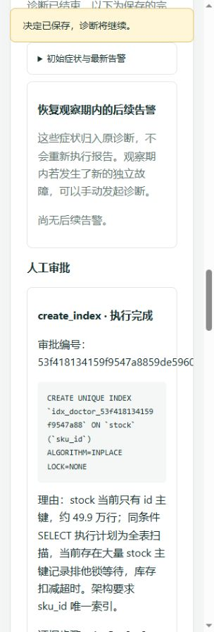

# 阶段 7 汇报书：审批、断点恢复与安全

日期：2026-10-29（UTC）。分支：`phase-07-reliability`，基线 main `4e48448`。本阶段保留用户在阶段 0 学习材料和库存服务两个 defer 上的修改，不纳入提交。

## 一、总览

医生现在可以把有限修复变成可审阅的审批单，在人批准后执行；进程退出后依据租约和已保存步骤接续工作。

新增三个受范围限制的写工具、页面审批、内部运维接口与基线守卫。加入官方 MCP SDK，只开放已有只读工具并保存审计。先单独修复阶段 6 的预算、缓存结算和告警标题，再完成恢复与审批。用户随后选择 OpenAI Terra，增加 Responses 适配与美元账户，历史人民币记录原样保留。真实 S01 已完成页面批准、建索引、P99 恢复、人工撤销和 healthy；本机与运行医生已回到 Mock。

| 阶段 7“做” | 完成情况与证据 |
|---|---|
| 状态机转换表 | 已完成；waiting_approval、合法与非法转换测试 |
| 租约、续约、启动恢复 | 已完成；数据库协调名额、保守续约失败停工、过时断点失败、真实进程测试 |
| 三个写工具、参数范围、diag_ddl、运维接口 | 已完成；INDEX 精确授权、内部端口与令牌、权限和参数测试 |
| 审批创建、页面、执行、复查、过期 | 已完成；真实 S01 页面审批，模型后续复查；过期/拒绝回放测试 |
| 审批与执行幂等 | 已完成；条件更新、保存参数、索引/连接池状态确认、写到一半杀进程测试 |
| 提示注入防护 | 已完成；JSON 数据封装、权限和审批由代码保证、伪造边界测试 |
| MCP 只读服务及客户端文档 | 已完成；官方 SDK 实际连接，16 工具，审计成功；docs/mcp.md |

没有开发阶段 8 评测、无审批自动修复或 CacheLoadsHigh 新规则。学习验收保持未勾选。

## 二、新引入的技术与依赖

| 技术或库 | 版本 | 用在哪里 | 为什么选它 | 放弃的替代方案 |
|---|---|---|---|---|
| 官方 MCP Go SDK | v1.8.0 | Streamable HTTP 只读工具入口 | 计划书指定，复用官方协议实现 | 自写 MCP 协议、单独一套工具执行路径 |
| google/jsonschema-go | v0.4.3（间接） | SDK Schema 支持 | SDK 依赖闭包 | 不另选替代库 |
| segmentio/encoding、asm | v0.5.4、v1.1.3（间接） | SDK 编码依赖 | 固定在 go.mod/go.sum | 不手工替换 SDK 内部实现 |
| uritemplate/v3、x/oauth2 | v3.0.2、v0.37.0（间接） | SDK 协议依赖 | 固定依赖版本；本入口使用每系统令牌 | 不为当前只读入口另做 OAuth 服务 |
| OpenAI Responses / GPT-6.1 Terra | gpt-6.1-terra | 用户改选后的真实模型 | 支持工具调用与非思考模式；账号查询确认可用 | 把 Terra 放进旧 Chat Completions 路径 |
| Docker 镜像与检查 CLI | 无新增版本 | 原固定版本栈 | 本阶段只调整配置与资源上限 | 无 |

模型协议、四档单价、缓存写入与权限依据见 [决定记录](../decisions.md#phase07-model)。OpenAI 项目 Key 查询组织账单为 403，实际扣费未取得。

## 三、代码明细

### 3.1 包与职责

| 包路径 | 新增/修改 | 职责 | 对外提供什么 |
|---|---|---|---|
| internal/doctor/approval | 新增 | 固定审批计划、检查写参数、按已批准记录执行 | Service、Backend、Repository、Record、Plan |
| internal/doctor/mcpserver | 新增 | 每系统认证、只读协议接入、审计 | MCP HTTP Handler 与审计接口 |
| internal/shop/ops | 新增 | 令牌保护的有限运维接口 | 池状态/条件修改、缓存预热 Handler |
| tools/recoverycheck | 新增 | 医生之外的真实进程恢复验收 | Mock 子进程与专用库测试 |
| internal/doctor/agent、llm、llm/openai | 修改 | 新预算、一次报告纠错、回放、审批等待、Responses/缓存费用 | Run、接口与上下文执行权 |
| internal/doctor/store、run | 修改 | 数据库租约、调度名额、恢复、审批、审计和币种 | 领取/续约/恢复/条件决定与费用接口 |
| internal/doctor/app、httpapi、web、target | 修改 | 接线、环境校验、固定来源、页面审批 | 人类审批 HTTP、页面、每系统写能力 |
| internal/doctor/alerts | 修改 | 从告警名生成分组标题 | Title |
| internal/doctor/source/mysqlinspect | 修改 | 查询列、索引形状和旧连接是否存在 | 复用三连接池的元数据接口 |
| internal/shop/app 及三个服务 app | 修改 | 启动独立内部运维监听 | StartOps、生命周期清理、修改标志指标 |
| internal/chaos/app、verify | 修改 | 恢复前检查医生修改残留 | healthy 的索引与连接池守卫 |
| tools/archcheck | 修改 | 检查运维端口不公开 | 短/长格式端口及主机网络检查 |

### 3.2 文件、行数与类型函数

逐文件变更、最终行数、用途、类型函数位置和调用者见 [完整代码清单](phase-07-code-inventory.md)。清单以阶段分支相对 main 的差异为范围；类型函数初稿来自 `commentcheck -list`，包含修改文件里复验的既有入口，避免遗漏关键 SQL 和并发函数。测试导航单独列出。全局阅读地图已重新生成。

### 3.3 数据库变更

| 迁移 | 变化 |
|---|---|
| 0013–0014 | 请求当时单价、报告是否预算触发及原因 |
| 0015 | mcp_audits，先记开始，再更新结果 |
| 0016–0018 | 活动时间、租约时钟、取消意图、步骤唯一身份、请求审计关联 |
| 0019–0020 | 跨进程调度协调行，控制全局与每系统名额 |
| 0021–0024 | 账本/诊断/步骤币种，缓存写入用量与单价 |
| 0025 | approvals：不可变 Plan、证据、预览、决定、执行者和 DDL 连接编号 |

迁移只追加，已有记录保留。MySQL 初始化 007 创建 INDEX 账号；006 增加 threads.PROCESSLIST_ID 单列查看。空库没有业务表时先建账号，服务迁移后补精确表权限。

### 3.4 接口、配置与部署

新增 `GET /api/v1/diagnoses/{id}/approvals` 和 `POST /api/v1/approvals/{id}/approve|reject`，修改接口接受空对象，登录与 CSRF 规则沿用阶段 6。新增 `/mcp/{target}`，使用独立 MCP 令牌。shop 的 `/ops/pool`（GET/POST）与 `/ops/cache/warm`（POST）在容器内部 6064，不映射到宿主机。没有新增 gRPC 客户端。

| 环境变量 | 含义 | 示例/默认 |
|---|---|---|
| SHOP_MYSQL_DDL_PASSWORD、SHOP_MYSQL_DDL_DSN | 独立索引账号初始化与医生连接 | 演示密码、容器主机名 |
| TEST_SHOP_MYSQL_DDL_DSN | 索引权限集成测试 | 宿主 diag_ddl DSN |
| SHOP_OPS_TOKEN、OPS_ADDR | 当前系统运维令牌、内部监听 | 演示值；宿主调试空，Compose :6064 |
| SHOP_MCP_TOKEN | 当前系统外部只读客户端身份 | 独立演示令牌 |
| CHAOS_BASELINE_MYSQL_DSN | 实验工具检查医生索引 | 宿主 diag_ro，医生不接收 |
| DOCTOR_LEASE_TTL、DOCTOR_RESUME_MAX_AGE | 租约与最大中断期 | 30s、2m |
| LLM_API_FORMAT | 真实请求协议 | 示例 responses；兼容默认 chat_completions |
| LLM_CACHE_HIT_PRICE_PER_MTOKEN、LLM_CACHE_WRITE_PRICE_PER_MTOKEN | 命中与缓存写入单价 | Terra示例 0.05、1.25美元/百万token |
| LLM_BUDGET_CURRENCY、LLM_TOTAL_BUDGET、LLM_DIAGNOSIS_BUDGET | 币种、总额、单诊断额 | 示例 USD、40、0.30；兼容默认 CNY、10、0.30 |
| LLM_BUDGET_ACCOUNT | 持久账户 | 示例 phase-07-08-openai；旧人民币账户保留 |

接入 YAML 新增 mysql_ddl_dsn_env、write_timeout、ops_api、mcp_token_env。其他范围和默认值完整同步计划书第 5.8.4 节。新费用指标使用固定 currency 标签；池修改指标为 db_pool_runtime_changed，不使用诊断 ID 标签。

Compose 容器数量仍为 19，doctor 256 MiB、doctor-mysql 512 MiB。按用户批准，Redis 改为数据 2 GiB、容器 2.5 GiB，整套实际暂停线 6 GiB。所有数据卷保留，幂等期限与 noeviction 不变。CI 固定 ubuntu-24.04，新增 INDEX 初始化、十二项 TEST 配置和真实进程恢复包，仍全部 Mock。

## 四、测试

测试名、文件和作用的完整导航见[代码清单](phase-07-code-inventory.md)。重点包括预算突破旧八万限制、一次纠错、缓存命中/写入价格、币种隔离；非法状态转换、续约失败停止、回复恢复、换模型；写参数边界、未批准拒绝、并发决定一次、原单参数不变、过期继续；真实杀进程、远端状态先查；伪造边界、MCP 隔离/审计、运维端口与实验基线。

| 检查 | 本机结果 |
|---|---|
| gofmt、go vet、staticcheck | 通过；首次发现两文件格式，已修正 |
| commentcheck / archcheck | 337 个非生成 Go 文件通过；架构通过 |
| go test -race ./... -count=1 -timeout=180s | 202 顶层/712 含子用例通过；41 个依赖用例跳过，由下行补验 |
| 全部十二项 TEST 的 race 集成 | 37 顶层/56 含子例通过，0 skip、0 fail |
| promtool 配置与两套规则测试 | 配置有效、12 条规则、cache/goroutine 测试通过 |
| go mod tidy | 模块依赖完整 |
| 学习材料两个 Go 例子 | gofmt、go run 通过，输出逐字写入材料 |
| GitHub CI | 待推送后填写实际运行链接与结果 |

没有用依赖测试的 SKIP 冒充通过。单元测试、CI 和集成测试都没有真实模型请求。集成期间暂停 doctor/Alertmanager，避免专用库的资源负载创建诊断；之后恢复基线，healthy 60.461 秒通过。

## 五、工程验收结果

| 验收项 | 结果与证据 |
|---|---|
| 查证中断恢复 | 通过；真实终止 Mock 子进程，11 步、已保存查询仅一次 |
| 换模型恢复 | 通过；原诊断模型保留，后续步骤为新 Mock 模型，11 步 |
| 等待审批中断 | 通过；原 pending 单保留，拒绝后接续，15 步 |
| 中断太久 | 通过；明确 failed 并写过时原因，不继续调查 |
| 执行到一半崩溃 | 通过；远端已改、本地未回包时终止，恢复 GET=3、POST=1，原单 executed |
| S01完整审批演示 | 通过；v7.2，5轮20工具，页面批准，DDL 6.180s，P99恢复；[审批截图](phase-07-approval.png)和notes |
| 修复撤销与基线 | 通过；残留索引令healthy立即失败，人工DROP、restore、healthy后故障组关闭 |
| MCP真实客户端 | 通过；官方SDK列出16工具，拓扑结果4086字节，数据库审计ok |
| 权限边界 | 通过；INDEX创建成功，其他业务读写拒绝；SHOW GRANTS 与1/3连接上限见下 |
| 已知限制 | 已写入第七节，覆盖计划书5.5.9第8条 |

### 真实模型结果与费用

| 场次 | 模型/提示 | 轮数/工具 | 输入/输出/命中token | 费用账本 | 报告如何提交 | 判断 |
|---|---|---|---|---|---|---|
| S01预算复测 | deepseek-flash / v7.0 | 8/17 | 79278/2691/64640 | ¥0.026698 | 主动 | 组件、机制正确 |
| S10预算复测 | deepseek-flash / v7.0 | 16/29 | 188191/3906/159872 | ¥0.047148 | 轮数预算要求整理 | 误把链路慢的排队后果当池问题，组件/机制均错误 |
| 协议冒烟 | gpt-6.1-terra / v7.1 | 2/4 | 9664/319/4459；写入5199 | $0.008323 | 主动 | 证据不足，未做场景评分 |
| S01审批演示 | gpt-6.1-terra / v7.2 | 5/20 | 57573/1326/41595 | $0.028682 | 主动 | 正确定位库存索引；执行后继续查证 |

DeepSeek 两场结算 ¥0.073846，官方余额 0.56→0.48，显示扣费 ¥0.08；中间分位读数和延后更新均保留。OpenAI 两次真实诊断合计 $0.037005，实际扣费无权限核对，不能与人民币相加。两种账本、失败与误判均未清除。

S01 对照：健康/故障/修复后的库存 P99 为 23.866/902.995/23.144 ms，下单为159.426/951.691/98.410 ms。都是单机一次一分钟窗口。审批等待约365.36秒不计活动预算。报告当时仍有告警，模型正确保留了“需继续观察”的限制；随后独立实测才确认恢复。

19 容器有流量时共 4224.870 MiB（4.125850 GiB），doctor 15.61 MiB、doctor-mysql 300.1 MiB、Redis580.3 MiB，低于6GiB暂停线；这是快照，不是峰值。



### 数据库与 Redis 授权实录

以下 SHOW GRANTS 与最大用户连接数由实际运行库读取；不含密码或认证摘要：

```text
GRANT USAGE ON *.* TO `diag_ddl`@`%`
GRANT INDEX ON `shop`.`orders` TO `diag_ddl`@`%`
GRANT INDEX ON `shop`.`processed_events` TO `diag_ddl`@`%`
GRANT INDEX ON `shop`.`product_sales` TO `diag_ddl`@`%`
GRANT INDEX ON `shop`.`products` TO `diag_ddl`@`%`
GRANT INDEX ON `shop`.`stock` TO `diag_ddl`@`%`
GRANT USAGE ON *.* TO `diag_ro`@`%`
GRANT SELECT (`BLOCKING_THREAD_ID`, `ENGINE`, `REQUESTING_ENGINE_LOCK_ID`, `REQUESTING_THREAD_ID`) ON `performance_schema`.`data_lock_waits` TO `diag_ro`@`%`
GRANT SELECT (`ENGINE`, `ENGINE_LOCK_ID`, `INDEX_NAME`, `LOCK_MODE`, `LOCK_TYPE`, `OBJECT_NAME`, `OBJECT_SCHEMA`) ON `performance_schema`.`data_locks` TO `diag_ro`@`%`
GRANT SELECT (`AVG_TIMER_WAIT`, `COUNT_STAR`, `DIGEST_TEXT`, `SCHEMA_NAME`, `SUM_ROWS_EXAMINED`, `SUM_ROWS_SENT`, `SUM_TIMER_WAIT`) ON `performance_schema`.`events_statements_summary_by_digest` TO `diag_ro`@`%`
GRANT SELECT (`VARIABLE_NAME`, `VARIABLE_VALUE`) ON `performance_schema`.`global_status` TO `diag_ro`@`%`
GRANT SELECT (`PROCESSLIST_ID`) ON `performance_schema`.`threads` TO `diag_ro`@`%`
GRANT SELECT ON `shop`.`orders` TO `diag_ro`@`%`
GRANT SELECT ON `shop`.`processed_events` TO `diag_ro`@`%`
GRANT SELECT ON `shop`.`product_sales` TO `diag_ro`@`%`
GRANT SELECT ON `shop`.`products` TO `diag_ro`@`%`
GRANT SELECT ON `shop`.`stock` TO `diag_ro`@`%`
diag_ddl	1
diag_ro	3
```

Redis diag_ro 的实际规则为 `-@all +hello +ping +info +slowlog|get +slowlog|len`，无 key 或 channel 范围。flags 为 on、sanitize-payload。密码摘要没有记录。权限集成确认 INFO/SLOWLOG 成功，GET/HGETALL/KEYS/SET/FLUSHALL/CONFIG 失败。

对照计划书5.5.9：只读工具不返回业务行；账号最多三连接；独立写账号只持 INDEX 且最多一连接；ops 只有三服务固定入口、范围检查和本系统令牌；写操作都要审批；MCP 只读。MySQL INDEX 自带 DROP INDEX 能力，代码不向医生提供删除入口，撤销由人执行。

最终 [Mock 页面截图](phase-07-final-mock.png) 与 `/api/v1/status` 一致，provider=mock，model=mock-script-v1，美元账本 $0.037005。

本阶段新增台账条目：**P7-1—P7-20**，最终 CI 与收尾状态另附后续条目。原始过程见 [notes](../notes.md#阶段-7审批断点恢复与安全进行中)。

## 六、偏离计划之处

- 用户改选 OpenAI Terra并授权$40、每次$0.30；增加Responses和独立币种账本。见[模型决定](../decisions.md#phase07-model)。原DeepSeek结果不删除。
- 用户批准Redis扩容与6GiB暂停线。保留数据、24小时幂等和noeviction；容量阻塞及两次healthy失败都在P7-5、P7-6。
- 等待审批占系统名额但释放全局名额，这是用户交给本阶段决定的实现选择，见[恢复决定](../decisions.md#phase07-recovery)。
- 进程验收放在tools/recoverycheck，保留医生的os/exec禁令；没有放宽安全检查。
- OpenAI组织账单查询403，未扩大Key权限。已取得用量计价账本，供应商实际扣费留用户核对。

## 七、已知问题与遗留事项

1. **无角色权限。** 任何登录用户都能审批；真实系统需要限制审批人并将发起人与审批人分开，RBAC不在项目范围。
2. **脱敏不覆盖所有个人信息。** 当前识别密钥、令牌等，日志和锁信息仍可能含业务值。靶场是假数据，接真实系统前需要完整脱敏或自部署模型。
3. **人可能误批。** 参数合法不等于操作合理；在线索引会消耗资源，连接池调小也会使系统变慢。审批判断仍是边界的一部分。
4. DDL取消不保证服务器停止；崩溃恢复通过真实状态确认，仍可能得到outcome_unknown并要求人工核对。MySQL的INDEX权限粒度包含DROP，代码只提供CREATE。
5. 待审批任务占住该系统，直到人决定、取消或过期。长中断默认失败，主动等待不计入这个时限。
6. OpenAI美元实际账单未能用项目Key读取，当前是接口用量价格账本；不宣称扣费差异为零。
7. S10真实复测误判仍保留。报告通过结构校验不等于根因正确；阶段8再按既定评测计划量化，当前未开发评测。
8. 五十万商品工作集下CacheLoadsHigh的已知误报仍存在，按用户要求另做。当前基线固定10000商品/200QPS/64工作者。
9. 历史订单扣库存超时仍可能需要人工核对，Deduct自身请求ID去重尚未实现；故障恢复观察期仍可能合并新故障，可手动发起诊断。

## 八、注释自查结论

三层说明已核对：新增包有doc.go并列全文件；分组README增加approval、ops、MCP与恢复验收导航；每个新增Go文件说明用途、主要内容和阅读入口。函数内部补充条件分支、事务锁顺序、租约丢失、DDL不确定结果的原因，避免套用“并发安全、不阻塞”等无内容句式。

commentcheck 337个非生成Go文件通过。曾发现三个新函数缺内部讲解，已补充真实判断理由。学习材料解释租约、幂等、MCP等词后再展开，包含真实开发失败、两份运行验证过的完整Go例子、八个必答问题与权限测试对照表。代码地图已重新生成。

## 九、学习指引

阅读[阶段7学习材料](../learn/phase-07-reliability.md)。建议先用一小时看S01审批过程，再用三小时读保存计划与执行器，两小时读租约和回放，一小时读MCP，余下时间跑Mock实验并回答八个问题。学习验收由用户本人勾选。

## 十、下一阶段预告

阶段8将加入评测体系和无故障、提示注入等对照，按固定规则比较结果。开始前仍需用户明确同意，并重新确认真实调用预算与基线。本阶段不实现或启动这些工作。
