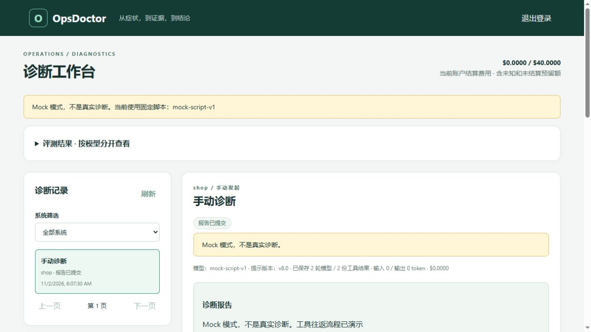
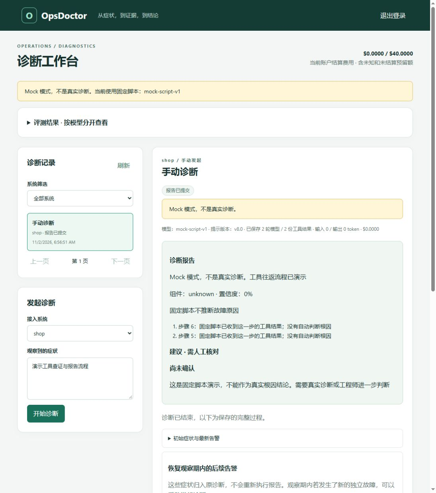

# 阶段 10 汇报书：收尾与展示

日期：2026-11-02。分支：`phase-10-showcase`，基线 `main/f851460`。

> 阶段10工程交付完成，等待Claude验收；不合并main、不勾学习验收、不开阶段9。运行代码c246734，消费者修复364a889；阶段8成绩仍按原冻结版本引用。原CI缺worker/Kafka日志，不能追认当时必定同错；本次已复现、修复并验证协调器初始化错误路径。

## 一、总览

本阶段整理项目展示入口，并在独立新卷中复现、修复 Kafka 消费组协调器冷初始化时 worker 过早退出的错误路径。

根 README 已整理为介绍、架构、快速开始、免费 Mock 演示、评测结果与权限边界。旧 README 的运行说明整体迁入 `docs/operations.md`，没有放进医生检索用的冻结手册。评测汇总只读取阶段 8 存档，不重跑模型或评分；失败、分母、S12 暴露缺口和交叉评分局限均保留。用户原有两处修改继续排除在本阶段提交之外。

| 计划书阶段 10“做” | 当前完成情况 |
|---|---|
| README 展示入口及全部要求的小节 | 已完成；最终新克隆按 README 在 5 分 4.934 秒内完成演示（P10-15），首轮较慢记录与缓存限制保留 |
| architecture 与 troubleshooting | 已完成；两条核心流程、实际权限、项目排查和已证修复边界齐全 |
| 面试题汇总 | 已完成；阶段 0–8、10 必答题与项目问题共 101 题，每题 3–4 条要点及出处已核对（P10-18） |
| 简历描述草稿 | 已完成；只写已验证能力，每个实测数字标台账 |
| 清理没用代码、过期注释、TODO | 已完成；扫描未发现待补 TODO/FIXME，已更新历史占位注释；保留仍被学习材料引用的 alertsink |
| 工程验收与阶段收尾 | 已完成；受控对照、修复后默认五轮、最终新克隆及增强CI均通过 |

## 二、新引入的技术与依赖

无。本阶段沿用既有 Go、Docker Compose、Python 标准库和仓库检查工具，没有引入计划书以外的组件，也没有升级镜像或模型。

| 技术或库 | 版本 | 用在哪里 | 为什么选它 | 放弃的替代方案 |
|---|---|---|---|---|
| 无新增 | — | — | 现有工具足以整理展示并排查启动 | 不为展示引入额外服务或前端框架 |

## 三、代码明细

### 1. 新增和修改的包

提交 364a889 已修复尚未取得消息时的暂态协调器错误；其他清理以说明更新为主：

| 包路径 | 新增 / 修改 | 职责 | 对外提供什么 |
|---|---|---|---|
| `internal/shop/events` | 修改消费读取逻辑，新增回归测试 | 在同一 Reader 上有界等待协调器恢复 | 原 Consumer API 不变，只在 Fetch 阶段重取 14/15/16 |
| `internal/eval/report` | 修改导出抬头 | 说明美元用量账本口径 | 原评分与统计算法不变 |
| `internal/platform/alertsink` | 修改注释 | 解释阶段 3 历史告警接收器为何保留 | 原有接收入口，行为不变 |
| `internal/shop/app/inventoryservice` | 修改配置类型注释 | 对齐库存进程当前配置职责 | 原有配置，行为不变；用户的 app.go 不改 |
| `internal/shop/app/shopctl` | 修改包说明 | 阅读顺序纳入已实现的销量核对 | 原有命令，行为不变 |

### 2. 新增和修改的文件

当前主要交付为 [README](../../README.md)、[运维说明](../operations.md)、[架构](../architecture.md)、[项目排查](../troubleshooting.md)、[简历草稿](../resume-draft.md)、决策/计划/进度与费用口径更新；另有只读评测汇总脚本和 JSON、本报告与学习材料，以及 events 消费修复、回归测试和包说明。全部文件及行数见下方完整清单。

全部文件的作用、行数和关键符号见[完整清单](phase-10-code-inventory.md)。本表按相对main/f851460的阶段变化生成，排除用户两文件，和`git diff --stat main...phase-10-showcase`互查。

`docs/learn/phase-00-foundation.md` 与 `internal/shop/app/inventoryservice/app.go` 是用户保留修改，不属于本阶段交付，不暂存、不还原。原始哈希已记录在 [notes](../notes.md#phase-10)。

### 3. 类型与函数清单

生产包无新增导出类型或函数；`Consumer.Run` 修改为调用同一 Reader 的有界拉取封装。下表列出修改的核心方法、新增私有函数、测试辅助类型及全部八个导出测试；位置按提交 364a889 核对。

| 名称 | 位置 | 作用 | 被谁调用 |
|---|---|---|---|
| `(*Consumer).Run(ctx) error` | [consumer.go:77](../../internal/shop/events/consumer.go#L77) | Fetch 阶段使用有界协调器恢复，取得消息后的顺序不变 | order-worker 组装与消费者测试 |
| `(*Consumer).fetchMessage(ctx) (kafka.Message, error)` | [consumer.go:108](../../internal/shop/events/consumer.go#L108) | 只对 14/15/16 最多额外重取三次；每次成功返回消息后结束本份预算 | `Consumer.Run` |
| `recoverableCoordinatorError(err) bool` | [consumer.go:131](../../internal/shop/events/consumer.go#L131) | 用 errors.Is 识别可包装的协调器协议错误 | `fetchMessage` |
| `waitFetchRetry(ctx, delay) error` | [consumer.go:136](../../internal/shop/events/consumer.go#L136) | 定时退避可由取消信号立即打断 | `fetchMessage`、取消测试 |
| `coordinatorMaxRetries` / `coordinatorRetryBackoff` / `coordinatorRetryMaxBackoff` | [consumer.go:47](../../internal/shop/events/consumer.go#L47) | 限制额外三次重取及 250/500/1000ms 退避 | `fetchMessage`、预算测试 |
| `fetchErrorReader` | [consumer_fetch_test.go:32](../../internal/shop/events/consumer_fetch_test.go#L32) | 按脚本返回协议错误或测试消息，保留原提交队列 | 本文件消费者恢复测试 |
| `(*fetchErrorReader).FetchMessage(ctx) (kafka.Message, error)` | [consumer_fetch_test.go:41](../../internal/shop/events/consumer_fetch_test.go#L41) | 记录失败与成功的取消息次数，不因失败推进队列 | 测试中 `Consumer.fetchMessage` |
| `TestConsumerRetriesCoordinatorErrors` | [consumer_fetch_test.go:60](../../internal/shop/events/consumer_fetch_test.go#L60) | 14/15/包装的 16 后恢复，只处理提交一次 | go test |
| `TestConsumerPermanentFetchError` | [consumer_fetch_test.go:81](../../internal/shop/events/consumer_fetch_test.go#L81) | 鉴权、版本和未知错误立即失败 | go test |
| `TestConsumerCoordinatorRetryBudget` | [consumer_fetch_test.go:92](../../internal/shop/events/consumer_fetch_test.go#L92) | 持续错误在初次加三次重取后结束 | go test |
| `TestConsumerCoordinatorBudgetResets` | [consumer_fetch_test.go:108](../../internal/shop/events/consumer_fetch_test.go#L108) | 两条消息各有独立连续错误预算 | go test |
| `TestConsumerCoordinatorRecoveryIdleContext` | [consumer_fetch_test.go:131](../../internal/shop/events/consumer_fetch_test.go#L131) | 恢复后空闲 Fetch 不被新增短 deadline 错杀 | go test |
| `TestConsumerCoordinatorErrorAfterFetch` | [consumer_fetch_test.go:162](../../internal/shop/events/consumer_fetch_test.go#L162) | 处理/提交阶段即便返回 16 仍立即失败，不取下一条 | go test |
| `TestConsumerCancelCoordinatorRetry` | [consumer_fetch_test.go:185](../../internal/shop/events/consumer_fetch_test.go#L185) | 取消打断退避，不再取消息 | go test |
| `TestFetchRetryWaitCancellation` | [consumer_fetch_test.go:206](../../internal/shop/events/consumer_fetch_test.go#L206) | 长退避也能被 context 取消打断 | go test |

[phase-10-eval-summary.py](phase-10-eval-summary.py) 是离线读取既有 Markdown 导出的脚本，没有对外 API；按原槽位关联报告和评分，输出五组计数与来源哈希。

### 4. 数据库变更

无。未新增业务/医生表、索引或迁移；冷启动试验使用独立 Compose 项目和全新数据卷，不把它们指向用户原库。

### 5. 接口变更

无。未新增 HTTP、gRPC 方法或宿主端口。

### 6. 配置变更

无新增业务变量。Compose预定义的`COMPOSE_PROJECT_NAME`传入Alloy，用于限定实际项目；已经补入计划书变量表与.env.example说明。README 显式设置 `COMPOSE_PROJECT_NAME=opsdoctor-fresh`、`LLM_PROVIDER=mock`、`EVAL_COMPARISON_ENABLED=false`、暂停压测及 small 数据范围；这些是已有配置的免费演示取值。

### 7. 部署变更

当前更新 Compose 的旧阶段数量注释，并增强 CI：记录首次镜像拉取/构建/启动耗时，新增串行五套新卷的健康与真实消费检查，保留每套 worker/Kafka/MySQL 日志，并用 stop 停回环境。这些步骤已在提交 5806a7e 的新 runner 通过；它们证明本次启动与消费成功，不构成历史问题已修复的证据。随后对受控复现路径的业务修复已提交 364a889：只改变 Fetch 阶段的协调器恢复，不加重启策略，也不延长默认启动超时；该提交的最终默认五轮及CI均通过（P10-11–P10-14）。c246734另修Alloy实际项目名，独立项目三服务日志也通过；没有改医生日志适配器。原 `opsdoctor` 容器和数据卷保留，尤其保留阶段 8 的 `opsdoctor_doctor-mysql-data`；不触碰两个 QQ 容器。

## 四、测试

### 1. 新增测试清单

新增八个 Go 测试，名称、文件和验证场景见第三节完整函数表。文档迁移逐段对照、权限链接检查和评测汇总复算另作只读核验，不当成 Kafka 集成证明。

### 2. 已执行命令与结果

首轮本地 `gofmt`、`go vet ./...`、固定版本 `staticcheck ./...`、`go run ./tools/commentcheck ./...`、`go run ./tools/archcheck ./...` 均通过；commentcheck 检查 425 个 Go 文件。

`go test -race ./... -count=1 -timeout=180s` 在 Mock 下通过：264 个顶层测试、895 个含子例测试，56 个外部依赖测试跳过，失败为 0。**这轮本地结果不是完整集成测试通过**；独立 CI 随后执行了专用 MySQL/Redis 集成及真实接线冒烟，并全部通过（P10-9），两种验证范围分开记录。

最终修复提交 364a889 的本地 `gofmt`、vet、staticcheck、commentcheck（426 文件）、archcheck 全通过；全仓 Mock race 为 272 顶层、906 含子例通过，56 个依赖测试跳过、0 失败（P10-12，[检查统计与源码哈希](phase-10-checks.json)）。这一轮仍在保留用户两文件修改的工作区执行，不把外部 skip 算集成通过；干净代码的专用库和接线由后续修复 CI 确认。独立复查与定向 race 也通过。

静态检查曾因新增错误字符串以 Kafka 大写开头而失败，修成中文上下文后重跑通过；没有放宽规则或删除原失败。首个修复实验使用旧错误文案版本通过，最终文案版也在相同放大条件下观察到同一 worker 记录 retry=1、backoff=250ms 后继续运行，并消费新增订单 401，销量核对成功。[最终对照](phase-10-startup-fix-validation.json)与P10-11、P10-13保留两版本的区别，不把前一个版本的成功冒充最终字节的验证。

文档检查确认旧 README 的 587 行正文在迁移归一化后完整保留，仅更新标题、链接和美元现行口径；32 个命令围栏逐字一致。README 的五组计数与只读存档复算结果一致。四层防线的函数链接均在源码中存在，PowerShell 快速开始代码块通过语法解析；这不代替真正的新用户部署。

原版复现：f851460 完成十次独立新卷启动，四次全栈、六次最小依赖组合，均未复现原 worker 冷启动退出（P10-6，[原记录与日志哈希](phase-10-startup-reproduction.json)）。全栈包含 Kafka 0.25/0.10 CPU 各一次的放大条件，后者临时使用 wait 300s、Kafka health timeout 60s，不能当作默认参数验收。最小环境未启动 Jaeger，其中五次在主动 stop 后因遥测导出超时退出 1，单列保留，不混成启动失败，也不能称完整生命周期全健康。

受控根因复现（P10-10）：在原 f851460、独立全新卷、Kafka 内部 offsets 分区从默认 50 临时放大到 500、CPU 0.25 的条件下，真实 worker 于 14:21:05.152 UTC 启动，14:21:15.256 因错误 16（Not Coordinator For Group）退出 1，OOM=false；Kafka 到 14:21:27.151 才记录内部协调元数据加载完成。[日志、状态与全文哈希](phase-10-startup-root-cause.json) 保留对应时序。Compose up 返回 0，随后二十秒观察才看到退出，证明只看 up 的返回值或一次健康检查会漏掉这条路径。原 CI41447608555 没有 worker/Kafka 关键日志，因此无法直接证明当时就是错误 16；受控参数也不同于该 CI 默认配置。

沿 kafka-go v0.4.51 源码检查，Reader 在内部入组失败后把协调器错误交给 FetchMessage，后台仍继续入组；原 `Consumer.Run` 却把 FetchMessage 的任何错误直接升级为进程退出。修复在同一 Reader 上只接受错误 14/15/16 的有限恢复：初次读取后最多额外三次，退避 250/500/1000ms，取消立即结束；每成功取到一条消息，下一条重新获得连续错误预算。没有给空闲 Fetch 添加 deadline，也不重试解码、SQL、提交位点或永久错误。

新用户实测：从远端 git clone 开始计时，使用提交 5806a7e、独立 `opsdoctor-fresh`、全新数据卷与 Mock。首次就绪 135.823 秒；首次页面走查 189.890 秒，包含浏览器文档初始化、一次定位器失败及接口核对；随后再次按三分钟脚本排练 152.167 秒。到完成演示累计 502.941 秒，即 8 分 22.941 秒（P10-7，[精确计时](phase-10-fresh-demo.json)）。这些记录全部保留，没有只挑第二次较快的数据。

Mock 页面实际保存 2 轮模型、2 份查看结果、10 个步骤，token/费用为 0；SSE 使用 Last-Event-ID=1 后依次补发 2–10（P10-7）。这是工具、持久化和页面演示，不是模型正确率或自动修复证明。

数据保护：前后全量清单对照，原 19 个 OpsDoctor 与 2 个 QQ 容器的 ID、挂载和状态不变，原卷删除 0；未启动、未读写原数据库。fresh 的 19 个容器已 stop，9 个数据卷保留；额外 HTTP 下单后总量 401/401、gap=0（P10-8，[对照证据](phase-10-docker-preservation.json)）。Compose 项目名不隔离镜像标签：构建更新了 5 个全局 Go 镜像标签，原容器仍引用原镜像 ID；不能声称全局镜像映射没有变化，也没有逐字节校验原库。

首轮 CI：[41458417476](https://github.com/Li-Nepenthe/opsdoctor/actions/runs/41458417476) 在提交 5806a7e 全部通过（P10-9，[步骤与计时](phase-10-ci-first.json)）。全新 ubuntu-24.04 runner 首次镜像拉取、构建与 up 为 337.594 秒；随后复用该 runner 镜像、每轮使用独立新卷，五轮真实消费 5/5 通过。每轮包含健康检查、二十秒观察、small 造数、HTTP 下单与销量追平。该次 CI 运行时还没有业务启动修复，因此这五轮不能改称“修复后五次通过”。本机镜像、模块和构建缓存保留，CI 记录用于补充这项限制。

## 五、工程验收结果

| 验收项 | 结论 | 证据与范围 |
|---|---|---|
| README在30分钟内启动并完成演示 | 通过 | 最终c246734远端新克隆304.934秒，页面102.415秒，Mock零token/零费用；P10-15及[最终计时](phase-10-fresh-final.json)。本机缓存保留；新runner269.488秒含pull/build/up补证据（P10-14） |
| 协调器初始化退出复现与修复 | 通过，保留历史CI限制 | 原版错误16退出；同条件最终修复记录重试后同worker继续消费。P10-10–P10-11；原CI缺日志，无法确认当时完全同根 |
| 修复后连续五次默认冷启动全部健康 | 通过 | 五独立新卷、每轮19服务、二十秒观察与真实订单追平（P10-13）；增强CI另五轮还查同trace三服务Loki日志（P10-14） |
| CI通过 | 通过 | 消费者364a889的CI41463487800、最终运行代码c246734的[CI41466035640](https://github.com/Li-Nepenthe/opsdoctor/actions/runs/41466035640)均全绿，[步骤/计时](phase-10-ci-fixed.json) |
| 原资源保护、凭据与链接 | 通过 | 原21容器标识/状态/挂载不变、原卷删除0；本机20测试项目/138卷保留并已停止。P10-16及[清单](phase-10-resource-final.json)；最终归档扫描另见P10-18 |

本阶段新增台账 **P10-1–P10-18**：冻结成绩只读计数1–5；初期原版、首轮新克隆与CI6–9；受控复现/对照/全仓检查/最终五轮10–13；增强CI14；最终新克隆、资源保护、日志链路15–17；归档检查18。全部在[数据台账](../数据台账.md)，旧失败、旧时长与限制均保留。

最终新克隆为c246734，独立项目opsdoctor-fresh-final使用全新卷。页面确认Mock后登录、诊断、查看两份真实工具结果和十步骤，并引用阶段8存档；SSE从1补发2–10。独立订单trace在Loki覆盖订单、库存、消费者，2.017秒查到三条日志（P10-17），该单次观察不作为日志延迟基准。

## 六、偏离计划之处

用户于 2026-10-30 决定先做阶段 10，以尽早开始投递；阶段 9 推迟，不取消。2026-11-02 用户确认阶段 8 已由 Claude 验收并合并 `main/f851460`，明确授权进入本阶段，不要求先勾学习验收。[决策记录](../decisions.md#phase-10-order)和计划书阶段 9、阶段 10、第 8.2 节均保留说明；“全部完成”里程碑不含推迟的阶段 9。

用户另更新美元费用口径：按项目用量账本计，即每次实际 token 用量乘以 2026-10-29 核对过的官方单价，分档结算，未知请求保留预留；平台账单因 Key 与其他用途共用，无法单独核对。人民币与美元分开，DeepSeek 未归因差额不改。

“清空 Docker”的验收方式按用户要求改为隔离项目和全新数据卷，并在新克隆前后核对容器与卷。未删除原项目数据或清理全部镜像缓存，QQ容器不操作；全局镜像标签变化单列披露；已以全新 CI runner 的首次启动时间补充缓存局限。该方式是用户明确指定的保护与证据边界，不宣称本机已清空所有 Docker 镜像。

## 七、已知问题与遗留事项

- 协调器冷初始化导致上层过早退出的路径已真实复现并修复；原 CI 缺日志，不能断言它当时必定同错。最终默认五轮和增强CI已通过；这个缺日志的历史限制仍保留。
- 阶段 9 推迟：日志只有 Loki，没有 OpenSearch、PostgreSQL、SkyWalking 或非 Go 运行时分析，也没有外部靶场第二张结果表。
- 评测为自建靶场少量重复。14 份评分失败保留；S10 的带工具报告把连接池当根因，评委与 Claude 给分尺度存在分歧。
- 交叉评分不是人工校准；两个模型可能有共同偏差。S12 没有真正暴露攻击文字；防注入当前只有权限、审批和隔离测试证据，真实暴露实验留待以后。
- 原有业务一致性、审批人隔离和脱敏限制继续保留。本阶段不改医生提示、工具、手册、评分或场景。

## 八、注释自查结论

最终修复 commentcheck 426 文件通过（P10-12），首轮 425 文件的记录仍保留。目录层有说明和导航；本轮更新的文件说明与代码注释解释现有职责，去掉已经过期的“以后阶段才实现”说法。alertsink 仍被历史学习材料引用，保留并讲清其位置。没有借清理修改冻结行为，用户两处修改保持原样。events 的 doc.go 已纳入 consumer_fetch_test.go，consumer.go 文件说明和函数注释解释恢复边界；已重新生成代码地图，并以完整文件与符号清单核对；只有一个新增Go测试文件，包内说明同步。

## 九、学习指引

先读[本阶段学习材料](../learn/phase-10-showcase.md)，再按 README 的三分钟脚本练习介绍。随后沿架构的两条流程找代码，用台账解释评测分母和费用。先看受控错误时序，再读有界恢复函数和测试；对照最终五轮、新克隆与增强CI，再练习解释历史CI缺日志和阶段8评测限制。

## 十、下一阶段预告

展示5806a7e、消费者修复364a889、日志隔离c246734与收尾提交均在阶段分支；完成归档后等待Claude验收；不合并 main，不勾学习验收。阶段 9 留待用户以后明确授权，届时需要补 OpenSearch 适配、外部靶场及独立结果表，并同步 README、架构、简历和台账。本阶段不开始这项工作。
